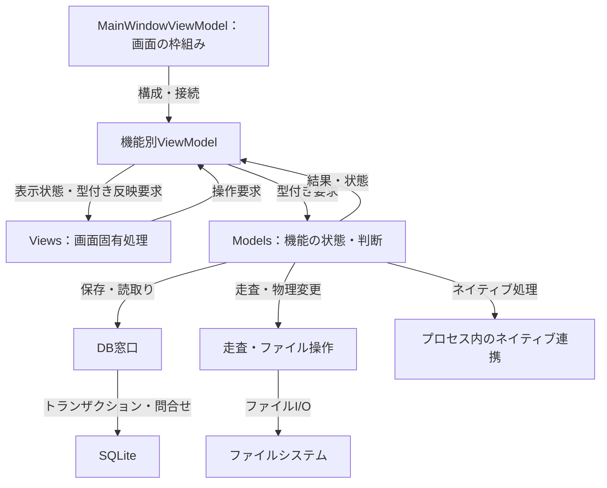

# アーキテクチャ

## 目的と適用範囲

アプリケーションの構成、責務の分担、構成が共有する管理主体、実行・配布の境界を示します。機能ごとの入力・結果・処理順は各領域の仕様を正本とします。

## 用語

[共通用語集](../glossary.md)の管理主体、DB窓口、保存モデル、読取りモデル、操作の入口、画面の枠組み、画面固有処理を使います。

| 用語 | 意味 |
| --- | --- |
| MVVM | 画面（View）、表示状態と操作の入口（ViewModel）、機能の状態と判断（Model）を分ける構成。 |
| ネイティブ連携 | プロセス内で読み込むWindows用ライブラリとの接続。 |
| 構成の寿命 | `ApplicationComposition` が生成してから破棄するまでの期間。ライブラリの再構築をまたいで続く。 |

## 仕様

### 実行基盤

.NET 10 / C# 14、`net10.0-windows`、x64を使います。

| 役割 | 採用する基盤 |
| --- | --- |
| 画面 | WPFと、Win32の子ウィンドウのホスト。MVVMにはLivetCaskを使う。 |
| 保存 | SQLite。 |
| ファイル検索 | Everything SDK 3とのネイティブ連携。 |
| 音声 | ManagedBassと、libogg・libvorbisを静的リンクしたプロセス所有のネイティブ連携。 |
| ログ | NLog（[ログ出力](logging.md)）。 |
| アーカイブ | SevenZipExtractor。 |

依存バージョンはプロジェクトと中央バージョンの宣言を正本とし、本書に依存一覧を複製しません。

### 層と責務

| 層 | 責務 |
| --- | --- |
| `BeMusicSeeker.Views` | WPFイベント、フォーカス、選択、スクロール、ヒット判定、ドラッグ表示、ダイアログ、ウィンドウハンドル。型付きの要求に基づく最終的な画面反映。 |
| `BeMusicSeeker.ViewModels` | 機能別の表示状態と操作の入口。ルートの `MainWindowViewModel` は画面の枠組みとして、一覧・ツリー・導入・保守・設定・再生などの機能を構成して接続する。 |
| `BeMusicSeeker.Models` | カタログ、プレイリスト、導入、保守、リソース健全性、スコア、LR2同期の判断と状態。 |
| `BeMusicSeeker.Models.BmsLibraryInternal` | 保存、変更、走査、パッケージ、ファイル操作、投影、ネイティブ実行の管理主体とDB窓口。 |
| `BeMusicSeeker.Models.Utils` | 走査、パス、ハッシュ、設定などの共通処理。 |
| `native/EverythingBridge` | Everything SDK 3のx64連携。管理側のコードと同じ配布契約で扱う。 |

`BeMusicSeeker.Models` は `BeMusicSeeker.Views` に依存しません。ダイアログなどの画面の部品が必要な場合は、モデルは窓口の型を持って表示の実装を持たず、実装は `Views` に置いて構成が注入します。

機能の状態、判断、永続化、複数サービスの処理順は、機能別のViewModel・管理主体・サービス・DB窓口に置きます。ルートのViewModelへ戻さず、全処理の中継点にもしません。次のものは追加しません。

- 画面固有処理を隠すだけの転送クラス。
- 他者の可変状態・ロックを外へ並べる巨大な窓口。
- 実行時に依存を探し回る仕組み。

#### 責務の接続図

矢印はラベルに示す構成・要求・結果の接続です。箱は責務の単位であり、フォルダ、名前空間、アセンブリが一対一に分離しているという意味ではありません。機能内部の全依存や呼出し順は省略しています。

変更操作での管理主体間の順序は[変更セッション](../library/mutations.md#操作単位の変更セッション)、起動時の依存は[起動](../runtime/startup.md)を参照します。

### 主な構成要素

| 型 | 担当 |
| --- | --- |
| `App` | プロセスの起動、設定の移行、ログ、未処理例外の境界。 |
| `ApplicationComposition` | 構成の寿命を持つ管理主体の生成と、ライブラリ・プレイリストへの接続（[構成が共有する管理主体](#構成が共有する管理主体)）。 |
| `MainWindowViewModel` | 起動・再読込みの接続、子の管理主体の構成、型付きの完了結果と画面の接続。 |
| `StartupProgressWorkflowOwner` | 起動の操作識別、必要な段階と完了した段階、失敗、操作制限、進捗表示。 |
| `StartupBackgroundTaskSchedulerOwner` | 起動の必須処理と後続処理、依存関係、実行区分、要求の集約、終了時の待機。 |
| `BMSLibrary` | 所持カタログ、リソース索引、保留・導入済みパッケージ、スコア、変更の管理主体の構成。 |
| `BMSPlaylist` | 表と項目の保存・編集、URL取込み・外部同期の構成。 |
| `CatalogOwnedCollectionOwner` | 所持譜面の共通現在値、所持項目の識別、カタログ版、派生索引、集合の読書き排他。 |
| `CatalogMutationOwner` | 共通の変更事実のDB確定、共通現在値への一回の適用、派生索引の更新と、排他の解放後の通知の順序。 |
| `CatalogChartInfoOwner`、`CatalogMaintenanceOwner` | 譜面情報の詳細・解析失敗と、保守の専門状態とその寿命。保存行を所持項目の正本にしない。 |
| `PackageChartEntry` | 導入項目の安定した排他境界と、現在の共通譜面・導入状態。 |
| `BmsLibraryDbGateway` | 楽曲・スコアDBの読取りとトランザクション。 |
| `EverythingNative` | ネイティブ取得結果の復号と、リソース索引への入力。 |

所持譜面の現在値、`CatalogRevision`、変更不能な確定結果は、`CatalogOwnedCollectionOwner` が同時に確定します。候補索引は識別と順序、リソース健全性は検査事実だけを所有し、表示・操作に使う現在値は同じカタログの捕捉口から取得します。依存と局所更新は[データと索引](data-and-indexes.md#共通変更と派生索引)に従います。

`LR2SongDB.song`、`bmson_song`、譜面情報の詳細行・保守行は、DB入出力の境界に限る保存モデルです。共通譜面、所持参照、変更の要求・結果、UI、パッケージ、スコアは、保存行への逆参照を持ちません。再生解析用の `Ribbit.BMS.BMSFile` は、別の責務として維持します。

### 構成が共有する管理主体

`ApplicationComposition` は、次の管理主体を構成の寿命で一つずつ所有し、再構築する各ライブラリと、同じライブラリのプレイリストへ明示的に接続します。ライブラリ・保存先・対象・終了状態は、ライブラリごとに個別です。

| 管理主体 | 所有するもの | 正本 |
| --- | --- | --- |
| ライブラリ変更の受付（L）、プレイリスト変更の受付（P） | 論理的な受付と、生存中の権限の借用。二つは別々の管理主体。 | [操作の競合ポリシー](operation-concurrency-policy.md#受付の開始終端と権限) |
| `ApplicationDatabaseScope` | 楽曲・スコアDBの排他と、読取り専用を含む接続の寿命。新旧のモデル、バックアップ、撤去、終了へ明示的に接続する。 | [終了](../runtime/shutdown.md#sqliteと失敗の観測) |
| 出力配置のスナップショット | 保存・適用済みの出力配置の小さい値。モデルの交差判定、プレイリスト出力、全体同期の入力と現行性の判定へ同じ値を渡す。 | [操作の競合ポリシー](operation-concurrency-policy.md#分類と並行可否) |
| `BmsRootRegistrationStore` | 確定した利用者のBMS登録の読取り、関連する保存、全必要保存後の限定公開。 | [BMS登録](#bms登録)。保存と限定公開は[設定保存](../runtime/settings-persistence.md#項目保存と公開)、走査とDBの境界は[起動](../runtime/startup.md#登録rootの表記と走査入力) |
| `Lr2ConfigOwner` | LR2設定の全文の正本。採用先は `Lr2ConfigSession` が保持する。 | [LR2設定](#lr2設定) |

構成が共有するものを増やしても、次の所有は移しません。

- 短い索引・接続のロックとDBトランザクションは、専門の管理主体に残します。ルートへ他者のロックを集めません。
- 試聴同士の順次実行と停止は、再生の管理主体が所有します。
- LR2処理の管理主体・DB窓口・保存先・モデルの終了状態は、ライブラリごとに個別です。旧モデルの終了で共有の受付を解放・失効させず、受付が一致することだけで旧対象を現行として許可しません。

#### 設定値の共有

構成が共有する設定は、確定値だけを保持します。通常の項目は対象のキーだけを保存し、成功後に公開します。環境・音声・BMS・出力などの未確定の候補は、既存の機能の担当に局所化します。二つの保存媒体や移行で保存済みの事実は、その担当の寿命で保持します。設定全体の複製や、残余の履歴は増やしません。

#### BMS登録

`BmsRootRegistrationStore` は、共有する設定と採用済みの `Lr2ConfigOwner` へ接続します。担当は次のように分けます。

| 判断・状態 | 担当 |
| --- | --- |
| 登録表記の確定、関連する保存、限定公開 | `BmsRootRegistrationStore` |
| 未確定の候補 | 設定 |
| 削除範囲、保護、物理成功に基づく登録解除の判断 | ライブラリ |
| 走査入力の保持 | `ActiveFileScan` |

可変な登録一覧や手動の配送は持たず、要求ごとの変更不能なスナップショットを、同じ確定読取りから作ります。保存成功の通知は、モデルの既存の `BMSParentFolderListCacheVersion` と、設定の確定値の通知へ接続します。別の永続的な対応表、キャッシュ世代、修復サービスは持ちません。

#### カスタムフォルダの予約領域

組込みカスタムフォルダの予約領域は、起動・環境変更・出力区分・BMS登録を受け付ける既存の設定の担当が検査します。通常の表編集・移行・出力・同期では、再検査も検査済みの状態も持ちません。初期設定での逐次の訂正は、選択した区分の保存と、登録の完全一致の差分に限ります。全体を受理する前に、プロファイルや保存媒体の処理を構築しません。予約範囲と旧い物理配置の保全は[設定](../runtime/settings.md#カスタムフォルダと検索対象)を正本とします。

#### LR2設定

ライブラリのプロファイル、設定画面、プレイリスト、LR2本体の連携は、同じ `Lr2ConfigOwner` を共用します。XMLの全文を個別に保持・再読込みする提供元は置きません。実処理には、登録と配置を含む変更不能な小さい公開入力を渡し、保存計画には操作内の作業コピーを使います。

### 起動と非同期処理

起動では、次の段階を区別します。任意のフォルダ更新や低優先度の表示を、アプリ全体の操作解禁の条件へ加えません。具体的な依存は[起動](../runtime/startup.md)に従います。

- 導入先推定の準備。
- 初期表示。
- 通常操作の解禁。
- 必須の初期読込み。
- 起動スケジューラー内の後続処理の完了。
- スケジューラー外のランキング・XML取得と、遅延した表示反映（別に追跡する）。

画面のコレクションは読取りモデルとして扱い、所有するUIの実行窓口で反映します。DB・ファイル・通信・解析の長時間処理はUIスレッドの外で行います。ただし、ドラッグ元が短時間しか有効でない入力の確保など、入口の寿命の契約を、機械的な非同期化で壊しません。

モデルのロック、DBトランザクション、排他権を保持したまま、UI、ダイアログ、通知先、別の管理主体を同期的に待ちません。単発の必須処理は管理主体が明示的に待ち、破棄してよい高頻度の表示だけを既存の表示識別で集約します。終了まで追跡できない非同期処理を増やしません。詳細は[ワークフローと並行性](workflow-concurrency.md)を参照します。

### ネイティブ連携

外部プレイヤーの埋込み面は、`PlaybackPanelView` の専用の `ExternalPlayerHwndHost` がUIスレッド上で所有するWin32の子ウィンドウです。WPFへの接続時に生成し、プレイヤーの終了が実際に完了した後の、最終の `MainWindow.Closed` で解放します。表示・寿命・物理寸法は[再生パネル](../ui/playback-panel.md#外部プレイヤーのホスト)に従います。

Everythingを利用できる通常の走査は `EBridge_ScanChartAndResources` を使い、譜面相対のリソースキーと逆引き用の情報も受け取ります。Everythingを利用できない場合は、規定の管理側の走査を使います。古いネイティブABIや契約の不一致を、互換経路で救済しません。入力の完全性は[長いパスとファイル入出力](path-length-and-io.md#完全な走査だけを反映する)、識別規則は[データと索引](data-and-indexes.md#リソース索引と所有関係)を参照します。

### ソースと配布物の配置

#### プロジェクトとリポジトリ直下

メインアプリのプロジェクト境界は `BeMusicSeeker/` です。プロジェクトファイル、依存ロック、設定、ソース、埋込み資源をこの配下に置きます。`Ribbit/`、`Parago/`、`OutlineFont/` も同じアセンブリの構成要素として収容し、名前空間は維持します。テスト、更新プログラム、補助ツールは、それぞれ独立したプロジェクトです。

| 配置 | 置くもの |
| --- | --- |
| `BeMusicSeeker/Themes/` | テーマ辞書。 |
| `BeMusicSeeker/Assets/` | アプリの素材。`Audio/`、`Fonts/`、`Images/`、`Icons/` に分ける。 |
| `BeMusicSeeker/Properties/` | アセンブリ情報、リソース、設定、発行プロファイル。 |
| リポジトリ直下の `native/`、`vendor/`、`third_party/`、`lang/` | ネイティブ部品、外部由来の部品、言語ファイル。プロジェクトから必要なファイルを明示して参照する。 |
| 各プロジェクトの `obj/`、`bin/` | ビルドの中間生成物と通常の出力。 |

ソースの配置と配布物の配置は区別します。配布物の `native/`、`libs/x64/`、`lang/` と、実行ファイル直下の `test.mp3` は維持します。

#### 層内の配置

物理フォルダは既存の機能・管理主体を探す単位であり、名前空間や公開範囲とは区別します。名前空間は、既存の型識別と、保存・XAMLからの参照を維持します。次の表は `BeMusicSeeker/` を基準にします。

| 配置 | 探す対象 |
| --- | --- |
| `Models/Chart`、`Library`、`Playlist`、`Install` | 譜面・スコアのモデル、ライブラリの構成と変更主体、表と項目、パッケージと導入要求。 |
| `Models/Playback`、`Settings`、`ExternalActions`、`Ir`、`Resources`、`LR2`、`Update`、`Localization` | 再生、設定の保存・編集、外部プログラムの操作、IR、譜面リソースの識別、各連携・機能。 |
| `Models/BmsLibraryInternal/Catalog`、`Mutations`、`FileOperations`、`Scanning` | カタログの正本と投影、変更セッションの事実と結果、物理変更の境界、譜面の走査・確定。 |
| `Models/BmsLibraryInternal/ChartInfo`、`Resources`、`ResourceHealth` | 譜面解析と補完、譜面リソースの参照・逆引き、健全性の判定・更新。WPFリソースとは区別する。 |
| `Models/BmsLibraryInternal/Install`、`Maintenance`、`Playlist`、`Lr2`、`PlayHistory`、`Score`、`Ir`、`Startup`、`Dialogs` | 各機能の管理主体と要求・結果。DB窓口と、ライブラリ全体の設定・実行条件は `BmsLibraryInternal` の直下に置く。 |
| `Models/Utils/Scanning`、`FileOperations`、`Processes` | 走査基盤、ファイルシステムの操作、外部プロセス・シェルの操作。用途を限定しない通知・同期などの小さな補助は `Utils` の直下に置く。 |
| `ViewModels/MainWindow` | ルートViewModelの全partial、構成、画面全体の更新判断・進捗・終了。 |
| `ViewModels/ChartList`、`ChartOperations`、`Install`、`Maintenance`、`Playlist`、`PlayHistory`、`Playback`、`Search`、`Settings`、`Lr2`、`Startup`、`Update` | 各機能の表示状態と操作の入口。 |
| `Views/CustomTable`、`Converters`、`MainWindow`、`Playback`、`Playlist`、`PlayHistory`、`Search`、`Settings`、`Dialogs` | 表部品、値変換、機能別の画面・端末処理。 |

配置では次を守ります。

- 層全体の接続・共通契約は、各層の直下に置きます。
- 機能専用の要求・結果・補助処理は、その機能の管理主体と同じ場所に置きます。
- 機能専用のダイアログはその機能へ、汎用・起動用のダイアログは `Dialogs` へ置きます。共通のWPF部品は `Views` の直下に置きます。
- メイン画面で使うことだけを理由に、機能の型を `MainWindow` 配下へ分散させません。
- 同じpartial型のファイルは一か所に置きます。
- ファイル数だけを基準に細分化したり、分類しにくい型を集めるためのフォルダを増やしたりしません。
- XAMLとコードビハインドを移すときは、相対リソースURIと、ソースパスを読む既存の検証・文書も同時に追従させます。

テストの物理配置は[テスト作成](../development/test-authoring.md#既存テストの調査と配置)に従います。

### 配布の構成

アプリは `win-x64` の自己完結型で配布し、管理コードの単一ファイル化とReadyToRunを使います。

| 設定 | 値 |
| --- | --- |
| `SelfContained` | `true` |
| `PublishSingleFile` | `true` |
| `PublishReadyToRun` | `true` |
| `PublishTrimmed` | `false` |
| `IncludeNativeLibrariesForSelfExtract` | `false` |
| `IncludeAllContentForSelfExtract` | `false` |
| `EnableCompressionInSingleFile` | `false` |

BASS・7zは `libs/x64`、Everything連携は `native`、言語ファイルは `lang` に配置します。ネイティブや全内容の自動展開、単一ファイルの圧縮、トリミングは使いません。配布形式の判断根拠と測定条件は[配布性能資料](../../acceptance/net10-distribution-performance.md)を参照します。その選定に使った「5秒かつ15%」を、アプリ全体の退行許容値にはしません。

`System.Resources.Extensions` と `System.Configuration.ConfigurationManager` は、WindowsDesktopランタイムが供給します。アプリの直接依存や中央バージョンへ追加せず、ロックファイルに偶然現れる項目を構成の契約として固定しません。設定と実配布物の動作は、それぞれの境界で確認します。

## 実装とテストの対応

| 仕様項目・主な条件 | 実装箇所 | テスト箇所・確認内容 |
| --- | --- | --- |
| BMS登録の保存・走査・確定表示の接続 | `BmsRootRegistrationStore`、`LibraryFileScanPipelineOwner`、`BMSLibrary`、`SettingsDialogViewModel` | 登録の実媒体は `BmsRootRegistrationTests`、同じ入力と失敗の終端は `LibraryFileScanPipelineOwnerTests`、標準構成での確定表示は `SettingDialogEditCompletionTests.BmsConfirmation_CompletesRealFileDiffBeforeClosing` が確認する。親候補のルート・要素境界は `LongPathFileSystemTests.NormalizedDirectoryContainment_RespectsRootAndElementBoundaries`、所持BMS・BMSONと管理外の `lr2folder` の共存は `BmsLibraryParentFolderCacheServiceTests`、ツリーと移動の共通の接続は `LibraryFolderTreeViewModelTests` が担う。 |
| 共通の確定登録の読取りと保存の責務 | [`BmsRootRegistrationStore`](../../../BeMusicSeeker/Models/Settings/BmsRootRegistrationStore.cs) | `BmsRootRegistrationTests` が、欠落・親子・順序・限定公開を確認する。設定の実差分・起動・LR2系列の既存テストが、同じ読取りと管理主体への接続を分担する。可変な旧一覧がないことは差分レビューで確認する。 |
| LR2設定の全文の所有と構成の寿命 | [`Lr2ConfigOwner`](../../../BeMusicSeeker/Models/LR2/Lr2ConfigOwner.cs)、[`ApplicationComposition`](../../../BeMusicSeeker/ViewModels/MainWindow/ApplicationComposition.cs) | [`Lr2ConfigOwnerTests`](../../../tests/BeMusicSeeker.Core.Tests/Lr2/Lr2ConfigOwnerTests.cs) が、全文と公開入力の区別を確認する。`ApplicationCompositionTests` の部分クラス（[`ApplicationCompositionLr2OwnerTests.cs`](../../../tests/BeMusicSeeker.Windows.Tests/MainWindow/ApplicationCompositionLr2OwnerTests.cs)）が、スタンドアロンのLR2プレイヤーの再生成を確認する。 |
| 再構築前後のプレイリストの受付と、個別の保存先の分離 | `ApplicationComposition`、`BMSLibrary`、`BmsPlaylistLibraryBindings` | [`ApplicationCompositionTests.CompositionCreatesPlaylistWithTypedLibraryBindings`](../../../tests/BeMusicSeeker.Windows.Tests/MainWindow/ApplicationCompositionTests.cs) が、同じ構成でのPの共有、Lとの分離、個別の管理主体・DB・終了状態、旧モデルの終了後も生存中の権限を借用できること、別の構成の権限を拒否することを確認する。 |
| 構成が共有する受付と、背景の入力更新の順序 | [`ApplicationComposition`](../../../BeMusicSeeker/ViewModels/MainWindow/ApplicationComposition.cs)、[`ChartFileOperationSynchronizer`](../../../BeMusicSeeker/Models/BmsLibraryInternal/ChartFileOperationSynchronizer.cs) | [導入先推定の対応表](../library/install-estimation.md#実装とテストの対応)の、標準構成での接続と、本番の変更口・実際の背景更新の回帰で確認する。 |
| 設定保存の型と互換性 | [`Settings.cs`](../../../BeMusicSeeker/Properties/Settings.cs)、[`PortableSettingsProvider.cs`](../../../BeMusicSeeker/Properties/PortableSettingsProvider.cs) | [`PortableSettingsPersistenceTests.SaveRoundTripsThroughFreshGeneratedSettingsAndPreservesUnknownKeys`](../../../tests/BeMusicSeeker.Core.Tests/Settings/PortableSettingsPersistenceTests.cs) が、新しい設定インスタンスでの再読込みと未知キーの保持を確認する。 |
| 管理依存の配置と配布物 | [`BeMusicSeeker.csproj`](../../../BeMusicSeeker/BeMusicSeeker.csproj)、[`publish.ps1`](../../../scripts/publish.ps1) の `Invoke-SelfContainedPublish` | [`ManagedDependencyOutputPolicyTests.ApplicationProjectUsesHostManagedDependencyLayout`](../../../tests/BeMusicSeeker.Core.Tests/Verification/ManagedDependencyOutputPolicyTests.cs) と、[`full` 検証](../development/testing.md)の実配布物の起動・更新。 |
| 中央バージョン、復元した依存と実出力の一致 | [`Directory.Packages.props`](../../../Directory.Packages.props)、各プロジェクトの `packages.lock.json` と復元・ビルド出力 | `ManagedDependencyOutputPolicyTests.PackageVersionsAreCentrallyOwnedAndRetiredAssembliesStayOutOfRuntimeOutput` が、中央指定と評価済みの指定、ロックファイル・選択された資産・依存記述の依存集合を照合し、アプリとテストの実行時DLLとパッケージ資産のバイト列の一致、退役済み資産の不在を確認する。ManagedBassのABI固定版は独立に確認し、通常依存の現行版の一覧は期待値に複写しない。`LockOwningProjectsDeclareCanonicalWinX64RestoreGraph` が、ロックファイルを持つ各プロジェクトの基本・`win-x64` の依存グラフとSQLite資産の一致を確認する。テストホストの実起動と終端は標準検証で確認する。 |
| WPFとWin32による外部プレイヤーの接続と寿命 | [`ExternalPlayerHwndHost`](../../../BeMusicSeeker/Views/Playback/ExternalPlayerHwndHost.cs)、[`MainWindow`](../../../BeMusicSeeker/Views/MainWindow/MainWindow.cs) | [再生パネルの対応表](../ui/playback-panel.md#実装とテストの対応)の、初期生成・接続・終了待ち。 |
| `Models` が `Views` に依存しない層の向き | [層と責務](#層と責務) | [`ModelLayerArchitectureTests`](../../../tests/BeMusicSeeker.Core.Tests/Dialogs/ModelLayerArchitectureTests.cs) が、`Models` 配下のソースの参照を検査する。窓口の実装と注入は[ダイアログの対応表](../ui/dialogs.md)に従う。 |
| 機能ごとの責務・起動・変更 | 各領域の管理主体 | [起動](../runtime/startup.md)、[ライブラリ変更](../library/mutations.md)、[画面](../ui/README.md)の対応表。 |

## 関連資料

[データと索引](data-and-indexes.md)、[データ規模と性能](performance-and-scale.md)、[ワークフローと並行性](workflow-concurrency.md)、[ポータブル更新](../integration/portable-update.md)、[リリース](../development/release.md)。
