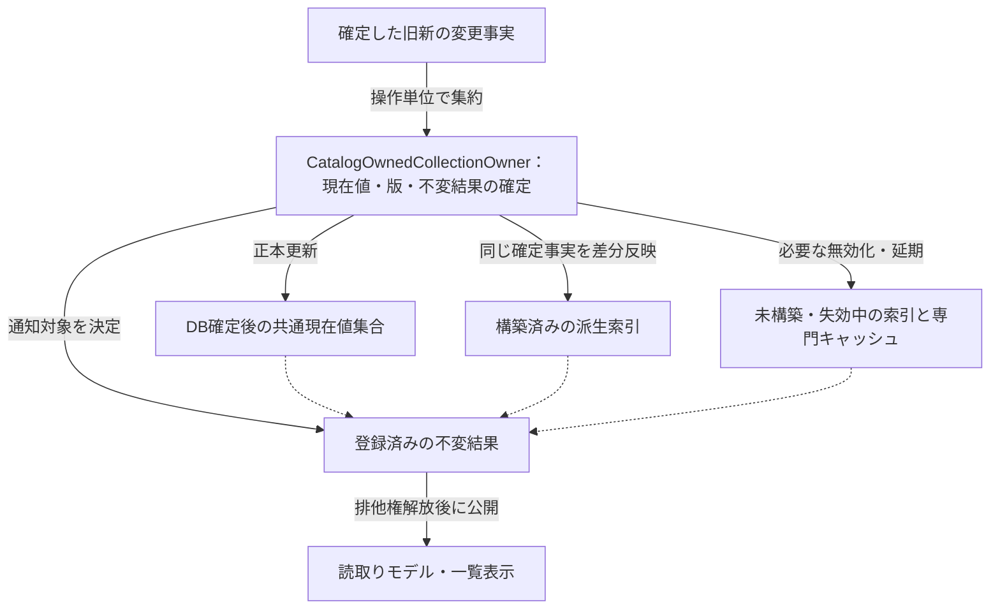

# データと索引

## 目的と適用範囲

保存データ、所持譜面集合、用途別の索引について、所有・識別条件・更新・公開の境界を定めます。少数の変更に対する仕事量と、全件処理の受入条件は[データ規模と性能](performance-and-scale.md)を正本とします。DB行のパスの識別は[パスによる識別](path-identity.md)に従います。

## 用語

[共通用語集](../glossary.md)のカタログ、所持譜面、所持項目の識別、索引、逆引き、スナップショット、差分、キャッシュの失効、確定事実、公開を使います。

| 用語 | 意味 |
| --- | --- |
| 完全一致パス | 各保存・索引の境界が持つ正規化済みのパスのキー。大文字小文字の比較規則を、別の曖昧な同一性へ広げない。 |
| 共通現在値 | 所持譜面の現在の値（`ChartFile`）。保存形式によらず、参照・表示・操作に使う。 |
| カタログ版 | 所持譜面の現在値の実際の変更で進む版（`CatalogRevision`）。 |
| 確定結果 | 一回の確定で作る変更不能な結果記録（`CatalogCommitReceipt`）。 |
| 所属数 | 同じハッシュやディレクトリに対応する所持項目の数。候補の有無だけとは区別する。 |
| 構造共有 | 変更のない部分を旧いスナップショットと共有し、変更箇所への経路だけを置き換えること。 |
| 構築済みの索引 | すでに作られて現在の入力と一致している派生索引。未構築・失効中の索引と区別する。 |

## 仕様

### 保存データの責務

| データ | 用途と制約 |
| --- | --- |
| `song` / `folder` | LR2互換のBMSのカタログ。保存行の型はDBの境界に限り、アプリの現在値は `ChartFile` とする。 |
| `bmson_song` | アプリ独自のBMSONのカタログ。LR2の `song` に互換の行を作らない。 |
| `chart_digest_map` | BMSのMD5とSHA-256・譜面情報を結ぶ部分的なキャッシュ。初回の走査の前に完全である必要はなく、実ファイルを読む処理で必要な範囲を補う。 |
| `chart_info` / 解析失敗の記録 | 解析器の版とファイルの状態に応じた譜面情報。読込み後はセッションの索引に反映する。LR2同期の状態を鮮度の判定に流用しない。 |
| `maintenance` | 保存済みのリソース健全性と、BMS固有の文字コードの情報。未計算の状態とは区別する。 |
| プレイリストのヘッダー・項目 | 操作と保存・出力の正本。所持の判定には項目の選択キーを使う。 |
| `ir_score` / `ir_data` | LR2IRのプレイヤーのスコアと、順位のキャッシュ。取得元と更新条件が異なる。 |

`ChartFile` はこれらのDB行ではなく、用途別の共通の読取りモデルです。所持項目と保存行の関係は[BMS・BMSONの共通モデル](../library/chart-model.md)を参照します。

### 共通現在値の格納・識別・順序

#### 所有と採用

`CatalogOwnedCollectionOwner` が、唯一の共通現在値の集合、その排他、カタログ版、派生索引を所有します。共通現在値の集合（`OwnedChartCollectionState`）は、次の規則で値を採用します。

- パスとMD5を持つ値を採用します。
- 形式をまたいで同じDBの完全一致パスがある場合は、BMSを優先します。
- 同じMD5の別の配置は残します。重複として除外した項目を、先の項目の削除後に自動で昇格させません。
- DBの `Ordinal` と、物理対象の `OrdinalIgnoreCase` の比較を混同しません。

#### 格納と捕捉

共通現在値は、変更不能な列（`CatalogStorageIndexedSequence`）のルートを共有して格納します。

- 所持項目の識別から列の要素へ到達し、完全一致パスの索引と派生参照の索引から対象を直接探します。位置は順序キーの二分探索で求めます。
- 捕捉済みのビューは、所属・順序・版に加えて要素の値も固定します。後の現在値の適用・移転で変わりません。
- 形式別のビューを捕捉するために全件を複製しません。形式別の範囲の列挙・検索・コピーは、その範囲だけを読みます（[全件処理と局所処理](performance-and-scale.md#全件処理と局所処理)）。

通常一覧の基準入力は、BMS、BMSONの順にカタログの保持列を結び付けた捕捉値です。

- 通常一覧だけのためにBMSONをパス順に整列し直しません。指定列と題名が同値の場合も、この保持順を使います。
- 指定列の並べ替えでは現在の値を評価します。プレイリストの代表の選択は、既存のカタログ順に従います。
- 呼出側の `includeBmsonRows` は捕捉の前に渡し、BMS専用の一覧ではBMSONを列挙しません。

通常一覧の添字を再利用するため、所属・基準順序の変更を示す `MembershipOrderIdentity` を捕捉値へ渡します。この識別は、加入・離脱・順序の正規化・全置換で替え、同じ位置への基本値の更新と内部移転では維持します。現在値の鮮度を示すカタログ版とは用途を分け、件数が同じでも別の所属へ旧い添字を流用しません。

#### 更新ごとの識別と順序

| 更新 | 識別と順序 |
| --- | --- |
| DBの全再読込み | 境界で一回だけ共通値へ変換し、新しい識別を発行する。入力の相対順と、既存の除外条件を維持する。 |
| BMSの追加・再解析による置換 | 新しい識別を発行し、旧い完全一致パスを除いて、入力順にBMSの末尾（BMSONの前）へ置く。 |
| BMSONの追加・再解析による置換 | 新しい識別を発行し、捕捉したパスを大文字小文字を区別せずに並べる。置換は同順位の末尾へ移す。 |
| 通常の値の適用、詳細に由来する基本値の更新 | 同じ識別と位置へ、新しい変更不能な値を一回適用する。旧い捕捉値は変更しない。 |
| 内部移転 | 同じ識別と格納位置を継承し、明示された旧新のパスで現在値・索引を更新する。旧いキーを新しいパスから推測しない。 |
| 差分なし | 現在値と識別を継承する。外部移転でのハッシュの再接続は利用者の列だけを復元し、識別は継承しない。 |

全置換の後の最初の追加・更新では、BMSONの部分だけを一度整列します。

- 順序キーが変わる生存中の識別は、値の変更とは別に、同じ確定結果へ含めます。
- BMSの列・順序キー・索引は共有し、全BMSを複製・再採番しません。
- 移転は捕捉済みの順序の位置を保ちます。画面の並べ替えには、共通現在値のパスを使います。
- `LibraryChartRefIndexSnapshot` の局所的な更新でも、全譜面の順位表を作りません。

#### カタログ版

カタログ版は、所持譜面の現在値の実際の変更で進めます。対象は、所属・識別・順序と、健全性・文字コード・警告・検査の由来です。

- 一回の確定のバッチで一回だけ進みます。
- 対象なし、または同じ識別の同値の再評価では進みません。
- 識別を再発行する全再読込みは、識別の実際の変更として進みます。明示的に識別を継承する同値の入力とは区別します。
- スコアなど独立した正本の版は、別に維持します。

### 共通変更と派生索引

#### 確定の順序

`CatalogOwnedCollectionOwner` は、既存の書込み主体の中で、共通現在値、必要な候補・ハッシュの索引、カタログ版、確定結果を同時に確定します。確定結果は次を持ちます。

- `BaseRevision`、`Revision`、対象の変更前後の値。
- 値とは独立した、順序が変わった識別（`OrderChangedTokens`）。
- 全置換かどうかの区別。
- 確定時の、構造共有のスナップショット。

通常の変更は次の順に反映します。

1. 旧いパス・旧いハッシュを、変更不能な確定事実として捕捉する。
2. DB確定の後に限って、共通現在値へ一回適用する。順序の変更も同じ確定に含め、値の変更に偽装しない。
3. 構築済みの索引へ、同じ旧新の事実を渡す。
4. 同じ短い集合の排他の中で、確定結果を既存の公開処理へ登録する。
5. 登録した後に、カタログ版を公開する。
6. 排他権を解放してから、登録した同じ確定結果を配送する。

カタログ版の公開は、確定結果の登録より後です。任意のスレッドがカタログ版Rを観測できるとき、Rの確定結果は公開処理へ登録済みです。差分の確定と全置換の両方に適用します。通常一覧の候補は、観測した版の確定結果を配送で得られる前提で採用を判断するため、Rの公開が登録より先行すると、その間の採用が範囲不足の失敗になります。確定区間の内部の処理（索引の適用、依存の更新、確定結果の構築、登録）は、まだ公開していない新しい版Rを明示して使い、確定後は書込み主体のカタログ版、確定結果、確定時のスナップショットの版が同じRになります。確定区間の内部で旧い版が見えている間に、先に確定結果が登録されることは許容します。

確定区間の内部の処理が例外で終わった場合は、現在値は変更済みなので版Rを公開し、確定結果は未登録のままにします。元の例外を維持して従来どおり呼出し元へ伝え、呼出し元の確定後の必須反映の失敗の扱いは変えません。このとき版Rを観測した通常一覧の候補は、配送でRを得られず、その候補の失敗として閉じます（[候補の範囲不足の閉じ方](../ui/table-view.md#候補の範囲不足の閉じ方)）。ハッシュ索引の結果の記述（[ハッシュと導入済みディレクトリ](#ハッシュと導入済みディレクトリ)）とは対象が異なります。参照の管理主体の同等の規則は[プレイリストの保存と更新](../playlist/storage-and-export.md)に従います。

共通現在値と集合の版は、同じ既存の排他の中で捕捉・適用します。DBの失敗や確定前の取消で、現在値を先に変更しません。操作の成功集合と必須の後処理は、`LibraryMutationOwner` がまとめます（[変更セッション](../library/mutations.md#操作単位の変更セッション)）。

譜面情報の書込みも、DB確定、同じ識別への必要な基本値の更新、ハッシュに依存する索引、詳細のセッション索引、解放後の通知の順に行います。詳細は[譜面情報](../library/chart-info.md#保存する列と公開順序)を参照します。

TXTの実際の差分は、同じ確定の中で、共通現在値とカタログ版だけを更新します。識別、格納順、候補の内容の版は保持し、同値は変更に含めません。成功したTXTの配置の親ディレクトリの直下だけを既存の索引から捕捉し、全所持譜面の再解析はしません。

#### 未構築の索引と無効化

- 未構築の索引は、変更のためだけには構築しません。カタログ版が進むことと、高価な派生索引を更新することは別の判断です。
- 全置換、必要な旧新の対応の不足、途中の失敗では、必要な無効化を行います。識別条件の違反を無効化で隠しません。
- 確定結果を登録した後に、索引だけを無効化しません。

#### 索引と表示状態ごとの更新

| 索引・表示状態 | 更新の方針 |
| --- | --- |
| MD5の所持数 | 追加・削除・MD5の変更を集約する。同じMD5の置換やSHA-256だけの変更は相殺し、不要な更新をしない。 |
| 導入済みディレクトリ | MD5・SHA-256ごとの所属数と既知のディレクトリを、対象だけ更新する（[ハッシュと導入済みディレクトリ](#ハッシュと導入済みディレクトリ)）。 |
| 実パスの参照・子孫数 | 実際の所属・移転を反映する。予定の導入先を混ぜない。 |
| 導入先の一時状態 | 導入先の変更と、元の所持主体・パッケージ項目の消失を反映する。実ファイルの存在や子孫数の根拠にはしない。 |
| 親フォルダの候補 | 現行のキャッシュを無効化する。捕捉済みのパスを再利用し、出力先の正規化は一回の構築につき一度だけ行う。 |
| プレイリストの所持ハッシュ・参照解決 | 構築済みの索引へ、識別・パス・ダイジェスト・候補順の実際の変更だけを局所的に反映する（[プレイリストの所持・解決の索引](#プレイリストの所持解決の索引)）。 |
| プレイリスト参照の表示更新 | 選択キーに一致する所持参照だけを、その都度取り出す。全参照の一覧を複製してから絞り込まない。 |
| リソース健全性 | 対象の差分を優先し、入力が不足するときは無効化・延期・必要な全件処理を選ぶ（[リソース健全性](#リソース健全性)）。 |
| 重複の行・グループ | 共通現在値の捕捉済みの列と、ハッシュ別の変更不能な派生索引を共有する。構築済みの索引は変更したハッシュの要素だけを更新し、グループの結果を無効化する。局所的な現在値の更新のために全件を走査・複製しない。 |
| 通常一覧 | 確定した同じカタログのスナップショットと対象の差分を渡す。鮮度と更新範囲を分け、版の変化だけで全体を再構築しない。 |

導入要求の再検査は、要求対象の完全一致パスにあった識別とダイジェストだけを比較します。無関係な題名や健全性の確定で、要求を拒否しません。LR2の通常フォルダの件数と実パスの捕捉は、既存のBMSのパスの所属のルートを共有し、所属の変化と表示値の変化を区別します。

#### 通常一覧への通知

通常の通知は `NormalLibraryRefreshNotificationVersion` を入口とし、必要な更新の契機と変更範囲を渡します。

- 通常一覧の所属・現在値は、確定結果が持つ確定時のカタログのスナップショットを入力とします。過去の追加・削除の通知を再生して所属を再現する独立した集合は持ちません。
- 差分は、実体化済みの行や、依存する順序の局所的な更新に使います。次の明示的な表示要求も、現在のカタログから構築できます。
- 重複警告の直接の更新も、確定済みの確定結果を既存の待ち行列へ登録し、全排他の解放後に同じ通知の入口を起動します。
- 確定後の処理や通知先の失敗で、確定結果を削除しません。未公開の補助通知だけを破棄してよいのは、確定済みの確定結果を含まない通知に限ります。
- 通知の不達の常時監視や、自動の再試行はしません。

`NormalLibraryRowCache` は、所持項目の識別をキーに表示行を再利用します。所属の根拠にはしません。明示的な全置換だけを初期化の境界とし、局所的な変更で、全ソースの初期化、全カタログの走査、全件の投影・リソース解析をしません。更新の契機は次のとおりです。

| 種類 | 契機 |
| --- | --- |
| 詳細 | 既存の詳細の版と、変更したMD5・SHA-256。 |
| スコア | 既存の版と、変更したキー。 |
| 保守・警告 | 既存の通知と対象。 |
| パッケージ | `ProjectionVersion` と延期。 |

#### スコアの公開

スコアの既存のルックアップは可変な `BMSScore` を共有するもので、全スコアの値の変更不能なスナップショットではありません。

- 局所的なsetterと、全ルックアップの再公開は、同じ排他の順序で行います。新しいルックアップの公開前に必要な購読を接続し、`ScoreSnapshotVersion` の進行と `ScoreSnapshotChange(BaseVersion, Version, Md5Keys, Sha256Keys)` の通常の待ち行列への登録を、同じ排他の中で確定します。
- 全再公開の対象は、旧新のキーの和集合です。空のキーによる版の進行も、結果として保持します。
- 純粋な通知は、排他の解放後に通常の通知処理を起動します。スコア通知の別の配送経路は置きません。
- カタログの初期化に伴う整理と、未公開の旧い通知の破棄は、独立したスコアの範囲を削除しません。

スコアの版は、表示へ反映済みの位置を表します。可変なルックアップから最新の値を読めても、その版までの全変更キーを反映していないソースを、最新の版として採用しません。通常一覧とワークスペースの反映済みの位置と待機は[一覧](../ui/table-view.md)に従います。

#### 導入済みの項目の参照

導入済みの項目の参照索引は、`PackageLifecycleOwner` が既存の所属ロックの中で管理します。

- 所持項目の識別に対応する生存中の項目の参照と、所属するパッケージの参照の集合だけを持ちます。共通現在値・保存行・独立した版・永続的な識別は追加しません。
- 確定値の局所的な反映では、対応する項目だけを訪問します。全導入済みの列の走査、項目の複製、遅延構築はしません。
- DB確定、共通現在値への一回の適用、既存の索引への反映の後で、同じ確定結果の変更後の値を、対応する項目へ共有します。移転の不完全なパスの要求や、後続の現在値の再捕捉で補いません。
- 項目とモデルの排他を解放してから、既存の通知を公開します。

#### 変更事実から索引・表示への反映

実線はラベルに示す変更情報の受渡し、破線は公開前の順序条件です。操作の変更事実はDB確定後に `CatalogOwnedCollectionOwner` へ適用し、同じ境界で共通現在値・版・旧新の差分を確定します。構築済みの索引と専門の依存の更新はその旧新の差分に従い、保存行や所持集合の変更通知から再推測しません。索引への反映と無効化の枝は、変更に応じて必要な側だけを扱い、両方が対象になる場合もあります。通知への破線の合流は、その変更で対象になった内部の反映・無効化の完了を表し、全枝を毎回実行するという意味ではありません。

### ハッシュと導入済みディレクトリ

ハッシュの索引の状態、ロック、初期化状態、世代、読取り・構築・反映は、`CatalogOwnedCollectionOwner` が所有します。`BMSLibrary` の公開窓口や利用側に、同じ世代・索引の正本を重複して置きません。

| 索引 | 保持するもの |
| --- | --- |
| `PrimaryHashLookupState` | MD5の件数だけ。既所持の判定や安全な削除のために、全ディレクトリの索引や詳細な譜面を作らない。 |
| `InstalledChartLookupIndexState` | MD5・SHA-256からディレクトリへの所属数、ディレクトリ内の異なるMD5の数、既知のディレクトリ。同じハッシュを持つ最後の所持項目が消えるまで、候補を保持する。 |

更新は、所属が変わったハッシュだけを、大文字小文字を区別しない候補順で行います。

- スナップショットと、除外付きの検索結果は、変更不能なルートを共有し、後続の変更で変わりません。
- 作成時に全体の対応表を複製したり、全候補を整列し直したりしません。
- `DirectoryReferenceCount` は更新済みの所属数を返します。初回の構築と、呼出側が全既知のディレクトリを明示的に列挙する処理は、全件を扱います。

通常の削除と統合は、種類・完全一致パス・変更前のMD5・SHA-256を同じ確定事実として、カタログと索引へ渡します。パスの整理（`PathCleanup`）を理由に、既知の旧いハッシュを捨てません。DBだけの整理と所持主体の除去を区別し、もともと所持譜面のない統合は、検索索引を取得する前に終了します。

### プレイリストの所持・解決の索引

プレイリストの参照解決の索引は `CatalogOwnedCollectionOwner` が所有し、候補の識別・種類・完全一致パス・ダイジェスト・順序だけを保持します。`ChartFile` の表示値を索引へ複写しません。

| 索引 | 規則 |
| --- | --- |
| 所持ハッシュ索引 | MD5・SHA-256それぞれの所持項目の数を持ち、最後の項目が消えた場合にだけ所属を除く。両方のハッシュ集合が同じなら内容の `Version` を維持し、所持数の集計を再利用する。共通の集合の版は、ハッシュの所属の内容の版とは別に管理する。 |
| 参照解決索引 | 種類と完全一致パスで全候補を保持する。代表は現在のパスを大文字小文字を区別せずに比べた最小値で、同値なら所持集合で先のもの。代表を削除すると次の候補を選び、最後の候補がなくなると未解決にする。項目にMD5がある場合はMD5だけで解決し、未解決でもSHA-256へ切り替えない。 |

読取りは次の規則に従います。

- `CapturePlaylistCatalogReadSnapshot` は、候補の解決と、必要な識別の現在値・カタログ版を、同じ読取り区間で捕捉します。退役した識別を、同じパスの別の項目へ救済しません。
- 確定結果のスナップショットは、その時点で構築済みの既存の候補のルートも、O(1)で共有します。
- `TryCapturePlaylistReadSnapshot` は、そのルートと同じスナップショットの識別の現在値だけを読み、後続の候補・現在値を混ぜません。
- 内容だけの更新では、候補のルートの内容の版を維持します。
- 明示的な全置換で破棄した索引は、次の全構築で取得します。

構築済みの索引は、導入・移転・削除・ハッシュの変更と、基準順序が変わる対象の候補だけを更新します。

- 初回のBMSONの順序の正規化でも、実際に位置が変わる識別と、移転前の捕捉パスを更新する必要がある候補だけを、同じ書込み主体の中で更新してからスナップショットを捕捉します。
- 既存の `Ordinal` を保持し、キーの比較モードの表現の差だけで、無関係な候補や表示行を更新しません。
- 確定結果には実際の位置の変更だけを含めます。候補キーだけの再捕捉の対象は、確定中の一時的な入力に限ります。
- 候補の同一パスの比較は、両方のキーへ共通のモードを適用します。旧新のキーが混在しても、比較の対称性と、新しく構築した候補順を保ちます。
- 確定結果を登録した後は、旧いスナップショットのパス・ハッシュ・代表を固定します。
- 全置換と旧い事実の不足では、必要な全体の無効化を維持します。順序だけの変更は、所持ハッシュ集合の内容の版や、詳細解析の入力を失効させません。

ハッシュの差分は通知の前に反映します。

- すでに現在の元データから再構築した索引へ、旧い差分を重ねません。
- 正常に反映したハッシュ変更の区間の終了時に、もう一度無効化しません。
- 元の版が違う結果や、失敗した結果は公開しません。
- 同じ世代の先行読込みのTaskの共有は既存の管理主体に残し、利用する機能ごとの別のキャッシュを作りません。

### リソース索引と所有関係

`LibraryResourceIndexOwner` は、現在の `LibraryResourceIndex`、`DirectoryResourceLookupCache`、世代をまとめて所有します。長寿命の利用側は過去のキャッシュの実体を保持せず、現在のスナップショットまたは変更命令を使います。ファイル操作は索引のロックの外で実行し、成功した事実を反映します。

#### キー

索引のキーは、拡張子を除いた譜面相対のパスです。

- `foo.wav` は `foo`、`sound/foo.wav` は `sound/foo` とし、ファイル名だけでは一致させません。
- 音声・画像・動画を分けます。
- 祖先から見えるリソースを含む集合と、最も近い譜面ディレクトリが所有する集合（`SelfOwned`）を分けます。
- 親ディレクトリの各要素は物理配置の識別として保持し、資源の拡張子と同じ字面でも置換・除去しません。`audio.ogg/tone.wav` と `audio.wav/tone.ogg` は、それぞれ `audio.ogg/tone`、`audio.wav/tone` の別のキーです。
- 拡張子の同一視は、同じ親の末尾のファイルだけに使います。`audio.ogg/tone.wav` と `audio.ogg/tone.ogg` は同じキーです。
- 元の参照 `RawPath` は変更しません。

ドライブ直下の譜面の親は、絶対ルート `C:\` のまま、ネイティブの分割・所有者の探索・包含・公開結果から、管理側のキャッシュ、健全性、逆引きへ渡します。

- `C:` のドライブ相対のキーへ縮約せず、現在位置で解決し直しません。
- ルート固有の資源はルートの自己所有、子の譜面の資源は子の自己所有とルートの祖先の集約へ入れ、ルート自身の親で探索を終えます。
- 通常のディレクトリとUNC共有ルートの既存の正規形（末尾の区切りなし）と、通常のディレクトリの要素の境界は維持します。

#### 祖先から見える集合と自身の所有分

次は `A` と `A/B` にそれぞれ譜面がある例です。実線はディレクトリの包含、破線はリソースの見え方を表します。ファイル名やパスは説明用であり、特定の配置を必須にしません。

```mermaid
flowchart TB
    A["A：譜面ディレクトリ"] --> Sound["A/sound：リソースだけのフォルダ"]
    Sound --> Kick["A/sound/kick.wav"]
    A --> B["A/B：譜面ディレクトリ"]
    B --> Snare["A/B/snare.wav"]
    Kick -.->|相対キー sound/kick| OwnA["Aから見える・AのSelfOwned"]
    Snare -.->|相対キー B/snare| VisibleA["Aから見えるがAのSelfOwnedではない"]
    Snare -.->|相対キー snare| OwnB["Bから見える・BのSelfOwned"]
```

自身の所有者は、最も近い譜面ディレクトリです。`A/sound` はリソースだけなので、導入候補にはなりません。候補の抑制にこの区別を使う条件は[導入先推定](../library/install-estimation.md#祖先候補の抑制)に従います。

#### 構造と更新の方式

少数の変更で全件を複製・再計算しないため、次の構造を使います。

| 構造 | 共有と更新の規則 |
| --- | --- |
| ディレクトリの項目 | 変更不能な `Entry`、パスから順序番号への対応表と、存在する番号だけの順序付きの対応表を共有する。全ディレクトリの複製・再採番をしない。 |
| 項目の位置 | 一つの未公開の命令の中では、最後に削除した位置を再利用する。空き位置は次の命令へ持ち越さず、既存の候補順を守る。欠番を列挙しない。 |
| 逆引き | 所有権を移した変更不能な初期の対応表と、キーごとの最新値だけを持つ共有可能な差分の対応表の二層で解決する。前の世代を連鎖して探索しない。 |
| 更新・公開 | 変更キーへの木の経路と、必要な候補配列だけを置き換える。複製直後の初回の更新や公開時にも、全件の変換・固定化をしない。 |
| 入力の所有権 | 所有権の移転が明示されたネイティブの構築結果を除き、入力の配列を複製する。公開後に呼出側が変更せず、内部の配列も外へ公開しない。 |

初期の対応表の置換前のデータは索引の寿命の間残り、差分は同じキーの最新値だけを保持します。明示的な走査・全置換で初期の対応表を入れ替えます。自動の圧縮、世代の台帳、操作後の必須の更新の延期は追加しません。

移動・名前変更は、対象の項目のハッシュに対応する計算済みの候補だけを調べ、位置を保ってパスを置換します。

- 最終的な候補列が順序も含めて同じなら、逆引きを書き換えません。空のリソースの項目の追加は、項目の格納だけを変更できます。
- ただし、リソースの集合が同じというだけでは、変更なしと判定しません。`SelfOwned` だけの変更でも、既存の「除去してから追加」の規則で `[A, B]` が `[B, A]` になる場合は更新します。
- 未計算と計算済みの空の候補、ハッシュ0、大文字小文字、遅延計算と全構築の意味を維持します。

#### 変更セッションとの接続

一回の変更セッションで成功した導入・削除・統合をまとめ、必要な逆引きの反映を一度だけ行います。

- 後続のパッケージの判定には、先行の物理的な成功を操作内の一時的な状態として渡します。パッケージごとの正本の公開を、通信手段にしません。
- 元フォルダの除去と統合先の追加も一つの未公開の変更にまとめ、同じ最終構成なら世代を維持します。

フォルダの削除は、物理削除に成功したフォルダ（`DeletedFolderPaths`）だけを集め、命令全体で項目を一回走査して祖先の集合と照合します。

- 重複・親子の対象を二重に計上せず、失敗・未実行の対象は除きません。
- 入力の列挙や反映の失敗では、旧い索引と世代を維持します。ただし、先行する物理削除を取り消したことは保証しません。

#### 初回の構築

通常起動のネイティブ経路は、`EBridge_ScanChartAndResources` の圧縮された結果から直接索引を作り、走査結果（`ChartScanResult`）にリソースの辞書を重複して具体化しません。Everythingを利用できない場合の管理側の走査と、テスト用の統合では、カテゴリ別の辞書を持つ経路を使います。逆引きは導入の準備の完了前に完成させ、保留パッケージの推定へ初回の構築を持ち越しません。

### リソース健全性

#### 存在件数

存在件数は、取得済みの `ChartFile.Resources` の使用参照だけから索引化した検索集合で計算します。

- 同じ種別の `sound.wav` と `sound.ogg` は、検索・分母では1件、元の記述は2件として保持します。
- `foo.v2.wav` の `LookupKey` は `foo.v2` のまま使い、集約や照合で再度拡張子を除きません。
- 同じディレクトリと種別・用途別の検索集合で共有するのは、存在件数だけです。定義の有無は用途別にキーと区別します。
- 未知の拡張子や空のキーから、親参照の理由を作りません。
- 対応する拡張子だけを、物理・索引で共通の照合対象とします。拡張子のない裸のファイルへの直接の存在確認はしません。外部プレイヤーの全挙動を再現する保証ではありません。

照合可能な集合だけの存在件数のキャッシュへ、譜面固有の照合できない参照の数と任意画像の状態を、返却時に合成します。LR2の長さ・文字コード・親参照は、同じスナップショットのCP932の全原文から独立して集約し、存在件数のキャッシュに依存しません。原文と解析状態の正本は[譜面の共通モデル](../library/chart-model.md#譜面情報とリソース保守)です。

#### 健康度

WAV・BGA・MOVIEの健康度は、使用ファイルのキーの存在数÷要求数です。

- 平方根によるペナルティは加えません。不足が一件でもあれば、整数の表示を100%にしません。
- 要求が0件なら対象外としてnullを返し、画面は `-` を表示します。
- 新しく計算した0件は、既存の `maintenance` の列へ0/0として保存します。旧い保存値の定義0・存在nullも、検査済みとして扱います。
- 健康度がnullであることだけで、検査済みかどうかを判断しません。

名前付きの照合できない参照は、同じカテゴリの個別の未充足として要求数へ含め、照合できる参照の存在数と合成します。

- 同一性は、カテゴリ、別々の譜面相対の配置、前後の空白の除去・区切りの統一・`OrdinalIgnoreCase` だけを施した原文で決めます。拡張子は除きません。
- 対象外と未定義のIDは、要求へ加えません。
- 未取得・読取り失敗・必要な配置の欠落は、未判定として区別します。名前付きの照合できない参照を理由に、カテゴリ全体を未判定（null/null）へ落としません。

#### 補助画像

任意の画像は通常のBGAの分母へ入れず、stagefile・backbmp・bannerの用途別に計算します。両形式とも、用途ごとに先頭の空でない採用された補助画像を一件分類し、その分類から定義と存在を決めます。存在が false になる場合（不正なパス・親参照などで照合できない場合を含む）は、補助画像の不足を通知します。

| 補助画像の状態 | 定義（`*Defined`） | 存在（`*Existing`） |
| --- | --- | --- |
| 対象外（未指定・null・空文字、または分類が対象外） | false | null |
| 照合でき、存在を確認した | true | true |
| 照合でき、存在しない。または不正なパス・親参照などで照合できない | true | false |
| 照合できるが、必要な配置が未取得 | true | null |

この組合せは、`BmsLibraryMaintenanceService` の `IsOptionalImageDefined` と `GetOptionalImageExisting` が作る値です。

#### 保存値と再計算

照合できない参照による未解決の結果は、DBの読込み後も、起動時の再解析の対象にしません。

- 同じ保存形の古い部分的なデータとは区別できないため、自動では補完せず、手動の再スキャンで更新します。
- 補助検査の未取得や、不完全な件数を持つ既存の補完対象は、補完対象のまま維持します。
- 明示された未判定の投影を、旧来の100%で補いません。
- 既存のDBの件数は、手動の再スキャンまで旧い基準を含んでよいものとします。スキーマの変更・移行・読込み時の失効や、基準の変更を理由とする起動時の再計算は追加しません。

有効なメンテナンス情報は、DBから反映した `DbHydrated` か、計算済みの `Calculated` です。

- 未計算の仮の値を、健全性の索引の正本にしません。
- 通常の起動では保存済みの情報を読み、欠落・古い対象だけを後続の保守へ回します。
- 未取得の表示用のメンテナンス情報は件数が未確定のまま扱い、健全性の計算やファイルの取得を開始しません。

#### 健全性の索引

構築済みの `ResourceHealthIndexSnapshot` は、種類と完全一致パスから、対象の参照・ハッシュ・警告の検査事実へ直接到達します。

- 対象に完全な `ChartFile` を保持しません。表示と操作の対象の現在値は、共通の捕捉口から取得します。
- 鮮度は実資源の入力の `InputVersion` で守り、カタログ版を二重に保持しません。無関係な題名などの確定で、正常な資源の差分を捨てません。
- 対象の差分だけを更新します。健康状態への変更では警告だけを除いて対象数を維持し、譜面の除去では所属も除きます。
- 更新する警告は入力順に末尾へ追加し、未変更の項目の順序と旧いスナップショットを保ちます。
- 全所属の複製、ハッシュ変更の対象ごとの全キーの探索、getterでの全件の具体化はしません。

再利用できるスナップショットがない保守一覧の読取りは、初期化済みの最小情報の読取りと、共通現在値の読取りの範囲の中で、対象を捕捉します。カタログの書込みの途中の状態を、空の一覧として確定しません。再利用できる場合に、新しい待機は加えません。

#### 更新の方式

変更なし、無効化、延期、差分、必要な全件構築は、入力の条件で選びます。全件の入力の取得条件、版の確認、失敗時の非公開を守り、移転・パスの整理で必要な無効化を、局所的な最適化のために省きません。

| 方式 | 規則 |
| --- | --- |
| `DeltaOnUpdates` | 現在の索引へ差分を適用する。未構築・失効中の場合や、差分を適用できない場合は、全件を構築せず失効させる。 |
| `DeferOnUpdates` | 更新中には構築しない。 |

どちらの方式でも、その後の表示の準備が現在の索引を構築し、同じ入力に対する再表示はそれを再利用します。構築済みの索引への導入を不必要に失効させないための反映順序は[操作ごとの反映範囲](../library/mutations.md#操作ごとの反映範囲)に従います。

### 起動とIRデータ

導入の準備までに必要な読取りは、パス・ハッシュ・時刻・フォルダ・所持関係などの最小のカタログに限ります。全件のメンテナンス情報と譜面情報は、この必須の経路へ戻しません。プレイリストのヘッダーは独立に読み、項目は、最小のカタログと必要な譜面情報・スコアの準備の後に、同じ親の操作で直接反映して、保存済みの出力を完了します。

#### プレイヤーのスコアXMLの取得

LR2IDが確定した後のプレイヤーのスコアXMLの取得は、次の契約に従います。

- 要求の開始から本文の受信まで、一つの30秒の期限を使います。終了要求は本文の待機にも伝播します。
- 取得は、必須UIと操作の解禁の後の順位処理の中で一回行い、その結果を同じ実行へ直接渡します。共有する先行取得の状態や、失敗の直後の再取得は持ちません。
- 通信・解析・キャッシュの読取りはLを持ちません。DBの更新とモデルの確定だけを、Lの取得後に停止と入力の一致を確認してから行います。
- 成功した空のスコアと失敗を区別します。通信失敗・期限超過・取消では、既存の `ir_score`、ハッシュの情報、現在のスコアを保持します。
- 結果は通常の結果型・ログ・背景処理の状態で伝え、新しい確認画面や再試行は加えません。

`ir_score` は未送信の検出に使います。XMLのスコアの実体から正規化したハッシュを作り、取得時刻で変わる `lastupdate` は除きます。

#### 順位のキャッシュ

`ir_data` は、ローカルの順位XMLに由来するキャッシュです。`UpdateLr2IrRankingCacheOnStartup=false` なら、起動時に走査・読込み・更新をしません。

- 順位XMLは共通の一回走査の解析器を使い、`id`、`clear`、`notes`、`combo`、`pg`、`gr`、`minbp` が0以上の整数である行だけを集計します。
- ファイルの時刻と末尾の `lastupdate` で再読込みを判定します。
- オフラインの順位の計算器は必要なときだけ作り、同じハッシュを起動時に読んでいれば再利用します。
- 初回の順位の保存は、対象のLR2IDの既存の行がないことをトランザクションの中で確認し、重複を除いた行を一括で挿入します。差分の更新は `(hash, lr2id)` の削除と挿入を使います。
- 互換性のため一意制約は加えず、`ir_data_idx(lr2id)` と非一意の `ir_data_idx_lr2id_hash(lr2id, hash)` を維持します。
- 順位の取得・反映は、導入の準備の完了の待機条件にしません。

### DBの読取り・スキーマ・削除

読取り用の接続は、スキーマを作成・修復しません。書込みを伴う整理・解析の補完・ファイル差分の反映は、書込み可能なトランザクションに分けます。少数のパス・ハッシュの問い合わせを、全表の具体化へ広げません。

#### スキーマの準備

| 処理 | 契約 |
| --- | --- |
| 通常のスキーマの準備 | `song` の `hashidx(hash)`、`parentidx(parent)`、アプリ側の `song_idx_folder(folder)` の不足を補う。 |
| `EnsureAppOwnedSchema()` | アプリ用の表・索引を現行化し、`app_schema_version(name='app_schema')` に `1` を記録する。 |
| `RepairAppOwnedSchema()` | 既存のハッシュの行を保ってアプリ用のスキーマを修復する。 |
| `EnsureLibraryStartupSchema()` | 起動に必要な既存の表・索引・版を、一つのトランザクションで準備する（下記）。 |

いずれも、全譜面を読んで `chart_digest_map` を埋める処理ではありません。

`EnsureLibraryStartupSchema()` は、DDLごとの確定を繰り返しません。

- 途中で失敗した場合は、今回の構造・版の変更を巻き戻し、既存のデータと元の失敗を保持します。
- 阻害する条件を除いた後の次の明示的な実行で準備でき、成功後に繰り返しても既存の行を保持します。
- スキーマの定義や版、他のスキーマ操作の確定境界は変更しません。

初回の連携で存在しないアプリの表を追加する場合は、修復の警告を出しません。次は警告の対象です。

- 既存の `playlist_entry` へのSHA-256の列・索引の追加。
- 一意索引の作り直し。
- 既存のアプリのデータの版の記録・現行化。

メタデータ配布用の `chart_info_schema_version` と、DB内の `app_schema` は別の契約です。

#### アプリのデータの削除

「BeMusicSeeker関連データをLR2データベースから削除」は、次を削除し、LR2の `song`、`folder`、`score` などは残します。

- `BeMusicSeekerOwnedTableNames` の表。
- 対応する `sqlite_sequence` の行。
- ネイティブの表に追加したアプリ用の索引。

初期化・再読込み・背景の更新の最中は受理しません。処理中は設定の操作を無効にし、成功後にアプリを終了します。アプリの表・索引を増やす場合は、この一覧と回帰テストも更新します。

#### SQLiteの互換範囲

LR2本体は SQLite 3.6.7 で `song.db` と `score.db` を開き、開くときにスキーマ全体を解析します。解析できない定義が一つでもあると、LR2はそのDBを使えません。そのため、アプリが作成・変更するSQLiteファイルのスキーマ定義は、SQLite 3.6.7 が解析できる範囲に限ります。

| 対象 | 範囲 |
| --- | --- |
| LR2連携の `song.db` | アプリ所有の表・索引・トリガー・ビューと、`song`・`folder` などLR2の表へ追加した索引。 |
| `score.db` | [プレイ履歴の取得](../playlist/lr2-history-schema.md)で導入する表・索引・トリガー。 |
| standalone の `song.db` | LR2は開きませんが、同じ準備処理と定義を共有するため、同じ範囲に揃えます。 |

スキーマに次を使いません。

- 部分索引（`WHERE` 付きの索引）と、式を含む索引。索引は列と `COLLATE` だけで定義します。
- 生成列、`WITHOUT ROWID`、`STRICT`。
- トリガー・ビューの中の UPSERT（`ON CONFLICT ... DO`）、CTE（`WITH`）、ウィンドウ関数、`RETURNING`、行値、複数行の `VALUES`。
- 3.6.7 より後に追加された関数（`char()`、`unicode()`、`instr()`、`printf()`、`iif()`、JSON関数など）と、`BINARY`・`NOCASE`・`RTRIM` 以外の照合順序。

正規化した値で照合する必要がある場合は、索引を列と `COLLATE` だけで定義し、正規化は問い合わせ側で行います。プレイリスト項目の候補索引 `playlist_entry_idx_candidate` は、スキーマの準備で既存の定義文と比べ、異なれば同名の索引を作り直します。以前の開発版が作った式の索引も、この処理で置き換えます。行は書き換えず、定義が一致すれば作り直しません。

アプリ自身が実行する問い合わせ（一時表を含む）も、同じ範囲を原則とします。範囲を超える場合は、次の表に箇所と理由を記録します。どの例外も、ファイルのスキーマに定義を残しません。

| 箇所 | 超える構文・関数と追加版 | 理由 |
| --- | --- | --- |
| [`BmsLibraryDbGateway`](../../../BeMusicSeeker/Models/BmsLibraryInternal/BmsLibraryDbGateway.cs)、[`Lr2FolderExistingRowLookup`](../../../BeMusicSeeker/Models/BmsLibraryInternal/Lr2/Lr2FolderExistingRowLookup.cs)、[`Lr2SongDbSyncService`](../../../BeMusicSeeker/Models/BmsLibraryInternal/Lr2/Lr2SongDbSyncService.cs)、[`Lr2SongDbWriter`](../../../BeMusicSeeker/Models/BmsLibraryInternal/Lr2/Lr2SongDbWriter.cs) の一時表への投入 | 複数行の `VALUES`（3.7.11） | 大量のパス・ハッシュ・生成列を一時表へ集める処理で、文の数と完了時間を抑えるため。一時表は接続の終了で消えます。 |
| [`Lr2SongDbWriter.BulkInsertGeneratedSongs`](../../../BeMusicSeeker/Models/BmsLibraryInternal/Lr2/Lr2SongDbWriter.cs) の `song` への挿入 | 複数行の `VALUES`（3.7.11） | 新しい譜面の生成行を、一時表を経由せずに `song` へ直接 `INSERT OR REPLACE` する処理で、文の数と完了時間を抑えるため。挿入されるのは行だけで、スキーマは変わりません。 |
| [`Lr2SongDbSyncService`](../../../BeMusicSeeker/Models/BmsLibraryInternal/Lr2/Lr2SongDbSyncService.cs) の互換性の保守列とハッシュの変更判定、[`Lr2SongDbWriter`](../../../BeMusicSeeker/Models/BmsLibraryInternal/Lr2/Lr2SongDbWriter.cs) の譜面情報の投影列・生成列・パス・`chart_digest_map` の変更判定 | 右辺が `NULL` 以外の `IS` / `IS NOT`（3.6.19） | 旧値・新値のどちらかが `NULL` になり得る列で、値が変わった行だけを更新するため。`=`・`<>` では `NULL` を含む差分を検出できず、`NULL` を同値として扱う比較が必要です。読み書きする行の値だけに使い、スキーマには残りません。 |
| sqlite-net の `SaveTransactionPoint`・`RollbackTo` を使う書込み（[`BmsLibraryDbGateway`](../../../BeMusicSeeker/Models/BmsLibraryInternal/BmsLibraryDbGateway.cs)、[`PlaylistPersistenceRepository`](../../../BeMusicSeeker/Models/BmsLibraryInternal/Playlist/PlaylistPersistenceRepository.cs) など） | `SAVEPOINT`・`ROLLBACK TO`・`RELEASE`（3.6.8） | 複数の表への変更を一つの確定単位にまとめ、失敗時に途中の変更だけを巻き戻すため。トランザクションの制御だけで、スキーマには残りません。 |
| [`SQLiteConnectionEx.TryApplyReadOptimizedPragmas`](../../../BeMusicSeeker/Models/LR2/SQLiteConnectionEx.cs) | 負の値でKiB単位を指定する `PRAGMA cache_size`（3.7.10）、`PRAGMA mmap_size`（3.7.17） | 読取り接続のページキャッシュとメモリマップを広げ、大量の読込みの完了時間を抑えるため。接続ごとの性能設定で、適用に失敗しても結果を記録して無視し、処理を続けます。ファイルにもスキーマにも残りません。 |
| [`LR2SongDBExtended.Dump`](../../../BeMusicSeeker/Models/LR2/LR2SongDBExtended.cs) | `instr()`（3.7.15）、`char()`（3.7.16） | プレイリストのSQLバックアップで、`quote()` が切り詰める埋込みNULと、区切りに使う垂直TABを含む文字列を判別して復元可能に保つ必要があり、3.6.7 の関数だけでは埋込みNULを判別できないため。読取りだけの問い合わせです。 |

検査は、テスト支援の [`Sqlite367SchemaCompatibility`](../../../tests/BeMusicSeeker.TestSupport/Components/Sqlite367SchemaCompatibility.cs) で行います。本番の準備入口を通したDBの `sqlite_master` の定義文を字句解析し、上記の構文と、3.6.7 にある関数・照合順序の許可一覧に含まれない名前を報告します。式索引・部分索引・生成列・`WITHOUT ROWID`・`STRICT` は、定義文に加えて `PRAGMA index_xinfo`・`index_list`・`table_xinfo`・`table_list` の結果でも確認します。実際の SQLite 3.6.7 でDBを開く検査は行いません。

### パス整理とハッシュの所有関係

大量の削除と局所的なパスの整理（`PathCleanup`）は、対象のパス・ハッシュを一時表に集め、`song`、`bmson_song`、`maintenance`、`chart_digest_map` を同じトランザクションで集合として更新します。

- 移転して残る保存主体の移動先は、完全一致で保護します。対応する `song` がなくても、対象の保守行は削除します。
- BMSの削除前のハッシュは、対象パスの一時表から主キーを引いて求め、ハッシュの索引全体を走査しません。
- 削除後に同じMD5の `song` が残る場合は、ハッシュの情報を保持します。
- BMSONの整理はBMSONと保守の行に限り、LR2の行・ハッシュの対応表の保存主体を作りません。
- 行ごとの孤児の判定や、全カタログの具体化には戻しません。

譜面情報の補完の保存では、パスとMD5が一致する既存のBMSの行の `level`、`difficulty`、`maxbpm`、`minbpm`、`bga`、`exlevel`、`longnote`、`random`、`karinotes` だけを更新します。基本の列・利用者が管理する列は再生成せず、欠落した行は挿入しません。所持主体のない `chart_info` もメタデータのキャッシュとして保持し、補完を理由に全削除しません。

## 実装とテストの対応

| 仕様項目・主な条件 | 実装箇所 | テスト箇所・確認内容 |
| --- | --- | --- |
| カタログ版の公開と確定結果の登録の順序、全置換と差分の版の一致 | [`CatalogOwnedCollectionOwner`](../../../BeMusicSeeker/Models/BmsLibraryInternal/Catalog/CatalogOwnedCollectionOwner.Commit.cs) | [`CatalogMaintenanceCurrentValueTests.CommittedRevision_IsRegisteredBeforeAnyThreadCanObserveIt`](../../../tests/BeMusicSeeker.Core.Tests/Catalog/CatalogMaintenanceCurrentValueTests.cs) が、確定区間の内部の索引の更新で別スレッドを止め、観測できる版が登録済みであること、確定後に三つの版が一致して確定結果がちょうど一つであること、全置換で `ResetsPriorNotifications` の印が立つことを確認する。[`MainWindowCatalogProjectionTests.FullReplacementDuringRegularRequest_ConvergesWithoutUnhandledDispatcherException`](../../../tests/BeMusicSeeker.Windows.Tests/MainWindow/MainWindowCatalogProjectionTests.cs) が、通常一覧の要求の途中の全置換から、未処理のDispatcher例外なく確定後のカタログへ収束して終了できることを確認する。確定区間の内部の失敗は静的に確認する。 |
| 共通現在値の確定版、同値、確定順、旧いスナップショット、局所の仕事量 | [`CatalogOwnedCollectionOwner`](../../../BeMusicSeeker/Models/BmsLibraryInternal/Catalog/CatalogOwnedCollectionOwner.Commit.cs) | [`CatalogMaintenanceCurrentValueTests`](../../../tests/BeMusicSeeker.Core.Tests/Catalog/CatalogMaintenanceCurrentValueTests.cs) が、共通の書込み主体と実際の待ち行列で、旧新の値、退役、対象外の件数を変えた条件での仕事量を確認する。実DBの保守・文字コードは [`BmsLibraryMaintenanceServiceTests`（Core）](../../../tests/BeMusicSeeker.Core.Tests/Maintenance/BmsLibraryMaintenanceServiceTests.cs) / [`BmsLibraryMaintenanceServiceTests`（Windows）](../../../tests/BeMusicSeeker.Windows.Tests/Maintenance/BmsLibraryMaintenanceServiceTests.cs) が担う。 |
| 初回のBMSONの順序の確定と、構築済みの候補の整合 | [`CatalogOwnedCollectionOwner`](../../../BeMusicSeeker/Models/BmsLibraryInternal/Catalog/CatalogOwnedCollectionOwner.Commit.cs)、[`OwnedChartCollectionState`](../../../BeMusicSeeker/Models/BmsLibraryInternal/Catalog/OwnedChartCollectionState.cs) | [`CatalogMaintenanceCurrentValueTests.FirstUpsert_CommitsExistingBmsonOrderAndWarmCandidatesTogether`](../../../tests/BeMusicSeeker.Core.Tests/Catalog/CatalogMaintenanceCurrentValueTests.cs) が、対象外の件数を変えた条件で、順序の差分、同じ確定の候補、旧いスナップショットの不変、次の通常の追加・更新の局所性を確認する。同じクラスの整列済み・単一のBMSONのケースが、既存の候補の除去・追加がないことを確認する。位置が変わらないキーと、後続の大文字小文字を区別した移転、位置が変わらない捕捉パスの再捕捉は、保持済みの索引と、新しく構築した全候補順で照合する。表示順と選択への接続は [`RegularChartNormalLibraryRefreshTests`（Core）](../../../tests/BeMusicSeeker.Core.Tests/ChartList/RegularChartNormalLibraryRefreshTests.cs) / [`RegularChartNormalLibraryRefreshTests`（Windows）](../../../tests/BeMusicSeeker.Windows.Tests/ChartList/RegularChartNormalLibraryRefreshTests.cs) が担う。 |
| 保存行の順序、移転、一定の差分の仕事量 | [`CatalogOwnedCollectionOwner`](../../../BeMusicSeeker/Models/BmsLibraryInternal/Catalog/CatalogOwnedCollectionOwner.cs)、[`CatalogStorageIndexedSequence`](../../../BeMusicSeeker/Models/BmsLibraryInternal/Catalog/CatalogStorageIndexedSequence.cs)、[`CatalogMutationOwner`](../../../BeMusicSeeker/Models/BmsLibraryInternal/Catalog/CatalogMutationOwner.cs) | [`CatalogMutationOwnerTests`](../../../tests/BeMusicSeeker.Core.Tests/Catalog/CatalogMutationOwnerTests.cs) |
| 範囲だけの取得と、通常一覧の形式の選択・捕捉の順 | [`CatalogStorageIndexedSequence`](../../../BeMusicSeeker/Models/BmsLibraryInternal/Catalog/CatalogStorageIndexedSequence.cs)、[`OwnedChartCollectionState`](../../../BeMusicSeeker/Models/BmsLibraryInternal/Catalog/OwnedChartCollectionState.cs)、[`RegularChartListOwner`](../../../BeMusicSeeker/ViewModels/ChartList/RegularChartListOwner.cs) | [`CatalogMutationOwnerTests`](../../../tests/BeMusicSeeker.Core.Tests/Catalog/CatalogMutationOwnerTests.cs) の `FormatRangeOperations_VisitOnlyRequestedBmsonEntriesRegardlessOfBmsBackground`、`RangeEnumerationAndCapture_PreserveBoundsOrderAndCapturedValues`、`NormalSourceCaptureAndProjection_VisitEachIncludedEntryOnce` が、対象外のBMSの件数を変えた条件で、範囲内の訪問、相対位置、明示的なコピー、捕捉の前から本番の行の生成までの仕事量を確認する。[`OwnedChartCollectionProjectionTests.CaptureSnapshot_PreservesCatalogOrderAndExcludesPathlessRows`](../../../tests/BeMusicSeeker.Core.Tests/Catalog/OwnedChartCollectionProjectionTests.cs) が、形式別の捕捉の順、内部移転後の位置・識別の継承、旧い捕捉値を確認する。 |
| 所持集合の順序、完全一致の参照、未構築の索引 | [`OwnedChartCollectionState`](../../../BeMusicSeeker/Models/BmsLibraryInternal/Catalog/OwnedChartCollectionState.cs)、[`LibraryChartRefIndexSnapshot`](../../../BeMusicSeeker/Models/BmsLibraryInternal/Catalog/LibraryChartRefIndexSnapshot.cs) | [`OwnedChartCollectionLookupMembershipTests`](../../../tests/BeMusicSeeker.Core.Tests/Catalog/OwnedChartCollectionLookupMembershipTests.cs)、[`OwnedChartCollectionReferenceIndexTests`](../../../tests/BeMusicSeeker.Core.Tests/Catalog/OwnedChartCollectionReferenceIndexTests.cs) |
| スコアのスナップショットの公開・購読・版の進行 | [`BMSLibrary.ScoreOwnership`](../../../BeMusicSeeker/Models/Library/BMSLibrary.ScoreOwnership.cs) | [`ScoreSnapshotPublicationTests`](../../../tests/BeMusicSeeker.Core.Tests/Catalog/ScoreSnapshotPublicationTests.cs) が、実際のsetter、全ルックアップの公開、ソースの切替、空のキー、初期化の前後、件数を変えた条件でのルックアップ・複写の仕事量を確認する。購読の差替えと終了時の解除、純粋な通知の失敗後のスコアの保持は、[`BmsLibraryIrStartupTests`](../../../tests/BeMusicSeeker.Windows.Tests/Startup/BmsLibraryIrStartupTests.cs)、[`StartupRequiredInitializationTests`](../../../tests/BeMusicSeeker.Core.Tests/Startup/StartupRequiredInitializationTests.cs)、[`BmsLibrarySavedScoreAvailabilityTests`](../../../tests/BeMusicSeeker.Core.Tests/Startup/BmsLibrarySavedScoreAvailabilityTests.cs)、[`BmsLibraryIrServiceTests`](../../../tests/BeMusicSeeker.Core.Tests/Ir/BmsLibraryIrServiceTests.cs) が確認する。 |
| 導入済みの索引、最後の所持主体、旧いスナップショット | [`InstalledChartLookupIndexState`](../../../BeMusicSeeker/Models/BmsLibraryInternal/Catalog/InstalledChartLookupIndexSnapshot.cs)、[`CatalogOwnedCollectionOwner`](../../../BeMusicSeeker/Models/BmsLibraryInternal/Catalog/CatalogOwnedCollectionOwner.cs) | [`BmsLibraryInstallEstimationServiceTests`（Core）](../../../tests/BeMusicSeeker.Core.Tests/Install/BmsLibraryInstallEstimationServiceTests.cs)、[`OwnedChartCollectionInstalledOverlayTests`](../../../tests/BeMusicSeeker.Windows.Tests/Catalog/OwnedChartCollectionInstalledOverlayTests.cs)、[`BmsLibraryPackageInstallServiceTests`（Core）](../../../tests/BeMusicSeeker.Core.Tests/Install/BmsLibraryPackageInstallServiceTests.cs) / [`BmsLibraryPackageInstallServiceTests`（Windows）](../../../tests/BeMusicSeeker.Windows.Tests/Install/BmsLibraryPackageInstallServiceTests.cs) の `OverwritePendingInstalledOnlyPackagesResources_UsesWarmCatalogWithoutChartDelta`、`InstallChartPackagesAuto_UsesPreflightDestinationAndWarmDelta`、`InstallPendingPackagesToEstimatedDestinations_UsesPreflightDestinationAndWarmDelta`、`ForceInstallPendingPackages_UsesPreflightDestinationAndWarmDelta` が、対象外の項目がある条件で全件の列挙が0件であること、譜面の差分を伴う経路ではMD5索引の更新が対象の件数に限られること、リソースだけの経路では既存のスナップショットを維持することを確認する。 |
| 所持ハッシュとプレイリストの代表の差分・通知の順 | [`CatalogOwnedCollectionOwner`](../../../BeMusicSeeker/Models/BmsLibraryInternal/Catalog/CatalogOwnedCollectionOwner.cs)、[`PlaylistLibraryResolveIndexSnapshot`](../../../BeMusicSeeker/Models/BmsLibraryInternal/Playlist/PlaylistLibraryResolveIndexSnapshot.cs) | [`PlaylistSummaryOwnedHashTests`](../../../tests/BeMusicSeeker.Core.Tests/Playlist/PlaylistSummaryOwnedHashTests.cs)、[`PlaylistSummaryMutationAndWarmTests`](../../../tests/BeMusicSeeker.Core.Tests/Playlist/PlaylistSummaryMutationAndWarmTests.cs)、[`PlaylistSummaryResolveIndexTests`](../../../tests/BeMusicSeeker.Core.Tests/Playlist/PlaylistSummaryResolveIndexTests.cs)、[`OwnedChartCollectionInlineDigestTests`](../../../tests/BeMusicSeeker.Windows.Tests/Catalog/OwnedChartCollectionInlineDigestTests.cs) の `BuildInlineChartInfo_DispatchesDigestMutationToOwnedAdjacentIndexes`、`BuildInlineChartInfo_WarmDigestDeltaStaysLocalAcrossTwoOperations`、`BuildInlineChartInfo_ShaOnlyChangeUpdatesShaLookupAndResourceHealthWithoutPrimaryLookupRebuild`、[`BmsLibraryDuplicateServiceTests`（Core）](../../../tests/BeMusicSeeker.Core.Tests/Maintenance/BmsLibraryDuplicateServiceTests.cs) / [`BmsLibraryDuplicateServiceTests`（Windows）](../../../tests/BeMusicSeeker.Windows.Tests/Maintenance/BmsLibraryDuplicateServiceTests.cs) の `MergeChartDirectory_TwoWarmOperationsKeepIndexesCurrentWithoutFullRebuild` が、二回の局所的な差分、旧いスナップショット、通知時点のMD5・SHA-256の解決とSHA-256だけの更新、対象外の項目がある条件で全件の列挙が0件であること、MD5索引の更新が対象の件数に限られることを確認する。 |
| 確定後の候補の変更、構築しない索引、重複警告の配送 | [`CatalogOwnedCollectionOwner`](../../../BeMusicSeeker/Models/BmsLibraryInternal/Catalog/CatalogOwnedCollectionOwner.cs) | `CatalogMaintenanceCurrentValueTests.ReceiptSnapshot_ResolvesCapturedCandidateAfterLaterCommit` と `CurrentCommit_DoesNotBuildColdIndexesAndTracksOnlyAnalysisInputs` が、確定後の候補の変更と後続の現在値の混在の防止、未構築・全置換時の非構築を確認する。`BmsLibraryDuplicateServiceTests.SearchDuplicateChartGroups_PublishesCommittedWarningsAfterLocksRelease` が重複警告の配送と通知先の失敗を、`CatalogMaintenanceCurrentValueTests.CommitQueue_KeptAfterApplyFailureAndLegacyNotificationClear` が確定後の例外と補助通知の削除を確認する。 |
| 参照索引と親フォルダの候補 | [`BmsLibraryParentFolderCacheService`](../../../BeMusicSeeker/Models/BmsLibraryInternal/Catalog/BmsLibraryParentFolderCacheService.cs) | [`BmsLibraryParentFolderCacheServiceTests`（Core）](../../../tests/BeMusicSeeker.Core.Tests/Catalog/BmsLibraryParentFolderCacheServiceTests.cs) / [`BmsLibraryParentFolderCacheServiceTests`（Windows）](../../../tests/BeMusicSeeker.Windows.Tests/Catalog/BmsLibraryParentFolderCacheServiceTests.cs)、[`PlaylistViewPipelineTests`（Core）](../../../tests/BeMusicSeeker.Core.Tests/Playlist/PlaylistViewPipelineTests.cs) / [`PlaylistViewPipelineTests`（Windows）](../../../tests/BeMusicSeeker.Windows.Tests/Playlist/PlaylistViewPipelineTests.cs)、[`PlaylistWorkspaceDetailRefreshTests`](../../../tests/BeMusicSeeker.Core.Tests/Playlist/PlaylistWorkspaceDetailRefreshTests.cs) |
| 資源の親の名前の保持、末尾のファイルの同一視、三種別、自己所有と祖先の所有 | [`EverythingBridge`](../../../native/EverythingBridge/EverythingBridge.cpp)、`ChartDirectoryScanBuilder` | [`EverythingBridgeQueryTests`](../../../native/EverythingBridge/tests/EverythingBridgeQueryTests.cpp) が、公開する結果の構造で、親の名前の条件表、各面、逆引き、仕事量を担当する。`ChartDirectoryScanBuilderTests.BuildFromAbsolutePaths_PreservesDirectoryNamesAndLeafAliasesWithNearestOwnership` が管理側の代表を、`BmsLibraryMaintenanceServiceTests.BuildResourceHealthSnapshot_DistinguishesAliasLikeDirectoriesWithoutFileFallback` が取得済みの参照の正負、元の記述、代替のファイル確認が0件であることを確認する。[`EverythingNativePathIdentityTests`](../../../tests/BeMusicSeeker.Compatibility.Tests/Scanning/EverythingNativePathIdentityTests.cs) が、実際のポインターの復号から、各面、逆引き、健康度、通常の推定までを、明示した検証データで接続する。実行条件は[ネイティブ取得の追加検証](../../../native/EverythingBridge/README.md#native取得の追加検証)を参照する。 |
| 絶対のドライブルート、通常・UNCの正規形、ルートの自己所有と祖先の所有 | `EverythingBridge`、`EverythingNative`、`DirectoryResourceLookupCache`、`BmsLibraryMaintenanceService` | ネイティブの公開結果（ルート・入力元・グループ化した代表）、`ChartDirectoryScanBuilderTests.BuildFromAbsolutePaths_PreservesDriveRootAndDescendantOwnership`、`DirectoryResourceLookupCacheTests.CreateFromNativeCanonicalArrays_PreservesAbsoluteDriveRootInEverySurface`、`RootFileEnumerationTests.SourceRootLookup_PreservesDriveRootAndExistingCanonicalKeys`、`BmsLibraryMaintenanceServiceTests.BuildResourceHealthSnapshot_PreservesRootIdentityWithoutFileFallback` が境界を分担する。`EverythingNativePathIdentityTests` のルートの代表は、ルート以外の作業場所から、実際の結果の符号化・復号、逆引き、健康度、推定へ接続する。 |
| リソースの構造共有、候補順、変更なしの書込みの抑制 | [`DirectoryResourceLookupCache`](../../../BeMusicSeeker/Models/BmsLibraryInternal/Resources/DirectoryResourceLookupCache.cs)、[`ResourceReverseLookupMap`](../../../BeMusicSeeker/Models/BmsLibraryInternal/Resources/ResourceReverseLookupMap.cs)、[`DirectoryResourceEntryStore`](../../../BeMusicSeeker/Models/BmsLibraryInternal/Resources/DirectoryResourceEntryStore.cs) | [`DirectoryResourceLookupCacheTests`](../../../tests/BeMusicSeeker.Core.Tests/Resources/DirectoryResourceLookupCacheTests.cs)、[`ResourceReverseLookupMapTests`](../../../tests/BeMusicSeeker.Core.Tests/Resources/ResourceReverseLookupMapTests.cs) |
| 成功した変更だけの一括公開、失敗時の旧い索引の保持 | [`LibraryResourceIndexOwner`](../../../BeMusicSeeker/Models/BmsLibraryInternal/Resources/LibraryResourceIndexOwner.cs)、[`LibraryMutationOwner`](../../../BeMusicSeeker/Models/Library/BMSLibrary.LibraryMutationOwner.cs) | [`LibraryResourceIndexOwnerTests`](../../../tests/BeMusicSeeker.Core.Tests/Resources/LibraryResourceIndexOwnerTests.cs)、[`BmsLibraryPackageInstallServiceTests`（Core）](../../../tests/BeMusicSeeker.Core.Tests/Install/BmsLibraryPackageInstallServiceTests.cs) / [`BmsLibraryPackageInstallServiceTests`（Windows）](../../../tests/BeMusicSeeker.Windows.Tests/Install/BmsLibraryPackageInstallServiceTests.cs)、[`OwnedChartCollectionLibraryMutationTests`](../../../tests/BeMusicSeeker.Windows.Tests/Catalog/OwnedChartCollectionLibraryMutationTests.cs) |
| 健全性の差分、警告の順、未計算の情報と書込みの同期 | [`ResourceHealthIndexSnapshot`](../../../BeMusicSeeker/Models/BmsLibraryInternal/ResourceHealth/ResourceHealthWarningProjection.cs)、[`ResourceHealthIndexOwner`](../../../BeMusicSeeker/Models/BmsLibraryInternal/ResourceHealth/ResourceHealthIndexOwner.cs) | [`BmsLibraryMaintenanceServiceTests`（Core）](../../../tests/BeMusicSeeker.Core.Tests/Maintenance/BmsLibraryMaintenanceServiceTests.cs) / [`BmsLibraryMaintenanceServiceTests`（Windows）](../../../tests/BeMusicSeeker.Windows.Tests/Maintenance/BmsLibraryMaintenanceServiceTests.cs)、[`ResourceHealthIndexOwnerTests`](../../../tests/BeMusicSeeker.Core.Tests/ResourceHealth/ResourceHealthIndexOwnerTests.cs)、[`ResourceHealthFullOwnedTargetFreshnessTests`](../../../tests/BeMusicSeeker.Core.Tests/ResourceHealth/ResourceHealthFullOwnedTargetFreshnessTests.cs) |
| 使用ファイルの件数、単純な充足率、要求0件、未解決、旧い保存値、補助画像の組合せ | [`ResourceHealthMaintenanceSnapshot`](../../../BeMusicSeeker/Models/BmsLibraryInternal/ResourceHealth/ResourceHealthMaintenanceSnapshot.cs)、[`BmsLibraryMaintenanceService`](../../../BeMusicSeeker/Models/BmsLibraryInternal/Maintenance/BmsLibraryMaintenanceService.cs) | [`BmsLibraryMaintenanceServiceTests`（Core）](../../../tests/BeMusicSeeker.Core.Tests/Maintenance/BmsLibraryMaintenanceServiceTests.cs) / [`BmsLibraryMaintenanceServiceTests`（Windows）](../../../tests/BeMusicSeeker.Windows.Tests/Maintenance/BmsLibraryMaintenanceServiceTests.cs) が、件数、キャッシュの共有、未解決の分離、保存、未判定の投影を確認する。既存の列からの検査完了の導出と、不完全な組合せの区別も、保守のテストで確認する。旧い保存値と未解決の結果をDBから復元した後の、通常の補完の省略と強制的な再評価は [`BmsLibraryInitializationLoadTests`](../../../tests/BeMusicSeeker.Core.Tests/Startup/BmsLibraryInitializationLoadTests.cs) が確認する。追加の移行や印がないことは静的に確認する。 |
| 三分類、個別の照合できない参照の数、照合できる集合の存在のキャッシュ | `ChartResourceSnapshot`、`BmsLibraryMaintenanceService`、`ChartResourceExistence` | `BmsLibraryMaintenanceServiceTests` が、同じキーの1/1・1/2・1/3、拡張子のない裸のファイルの陰性、用途・ハッシュの衝突、既知の0/0、必要な配置が未取得の場合を確認する。 |
| 起動のスキーマの準備の一括確定、途中の失敗、既存の行の保持、明示的な再実行 | [`BmsLibraryDbGateway.EnsureLibraryStartupSchema`](../../../BeMusicSeeker/Models/BmsLibraryInternal/BmsLibraryDbGateway.cs) | [`AppSchemaPreflightServiceTests`](../../../tests/BeMusicSeeker.Core.Tests/Startup/AppSchemaPreflightServiceTests.cs) が、新しい読取り専用の接続から、成功後の表・索引・版、後段のSQLの障害による構造・列・版の巻戻しと元の行の保持、障害を除いた後の明示的な再実行を確認する。 |
| SQLiteの互換範囲の検査器 | [`Sqlite367SchemaCompatibility`](../../../tests/BeMusicSeeker.TestSupport/Components/Sqlite367SchemaCompatibility.cs) | [`Sqlite367SchemaCompatibilityTests`](../../../tests/BeMusicSeeker.Core.Tests/Verification/Sqlite367SchemaCompatibilityTests.cs) が、禁止事項ごとの定義文（以前の開発版が作った式の候補索引を含む）を報告の分類・関数名で拒否し、文字列・識別子・注釈の中の語、許可した関数・照合順序、sqlite-net が生成する定義を受理することを確認する。実DBでは、定義文だけでなく `PRAGMA` から式索引・部分索引・生成列・`WITHOUT ROWID`・`STRICT` を報告することを確認する。 |
| `song.db` のスキーマ準備後の互換範囲 | [`StandaloneLibraryDatabase`](../../../BeMusicSeeker/Models/BmsLibraryInternal/StandaloneLibraryDatabase.cs)、[`BmsLibraryDbGateway`](../../../BeMusicSeeker/Models/BmsLibraryInternal/BmsLibraryDbGateway.cs) | [`AppSchemaPreflightServiceTests.PrepareSchema_LeavesOnlySqlite367CompatibleDefinitions`](../../../tests/BeMusicSeeker.Core.Tests/Startup/AppSchemaPreflightServiceTests.cs) が、standalone の作成、LR2連携の `EnsureAppOwnedSchema()`・`RepairAppOwnedSchema()` と続く `EnsureLibraryStartupSchema()` の後、読取り専用の接続で全定義が互換範囲に収まることを確認する。式の候補索引からの置換は [`PlaylistEntryCommitTests.EnsureSchema_ReplacesDevelopmentExpressionCandidateIndexWithoutRewritingRows`](../../../tests/BeMusicSeeker.Core.Tests/Playlist/PlaylistEntryCommitTests.cs) が担う。 |
| `score.db` のプレイ履歴の導入後の互換範囲 | [`Lr2PlayHistorySchemaService`](../../../BeMusicSeeker/Models/BmsLibraryInternal/PlayHistory/Lr2PlayHistorySchemaService.cs) | [`Lr2PlayHistorySchemaServiceTests.InstallOrRepair_LeavesOnlySqlite367CompatibleDefinitions`](../../../tests/BeMusicSeeker.Core.Tests/PlayHistory/Lr2PlayHistorySchemaServiceTests.cs) が、導入後に読取り専用で開いた `score.db` の全定義が互換範囲に収まることを確認する。 |
| 導入の差分の通知前の反映と、統合後の遅延構築 | [`LibraryMutationOwner`](../../../BeMusicSeeker/Models/Library/BMSLibrary.LibraryMutationOwner.Common.cs)、[`RegularChartListOwner`](../../../BeMusicSeeker/ViewModels/ChartList/RegularChartListOwner.cs) | [`BmsLibraryPackageInstallServiceTests`（Core）](../../../tests/BeMusicSeeker.Core.Tests/Install/BmsLibraryPackageInstallServiceTests.cs) / [`BmsLibraryPackageInstallServiceTests`（Windows）](../../../tests/BeMusicSeeker.Windows.Tests/Install/BmsLibraryPackageInstallServiceTests.cs) の `UsesPreflightDestinationAndWarmDelta` を含む自動・推定先・強制の導入のテストが、現在性、局所的な差分、旧いスナップショットを確認する。[`BmsLibraryDuplicateServiceTests`（Core）](../../../tests/BeMusicSeeker.Core.Tests/Maintenance/BmsLibraryDuplicateServiceTests.cs) / [`BmsLibraryDuplicateServiceTests`（Windows）](../../../tests/BeMusicSeeker.Windows.Tests/Maintenance/BmsLibraryDuplicateServiceTests.cs) の `MergeChartDirectory_RechecksResourcesWithinAcceptedOperation` が、BMS・BMSONの実際の統合後の未構築の状態、初回の表示での構築、同じ世代での再利用を確認する。 |
| IRの取得の単一の期限と取消、失敗時の既存データの保持 | [`BmsLibraryIrService`](../../../BeMusicSeeker/Models/BmsLibraryInternal/Ir/BmsLibraryIrService.cs) | [`AppHttpClientTests`](../../../tests/BeMusicSeeker.Core.Tests/Runtime/AppHttpClientTests.cs)、[`BmsLibraryIrServiceTests`](../../../tests/BeMusicSeeker.Core.Tests/Ir/BmsLibraryIrServiceTests.cs)、[`BmsLibraryIrStartupTests`](../../../tests/BeMusicSeeker.Windows.Tests/Startup/BmsLibraryIrStartupTests.cs) |
| 局所的なパスの整理、旧いハッシュの捕捉、残る所有者の保護 | [`BmsLibraryDbGateway`](../../../BeMusicSeeker/Models/BmsLibraryInternal/BmsLibraryDbGateway.cs) | [`CatalogMutationOwnerTests.ApplyCatalogMutation_PathCleanupUsesBoundedExactSetAndPreservesDigestOwnership`](../../../tests/BeMusicSeeker.Core.Tests/Catalog/CatalogMutationOwnerTests.cs) が、実際の接続の実行統計（`PROFILE`）で全件走査の手順（`FULLSCAN_STEP`）と仮想マシンの手順（`VM_STEP`）を観測し、補助的に問い合わせの計画も確認する。 |

## 関連資料

[BMS・BMSONの共通モデル](../library/chart-model.md)、[ライブラリ変更](../library/mutations.md)、[起動](../runtime/startup.md)、[データ規模と性能](performance-and-scale.md)。
