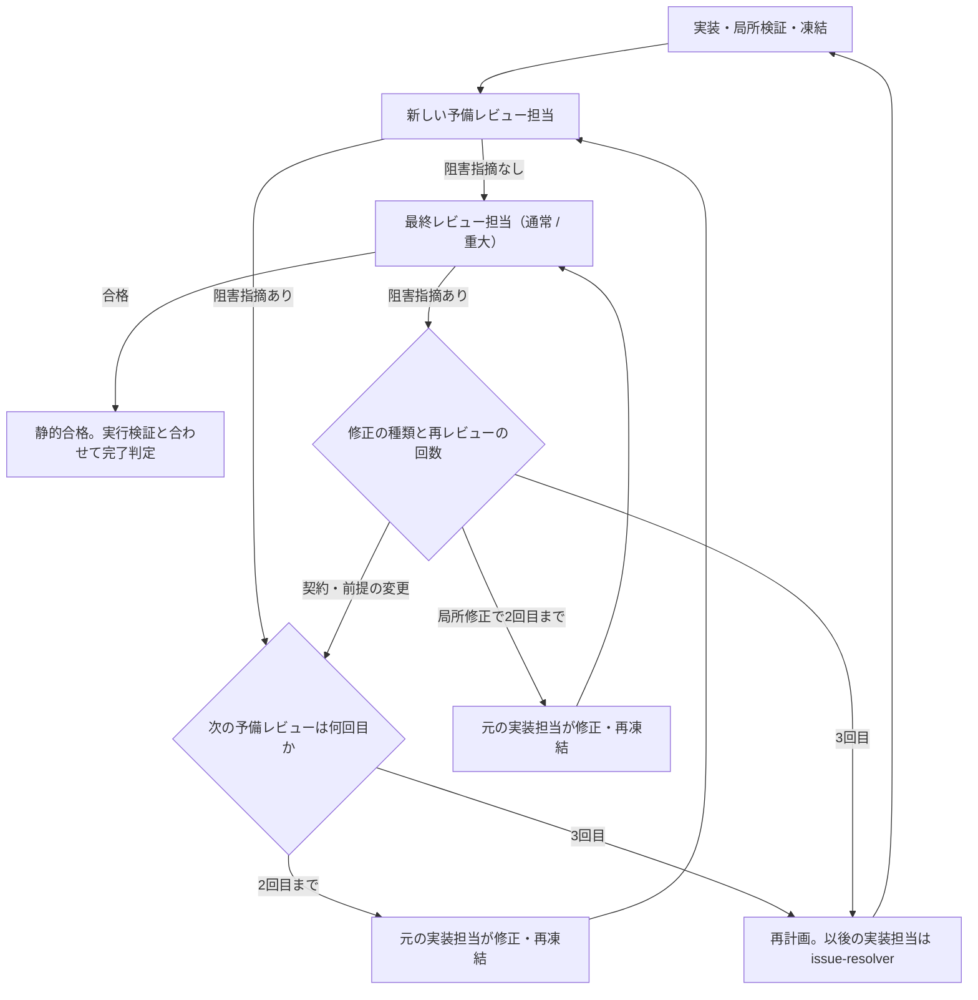

# エージェントによる開発作業

## 目的と適用範囲

複数段階の変更で、仕様判断、実装、検証、独立レビューを分担します。必要な判断だけを専用担当へ渡し、依頼の区分ごとに適用する工程は[工程の適用範囲](#工程の適用範囲)で決めます。機能の挙動は各機能仕様、テスト設計は[テスト作成](test-authoring.md)、実行条件は[検証](testing.md)を正本とします。

## 用語

全体ルート、実装単位、単位責任者、責任者、担当、凍結、予備レビュー、最終レビューは[用語集の開発作業の分担](../glossary.md#開発作業の分担)に従います。

## 仕様

### 工程の適用範囲

責任者は着手前に依頼を次の区分へ当てはめ、適用する工程を決めます。

| 区分 | 対象 | 適用する工程 |
| --- | --- | --- |
| 質問・調査 | 作業ツリーを変更しない回答・調査・点検。 | 実装の委譲、レビュー、実行検証を要求しない。調査や点検の委譲は行える。 |
| 軽微な修正 | 製品とテストの挙動に影響しない文書・コメントの変更。機能の実装ではなく、既定値や画面部品の寸法・配置など、値の調整に近い変更。 | 実装の委譲、予備・最終レビュー、`verify` を責任者の裁量で省略できる。 |
| 通常変更 | 上記以外で、[重大変更の判定](#重大変更の判定)に該当しない変更。 | [役割と順序](#役割と順序)の工程。最終レビューは `repo-static-review`。 |
| 重大変更 | [重大変更の判定](#重大変更の判定)に該当する変更。 | [役割と順序](#役割と順序)の工程。最終レビューは `critical-static-review`。 |

[重大変更の判定](#重大変更の判定)の境界に当たる変更は、値や文言だけの変更でも軽微な修正にしません。区分を判断できない場合と、作業中に区分の前提が変わった場合は、より多くの工程を要する区分として扱います。

軽微な修正で工程を省略する場合も、責任者は変更の影響に応じた確認を選びます。文書は[文書変更の確認](../../README.md#文書変更の確認)、コードはビルドや対象moduleの局所実行などです。実施した確認と省略した工程を報告します。

通常変更と重大変更では、効率や差分の小ささだけを理由に工程を省略・統合・並べ替えしません。各工程の中で省略できる条件は、[テスト設計の要否](#テスト設計の要否)など各節の定めに従います。

### 役割と順序

| 担当 | 責務 |
| --- | --- |
| 全体ルート | 利用者への質問、全体の優先順位、単位間の依存と共有契約、ワークツリーの割当、`verify` と性能測定の開始調整、`dev` への統合、全体の判断と報告。 |
| 単位責任者 | 指定範囲の調査、テスト必要性の判断と独立設計の承認、引継ぎ点検、実装、対象moduleの局所MTP実行、仕様・計画の更新、レビュー手配、元実装担当への差し戻し、ブランチ内のコミットと統合引継ぎ。 |
| `design-advisor` | 未決の難しい設計問題への助言。承認や実装はしない。 |
| `test-contract-designer` | 仕様から判定基準を先に定め、その後に検証境界・保証の分担・配置を設計する。 |
| `plan-clarifier` | 完成した実装引継ぎを、未記載の契約を補完せずに読んで質問する。 |
| `implementation-worker` | 承認済み契約と許可パス内で実装・差し戻し修正・局所検証を行う。 |
| `issue-resolver` | 再計画後の実装単位で、`implementation-worker` と同じ契約で修正・再実装を行う。 |
| `preflight-static-review` | 凍結範囲の全体を新規コンテキストで予備レビューする。呼出しごとに新しい担当を使う。 |
| `repo-static-review` / `critical-static-review` | 予備レビューに合格した通常 / 重大変更を、同じ合格基準で独立して最終レビューする。 |

責任者は範囲内の各工程を判断し、全体ルートの工程別の再承認を求めません。小さな単位では責任者が実装を兼ねられますが、必要な独立テスト設計と独立レビュー、通常 / 重大変更の区分は維持します。専用の管理ロールや管理階層を増やさず、各環境の汎用担当を単位責任者に使えます。

通常変更と重大変更の各実装単位は、計画案 → 必要な設計相談 → 必要な独立テスト設計と承認 → 引継ぎ点検 → 責任者の確定 → 実装 → 必要な整形・ビルドと局所検証 → 凍結と予備レビュー → 最終レビューの順に進めます。相談・設計・点検の担当は実装開始前に終了します。`verify`・`full`・性能測定は静的レビューと独立して進め、統合・完了時に両方の合格を確認します。

### 担当の共通契約

全体ルートと単位責任者は、必要な子担当を呼べます。引継ぎには、判断を返す責任者、担当範囲、許可パスを明示します。担当は開始時に `git status --short`、リポジトリルートと対象範囲の `AGENTS.md`、本書の共通規則と役割の節を確認します。調査は必要な根拠と関連経路に絞り、同じ全体調査や履歴の複写を繰り返しません。仕様の補助図を扱う際は[補助図の運用](../README.md#補助図mermaid)に従います。

書込みは許可パス内に限り、無関係な既存差分を変更しません。読取り専用担当は作業ツリーの対象差分を変更しません。差分・履歴・ファイルの読取り、検索、`git diff --check` などの非変更確認は行えます。責任者が同じ版で成功を確認済みの検証は再実行しません。専門担当は結果を指定された責任者へ返します。全体ルートと単位責任者は、自分が管理する作業ワークツリーで必要な検証・独立レビューを通過した意味のある変更をローカルコミットできます。コミットと送信・公開等の権限は[ブランチ運用](release.md#ブランチと履歴)に従います。

資料・入力不足は `NEEDS_ROOT_INPUT`、契約・担当範囲の変更判断は `NEEDS_ROOT_DECISION` として、引継ぎで指定された責任者へ返し、影響する編集を止めます。識別子に `ROOT` が含まれていても、範囲内の判断は単位責任者が行います。利用者の挙動・保証の未確定、依頼範囲の拡張、他の単位や共有契約への影響は全体ルートへ戻します。責任者は[要件の確定手順](#要件と到達可能性)に従い、調査で解消する不明点と利用者への質問を分けます。結果は日本語で簡潔に返し、未確認・未実施を成功として報告しません。

全担当の検証・レビューは[検証方針](testing.md#検証方針)に従います。実機確認の未実施だけを受入阻害事項や入力不足として扱いません。必要な自動検証・静的確認の不足、失敗、既知不具合は報告・対処します。

### 要件と到達可能性

責任者は計画・要件・設計を確定する前に、目的・制約・対象外・完了条件と、挙動・責務・保存・互換性・操作の許可条件・失敗・取消・性能の契約に未確定事項がないか確認します。利用上その保証が必要か、どの操作・条件まで適用するかも確認対象です。通常の利用目的と合意済みの範囲から判断できる事項は責任者が判断します。契約内の実装方法は担当の裁量に残し、承認済み事項を再質問しません。

資料・コードで確認できる事実は調査します。利用者の意図に依存し、挙動や保証が変わる選択は、全体ルートが選択肢・影響・推奨案を示して利用者へ質問します。回答までは、その判断に依存する設計の確定・実装・テストの期待結果の確定を止め、独立した調査は進められます。責任者が仕様を記述したことやレビューの合格を、利用者の合意の代わりにしません。実装・検証・レビュー中に未確定事項が見つかった場合も同じ扱いです。

入力検査を変える場合は[互換性の原則](../../../AGENTS.md#変更の原則)に従い、従来と変更後の受理・拒否、変更理由、利用者への影響を示します。既存経路や代表入力で判断できる範囲を使い、従来の扱いが未確認なら明記します。判断のためだけに網羅的な比較実験を必須にしません。

競合への対処は[必須の判断手順](../core/workflow-concurrency.md#競合対策を決める手順)を経て確定します。その他の実行時の問題も、本番の入口・前提・経路・影響で判断し、テストだけで作れる状態や仮説を根拠に保証を増やしません。承認済み新機能は計画上の入口、検証失敗は実際の診断を根拠にします。

### 重大変更の判定

責任者は計画時と最終差分の確定時に、次の契約または保証の実現方法を実質的に変えるかを確認します。

| 境界 | 対象 |
| --- | --- |
| 永続化・互換性 | 保存、削除、置換、補償、確定、データ形式・互換性。 |
| 並行性・寿命 | 受付、取消、再入、世代、ロック、Dispatcher、終了・解放の順序と所有。 |
| 責務・処理方式 | 複数主体間の責務・可変状態の移管、大規模データの走査・索引・キャッシュ・バッチ化。 |
| 検証・実行制御 | 上記の保証を支えるテストの判定変更・置換・削除、セキュリティ、書込み権限、承認、必須検証、失敗報告の条件。 |

該当する変更は `critical-static-review`、それ以外は `repo-static-review` を選び、理由を計画か引継ぎに一、二文で示します。挙動維持でも実現方法を組み替える変更は対象です。ファイル名・差分量・機械的な改名や整形だけでは判定しません。境界への影響を確認できない場合は、未確認点を示して重大変更として扱います。

### 設計相談

重大な境界の新設・再配分に未決事項がある、または設計案の責務・状態・互換性・失敗・性能を比較する必要がある場合に `design-advisor` を使います。承認済み設計の再確認には使いません。

判断したい問題、維持条件、事実と参照、変更可能範囲、既知の候補を渡します。担当は推奨と理由、削除・統合できる処理や状態、検証観点、未決事項を返します。候補の水増し、実装、テスト設計書の代作、全体レビューはしません。採否は責任者が決め、利用者の未決の希望を代わりに承認しません。

### テスト設計の要否

責任者は[恒久テストの必要性](test-authoring.md#変更分類と恒久テストの必要性)を判断し、追加・意味変更・置換が必要な範囲だけ `test-contract-designer` へ渡します。機械的変更と代替不要の削除には設計書を要求しません。テストの新設・変更の判断と、既存テストを実行する範囲の判断は分けます。

設計担当には独立した要件・仕様・明示的に承認した現行挙動の固定範囲を渡します。現在の実装・出力・既存期待値から正解を推定させる調査履歴は渡しません。初期入力と継承履歴にも同じ制約を適用し、独立性を確保できなければ[利用不能時の扱い](#担当機能を利用できない場合)に従います。

担当は[判定基準](test-authoring.md#仕様の根拠とテスト設計書)を先に確定し、その後に実装・既存テストを調べて到達経路、検証境界、保証の分担、配置を設計します。責任者はその対応を承認し、置換・削除では必要な保証の移管先も確認します。具体的なAPIや配置の都合で期待結果を変えません。設計内容は既存の計画・引継ぎにまとめ、別の台帳や承認工程は増やしません。

### 実装担当への入力

目的・完了条件・対象外、変更対象の入力受理範囲・操作の許可条件を含む確定した契約と根拠、担当の裁量、許可パス・既存差分・依存と共有資源、関連仕様、検証方法を渡します。必要なテスト設計は承認済みの判定基準・検証境界・保証の分担・配置・待機と解放を参照します。既存の計画か引継ぎメッセージを使い、専用台帳や重複資料は作りません。

複数ワークツリーで進める場合は、対象ワークツリーの絶対パス、ブランチ、基準版を明示し、担当がその場所で必要な設定・引継ぎを読めることを確認します。担当はコマンドの作業ディレクトリとファイル操作の対象を明示し、別ワークツリーの差分と取り違えません。

担当は契約を保って実装し、既存の補助処理やテストの準備・表明方法を適合させます。局所修正と対象moduleの局所MTP実行は担当が行い、責任者が開始・結果・回収を管理します。単位の最終検証は責任者が手配し、`verify`・`full` と性能測定の開始調整は[複数ワークツリーの検証](testing.md#複数ワークツリーの検証)に従って全体ルートが行います。

### 引継ぎの点検

必要なテスト設計の承認後、実装直前に `plan-clarifier` を一度呼びます。実装担当と同じ引継ぎを渡し、計画策定の会話や他担当への権威付けを添えません。起動時の履歴継承も確認し、未記載の前提を持つ状態を独立した読解点検とは扱いません。

担当は適用指示・引継ぎ・明示された参照だけを読み、広範な探索や実装からの仕様推定をしません。結果が変わる不足・矛盾について、該当記述と実装への影響を質問します。参照先に回答があれば根拠を示し、再質問しません。担当の裁量は未決と区別し、推奨案・設計改善・テスト必要性の再判定は担当しません。

必要な参照を確認できなければ `NEEDS_ROOT_INPUT` として点検未完了を返します。未完了の点検は入力補充後に完了させます。「質問なし」は設計の正しさ・網羅性・安全性の保証ではありません。責任者は不足を解消して引継ぎを確定します。完了済みの点検への説明補充だけなら再点検せず、契約・範囲・期待結果が実質的に変わる場合だけ、影響する設計・承認と引継ぎ点検をやり直します。

### 不備の差し戻し

責任者は発見者・工程・重大度ではなく、次の状況で対応を選びます。入力不足や契約の未決事項があれば先に解消します。

| 状況 | 対応 |
| --- | --- |
| 実装漏れ、計画未達、検証失敗、受入阻害指摘 | 元の実装担当へ通常修正を戻す。責任者が実装を兼ねた場合は自分で修正する。統合確認・予備レビュー・最終レビューのどこで見つかっても同じ。 |
| レビュー結果の確認漏れ・根拠不足・矛盾 | [レビューの進行](#レビューの進行)に従い、レビュー担当へ補完を求める。実装修正とは分ける。 |
| 資料、環境、権限など必要な入力の不足 | `NEEDS_ROOT_INPUT` として責任者が補充する。 |
| 契約、期待結果、責務、担当範囲の変更が必要 | `NEEDS_ROOT_DECISION` として責任者が判断し、必要な設計・承認・引継ぎ点検へ戻る。 |
| 同じ実装単位でレビューの反復が上限に達した、または修正担当が通常修正で進めないと報告し入力・契約の不足では説明できない | 通常修正の行より優先する。次の修正を始める前に[反復回数と再計画](#反復回数と再計画)に従って再計画し、以後の修正担当を `issue-resolver` にする。 |

元の実装担当が終了していれば再開し、再開できなければ現在の差分と引継ぎを同じ役割の新しい担当へ渡します。担当不明・複数領域の不備は、責任者が修正担当と許可パスを割り当てます。責任者自身の統合作業の不備は、責任者が修正するか実装担当へ割り当てます。

差し戻しでは、違反する要件、期待結果と観測結果、診断、現在の差分、許可パスを渡します。修正担当は原因調査・修正・局所検証を行い、責任者は修正後に影響する統合確認・検証を行います。契約を保つ通常修正だけなら再設計・引継ぎ点検は不要です。確認済み領域の妥当な指摘は、別領域のレビュー完了を待たずに修正へ戻せます。凍結範囲に影響する修正は、[領域単位の凍結](#領域単位の凍結)に従って該当レビューの読取りを止めてから行います。差し戻しと担当交代のどちらでも、元の担当の編集・検証と、同じ範囲へ書き込む他の処理の停止を確認してから書込みを引き継ぎます。

### 実装担当の完了報告

`implementation-worker` と `issue-resolver` は、結果、変更ファイルの役割、検証と結果、依存・競合・残課題を返します。テスト変更は判定基準と実際の検証境界、既存テストとの分担、置換前後の保証、共有資源・実行区分・待機と解放を対応付けます。必要と判断した失敗再現・識別力の確認、省略・時間超過は、適用条件と実際の結果を区別して報告します。通常修正を試しても進めない場合は、試行結果と未解決の技術的理由を責任者へ返します。

### レビューの共通確認

レビュー担当は指定版間と作業ツリーの対象差分（ステージ済み・未ステージ・未追跡）から、関連する呼出元・失敗経路・テスト・仕様を追います。要件充足、正常・空入力・失敗・取消・再入・終了、互換性、責務・スレッド・資源寿命、性能、ログ・翻訳・バージョン、テストの独立性を変更に応じて点検します。[ファイルとDBの整合](../library/file-db-consistency.md)等の受容済みの限界から新しい保証を要求しません。阻害指摘を発見してもそこで探索を打ち切らず、指定された確認対象を一巡してから結果を返します。

テストの設計・置換は[テストレビューの観点](test-authoring.md#引継ぎとレビュー)、実行結果と未実施範囲は[検証方針](testing.md#検証方針)に照らして確認します。実処理の通過量やテスト種別だけで保証を評価しません。

入力検査による拒否範囲の拡大と競合への対処は、[要件の確定手順](#要件と到達可能性)に照らして確認します。規格違反や内部APIだけで再現できる競合を理由に、未合意の拒否条件・並行実行の保証を要求しません。本番で再現した競合も同じ判断手順へ戻り、並行実行を維持する修正を当然の前提にしません。本番での受付制限の漏れや、確定した契約への違反は指摘し、操作の許可や保証自体が未確定なら責任者へ判断を戻します。テストの期待結果は、その判断後の契約に合わせます。

指摘は重大度、違反要件、経路・条件・影響、`file:line`、確信度、修正範囲を示します。P0は直ちにデータ消失・セキュリティ・起動不能へつながる問題、P1は現実的な誤動作・停止・互換性退行、P2は受入条件への直接違反です。好み・差分量・仮説・対象外の改善は受入阻害事項と分け、指摘の有無、確認範囲、不確かさを返します。必要範囲の未確認を合格にしません。

### レビューの進行

レビューは、必要な整形・ビルドと、追加・変更したテストおよび変更箇所の局所検証が成功し、対象差分と判断に使う共有依存を凍結できた時点で開始します。`verify`・`full`・性能測定の完了や成功は開始条件ではありません。静的レビューと実行検証は独立した合格条件で、「最終レビュー合格・実行検証未完了」は有効な中間状態です。全体テストの未完了・未成功だけでレビューの開始・進行・静的な合格判定を止めず、具体的なコード上の不備や保証欠落は指摘します。実行検証の失敗が判明しても確認済みのレビューを自動で失効させず、新しい証拠が判断に影響する箇所だけ確認します。

予備・最終レビューには、目的・受入条件、比較版・対象差分、検証要約、必要な承認済みテスト設計を渡します。予備レビューの各回と、最終レビューの初回・再計画後は新規コンテキストで始め、以前のレビューの指摘・会話・修正説明を渡しません。回答の補完、重大用への切替、最終レビューの局所再レビューの引継ぎは各節に従います。

開始前に凍結範囲へ書き込む担当と、その範囲を変更し得る処理を止めます。レビュー中は責任者も凍結範囲を変更しません。ソースを変更しないテストや、レビュー対象外の生成物だけを書くビルドは並行できます。自動整形は凍結前に済ませ、同じ版で成功済みの検証は根拠なく再実行しません。読取り中の凍結範囲が無断で変わった場合は、影響するレビューを止め、対象版と必要な確認範囲を更新します。

責任者は応答ごとに結果を確認し、次のように進めます。

| 結果 | 次の処理 |
| --- | --- |
| 必要範囲を確認済みで、静的な受入阻害事項がない | 予備レビューなら合格とし、同じ凍結版で最終レビューへ進む。最終レビューなら静的合格として保持し、実行検証と合わせて[完了判定](#完了判定)へ渡す。任意の改善提案だけでは修正を必須にしない。 |
| 妥当な受入阻害指摘がある | 修正範囲の凍結を解除し、[不備の差し戻し](#不備の差し戻し)で修正する。必要な検証後に対象版を更新して再凍結し、[予備レビュー](#予備レビュー)または[最終レビュー](#最終レビュー)の規則で次の担当を呼ぶ。 |
| 確認漏れ・根拠不足・矛盾がある | 当該範囲を未完了として、同じ凍結版のまま同じ担当へ補完を求める。担当を再利用できなければ同じ役割の新しい担当で必要範囲を確認し、最終レビューで確認履歴を引き継げない場合は[最終レビュー](#最終レビュー)の局所再レビューを続けない規則に従う。指摘を採用しない場合も、契約・経路に基づく理由を示す。 |

回答の補完は修正後の再レビューと区別します。補完できない未確認点は合格にしません。

指摘が出たあとに誰を呼ぶかは次の図のとおりです。責任者は次の修正を始める前に分岐を判断します。回数の数え方は[反復回数と再計画](#反復回数と再計画)、契約・前提の変更の判定と、その修正に先立つ設計・承認・引継ぎ点検は[最終レビュー](#最終レビュー)に従います。

### 予備レビュー

責任者は差分・引継ぎから担当の重複、契約との一致、旧経路の退役、文書の移管を確認して統合し、[開始条件](#レビューの進行)を満たして凍結します。完了範囲を再実装せず、不備は[差し戻し](#不備の差し戻し)で扱います。全体の実行検証は[実行範囲の選択](testing.md#実行範囲の選択)に従って別に進め、レビュー開始のために完了を待ちません。検証後に差分が変わった場合は、影響する検証を新しい版で行います。同一版の失敗の再実行は[検証規則](testing.md#実行期限と失敗分類)に従います。

予備レビューは、新しい `preflight-static-review` を新規コンテキストで呼び、凍結範囲の全体と判断に必要な関連経路を確認させます。凍結範囲は分割しない場合は最終レビューへ渡す対象差分全体、[領域単位](#領域単位の凍結)で分ける場合は各担当に割り当てた領域です。初回の確認で受入阻害指摘がなく、必要範囲を確認済みなら合格です。指摘があれば修正・関連検証・再凍結の後、修正範囲と共有依存に影響する領域ごとに別の新しい予備レビュー担当を呼び、影響のない領域の結果は保持します。同じ担当に修正を再確認させても合格の根拠になりません。予備レビューは毎回新しい目で凍結範囲を見る工程であり、最終レビューの代替ではありません。

### 最終レビュー

予備レビューに合格した同じ凍結版に対して、当該変更の設計・引継ぎ点検・実装・予備レビューに参加していない新しい担当を一人選びます。[重大変更の判定](#重大変更の判定)に従い、通常は `repo-static-review`、重大変更は `critical-static-review` を使い、共通入力に分類理由を加えます。予備レビューを理由に担当設定を置き換えません。最終差分全体を独立して確認させ、領域単位で進める場合は同じ最終担当が確認範囲を補完し、最後に組み合わせた版の整合を確認します。

通常担当も重大な指摘を報告します。重大変更の見落しや判断しきれない重大問題があれば、指摘・確認済み範囲・未確認点・切替理由を責任者へ返します。責任者は通常担当を終了し、凍結を維持して新しい重大担当へ引き継ぎます。重大担当は同じ最終差分全体を参照し、引継ぎを活用して必要な確認を終えます。担当の切替だけなら予備レビューをやり直さず、通常用の完走や二重の全体レビューも要求しません。

最終レビュー後の修正も[不備の差し戻し](#不備の差し戻し)で扱います。契約を保つ局所修正なら、検証・再凍結後、予備レビューを挟まず同じ最終レビュー担当へ戻せます。前回の版・指摘・修正差分・検証結果を渡し、修正と直接影響する契約を確認させます。担当が編集に参加していないことと、確認履歴を確実に引き継げることが条件です。予備レビューと違って一人の担当が最終版全体の整合を見るため、同じ担当の再レビューを認めます。

重要な前提・範囲・契約が変わる、責務・状態・主要な実行経路・並行性・寿命を実質的に組み替える、または確認履歴を確実に引き継げない場合は、局所再レビューを続けません。契約・範囲・期待結果の変更には必要な設計・承認・引継ぎ点検を行い、再凍結後に影響する領域を新しい予備レビュー、続いて新しい最終レビューで確認します。影響が差分全体へ及ぶ場合は全体をやり直します。履歴の喪失だけを理由に実装は変更しません。

実装・修正への参加や、渡さないと定めた以前のレビュー内容の継承によって独立性を失った担当の結果は、合格根拠に使いません。原因の解消・必要な検証・再凍結後に新しい予備レビューからやり直します。影響のない領域の結果は保持し、非変更確認や不要だった追加確認だけでは結果を破棄しません。

### 領域単位の凍結

レビューを分割する場合、責任者は領域ごとの対象パス、判断に使う共有コード・仕様・設定、比較版・対象版、確認済み範囲と未確認点を引継ぎで示します。Git上の版や必要な一時スナップショットを使い、専用台帳や恒久的な状態保存は増やしません。共有依存は直接の参照だけでなく、接続・寿命・保証の分担を判断するために使う範囲も含めます。

凍結範囲に影響しない確認済み領域の修正は、別領域のレビューと並行できます。修正前に責任者が影響を確認し、レビュー中の領域または共有依存に及ぶ場合だけ、該当レビューへ停止を伝えて読取りの停止を確認します。修正・必要な検証後に対象版を更新し、影響する領域は[予備レビュー](#予備レビュー)なら新しい担当、[最終レビュー](#最終レビュー)なら局所再レビューの規則で確認を再開します。影響を判断できない範囲は凍結を維持します。

各領域の合格だけでは全体を完了にしません。修正が揃った対象ワークツリーで、レビュー対象と判断に使う共有依存への書込みを止め、領域間の整合を確認します。責任者と最終レビュー担当は、最終版が各領域の確認済み版・共有依存と一致し、接続・責務・保証の分担に未確認や矛盾が残らないことを確認します。共有依存の変更により以前の判断へ影響する場合は、その領域も再確認します。対象を変更しない実行検証は並行して継続でき、統合・完了前に必要な成功を別途確認します。

### 反復回数と再計画

実装単位ごとに、予備レビューを受けた凍結版の数と、最終レビューで修正後の再レビューを受けた回数を数えます。領域ごとに担当を分けても同じ凍結版なら1回です。最終レビュー後の契約・前提の変更で戻った予備レビューも予備レビューの回数に数え、その後の新しい最終レビューは初回として再レビューに数えません。実行検証の失敗を修正した後の再レビューは数えます。どちらの回数も再計画まで戻しません。回答の補完、担当の切替、領域の分割、独立性の喪失による同じ版のやり直しは数えません。

次のいずれかに当たる場合、責任者は次の修正を始める前に責務・範囲・完了条件・分割を再計画します。

- 3回目の予備レビューが必要になった。最終レビュー後の契約・前提の変更で戻る場合を含む。
- 最終レビューで3回目の再レビューが必要になった。
- 修正担当が通常修正を試しても進めないと報告し、入力・契約の不足では説明できない。

再計画で契約・範囲・期待結果を変える場合は、影響する設計・承認・引継ぎ点検もやり直します。再計画後、その実装単位の修正と再実装は `issue-resolver` が担います。責任者が実装を兼ねていた場合も委譲します。`issue-resolver` は `implementation-worker` と同じ入力・許可パス・完了報告の契約で動き、契約変更や無断の範囲拡大はしません。責任者は元の担当の編集・検証の停止を確認してから書込みを引き継ぎます。

再計画後は回数を戻し、新しい予備レビューから再開します。`issue-resolver` の周回で再び上記のいずれかの条件に当たった場合は、再計画や `issue-resolver` の再呼出しを繰り返さず、全体ルートを通じて利用者へ判断を戻します。回数や消費量を理由に未解決の指摘を合格にしません。

### 並列作業

単独開発はメインの作業ツリーで行えます。独立した修正は、別ワークツリー・別ブランチと明確な所有を定めて並列化できます。実作業中のワークツリーは、他のチャットの既存分も含めてメイン以外に同時最大5本とします。実装・検証・レビュー中と一時的な実行枠待ちは数えます。明示的に保留し、差分・資料の保全だけに使うワークツリーは除外します。保留した作業を再開するときは、全体ルートが空き枠を確認して実作業枠へ戻します。これは容量上限であり、枠を埋める目標ではありません。独立した作業と検証・統合の見通しがある場合に追加し、検証・レビュー待ちが増える場合は新規着手より完了・統合・ワークツリーの再利用や回収を優先します。上限の再検討は、実際の待ち状況や容量を根拠に提案します。他のチャットのワークツリーは、明示許可なく変更・回収しません。

並列開発中のメイン作業ツリーは `dev` ブランチの統合専用とし、原則クリーンに保ちます。新しい実装・テスト・仕様・計画は各作業ワークツリーの別ブランチで完結させます。全体ルートは全体調整と `dev` への統合を担い、単位内の作業は単位責任者へ任せます。メイン作業ツリーへ別の長期実装を抱えません。この運用への切替えは、実行中の検証や凍結中のレビューを妨げない安全な切れ目で行います。

メイン作業ツリーに未完了差分があり、独立した完成単位の統合を妨げる場合は、利用者が許可した範囲で作業ワークツリーへの移管を行います。元の担当の編集・検証、同じ範囲へ書き込む処理、関連するレビューの読取りの停止を確認し、差分と必要資料、所有、基準版、確認済みの版・範囲・共有依存・結果と未確認点を引き継ぎ、移管先との一致を確認して喪失・二重編集を防ぎます。移管やアプリの再起動だけを理由に、成功済みの確認を破棄しません。

同一ワークツリーの書込みは原則一担当とします。目的・ファイルの分離だけで独立とせず、共有API、DBスキーマ、共通テスト補助処理、生成物、仕様への依存を確認し、先行作業に依存する修正は直列に進めます。同じ機能の別実装は競わせません。メインの未コミット差分を別ワークツリーへ無断でコピー・移動しません。責任者の編集・検証も競合させません。

ワークツリー数と担当数を区別し、調査・設計・実装・レビューの担当に作業ワークツリーと同じ枠数の制限を設けません。待機・差し戻し用の担当を保持するために必要な委譲を抑えず、不要な担当や重複した委譲を整理します。子担当の容量は各実行環境の上限に従います。Codex の子担当スレッドの容量は[全体設定](../../../.codex/config.toml)に従い、設定行の削除を無制限化として扱いません。委譲後の待ち方は[担当の完了待ち](#担当の完了待ち)に従います。

検証・レビューの対象ワークツリーと共有依存の版を確認中に固定します。別ワークツリーの変更だけで確認済みの結果を一律に破棄せず、影響する版・領域・検証を更新します。独立した調査・編集は進められますが、対象moduleの局所MTP実行は単位責任者が自主管理し、`verify` と性能測定の開始は[複数ワークツリーの検証](testing.md#複数ワークツリーの検証)に従って全体ルートが調整します。

各実装単位の必要な設計、検証、予備レビュー、最終レビュー、コミットは維持します。依存のない単位は着手順に縛らず、準備が揃ったものから、全体ルートが[通常の作業ブランチの統合](release.md#通常の作業ブランチの統合)に従って `dev` へ一件ずつ統合します。統合引継ぎと確認、作業ワークツリーの再利用・回収、完了ブランチの削除は同手順に集約します。再利用時の次の単位とワークツリーの割当は全体ルートが決めます。

### 担当の完了待ち

委譲した担当の完了は、実行環境の完了通知で待ちます。親が担当の作業を逐一監視して利用者へ実況し、利用上限を消費することを防ぐためです。

- 全体ルートと単位責任者は、配れる独立作業があれば配分し、自分に進める仕事があれば進めます。一件委譲しただけで即時待機を原則にせず、配る仕事も自分の仕事もない場合に待ちます。
- 完了確認だけを目的に、状態一覧・担当の会話・差分・ログを繰り返し読みません。待機中という進捗だけの通知もしません。担当の確認や進捗報告は、新しい情報、完了・判断依頼、利用者の入力、別の独立した作業理由がある場合に行います。
- 委譲した担当の結果を回収せずに、依頼の作業を終えません。中断・失敗・停止した担当は、実装担当なら[不備の差し戻し](#不備の差し戻し)、レビュー担当なら[レビューの進行](#レビューの進行)の規則で再開するか、同じ役割の新しい担当へ引き継ぎます。責任者が中断から復帰したときは、未回収の担当の有無を先に確認します。

呼出し方と待機の設定は実行環境ごとに定めます。

| 実行環境 | 正本 |
| --- | --- |
| Codex | [全体設定](../../../.codex/config.toml)。`wait_agent` は原則 `timeout_ms=900000` とし、連絡・利用者入力で復帰する。意味のある状態変化のないtimeoutでは進捗通知や状態照会を挟まず再待機する。 |
| Claude Code | [Claude Code 固有の事項](../../../CLAUDE.md#担当の呼出しと待ち方)。 |

### 完了判定

区分に応じた検証とレビューを終えた実装単位は、その単位でコミットしてから次の単位へ進みます。複数の単位を一つの未コミット差分へ溜めず、次の単位は前の単位の未コミット差分を残さない状態から始めます。途中のどのコミットも、その単位に必要な検証とレビューを終えた状態を表すように順序付けます。

担当の完了報告や予備レビューの合格だけでは、作業全体を完了にしません。統合・完了には、最終差分へ適用できる最終レビューの合格と、作業段階で必要な実行検証の成功の両方を要求します。軽微な修正で[工程の適用範囲](#工程の適用範囲)に従って省略した工程は、この要求から除きます。最終レビュー合格・実行検証未完了の中間状態では統合せず、レビュー合格をテスト省略の理由にしません。責任者は受入阻害事項の解消、文書の移管・一時資料の削除も確認して引き継ぎます。全体ルートは各単位の結果と統合後の整合、残課題を確認して依頼全体を報告します。失敗・未実施・未確認は明記し、成功扱いにしません。レビュー後に文書を含む対象差分を変更した場合も、影響する局所検証・再レビューと必要な全体検証を行います。版と確認範囲は既存の担当連絡・Git・検証結果で引き継ぎ、新しい状態台帳や管理層は設けません。

### 計画と記録

[資料運用](../../README.md)と[計画運用](../../plan/README.md)に従い、現在の判断・根拠・残作業・再開情報だけを残します。完了時は必要な契約・設計判断・残課題を移管し、作業専用資料を削除して参照を更新します。一時的な番号やログを恒久資料・コード・テストへ持ち込みません。レビューの根拠は引継ぎか指定されたGit上の版を使い、完了計画の保存を要求しません。

### 担当機能を利用できない場合

専用担当がなければ、同じモデル・推論強度・権限・役割契約を明示した汎用担当を使えます。同等の設定や独立入力を確保できなければ該当工程を未実施として返し、完了扱いにしません。別モデルや自己点検への無断の置換はせず、異なる条件で続行するには相違・影響を示して利用者の合意を得ます。

## 実装とテストの対応

| 仕様項目 | 設定・参照 | 確認方法 |
| --- | --- | --- |
| 役割の選択・権限・並列度 | [Codex役割設定](../../../.codex/agents/README.md)、[Codex全体設定](../../../.codex/config.toml)、[Claude Code役割設定](../../../.claude/agents/) | TOML・YAMLの構文と、モデル・推論強度・権限・参照する節が[役割と順序](#役割と順序)と一致すること。担当数とワークツリー数の区別。 |
| 工程の適用範囲・担当の完了待ち | [Codex全体設定](../../../.codex/config.toml)、[Claude Code 固有の事項](../../../CLAUDE.md)、[Claude Code設定の案内](../../../.claude/README.md) | [工程の適用範囲](#工程の適用範囲)の区分と[担当の完了待ち](#担当の完了待ち)が、各環境の指示・スキル・フックの記述と矛盾しないこと。スキルが参照する見出しが正本に存在すること。 |
| 要件の確定・引継ぎ・独立設計 | [開発指針](../../../AGENTS.md#変更の原則)、[競合対策の判断](../core/workflow-concurrency.md#競合対策を決める手順)、[テスト作成](test-authoring.md) | [要件と到達可能性](#要件と到達可能性)、[テスト設計の要否](#テスト設計の要否)、[引継ぎの点検](#引継ぎの点検)と、担当へ渡す入力の照合。 |
| 差し戻し・再計画・`issue-resolver` への切替 | [実装担当（Codex）](../../../.codex/agents/implementation-worker.toml)、[再計画後の実装担当（Codex）](../../../.codex/agents/issue-resolver.toml)、[実装担当（Claude Code）](../../../.claude/agents/implementation-worker.md)、[再計画後の実装担当（Claude Code）](../../../.claude/agents/issue-resolver.md)、本書 | [不備の差し戻し](#不備の差し戻し)の差し戻し先、[反復回数と再計画](#反復回数と再計画)の回数判定と、再計画後の担当が同じ契約で動くこと。 |
| 凍結・レビュー・並列作業 | [検証](testing.md)、[補助図の運用](../README.md#補助図mermaid)、本書 | [レビューの進行](#レビューの進行)の開始条件と結果の扱い、[予備レビュー](#予備レビュー)の毎回新規の呼出し、[最終レビュー](#最終レビュー)の選択・切替・局所再レビュー、[領域単位の凍結](#領域単位の凍結)、[並列作業](#並列作業)の上限と所有、[完了判定](#完了判定)。 |

構文・参照・UTF-8・LF・`git diff --check` と、設定・引継ぎ・運用契約の静的な整合を確認します。実際に行った委譲・返却・責任者による判断の観測と、未実施の設定適用・入力継承の実機確認は区別します。担当の起動・設定適用・入力継承に関わる運用変更では、必要に応じて[利用者に推奨する実機確認](testing.md#利用者に推奨する実機確認)を示します。運用文言を固定する自動テストや専用の評価基盤は設けません。

## 関連資料

[開発指針](../../../AGENTS.md)、[テスト作成](test-authoring.md)、[検証](testing.md)、[資料運用](../../README.md)。
