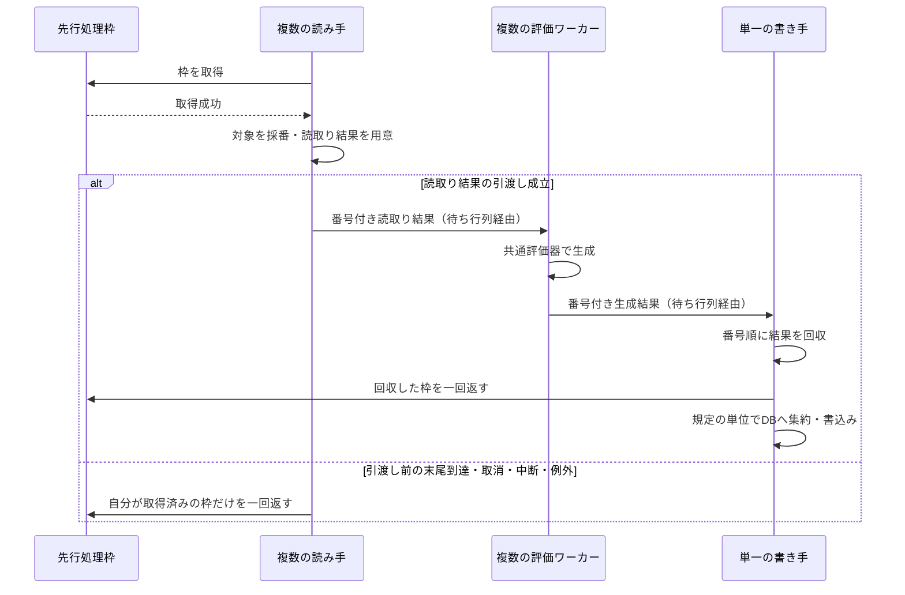

# LR2の楽曲DB生成と同期

## 目的と適用範囲

LR2連携モードで、現在のBMS譜面・検索ルート・プレイリスト出力から `song.db` の `song` と `folder` を生成する契約を定めます。LR2自身の起動時自動更新には依存しません。

## 用語

[共通用語集](../glossary.md)を参照します。コードの識別子は原表記を使います。

## 仕様

操作の受付分類・競合結果・必要継続の寿命は[競合ポリシー](../core/operation-concurrency-policy.md)を正本とします。以下は入力・処理・資源所有と結果の固有契約です。

### 管理範囲と設定

`song` と `folder` の生成列は再生成可能なデータです。ただし `song` の行の追加・削除はファイル差分検出が担当し、全体同期はその所属を変更しません。利用者が編集する `favorite`、`tag`、`adddate` は明示的な保持対象です。

BMSONはLR2へ出力せず、本アプリの `bmson_song` 等で管理します。BMSONにLR2互換性警告を出しません。スタンドアロンモードでは、LR2用のフォルダ行、`.lr2folder` 探索、`folderinfo.txt`、組込みカスタムフォルダの階層を生成しません。

LR2環境の確定時と起動時の設定読込みで、`config.xml` の `<autoreload>` を `0`（手動更新のみ）にします。BMS検索ルートは本アプリの共通画面から管理します。追加操作そのものでは再帰走査せず、通常の差分更新に含めます。入力は存在するディレクトリかつShift_JISで表せるパスとし、相対パスや同一・親子関係の重複を正規化・検証します。

### 受付と実終端

全体同期の開始・競合・権限継続は[競合ポリシー](../core/operation-concurrency-policy.md#設定全体操作終了)を正本とします。Runningは進捗表示であり物理処理の成功を表しません。

受理済みの設定・導入・差分の必須部分反映は同じ権限で実終端までawaitし、自己受付を取り直しません。推定入力を実変更する受理済み背景更新は先行操作の終端後に共通受付を取得して実更新します。起動全体同期と差分後のNeeded全体同期は開始競合なら見送り、確定したchart・通常フォルダ差分を保持して参照を更新します。未実施全体をCompletedとせず、既存Needed/Incomplete等と実結果で区別します。共通受付取得後の実実処理は手動要求も直接作業Taskで開始して実終端をawaitし、内側で起動スケジューラーの枠を待ちません。受理済み起動要求の外側の登録・依存・進捗は維持します。登録だけを完了にせず、失敗・終了取消でも開始済み処理と後片付けを待機してから解放します。同期失敗は状態保存後も元の例外を返し、先行の確定を巻き戻しません。DB接続の短期ロック、SQLite busy、署名・永続状態・進捗・Incompleteは維持します。

### 同期への入力

同一の受理済みLR2操作では小さい変更不能な設定入力・custom-フォルダ設定スナップショットを共通受付取得後・非同期準備Taskの開始前に一回捕捉し、署名・生成準備・プレイリスト・実処理入力へ明示的に渡して一致させます。配置は保存・適用済みの小スナップショットを使い、別セクションの未確定候補で署名・currentness・出力先を変えません。非配置の生成フラグも確定値を次の明示要求で新しく捕捉します。LR2独立の最新性・世代検査は維持します。

現在のBMSパス、検索ルート、必要な祖先ディレクトリと更新時刻、`folderinfo.txt`、探索済みの管理外 `.lr2folder`、アプリ出力、LR2組込みフォルダ、設定値、解析結果・互換性警告・リソース調査結果を受け取ります。不完全な入力を、同期内の広範な再探索で補って成功扱いにしません。

LR2に見せるjukeboxルートと、本アプリが譜面・リソースを走査するルートは用途が異なります。通常出力先、追加出力先、ルート出力先の扱いは[設定](../runtime/settings.md#カスタムフォルダと検索対象)を参照します。

利用者登録readerは、共有XML所有者の公開登録と同時公開された配置から、通常・追加・ROOT管理領域と子孫を除いて作ります。欠落登録と保存順を保ちます。走査readerは同じ所有者の公開入力から従来の存在・Shift_JIS・祖先包含の正規化を行い、通常出力を含め、追加・ROOT領域を除きます。必要所有者がない実ライブラリをstandalone入力へ読み替えません。

### songの生成

ファイル差分検出は、信頼できる走査範囲の現在パスをDBの完全一致キーで照合します。行の収束、大小文字だけ異なるパス、一対一・同一MD5での保存値引継ぎは[パスの同一性](../core/path-identity.md)に従います。全体同期は存在する行の生成列だけを更新し、不要行の削除、管理用補助行やダイジェストの整理を担当しません。

`date` は譜面ファイルの更新時刻をUnix秒で保存します。新しい行の `adddate` が未設定なら、同期時点のLR2形式時刻で初期化します。`level`、`judge`、`date`、`folder`、`parent` 等は現在の入力から生成します。日時の0や負値も有効なUnix秒として扱います。

共通現在値から生成列を保存する際の `level` は、その現在値を優先します。レベル上書き後も、取得済み譜面情報に残る元の表記レベルで上書き値を戻しません。文字コード補正の限定更新も既存の `level` を維持し、保存後の再読込みは確定済みレベルを使います。回帰確認は `BmsPlaylistMigrationAndRegistrationTests.PlaylistTableLevelOverwriteWorkflow_UpdatesOnlyExistingSongLevel` で、実上書き、メタデータの再読解、SQLite再読込みを連続して行います。

所持BMSの文字コード変更とリソース再調査に伴う再復号は、`SongMetadataUpdate` に完全一致パス・MD5と生メタデータを捕捉し、既存の同一内容の `song` に限定UPDATEします。更新列は `title`、`subtitle`、`artist`、`subartist`、`genre` と、捕捉したファイル更新時刻のUnix秒である `date` だけです。表示合成前の `RawTitle`、`RawSubtitle`、`RawArtist`、`Subartist`、`Genre` を使い、BPM・ノート数・exlevel・type・LN/BGA/RANDOM・レベル・判定・利用者列を含む他の全列を保持します。保留・未登録・別MD5の行を新設せず、全解析や既存全列の読戻しを保存の条件にしません。

メタデータ更新は文字コード・修正印等の保守値と同じ操作単位のトランザクションで確定し、DB成功後にだけ所持現在値と通知へ反映します。明示文字コード指定で生メタデータが同値ならsongの更新を要求しません。選択・全所持の強制リソース再調査でも、具体的な確定文字コードを保持して再復号した文字列が同値ならsongを更新せず、資源だけが変化した場合はmaintenanceだけを保存します。保守値も同じならDBへ書きません。一方、未確定値の再検出で非CP932の文字コードが確定した場合は、再復号の文字列が同値でも従来の限定更新を使います。確定文字コードの保持条件は[譜面の読取り](../library/chart-file-reading.md#導入と手動再走査)に従います。BMSONの保守ではLR2のsongを生成しません。

`folder` と `parent` はLR2互換のCRC32です。対象ディレクトリまたはその親のパスに末尾の `\` とNULを付け、Shift_JISのバイト列から計算します。パスをShift_JISで表せない、またはWindowsパスとして解釈できない場合も管理対象のBMS行は削除せず、両列を `NULL` にして互換性警告を付けます。計算は `LR2CRC32` と `Lr2SongFolderParentNormalizer` を正本とします。

新規追加と `UpsertSongs` では、この正規化を保存前に行います。相対パスの補正は、絶対パス化とCRC計算の両方が成功した場合だけ `song.path` に反映します。計算できないパスだけを中途半端に更新したり、警告対象を次の走査で削除・再追加したりしません。

譜面本体を読み取れない場合は、DB境界で同じ完全一致パスとMD5の既存行を使い、未取得の生成列を保持します。現在のテキストグループと取得済み詳細の限定列だけを反映し、保存行を共通現在値や同期要求へ逆参照させません。

差分インストール時のBMSの `song.txt` は、[導入の保存境界](../library/mutations.md#導入と導入先修正)で導入先の実配置から確定します。保存値と導入後の共通現在値を一致させ、配置・更新日時・内容が不変の直後の差分読込みで不要なtxt差分再解析を発生させません。BMSONへこのLR2列の規則は追加しません。

独立した基本読取り・ハッシュ・軽量解析の通常の未知失敗も、今回の対象を非採用にして旧楽曲行と利用者列、正常な別対象を保持します。未知失敗を正常な代替行の生成へ置き換えず、恒久的な解析不能行を作りません。既知のI/O失敗と読取りバッファーを得られない場合の既存の互換代替は維持し、扱いが異なる用途の分類だけを残します。失敗対象の順序位置も終端まで処理し、欠番によって後続を止めません。次の通常の解析機会で再評価し、自動再試行は追加しません。

独立した詳細解析だけの通常の未知失敗は、[共通評価](../library/chart-info.md#失敗)で今回の対象失敗として終え、正常に得た基本楽曲行と正常な別対象の詳細を保持します。未完成の結果を成功採用することや、純粋な取得・生成の捕捉へDB確定・必須引渡し・共有更新を含めることはありません。要求取消と待ち行列等の基盤故障は、この対象スキップと区別し、通常の開始済み処理の終端まで扱います。

### folderの全体生成

`folder.path` が行のキーです。通常ディレクトリは `type=1` とし、親のCRC32を `parent` に設定します。LR2ルート直下として扱う行は `ROOT` とNULのCRC32を親にします。自身のCRC32を保存する専用列はありません。`date` はディレクトリまたは `.lr2folder` の更新時刻であり、ルート行も実際の時刻と一致させます。

期待する集合は検索ルート、BMSのあるディレクトリとルートまでの祖先、`folderinfo.txt` のある場所、テキストグループ、`.lr2folder` に必要な親階層から作ります。同一パスの優先度は、組込みカスタムフォルダ、`.lr2folder`、`folderinfo.txt` のあるディレクトリ、通常ディレクトリの順です。同順位で同内容なら順序に依存せず一つにまとめ、異なる内容なら衝突です。

正常に読み取れたBMSや `.lr2folder` でも、パスをCP932で表現できない場合は該当する通常folder行・`.lr2folder` 行・親行だけを投影から省き、他の行の同期を続けます。BMSのsong行は保持し、`folder` と `parent` を `NULL` にしてLR2互換性警告を残します。folder投影の既存事前検査で探索未完了、`.lr2folder` または `folderinfo.txt` の読込み失敗、必要なディレクトリメタデータ不足を検出した場合は、従来どおり全体同期を失敗させます。この規則はBMS譜面本体の読取り失敗へ広げません。実装は `Lr2FolderTableReconciliationService.BuildProjection`、回帰テストは [`BmsLibraryLr2SongDbSyncTests`](../../../BeMusicSeeker.Tests/Lr2/BmsLibraryLr2SongDbSyncTests.cs) の `QueueLr2SongDbSync_CompletesWhenChartDirectoryPathIsUnsupported`、`QueueLr2SongDbSync_SkipsUnsupportedLr2FolderFileNameAndContinues`、`QueueLr2SongDbSync_SkipsUnsupportedLr2FolderParentAndContinues` です。

全入力の探索・取得・解析と必要な親行の構成が成功してから、一つのトランザクションでフォルダ表全体を置き換えます。不完全な入力や同順位の衝突では表を変更せず、`Incomplete` または `Failed` を返します。通常のプレイリスト・設定・譜面変更は、明示された局所範囲だけを同期します。

### 楽曲チャンクの確定と必須反映

楽曲行、`chart_info`、解析失敗と互換性事実、処理位置は同じ既存チャンクのトランザクションで一回だけ確定します。確定前の失敗はそのチャンクを巻き戻し、先行する確定済みチャンクと利用者列・処理位置を保持します。実確定後の索引・投影失敗でDBを巻き戻したり、処理位置を未確定の位置へ戻したりしません。

`ChartInfoRowsCommitted`、`ChartInfoParseFailuresCommitted`、`Lr2CompatibilityFactsCommitted` は確定済み事実の必須引渡しです。一つが失敗しても同じチャンクの他の必要な引渡しを各一度試み、失敗原因とスタックを維持して同期を失敗させます。必須引渡し内部の取消例外を、同期所有の終了取消へ読み替えません。進捗、性能記録、背景報告と画面通知は任意であり、その失敗で確定結果や失敗保存・実要求終端を飛ばしません。

#### 原因の選択と取消の分類

楽曲行の処理は先着した実故障を保持します。先着原因が所有する取消だった場合だけ、後続の必須引渡しなどの実故障を優先します。所有する取消と判定するには、記録時点で `OperationCanceledException` のトークンが要求トークンまたは連結した内部処理のトークンと一致し、要求トークンの取消か所有者の終了要求フラグが成立している必要があります。型とトークンが一致しない実故障では、終了要求フラグを取得しません。後発の取消で、先着した実故障や所有しない取消例外を再分類しません。

原因の選択にかかわらず全待機へ直ちに停止を通知し、開始済みの読取り・評価と待ち行列の完了処理を終端まで待ちます。所有しない取消例外は、未解決の巻戻しを優先判定し、`Failed` 保存を試みた後で実失敗として返します。元のメッセージ、内部原因のトークンとスタックを保持し、後発の終了要求でも通常取消へ変換しません。

#### 巻戻しと取消時の終端進捗

記録済みの所有取消は要求トークンの取消確認を通します。トークンが取消済みなら、既存の通知と例外返却を使います。終了要求フラグが先着し、トークン未取消のまま確認を通過した場合は、全開始処理の終端後に実確定位置・全体対象件数・`song_rows`・段階件数0/0を通知してから元の取消例外を返します。未解決の巻戻しはこの通知より先に失敗とします。任意通知の故障でも元例外と確定DB結果を保ち、古い評価進捗が確定位置を追い越さないよう、要求調整処理の `Incomplete` 保存へ実確定位置を引き渡します。

終了要求フラグを伴わない要求トークンの取消は、想定外取消として `Failed` を保存し、要求トークン付きの取消例外を返します。その他の実故障の返却契約は変えません。

巻戻しではSQLiteの実トランザクション終端を確認します。管理APIが失敗しても、既存の直接SQLによる巻戻しが成功した場合、またはSQLiteが既に巻戻している場合は、安全な取消完了として元操作の失敗・終了取消の区別を保持します。管理状態だけが解除されて実トランザクションが残る場合も直接巻戻しを試みます。実状態を確立できなければ元処理と両巻戻し原因を診断し、未解決の接続上へ状態保存を重ねず、所有接続の解放を含む実終端まで失敗として返します。終了要求の有無だけで正常な中断へ変換しません。

#### 必須投影と要求全体の完了

`Lr2SongDbSyncService.Run` の `FinalStage == CompletedStage` は内部の生成成功だけを示し、永続状態は `Running` と実確定した処理位置、未設定の完了時刻を残します。生成側は全体の完了進捗も出しません。保守書込み処理と所有接続を解放した後、既存要求調整処理が必須終端投影を一度実行し、所有トークンの取消を確認してから、既存状態保存窓口の `MarkCompleted` で実完了を保存します。その保存成功後にだけ完了進捗と完了要求版を公開します。投影を生成側のコールバックへ移して保守書込み処理と所持集合書込み処理のロック順を逆転させません。

要求の終端で確定互換性事実を投影するときは、試行済みと成功済みを区別し、失敗した投影を`catch`から再実行しません。先行する詳細索引や一部互換性投影の成功を保持し、終了取消の後に必須投影が失敗した場合も `Failed` とします。元の実失敗に続く二次投影の失敗は両方を診断して元失敗を返します。実投影の成功後でも所有終了が先着すれば完了を保存せず `Incomplete` とします。失敗状態の保存自体が失敗しても元原因を置換せず、公開の `Running` を解除して実要求を終結します。保存先に `Running` が残る場合も未完了を維持し、未確定の完了で次回同期を省略しません。全体の再試行・巻戻しや新たな永続故障台帳は追加しません。

### カスタムフォルダの階層

通常の `.lr2folder` は `type=2` です。特殊な種別は組込みフォルダだけに付け、`newsong.lr2folder` は3、`course1.lr2folder` から `course3.lr2folder` は6です。それ以外は本文に `#COMMAND` や `#TAG` があっても2です。

管理外ファイルは実際の探索ルート配下の階層を維持します。ルート自身だけを `ROOT` の直下とし、子ディレクトリやファイルを平坦化しません。アプリの通常出力先は出力基点をルートとして扱い、ルート出力先では各プレイリストのディレクトリをルートとして扱います。連番ファイルはそのプレイリストディレクトリを親とし、ルート出力基点の直下に置く単独ファイルだけを `ROOT` の直下にします。

保存時は `0000.lr2folder` からの連番をShift_JISで出力し、同じ生成内容からDB行を同期します。ルート出力の設定変更はLR2設定の検索ルートにも反映します。全体同期では更新時刻が一致しても本文を再解析します。全体同期の事前準備中に行うファイル作成・検証と、フォルダ表の確定を分けます。

組込みフォルダの場所はLR2実行ファイル配下の `LR2files/CustomFolder` です。`<customfolder>` のビットマスクが `RANDOM`、`favorite.lr2folder`、`TOP10.lr2folder`、`PLAYLEVEL`、`CLEAR`、`RANK`、`ignore.lr2folder`、`INSANE01`、`INSANE02` の有効化を制御します。コースは常に扱い、新曲フォルダは `titleflash` と `song.adddate` から生成対象を決めます。DBにはLR2ルートからの相対パスで保存します。

### 同期状態と起動

同期状態は `lr2_song_db_sync_status` の `name=default` 行に保持します。状態、入力署名、実行識別子、処理位置、総数、段階、エラー、更新・完了時刻を記録します。状態には `NotNeeded`、`Needed`、`Running`、`Completed`、`Failed`、`Cancelled`、`Incomplete` があります。

`signature` はハッシュ化せず、固定prefix `lr2_song_db_sync_v2` に、`appSchema=1`、`chartInfoSchema=5`、`chartInfoParser=21`、`songFolderGenerator=1`、`lr2FolderFileParser=1`、`lr2CompatibilityFacts=1`、`operationModeLR2DB=0` または `1` をこの順で `|` 区切りで連結した文字列です。構成・意味の変更は[開発指針の必須承認規則](../../../AGENTS.md#変更の原則)に従います。

`Completed` は、完全な生成入力、フォルダ表の確定、楽曲の生成列更新、親L/P内で取得した入力の反映、必須詳細索引・互換性投影、状態の保存が成功したことを示します。同じ入力署名で完了済みなら全体同期を省略します。これは `chart_info` の存在・完全性・現行性の証明ではありません。譜面情報の補完は[譜面情報の管理](../library/chart-info.md)に従います。

通常起動ではローカル必須出力の成功後、既存状態・署名で必要な全体同期を同じ親L/Pで直接待ちます。正常・失敗・中断とcleanupの実終端後に親受付を解放します。ローカル失敗では同期へ進まず、LR2だけの通常失敗ではローカル確定を維持し独立結果・永続記録・通知へ残します。親L/P解放後の必須UIと実host接続が成功してから通常・設定共通の終端で解禁し、同期失敗をUI成功の証明にもUI失敗の取消にも読み替えません。同期の失敗を上位のローカル準備成功へ混ぜず、進捗バーの再試行ボタンは設けません。設定画面の手動同期と次回起動は新しい入力を取得します。

失敗の保存と公開は`BMSLibrary.Lr2SynchronizationOwner`の同じ責務に集め、実行開始前の境界で失敗した場合も元例外を型付き結果へ残します。既に確定した`Failed`/`Incomplete`は上書き・重複通知しません。本番の起動・再初期化はこの結果を消費して既存のLR2状態を表示へ接続します。終了取消は非致命的なLR2失敗結果へ変換せず、上位の`ShutdownRequested`へ伝播し、親受付の終端後も初回完了・操作解禁・外部同期投入には進みません。

未完了状態、失敗後の再試行、手動の強制同期は先頭から実行します。保存した処理位置から再開しません。利用者向けの同期取消操作は設けず、アプリ終了の内部取消だけを区別します。安全に記録できる場合は `Incomplete` と `shutdown_interrupted` を残します。旧DBの `Cancelled` は読込み・表示・再試行判定に対応しますが、新しい通常実行では作りません。終了以外の取消は失敗として表面化します。

同期中も読み取り操作を許可し、DB変更を伴う操作は制限します。全体同期はカスタム定義とディレクトリ情報を読み、通常・カスタムフォルダの完全な投影を検証・一括確定してから、楽曲の生成列、同じ入力による同期状態の確定へ進みます。事前のプレイリスト出力・組込みカスタムフォルダ準備も同じLR2行へ通知します。観測用の実段階・件数・不定表示は[進捗管理](../runtime/progress.md#lr2楽曲db全体同期の段階)に従い、通知先の例外でDB結果を変えません。

楽曲の有限進捗はスキーマ等の準備後に開始し、同じ対象の短いチャンク保存でも役割と件数を維持します。既知0件の件数段階は通知しません。プレイリストの表ごとの再帰整理は独立した不定段階として残し、次表の出力で全体ファイル数の有限段階へ戻します。通知だけを整理し、DB確定・保存カーソル・物理整理の順序は維持します。

### 読込みと確定結果の再利用

リソース互換性は[共通リソース結果](../library/chart-model.md#譜面情報とリソース保守)の全元記述で評価します。推定・保守・同期・移転再評価の入口によらず、検索キーが同じ別原文も個別に扱い、非空のUnknownや空キーも原文の長さを評価します。真の空・空白だけの原文は共通結果に保持してもリソース長の評価対象にはせず、最大相対長を0として記録しません。`.flac` / `.jpeg` を照合用の `.wav` / `.png` として1バイト短く数えません。元記述のトリム、区切り、独立した `.` の整理とCP932の259・260バイト境界を維持します。パスなしCP932診断は文字コード警告を付け、他の参照の長さ評価を妨げません。

楽曲行の処理開始時に、現行パーサー版の譜面情報と、再試行期限を考慮した解析失敗MD5集合を取得します。各ワーカーは既存の `ChartFileSnapshot` とこれらの値を共通評価器へ渡します。ワーカー内で追加の譜面読込みやDB照会を行いません。不足・古い譜面情報も、専用パーサーを新設せず共通の補完処理を使います。

全体同期の表示メタデータは、捕捉済み楽曲行の保守値にある同path・同一MD5の具体的な確定文字コードを採用します。具体名と照合・CP932資源の条件は[譜面の読取り](../library/chart-file-reading.md#lr2同期と全件補完)に従います。既存の利用者列を保持し、指定のための追加読取り・全件辞書・保存状態を作りません。

互換性の保守値を同じ完全一致pathの別内容hashへ更新するときは、そのhash更新と同じSQLで `encoding=NULL`、`is_encoding_fixed=false` として旧内容の指定を失効させます。通常のDB再読込み後の次の明示同期でも旧指定を採用しません。同一MD5の大小文字差だけでは失効させず、資源健康列・警告無視等の従来の保存契約を保ちます。読取不能で互換性を生成しなかった対象には失効を書かず、チャンク失敗ではhashと指定を同時に巻き戻します。過去に別内容へ付け替え済みの指定は推測して修復しません。

今回のファイル差分がDBへ確定したBMSパスと走査面は、変更不能な`LibraryFileInitializationResult`として後段へ直接渡します。親L/Pが必須処理・cleanupまで生存し、競合する正本変更を受付けないため、共有証票の公開・取得・消費・破棄や因果を推測する全体版照合を行いません。再初期化・差分再読込みも同じ結果引渡しを使います。手動同期は過去の結果を使いません。確定パスの比較は現行の `OrdinalIgnoreCase` を維持し、別パスの同一MD5を連動して除外しません。DB保存キーの完全一致とは区別します。

`Run` は有効な現在の楽曲行から、今回直接渡された確定パスに一致する行だけを、総数・初期進捗・実行状態の確定前に一度除外します。現在の入力にない確定パスは件数から差し引きません。既存の対象行リストの構成を置き換え、残存行の相対順を維持して連続採番します。全パスの再整列や新たな全件コピーは増やしません。除外対象には先行処理枠、読取り候補、計算結果、チャンクを作らず、reader・worker・writerへ流しません。

有効候補数を `A`、入力行に一致した除外数を `E`、譜面処理対象数を `T = A - E`、従来のフォルダ処理分を `F` とします。入口の診断は `A`・`E`・`T` を記録します。全体の `TotalCount` / `total_count` は `F + T`、譜面段階の分母は最初から `T` とし、確定済み `ProcessedCount` / `processed_cursor`、段階境界、チャンク位置、結果・ログも同じ対象集合に揃えます。`SongRowProcessedCount` は投入後に処理した件数、`SongRowSkippedCount` はそのうち基本入力を非採用にした件数だけを示し、投入前除外と合算しません。処理中の確定パス用カウンターは持ちません。保存cursorを次要求の再開位置には使いません。

全件が確定パスの場合と元の譜面入力が0件の場合は、ともに `T = 0` として扱います。譜面段階の開始は `T > 0` だけで判定し、空のパイプライン、スキップ用チャンク、不要な譜面段階の状態・進捗通知を作りません。全 `ChartPaths`、祖先・フォルダ候補、現在の所属集合と利用者保存列は保持し、必要なフォルダ生成・検証・確定、`final_validation`、writer解放後の必須終端投影・完了保存へ進みます。必要な `final_validation` / `sync_state_saving` の既存の不定進捗は維持し、存在しない譜面作業を表示しません。0件を全体成功の証明にせず、不完全なフォルダ入力、親権限終了、終了取消、DB失敗は従来の非成功結果を保ちます。非除外対象は従来どおり1,000件単位（末尾は残件数）、同じ並列度で処理します。

複数の読み手は、順序回収までの先行数を制限する枠を取得してから対象を採番します。採番済みで未回収の項目は必ず枠を確保済みとし、先頭の不足番号が後続結果で埋まった枠を待つ循環を防ぎます。受渡し前の末尾到達・終了取消・中断・例外では読み手が取得済みの枠だけを返し、受渡し後は書き手が番号順に回収した時点で返します。枠は一度だけ返し、過剰返却の例外を無視しません。

読み手・評価ワーカーの内部故障は、番号順回収が故障を発見するまで待たず、最初の原因を保持して操作内の取消を直ちに通知します。先行処理枠と両待ち行列の待機を起こして残りの投入・生成・回収を停止し、開始済みの全読取り処理・ワーカーと待ち行列の完了処理を待機してから、元の型・メッセージ・スタックで失敗を返します。閉鎖済み待ち行列への後続出力や内部停止の取消例外で、最初の原因を置換しません。通常の譜面読取り不能は既存の生成列保持へ進み、内部解析・資源故障を解析失敗行へ保存しません。

内部停止用の取消は要求トークンを取消にせず、利用者・終了要求の分類へ読み替えません。実要求トークンが取消された場合は既存の要求トークン付き例外と状態分類を使い、終了以外の取消は `Failed` / `Unexpected operation cancellation.` を維持します。確定済みチャンク・利用者列・保存カーソルを保持し、全体巻戻しや未確定の後続部分の新たな確定保証を追加しません。詳細解析依存は要求に指定したサービス、または既存の共通サービスを一操作で一度解決して各評価へ渡します。

最終入力は今回の走査面、確定した行集合、同じ操作で生成・検証した完全な準備面から作ります。後続の途中再走査で新旧入力を混ぜません。走査なしの新規要求は現在の入力を取得します。UI要求世代、読取りcache失効、永続LR2状態・互換署名は維持します。

#### 並列生成と順序回収の所有権

図は同期パイプラインが継続する通常の受渡しと、読み手が引渡し前に退出する経路だけを示します。ワーカーや書き手の例外で残りのパイプラインを打ち切り、同期を失敗として扱う経路は本文の失敗規則に従います。矢印は処理順と、先行処理枠・番号付き結果の受渡しです。枠は採番より前に取得し、読取り結果の待ち行列への引渡し成立後は書き手だけが番号順の回収時に返します。評価ワーカーは枠を返さず、枠の返却はDB確定成功の通知でもありません。

採番済みなのに枠を持たない先頭項目を作りません。ワーカーは追加の譜面読取り・DB照会を行わず、投入前除外後の対象だけを既存の順序回収へ通します。

### 局所変更と性能

取り込み後の自動推定と[後段の自動導入](../library/install-estimation.md#取り込み後の自動推定に続く導入)では、初段・後段の同期可能な確定分の必要同期を操作末尾の一回へ集約します。同じcapabilityと取り込み入口の設定を渡し、別の予約や自動再試行を作りません。初段成功後の推定失敗・取消、後段準備失敗・競合、後段のパッケージ境界取消でも、安全に同期できる確定分の必要同期を待ちます。設定無効でも初段の必要同期を維持します。

DB確定後の必須反映失敗・未回復の物理失敗など、既存の整合条件が同期を許さない場合は迂回しません。初段を含む確定事実と必要同期の未完了を操作結果へ残します。同期自体の失敗でも、推定・後段の元の失敗や取消を上書きせず、確定済み変更を保持します。

導入・削除・移動・リネーム・統合では、確定結果から追加・削除・旧新BMSパスを捕捉します。追加だけなら現在BMSの再検索は不要です。削除・移動では変更ディレクトリ内と、登録ルートまでの祖先のBMS件数だけを既存索引から取得します。BMSONを残存BMSに数えず、削除範囲をルート全体へ広げません。

値は所持集合のロックと対応する版の下で固定し、確定結果に可変な検索関数を持たせません。自動リネームも共通の変更セッション内で局所値を取得し、LR2同期を一回終えます。取得・同期の失敗は失敗として返し、既に確定したファイル・DB処理を再実行・巻き戻ししません。

ディレクトリ比較とDBの完全一致キーを区別します。通常の局所変更で全BMSの列挙・整列・全祖先索引の再構築を行いません。全体同期では一回の完全なフォルダ生成と確定を行い、楽曲行の所属は変更しません。探索が不完全なら広範囲の不要行削除を行いません。

低水準の文の解放では、`sqlite3_finalize` が直前の実行失敗を返した場合も文自体は破棄済みとして扱います。既に実行失敗がある場合は二次診断をログへ置き、`Exception.Data` の履歴へ追加しません。解放APIの呼出し自体が例外で終わり解放を確認できない場合は、未解決の後片付けとして元失敗とともに返します。実行失敗がない場合の解放エラーは、そのまま操作失敗です。

検索先と管理出力配置は `Lr2ConfigOwner` が公開する一つの変更不能な入力から捕捉します。一操作のpreflight・走査・親folder cache・導入は同じ捕捉値を用い、採用後の外部XML内容は取り込みません。検索先の実在・利用可能性と実保存の失敗は、それぞれの操作時に引き続き検査します。

## 実装とテストの対応

| 仕様項目・主な条件 | 実装箇所 | テスト箇所・確認内容 |
| --- | --- | --- |
| 保存同期署名の構成・順序・版と通常mode | [`Lr2SongDbSyncSignatureBuilder`](../../../BeMusicSeeker/Models/BmsLibraryInternal/Lr2/Lr2SongDbSyncSignatureBuilder.cs) | [`Lr2SongDbSyncSignatureBuilderTests`](../../../BeMusicSeeker.Tests/Lr2/Lr2SongDbSyncSignatureBuilderTests.cs) はfalse・trueそれぞれの独立literalと全文一致を確認する。builderの参照定数と必須承認規則との整合は静的確認へ分担する。 |
| 全体同期への確定文字コードの接続・内容変更時の指定失効 | [`Lr2SongDbSyncService`](../../../BeMusicSeeker/Models/BmsLibraryInternal/Lr2/Lr2SongDbSyncService.cs)、`CatalogMutationOwner.CaptureLr2SynchronizationInputRowSnapshot` | [`BmsLibraryLr2SongDbSyncTests.QueueLr2SongDbSync_PreservesFixedEncodingAndExpiresOnlyChangedContent`](../../../BeMusicSeeker.Tests/Lr2/BmsLibraryLr2SongDbSyncTests.cs) は通常DB読込み・実Catalog捕捉から明示同期へ進み、Big5・UTF-8のDB生5項目と現在一覧、指定・固定印・利用者列・健康・無視を確認する。同path別内容は指定失効と、通常DB再読込み後の次の同期での非復活を確認する。最初の旧指定非採用の識別を含む採否条件・混在CP932資源・単回読取りは[譜面読取りのservice系列](../library/chart-file-reading.md#実装とテストの対応)が分担し、MD5大小差保持もそこで確認する。`SyncService_RollsBackEncodingExpiryWhenChunkCommitFails` は失効後のcursor保存失敗で旧hash・指定・健康を保つこと、既存の読取不能時の生成列保持ケースは指定の非失効も確認する。確定パス投入前除外・署名・BMSON・所持保守は既存各系列へ分担する。 |
| 利用者登録分類とLR2走査集合の分離 | [`Lr2SearchRootSnapshotOwner`](../../../BeMusicSeeker/Models/BmsLibraryInternal/Lr2/Lr2SynchronizationPorts.cs) | `BmsRootRegistrationTests.Lr2Registration_ClassifiesPublishedPlacementWithoutChangingScanRoots` が利用者登録を、`BmsLibraryLr2SongDbSyncTests.CaptureBmsDirectories_*` / `Lr2SynchronizationArchitectureTests.SearchRootSnapshot*` が実XMLの登録保持・走査正規化・通常出力包含/追加ROOT除外を分担する。 |
| 登録と分類用配置の同時捕捉 | [`BmsLibraryOptionsSnapshot`](../../../BeMusicSeeker/Models/BmsLibraryInternal/BmsLibraryOptionsSnapshot.cs)、[`Lr2SynchronizationPorts`](../../../BeMusicSeeker/Models/BmsLibraryInternal/Lr2/Lr2SynchronizationPorts.cs) | [`Lr2ConfigOwnerTests`](../../../BeMusicSeeker.Tests/Lr2/Lr2ConfigOwnerTests.cs) が旧captureの不変と新登録・配置の公開を、[`BmsConfirmation_CompletesRealFileDiffBeforeClosing`](../../../BeMusicSeeker.Tests/Settings/SettingDialogEditCompletionTests.cs) が新登録を使った実走査・DB・表示と後続の維持を確認します。 |
| 文字コード変更・再調査のメタデータ限定保存 | [`CatalogMaintenanceOwner`](../../../BeMusicSeeker/Models/BmsLibraryInternal/Catalog/CatalogMaintenanceOwner.cs)、[`CatalogMutationOwner.ApplyMaintenanceWriteUnderGuard`](../../../BeMusicSeeker/Models/BmsLibraryInternal/Catalog/CatalogMutationOwner.cs)、`SongMetadataUpdate` | [`SelectedChartMutationWorkflowOwnerTests.ApplyEncoding_RealStoreAfterDbLoadPreservesUnchangedSongColumns`](../../../BeMusicSeeker.Tests/ChartOperations/SelectedChartMutationWorkflowOwnerTests.cs) と [`SelectedChartResourceHealthWorkflowOwnerTests.RescanAsync_RealStoreAfterDbLoadPreservesUnchangedSongColumns`](../../../BeMusicSeeker.Tests/ChartOperations/SelectedChartResourceHealthWorkflowOwnerTests.cs) は実DB読込み・最新詳細hydrate後の本番操作で、生メタデータ5列と固定mtime由来のdate、他の全song列・背景行の保持を読取り専用SELECTで確認する。未確定からの再検出は文字列差分あり・同値を扱う。同クラスの `Rescan_FixedUtf8AfterDbLoadPreservesMetadataAndOnlyPersistsResourceChanges` は選択・全所持の確定UTF-8で、保存値・現在一覧・hash・対象外全列を保ち、資源増減時のsong UPDATE拒否でもmaintenanceだけを更新することを確認する。保留のsong非新設と同値・修正印は既存の選択保留実storeケースと `BmsLibraryMaintenanceServiceTests` が分担する。 |
| 自動推定後導入を含む操作末尾の必要同期と先行結果保持 | `BMSLibrary.PackageInstall`、`Lr2SongDbSyncRequestCoordinator` | [`PackageInstallWorkflowOwnerTests.AutomaticContinuation_SynchronizesCommittedStagesAtTerminal`](../../../BeMusicSeeker.Tests/Install/PackageInstallWorkflowOwnerAutomaticContinuationTests.cs) は後段正常成功・初段後の推定失敗／取消・後段部分成功後取消・推定と同期の重畳失敗を、本番受付・実coordinator・SQLiteのsong／folder出力と同期状態まで確認する。`AutomaticContinuation_ExcludesOnlyPlaylistBusyTargetWithoutReplay` はP競合による必須失敗・同期未完了案内と先行結果保持・自動再実行0を確認する。正常行は同じ初期化後の二回目の実取り込みでCompleted省略後も正常結果・非エラー案内を維持する。`QueueLr2SongDbSync_CompletedSignatureSkipsWithoutStartingOrChangingStoredCompletion` は保存済みCompleted・run・DB保持と準備/新規要求0・L/P解放を確認し、既存の [`BmsLibraryLr2SongDbSyncTests`](../../../BeMusicSeeker.Tests/Lr2/BmsLibraryLr2SongDbSyncTests.cs) は同期核の条件を分担する。 |
| 差分インストールのtxt保存とfile_diffへの接続 | [`Lr2TextGroupResolver`](../../../BeMusicSeeker/Models/BmsLibraryInternal/Lr2/Lr2TextGroupResolver.cs)、`LibraryMutationSession.Commit` | [`BmsLibraryPackageInstallServiceTests`](../../../BeMusicSeeker.Tests/Install/BmsLibraryPackageInstallServiceTests.cs) の `EstimatedInstall_TextFlagMatchesFinalPlacementWithoutImmediateFileDiffReparse` は既存直下txt・後続同梱txt・子だけのtxtを分担し、実SQLiteのtxtと導入後の現在値、LR2モードの `BmsAddedTargetCount=0`・`BmsTextOnlyUpdateCount=0` を確認する。既存の [`BmsLibraryInstallEstimationServiceTests`](../../../BeMusicSeeker.Tests/Install/BmsLibraryInstallEstimationServiceTests.cs) の `PackageChartEntry_BmsCurrentChartRecomputesTextGroupOnInstalledPath`・`PackageChartEntry_BmsCurrentChartClearsStaleTextGroupOnInstalledPath` は項目単独の判定、[`BmsLibraryInitializationFileScanTests`](../../../BeMusicSeeker.Tests/Startup/BmsLibraryInitializationFileScanTests.cs) は差分判定の詳細条件を担う。 |
| 両受付の開始競合、準備・書込み0と部分取得解放 | `Lr2SongDbSyncRequestCoordinator` | [`QueueLr2SongDbSync_CompetingAdmissionSkipsBeforePreparationAndReleasesPartialLease`](../../../BeMusicSeeker.Tests/Lr2/BmsLibraryLr2SongDbSyncTests.cs): 実到達・実結果・Task終端を確認し、保持点はfinallyで解放して全開始Taskを待機する。 |
| 差分の実chart/通常フォルダ確定と全体同期競合skipの区別 | `FileDiffReloadWorkflowOwner` | [`DailyLibraryDiffAndIndependentPlaylistRegistration_CompleteActualChangesConcurrently`](../../../BeMusicSeeker.Tests/MainWindow/ApplicationCompositionAdmissionTests.cs): 実到達・実結果・Task終端を確認し、保持点はfinallyで解放して全開始Taskを待機する。 |
| 全原文のLR2評価、照合別名との分離、CP932境界 | [`Lr2CompatibilityEvaluator`](../../../BeMusicSeeker/Models/BmsLibraryInternal/Lr2/Lr2CompatibilityEvaluator.cs) | [`Lr2CompatibilityGoldenTests`](../../../BeMusicSeeker.Tests/Lr2/Lr2CompatibilityGoldenTests.cs) は原文の `.flac` / `.jpeg` の259・260バイト、同キーの全原文、非空の空キー・種類不明、長いdirectoryで空定義だけの最大相対長がnullとなる条件、パスなし診断と別参照の長さを確認する。同期への接続と既存健全性の保持は `QueueLr2SongDbSync_ProjectsLr2CompatibilityWarningsToLiveRows`。 |
| 共通受付の権限・寿命とBusy | [`ChartFileOperationSynchronizer`](../../../BeMusicSeeker/Models/BmsLibraryInternal/ChartFileOperationSynchronizer.cs)、[`Lr2SongDbSyncRequestCoordinator`](../../../BeMusicSeeker/Models/BmsLibraryInternal/Lr2/Lr2SongDbSyncRequestCoordinator.cs) | [`ChartFileOperationSynchronizerTests`](../../../BeMusicSeeker.Tests/ChartOperations/ChartFileOperationSynchronizerTests.cs) は別管理主体・解放済み・二重解放と借用を確認。`BmsLibraryLr2SongDbSyncTests` は準備から実処理終端のBusy、成功・失敗・終了取消を確認。既存準備境界の明示barrierをfinallyで解放し、開始済み実Taskを待機する。 |
| 実LR2と試聴・設定の標準接続 | [`ApplicationComposition`](../../../BeMusicSeeker/ViewModels/MainWindow/ApplicationComposition.cs)、[`Lr2SongDbSyncWorkflowOwner`](../../../BeMusicSeeker/ViewModels/Lr2/Lr2SongDbSyncWorkflowOwner.cs) | [`ApplicationCompositionTests`](../../../BeMusicSeeker.Tests/MainWindow/ApplicationCompositionAdmissionTests.cs) は実実行時の準備・実処理待機から、新規試聴とライブラリ依存の局所確定のBusy、既存試聴・候補の維持、無関係な通常項目の実保存を確認する。Busy呼出し前後の対象値・所有XML・再読込み回数を比較し、追加副作用がないことを確認する。 |
| 同じ操作の設定入力と次回の捕捉 | [`Lr2SongDbSyncRequestCoordinator`](../../../BeMusicSeeker/Models/BmsLibraryInternal/Lr2/Lr2SongDbSyncRequestCoordinator.cs)、[`BMSPlaylist`](../../../BeMusicSeeker/Models/Playlist/BMSPlaylist.cs) | [`CustomFolderOutputSettingsSnapshotTests`](../../../BeMusicSeeker.Tests/Playlist/CustomFolderOutputSettingsSnapshotTests.cs) は捕捉Aの不変と次回Bを確認。標準構成の `StandardComposition_Lr2UsesCapturedGenerationOptionAndAdoptsConfirmedOptionOnNextRequest` はA捕捉後の独立項目保存でもAの実生成を確認し、非配置の生成フラグだけを変更して次の明示要求で更新する。出力配置の未確定候補と保存後公開は標準構成の局所確定試験に分担する。生成optionの未送信検知だけをA=trueからB=falseへ編集する場合は、現行性対象を固定し、Aの未送信定義とフォルダ行の実保存・Completed、次要求の定義・行除去とCompletedを確認する。設定入力の一回捕捉と明示受渡しは静的確認、現行性確認の再読込みは維持する。 |
| 標準playlistの生存権限と保存結果 | [`ApplicationComposition`](../../../BeMusicSeeker/ViewModels/MainWindow/ApplicationComposition.cs) の `CreateBmsPlaylist` | [`ApplicationCompositionTests`](../../../BeMusicSeeker.Tests/MainWindow/ApplicationCompositionAdmissionTests.cs) の `StandardComposition_PlaylistBindingGeneratesFileAndPersistsFolderUnderAcceptedLr2Capability`: 実生成ファイルと実フォルダ行、内部終端後も外側lease保持を確認。 |
| 受理済み保守とLR2の非重複・実更新 | [`BMSLibrary.InstallableMaintenance`](../../../BeMusicSeeker/Models/Library/BMSLibrary.InstallableMaintenance.cs) | [`InstallableMaintenanceAdmissionTests`](../../../BeMusicSeeker.Tests/Startup/InstallableMaintenanceAdmissionTests.cs) は実初期化の依存・実schedulerのpost枠1を維持し、手動LR2準備中に必須保守が受付を待つ交差から、実フォルダ表・保守表の両更新、全Taskとschedulerの終端・次の明示操作まで確認。 |
| 準備面の合成・消費・実生成と保存の分担 | [`BMSLibrary.Lr2SynchronizationOwner`](../../../BeMusicSeeker/Models/Library/BMSLibrary.Lr2SynchronizationOwner.cs)、[`BmsLr2SongDbSyncWorkflowRuntime`](../../../BeMusicSeeker/ViewModels/Lr2/Lr2SongDbSyncWorkflowOwner.cs) | [`BmsLibraryLr2SongDbSyncTests`](../../../BeMusicSeeker.Tests/Lr2/BmsLibraryLr2SongDbSyncTests.cs) の `PreparedSurface` と入力構築caseは既存管理主体境界で合成・消費・失効を確認する。実生成から保存はQueueと標準構成で確認し、管理主体のfakeが自作する準備順は上位の判定基準にしない。 |
| 受理済みLR2継続の権限と実Task待機 | [`Lr2SongDbSyncWorkflowOwner`](../../../BeMusicSeeker/ViewModels/Lr2/Lr2SongDbSyncWorkflowOwner.cs)、[`FileDiffReloadWorkflowOwner`](../../../BeMusicSeeker/ViewModels/Startup/FileDiffReloadWorkflowOwner.cs) | [`Lr2SongDbSyncWorkflowOwnerTests`](../../../BeMusicSeeker.Tests/Lr2/Lr2SongDbSyncWorkflowOwnerTests.cs)、[`FileDiffReloadWorkflowOwnerTests`](../../../BeMusicSeeker.Tests/Startup/FileDiffReloadWorkflowOwnerTests.cs): 生存権限・reason・要求条件を明示転送し、保持Task終端前の後段停止、元失敗と継続条件を確認する。 |
| 生成入力と走査なしの候補構成 | [`Lr2SongDbSyncInputBuilder`](../../../BeMusicSeeker/Models/BmsLibraryInternal/Lr2/Lr2SongDbSyncInputBuilder.cs) | [`Lr2SongDbSyncInputBuilderTests`](../../../BeMusicSeeker.Tests/Lr2/Lr2SongDbSyncInputBuilderTests.cs) |
| 完全なフォルダ集合・衝突・一括確定 | [`Lr2FolderTableReconciliationService`](../../../BeMusicSeeker/Models/BmsLibraryInternal/Lr2/Lr2FolderTableReconciliationService.cs) | [`Lr2FolderTableReconciliationServiceTests`](../../../BeMusicSeeker.Tests/Lr2/Lr2FolderTableReconciliationServiceTests.cs)、[`Lr2FolderRowGeneratorTests`](../../../BeMusicSeeker.Tests/Lr2/Lr2FolderRowGeneratorTests.cs) |
| 同期状態と生成列の永続化 | [`Lr2SongDbSyncService`](../../../BeMusicSeeker/Models/BmsLibraryInternal/Lr2/Lr2SongDbSyncService.cs)、[`Lr2SongDbWriter`](../../../BeMusicSeeker/Models/BmsLibraryInternal/Lr2/Lr2SongDbWriter.cs) | [`BmsLibraryLr2SongDbSyncTests`](../../../BeMusicSeeker.Tests/Lr2/BmsLibraryLr2SongDbSyncTests.cs)、[`Lr2SongDbSyncServiceTests`](../../../BeMusicSeeker.Tests/Lr2/Lr2SongDbSyncServiceTests.cs)、[`Lr2SongDbWriterTests`](../../../BeMusicSeeker.Tests/Lr2/Lr2SongDbWriterTests.cs) |
| 操作内の確定結果の直接引渡し | [`LibraryFileInitializationResult`](../../../BeMusicSeeker/Models/BmsLibraryInternal/Startup/LibraryFileInitializationResult.cs) | [`Lr2SongDbSyncCommittedInputTests`](../../../BeMusicSeeker.Tests/Lr2/Lr2SongDbSyncCommittedInputTests.cs) |
| 確定パスの投入前除外と混在入力 | `Lr2SongDbSyncService.Run` | [`Lr2SongDbSyncCommittedInputTests`](../../../BeMusicSeeker.Tests/Lr2/Lr2SongDbSyncCommittedInputTests.cs) の `CommittedInputSongRowsSkipReaderAndCurrentnessRead` は大小文字比較、入力外の確定パス、別パス同MD5、基本入力非採用を分担し、読取り・保存・入口集計・対象数と確定位置を確認する。 |
| 全件除外と元0件のフォルダ・進捗 | `Lr2SongDbSyncService.Run`、`Lr2SongDbSyncStatusMapper` | `CommittedInputSongRows_ExcludeAllAndKeepFoldersWithoutSongStages` はフォルダありの全件除外で譜面読取り・解析・パイプライン・チャンク・譜面通知の不在と、全ChartPathsからの祖先・フォルダ、最終検証、保存行・利用者列、`Running`・完了時刻未設定を確認する。`SyncService_EmptyInputOmitsCountedStages` は元0件のフォルダ有無を分担する。 |
| 非除外のチャンク境界と順序枠超過 | `Lr2SongDbSyncService.UpsertSongRows` | [`Lr2SongDbSyncServiceTests`](../../../BeMusicSeeker.Tests/Lr2/Lr2SongDbSyncServiceTests.cs) の `SyncService_RealSongUpdatesKeepFiniteRoleAcrossChunkCommits` は実更新1001件・10001件で連続チャンク位置・順序回収・末尾・全保存・利用者列・確定位置を確認する。取消・必須反映故障は既存の実更新ケースが分担する。 |
| 実ファイル確定から0件同期の実終端・失敗 | `StartupLibraryInitializationWorkflowOwner`、`Lr2SongDbSyncRequestCoordinator` | [`StartupRequiredInitializationTests`](../../../BeMusicSeeker.Tests/Startup/StartupRequiredInitializationTests.cs) の `RequiredInitialization_HoldsBothAdmissionsUntilLr2TerminalAndWritesSavedOutputs` は実ファイル確定・直接入力・同じ親L/Pから実coordinator・SQLiteのフォルダと完了保存まで確認する。実生産した状態をmapper・進捗hubへ渡し、架空の譜面表示を防いで最終検証・保存の不定進捗を維持する。`BmsLibraryLr2SongDbSyncTests.ReloadFileDiff_PassesCommittedInputAfterCapturedSurfaceFilesystemChanges` は捕捉後FS変更でも直接確定入力を維持し、全件除外の成功、不完全フォルダ入力、完了保存DB失敗を実終端まで確認する。 |
| 採番と順序枠の所有権 | [`Lr2SongDbSyncService`](../../../BeMusicSeeker/Models/BmsLibraryInternal/Lr2/Lr2SongDbSyncService.cs) の `UpsertSongRows` | 採番より前の枠取得、全退出経路の返却条件、番号順回収時の返却を静的に確認する。境界件数のテストでは本番のCPU別並列度を使い、特定のスレッド切替順を強制しない。 |
| 実確定後の必須引渡しと任意通知の故障分離 | [`Lr2SongDbSyncService`](../../../BeMusicSeeker/Models/BmsLibraryInternal/Lr2/Lr2SongDbSyncService.cs) | [`Lr2SongDbSyncServiceTests`](../../../BeMusicSeeker.Tests/Lr2/Lr2SongDbSyncServiceTests.cs) の `SyncService_RequiredCommittedCallbackFailureKeepsDurableFactsAndCursor` は正常譜面の実解析で詳細・互換性事実を確定し、両引渡しの失敗を分担する。進捗・性能診断も失敗する条件で元のスタック、保存行・利用者列・確定処理位置を保持することを確認する。他の必須引渡しも試み、確定済みDBを巻き戻さず未完了とする。 |
| 所有する取消・所有しない取消と必須引渡し故障の競合 | [`Lr2SongDbSyncService`](../../../BeMusicSeeker/Models/BmsLibraryInternal/Lr2/Lr2SongDbSyncService.cs) の `UpsertSongRows` | [`Lr2SongDbSyncServiceTests`](../../../BeMusicSeeker.Tests/Lr2/Lr2SongDbSyncServiceTests.cs) の `SyncService_PipelineCancellationRacePreservesGenuineCauseAndCommittedPrefix` は、正常な先行・末尾譜面から先行分の詳細を実生成し、所有取消後の詳細・互換性引渡し故障と、所有者の取消前に先着する読取り側の取消例外の3条件を確認する。後者は後発の終了要求・詳細引渡し故障でも先着原因のメッセージ・トークン・スタックを保持する。各条件で全必須引渡しを一回試み、全読取り・引渡しの終端、`Failed`、確定済みチャンク・利用者列・処理位置、未確定末尾と未完了状態の保持、確定後の巻戻し不在を確認する。終了要求フラグだけが先着する条件は含まない。 |
| 終了要求フラグとトークン取消の順序、チャンク全体の巻戻し | [`Lr2SongDbSyncService`](../../../BeMusicSeeker/Models/BmsLibraryInternal/Lr2/Lr2SongDbSyncService.cs) の `UpsertSongRows` | [`Lr2SongDbSyncServiceTests`](../../../BeMusicSeeker.Tests/Lr2/Lr2SongDbSyncServiceTests.cs) の `SyncService_ShutdownCancellationAtSongCommitRollsBackWholeChunk` は起動時と同じ既設スキーマへの詳細保存後の終了要求について、トークンも即時取消する条件とフラグだけの条件を分担する。要求トークン付きの取消例外、楽曲・詳細行の巻戻し、トランザクション終端、確定処理位置不変、完了時刻・`Failed`・`Completed` 保存と必須確定引渡しの不在を確認する。フラグだけの条件では返却時も要求トークンが未取消であることを確認する。 |
| 終了取消後の代替巻戻し・未解決状態と確定位置の終端通知 | [`Lr2SongDbSyncService`](../../../BeMusicSeeker/Models/BmsLibraryInternal/Lr2/Lr2SongDbSyncService.cs) | [`Lr2SongDbSyncServiceTests`](../../../BeMusicSeeker.Tests/Lr2/Lr2SongDbSyncServiceTests.cs) の `SyncService_ShutdownRollbackDistinguishesSafeFallbackFromUnresolvedTransaction` は、管理APIだけの巻戻し失敗と両経路の失敗を即時トークン取消で、管理APIだけの失敗を終了要求フラグのみで確認する。直接SQLによる巻戻し成功では取消を保ち、最後の進捗が実確定位置・全体件数・`song_rows`・段階件数0/0と安全なトランザクション終端に一致する。フラグのみの条件は任意通知も失敗させ、未取消トークン付きの元例外とDB結果の保持を確認する。両巻戻し失敗は実失敗として原因を診断する。全条件で確定済みチャンク・利用者列・処理位置と未確定末尾・未完了状態を保持する。両巻戻し失敗とフラグのみの組合せは含まない。 |
| 必須終端投影・状態保存と所有終了の競合 | [`Lr2SongDbSyncRequestCoordinator`](../../../BeMusicSeeker/Models/BmsLibraryInternal/Lr2/Lr2SongDbSyncRequestCoordinator.cs)、[`BMSLibrary.Lr2SynchronizationOwner`](../../../BeMusicSeeker/Models/Library/BMSLibrary.Lr2SynchronizationOwner.cs) | [`BmsLibraryLr2SongDbSyncTests`](../../../BeMusicSeeker.Tests/Lr2/BmsLibraryLr2SongDbSyncTests.cs) の `QueueLr2SongDbSync_CompletionWaitsForRequiredProjectionAndOwnerCheckpoint` は、正常な二譜面の詳細を実生成・確定し、投影待機中の `Running`・確定行・利用者列・処理位置と両受付を保持する。投影成功は `Completed`、通常完了側で部分投影後に終了要求を出してから投影が失敗する条件と、終了取消の捕捉側で投影が失敗する条件は `Failed`、投影成功後の所有終了は `Incomplete` を確認する。`Failed` 保存だけの失敗では保存先の `Running` と元投影原因・公開 `Failed` を保つ。先行索引・一部互換性投影を巻き戻さず、投影の非再試行と要求・両受付の終端を確認する。楽曲行処理内の取消競合とは別の終端投影の保証である。 |
| 独立した詳細失敗の非恒久化と基本行・順序の保持 | [`Lr2SongDbSyncService`](../../../BeMusicSeeker/Models/BmsLibraryInternal/Lr2/Lr2SongDbSyncService.cs) と共通詳細評価器 | [`Lr2SongDbSyncServiceTests.SyncService_UnknownDetailFailurePreservesBasicUserValuesAndOrderedCompletion`](../../../BeMusicSeeker.Tests/Lr2/Lr2SongDbSyncServiceTests.cs) は実SQLiteで、詳細失敗対象の基本行・利用者列、正常対象の詳細、raw失敗行非生成、順序番号の欠落がない完了と開始済み健全処理の終端を確認する。 |
| 独立した基本入力の未知失敗と次の通常機会 | [`Lr2SongDbSyncService`](../../../BeMusicSeeker/Models/BmsLibraryInternal/Lr2/Lr2SongDbSyncService.cs) の純読取り・ハッシュ・基本解析 | [`Lr2SongDbSyncServiceTests`](../../../BeMusicSeeker.Tests/Lr2/Lr2SongDbSyncServiceTests.cs) の `SyncService_UnknownBasicReadFailurePreservesOldRowAndCompletesNormalSiblings` は読取り失敗対象の旧行・利用者列、正常な別対象の実解析・保存、順序位置、恒久失敗行の非生成、開始済み処理の終端と次要求での再評価を確認する。ハッシュ・解析の捕捉範囲と保存・必須反映の分離は静的確認、既知入力の互換性は既存解析テストに分担する。 |
| 要求取消と開始済み処理の終端 | [`Lr2SongDbSyncService`](../../../BeMusicSeeker/Models/BmsLibraryInternal/Lr2/Lr2SongDbSyncService.cs) の `UpsertSongRows` | [`Lr2SongDbSyncServiceTests`](../../../BeMusicSeeker.Tests/Lr2/Lr2SongDbSyncServiceTests.cs) の `SyncService_RequestCancellationPreservesCommittedPrefixAndJoinsWorkers` はCPU数によらず要求取消を伝播し、確定済みチャンク・利用者列・処理位置、解析失敗行の非生成、全開始処理の終端を確認する。独立した基本入力失敗の対象スキップとは分ける。 |
| 局所BMS範囲・祖先・完全一致キー | [`Lr2NormalFolderSyncScopeBuilder`](../../../BeMusicSeeker/Models/BmsLibraryInternal/Lr2/Lr2NormalFolderSyncScopeBuilder.cs)、[`Lr2NormalFolderDbSyncService`](../../../BeMusicSeeker/Models/BmsLibraryInternal/Lr2/Lr2NormalFolderDbSyncService.cs) | [`Lr2NormalFolderSyncScopeBuilderTests`](../../../BeMusicSeeker.Tests/Lr2/Lr2NormalFolderSyncScopeBuilderTests.cs)、[`Lr2NormalFolderDbSyncServiceTests`](../../../BeMusicSeeker.Tests/Lr2/Lr2NormalFolderDbSyncServiceTests.cs)、[`BmsLibraryFolderRenameRefreshTests`](../../../BeMusicSeeker.Tests/Maintenance/BmsLibraryFolderRenameRefreshTests.cs) |

## 関連資料

[一括再構成の設計判断](../../decisions/lr2-song-db-one-shot-reconciliation.md)、[索引](../core/data-and-indexes.md)、[プレイリスト出力](../playlist/storage-and-export.md)を参照します。
