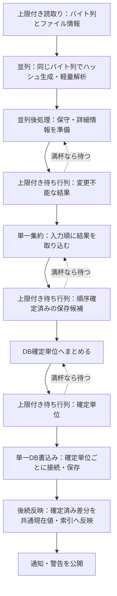

# 譜面ファイルの読取り

## 目的と適用範囲

ファイル差分、導入、再走査、LR2同期、補完解析で、譜面のバイト列を重複して読まないための処理分担と寿命を定めます。解析値の互換性、譜面情報の最新性、パス収束の定義は各専門仕様に従います。

## 用語

[共通用語集](../glossary.md)を参照します。コードの識別子は原表記を使います。

本資料の「後処理」は軽量解析から保存可能な保守・詳細情報を作る段階です。「補完解析」は既所持データの不足を埋める処理であり、新規ファイルの登録後に必ず行う別処理ではありません。

## 仕様

### 読取りと解析の入口

バイト列とハッシュを必要とする処理は `ChartFileSnapshot` を使います。これは `Path`、`Bytes`、`Length`、`LastWriteTimeUtc`、`Md5`、`Sha256` を持つ一回の読取り結果であり、表示・操作用の `ChartFile` やDBの保存主体とは異なります。

| 段階 | 入口 | 責務 |
| --- | --- | --- |
| 読取り | `ChartFileContentReader.ReadBuffer(path)` | バイト列とファイル情報だけを読む |
| ハッシュ生成 | `ChartFileContentReader.CreateSnapshot(buffer)` | 同じバイト列からMD5・SHA-256を計算する |
| 小規模な互換入口 | `ReadSnapshot(path)` | 上記の二段階を続けて行う |
| BMSの軽量解析 | `BmsChartFileParser.ParseSnapshot` | 共通基本値とリソース参照を直接生成する |
| BMSONの軽量解析 | `BmsonChartFileParser.ParseSnapshot` | 共通基本値とリソース参照を直接生成する |
| 詳細解析 | `ChartInfoParser.ParseBytesDetailed` | 譜面情報、診断、時間超過、解析失敗を生成する |
| 文字コードによる再読解 | `ReloadBMSMetadataWithEncodingDetection` | 同じバイト列から表示用の基本情報を読み直す |

[譜面プロパティ](../ui/chart-properties.md)では、同じ軽量解析の任意受取先 `ChartResourceParseDetails` にだけ定義元・定義番号と未定義参照番号を収集します。通常のライブラリ解析の戻り値・DB・長寿命のモデルには追加しません。

基本解析の戻り値は `ChartFile` です。保存行を経由せず、同じ捕捉入力のbytes/hash/timeを使用します。生title/subtitle/artist/subartistを表示合成から復元せず、bmsonの元chart_nameはファイル入力からだけ得ます。保存行への変換はDB境界だけに置きます。

BMSONの旧キーは基本値・詳細値が共有する `BmsonJsonParser` で正規化します。[旧形式と現代名の優先](parser-compatibility.md#bmsonのjsonとイベント)を両方に適用し、旧 `soundChannel` のノートがある音源を使用要求へ含め、空notesの音源は使用要求にしません。通常フォルダの導入判定もこの基本解析結果を使い、使用音源が揃えば候補、欠損なら警告付き保留とします。

パスだけを持つ既存処理と保留の生成では、パスを受ける互換APIを使えます。新しい大量処理で同じ譜面をハッシュ・軽量解析・詳細解析のために別々に読みません。長パスI/Oは専用の境界を通し、保存するパスに拡張長プレフィックスを含めません。

バイト列は処理中だけ保持し、DBや長寿命のモデルに保存しません。寿命内での再利用は積極的に行いますが、軽量解析と詳細解析の責務を一つに混ぜません。

### 保留項目の文字コード

保留BMSへの文字コード指定と現指定の確定は、現在の `PackageChartEntry` の寿命内だけで保持します。表示・導入先推定・フォルダ名生成は、その項目の同じ復号済みメタデータを使います。保留だけの操作は `song`・`maintenance` を新設・更新せず、DB確定を必要としません。空の保存要求が `NotApplied` でも失敗と扱いません。所持混在要求は所持分を従来の保存契約で確定してから両方へ反映し、保存失敗時は所持・保留とも新しい指定や復号値を反映しません。

選択保留の資源再調査も現在の文字コード・修正印を保持し、評価結果を項目と既存表示行へ届けます。入力元と配置先の再評価・表示の分担は[警告仕様](warnings.md#リソース状態の評価)に従います。再起動を越える指定復元や由来・状態の追加は行いません。既存の孤立した保守行は通常の整理に委ね、操作ごとの移行・修復を追加しません。

### ファイル差分の処理順序

差分を作る前の走査取得は、完全性が成立した結果だけを採用します。先行走査の通常失敗を「先行結果なし」として同じ要求内で再走査せず、既存の不完全走査の警告と非反映へ渡します。Everythingを利用できない場合に、同じ完全性契約の管理された走査が正常に完了した結果は従来どおり採用します。

正本DBの読取り後にBMSルートの再検査が失敗した場合も、保存済み内容を保持し、部分列挙からの追加・削除を行いません。初期の必須設定検証と出力先検査、DB保存と必須公開の成否は別の境界です。開始済みの走査・mtime取得Taskは既存の所有で終端まで待ち、早期の非反映結果にも捕捉した設定を渡します。起動の利用開始条件は[起動仕様](../runtime/startup.md#登録ディレクトリの検査)に従います。

初期化、全体の再初期化、軽量差分更新で追加・更新したファイルは、読取り、ハッシュ生成、軽量解析、メンテナンス情報・譜面情報の準備、DB確定、メモリ公開の順に扱います。

読取りは `ChartFileReadPipelinePolicy` に従い、対象が複数でCPUが十分なら最大2並列とします。件数上限のある待ち行列で入力を制御し、ハッシュ計算は解析側で行います。独立した読取り・ハッシュ・基本解析の通常失敗は、原因が未分類でも今回の対象を非採用にし、`FileScanFailures` と診断へ残します。譜面ごとに初期化ダイアログを出さず、未完成の新規行を保存しません。有効な既存行と利用者列、正常な別対象を保持し、未知失敗を恒久的な解析不能記録へ保存しません。詳細解析の失敗だけでは、軽量解析で得た共通基本値の登録を止めません。

この対象化は純粋な取得・計算を囲む範囲に限り、待ち行列、後処理の共有変更、保存、必須反映を含めません。失敗を除いた次の通常の処理機会には同じ対象を評価でき、再試行や新しい状態を追加しません。既知入力の受理と既存の失敗判定、通常の開始済みTaskの終端は維持します。

軽量解析と後処理は別の並列段階です。後処理は一譜面分の変更不能な結果と保存用データを返し、共有の結果、現在のモデル、確定用状態を直接変更しません。一つの集約処理が入力順に件数、移動ハッシュ、モデル更新、譜面情報の公開、DBへの投入をまとめます。

既定の解析並列数はCPU数の半分程度、後処理はその約1.5倍かつCPU数以下を目安にします。明示した上書き値は尊重します。`inline_maintenance_degree` は一譜面内の並列数であり、後処理の並列数とは区別します。

`InlineChartInfoBatchSize` の既定2048件は情報検索・生成の内部単位であり、後処理の待合せやDB確定の単位ではありません。DBの既定 `DbCommitChunkSize` は10000件です。二件以上の差分では、開始時に現在版の情報を読み取り専用で捕捉し、同じ差分処理の先行確定を偶然観測しないようにします。スキーマが現在でない場合は空の捕捉結果を渡し、並列処理側で代わりのDB検索を始めません。

ファイル差分中に開始したLR2フォルダ・ファイル準備Taskは、成功・解析失敗・DB確定失敗・公開失敗の全終端で実完了まで回収します。差分を直接適用する呼出元にも同じ寿命を保証し、実行中の走査要求と呼出元の受付は準備ワーカーの終了前に解放しません。失敗した差分へ準備結果を遅れて適用せず、回収だけの経路では準備の再計算も行いません。準備の二次故障や診断は元の失敗とスタック、先行確定したDB・共通現在値を置き換えず、通常成功経路での準備失敗の代替処理は維持します。

### DBへの集約と進捗

後処理、保存単位の集約、単一のDB書込み処理を、それぞれ上限付きの待ち行列で接続します。DBが遅い場合は入力を抑制しますが、一回の確定中も集約処理は別の入力を扱えます。DB接続は確定単位ごとに開いて閉じます。

| 進捗 | 数えているもの |
| --- | --- |
| 読取り | バイト列とファイル情報を読んだ件数 |
| 解析 | ハッシュと解析・評価を終えた件数 |
| 画面のファイル差分進捗 | 後処理がDBへ渡せる一譜面分のデータを作った件数。DB確定済み件数ではない |
| DB書込み | 保存先への確定を終えた件数 |

BMS追加とBMSON追加・更新を同じ進捗の対象に含めます。`song`、`bmson_song`、ハッシュ対応、情報・失敗、作成できた保守行を同じ確定単位へ渡し、成功後だけ共通現在値、索引、警告を公開します。

完全に現在の既存情報を、ファイル差分の成果物へ全件保持しません。`file_diff_inline` の索引差分は新規・更新した情報だけであり、全体の情報索引は `chart_info_hydration` が更新します。ハッシュ不足などの修正対象が既存情報を再利用する場合は、その対象に必要な保存用適用結果を残します。

#### 並列処理と確定の境界

ファイル差分の成功経路を示します。実線は主な処理順と入力・結果・保存単位の受渡し、破線は待ち行列による入力抑制です。読取りからDB確定までは段階を重ねて実行でき、DB確定中も集約を続けられます。並列数・保存単位・進捗の定義は上の本文・表に従います。

DB書込みの完了だけをファイル差分全体の公開完了とは扱いません。確定済みの差分を後続の反映境界で共通現在値・索引へ適用し、必要な通知・警告を公開します。後処理は現在のモデルを直接更新しません。詳細解析だけの通常の失敗は基本行の登録を妨げません。既知の入力不良・時間超過だけを失敗行の保存候補に含め、原因不明の詳細失敗は今回だけスキップして恒久記録に入れません。正常な後続対象の詳細は保存し、遅延した解析と書込みは実終端まで待ちます。詳細失敗と必要な保存・公開の失敗は[譜面情報の境界](chart-info.md#失敗)に従って分けます。バイト列は解析後、リソース参照は保守行への集約後、保存用データは確定後に解放します。導入の一操作一セッションと、この差分走査のDB確定単位は別契約です。

### パス差分と利用者の保存値

軽量な `ReloadFileDiff` は、メモリ上のBMS・BMSONと走査結果を比較します。DBの再読込み、メタデータ取込み、全体の情報読込み・補完、遅延保守を同時に行いません。外部のDB変更や互換修復には `FullReinitialize` を使います。

旧パスの削除は完全一致の一時表を使う集合SQLで行います。BMSの旧MD5を退避し、譜面・保守行を消した後、残存主体がないハッシュ対応だけを削除します。BMSONと保守行も同じ確定単位で扱います。メモリ側の削除判定はハッシュ集合を使い、全譜面と全削除パスの総当たりに戻しません。

保守行の一時表は `path TEXT PRIMARY KEY` を使い、同じ完全一致のパスだけを最後の値へまとめます。大文字小文字だけが異なるパスは別行です。

移動に伴う利用者の列の引継ぎは、差分開始時の旧パスから捕捉し、同じMD5の旧新候補が差分全体で一対一の場合だけ行います。並列処理の完了順や保存単位で一意性を判定しません。列、既存の導入先保護、曖昧な候補の扱いは[パスの識別と収束](../core/path-identity.md)に従います。メンテナンス情報は引き継がず現在の入力から評価します。

### リソース参照と文字コード

軽量解析で得る両形式の不変な `Resources` は、同じ処理中の保守とLR2互換性評価まで共有します。抽出時に確定した `LookupKey` を音声・画像・動画別の索引へ照合し、元記述はLR2評価へ渡します。初期化・差分処理は既存の公開・確定境界までに両形式の結果を解放し、全件常駐や直後の再読取りを生みません。DB由来で未取得の既存譜面は、保守の既存入口で明示取得します。通常保守と強制再走査でも、各譜面の評価結果へ集約した後は適用する共通現在値のリソース参照を解放し、保存成功後の状態へ戻しません。捕捉済みの入力値とパッケージが共有する結果は変更しません。保存失敗では共通現在値を適用せず、その処理で新たに取得した短命な参照を残しません。パッケージは評価に必要な期間だけ同じ結果を共有し、元バイト列を長期保持しません。参照の契約は[共通譜面](chart-model.md#譜面情報とリソース保守)に従います。

リソース索引にディレクトリがある場合は、その集合へ直接照合します。索引がない場合だけ共有の存在確認キャッシュを補助的に使います。同じディレクトリ・同じ使用ファイルキー集合で共有できるのは存在件数です。パス、ハッシュ、文字コード、LR2互換性、警告の無視状態、保守行全体を共有しません。画像でもstagefile・backbmp・bannerの役割は区別します。定義済み照合不能参照による未判定化は各譜面へ反映し、同じ照合可能キーを持つ別譜面とのキャッシュ共有で消しません。未定義IDは要求へ含めません。

物理フォルダの改名・移動・削除・統合後は、[変更セッション](mutations.md#操作ごとの反映範囲)が旧新祖先の既存Entryも最終FSへ揃えます。親譜面が子の音声・画像・動画を相対参照する場合、後続の明示保守は更新済みEntryへ照合し、存在しなくなった旧相対keyを古い索引から復活させません。親の参照の書換え・複製や、全関連譜面の即時再評価は行いません。

健康度・推定は[使用参照](parser-compatibility.md#軽量解析の使用リソース)を使い、発見・グループ化の全定義判定とLR2の原文診断を別用途として維持します。全定義による用途を消費した後に解析参照を解放し、今回の保守結果と警告を投影します。表示やツールチップから再読取りを始めません。

BMSの基本情報とリソース参照はまずCP932系の既定で読みます。同じバイト列からASCII、Shift_JIS、KS_C_5601、UTF-8、不明を判定し、非Shift_JISが確定した場合だけ、`title`、`subtitle`、`artist`、`subartist`、`genre` を元の個別値として読み直します。不明や推定末尾の `?` では補正しません。タイトルと副題、アーティストと副アーティストを合成しません。

UTF-8 BOM付きのBMS/PMSは、BOMを優先して判定名と実際の復号方式をUTF-8へ揃え、BOM直後の先頭指示行も表示用メタデータとして読み取ります。BOMなしの判定規則は維持します。新規登録、明示保守、LR2同期、パッケージ読取りはこの共通判定を使い、ハッシュはBOMを含む元のバイト列から計算します。この補正のためにparser版を更新したり、既所持譜面を自動で全件再解析したりしません。

BOM付き本文の復号は従来のBOM自動認識と同じ置換復号を使い、CP932の資源名バイトが混在する既存入力を新たに拒否しません。有効なUTF-8で記述された表示用5項目を読み取り、資源名は引き続き元のバイト列をCP932で解釈します。

リソース参照と画像パスは、LR2の本文解釈に合わせ、BOM自動判定をしないCP932の値を維持します。`maintenance.encoding` は表示・保守用であり、詳細解析の文字コードを変更しません。

### 導入と手動再走査

保留中に読んだバイト列を導入まで長期保持しません。導入は実際の配置先を読み直して詳細情報を生成し、影響する譜面の保守を操作単位で行います。保留中は[警告の配置基準](warnings.md#リソース状態の評価)に従い、設定済みの導入先、先頭候補、現在の入力元配置の順で健康度と一時的な `ResourceHealth` 警告を評価します。設定先・候補では実際に持ち込む同梱資源を加算します。導入成功時にこの一時警告を解除し、導入後は通常ライブラリと同じメンテナンス情報から表示します。保存・必須反映・公開は[変更セッション](mutations.md)に従い、パッケージごとの確定・通知に分割しません。

手動の再スキャンと全譜面再スキャンは、リソース、文字コード、BMSONの参照を再評価する重い操作です。所持BMSで `EncodingFixed=true` かつ具体的な文字コード名を保存済みの場合は、手動・自動の由来を分けず、その文字コードと確定状態を保持して表示メタデータ5項目を同じ入力から再復号します。具体名は非空で、`unknown`（大文字小文字を区別しない）でも末尾 `?` 付きでもない名前です。確定したCP932も指定復号し、`EncodingFixed=true` の `shift_jis?` や、未確定の具体名は従来の検出対象にします。資源は文字コードの保持と独立して従来どおり再評価します。

上限付きの読取り、並列評価、単一DB書込みを使い、変更した保守行だけを保存します。確定文字コードで再復号したメタデータと保守値が同じ場合は書きません。資源だけが変化した場合は保守行だけを保存します。未確定値の再検出で非CP932が確定した場合は、文字列が同値でも従来の限定した `song` 更新を維持します。保存列・由来推測・全件再保存は追加しません。この操作では `chart_info` を作らず、不足や版違いは情報の読込み・補完に任せます。

### LR2同期と全件補完

LR2の `song_rows` も同じスナップショットと `Lr2SongRowEnricher.CreateParsedSongRowFromSnapshot` を使います。開始時に情報と時間上限を考慮した失敗集合を捕捉し、追加の読取り・DB検索なしで `EvaluateSnapshot` へ渡します。回復可能な行生成失敗で既存行を保つ経路は、その失敗を保持したまま使います。LR2互換性の反映は保守行のLR2列だけを更新し、リソース・文字コードの結果を置換しません。

直前のファイル差分が、同じ入力・走査世代の全BMSパスを永続化し、保守・情報生成の対象を満たし、移動ハッシュの曖昧さがない場合は、自動同期の `song_rows` を省略できます。全列の再比較は差異の診断であり、必須の受付条件にしません。手動強制同期、署名不一致、対象不足では通常どおり読みます。省略の根拠は永続化しません。

全件補完は既存DBの不足・旧版を補う処理です。完全に現在の対象は読取り前に除き、ハッシュなどの修正が必要な対象は読取り後に既存情報を再利用できます。同じMD5は一回評価して全BMS主体へ適用し、既存行の9列だけを更新します。BMSONからLR2の行を作りません。詳細は[譜面情報の保存](chart-info.md)に従います。

### 寿命と診断

解析後のバイト列、保守行に畳み込んだリソース参照、確定後の保存用データは速やかに解放します。保存件数の上限を、バイト列の保持上限の代わりにしません。初期化で明示的なGCや大規模オブジェクト領域の圧縮を行いません。

| 診断 | 意味 |
| --- | --- |
| `song_tbl_file_check_breakdown` | 各段階の件数、時間、待ち行列の待機、情報・保守・文字コードの内訳 |
| `inline_chart_info_index_published_count` | ファイル差分から索引へ渡した新規・更新情報の行数。再利用で省略した全行数ではない |
| `inline_maintenance_*` | 保守行の生成と譜面ごとの索引・存在確認の利用数。並列の他譜面の件数を混ぜない |
| `inline_encoding_*` | 文字コード判定と、元の基本情報を読み直した件数・時間 |
| `commit_queue_wait_ms` / `commit_writer_queue_wait_ms` | 後処理から集約、集約からDB書込みへの待機を分けた値 |
| `chart_info_inline_install` | 実配置先から生成した情報の導入時集計 |
| `chart_info_backfill start/done` | 補完解析の読取り数・量・並列数・解析時間 |
| `chart_info_backfill parse_failed` | 共通解析処理の失敗。名称だけで補完経路と断定せず、周辺の集計と合わせる |

## 実装とテストの対応

| 仕様項目・主な条件 | 実装箇所 | テスト箇所・確認内容 |
| --- | --- | --- |
| 旧BMSONの基本値・使用音源と通常フォルダ導入 | [`BmsonChartFileParser`](../../../BeMusicSeeker/Models/BmsLibraryInternal/ChartInfo/BmsonChartFileParser.cs)、共通JSON境界、`BMSLibrary.InstallChartPackagesAutoWithProgressAsync` | [`BmsonSongParserTests.ParseSnapshot_LegacySoundChannelsMatchModernUsedResources`](../../../BeMusicSeeker.Tests/ChartInfo/BmsonSongParserTests.cs) が実snapshotの旧0.21・versionlessと新形式の資源一致・空notes除外を確認する。`BmsLibraryPackageInstallServiceTests.InstallChartPackagesAuto_BmsonFolderPreservesLegacyResourceAndStorageContracts` は3形式の通常フォルダを実導入入口へ渡し、音源ありの実配置・所持・新DB接続のbmson_song/詳細保存literal版21と、欠損時の元入力保持・不足警告付き保留・未導入を確認する。 |
| 保留文字コードの項目寿命内の保持、所持混在の保存成功境界 | [`CatalogMaintenanceOwner.ApplyEncoding`](../../../BeMusicSeeker/Models/BmsLibraryInternal/Catalog/CatalogMaintenanceOwner.cs)、`BmsLibraryMaintenanceService.ApplyEncoding`、`PackageChartEntry` | [`SelectedChartMutationWorkflowOwnerTests.ApplyEncoding_RealStoreUpdatesSelectedPendingEntriesWithoutChangingPlacement`](../../../BeMusicSeeker.Tests/ChartOperations/SelectedChartMutationWorkflowOwnerTests.cs) は実owner・store・Library・SQLiteでBig5明示再復号と現指定確定、保留の新設禁止・既存行不変、所持混在成功・所持保存失敗時の両者非反映と成功通知なしを確認する。同じ項目と生成済み行の復号値・固定印、`BuildTargetMetadataProfile` の原題・元作者受渡しも確認する。`ApplyEncoding_AndPendingResourceRescanKeepBig5WithoutDatabase` はDBファイルなしで指定後の資源増減と既存行の表示保持を確認する。フォルダ名生成の `CreateChartFolderPathFromCharts` が同じ項目から渡されたTitle/Artistを使うことは静的確認、所持の限定保存列網羅は既存 `MaintenanceMetadataSongFixture`、孤立行の整理は既存Catalog系列へ分担する。 |
| 所持再スキャンの具体的な確定文字コード保持・指定復号・同値無書込み | [`BmsLibraryMaintenanceService`](../../../BeMusicSeeker/Models/BmsLibraryInternal/Maintenance/BmsLibraryMaintenanceService.cs) | [`BmsLibraryMaintenanceServiceTests.UpdateMaintenanceInfo_ForceUpdatePreservesOnlyConcreteFixedEncoding`](../../../BeMusicSeeker.Tests/Maintenance/BmsLibraryMaintenanceServiceTests.cs) は確定UTF-8のASCII・BOMなし非ASCII、生5項目、確定CP932、推定名と未確定具体名の従来検出、固定mtime同値でwriter非呼出を確認する。[`SelectedChartResourceHealthWorkflowOwnerTests.Rescan_FixedUtf8AfterDbLoadPreservesMetadataAndOnlyPersistsResourceChanges`](../../../BeMusicSeeker.Tests/ChartOperations/SelectedChartResourceHealthWorkflowOwnerTests.cs) は実DB読込み後の選択・全所持入口で保存値・現在一覧と資源増減を確認し、song更新拒否triggerで資源だけの変更に余分なsong更新がないことを検出する。 |
| UTF-8 BOMの実判定と原文メタデータ、CP932資源・原byte hashの保持 | [`BmsEncodingDetector`](../../../BeMusicSeeker/Models/BmsLibraryInternal/ChartInfo/BmsEncodingDetector.cs)、[`BmsChartFileParser`](../../../BeMusicSeeker/Models/BmsLibraryInternal/ChartInfo/BmsChartFileParser.cs) | [`BMSFileSnapshotTests`](../../../BeMusicSeeker.Tests/Chart/BMSFileSnapshotTests.cs) の `CreateBMSFileFromSnapshot_WithDetectedUtf8BomKeepsResourceReferencesShiftJis` はBMS/PMSと先頭・後続TITLEを実Detectと共通解析へ渡し、5項目の原文、既知CP932資源名、BOM込みbytesの独立計算hashを確認する。`CreateBMSFileFromSnapshot_Utf8BomWithCp932ResourceBytesPreservesMetadataAndHashes` は有効UTF-8の5項目と生CP932資源名が混在する入力の受理・原文・既知資源名・原byte hashを確認する。韓国語資源・ASCII・捕捉後の差替えと時刻は同じ既存系列が分担する。 |
| 共通判定から各入口の保存・現在値・通知への接続 | [`FileScanParseCommitOwner`](../../../BeMusicSeeker/Models/BmsLibraryInternal/Scanning/FileScanParseCommitOwner.cs)、[`BmsLibraryMaintenanceService`](../../../BeMusicSeeker/Models/BmsLibraryInternal/Maintenance/BmsLibraryMaintenanceService.cs)、[`Lr2SongDbSyncService`](../../../BeMusicSeeker/Models/BmsLibraryInternal/Lr2/Lr2SongDbSyncService.cs)、[`PackageChartEntry`](../../../BeMusicSeeker/Models/BmsLibraryInternal/Install/PackageChartEntry.cs) | [`BmsLibraryInitializationFileScanTests`](../../../BeMusicSeeker.Tests/Startup/BmsLibraryInitializationFileScanTests.cs) の `ApplyFileScanDiff_AddsBmsWithLr2FolderAndParentHashes` はBOM付き新規差分のDB原文・encodingと一覧用現在値、hash・通常列・LR2列を確認する。[`BmsLibraryMaintenanceServiceTests`](../../../BeMusicSeeker.Tests/Maintenance/BmsLibraryMaintenanceServiceTests.cs) の `UpdateMaintenanceInfo_BmsEncodingMaintenanceDoesNotMutateDigest` は文字化け済み値の自動判定・保存とdigest・利用者列・CP932資源を確認する。[`Lr2SongDbSyncServiceTests`](../../../BeMusicSeeker.Tests/Lr2/Lr2SongDbSyncServiceTests.cs) の `SyncService_ParsesSongRowsWithDetectedUtf8Encoding` はBOMなし・ありの実SQLite保存・確定通知を確認し、[`BmsLibraryPackageInstallServiceTests`](../../../BeMusicSeeker.Tests/Install/BmsLibraryPackageInstallServiceTests.cs) の `PackageChartEntry_FromPathReadsUtf8BomMetadata` は実pathからの共通値を確認する。条件網羅はsnapshot系列へ集約する。 |
| フォルダ変更後の親相対資源参照 | [`LibraryMutationSession`](../../../BeMusicSeeker/Models/Library/BMSLibrary.LibraryMutationOwner.Session.cs) と通常の明示保守 | [`BmsLibraryFolderRenameRefreshTests.FolderMutation_RefreshesExistingAncestorsOnceFromFinalFilesystem`](../../../BeMusicSeeker.Tests/Maintenance/BmsLibraryFolderRenameRefreshTests.cs) が既知配置から決めた音声・画像・動画の旧新key、六分類・reverseを照合し、親参照を変えず実libraryの明示保守で旧音声を存在扱いにしないことを確認する。 |
| 未採用走査の失敗・非再実行・通常終端と完全な代替走査 | [`LibraryFileScanPipelineOwner`](../../../BeMusicSeeker/Models/BmsLibraryInternal/Scanning/LibraryFileScanPipelineOwner.cs) | [`LibraryFileScanPipelineOwnerTests`](../../../BeMusicSeeker.Tests/Scanning/LibraryFileScanPipelineOwnerTests.cs) の `ApplyActiveFileScan_IncompletePrefetchWarnsAndJoinsWithoutApplyingBeforeNextRequest` は不完全結果と失敗した先行Task、mtime回収、保存済み目録と捕捉設定、次要求を確認する。先行Taskの故障代替は非再実行の識別に限り、通知の耐性保証にはしない。`ApplyActiveFileScan_EverythingUnavailableAppliesCompleteManagedFallback` は実ファイルによる完全な代替結果の採用・保存を確認する。 |
| 読取り後のハッシュ生成と後処理の集約 | [`ChartFileContentReader`](../../../BeMusicSeeker/Models/BmsLibraryInternal/ChartInfo/ChartFileContentReader.cs)、[`ChartFileReadPipelinePolicy`](../../../BeMusicSeeker/Models/BmsLibraryInternal/ChartInfo/ChartFileReadPipelinePolicy.cs) | [`BmsLibraryInitializationFileScanTests`](../../../BeMusicSeeker.Tests/Startup/BmsLibraryInitializationFileScanTests.cs) の `ApplyFileScanDiff_AddsBmsWithLr2FolderAndParentHashes` と `ApplyFileScanDiff_AggregatesInlineRowsAcrossPostParseWorkers`、[`ChartInfoBackfillStorageTests`](../../../BeMusicSeeker.Tests/ChartInfo/ChartInfoBackfillStorageTests.cs) の実補完・保存で確認する。CPU別の内部並列数・キュー容量の現在値を固定せず、実同時読取り数の上限は自動検証済みとは扱わない。 |
| 明示取得、保守・互換性評価後の短命な参照解放 | [`BmsLibraryMaintenanceService`](../../../BeMusicSeeker/Models/BmsLibraryInternal/Maintenance/BmsLibraryMaintenanceService.cs)、[`FileScanParseCommitOwner`](../../../BeMusicSeeker/Models/BmsLibraryInternal/Scanning/FileScanParseCommitOwner.cs) | [`BmsLibraryMaintenanceServiceTests`](../../../BeMusicSeeker.Tests/Maintenance/BmsLibraryMaintenanceServiceTests.cs) は取得済み結果の再利用、時刻変更・強制更新・解析失敗の非保存と、評価後の共通現在値の参照解放・Package側の必要期間共有を確認する。`UpdateMaintenanceInfo_BmsonDurableFailureRejectsUnappliedWrite` は通常・durableの保存失敗で未適用の新結果を拒否する保証を確認する。`ApplyFileScanDiff_AddsBmsPersistsInlineMaintenanceAndClearsResourceRefs` と `ApplyFileScanDiff_TracksBmsonAddsDeletesAndUpdatesDatabase` は保存後の両形式の解放を確認する。保存・解放までの同じバイト列と結果の共有、即座の再読取りがないことは静的に確認する。 |
| 差分の順序、保存、進捗、個別失敗、保守と情報の同時生成 | [`BmsLibraryInitializationService`](../../../BeMusicSeeker/Models/BmsLibraryInternal/Startup/BmsLibraryInitializationService.cs) | [`BmsLibraryInitializationFileScanTests`](../../../BeMusicSeeker.Tests/Startup/BmsLibraryInitializationFileScanTests.cs)、[`BmsLibraryInitializationInlineChartInfoTests`](../../../BeMusicSeeker.Tests/Startup/BmsLibraryInitializationInlineChartInfoTests.cs) |
| 基本入力失敗の対象化と旧値・正常な別対象の保持 | [`FileScanParseCommitOwner`](../../../BeMusicSeeker/Models/BmsLibraryInternal/Scanning/FileScanParseCommitOwner.cs) の純読取り・ハッシュ・基本解析 | [`BmsLibraryInitializationFileScanTests`](../../../BeMusicSeeker.Tests/Startup/BmsLibraryInitializationFileScanTests.cs) の `ApplyFileScanDiff_ReadFailureIsAggregatedWithoutInitializationDialog` は走査後に消失した新規・更新ファイルと正常譜面を混在させ、未完成行の非保存、旧DB行・利用者列と正常対象の保持を確認する。`ApplyFileScanDiff_InvalidUpdatedBmsonKeepsExistingCatalogWithoutFreshRefs` は解析不良時の旧DB値も確認する。未知の基本読取りはLR2同期の対象失敗試験、純取得と保存・共有更新の捕捉範囲は静的確認に分担する。 |
| 開始済みLR2準備の全終端回収と失敗要求の非公開 | [`LibraryFileScanPipelineOwner`](../../../BeMusicSeeker/Models/BmsLibraryInternal/Scanning/LibraryFileScanPipelineOwner.cs) の `ApplyFileScanDiff`、`ApplyActiveFileScan` | [`LibraryFileScanPipelineOwnerTests`](../../../BeMusicSeeker.Tests/Scanning/LibraryFileScanPipelineOwnerTests.cs) の `ApplyActiveFileScan_CommitFailureJoinsLr2PreparationBeforeReleasingRequest` は実DB確定失敗と準備成功・二次故障で、準備の待機中の早期終端・重複受付の拒否、元SQLite原因とスタック、先行保存行・所持世代番号の保持、目録・譜面情報・準備結果の非公開、終端後の新規受付を確認する。既存の更新時刻回収・正常走査・公開購読先失敗の保証は維持し、直接呼出しと他の失敗経路にも同じ回収が及ぶこと、回収時の非再計算と成功経路の代替処理は静的に確認する。 |
| 詳細情報の再利用、公開順序、補完時の限定更新 | [`ChartInfoBuildService`](../../../BeMusicSeeker/Models/BmsLibraryInternal/ChartInfo/ChartInfoBuildService.cs)、[`ChartInfoInlineBuildService`](../../../BeMusicSeeker/Models/BmsLibraryInternal/ChartInfo/ChartInfoInlineBuildService.cs) | [`ChartInfoInlineHydrationTests`](../../../BeMusicSeeker.Tests/ChartInfo/ChartInfoInlineHydrationTests.cs)、[`ChartInfoBackfillStorageTests`](../../../BeMusicSeeker.Tests/ChartInfo/ChartInfoBackfillStorageTests.cs) |
| 導入先からの解析と失敗再利用 | [`BmsLibraryPackageInstallService`](../../../BeMusicSeeker/Models/BmsLibraryInternal/Install/BmsLibraryPackageInstallService.cs) | [`ChartInfoInstallFailureRetryTests`](../../../BeMusicSeeker.Tests/ChartInfo/ChartInfoInstallFailureRetryTests.cs)、[`BmsLibraryPackageInstallServiceTests`](../../../BeMusicSeeker.Tests/Install/BmsLibraryPackageInstallServiceTests.cs) |
| LR2行の生成と差分直後の同期 | [`Lr2SongRowEnricher`](../../../BeMusicSeeker/Models/BmsLibraryInternal/Lr2/Lr2SongRowEnricher.cs) | [`BmsLibraryLr2SongDbSyncTests`](../../../BeMusicSeeker.Tests/Lr2/BmsLibraryLr2SongDbSyncTests.cs) |

## 関連資料

[解析互換性](parser-compatibility.md)、[データと索引](../core/data-and-indexes.md)、[LR2楽曲DB](../integration/lr2-song-db.md)、[規模と性能](../core/performance-and-scale.md)を参照します。
