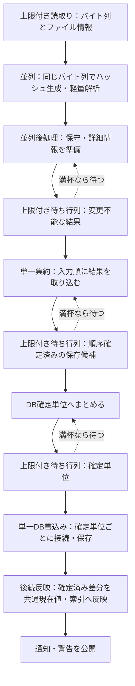

# 譜面ファイルの読取り

## 目的と適用範囲

ファイル差分、導入、再走査、LR2同期、補完解析で、譜面のバイト列を重複して読まないための処理の分担と寿命を定めます。解析値の互換性、譜面情報の最新性、パスの収束は各専門の仕様に従います。

## 用語

[共通用語集](../glossary.md)を参照します。コードの識別子は原表記を使います。機能固有の用語は次のとおりです。

| 用語 | 意味 |
| --- | --- |
| 軽量解析 | 一覧登録用の共通基本値とリソース参照を作る解析。`chart_info` を作る詳細解析とは別の責務。 |
| 後処理 | 軽量解析の結果から、保存できる保守情報・詳細情報を作る段階。 |

補完解析は所持済みデータの不足を埋める処理であり、新しいファイルを登録した後に必ず行う別の処理ではありません。

## 仕様

### 読取りと解析の入口

バイト列とハッシュを必要とする処理は `ChartFileSnapshot` を使います。これは `Path`、`Bytes`、`Length`、`LastWriteTimeUtc`、`Md5`、`Sha256` を持つ一回の読取り結果であり、表示・操作用の `ChartFile` やDBの保存行とは異なります。

| 段階 | 入口 | 責務 |
| --- | --- | --- |
| 読取り | `ChartFileContentReader.ReadBuffer(path)` | バイト列とファイル情報だけを読む。 |
| ハッシュ生成 | `ChartFileContentReader.CreateSnapshot(buffer)` | 同じバイト列からMD5・SHA-256を計算する。 |
| 小規模な互換入口 | `ReadSnapshot(path)` | 上の二段階を続けて行う。 |
| BMSの軽量解析 | `BmsChartFileParser.ParseSnapshot` | 共通基本値とリソース参照を直接作る。 |
| BMSONの軽量解析 | `BmsonChartFileParser.ParseSnapshot` | 共通基本値とリソース参照を直接作る。 |
| 詳細解析 | `ChartInfoParser.ParseBytesDetailed` | 譜面情報、診断、時間超過、解析失敗を作る。 |
| 文字コードによる読み直し | `BmsChartFileParser.ApplyEncodingDetection` / `ApplyEncoding` | 同じ採用本文から、表示用のメタデータと通常リソースを読み直す。 |

軽量解析の戻り値は `ChartFile` です。保存行を経由せず、捕捉した入力の同じバイト列・ハッシュ・更新時刻を使います。生の title・subtitle・artist・subartist を表示用の合成値から復元せず、BMSONの元の `chart_name` はファイル入力からだけ得ます。保存行への変換はDB境界だけで行います。

[譜面プロパティ](../ui/chart-properties.md)では、同じ軽量解析の任意の受取先 `ChartResourceParseDetails` にだけ、定義元・定義番号と未定義の参照番号を集めます。通常のライブラリ解析の戻り値、DB、長寿命のモデルにはこれらを追加しません。

BMSONの旧キーは、基本値と詳細値が共有する `BmsonJsonParser` で正規化し、[旧形式と現代名の優先](parser-compatibility.md#bmsonのjsonとイベント)を両方に適用します。旧 `soundChannel` のノートがある音源は使用要求に含め、notes が空の音源は使用要求にしません。通常フォルダの導入判定もこの軽量解析の結果を使い、使用する音源が揃えば候補、欠けていれば警告付きの保留とします。

パスだけを持つ既存の処理と保留の生成では、パスを受ける互換APIを使えます。大量の処理では、同じ譜面をハッシュ・軽量解析・詳細解析のために別々に読みません。長いパスの入出力は専用の境界を通し、保存するパスに拡張長のプレフィックスを含めません。

バイト列は処理中だけ保持し、DBや長寿命のモデルに保存しません。寿命内での再利用は積極的に行いますが、軽量解析と詳細解析の責務は混ぜません。

### 保留項目の文字コード

保留BMSへの文字コードの指定と、現在の指定の確定は、現在の `PackageChartEntry` の寿命内だけで保持します。表示・導入先推定・フォルダ名生成は、その項目の同じ復号済みメタデータと通常リソースを使います。要求に所持譜面を含むかによる保存と反映の順序、保留譜面だけの操作がDBを使わないことは、[共通モデル](chart-model.md#保留譜面の文字コード選択)に従います。

指定した保留譜面は、元の配置と捕捉済みの現在配置を新しい参照で評価し直し、明示した導入先・候補・所属を維持します。旧キーに基づく推定は自動確定に再利用せず、既存の再推定の入口で新しい参照を評価します。同じパス・SHA-256について取得済みの固定指定は、パッケージの発見・昇格・入れ子の分類より前に渡し、内容が変わった場合は引き継ぎません。

選択した保留譜面のリソース再調査も、現在の文字コードと修正印を保持し、評価結果を項目と既存の表示行へ届けます。入力元と配置先の再評価・表示の分担は[警告仕様](warnings.md#リソース状態の評価)に従います。再起動をまたいで指定を復元することや、由来・状態の追加は行いません。既存の孤立した保守行は通常の整理に任せ、操作ごとの移行・修復は追加しません。

#### 導入した保留譜面への引継ぎ

導入に成功した保留譜面では、入力元の保守値が元のパスおよびMD5と（大文字小文字を区別せずに）一致する場合だけ、成功先のパス、同じMD5、文字コード、修正印を、未評価の保守値へ引き継ぎます。元の配置の健全性、警告の無視、LR2診断は持ち越さず、成功先で通常の強制保守評価を行って、既存の所持データの保存にまとめます。具体的な文字コード名・未確定の値・推定名を採用するかは、既存の保守評価に任せます。導入前の単体・子譜面の警告は、[警告の更新契約](warnings.md#種類ごとの更新)に従い、成功した項目でだけ解除します。

導入に失敗した譜面と未処理の保留指定は、その項目の中に保持します。リソースだけを更新した別の所持譜面や、同じMD5の別の配置へは指定を広げません。成功後の所持譜面の再調査やDB読込みでは、通常の確定した文字コードの保持を使い、保留の指定を再起動後に復元する仕組みは追加しません。

### ファイル差分の処理順序

#### 走査結果の採用

差分を作る前の走査は、完全性が成立した結果だけを採用します。先行走査が通常の失敗で終わった場合に「先行結果なし」として同じ要求の中で走査し直さず、既存の不完全な走査の警告と、変更を反映しない結果へ渡します。Everythingを利用できない場合でも、同じ完全性の契約を満たす管理された走査が正常に完了すれば、その結果を採用します。

正本DBを読み取った後にBMSルートの再検査が失敗した場合も、保存済みの内容を保持し、部分的な列挙から追加・削除を行いません。初期の必須設定の検証と出力先の検査、DB保存と必須の公開の成否は、それぞれ別の境界です。開始済みの走査Taskは既存の所有者が終端まで待ち、早期に返す非反映の結果にも捕捉した設定を渡します。起動時に利用を開始する条件は[起動仕様](../runtime/startup.md#登録ディレクトリの検査)に従います。

#### 追加・更新ファイルの処理順

初期化、全体の再初期化、軽量な差分更新で追加・更新したファイルは、読取り、ハッシュ生成、軽量解析、保守情報・譜面情報の準備、DB確定、メモリへの公開の順に扱います。更新日時の一致による既存情報の再利用は[保証の前提](file-db-consistency.md#保証の前提)に従います。

読取りは `ChartFileReadPipelinePolicy` に従い、対象が複数でCPUに余裕がある場合は最大2並列とします。件数に上限のある待ち行列で入力を抑え、ハッシュの計算は解析側で行います。

#### 個別の読取り・解析失敗

独立した読取り・ハッシュ生成・軽量解析が通常の失敗で終わった場合は、原因を分類できなくても、今回はその対象を採用せず、`FileScanFailures` と診断に残します。譜面ごとに初期化のダイアログを出さず、未完成の新規行を保存しません。有効な既存行と利用者列、正常な別の対象は保持し、原因不明の失敗を恒久的な解析不能の記録として保存しません。詳細解析だけの失敗は、軽量解析で得た共通基本値の登録を止めません。

この対象単位の扱いは、純粋な取得・計算を囲む範囲に限ります。待ち行列、後処理での共有状態の変更、保存、必須の反映は含めません。次の通常の処理機会には同じ対象を評価でき、再試行や新しい状態は追加しません。既知の入力の受理と既存の失敗判定、開始済みTaskの通常の終端は維持します。

#### 並列段階と集約

軽量解析と後処理は別の並列段階です。後処理は一譜面分の変更不能な結果と保存用データを返し、共有の結果、現在のモデル、確定用の状態を直接変更しません。一つの集約処理が、入力順に件数、移動したハッシュ、モデルの更新、譜面情報の公開、DBへの投入をまとめます。

並列数の既定は、解析がCPU数の半分程度、後処理がその約1.5倍かつCPU数以下です。明示した上書き値は尊重します。`inline_maintenance_degree` は一譜面の中の並列数であり、後処理の並列数とは区別します。

`InlineChartInfoBatchSize`（既定2048件）は、譜面情報の検索・生成の内部単位であり、後処理の待合せやDB確定の単位ではありません。DB確定の単位は `DbCommitChunkSize`（既定10000件）です。二件以上の差分では、開始時に現在版の譜面情報を読み取り専用で捕捉し、同じ差分処理の先行する確定を偶然観測しないようにします。スキーマが現在の版でない場合は空の捕捉結果を渡し、並列処理の側で代わりのDB検索を始めません。

#### LR2準備Taskの回収

ファイル差分の途中で開始したLR2のフォルダ・ファイル準備Taskは、成功、解析失敗、DB確定失敗、公開失敗のどの終端でも、実際に完了するまで回収します。差分を直接適用する呼出元にも同じ寿命を保証し、実行中の走査要求と呼出元の受付を、準備ワーカーの終了前に解放しません。

失敗した差分へ準備結果を遅れて適用せず、回収だけを行う経路では準備を計算し直しません。準備の二次故障や診断で、元の失敗とそのスタック、先に確定したDBと共通現在値を置き換えません。通常の成功経路で準備が失敗した場合の代替処理は維持します。

### DBへの集約と進捗

後処理、保存単位への集約、単一のDB書込み処理を、それぞれ上限付きの待ち行列で接続します。DBが遅い場合は入力を抑えますが、一回の確定の最中も集約処理は別の入力を扱えます。DB接続は確定単位ごとに開いて閉じます。

| 進捗 | 数えているもの |
| --- | --- |
| 読取り | バイト列とファイル情報を読んだ件数 |
| 解析 | ハッシュと解析・評価を終えた件数 |
| 画面のファイル差分進捗 | 後処理が、DBへ渡せる一譜面分のデータを作った件数。DB確定済みの件数ではない。 |
| DB書込み | 保存先への確定を終えた件数 |

BMSの追加と、BMSONの追加・更新を、同じ進捗の対象に含めます。`song`、`bmson_song`、ハッシュの対応、譜面情報・解析失敗、作成できた保守行を同じ確定単位へ渡し、確定に成功した後にだけ共通現在値、索引、警告を公開します。

完全に現在の版である既存の譜面情報を、ファイル差分の成果物へ全件保持しません。`file_diff_inline` の索引差分は新規・更新した譜面情報だけであり、全体の索引は `chart_info_hydration` が更新します。ハッシュ不足などの修正対象が既存情報を再利用する場合は、その対象に必要な保存用の適用結果を残します。

#### 並列処理と確定の境界

ファイル差分の成功経路を示します。実線は主な処理順と、入力・結果・保存単位の受渡しです。破線は待ち行列による入力の抑制です。読取りからDB確定までの段階は重ねて実行でき、DB確定の最中も集約を続けられます。並列数・保存単位・進捗の定義は上の本文と表に従います。

DB書込みの完了だけを、ファイル差分全体の公開の完了とは扱いません。確定済みの差分を後続の反映の境界で共通現在値・索引へ適用し、必要な通知・警告を公開して完了します。

詳細解析の失敗は、既知の入力不良と時間超過だけを解析失敗の行の保存候補に含めます。原因不明の詳細解析の失敗は今回だけ対象から外し、恒久的な記録に入れません。どちらの場合も正常な後続の対象の詳細は保存し、遅れている解析と書込みは実際の終端まで待ちます。詳細の失敗と、必要な保存・公開の失敗の区別は[譜面情報の失敗](chart-info.md#失敗)に従います。

導入の「一操作一変更セッション」と、この差分走査のDB確定単位は別の契約です。

### パス差分と利用者の保存値

軽量な `ReloadFileDiff` は、メモリ上のBMS・BMSONと走査結果を比較します。DBの再読込み、メタデータの取込み、全体の譜面情報の読込み・補完、遅延した保守を同時には行いません。外部でのDB変更や互換性の修復には `FullReinitialize` を使います。

旧パスの削除は、完全一致の一時表を使う集合SQLで行います。BMSの旧MD5を退避し、譜面・保守行を消した後、残っている主体がないハッシュ対応だけを削除します。BMSONと保守行も同じ確定単位で扱います。メモリ側の削除判定にはハッシュ集合を使い、全譜面と全削除パスの総当たりにはしません。

保守行の一時表は、完全に一致するパスだけを一行（最後の値）にまとめます。大文字小文字だけが異なるパスは別の行です。

移動に伴う利用者列の引継ぎは、差分の開始時に旧パスから捕捉し、同じMD5の旧候補と新候補が差分全体で一対一の場合だけ行います。並列処理の完了順や保存単位で一意性を判定しません。対象の列、既存の導入先の保護、曖昧な候補の扱いは[パスの識別と収束](../core/path-identity.md)に従います。保守情報は引き継がず、現在の入力から評価します。

LR2の `folder` の行には、生のキーが異なる場合にこの利用者列の引継ぎを適用しません。全登録の完全な走査では、同じ操作で取得した `folder` の全体と、必要な行の全集合を比較します。通常以外の行・カスタムフォルダに必要な親・`folderinfo` の保全と、局所的な変更の範囲は[LR2楽曲DB](../integration/lr2-song-db.md#folderの全体生成)に従います。

### リソース参照と文字コード

参照の値の契約は[共通モデル](chart-model.md#譜面情報とリソース保守)、使用参照の抽出条件は[軽量解析の使用リソース](parser-compatibility.md#軽量解析の使用リソース)に従います。

#### 共有と解放

軽量解析で得た両形式の不変な `Resources` は、同じ処理の中の保守とLR2互換性の評価まで共有します。実際に採用した本文から確定した `LookupKey` を、音声・画像・動画別の索引と照合します。LR2診断は、同じ `ChartFileSnapshot` に対する独立したCP932の走査へ集約します。健全性と導入先推定は使用参照を使い、発見・グループ化での全定義の判定とLR2の原文診断は別の用途として維持します。全定義を使う用途を終えてから解析参照を解放し、今回の保守結果と警告を投影します。表示やツールチップから読取りを始めません。

参照を保持する期間は次のとおりです。

| 場面 | 保持と解放 |
| --- | --- |
| 初期化と差分処理 | 既存の公開・確定の境界までに両形式の結果を解放する。全件の常駐や、直後の読み直しを生まない。 |
| DBから読み込んだ未取得の既存譜面 | 保守の既存の入口で明示的に取得する。 |
| 通常の保守と強制の再走査 | 各譜面の評価結果へ集約した後は、適用する共通現在値のリソース参照を解放し、保存成功後の状態へ戻さない。捕捉済みの入力値と、パッケージが共有する結果は変更しない。 |
| 保存に失敗した場合 | 共通現在値を適用せず、その処理で新たに取得した短命な参照を残さない。 |
| パッケージ | 評価に必要な期間だけ同じ結果を共有し、元のバイト列を長期間保持しない。 |

#### 存在確認とキャッシュ

リソース索引にディレクトリがある場合は、その集合へ直接照合します。索引がない場合だけ、共有の存在確認キャッシュを補助として使います。同じディレクトリ・同じ使用ファイルキー集合で共有できるのは存在件数だけです。パス、ハッシュ、文字コード、LR2互換性、警告の無視状態、保守行の全体は共有しません。画像でも、stagefile・backbmp・bannerの役割は区別します。名前付きで照合できない参照の個別の未充足数は譜面ごとに合算し、同じ照合可能キーを持つ別の譜面とのキャッシュ共有で消しません。未定義のIDは要求に含めません。

物理フォルダの改名・移動・削除・統合の後は、[変更セッション](mutations.md#操作ごとの反映範囲)が旧新の祖先の既存の項目も最終的なファイルシステムへ揃えます。親の譜面が子の音声・画像・動画を相対参照している場合、後続の明示的な保守は更新済みの項目へ照合し、存在しなくなった旧い相対キーを古い索引から復活させません。親の参照の書換え・複製や、関連する全譜面の即時の再評価は行いません。

#### BMSの文字コードと採用本文

BMSは、同じ `ChartFileSnapshot` をCP932で（BOMを自動認識せずに）走査し、既存の基本数値、保存する画像三項目、LR2の三つの事実（警告フラグ・CP932での最大の相対バイト長・親参照）を確定します。文字のメタデータと通常リソースは、実際に採用した本文から一緒に抽出します。タイトルと副題、アーティストと副アーティストは合成しません。

| 判定・指定 | 採用本文 |
| --- | --- |
| 自動判定が unknown、末尾が `?` の名前、またはCP932 | CP932による初期の解析結果を使う。 |
| 確定した非CP932 | 検出時に復号した本文を再利用する。 |
| 明示指定 | 既存の `DecodeBytes` のBOM認識を維持する。 |

実際の符号化のコードページが932で、`StreamReader` が認識するBOM（UTF-8・UTF-16・UTF-32）がない場合だけ、同じバイト列を既定の置換で復号した結果になるため、初期のCP932の結果を共用します。BOM付きは別の本文とし、文字コード名の一致だけでは共用しません。

UTF-8のBOM付きのBMS・PMSは、BOMを優先して判定名と実際の復号方式をUTF-8に揃え、BOMの直後にある先頭の指示行も表示用のメタデータとして読み取ります。BOMのない入力の判定規則は変えません。新規登録、明示的な保守、LR2同期、パッケージの読取りはこの共通の判定を使い、ハッシュはBOMを含む元のバイト列から計算します。この補正のために解析器の版を上げたり、所持済みの譜面を自動で全件再解析したりしません。

BOM付きの本文も既存の置換復号を維持し、文字コードが混在した入力を新たに拒否しません。BOMの直後の通常リソースも、実際に採用した本文から読みます。保存するBMSの stagefile・backbmp・banner だけは、既存のCP932による先頭の空でない値を維持し、BMSONの画像・preview の保存値も既存の正規化を維持します。

#### LR2診断

LR2診断は、CP932自身の論理行で、全WAV・BMP・任意画像の原文を評価します。未使用・対象外・後続の画像も含めます。CR・LF・CRLFと、不正な先行バイトによる改行の消費は既存の復号規則を維持し、実際に採用した本文へ行番号で診断を結び付けません。復号できないことと親参照は、同時に保持します。

同じCP932本文から得た診断の事実は、解析中の同じ定義へ添え、別の行として集め直しません。採用した本文が異なる場合と、先頭のBOMだけを対象とする独立した診断では、CP932の問題の原文とCP932自身の論理行を、[譜面プロパティ](../ui/chart-properties.md)の「CP932で解釈した場合の問題」の見出しと説明の下に、対象がある場合だけ一回表示します。同じ指定の通常の解釈と並べて表示でき、別の本文どうしをIDや行番号で結び付けません。

通常リソースからLR2の原文を逆算せず、長期間保持するバイト列・本文・CP932の定義履歴は追加しません。`maintenance.encoding` は、詳細なノート解析の文字コードを変えません。

### 導入と手動再走査

保留中に読んだバイト列を導入まで保持しません。導入は実際の配置先を読み直して詳細情報を作り、影響する譜面の保守を操作単位で行います。保存・必須の反映・公開は[変更セッション](mutations.md)に従い、パッケージごとの確定・通知に分けません。

保留中は[警告の配置基準](warnings.md#リソース状態の評価)に従い、設定済みの導入先、先頭の候補、現在の入力元の配置の順で、健全性と一時的な `ResourceHealth` 警告を評価します。設定先・候補では、実際に持ち込む同梱リソースを加えて数えます。導入に成功したらこの一時的な警告を解除し、導入後は通常のライブラリと同じ保守情報から表示します。

手動の再スキャンと全譜面の再スキャンは、リソースと文字コードを評価し直します。同じパス・同じ内容で `EncodingFixed=true` の具体的な文字コード名（空でなく、unknown でなく、末尾に `?` がない）であれば、由来を問わず指定を保持し、同じ入力から文字のメタデータと通常リソースを復号し直します。確定したCP932も、明示指定と同じBOMの認識に従います。未確定の値は既存の検出の対象です。

リソースだけが変わる文字コードの変更も、所持譜面の保守・現在値・健全性の索引へ反映し、保存に成功する前には公開しません。元のバイト列・ハッシュ・保存するBMSの画像三項目・利用者列は変えません。

再スキャンは上限付きの読取り、並列の評価、単一のDB書込みを使い、変わった保守行だけを保存します。

| 再評価の結果 | 保存 |
| --- | --- |
| 確定した文字コードで復号し直したメタデータと保守値が同じ | 書き込まない。 |
| リソースだけが変わった | 保守行だけを保存する。 |
| 未確定の値を検出し直して非CP932が確定した | 文字列が同じでも、限定した `song` の更新を行う。 |

保存列の追加・由来の推測・全件の再保存は行いません。この操作では `chart_info` を作らず、不足や版の違いは譜面情報の読込み・補完に任せます。

### LR2同期と全件補完

LR2の `song_rows` は、一回だけ読んだスナップショットを共通の入口で解析します。親の受付で捕捉した、同じパス（`Ordinal` の完全一致）・同じMD5（大文字小文字を区別しない）の具体的な確定指定は `ApplyEncoding` へ渡し、文字のメタデータと通常リソースに採用します。指定がない、未確定、別のパス、別のハッシュの場合は自動検出します。保存する画像三項目とLR2診断は、独立したCP932の値を保ちます。

開始時に、譜面情報と時間上限を考慮した解析失敗の集合を捕捉し、追加の読取りやDB検索なしで `EvaluateSnapshot` へ渡します。回復可能な行生成の失敗で既存の行を保つ経路は、その失敗を保持したまま使います。LR2互換性の反映では、既存のリソース健全性と警告の無視を保持します。同じパスで内容のハッシュが変わる更新でだけ、同じSQLで旧内容の文字コード指定を無効にし、同じMD5の大文字小文字の違いでは指定を保持します。保存の条件と再読込みは[LR2楽曲DB](../integration/lr2-song-db.md#読込みと確定結果の再利用)に従います。通常の補完の要否と、保存済みの Completed によるLR2全体同期の省略は、独立して判定します。

直前のファイル差分が、同じ入力・走査世代の全BMSパスを永続化し、保守・譜面情報の生成対象を満たし、移動したハッシュに曖昧さがない場合は、自動同期で `song_rows` を読むことを省略できます。全列の再比較は差異の診断であり、必須の受付条件にはしません。手動の強制同期、Completed でない状態、対象の不足では通常どおり読みます。省略の根拠は永続化しません。

全件補完は、既存DBの不足や古い版を補う処理です。完全に現在の版の対象は読取りの前に除き、ハッシュなどの修正が必要な対象は読取りの後に既存の情報を再利用できます。同じMD5は一回だけ評価して全BMS主体へ適用し、既存行の9列だけを更新します。BMSONからLR2の行を作りません。詳細は[譜面情報の保存](chart-info.md)に従います。

### 寿命と診断

解析後のバイト列、保守行にまとめた後のリソース参照、確定後の保存用データは速やかに解放します。保存件数の上限を、バイト列の保持上限の代わりにしません。初期化で明示的なGCや大規模オブジェクト領域の圧縮は行いません。

| 診断 | 意味 |
| --- | --- |
| `song_tbl_file_check_breakdown` | 各段階の件数、時間、待ち行列での待機、譜面情報・保守・文字コードの内訳 |
| `inline_chart_info_index_published_count` | ファイル差分から索引へ渡した新規・更新の譜面情報の行数。再利用で省略した全行数ではない。 |
| `inline_maintenance_*` | 保守行の生成と、譜面ごとの索引・存在確認の利用数。並列で処理した他の譜面の件数を混ぜない。 |
| `inline_encoding_*` | 文字コードの判定と、元の基本情報を読み直した件数・時間 |
| `commit_queue_wait_ms` / `commit_writer_queue_wait_ms` | 後処理から集約への待機と、集約からDB書込みへの待機を分けた値 |
| `chart_info_inline_install` | 実際の配置先から作った譜面情報の導入時の集計 |
| `chart_info_backfill start/done` | 補完解析の読取り数・量・並列数・解析時間 |
| `chart_info_backfill parse_failed` | 共通の解析処理の失敗。名称だけで補完の経路と断定せず、周辺の集計と合わせて読む。 |

### 軽量使用IDとゼロノート判定

軽量解析で使用IDを求めるときの BASE は整数として読み、`62`・`+62`・`062`・前後に空白のある値を数値の62として扱います。WAV・BMPの使用・未使用・未定義の分類を共通に揃え、全分岐・同じIDの全定義・LNOBJを含む既存の参照規則を保ちます。内蔵の解析器が採用する最後の有効な BASE（16/36/62）と、詳細解析の規則は統一しません。

保存済みの健全性の訂正は、選択した譜面の構成ファイルの再スキャンで明示的に行い、保存後に現在値・不足の警告・索引へ反映します。通常の起動や診断画面では更新せず、詳細解析のやり直しや、保存する版の追加も行いません。

保留のゼロノート判定は、先頭3バイトのUTF-8 BOMだけを読み飛ばし、既存の逐次読取りと、見えるノートの正規表現で全分岐を検査します。本文中の文字、UTF-16/32、詳細解析のノート数による代替には広げません。ノートのある譜面は改名せず、真にゼロノートの譜面だけを、既存の衝突の処理と保留・DBへの反映に渡します。

## 実装とテストの対応

| 仕様項目・主な条件 | 実装箇所 | テスト箇所・確認内容 |
| --- | --- | --- |
| 旧BMSONの基本値・使用音源と通常フォルダの導入 | [`BmsonChartFileParser`](../../../BeMusicSeeker/Models/BmsLibraryInternal/ChartInfo/BmsonChartFileParser.cs)、共通のJSON境界、`BMSLibrary.InstallChartPackagesAutoWithProgressAsync` | [`BmsonSongParserTests.ParseSnapshot_LegacySoundChannelsMatchModernUsedResources`](../../../tests/BeMusicSeeker.Core.Tests/ChartInfo/BmsonSongParserTests.cs) が、実際のスナップショットで旧0.21・版なし・新形式のリソースの一致と、空の notes の除外を確認する。`BmsLibraryPackageInstallServiceTests.InstallChartPackagesAuto_BmsonFolderPreservesLegacyResourceAndStorageContracts` は3形式の通常フォルダを実際の導入入口へ渡し、音源がある場合の実配置・所持・新しいDB接続での `bmson_song` と詳細の保存（固定値の版22）を、欠けている場合の元入力の保持・不足警告付きの保留・未導入を確認する。 |
| 保留文字コードの項目寿命内の保持、所持混在の保存成功境界 | [`CatalogMaintenanceOwner.ApplyEncoding`](../../../BeMusicSeeker/Models/BmsLibraryInternal/Catalog/CatalogMaintenanceOwner.cs)、`BmsLibraryMaintenanceService.ApplyEncoding`、`PackageChartEntry` | [`SelectedChartMutationWorkflowOwnerTests.ApplyEncoding_RealStoreUpdatesSelectedPendingEntriesWithoutChangingPlacement`](../../../tests/BeMusicSeeker.Windows.Tests/ChartOperations/SelectedChartMutationWorkflowOwnerTests.cs) は、実際の管理主体・DB窓口・ライブラリ・SQLiteで、Big5の明示的な再復号と現在の指定の確定、保留での行の新設禁止と既存行の不変、所持混在の成功と、所持の保存失敗時に両者を反映せず成功を通知しないことを確認する。同じ項目と生成済みの行の復号値・修正印、`BuildTargetMetadataProfile` への原題・元の作者の受渡しも確認する。`ApplyEncoding_AndPendingResourceRescanKeepBig5WithoutDatabase` は、DBファイルなしで、指定後のリソースの増減と既存行の表示の保持を確認する。フォルダ名生成の `CreateChartFolderPathFromCharts` が同じ項目から渡された Title・Artist を使うことは静的確認、所持譜面の限定保存列の網羅は既存の `MaintenanceMetadataSongFixture`、孤立行の整理は既存のカタログのテストへ分担する。 |
| リソースだけが変わる指定の保存、探索前の固定指定 | `CatalogMaintenanceOwner`、`BmsLibraryMaintenanceService`、`BmsLibraryPackageInstallService` | `SelectedChartMutationWorkflowOwnerTests.ApplyEncoding_RealStorePersistsEncodingAndFixedMarkUnderSameAdmission` が、実DBの健全性・現在値・索引と `song` を更新しないことを、[`BmsLibraryPackageInstallServiceTests.PrepareAutoInstallWorkflow_AppliesSameInputFixedEncodingBeforePackageDiscovery`](../../../tests/BeMusicSeeker.Core.Tests/Install/BmsLibraryPendingNormalizationTests.cs) が、同じパス・SHA-256での親への昇格と、内容が変わった場合に引き継がないことを確認する。再取得と譜面プロパティでの捕捉した指定は、既存の保守・譜面プロパティのテストで確認する。 |
| 導入成功先への文字コードの保存、資源だけの導入で別配置を変えないこと | `BmsLibraryPackageInstallService`、`PackageInstallWorkflowOwner` | [`BmsLibraryPackageInstallServiceTests.PendingFixedEncoding_InstallPersistsOnlySuccessfulPlacementAndSurvivesRescan`](../../../tests/BeMusicSeeker.Core.Tests/Install/BmsLibraryPackageInstallServiceEncodingTests.cs) は、固定したBig5の実際のバイト列・タイトル・MD5・SHA-256を、通常の新規と推定先の実ファイルシステム・SQLite、所持譜面と同じ現在の項目、再調査と新しいDB読取りで照合する。元フォルダと成功先でCP932の対応可否が逆になる二方向で、実際の保留評価のLR2警告の投影を成功時に解放し、再調査の前から同じ現在の項目と所持譜面の成功先の診断が一致することも確認する。自然な単体の再投入から実際の推定・自動の後段へ進む接続は [`PackageInstallWorkflowOwnerTests.AutomaticContinuation_ReimportedPendingFixedEncodingReachesInstalledDatabase`](../../../tests/BeMusicSeeker.Core.Tests/Install/PackageInstallWorkflowOwnerEncodingTests.cs)、リソースだけの導入で別の所持譜面・同じMD5の別配置が変わらないことは `PendingFixedEncoding_ResourceOnlyInstallDoesNotOverwriteOwnedSameHashPlacements` が担当する。 |
| 所持譜面の再スキャンでの具体的な確定文字コードの保持、指定での復号、同値で書き込まないこと | [`BmsLibraryMaintenanceService`](../../../BeMusicSeeker/Models/BmsLibraryInternal/Maintenance/BmsLibraryMaintenanceService.cs) | [`BmsLibraryMaintenanceServiceTests.UpdateMaintenanceInfo_ForceUpdatePreservesOnlyConcreteFixedEncoding`](../../../tests/BeMusicSeeker.Core.Tests/Maintenance/BmsLibraryMaintenanceServiceTests.cs) は、確定したUTF-8のASCII・BOMなしの非ASCII、生の5項目、確定したCP932、推定名と未確定の具体名での既存の検出、更新時刻を固定した同値の場合に書込み処理を呼ばないことを確認する。[`SelectedChartResourceHealthWorkflowOwnerTests.Rescan_FixedUtf8AfterDbLoadPreservesMetadataAndOnlyPersistsResourceChanges`](../../../tests/BeMusicSeeker.Windows.Tests/ChartOperations/SelectedChartResourceHealthWorkflowOwnerTests.cs) は、実DBの読込み後に選択・全所持の入口から保存値・現在の一覧とリソースの増減を確認し、`song` の更新を拒否するトリガーで、リソースだけの変更に余分な `song` の更新がないことを検出する。 |
| LR2同期での確定指定の適用と、通常リソース・CP932の保守事実・一回の読取り | [`Lr2SongDbSyncService.CreateSyncSongRow`](../../../BeMusicSeeker/Models/BmsLibraryInternal/Lr2/Lr2SongDbSyncService.cs) | `Lr2SongDbSyncServiceTests.SyncService_AppliesFixedEncodingWithIndependentCp932Facts` は、Big5・UTF-8・CP932での生の5項目の固定値、CP932が混在したリソースの既知の長さ・警告と、読取りが1回であることを、実際の実行・SQLiteで確認する。`SyncService_DetectsEncodingUnlessConcreteFixedIdentityMatches` は、未指定・空の名前・unknown・推定名・未確定・別のパス・パスの大文字小文字の違い・別のハッシュでの自動検出を分担する。BOMの有無による既存の検出・詳細の再利用は既存のサービスのテストに残す。DB再読込み後に復活しないことと、実際のカタログの捕捉への接続は[LR2楽曲DBの対応表](../integration/lr2-song-db.md#実装とテストの対応)に集約する。 |
| UTF-8 BOMの実際の判定と採用したメタデータ・通常リソース、CP932の保存画像・元のバイト列のハッシュの保持 | [`BmsEncodingDetector`](../../../BeMusicSeeker/Models/BmsLibraryInternal/ChartInfo/BmsEncodingDetector.cs)、[`BmsChartFileParser`](../../../BeMusicSeeker/Models/BmsLibraryInternal/ChartInfo/BmsChartFileParser.cs) | [`BMSFileSnapshotTests`](../../../tests/BeMusicSeeker.Core.Tests/Chart/BMSFileSnapshotTests.cs) の `CreateBMSFileFromSnapshot_WithDetectedUtf8BomAdoptsResourcesAndKeepsSavedImages` は、BMS・PMSと先頭・後続の TITLE を実際の判定と共通の解析へ渡し、5項目の原文、採用した本文のリソース名、BOMを含むバイト列から独立に計算したハッシュを確認する。`CreateBMSFileFromSnapshot_Utf8BomWithCp932ResourceBytesPreservesMetadataAndHashes` は、有効なUTF-8の5項目と生のCP932のリソース名が混在する入力の受理、採用した原文、元のバイト列のハッシュを確認する。韓国語のリソース・ASCII・捕捉後の差替えと時刻は、同じ既存のテスト群が分担する。 |
| 共通の判定から各入口の保存・現在値・通知への接続 | [`FileScanParseCommitOwner`](../../../BeMusicSeeker/Models/BmsLibraryInternal/Scanning/FileScanParseCommitOwner.cs)、[`BmsLibraryMaintenanceService`](../../../BeMusicSeeker/Models/BmsLibraryInternal/Maintenance/BmsLibraryMaintenanceService.cs)、[`Lr2SongDbSyncService`](../../../BeMusicSeeker/Models/BmsLibraryInternal/Lr2/Lr2SongDbSyncService.cs)、[`PackageChartEntry`](../../../BeMusicSeeker/Models/BmsLibraryInternal/Install/PackageChartEntry.cs) | [`BmsLibraryInitializationFileScanTests`（Core）](../../../tests/BeMusicSeeker.Core.Tests/Startup/BmsLibraryInitializationFileScanTests.cs) / [`BmsLibraryInitializationFileScanTests`（Windows）](../../../tests/BeMusicSeeker.Windows.Tests/Startup/BmsLibraryInitializationFileScanTests.cs) の `ApplyFileScanDiff_AddsBmsWithLr2FolderAndParentHashes` は、BOM付きの新規差分について、DBの原文・文字コードと一覧用の現在値、ハッシュ・通常列・LR2列を確認する。[`BmsLibraryMaintenanceServiceTests`（Core）](../../../tests/BeMusicSeeker.Core.Tests/Maintenance/BmsLibraryMaintenanceServiceTests.cs) / [`BmsLibraryMaintenanceServiceTests`（Windows）](../../../tests/BeMusicSeeker.Windows.Tests/Maintenance/BmsLibraryMaintenanceServiceTests.cs) の `UpdateMaintenanceInfo_BmsEncodingMaintenanceDoesNotMutateDigest` は、文字化けした値の自動判定・保存と、ハッシュ・利用者列・CP932のリソースを確認する。[`Lr2SongDbSyncServiceTests`（Core）](../../../tests/BeMusicSeeker.Core.Tests/Lr2/Lr2SongDbSyncServiceTests.cs) の `SyncService_ParsesSongRowsWithDetectedUtf8Encoding` は、BOMの有無による実際のSQLiteへの保存と確定の通知を、[`BmsLibraryPackageInstallServiceTests`（Core）](../../../tests/BeMusicSeeker.Core.Tests/Install/BmsLibraryPackageInstallServiceTests.cs) / [`BmsLibraryPackageInstallServiceTests`（Windows）](../../../tests/BeMusicSeeker.Windows.Tests/Install/BmsLibraryPackageInstallServiceTests.cs) の `PackageChartEntry_FromPathReadsUtf8BomMetadata` は、実際のパスからの共通現在値を確認する。条件の網羅はスナップショットのテスト群に集約する。 |
| フォルダ変更後の、親からの相対リソース参照 | [`LibraryMutationSession`](../../../BeMusicSeeker/Models/Library/BMSLibrary.LibraryMutationOwner.Session.cs) と通常の明示的な保守 | [`BmsLibraryFolderRenameRefreshTests.FolderMutation_RefreshesExistingAncestorsOnceFromFinalFilesystem`](../../../tests/BeMusicSeeker.Core.Tests/Maintenance/BmsLibraryFolderRenameRefreshTests.cs) が、既知の配置から決めた音声・画像・動画の旧新のキー、六分類・逆引きを照合し、親の参照を変えずに、実際のライブラリの明示的な保守で旧い音声を存在扱いにしないことを確認する。 |
| 採用しない走査の失敗、走査し直さないこと、通常の終端と、完全な代替走査 | [`LibraryFileScanPipelineOwner`](../../../BeMusicSeeker/Models/BmsLibraryInternal/Scanning/LibraryFileScanPipelineOwner.cs) | [`LibraryFileScanPipelineOwnerTests`（Core）](../../../tests/BeMusicSeeker.Core.Tests/Scanning/LibraryFileScanPipelineOwnerTests.cs) / [`LibraryFileScanPipelineOwnerTests`（Windows）](../../../tests/BeMusicSeeker.Windows.Tests/Scanning/LibraryFileScanPipelineOwnerTests.cs) の `ApplyActiveFileScan_IncompletePrefetchWarnsWithoutApplyingBeforeNextRequest` は、不完全な結果と、失敗した先行の譜面走査Taskの終端、保存済みの目録と捕捉した設定、次の要求を確認する。先行Taskの故障の代替は走査し直さないことの識別に限り、通知の耐性の保証には使わない。`ApplyActiveFileScan_EverythingUnavailableAppliesCompleteManagedFallback` は、実ファイルによる完全な代替結果の採用・保存を確認する。 |
| 読取り後のハッシュ生成と後処理の集約 | [`ChartFileContentReader`](../../../BeMusicSeeker/Models/BmsLibraryInternal/ChartInfo/ChartFileContentReader.cs)、[`ChartFileReadPipelinePolicy`](../../../BeMusicSeeker/Models/BmsLibraryInternal/ChartInfo/ChartFileReadPipelinePolicy.cs) | [`BmsLibraryInitializationFileScanTests`（Core）](../../../tests/BeMusicSeeker.Core.Tests/Startup/BmsLibraryInitializationFileScanTests.cs) / [`BmsLibraryInitializationFileScanTests`（Windows）](../../../tests/BeMusicSeeker.Windows.Tests/Startup/BmsLibraryInitializationFileScanTests.cs) の `ApplyFileScanDiff_AddsBmsWithLr2FolderAndParentHashes` と `ApplyFileScanDiff_AggregatesInlineRowsAcrossPostParseWorkers`、[`ChartInfoBackfillStorageTests`](../../../tests/BeMusicSeeker.Core.Tests/ChartInfo/ChartInfoBackfillStorageTests.cs) の実際の補完・保存で確認する。CPUごとの内部の並列数・待ち行列の容量の現在値は固定せず、実際の同時読取り数の上限は自動検証済みとは扱わない。 |
| 明示的な取得と、保守・互換性の評価後の短命な参照の解放 | [`BmsLibraryMaintenanceService`](../../../BeMusicSeeker/Models/BmsLibraryInternal/Maintenance/BmsLibraryMaintenanceService.cs)、[`FileScanParseCommitOwner`](../../../BeMusicSeeker/Models/BmsLibraryInternal/Scanning/FileScanParseCommitOwner.cs) | [`BmsLibraryMaintenanceServiceTests`（Core）](../../../tests/BeMusicSeeker.Core.Tests/Maintenance/BmsLibraryMaintenanceServiceTests.cs) / [`BmsLibraryMaintenanceServiceTests`（Windows）](../../../tests/BeMusicSeeker.Windows.Tests/Maintenance/BmsLibraryMaintenanceServiceTests.cs) は、取得済みの結果の再利用、更新時刻の変更・強制更新・解析失敗で保存しないことと、評価後に共通現在値の参照を解放し、パッケージ側では必要な期間だけ共有することを確認する。`UpdateMaintenanceInfo_BmsonDurableFailureRejectsUnappliedWrite` は、通常と永続確定の保存失敗で、適用していない新しい結果を拒否することを確認する。`ApplyFileScanDiff_AddsBmsPersistsInlineMaintenanceAndClearsResourceRefs` と `ApplyFileScanDiff_TracksBmsonAddsDeletesAndUpdatesDatabase` は、保存後の両形式の解放を確認する。保存・解放までの同じバイト列と結果の共有、すぐに読み直さないことは静的に確認する。 |
| 保存済みの健全性の訂正と、ゼロノート判定のBOMの扱い | `BMSFile` の軽量な使用ID解析、`ChartResourceSnapshot`、`PendingPackageWorkflowOwner` | `ChartResourceSnapshotTests.ParseSnapshot_IntegerBase62KeepsResourceIdsDistinct` と `SelectedChartResourceHealthWorkflowOwnerTests.RescanAsync_Base62CorrectsPersistedCountsWithoutRebuildingDetails` が、整数の BASE の扱いと明示的な再スキャンでの訂正を確認する。`ChartResourceSnapshotTests.IsZeroNote_RecognizesFirstUtf8BomWithoutRemovingBodyCharacters` と `PendingPackageWorkflowOwnerTests.RenamePendingZeroNoteChartsAsync_RealStoreInvalidatesOnlyZeroNoteBmsAndPms` が、BMS・PMS、元のバイト列、衝突時の保全を確認する。 |
| 差分の順序、保存、進捗、個別の失敗、保守と譜面情報の同時生成 | [`BmsLibraryInitializationService`](../../../BeMusicSeeker/Models/BmsLibraryInternal/Startup/BmsLibraryInitializationService.cs) | [`BmsLibraryInitializationFileScanTests`（Core）](../../../tests/BeMusicSeeker.Core.Tests/Startup/BmsLibraryInitializationFileScanTests.cs) / [`BmsLibraryInitializationFileScanTests`（Windows）](../../../tests/BeMusicSeeker.Windows.Tests/Startup/BmsLibraryInitializationFileScanTests.cs)、[`BmsLibraryInitializationInlineChartInfoTests`](../../../tests/BeMusicSeeker.Core.Tests/Startup/BmsLibraryInitializationInlineChartInfoTests.cs) |
| 軽量解析までの入力失敗を対象単位で扱い、旧値・正常な別対象を保持すること | [`FileScanParseCommitOwner`](../../../BeMusicSeeker/Models/BmsLibraryInternal/Scanning/FileScanParseCommitOwner.cs) の純粋な読取り・ハッシュ生成・軽量解析 | [`BmsLibraryInitializationFileScanTests`（Core）](../../../tests/BeMusicSeeker.Core.Tests/Startup/BmsLibraryInitializationFileScanTests.cs) / [`BmsLibraryInitializationFileScanTests`（Windows）](../../../tests/BeMusicSeeker.Windows.Tests/Startup/BmsLibraryInitializationFileScanTests.cs) の `ApplyFileScanDiff_ReadFailureIsAggregatedWithoutInitializationDialog` は、走査後に消えた新規・更新ファイルと正常な譜面を混在させ、未完成の行を保存しないこと、旧DB行・利用者列と正常な対象の保持を確認する。`ApplyFileScanDiff_InvalidUpdatedBmsonKeepsExistingCatalogWithoutFreshRefs` は、解析不良時の旧DB値も確認する。原因不明の基本読取りの失敗はLR2同期の対象失敗のテスト、純粋な取得と保存・共有更新の捕捉範囲は静的確認に分担する。 |
| 開始済みのLR2準備をすべての終端で回収し、失敗した要求を公開しないこと | [`LibraryFileScanPipelineOwner`](../../../BeMusicSeeker/Models/BmsLibraryInternal/Scanning/LibraryFileScanPipelineOwner.cs) の `ApplyFileScanDiff`、`ApplyActiveFileScan` | [`LibraryFileScanPipelineOwnerTests`（Core）](../../../tests/BeMusicSeeker.Core.Tests/Scanning/LibraryFileScanPipelineOwnerTests.cs) / [`LibraryFileScanPipelineOwnerTests`（Windows）](../../../tests/BeMusicSeeker.Windows.Tests/Scanning/LibraryFileScanPipelineOwnerTests.cs) の `ApplyActiveFileScan_CommitFailureJoinsLr2PreparationBeforeReleasingRequest` は、実際のDB確定の失敗と、準備の成功・二次故障の組合せで、準備の待機中に早期に終端しないこと、重複した受付の拒否、元のSQLiteの原因とスタック、先に保存した行と所持の世代番号の保持、目録・譜面情報・準備結果を公開しないこと、終端後の新しい受付を確認する。既存の更新時刻での回収・正常な走査・公開の購読先の失敗の保証は維持し、直接の呼出しと他の失敗経路にも同じ回収が及ぶこと、回収時に計算し直さないこと、成功経路の代替処理は静的に確認する。 |
| 詳細情報の再利用、公開の順序、補完時の限定更新 | [`ChartInfoBuildService`](../../../BeMusicSeeker/Models/BmsLibraryInternal/ChartInfo/ChartInfoBuildService.cs)、[`ChartInfoInlineBuildService`](../../../BeMusicSeeker/Models/BmsLibraryInternal/ChartInfo/ChartInfoInlineBuildService.cs) | [`ChartInfoInlineHydrationTests`（Core）](../../../tests/BeMusicSeeker.Core.Tests/ChartInfo/ChartInfoInlineHydrationTests.cs)、[`ChartInfoInlineHydrationTests`（Windows。接続・外部入力）](../../../tests/BeMusicSeeker.Windows.Tests/ChartInfo/ChartInfoInlineHydrationTests.cs)、[`ChartInfoBackfillStorageTests`](../../../tests/BeMusicSeeker.Core.Tests/ChartInfo/ChartInfoBackfillStorageTests.cs) |
| 導入先からの解析と、解析失敗の再利用 | [`BmsLibraryPackageInstallService`](../../../BeMusicSeeker/Models/BmsLibraryInternal/Install/BmsLibraryPackageInstallService.cs) | [`ChartInfoInstallFailureRetryTests`（Core）](../../../tests/BeMusicSeeker.Core.Tests/ChartInfo/ChartInfoInstallFailureRetryTests.cs)、[`ChartInfoInstallFailureRetryTests`（Windows。接続・外部入力）](../../../tests/BeMusicSeeker.Windows.Tests/ChartInfo/ChartInfoInstallFailureRetryTests.cs)、[`BmsLibraryPackageInstallServiceTests`（Core）](../../../tests/BeMusicSeeker.Core.Tests/Install/BmsLibraryPackageInstallServiceTests.cs) / [`BmsLibraryPackageInstallServiceTests`（Windows）](../../../tests/BeMusicSeeker.Windows.Tests/Install/BmsLibraryPackageInstallServiceTests.cs) |
| LR2行の生成と、差分直後の同期 | [`Lr2SongRowEnricher`](../../../BeMusicSeeker/Models/BmsLibraryInternal/Lr2/Lr2SongRowEnricher.cs) | [`BmsLibraryLr2SongDbSyncTests`（Core）](../../../tests/BeMusicSeeker.Core.Tests/Lr2/BmsLibraryLr2SongDbSyncTests.cs) / [`BmsLibraryLr2SongDbSyncTests`（Windows）](../../../tests/BeMusicSeeker.Windows.Tests/Lr2/BmsLibraryLr2SongDbSyncTests.cs) |

## 関連資料

[解析互換性](parser-compatibility.md)、[データと索引](../core/data-and-indexes.md)、[LR2楽曲DB](../integration/lr2-song-db.md)、[規模と性能](../core/performance-and-scale.md)を参照します。
