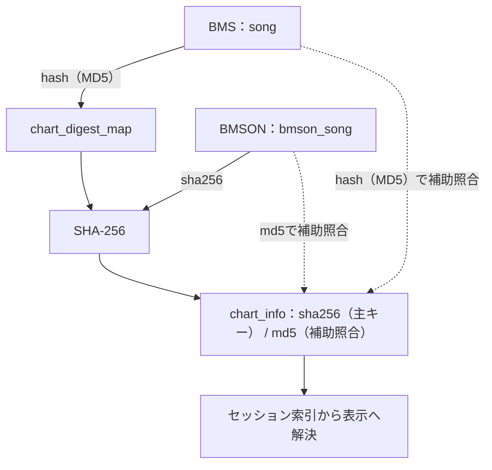

# 譜面情報の保存と最新性

## 目的と適用範囲

`chart_info` の識別条件、読込み、補完解析、保存と公開を定めます。解析の値そのものは[解析互換性](parser-compatibility.md)、入力の読取りは[譜面ファイルの読取り](chart-file-reading.md)に従います。

## 用語

[共通用語集](../glossary.md)を参照します。コードの識別子は原表記を使います。

## 仕様

### 識別と共通詳細値

BMSは `song.hash` のMD5と `chart_digest_map` のSHA-256を結び、`chart_info.sha256` を参照します。BMSONは `bmson_song.sha256` を優先し、`chart_digest_map` を作りません。

詳細情報の生成・再利用・保存は内容のハッシュを識別の単位とし、同じ内容を持つBMSとPMSで共有します。解析そのものには拡張子に依存する解釈がありますが、同じ内容を `.bms` と `.pms` で併存させ、拡張子ごとに異なる詳細値を保持する利用は想定しません。拡張子別のキャッシュの識別や結果の保証は設けず、この前提だけを理由に入力の登録を新たに拒否しません。

`chart_info` は譜面メタデータのキャッシュでもあるため、現在のカタログに所持主体がない行を、読込みや補完解析だけを理由に削除しません。`CatalogChartInfoOwner` が、不変の `ChartDetails` と `ChartParseFailure` のキャッシュと最新性を所有し、DB行の型への変換はDB境界だけで行います。表示は既存のセッション索引と投影の提供元から解決し、保存行への逆参照を持ちません。

#### 情報を解決するキー

実線は、保存済みのキーからSHA-256を得て `chart_info` を引く主な経路、破線はセッション索引でのMD5による補助の照合を示します。外部キー制約や解析の実行順ではありません。BMSとBMSONでは、SHA-256へ到達する経路が異なります。情報と解析失敗のどちらを採用するかは、[最新性の判定](#最新性の判定)の優先順位で決めます。

セッション索引はSHA-256を優先し、SHA-256で解決できない場合は `chart_info.md5` でも候補を照合します。MD5は `chart_info` の主キーではなく、同じMD5に複数の情報行が存在できます。MD5による補助の照合で候補が複数ある場合は、SHA-256の順で先頭の行を代表とします。所持主体がないキャッシュ行も存在できるため、この図は所持集合との一対一の対応や、削除の連動を意味しません。

#### 読込みと補完の受付

譜面情報の背景での読込みと、ハッシュ・譜面情報の補完は、推定の入力を実際に更新するため、共通の論理的な受付を使います。先行する操作の実際の終端を非同期に待ってから必須の更新を行い、受理済みの要求を競合拒否（`Busy`）で捨てません。読込みから起こす同期的な補完は同じ受付の継続として処理し、待機中の補完の本体は、完了済みの要求を再実行しません。表示の要求の版と索引の版は、それぞれの管理主体が管理します。

### 最新性の判定

同じ譜面の判定の優先順位は次のとおりです。

| 優先順位 | 条件 | 結果 |
| --- | --- | --- |
| 1 | 識別条件が一致し、解析器の版が現行以上の `chart_info` がある | 既存の情報を再利用する。 |
| 2 | 解析器の版が現行と完全に一致し、記録時の時間上限が現在の上限以上である解析失敗がある | 再解析しない。 |
| 3 | いずれもない | 解析の候補にする。 |

現在の情報と現在の解析失敗が併存する場合は、情報を優先します。古い解析器の結果や、現在より短い制限時間で記録した解析失敗は、再解析を省く根拠にしません。

現行の解析器の版は22です。保存済みの成功行は、版が22以上で識別条件が一致すれば再利用します。21以前の所持行は、通常の補完で実際の入力から再解析し、現行の版で保存します。旧い行の版だけを書き換えることはせず、未所持の旧い行を一括で削除しません。20以前の、地域設定に依存したハッシュも同じ補完で更新します。最新性の判定、同一起動内の全件の現在判定、補助メタデータの版の検査は、`BmsLibraryDbGateway.CurrentChartInfoParserVersion` を共用します。LR2全体同期の要否は、解析器の版とは独立した Completed の判定です。

保存済みの解析失敗は、例外の型やメッセージで分類し直しません。再解析が必要な場合は、一覧から解析失敗の結果を明示的に削除します。

判定の正本は `ChartInfoBuildService.EvaluateSnapshot` です。呼出元が、単一の `ChartFileSnapshot`、所持主体の識別条件、事前に取得した情報と解析失敗を渡します。評価処理自身はファイルやDBを読み書きせず、既存の情報の適用、解析失敗による省略、解析の成功・失敗、入力の取得不能のいずれかを返します。導入時の解析、全件補完、LR2同期で、解析器・優先順位・失敗メッセージの整形を分岐させません。

### 導入後の対象限定検索

パスから導入後の情報を作る場合は、実際に読めたスナップショットのMD5だけで解析失敗を検索します。発見時のMD5は、その後に内容が変わっている可能性があるため根拠にしません。対象が空ならDBを開かず、問い合わせもしません。

検索は、パラメーター付きのMD5の集合を分割して行い、失敗表を全件取得してから絞り込みません。全所持項目を照合する起動時の読込みとは区別します。現在の情報を再利用する場合も、新しい所持項目に必要な適用と、確定後の索引・通知は省きません。

### 保存する列と公開順序

文字コードの変更やリソースの再調査でメタデータだけを再復号する場合は、[songの限定保存](../integration/lr2-song-db.md#songの生成)を使います。詳細の索引を読込み済みでも、共通現在値に `ChartInfo` が付いていない起動直後の状態を許容し、メタデータの保存のために詳細を再解析したり、生成列を全部上書きしたりしません。対応するテストは[LR2楽曲DBの対応表](../integration/lr2-song-db.md#実装とテストの対応)を正本とします。

導入時の解析と全件補完は、保存対象と譜面情報を `CatalogChartInfoStorageWriteRequest` にまとめ、`CatalogMutationOwner.ApplyChartInfoStorageWrite` から一つのトランザクションへ渡します。

#### 生成列と限定更新

新規・更新ファイルは、基本解析と詳細解析を組み合わせた不変の共通変更事実を作り、DB境界で生成列へ変換します。新規の走査候補の保存用の `mode` は、捕捉した本文の基本解析の値を維持し、再利用した詳細の `mode` を生成列へ写しません。これは、詳細からの共通基本値の更新や、明示的なモードの再検出による限定的な書戻しとは別の境界です。

所持済みの譜面の全件補完は行全体を作り直さず、パスと正規化したMD5が一致する既存のBMSの次の9列だけを更新します。

`level`、`difficulty`、`maxbpm`、`minbpm`、`bga`、`exlevel`、`longnote`、`random`、`karinotes`

基本列、`mode`、`judge`、`favorite`、`tag`、`adddate` は既存の値を維持します。行の欠落や識別の不一致は、件数と上限付きの例を診断し、暗黙に `song` の行を挿入しません。BMSONは情報とセッション索引を更新しますが、LR2の `song` の行やハッシュ対応表を作りません。

ハッシュが不足している候補が既存の現在の情報を再利用した場合も、保存用の適用結果を作ります。同じMD5を持つ複数のBMSには、一回の読取り・評価の結果を全対象へ反映します。

#### レベルの扱い

通常の `chart_info` の補完でも、同じパス・MD5の `song.level` と現在値の Level を、譜面由来の値へ戻します。手動のLR2再同期も、生成済みの値から、同じ所持項目の Level と LevelText を実際の終端で揃えます。保存前に失敗したチャンクは公開せず、確定済みの先頭部分の扱いは[LR2同期](../integration/lr2-song-db.md#楽曲チャンクの確定と必須反映)に従います。難易度表の上書き値を保護する状態は持ちません。

導入時の保存・公開でも、`LevelText` は負号を含めてインバリアントカルチャで作ります。負の PLAYLEVEL の表示を ENTRY LEVEL の初期文字列へ渡したとき、変更せずに確定しても固定の文法で受理できる表記にし、数値の保存値は変えません。

#### 公開順序

公開は、DB確定、DBで一致した共通現在値への一回の適用、ハッシュに依存する索引、譜面情報のセッション索引、警告・ハッシュの通知の順に行います。同じ所持項目の識別を持つ現在値を詳細の確定で更新するときは、実際の変更を共通確定契約で一回だけ確定します。独立した詳細索引の版と変更したハッシュも、必要な表示へ通知します。確定前や確定に失敗したときに、部分的に公開しません。ハッシュの変更内容は一回だけ作り、索引の更新と公開で共用します。

### 起動時の読込みと同一起動内の省略

#### 読込み

LR2連携と単独動作は、同じ読取り専用の処理で、実在する情報・解析失敗を取得し、所持譜面と照合します。この段階でスキーマを作成・修復せず、導入できるようになるまで同期的に待たせません。

起動時の表示用の投影は[型付きの生の読取り](../core/performance-and-scale.md#全件処理と局所処理)を使い、REALのdoubleの精度と更新時刻の1tickを、最終的な辞書まで保持します。旧いTEXTの固定の数値・ticksも読み、null許容の整数で適合しない値はnull、必須の整数は0、boolはfalse、無効なticksは既定の日時にします。現在の成功・現在の解析失敗の判定は、同じ読取り結果の解析器の版・失敗の種類・時間上限から作ります。読込み時に保存値やスキーマを変更しません。

#### 補助メタデータの取込み

現在より古い解析器の版の補助メタデータ（bundle）は、取込み時の版の検査で採用せず、既存の取込み失敗の経路でログを出してから、保存済みのカタログの読込みへ進みます。保存済みデータの必須の読込みの後に操作を解禁し、所持する旧い情報は通常の起動の背景補完へ回します。補完の完了を利用開始の条件にせず、必須のDB自体の読込み失敗は失敗として扱います。

補助メタデータは、選択済みの `ApplicationPathSnapshot.ProfileDirectory` からだけ取り込み、成功後は同じプロファイルの `imported_metadata` へ移動します。通常のプロファイルと実行ファイルの配置が一致する構成では、その配置をそのまま使います。別のプロファイルを指定した構成では、実行ファイル側や共有 Assets の bundle を消費・移動しません。取込みの手順は[起動の補助メタデータの取込み](../runtime/startup.md#補助メタデータの取込み)を参照します。

#### 同一起動内の省略

`lr2_song_db_sync_status` は、LR2の生成行の同期状態です。同期済みであることや、ファイル差分がないことは、`chart_info` の存在と完全性を証明しません。どちらの動作モードでも、現在の情報も解析失敗もない所持譜面は補完の候補になります。

実データの照合で全対象が現在の情報または解析失敗と判定された場合は、`ChartInfoHydrationAllCurrentSnapshot` を記録できます。解析器の版、時間上限、対象の解析入力が変わらない同一起動内では、候補の集計と全件補完を省略します。LR2の同期状態からこの記録を合成しません。

未確認の入力は、既存の未確認の集合と解析条件で管理します。健全性や Title だけの確定では、全体の候補走査を始めません。初回・明示的な全置換・解析条件の変更では全体を入力とし、以後の局所的な変更と前回の未完了分では、対象の所持項目の現在値と、必要な詳細・解析失敗だけを取得します。局所補完で取得する仕事量は、変更のあった入力だけに比例し、全体のカタログの版には比例しません。

補完を省略できる証拠は、現在の情報・有効な保存済みの解析失敗を確認した入力か、情報・有効な解析失敗の保存と必要な反映を終えた入力です。保存していない内部故障の対象は、今回の要求だけで読み飛ばし、次の明示的な要求の未確認の集合へ残します。読取りやハッシュの失敗がなかったことや、要求の終端の版が進んだことだけでは完了にしません。確定済みの入力の証拠はチャンクごとに反映し、後続のチャンクが失敗しても先行分を再走査の対象へ戻しません。解析入力の同一性と、詳細以外の値の更新は区別します。

#### 解析失敗の明示削除

解析失敗の明示的な削除は、失敗行と警告を更新しますが、同一起動内の上記の記録を無効にせず、即時の再読込みや補完も予約しません。現在の情報がない譜面は、次回の起動の実データの照合で候補へ戻ります。同一起動中に既に進行している読込みが、削除の前後どちらの状態を観測するかは保証しません。

### 失敗

DBの読込みに失敗した場合に「全て最新」を合成しません。

#### 対象ごとの失敗

独立した詳細情報の取得・ハッシュ生成・解析が、原因不明の通常の失敗で終わった場合は、今回の対象の失敗として件数と診断に残し、未完成の詳細を採用しません。失敗行を新たに保存・削除せず、正常な独立した対象、有効な既存の情報、成功した基本情報・識別を保持します。次の通常の補完では同じ対象を評価でき、再試行の処理や、旧い失敗行の一括の救済は追加しません。

恒久的な解析失敗の候補にするのは、ハッシュが取得できた場合の、解析器が入力不良と判定する `InvalidDataException`・JSONの形式の失敗と、解析時間の超過だけです。長さを制限したメッセージ、解析器の版・時間上限と、成功時に同じMD5の失敗行を削除する候補は維持します。保存と削除のトランザクションは呼出元が管理します。原因不明の失敗は、既存の失敗件数と失敗行の候補の有無で表し、新しい状態や結果の型を持ちません。

成功時の診断と失敗の警告は採否から分離し、通常の診断の失敗で、成功行・元の対象の失敗・時間超過を変更しません。補完の段階の計測と、DB確定後の行の欠落の警告も任意の診断とし、その失敗で必要な確定と公開を飛ばしません。共通の評価処理に導入済みのOOMの捕捉は即時の終了へ接続しますが、全Task・全回収・案内の成功は保証しません。今後の対策の範囲は[共通例外仕様](../core/exception-handling.md#oomとプロセス状態)に従い、全経路での検出・即時終了を追加の必須保証にはしません。

#### BMSONの入力不良

BMSONのオブジェクト欄にある数値・文字列などの変換できない値、必要なイベント・ノート要素のnull、解析器が判定する表現できない時間は、その譜面の解析失敗に留めます。省略できる配列・チャンネル自体のnullは許容します。イベントの統合では実在する候補だけを比較し、最大のint位置を他の種類のイベントの枯渇と混同しません。

基本値の解析と詳細解析は、同じJSONの入力不良の判定を使い、内部故障を入力不良へ包みません。詳細の評価では、JSONの例外に包まれた通常の内部故障も今回だけの失敗とし、恒久的な記録に入れません。資源不足は通常の対象の失敗へ変換しません。基本値の解析側での原因不明の取得・解析の失敗も、その譜面の今回の処理だけを読み飛ばし、恒久的な解析不能の記録に入れません。

#### 全件補完の処理と保存の失敗

全件補完では、独立した読取り・ハッシュ生成・詳細解析の失敗と、待ち行列・DB書込み・必須の反映の失敗を分けます。入力を扱う狭い捕捉の範囲に、待ち行列への投入・保存・公開を含めません。通常の失敗・取消では、読取り処理、ワーカー、集約・保存のTaskを終端まで所有し、一対象だけの失敗で健全な後続の解析を止めません。DB書込みや必須の公開の失敗はサービスから伝播し、先に確定した結果を巻き戻しません。

ファイル差分の走査とLR2同期でも、詳細だけの原因不明の通常の失敗は、正常な基本行の保存を妨げず、正常な対象の詳細と既存の確定・公開を保ちます。詳細の失敗によって順序番号を欠けさせません。遅れている健全な解析や書込みの公開のコールバックも、通常の実際の終端まで待ちます。詳細以外の処理の故障と要求の取消の区別は、[譜面ファイルの読取り](chart-file-reading.md)と[LR2楽曲DBの同期](../integration/lr2-song-db.md#読込みと確定結果の再利用)に従います。

#### 背景補完の失敗と要求の終端

背景の管理主体も、候補の取得・準備・保存・必要な公開の通常の失敗を、補完操作の失敗として呼出元へ返します。候補の取得の失敗を全件補完へ置き換えません。開始済みの通常の処理と、準備済みの確定・公開を終え、受理済みの別の要求があれば既存の処理の周回で扱った後、最初の失敗を所有するTaskへ伝えます。他の失敗は診断を試み、全原因の再送や自動の再試行は追加しません。保存に失敗した分を公開せず、先に確定したDBの内容・反映した内容・補完済みの件数を保ちます。

要求の完了の版は、成功ではなく終端を表します。通常の失敗でも、発行済みの要求の完了の版・実行中の状態・現在のパスを確定し、表示のためだけの購読先や性能診断の失敗で終端を妨げません。正本を保った保存失敗の後は、次の明示的な補完要求を受け付けます。

確定の後は、共通現在値、ハッシュ由来の参照・索引、詳細の索引の順に反映し、準備した公開は入力の変更区間を解放した後に行います。必要な反映の失敗は補完操作の失敗として伝播し、確定済みのDBや件数を巻き戻しません。共通の派生状態への反映の準備が失敗した場合は、`LibraryMutationOwner` がリソース健全性の索引を失効させます。任意の内部故障に対して、全派生状態の復元や安全な継続を保証するものではありません。追加の対策の要否は[共通例外仕様](../core/exception-handling.md#判断の単位)の具体的な影響と到達条件から判断し、内部のコールバックへ例外を注入できるというだけで新しい回復・終了の経路を設けません。

### BMSONの共通表示と画像イベント

導入時の詳細値の投影では、BMSONの共通のモードを基本解析の値のまま保持します。`keyboard-24k` / `keyboard-24k-double` の一覧・整列の値は24/48、詳細の互換IDは25/50です。レベル・難易度・ハッシュの投影と、BMSの詳細でのモードの補正は維持し、追加の読取りは行いません。

`bga_events`・`layer_events`・`poor_events` は、各座標に同じタイムラインを確保します。同じ座標は統合し、BGAの使用フラグは `bga_events` の実際のイベントだけを根拠とします。STOPの間にある画像だけの時点も速度の復帰へ反映しますが、ノート数と演奏長は変えません。この扱いは解析器の版22のまま維持し、版21以前の行は既存の再解析で更新します。同じ版のキャッシュは強制的に失効させません。

BMSONのTOTALの未定義と有効値は[解析互換性](parser-compatibility.md#totalとbpmの範囲)に従います。

## 実装とテストの対応

| 仕様項目・主な条件 | 実装箇所 | テスト箇所・確認内容 |
| --- | --- | --- |
| 導入時の負のLEVELの表示と、変更しない確定 | `ChartInfoStorageApplication.CreateCurrentValue`、`PlaylistDetailSourceRow` | `ChartInfoInlineHydrationTests.InlinePublication_NegativeLevelCanBeCommittedFromDetailRowWithoutEditing` は、sv-SEで実際の保存・公開の後のASCIIの負号から、詳細行・実際の保存先への接続を確認する。実際のF2/Enter/Escape、拒否の通知と次の保存は `MainWindowPlaylistWorkspaceWpfTests.EntryLevel_CurrentCultureRoundTripAndCancelKeepSavedNumber` が分担する。 |
| 旧BMSONの通常フォルダの導入による詳細の保存 | `BMSLibrary.InstallChartPackagesAutoWithProgressAsync`、`ChartInfoInlineBuildService`、共通のJSON境界 | [`BmsLibraryPackageInstallServiceTests.InstallChartPackagesAuto_BmsonFolderPreservesLegacyResourceAndStorageContracts`](../../../tests/BeMusicSeeker.Core.Tests/Install/BmsLibraryPackageInstallServiceTests.cs) は、旧0.21・版なし・現代形式の実際の導入から実配置・所持を確認し、新しい読取り専用のDB接続で `bmson_song` のパス・ハッシュと、詳細の固定値の版22・BPM 120～240・3ノート・最終1000msを観測する。音源の欠損では元の入力の保持・不足警告付きの保留・未導入を確認する。キーの優先・数値字句の条件の網羅と、通常の補完のキャッシュの再利用は別の境界へ分担する。 |
| 旧BMSONの新規保存・版21の再解析・同じハッシュの版22の再利用 | `BmsonJsonParser`、`ChartInfoBuildService`、`BmsLibraryDbGateway` | [`ChartInfoBackfillStorageTests.BackfillChartInfos_AppliesChartInfoToBmsonStorageOwner`](../../../tests/BeMusicSeeker.Core.Tests/ChartInfo/ChartInfoBackfillStorageTests.cs) は、旧0.21・版なし・現代形式を実際のSQLiteへ保存し、新しい接続で固定値の22と詳細値を確認する。版21の一回の読取りと再解析、同じハッシュの版22での読取り0回・識別できる保存ハッシュの保持と、BMS専用の表を作らないことも確認する。 |
| BMSONのTOTALの未定義と有効値、補完後のLevel、旧い Completed での補完 | [`ChartInfoParser`](../../../BeMusicSeeker/Models/BmsLibraryInternal/ChartInfo/ChartInfoParser.cs)、[`CatalogChartInfoOwner`](../../../BeMusicSeeker/Models/BmsLibraryInternal/Catalog/CatalogChartInfoOwner.cs) | `ChartInfoParserBehaviorTests.ParseBmson_TotalDefinitionPreservesEffectiveValue` は、省略・100・0・負の値・null・正の値の倍率を実際の解析で比較する。`ChartInfoBackfillStorageTests.BackfillChartInfos_AppliesChartInfoToBmsonStorageOwner` は、実際の補完とSQLiteの再読込みから、一覧のTOTAL・未定義の表示・定義済み／未定義の検索への接続を確認する。`ChartInfoInlineHydrationTests.DeferredChartInfoHydration_MissingCurrentRowBackfillsRegardlessOfCompletedLr2Status` は、欠落した情報と版21を対象に、旧い Completed で全体同期が始まらず、level 12が譜面由来の3へ戻り、再読込みでも保たれることを確認する。 |
| BMSONの共通モードの投影と画像イベント | `ChartInfoInlineBuildService`、`ChartInfoParser` | `ChartInfoInstallFailureRetryTests.InstallChartPackages_AddsBmsonAndBuildsInlineChartInfo` が通常・推定先の導入とDBの再読込みを、`ChartInfoInlineHydrationTests.InlineProjection_BmsonPreservesCommonMode` が投影を、`ChartInfoParserBehaviorTests.ParseBmson_ImageCoordinatesRestoreSpeedBetweenStops` が三種の画像イベント・重複・空配列を確認する。 |
| 局所補完で取得する仕事量 | `CatalogChartInfoOwner` | [`ChartInfoInlineHydrationTests.WarmBackfill_UsesChangedInputTokensInsteadOfGlobalCatalogRevision`](../../../tests/BeMusicSeeker.Core.Tests/ChartInfo/ChartInfoInlineHydrationTests.cs) が、実際のBMS・SQLiteと背景の16件・128件で、変更のあった入力だけを取得することを確認する。 |
| 起動時の補助メタデータの取込み範囲 | `ChartInfoMetadataBundleStartupImporter` | [`ShellShutdownDatabaseScopeTests.StartupMetadata_ConsumesOnlyProfileBundleAndPreservesBaseAndAssets`](../../../tests/BeMusicSeeker.Windows.Tests/MainWindow/ShellShutdownDatabaseScopeTests.cs) が、実際の起動の入口での入力の隔離、最終的なDBとアーカイブ、共有側の準備済みファイルの不変を確認する。実際のATTACHと所有するTaskの終端は[終了仕様](../runtime/shutdown.md#実装とテストの対応)へ分担する。 |
| スキーマ、メタデータの入出力、起動時の取込み | [`CatalogChartInfoOwner`](../../../BeMusicSeeker/Models/BmsLibraryInternal/Catalog/CatalogChartInfoOwner.cs)、[`ChartInfoMetadataBundleStartupImporter`](../../../BeMusicSeeker/Models/BmsLibraryInternal/ChartInfo/ChartInfoMetadataBundleStartupImporter.cs) | [`ChartInfoMetadataSchemaExportImportTests`](../../../tests/BeMusicSeeker.Core.Tests/ChartInfo/ChartInfoMetadataSchemaExportImportTests.cs) の `ImportChartInfoMetadataBundle_ImportsMissingAndStaleRowsAndClearsFailures`（同じ bundle の再投入を含む）、`StartupImporter_PrefersDatabaseBundleOverArchive`、`StartupImporter_ImportsArchiveBundleAndMovesImportedArchive`（展開済みのキャッシュの移動・再配置・一回だけの展開）。 |
| 版20以前の通常の補完、版22・23の成功行の再利用、現在の成功の優先、未所持の旧い行の保持 | [`BmsLibraryDbGateway`](../../../BeMusicSeeker/Models/BmsLibraryInternal/BmsLibraryDbGateway.cs)、[`ChartInfoBuildService`](../../../BeMusicSeeker/Models/BmsLibraryInternal/ChartInfo/ChartInfoBuildService.cs) | [`ChartInfoBackfillStorageTests`](../../../tests/BeMusicSeeker.Core.Tests/ChartInfo/ChartInfoBackfillStorageTests.cs) は、未登録・版20からの独立した固定値の22での保存、負の時刻の独立したASCIIの固定値から求めたハッシュ・実際の読込み・進捗、未所持の旧い行の版・ハッシュの保持を確認する。`BackfillChartInfos_ReusesSavedSuccessAtCurrentOrFutureParserVersion` は、実DBの22・23を実際の現在行の検索で採用し、読取り0回と保存した版・区別できるハッシュの保持を確認する。[`ChartInfoMetadataSchemaExportImportTests.ChartInfoExport_ExportsCurrentRowsAndComplementsDigestMap`](../../../tests/BeMusicSeeker.Core.Tests/ChartInfo/ChartInfoMetadataSchemaExportImportTests.cs) は、実際の出力の manifest の版を独立した固定値の22で照合し、行の選別・ハッシュ対応の補完・件数を確認する。TOTALを省略した入力を実際に解析した版22の bundle を別のDBへ取り込み、未定義のフラグと有効なTOTALも確認する。補助メタデータ・読込み・全件の現在判定の定数の接続と、旧い bundle を採用しなかった後の起動の継続は静的確認へ分担する。 |
| 解析結果、時間上限、互換入力 | [`ChartInfoParser`](../../../BeMusicSeeker/Models/BmsLibraryInternal/ChartInfo/ChartInfoParser.cs)、[`ChartInfoBuildService`](../../../BeMusicSeeker/Models/BmsLibraryInternal/ChartInfo/ChartInfoBuildService.cs) | [`ChartInfoParserBehaviorTests`](../../../tests/BeMusicSeeker.Core.Tests/ChartInfo/ChartInfoParserBehaviorTests.cs)、[`ChartInfoParserBehaviorTests`（互換性テストの固定入力・外部ツール）](../../../tests/BeMusicSeeker.Compatibility.Tests/ChartInfo/ChartInfoParserBehaviorTests.cs) |
| 詳細の原因不明の取得・解析失敗を恒久化しないことと、次の通常の機会 | [`ChartInfoBuildService`](../../../BeMusicSeeker/Models/BmsLibraryInternal/ChartInfo/ChartInfoBuildService.cs) | [`ChartInfoBackfillStorageTests.BackfillChartInfos_UnknownInputFailureSkipsAndNextOpportunityEvaluates`](../../../tests/BeMusicSeeker.Core.Tests/ChartInfo/ChartInfoBackfillStorageTests.cs) は、実際のSQLiteと管理主体を使い、原因不明の読取り・解析失敗、通常の進捗通知の故障、正常な対象と成功した識別・旧値の保持、生の失敗行を作らないこと、次の通常の補完で同じ対象を評価・保存することを確認する。集約・保存の実際の終端は既存の待合せで確認し、OOMでの終了とハッシュの純粋な捕捉範囲は静的に分担する。 |
| 実際のファイル差分での詳細の原因不明の失敗と、健全な処理の終端 | [`FileScanParseCommitOwner`](../../../BeMusicSeeker/Models/BmsLibraryInternal/Scanning/FileScanParseCommitOwner.cs)、共通の詳細の評価処理 | [`BmsLibraryInitializationFileScanTests.ApplyFileScanDiff_UnknownDetailFailureKeepsBasicAndWaitsForHealthyWriter`](../../../tests/BeMusicSeeker.Core.Tests/Startup/BmsLibraryInitializationFileScanTests.cs) は、詳細一件の通常の故障でも、基本行・正常な対象の詳細を保ち、生の失敗行を作らず、遅れている健全な解析・書込み処理の終端より前に完了しないことを確認する。保存失敗で公開しないことと処理全体の終端は、既存の `ApplyFileScanDiff_StreamingWriterFailureDoesNotBlockPipeline` へ分担する。 |
| 全件補完の9列の更新、同じハッシュの複数の主体、確定の失敗 | [`CatalogMutationOwner`](../../../BeMusicSeeker/Models/BmsLibraryInternal/Catalog/CatalogMutationOwner.cs)、[`ChartInfoBuildService`](../../../BeMusicSeeker/Models/BmsLibraryInternal/ChartInfo/ChartInfoBuildService.cs) | [`ChartInfoBackfillStorageTests`](../../../tests/BeMusicSeeker.Core.Tests/ChartInfo/ChartInfoBackfillStorageTests.cs) の `BackfillChartInfos_ParsesMissingRowsSkipsCurrentRowsAndReparsesStaleRows`、`BackfillChartInfos_UpdatesOnlyChartInfoSongProjectionAndPreservesOtherColumns`、`BackfillChartInfos_ReusedCurrentRowProjectsSongColumnsForMissingDigestCandidate`、`BackfillChartInfos_GroupsDuplicateMissingSha256TargetsByMd5`（同じMD5を一回の読取りで反映）、`BackfillChartInfos_TransactionFailureDoesNotPublishCanonicalDigestSongOrIndex`、`BackfillChartInfos_LaterChunkFailureKeepsEarlierPublicationAndDoesNotPublishFailedChunk`、`BackfillChartInfos_MissingSongRowCommitsFactsWithoutInsertingSong`（行の欠落の警告・計測の故障でもDB確定と必要な公開を保持）。 |
| 背景補完の通常の失敗と要求の終端 | [`CatalogChartInfoOwner`](../../../BeMusicSeeker/Models/BmsLibraryInternal/Catalog/CatalogChartInfoOwner.cs) | [`ChartInfoInlineHydrationTests`](../../../tests/BeMusicSeeker.Core.Tests/ChartInfo/ChartInfoInlineHydrationTests.cs) の `CatalogChartInfoOwner_PreparationFailureTerminatesAndNextExplicitRequestSucceeds` は候補の取得前と受付後のDB準備の失敗を、`CatalogChartInfoOwner_StorageFailureDrainsAcceptedRequestAndKeepsFirstFault` は実際のロールバック・別の所持項目の受理済みの要求と、次の明示的な要求を確認する。`CatalogChartInfoOwner_RequiredPublicationFaultKeepsCommittedDigestCount` は必要な反映の失敗時の失敗の伝播・確定済みのDB・実際の件数を、`CatalogChartInfoOwner_AfterReleaseCheckpointFailurePreservesCompletion` は保存後の計測の失敗でも必要な公開と元の要求の実際の終端を保つことを確認する。共有の派生状態の復旧と最終的なアプリの終了は、この検証の保証外とする。 |
| 通常の内部故障を今回だけの失敗とし、診断が干渉しないこと | [`ChartInfoBuildService.EvaluateSnapshot`](../../../BeMusicSeeker/Models/BmsLibraryInternal/ChartInfo/ChartInfoBuildService.cs) | [`ChartInfoInlineHydrationTests`](../../../tests/BeMusicSeeker.Core.Tests/ChartInfo/ChartInfoInlineHydrationTests.cs) の `ChartInfoSnapshotEvaluator_InternalFaultSkipsWithoutPersistentFailure`、`ChartInfoSnapshotEvaluator_DiagnosticFailurePreservesSuccessfulRow`、`ChartInfoSnapshotEvaluator_WarningFailurePreservesInputFailure`、`ChartInfoSnapshotEvaluator_BmsonNumericInputFailureRemainsPersistent` が、原因不明の失敗と、成功・既知の入力不良・時間超過・現在の情報の優先を分担する。[`BmsonInputFailureBoundaryTests.EvaluateSnapshot_WrappedInternalFailureSkipsWithoutPersistentFailure`](../../../tests/BeMusicSeeker.Core.Tests/ChartInfo/BmsonInputFailureBoundaryTests.cs) はJSONに包まれた通常の内部故障・引数の契約違反を恒久化しないことを、既存の不正入力と許容するnullのテストは入力の互換性を分担する。 |
| BMSONの入力失敗と許容する入力 | `ChartInfoParser`、`BmsonJsonParser`、`ChartInfoBuildService.EvaluateSnapshot` | `BmsonInputFailureBoundaryTests` は、実際の入力で、オブジェクトへ変換できない値・null要素・表現できない時間の解析失敗、任意の配列・チャンネルのnullの許容、最大のint位置のイベント、JSONの例外に包まれた通常の内部故障を今回だけ採用せず恒久化しないことを確認する。直接捕捉したOOMと、直近のJSONの例外に包まれたOOMの即時終了は静的確認へ分担する。`BmsLibraryInitializationFileScanTests.ApplyFileScanDiff_InvalidBmsonLogsAndReportsProgress` は、壊れたJSON・範囲外の数値・nullのイベント・オブジェクト欄の数値を正常な譜面と同じ実際の走査へ渡し、正常な譜面の保持と処理済みの進捗を確認する。 |
| 起動時の型付きの表示用の投影、doubleのビット・1tick・固定のTEXTとの互換 | [`BmsLibraryDbGateway.LoadChartInfoHydrationData`](../../../BeMusicSeeker/Models/BmsLibraryInternal/BmsLibraryDbGateway.cs) | [`ChartInfoInlineHydrationTests.LoadChartInfoHydrationData_UsesRawProjectionAndPreservesCurrentness`](../../../tests/BeMusicSeeker.Core.Tests/ChartInfo/ChartInfoInlineHydrationTests.cs) は、実際の保存後の新しい接続で、en-US/de-DE/th-THでの最終的な辞書と現在の集合、doubleのビット・1tick・NULL、完全な行との比較を確認する。`LoadChartInfoHydrationData_PreservesFixedTextCompatibilityAndInvalidDefaults` は、テストが所有する旧いTEXTの列と実際の typeof で、固定の互換・null/0/既定の日時・保存値の不変を確認する。型変換の条件表と、実際のステップ・コールバックの失敗は `SQLiteProviderRuntimeTests` へ集約する。 |
| 読取り専用の照合、対象のMD5の検索、既存の情報の適用、公開の順序 | [`ChartInfoInlineBuildService`](../../../BeMusicSeeker/Models/BmsLibraryInternal/ChartInfo/ChartInfoInlineBuildService.cs)、[`BmsLibraryDbGateway`](../../../BeMusicSeeker/Models/BmsLibraryInternal/BmsLibraryDbGateway.cs)、[`CatalogChartInfoOwner`](../../../BeMusicSeeker/Models/BmsLibraryInternal/Catalog/CatalogChartInfoOwner.cs) | [`ChartInfoInlineHydrationTests`](../../../tests/BeMusicSeeker.Core.Tests/ChartInfo/ChartInfoInlineHydrationTests.cs) の対象限定の検索と既存の適用のテストを維持する。`ChartInfoInlineBuildService_UnknownReadFailurePreservesSiblingAndStoredBasic` は、原因不明の取得と診断の故障でも、正常な保存候補・旧い基本行・生の失敗表を保持することを確認する。 |
| 保存していない故障とチャンクごとの完了の証拠、次の明示的な要求 | [`CatalogChartInfoOwner`](../../../BeMusicSeeker/Models/BmsLibraryInternal/Catalog/CatalogChartInfoOwner.cs)、[`ChartInfoBuildService`](../../../BeMusicSeeker/Models/BmsLibraryInternal/ChartInfo/ChartInfoBuildService.cs) | [`ChartInfoInlineHydrationTests`](../../../tests/BeMusicSeeker.Core.Tests/ChartInfo/ChartInfoInlineHydrationTests.cs) の `BackfillInputCoverage_InternalFaultRetriesOnlyUnfinishedInputOnNextExplicitRequest` と `BackfillInputCoverage_LaterChunkFaultPreservesEarlierProofAndRetriesOnlyPendingInputs` は、同じ管理主体への二つの要求を実際のサービス・実DBへ通し、正常・有効な解析失敗・保存していない内部故障の分離と、後続のDB故障の後の先行確定の保持・未完了分だけの再評価を確認する。サービス単体のワーカーの回収と確定・公開は、既存の [`ChartInfoBackfillStorageTests`](../../../tests/BeMusicSeeker.Core.Tests/ChartInfo/ChartInfoBackfillStorageTests.cs) が担う。 |
| 新規走査でのキャッシュ済み詳細の再利用と、保存する `mode` の分離 | [`FileScanParseCommitOwner`](../../../BeMusicSeeker/Models/BmsLibraryInternal/Scanning/FileScanParseCommitOwner.cs)、DB境界の生成列への変換 | [`BmsLibraryInitializationInlineChartInfoTests`](../../../tests/BeMusicSeeker.Core.Tests/Startup/BmsLibraryInitializationInlineChartInfoTests.cs) の `ApplyFileScanDiff_CurrentInlineChartInfoRowSkipsParseAndReturnsAppliedRow` が、基本解析とキャッシュ済みの詳細でモードが異なる入力と、実DBの読戻しで確認する。 |
| 導入後の実際のハッシュ、警告の削除、競合と次回の再評価 | [`ChartInfoInlineBuildService`](../../../BeMusicSeeker/Models/BmsLibraryInternal/ChartInfo/ChartInfoInlineBuildService.cs)、[`ChartInfoParseFailureRemovalWorkflowOwner`](../../../BeMusicSeeker/ViewModels/Maintenance/ChartInfoParseFailureRemovalWorkflowOwner.cs) | [`ChartInfoInstallFailureRetryTests`（Windows）](../../../tests/BeMusicSeeker.Windows.Tests/ChartInfo/ChartInfoInstallFailureRetryTests.cs) の `InstallChartPackages_UsesInstalledSnapshotMd5ForFailureLookup`、`RemoveChartInfoParseFailuresByMd5_RetriesOnNextStartupInBothModes` と、[`ChartInfoInstallFailureRetryTests`（Core）](../../../tests/BeMusicSeeker.Core.Tests/ChartInfo/ChartInfoInstallFailureRetryTests.cs) の `BackfillChartInfos_ParseFailureStillPersistsDigest`、`BackfillChartInfos_SkipsCurrentPersistedParseFailure`、`BackfillChartInfos_ReparsesStalePersistedParseFailureAndUpdatesRecord`、`BackfillChartInfos_ReparsesShorterTimeoutFailure`、`BackfillChartInfos_CommitsInChunksAndLogsPhaseBoundaries`。実際のMD5でのBMSの解析失敗、確定後の警告、次回起動での再評価を確認する。 |

## 関連資料

[譜面ファイルの読取り](chart-file-reading.md)、[変更操作](mutations.md)、[データと索引](../core/data-and-indexes.md)、[テスト実行](../development/test-runtime.md)を参照します。
