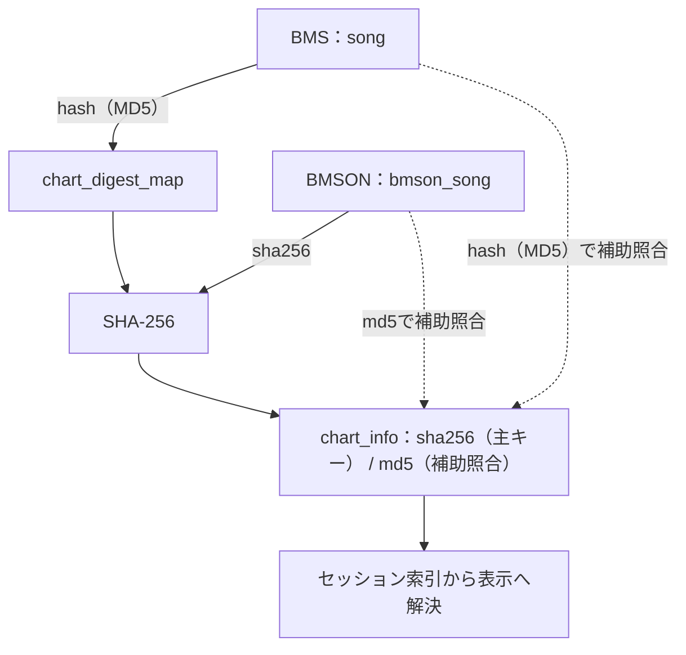

# 譜面情報の保存と最新性

## 目的と適用範囲

`chart_info` の識別条件、読込み、補完解析、保存と公開を定めます。解析の値そのものは[解析互換性](parser-compatibility.md)、入力の読取りは[譜面ファイルの読取り](chart-file-reading.md)に従います。

## 用語

[共通用語集](../glossary.md)を参照します。コードの識別子は原表記を使います。

## 仕様

### 識別と共通詳細値

BMSは `song.hash` のMD5と `chart_digest_map` のSHA-256を結び、`chart_info.sha256` を参照します。BMSONは `bmson_song.sha256` を優先し、`chart_digest_map` を作りません。

詳細情報の生成・再利用・保存は内容hashを識別単位とし、同じ内容を持つBMSとPMSで共有します。解析自体には拡張子に依存する解釈がありますが、同じ内容を `.bms` と `.pms` で併存させ、拡張子ごとに異なる詳細値を保持する利用は想定しません。拡張子別のキャッシュ識別や結果保証は設けず、この前提だけを理由に入力の登録を新たに拒否しません。

`chart_info` は譜面メタデータのキャッシュでもあるため、現在のカタログに所持主体がない行を、読込みや補完解析だけを理由に削除しません。`CatalogChartInfoOwner` が不変の `ChartDetails` と `ChartParseFailure` のキャッシュ・最新性を所有し、DB行型への変換はDB境界だけに置きます。表示は既存のセッション索引と投影の提供元から解決し、保存行への逆参照を持ちません。

#### 情報を解決するキー

実線は保存済みキーからSHA-256を得て `chart_info` を引く主経路、破線はセッション索引でのMD5による補助照合を示します。外部キー制約や解析の実行順ではありません。BMSとBMSONでSHA-256へ到達する経路が異なります。情報・失敗のどちらを採用するかは次節の優先順位で判断します。

セッション索引はSHA-256を優先し、SHA-256で解決できない場合は `chart_info.md5` でも候補を照合します。MD5は `chart_info` の主キーではなく、同じMD5に複数の情報行が存在できます。MD5による補助照合で複数候補がある場合は、SHA-256の順で先頭の行を代表とします。所持主体がないキャッシュ行も存在でき、この図は所持集合との一対一対応や削除の連動を意味しません。

譜面情報の背景読込みとハッシュ・譜面情報補完は、推定入力を実際に更新するため共通論理受付を使います。先行操作の実終端を非同期で待って必須更新を実行し、受理済み要求をBusyで捨てません。読込みから起こす同期補完は同じ受付の継続として処理し、待機中の補完実処理は完了済み要求を再実行しません。表示要求版と索引版は引き続き各所有者で管理します。

### 最新性の判定

同じ譜面の判定優先順位は次のとおりです。

| 優先順位 | 条件 | 結果 |
| --- | --- | --- |
| 1 | 識別条件が一致し、解析器の版が現行以上の `chart_info` | 既存情報を再利用する |
| 2 | 解析器の版が現行と完全一致し、記録時の時間上限が現在の上限以上である解析失敗 | 再解析しない |
| 3 | いずれもない | 解析候補にする |

現在の情報と現在の失敗が併存する場合は情報を優先します。古い解析器の結果や、現在より短い制限時間で記録した失敗は、再解析を省く根拠にしません。

現行の解析器版は21です。保存済み成功行の21・22は識別条件が一致すれば再利用し、地域設定に依存するhashなどの相違だけで一律に再解析・版更新・削除しません。20以前の行は通常補完の対象とし、同じ入力を所持する場合は実際に読み直して解析し、固定UTF-8のhashと現行版を保存します。旧行の版だけを更新せず、未所持の旧行も一括削除しません。数値・日時の不変書式と譜面文字列のASCII整数は維持します。最新性、同一起動内の全件現在判定、metadataの版検査とLR2同期署名は `BmsLibraryDbGateway.CurrentChartInfoParserVersion` を共用します。保存署名に関わる変更は[必須承認規則](../../../AGENTS.md#変更の原則)に従います。

保存済みの失敗は例外型やメッセージで再分類しません。再解析が必要な場合は、一覧から解析失敗結果を明示的に削除します。

旧BMSONのキー正規化でも解析器版21と最新性判定を維持します。新規解析と旧20などの通常再解析対象では[旧新同義の入力](parser-compatibility.md#bmsonのjsonとイベント)から同じ詳細を生成します。同hashで版21以上の既存成功行は従来どおり再利用し、この対応だけを理由に強制全件解析や既存cacheの自動刷新を行いません。同期署名とその参照定数も変更しません。

判定の正本は `ChartInfoBuildService.EvaluateSnapshot` です。呼出元が単一の `ChartFileSnapshot`、所持主体の識別条件、事前取得した情報と失敗を渡します。評価処理自身はファイルやDBを読み書きせず、既存情報の適用、失敗による省略、解析の成功・失敗、入力取得不能のいずれかを返します。導入時解析、全件補完、LR2同期で解析器・優先順位・失敗メッセージの整形を分岐しません。

### 導入後の対象限定検索

パスから導入後の情報を生成する場合、実際に読めたスナップショットのMD5だけで解析失敗を検索します。発見時のMD5は、その後に内容が変わっている可能性があるため根拠にしません。対象が空ならDBを開かず、問い合わせもしません。

検索はパラメーター付きのMD5集合を分割して行い、失敗表を全件取得してから絞りません。全所持項目を照合する起動時の読込みとは区別します。現在の情報を再利用する場合も、新しい所持項目に必要な適用と確定後の索引・通知は省きません。

### 保存する列と公開順序

文字コード変更・リソース再調査でメタデータだけを再復号する場合は、[songの限定保存](../integration/lr2-song-db.md#songの生成)を使います。詳細索引をhydrate済みでも共通現在値の `ChartInfo` が未付与である起動状態を許容し、メタデータ保存のための詳細再解析や生成列の全上書きを行いません。

導入時解析と全件補完は、保存対象と譜面情報を `CatalogChartInfoStorageWriteRequest` へまとめ、`CatalogMutationOwner.ApplyChartInfoStorageWrite` から一つのトランザクションへ渡します。

新規・更新ファイルは基本解析と詳細解析を組み合わせた不変の共通変更事実を作り、DB境界で生成列へ変換します。 新規scan候補の保存用 `mode` は捕捉本文の基本解析値を維持し、再利用した詳細値の `mode` を生成列へコピーしません。詳細からの共通基本値更新や明示的なmode再検出の限定書戻しとは別の境界です。既所持譜面の全件補完は行全体を再生成せず、パスと正規化MD5が一致する既存BMSの次の9列だけを更新します。

`level`、`difficulty`、`maxbpm`、`minbpm`、`bga`、`exlevel`、`longnote`、`random`、`karinotes`

基本列、`mode`、`judge`、`favorite`、`tag`、`adddate` は既存値を維持します。欠落行や識別不一致は件数と上限付きの例を診断し、暗黙に `song` 行を挿入しません。BMSONは情報とセッション索引を更新しますが、LR2の `song` 行やハッシュ対応表を作りません。

ハッシュ不足の候補が既存の現在情報を再利用した場合も保存用の適用結果を作ります。同じMD5を持つ複数BMSは一回の読取り・評価結果を全対象へ反映します。

公開順序は、DB確定、DBで一致した共通現在値の一回適用、ハッシュ依存索引、譜面情報のセッション索引、警告・ハッシュ通知の順です。同じtokenの現在値を詳細確定で更新するときは、実変更を共通確定契約で一回確定します。独立した詳細索引の版と変更hashも必要な表示へ通知します。確定前や確定失敗時に部分公開しません。ハッシュの変更内容は一回作り、索引更新と公開に共用します。

### 起動時の読込みと同一起動内の省略

LR2連携と単独動作は、同じ読み取り専用の処理で実在する情報・失敗を取得し、所持譜面と照合します。この段階でスキーマを作成・修復せず、導入可能になるまでを同期的に待たせません。

起動時の表示射影は [型付きraw読取り](../core/performance-and-scale.md#全件処理と局所処理) を使い、REALのdouble精度と更新時刻の1tickを最終辞書まで保持します。旧TEXTの固定数値・ticksも読み、nullable整数の不適合はnull、必須整数は0、boolはfalse、無効ticksは既定日時にします。現行成功・現行失敗の判定は、同じ読取り結果の解析器版・失敗種別・時間上限から構築します。保存値やschemaを読込み時に変更しません。

現在より古い解析器版のmetadata bundleは取込みの版検査で不採用とし、既存の取込み失敗経路でログ後に保存済みカタログの読込みへ進みます。保存済みデータの必須読込み後に操作を解禁し、所持する旧情報は通常起動の背景補完へ回します。補完完了を利用開始の条件にせず、必須DB自体の読込み失敗は既存どおり失敗として扱います。

`lr2_song_db_sync_status` はLR2の生成行の同期状態です。同期済み、またはファイル差分なしという状態は、`chart_info` の存在と完全性を証明しません。どちらの動作モードでも、現在の情報も失敗もない所持譜面は補完候補になります。

実データの照合で全対象が現在の情報または失敗と判定された場合は、`ChartInfoHydrationAllCurrentSnapshot` を記録できます。解析器の版、時間上限と対象の解析入力が変わらない同一起動内では、候補集計と全件補完を省略します。既存のpending集合と解析条件で未確認入力を管理し、health・Titleだけの確定では全体候補走査を始めません。初回・明示全置換・解析条件変更は全体入力、以後の局所変更と前回未完了分は対象tokenの現在値と必要な詳細・解析失敗だけを取得します。LR2の同期状態からこの結果を合成しません。

補完を省略できる証拠は、現在の情報・有効な保存済み失敗を確認した入力、または情報・有効失敗の保存と必要反映を終えた入力です。未保存の内部故障は今回の要求だけでスキップし、次の明示的な要求のpendingへ残します。単にread/digest失敗がなかったことや、要求の終端版が進んだことでは完了にしません。chunkごとに確定済み入力の証拠を反映し、後続chunkの失敗でも先行分を再走査対象へ戻しません。解析入力の同一性と、詳細以外の値の更新を区別します。

解析失敗の明示削除は、失敗行と警告を更新しますが、同一起動内の上記記録を無効化せず、即時の再読込みや補完を予約しません。現在の情報がない譜面は次回起動の実データ照合で候補へ戻ります。同一起動中に既に進行中の読込みが削除前後のどちらを観測するかは保証しません。

局所補完の取得仕事量は [`ChartInfoInlineHydrationTests.WarmBackfill_UsesChangedInputTokensInsteadOfGlobalCatalogRevision`](../../../BeMusicSeeker.Tests/ChartInfo/ChartInfoInlineHydrationTests.cs) が、実BMS・SQLiteと背景16/128件で検証します。

### 失敗

DBの読込み失敗では「全て最新」を合成しません。独立した詳細情報の取得・ハッシュ・解析の通常の原因不明の失敗は、今回の対象失敗として件数と診断へ残し、未完成の詳細を採用しません。失敗行を新規保存・削除せず、正常な独立対象、有効な既存情報、成功した基本情報・識別を保持します。失敗を注入した条件を除いた次の通常補完では同じ対象を評価でき、再試行処理や旧失敗行の一括救済は追加しません。

解析器が入力不良と判定する `InvalidDataException`・JSON形式失敗と解析時間超過だけを、ハッシュが取得できた場合の恒久失敗候補にします。長さを制限したメッセージ、解析器の版・時間上限、成功時の同じMD5の失敗削除候補を維持します。保存と削除のトランザクションは呼出元が管理します。未知失敗は既存の失敗件数と失敗行候補の有無で表し、新しい状態や結果型を持ちません。

成功診断と失敗警告は採否から分離し、通常の診断失敗は成功行・元の対象失敗・期限切れを変更しません。補完の段階計測とDB確定後の欠落行警告も任意診断とし、その失敗で必要な確定公開を飛ばしません。共通評価器に導入済みのOOM捕捉は即時終了へ接続し、全Task・全回収・案内成功を保証しません。今後の対策範囲は[共通例外仕様](../core/exception-handling.md#oomとプロセス状態)に従い、全経路の検出・即時終了を追加の必須保証にしません。

bmsonのオブジェクト欄にある数値・文字列などの変換不能値、必要なイベント・ノート要素のnull、解析器が判定する表現不能な時間は、その譜面の解析失敗に留めます。省略可能な配列・チャンネル自体のnullは従来どおり許容します。イベント統合では実在する候補だけを比較し、最大int位置を他種イベントの枯渇と混同しません。基本値解析と詳細解析は同じJSON入力不良の判定を使い、内部故障を入力不良へ包装しません。詳細評価ではJSONに包まれた通常の内部故障も今回だけの失敗とし、恒久記録に入れません。資源不足は通常の対象失敗へ変換しません。基本値解析側の未知取得・解析失敗も、その譜面の今回の処理だけをスキップし、恒久的な解析不能記録に入れません。

全件補完では、独立した読取り・ハッシュ・詳細解析の失敗と、待ち行列・DB書込み・必須反映の失敗を分けます。入力を扱う狭い捕捉に待ち行列への投入・保存・公開を含めません。通常の失敗・取消では読取り処理、ワーカー、集約・保存Taskを終端まで所有し、純粋な一対象の失敗で健全な後続解析を止めません。DB書込みや必須公開の失敗はサービスから伝播し、先行する確定済み結果を巻き戻しません。

背景の管理主体も、候補取得・準備・保存・必要公開の通常失敗を、補完操作の失敗として呼出元へ返します。候補取得の失敗を全件補完へ置き換えません。開始済みの通常処理と準備済みの確定公開を終え、受理済みの別要求があれば既存の処理周で扱った後、最初の失敗を所有Taskへ伝えます。他の失敗は診断を試み、全原因の再送や自動再試行は追加しません。保存の失敗分を公開せず、先行確定のDB内容・反映内容・補完済み件数を保ちます。

要求の完了版は成功ではなく終端を表します。通常失敗でも発行済み要求の完了版・実行中フラグ・現在パスを確定し、純粋な表示購読者や性能診断の失敗で終端を妨げません。正本を保った保存失敗の後は、次の明示的な補完要求を受け付けます。

確定後は共通現在値、ハッシュ由来の参照・索引、詳細索引の順で反映し、準備した公開を入力変更区間の解放後に行います。必要反映の失敗は補完操作の失敗として伝播し、確定済みDBや件数を巻き戻しません。共通の派生反映の準備が失敗した場合は、`LibraryMutationOwner`がリソース健全性索引を失効します。任意の内部故障に対する全派生状態の復元・安全な継続を保証するものではありません。追加対策の要否は[共通例外仕様](../core/exception-handling.md#判断の単位)の具体的な影響と到達条件から判断し、内部callbackへ例外を注入できるだけで新しい回復・終了経路を設けません。

ファイル差分走査とLR2同期でも、詳細だけの通常の未知失敗は正常な基本行の保存を妨げず、正常対象の詳細と既存の確定公開を保ちます。詳細失敗によって順序番号の欠落を作りません。遅延した健全解析や書込みの公開コールバックも通常の実終端まで待ちます。詳細以外のパイプライン故障と要求取消の区別は、[譜面読取り](chart-file-reading.md)と[LR2楽曲DB同期](../integration/lr2-song-db.md#読込みと確定結果の再利用)に従います。

## 実装とテストの対応

| 仕様項目・主な条件 | 実装箇所 | テスト箇所・確認内容 |
| --- | --- | --- |
| 旧BMSONの通常フォルダ導入による詳細保存 | `BMSLibrary.InstallChartPackagesAutoWithProgressAsync`、`ChartInfoInlineBuildService`、共通JSON境界 | [`BmsLibraryPackageInstallServiceTests.InstallChartPackagesAuto_BmsonFolderPreservesLegacyResourceAndStorageContracts`](../../../BeMusicSeeker.Tests/Install/BmsLibraryPackageInstallServiceTests.cs) は旧0.21・versionless・現代形式の実導入から実配置・所持を確認し、新しい読取り専用DB接続でbmson_songのpath/hashと詳細のliteral版21・BPM120～240・3ノート・最終1000msを観測する。音源欠損は元入力保持・不足警告付き保留・未導入を確認し、キー優先・数値字句の条件網羅と通常補完のcache再利用は別の境界へ分担する。 |
| 旧BMSONの新規保存・旧20再解析・同hash21再利用 | `BmsonJsonParser`、`ChartInfoBuildService`、`BmsLibraryDbGateway` | [`ChartInfoBackfillStorageTests.BackfillChartInfos_AppliesChartInfoToBmsonStorageOwner`](../../../BeMusicSeeker.Tests/ChartInfo/ChartInfoBackfillStorageTests.cs) は旧0.21・versionless・現代形式を実SQLiteへ保存し、新接続でliteral21・詳細値を確認する。旧20の一回読取り・再解析、同hash21の読取り0・識別可能な保存hash保持とBMS専用表の非生成も確認する。 |
| 再復号のメタデータ限定保存と詳細未付与の起動状態 | `CatalogMaintenanceOwner`、`CatalogMutationOwner`、`SongMetadataUpdate` | [LR2楽曲DBの対応表](../integration/lr2-song-db.md#実装とテストの対応)の `ApplyEncoding_RealStoreAfterDbLoadPreservesUnchangedSongColumns` と `RescanAsync_RealStoreAfterDbLoadPreservesUnchangedSongColumns` が、本番操作・実DB読込み・詳細hydrate後の更新5列/dateと対象外全列の保持を確認する。 |
| スキーマ、メタデータの入出力、起動時取込み | [`CatalogChartInfoOwner`](../../../BeMusicSeeker/Models/BmsLibraryInternal/Catalog/CatalogChartInfoOwner.cs)、[`ChartInfoMetadataBundleStartupImporter`](../../../BeMusicSeeker/Models/BmsLibraryInternal/ChartInfo/ChartInfoMetadataBundleStartupImporter.cs) | [`ChartInfoMetadataSchemaExportImportTests`](../../../BeMusicSeeker.Tests/ChartInfo/ChartInfoMetadataSchemaExportImportTests.cs) の `ImportChartInfoMetadataBundle_ImportsMissingAndStaleRowsAndClearsFailures`（同一bundle再投入を含む）、`StartupImporter_PrefersDatabaseBundleOverArchive`、`StartupImporter_ImportsArchiveBundleAndMovesImportedArchive`（抽出済みcacheの移動・再配置・一回だけの抽出） |
| 旧20の通常補完、21・22の成功行再利用、現在成功の優先、未所持旧行の保持 | [`BmsLibraryDbGateway`](../../../BeMusicSeeker/Models/BmsLibraryInternal/BmsLibraryDbGateway.cs)、[`ChartInfoBuildService`](../../../BeMusicSeeker/Models/BmsLibraryInternal/ChartInfo/ChartInfoBuildService.cs) | [`ChartInfoBackfillStorageTests`](../../../BeMusicSeeker.Tests/ChartInfo/ChartInfoBackfillStorageTests.cs) は未登録・旧20からの独立literal21保存、負時刻の独立ASCII literal由来hash・実読込み・進捗、未所持旧行の版/hash保持を確認する。`BackfillChartInfos_ReusesSavedSuccessAtCurrentOrFutureParserVersion` は実DBの21・22を本番の現在行検索で採用し、読取り0と保存版・差別化hashの保持を確認する。[`ChartInfoMetadataSchemaExportImportTests.ChartInfoExport_ExportsCurrentRowsAndComplementsDigestMap`](../../../BeMusicSeeker.Tests/ChartInfo/ChartInfoMetadataSchemaExportImportTests.cs) は実exportのmanifest版を独立literal21で照合し、行選別・digest補完・件数を確認する。metadata/hydration/全件現在判定の定数接続と旧bundle不採用後の起動継続は静的確認へ分担する。 |
| 解析結果、時間上限、互換入力 | [`ChartInfoParser`](../../../BeMusicSeeker/Models/BmsLibraryInternal/ChartInfo/ChartInfoParser.cs)、[`ChartInfoBuildService`](../../../BeMusicSeeker/Models/BmsLibraryInternal/ChartInfo/ChartInfoBuildService.cs) | [`ChartInfoParserBehaviorTests`](../../../BeMusicSeeker.Tests/ChartInfo/ChartInfoParserBehaviorTests.cs) |
| 詳細の未知取得・解析失敗の非恒久化と次の通常機会 | [`ChartInfoBuildService`](../../../BeMusicSeeker/Models/BmsLibraryInternal/ChartInfo/ChartInfoBuildService.cs) | [`ChartInfoBackfillStorageTests.BackfillChartInfos_UnknownInputFailureSkipsAndNextOpportunityEvaluates`](../../../BeMusicSeeker.Tests/ChartInfo/ChartInfoBackfillStorageTests.cs) は実SQLiteと管理主体を使い、未知読取り／解析失敗、通常の進捗通知故障、正常対象と成功識別・旧値の保持、raw失敗行の非生成、次通常補完での同対象の評価・保存を確認する。集約・保存の実終端は既存gateで確認し、OOM終了とhashの純捕捉範囲は静的に分担する。 |
| 実ファイル差分での未知詳細失敗と健全処理の終端 | [`FileScanParseCommitOwner`](../../../BeMusicSeeker/Models/BmsLibraryInternal/Scanning/FileScanParseCommitOwner.cs)、共通詳細評価器 | [`BmsLibraryInitializationFileScanTests.ApplyFileScanDiff_UnknownDetailFailureKeepsBasicAndWaitsForHealthyWriter`](../../../BeMusicSeeker.Tests/Startup/BmsLibraryInitializationFileScanTests.cs) は詳細一件の通常故障でも基本行・正常対象の詳細・raw失敗行非生成を保ち、遅延した健全解析・writerの終端前に完了しないことを確認する。保存失敗の非公開とパイプライン終端は既存の `ApplyFileScanDiff_StreamingWriterFailureDoesNotBlockPipeline` へ分担する。 |
| 全件補完の9列更新、同じハッシュの複数主体、確定失敗 | [`CatalogMutationOwner`](../../../BeMusicSeeker/Models/BmsLibraryInternal/Catalog/CatalogMutationOwner.cs)、[`ChartInfoBuildService`](../../../BeMusicSeeker/Models/BmsLibraryInternal/ChartInfo/ChartInfoBuildService.cs) | [`ChartInfoBackfillStorageTests`](../../../BeMusicSeeker.Tests/ChartInfo/ChartInfoBackfillStorageTests.cs) の `BackfillChartInfos_ParsesMissingRowsSkipsCurrentRowsAndReparsesStaleRows`、`BackfillChartInfos_UpdatesOnlyChartInfoSongProjectionAndPreservesOtherColumns`、`BackfillChartInfos_ReusedCurrentRowProjectsSongColumnsForMissingDigestCandidate`、`BackfillChartInfos_GroupsDuplicateMissingSha256TargetsByMd5`（同じMD5を一回読取りで反映）、`BackfillChartInfos_TransactionFailureDoesNotPublishCanonicalDigestSongOrIndex`、`BackfillChartInfos_LaterChunkFailureKeepsEarlierPublicationAndDoesNotPublishFailedChunk`、`BackfillChartInfos_MissingSongRowCommitsFactsWithoutInsertingSong`（欠落行警告・計測の故障でもDB確定と必要公開を保持） |
| 背景補完の通常失敗と要求終端 | [`CatalogChartInfoOwner`](../../../BeMusicSeeker/Models/BmsLibraryInternal/Catalog/CatalogChartInfoOwner.cs) | [`ChartInfoInlineHydrationTests`](../../../BeMusicSeeker.Tests/ChartInfo/ChartInfoInlineHydrationTests.cs) の `CatalogChartInfoOwner_PreparationFailureTerminatesAndNextExplicitRequestSucceeds` は候補取得前／受付後のDB準備失敗を、`CatalogChartInfoOwner_StorageFailureDrainsAcceptedRequestAndKeepsFirstFault` は実rollback・別tokenの受理済み要求と次明示要求を確認する。`CatalogChartInfoOwner_RequiredPublicationFaultKeepsCommittedDigestCount` は必要反映失敗時の失敗伝播・確定DB・実件数を、`CatalogChartInfoOwner_AfterReleaseCheckpointFailurePreservesCompletion` は保存後の計測失敗でも必要公開と元要求の実終端を保つことを確認する。共有派生状態の復旧と最終アプリ終了はこの検証の保証外とする。 |
| 通常の内部故障の今回だけの失敗と診断非干渉 | [`ChartInfoBuildService.EvaluateSnapshot`](../../../BeMusicSeeker/Models/BmsLibraryInternal/ChartInfo/ChartInfoBuildService.cs) | [`ChartInfoInlineHydrationTests`](../../../BeMusicSeeker.Tests/ChartInfo/ChartInfoInlineHydrationTests.cs) の `ChartInfoSnapshotEvaluator_InternalFaultSkipsWithoutPersistentFailure`、`ChartInfoSnapshotEvaluator_DiagnosticFailurePreservesSuccessfulRow`、`ChartInfoSnapshotEvaluator_WarningFailurePreservesInputFailure`、`ChartInfoSnapshotEvaluator_BmsonNumericInputFailureRemainsPersistent` が、未知失敗と成功・known入力・時間超過・現在情報優先を分担する。[`BmsonInputFailureBoundaryTests.EvaluateSnapshot_WrappedInternalFailureSkipsWithoutPersistentFailure`](../../../BeMusicSeeker.Tests/ChartInfo/BmsonInputFailureBoundaryTests.cs) はJSONに包まれた通常内部・引数契約故障の非恒久化、既存の不正入力と許容null系列は入力互換を分担する。 |
| bmsonの入力失敗と許容入力 | `ChartInfoParser`、`BmsonJsonParser`、`ChartInfoBuildService.EvaluateSnapshot` | `BmsonInputFailureBoundaryTests` は実入力でオブジェクトへの変換不能値・null要素・表現不能な時間の解析失敗、任意配列・チャンネルのnullの許容、最大int位置のイベント、JSON例外に包まれた通常の内部故障の今回だけの非採用・非永続化を確認する。直接捕捉したOOMと直近のJSON例外に包まれたOOMの即時終了は静的確認へ分担する。`BmsLibraryInitializationFileScanTests.ApplyFileScanDiff_InvalidBmsonLogsAndReportsProgress` は壊れたJSON・数値範囲外・nullイベント・オブジェクト欄の数値を正常譜面と同じ実走査へ渡し、正常譜面の保持と処理済み進捗を確認する。 |
| 起動の型付き表示射影、double bit・1tick・固定TEXT互換 | [`BmsLibraryDbGateway.LoadChartInfoHydrationData`](../../../BeMusicSeeker/Models/BmsLibraryInternal/BmsLibraryDbGateway.cs) | [`ChartInfoInlineHydrationTests.LoadChartInfoHydrationData_UsesRawProjectionAndPreservesCurrentness`](../../../BeMusicSeeker.Tests/ChartInfo/ChartInfoInlineHydrationTests.cs) は実保存後の新接続でen-US/de-DE/th-THの最終辞書と現行集合、double bit・1tick・NULL、完全行との比較を確認する。`LoadChartInfoHydrationData_PreservesFixedTextCompatibilityAndInvalidDefaults` はテスト所有の旧TEXT列と実typeofで固定互換・null/0/既定日時・保存値不変を確認する。型変換の条件表と実step/callback失敗は `SQLiteProviderRuntimeTests` へ集約する。 |
| 読取り専用の照合、対象MD5の検索、既存情報の適用、公開順序 | [`ChartInfoInlineBuildService`](../../../BeMusicSeeker/Models/BmsLibraryInternal/ChartInfo/ChartInfoInlineBuildService.cs)、[`BmsLibraryDbGateway`](../../../BeMusicSeeker/Models/BmsLibraryInternal/BmsLibraryDbGateway.cs)、[`CatalogChartInfoOwner`](../../../BeMusicSeeker/Models/BmsLibraryInternal/Catalog/CatalogChartInfoOwner.cs) | [`ChartInfoInlineHydrationTests`](../../../BeMusicSeeker.Tests/ChartInfo/ChartInfoInlineHydrationTests.cs) の対象限定検索と既存適用系列を維持する。`ChartInfoInlineBuildService_UnknownReadFailurePreservesSiblingAndStoredBasic` は未知取得と診断故障でも正常な保存候補・旧基本行・raw失敗表を保持することを確認する。 |
| 未保存故障とchunkごとの完了証拠、次の明示要求 | [`CatalogChartInfoOwner`](../../../BeMusicSeeker/Models/BmsLibraryInternal/Catalog/CatalogChartInfoOwner.cs)、[`ChartInfoBuildService`](../../../BeMusicSeeker/Models/BmsLibraryInternal/ChartInfo/ChartInfoBuildService.cs) | [`ChartInfoInlineHydrationTests`](../../../BeMusicSeeker.Tests/ChartInfo/ChartInfoInlineHydrationTests.cs) の `BackfillInputCoverage_InternalFaultRetriesOnlyUnfinishedInputOnNextExplicitRequest` と `BackfillInputCoverage_LaterChunkFaultPreservesEarlierProofAndRetriesOnlyPendingInputs` は、同じownerへの二要求を実service・実DBへ通し、正常・有効失敗・未保存内部故障の分離と、後続DB故障後の先行確定保持・未完了分だけの再評価を確認する。service単体のworker回収・確定公開は既存 [`ChartInfoBackfillStorageTests`](../../../BeMusicSeeker.Tests/ChartInfo/ChartInfoBackfillStorageTests.cs) が担う。 |
| 導入後の実ハッシュ、警告削除、競合と次回の再評価 | [`ChartInfoInlineBuildService`](../../../BeMusicSeeker/Models/BmsLibraryInternal/ChartInfo/ChartInfoInlineBuildService.cs)、[`ChartInfoParseFailureRemovalWorkflowOwner`](../../../BeMusicSeeker/ViewModels/Maintenance/ChartInfoParseFailureRemovalWorkflowOwner.cs) | [`ChartInfoInstallFailureRetryTests`](../../../BeMusicSeeker.Tests/ChartInfo/ChartInfoInstallFailureRetryTests.cs) の `InstallChartPackages_UsesInstalledSnapshotMd5ForFailureLookup`、`BackfillChartInfos_ParseFailureStillPersistsDigest`、`BackfillChartInfos_SkipsCurrentPersistedParseFailure`、`BackfillChartInfos_ReparsesStalePersistedParseFailureAndUpdatesRecord`、`BackfillChartInfos_ReparsesShorterTimeoutFailure`、`RemoveChartInfoParseFailuresByMd5_RetriesOnNextStartupInBothModes`、`BackfillChartInfos_CommitsInChunksAndLogsPhaseBoundaries`。実MD5のBMS解析失敗、確定後の警告、次回起動の再評価を確認する。 |

新規scanのcached詳細再利用と保存modeの分離は [`BmsLibraryInitializationInlineChartInfoTests`](../../../BeMusicSeeker.Tests/Startup/BmsLibraryInitializationInlineChartInfoTests.cs) の `ApplyFileScanDiff_CurrentInlineChartInfoRowSkipsParseAndReturnsAppliedRow` が、基本解析とcached詳細のmodeが異なる入力と実DB読戻しで確認します。

## 関連資料

[譜面ファイルの読取り](chart-file-reading.md)、[変更操作](mutations.md)、[データと索引](../core/data-and-indexes.md)、[テスト実行](../development/testing.md)を参照します。
