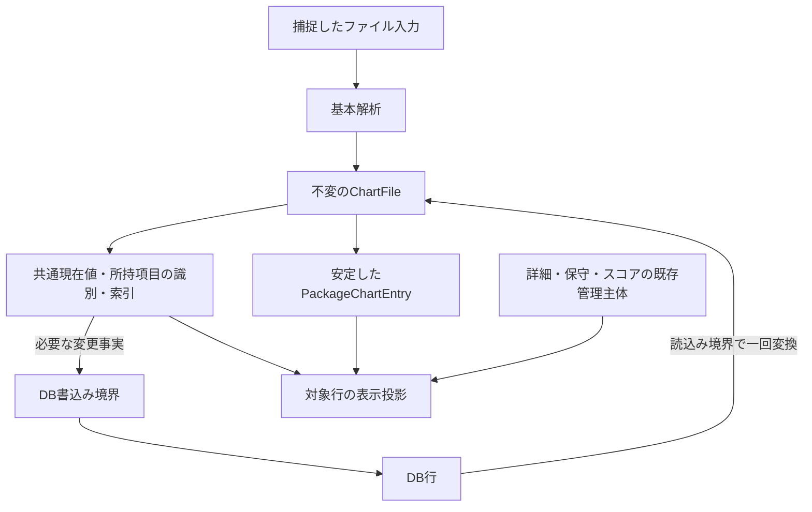

# BMS・BMSONの共通モデル

## 目的と適用範囲

BMSとBMSONを同じ画面・操作から扱うためのモデルと、形式ごとに維持する保存・解析の境界を定めます。共通化を理由に、既存のLR2データベース、プレイリストの保存形式、設定キー、利用者向けの文言は変更しません。

## 用語

[共通用語集](../glossary.md)を参照します。コードの識別子は原表記を使います。機能固有の用語は次のとおりです。

| 用語 | 意味 |
| --- | --- |
| 所持項目 | 所持項目の識別（`OwnedChartToken`）で区別する、その起動中のカタログ項目。内容・順序・保存行とは分ける。 |
| 共通現在値 | 不変の `ChartFile` で表す、譜面の現在の値。保存行や専門の管理主体への参照を持たない。 |
| 所属のない譜面 | 保留パッケージの項目として解決されない操作対象。要求では `LooseEntries` に置く。 |

## 仕様

### 保存するデータとアプリ内の譜面

| 対象 | 正本と責務 |
| --- | --- |
| BMSの保存行 | `LR2SongDB.song`。DB入出力の境界だけで生成・読取りを行い、解析結果・スコアの購読・アプリの状態を持たない。 |
| BMSONの保存行 | `LR2SongDBExtended.bmson_song`。LR2の `song` へ互換行を作らない。 |
| 共通現在値 | 不変の `ChartFile`。形式、実パス、ハッシュ、生のメタデータと表示値、必要な期間だけのリソース結果を持つ。 |
| 所持譜面の集合 | `OwnedChartCollectionState` が共通現在値と索引を持つ。`CatalogOwnedCollectionOwner` が排他、`CatalogRevision`、不変の確定結果、派生索引を所有する。 |
| 詳細・解析失敗・保守 | 不変の `ChartDetails`、`ChartParseFailure`、`ResourceHealthMaintenanceSnapshot`。キャッシュ・最新性・失敗・未計算の扱いは、それぞれの専門の管理主体が所有する。 |
| パッケージ内の譜面 | 安定した `PackageChartEntry` が現在の `ChartFile` と導入状態を所有し、項目自身を排他の境界とする。 |
| 画面で一時的に重ねる値 | `ChartFileTransientState`。導入先、警告、リソース健全性、文字コードなどの投影であり、永続化の正本にはしない。 |

所持カタログを、健全性・文字コード・警告を含む所持譜面の現在値の正本とします。共通現在値と保存行の変換は境界で一回だけ行います。基本解析は、捕捉済みのバイト列・ハッシュ・更新時刻から直接 `ChartFile` を返します。DBの読込みでは境界で共通現在値へ変換し、保存では不変の変更事実を境界で行へ変換します。共通現在値から現在値や保存行を引く参照、双方向の同期、保存行の通知の中継は設けません。

共通現在値に含める警告と導入先候補は、不変の集合として捕捉し、呼出元の可変なリストを保持しません。生の title・subtitle・artist・subartist は、合成した表示値から逆算しません。BMSONの元の `chart_name` はファイル入力からだけ取得し、DBに保存した合成済みの subtitle から復元しません。`BmsCharts` / `BmsonCharts` は共通現在値を捕捉した読取りビューであり、取得のために全件を投影・複製しません。

次の図は、共通現在値がどこから作られ、どこへ渡るかを示します。

再生中の一時状態は、`PlaybackPanelViewModel` の現在の譜面と状態ビットが所有し、一覧の `status` の読取りにだけ重ねます。カタログ、共通現在値、保存行は再生中の状態を持ちません。

#### 導入済み項目への現在値反映

所持項目の現在値が変わったときは、同じ識別を持つパッケージ内の項目（`PackageChartEntry`）へも反映します。反映先は、`PackageLifecycleOwner` の所属境界が持つ、所持項目の識別から項目への派生参照索引で求めます。同じ識別を持つ項目はすべて更新し、一つの項目が複数の所属を持つ場合は、最後の所属が離脱するまで参照を保持します。識別を持たない保留項目は、パスやハッシュで所持項目に接続しません。

参照の登録・解除は、加入・離脱・所属列の置換に伴う差分だけで行います。カタログを付け替えても、残るパッケージの項目は再登録せず、旧カタログと退役したパッケージの購読だけを解除します。加入時は取得済みの列を入出力なしで捕捉し、未取得の探索・解析を始めません。切り離した項目は、準備の入口でだけ作ります。

所属の剪定で残る項目は、同じ参照を保ちます。`ReplaceChartEntries` は確定した列を保持し、パッケージの移転後に旧 `SourcePath` と一致しないことを理由に遅延探索へ戻しません。反映は項目の既存の排他と通知の延期を使い、離脱した項目への遅延通知は抑止します。

導入では、物理処理を終えた時点のパスと導入状態を先に反映します。保守と所属登録を含む必須の後処理がすべて成功してから、今回導入した所持項目の現在値だけを捕捉し直し、同じ識別の加入済み項目へ上記の局所反映で渡します。計算済みのリソース充足値は、新しく作る一覧にも届けます。通知は変更の排他権を解放した後に公開します。保守が失敗・取消になった場合は、到達済みの状態を変えません。全導入済み項目の再走査や、行の読取りからの現在値検索は行いません。

#### 保留譜面の文字コード選択

選択時の `PackageChartEntry` の参照を、要求・操作窓口・モデルへ引き継ぎます。所持譜面は識別から現在値を解決し、保留譜面は指定された項目の現在値を計算入力にします。保存と反映の順序は、要求に所持譜面を含むかで分かれます。

| 要求の対象 | 保存と反映 |
| --- | --- |
| 所持譜面を含む | 所持分の必要なDB保存が成功してから、同じ保留項目のメタデータ・文字コード・修正済み状態へ反映する。保存に失敗した場合は、所持・保留とも新しい値を反映しない。 |
| 保留譜面だけ | DB確定を必要とせず、`song` と `maintenance` の行を新設・更新しない。空の保存要求の結果が `NotApplied` でも失敗と扱わない。 |

指定は現役の項目の寿命内で保持します。新しい通常リソースで、元の配置と捕捉済みの現在配置の健全性・警告を更新し、明示した導入先・候補・所属は維持します。文字コードとメタデータが同じでも、リソースが変われば反映します。すべて同値なら、修正印が未確定の場合に修正印だけを確定します。

指定の保持期間と、表示・推定・フォルダ名生成への受渡しは[譜面ファイルの読取り](chart-file-reading.md#保留項目の文字コード)に従います。

#### 所持BMSの再復号

所持BMSを再復号した基本値は、[songのメタデータ限定保存](../integration/lr2-song-db.md#songの生成)に従い、生のメタデータ5列と、捕捉した更新時刻の `date` だけを、同じパス・MD5の既存行へ反映します。DB読込み直後で共通現在値に詳細が付いていない状態でも、`song` の他の列は保持します。文字コードの変更や再調査のために、保存列を `ChartFile` へ戻したり、全解析や全列の上書き保存を行ったりしません。

### 再生用解析との境界

一覧・保存・操作の対象は `ChartFile`、内蔵再生と音声書出しの解析結果は不変の `PlaybackChart` とします。再生・選曲・共通表示は `ChartFile` を対象とし、形式固有の処理は、解析・保存から共通モデルへの入口に置きます。

`PlaybackChart.Load(path)` が、BMS解析結果の投影とbmson専用の解析を選びます。通常のロードと先読みはこの入口を共有し、`chart_info` の時刻や保存行を音声計画へ転用しません。再生解析の `Ribbit.BMS.BMSFile` は、共通モデルとは別の型として維持します。BMS専用の操作は形式と必要な識別子を条件にし、保存行の有無を可否の条件にしません。

再生対象・世代・状態・表示素材の契約と対応テストは[再生パネル](../ui/playback-panel.md#共通の再生対象と一覧状態)、音声区間は[bmson再生](bmson-playback.md)、BMSの入力と時刻は[RibbitのBMS時刻計算](ribbit-timing.md)を正本とします。

### 所持譜面の識別条件

所持譜面は実パスとMD5を必須とします。DBの完全一致パスは、BMS・BMSONを通じて `Ordinal` 比較で一意です。物理パスの `OrdinalIgnoreCase` 比較とは用途を分け、同じMD5の別配置を統合しません。

所持項目には、内容や保存行を持たない所持項目の識別（`OwnedChartToken`）を発行します。識別だけから現在値・パス・保存行を取り出すAPIはありません。識別を引き継ぐか新しく発行するかは、次のとおりです。

| 場面 | 識別 |
| --- | --- |
| 通常の現在値の適用、内部移転、投影、並べ替え、変更のない差分走査 | 引き継ぐ。 |
| 新規登録、再解析による置換、DBの全再読込み | 新しく発行する。 |
| 外部移転のハッシュによる再接続 | 引き継がず、利用者列だけを復元する。 |
| 保留・未所持の項目 | 持たない。 |

DB読込みや外部からの全置換では、パスまたはMD5のない行を所持集合から除外します。同じパスの行が重複する場合は、BMS、BMSONの順に入力を読み、先の行を採用して除外件数を記録します。内部の追加・移転・ハッシュ更新がこの条件を破った場合は、再構築で隠さず異常として検出します。

プレイリストの未所持項目や表示専用の投影は、パスなしでも作成できます。ただし、その値を導入済みの判定、フォルダ操作、リソース保守、所持譜面のハッシュ更新通知へ入れません。SHA-256は補助の識別子であり、MD5のない所持譜面を許容する代替条件ではありません。

### 表示行と現在値の取得

`LibraryChartRow` は共通現在値またはパッケージ項目を包み、`Chart` で共通の譜面を公開します。`ChartListSourceRow` は仮想一覧の絞込み・並べ替えに使う軽量な読取りモデルです。実パスや作者だけで絞り込める場合に、全件の詳細な `ChartFile` やリソース一覧を作りません。

通常一覧の所属と基本値は、カタログの同じ確定版から捕捉した読取り列を入力にします。表示側で所属を独立に追加・削除する集合は持たず、行や投影のキャッシュが残っていることを所属の根拠にしません。プレイリスト詳細の行は有効なエントリーから、サマリーの行は表の集合から決まります。カタログの変更では、所持の解決・譜面由来の値・所持の集計だけを更新し、表示の更新だけでエントリーの所属・保存値・明示した順序を変えません。

通常の所持譜面は、不変の基本現在値と、専門の管理主体・ViewModelの一時状態から投影します。パッケージの行は元の `PackageChartEntry` を保持し、`ProjectionVersion` と変更通知に応じて投影を更新します。導入先を表示するためだけに警告一覧を作るなど、不要な値の具体化は避けます。

BMSONを通常一覧に含める範囲は、通常のルート・フォルダ・キーワード・モードの絞込みと、全譜面の検査一覧です。プレイリスト、保守、導入の専用一覧は、それぞれの情報源からBMSONを扱います。BMS専用の文字化け・未登録・ゼロノートの一覧も、画面へ渡す時点では共通の譜面行に投影します。

表示値の正本を保存行へ重複して持たせません。

| 表示する値 | 取得元と更新 |
| --- | --- |
| 譜面情報 | `BMSLibrary.ResolveChartInfo(...)` と `CatalogChartInfoOwner` のセッション索引。保存行に一時的な `ChartInfo` を付けて代用しない。 |
| スコア・DJレベル・達成率 | `ChartScoreSnapshot` を介して譜面・表示行で解決する。スコアの接続・購読・再読込み・有効な取得元・版は既存のライブラリ管理が所有し、スコアの実体ごとに一つだけ購読する。購読は差替え・再読込み・終了で解除し、譜面ごとの購読は作らない。通常のBMSはLR2をMD5、beatorajaをSHA-256で解決し、通常のBMSONはスコアなし（`NoScore`）とする。プレイリスト専用の所持・未所持の解決では、所持BMSONのSHA-256によるbeatorajaのスコアも使う。 |
| 参照するプレイリスト | `PlaylistReferenceIndex` から捕捉した不変の入力と、参照の確定差分。[参照索引の契約](../playlist/storage-and-export.md#参照プレイリストの索引と表示)に従う。`RefTablesSymbols` / `RefTablesNames` は表示列名であり、BMS保存行の可変なキャッシュではない。 |
| 警告 | `ChartWarning`（種類と事実だけを持ち、翻訳済みの文字列を持たない）と `ChartWarningProjectionFormatter`。要約・ハッシュ・ツールチップは、行側で読取り時に現在の表示言語で作る。 |
| リソース健全性・文字コード | 不変の `ResourceHealthMaintenanceSnapshot` と一時的な投影。DBから読み込んだ値（`DbHydrated`）、計算済み（`Calculated`）、未計算を区別し、既存の通知へ変更対象を渡す。 |
| 導入先 | `PackageChartEntry`、`ChartFileTransientState`、モデル内の一時状態。BMS保存行へ書き戻さない。明示的に空へ変更した状態も区別する。 |

通常一覧の並べ替えは、`LibraryChartRowSortEngine` と `ChartListOrder` の列定義を正本とします。公開する並べ替え列と仮想一覧の対応を揃え、未対応の列を全件の通常行の生成で補いません。画面側の採用・破棄・通知は[一覧表示](../ui/table-view.md)を参照します。

### 保存成績の再読込みと旧結果

保存済みのスコア（成績）の読取り結果を、ライブラリが採用して譜面の表示値へ投影するまでの契約です。表示・通知の側は次の文書を正本とします。

| 内容 | 正本 |
| --- | --- |
| 取得の契機、再取得しない操作で取得組を保持する範囲、履歴の扱い | [プレイ履歴](../playlist/play-history.md#キャッシュと表示用変換) |
| 正常に読み込んだ取得元に記録がない行の空値 | [一覧表示](../ui/table-view.md#画面状態の一括確定) |
| ランプ集計での失敗状態の扱い | [ランプビューア](../playlist/lamp-viewer.md#取得の契機と通常の終了) |
| 失敗を正常な空・取得成功へ読み替えない一般原則 | [例外・操作結果・診断](../core/exception-handling.md#失敗した成果物と表示) |

#### 読取り結果の採用

`ScoreTableLoadResult` は、通常成績と全履歴を合わせた今回の読取り結果です。`ScoreSnapshot` は、今回採用した成績、取得状態、同じ `PlayHistorySnapshot` への参照を表します。取得は最新の確定設定から行います。表示用の版の更新と取得世代は区別し、通常成績だけを局所的に更新しても、取得済みの履歴は保持します。

| 今回の結果 | 採用 |
| --- | --- |
| 取得成功 | 今回の内容を採用する。正常に取得した0件も有効な結果であり、旧成績を取り除く。 |
| 未設定 | 既存の未設定時の扱いに従う。 |
| 取得失敗 | `Failed` と、今回の対象の情報源・パスで公開する。同じ情報源・DBパスであっても、旧成績を今回の成功結果へ流用しない。 |

旧スナップショット・取得時刻・実体の退避と復元は行いません。旧実体の購読は、通常のスナップショット交換で解除します。通常成績と履歴の成否は独立して扱い、失敗も次の許可された取得まで保持します。その場での再試行、別の情報源への切替え、恒久的な無効化状態は設けません。

#### 取得失敗の通知

設定済みDBの初回・切替え後・再読込みで取得に失敗した場合は、一回の読取り要求につき一回だけ、既存のスコア読取り失敗の警告を通知します。通知は、受付と初期化の排他を解放した後に行います。未設定と正常な0件では失敗を通知しません。

#### 失敗時と未記録の投影

取得に失敗した場合、通常一覧の表示・検索はスコアなしの投影を使い、所持譜面はNO PLAY相当になります。スコア条件だけを理由にした受付の制限、三値の判定、読取り時の例外は追加しません。この既定値は読取りの成功を意味せず、今回の失敗結果と案内はそのまま保ちます。

保存成績のBPが `int.MaxValue` の場合は未記録として、`ChartScoreSnapshot` の共通の数値投影でnullにします。通常一覧とプレイリスト一覧は、この投影を表示・検索・整列に共通して使い、巨大な実績値として扱いません。元の `BMSScore` と外部DBは変更せず、CLEAR・PLAYCOUNT・CLEARCOUNTと、実績BPの0・正の値は保持します。外部DBの通常のプレイ結果を読み込み直して投影し直せば、新しい実績BPを使います。LR2のBP -1を総ノーツ数とする変換は維持します。

### 操作対象と権限

UIからは、`ChartOperationTarget` に譜面、元の項目、所持・保留・未所持の状態、操作権限をまとめて渡します。`SourceScope` は `Library`、`PendingPackage`、`NewlyInstalledPackage`、`PlaylistOwned`、`PlaylistMissing` を区別します。権限は、メニューの表示と実行側の両方で確認します。

| 権限 | BMS | BMSON | 条件 |
| --- | --- | --- | --- |
| `OpenFile` / `OpenFolder` | 可 | 可 | 実パスがあり、欠落していないこと。 |
| `OpenPlaylistUrls` | 可 | 可 | プレイリスト項目にURLまたは差分URLがあること。 |
| `RunResourceHealthCheck` | 可 | 可 | 実パスがあり、欠落していないこと。 |
| `UseLr2Ir` | 可 | 不可 | BMSで、有効なMD5があること。BMS-IRへのリンクでLR2BMSIDを代用しない。 |
| `RunBmsEncodingCheck` / `RunBmsEncodingFix` / `RunZeroNoteCheck` | 可 | 不可 | 欠落していないBMSであること。 |
| `RenameInvalidExtension` | 可 | 不可 | 欠落していないBMSであること。 |
| `ConvertToAudio` | 可 | 可 | 実パスがあり、欠落・保留の状態ではないこと。 |
| `RepairInstalledLocation` / `MoveInLibrary` / `RemoveFromLibrary` | 可 | 可 | 実パスがあり、欠落・保留の状態ではないこと。 |
| `UpdateInstallDestination` | 可 | 可 | プレイリスト項目ではない保留パッケージの行であること。 |

`GridRowResolver` は、通常一覧とプレイリストの行が公開する `Chart` をそのまま操作入力にします。内蔵再生と音声変換も共通の `ChartFile` を解決します。外部プレイヤーへの引渡しでは、そのプレイヤーの既存の形式条件を別に確認します。

フォルダ名の編集は、`TryGetFolderEditChartOperationTarget(...)` で権限を確認し、UIスレッドで `RenameChartFolderRequest` を確定してから実行します。`ChartFile.Level` / `Folder` は読取り専用であり、LEVELの編集はプレイリスト項目の編集として扱います。

譜面ビューアの項目は権限を使わず、[外部起動](../ui/external-launch.md#譜面ビューアの項目と登録結果の通知)の共通の判定で決めます。

右クリックの外部操作は、メニューを開いた行から `RightClickActionResolutionInput` を作り、クリック時に同じ行と現在の設定で解決し直します。選択集合で代用しません。未所持のプレイリスト行・履歴行も、有効なハッシュがあればWeb操作を行えますが、外部プログラムは解決済みの実ファイルだけを対象にします。詳細は[外部起動](../ui/external-launch.md)を参照します。

### モデルへ渡す参照と要求

ファイルの削除・移転には、所持項目の識別、種別、捕捉したパス・MD5・SHA-256だけを持つ `LibraryChartRef` を使います。解決の方法は識別の有無で分かれます。

| 参照 | 解決 |
| --- | --- |
| 識別あり | 識別だけから現在値を取得し、要求の種別とDBの完全一致パス（`Ordinal`）が現在値と一致することを検証する。生存している識別は、内部移転後の現在値も解決する。未解決・退役した識別を、種別やパスで解決し直さない。 |
| 識別なし | 種別とDBの完全一致パスで解決する。 |

どちらの場合も、古い選択のハッシュだけを理由に拒否しません。

通常の削除と拡張子の変更では、確認対象を不変の `ChartFile` として固定し、ファイルシステム上の存在・属性の履歴は保持しません。本受付の後、最初の変更より前に、全対象の識別・種別・固定したパスの結び付きを照合し、一つでも成立しなければ要求全体を失敗にします。照合には、削除ではDBの `Ordinal` 比較、拡張子の変更では物理パスの比較を使います。ハッシュの履歴は比較せず、DB・索引への反映には照合した共通現在値を使います。確認中に起きた別の変更を前提に、対象ごとに陳腐化（Stale）として処理を続けることはしません。

項目の削除は識別を厳密に照合し、明示的なパスの整理（`PathCleanup`）と区別します。一般的な物理対象の比較では、種別と物理パスによる解決を維持します。

選択はUIスレッド上で固定し、機能別の要求へ変換してからバックグラウンドの処理へ渡します。

| 操作 | 要求・受渡し |
| --- | --- |
| リソース健全性・無視設定 | `ChartResourceHealthRequest` に `ChartFile` を保持する。 |
| フォルダの自動命名 | `ChartFolderAutoRenameRequest` に `ChartFile` を保持する。 |
| 保留導入先の検索・解除・編集 | `PendingInstallDestinationSearchRequest` / `PendingInstallDestinationClearRequest` / `PendingInstallDestinationEditRequest`。パッケージ項目の識別関係を保持する。 |
| 導入先の修復 | `RepairInstalledLocationRequest`。検索・解除は `RepairEntries`、修復は現在の導入先状態を重ねた `RepairCharts` を使う。 |
| 保留譜面の削除 | `RemovePendingCharts(IEnumerable<ChartFile>)`。物理削除に成功したパスを `ChartPathsToRemove` として項目の削除へ渡す。 |

パッケージに属する対象は、項目の識別関係から現在のパッケージへ解決します。所属のない譜面は要求の `LooseEntries` に固定し、後からパスだけで保留パッケージへ吸収しません。検索やメニューの可否判定のために、共有の互換オブジェクトを遅延生成して状態を書き戻すことはしません。

導入先の修復は、BMS・BMSONを共通の変更事実として返し、保存時にだけ形式別に分けます。修復に成功した後の保守対象は、確定後の共通現在値から取り直し、同じ排他権の中でまとめて検査します。操作全体の結果は[変更セッション](mutations.md)に保持します。

### パッケージと保留状態

`ChartPackage.ChartEntries` をパッケージ内の譜面の正本とします。代表譜面・定義リソース・推定入力・保留一覧はこの項目から作り、遅延探索を実行する時期は変えません。

導入は、切り離した項目で準備した値をDBへ確定してから、`ApplyCurrentChart` で現役の項目へ反映します。導入専用の `WithInstalledPath` は、配置の変更だけを表す `WithPath` と区別し、[保留文字コードの成功先への保存](chart-file-reading.md#保留項目の文字コード)を準備します。元の配置の保守値を、新しい配置の評価済みの値として扱いません。`ClearPostInstallState` は、準備に使った切り離した項目と、成功した現役の項目でだけ[導入前の構造警告](warnings.md#種類ごとの更新)を解除し、失敗・保留の項目には適用しません。

導入先、候補、低信頼の警告、`SEARCHING` は項目の投影状態です。項目が変わった後に、表示行が古い投影を固定しないようにします。再構成したパッケージでは、代表だけでなく全項目のリソース健全性と警告を復元します。BMS・BMSONとも、導入済み、単一BMSON、入れ子の譜面など、項目固有の条件を維持します。

`PackageInstallEstimationSnapshot` は、項目から代表譜面、使用リソース、メタデータ、探索範囲を作ります。ルート単位の上限付き探索を共有するのは、ディレクトリ型のパッケージだけです。単一ファイル型と所属のない譜面では親ディレクトリを列挙せず、同梱リソースと候補リソースを別々の空集合、探索件数を0として保持します。使用リソースと譜面自身の情報は保持します。探索と候補評価は[導入先推定](install-estimation.md)を参照します。

再生を止めるかどうかは、変更の範囲で決めます。フォルダ全体の移動・削除・名前変更では、譜面の形式にかかわらず、現在の再生対象のディレクトリと重なるかを確認します。ファイル単位の削除・修復では、現在の譜面ファイルへの影響を確認し、同じフォルダの別の譜面だけを変更するために再生を止めません。

### プレイリストの識別と行

所持譜面から追加する項目には、判明しているMD5・SHA-256を両方保存します。一方、検索・参照・集計には `PlaylistEntryLookupKey` が選ぶ一つのキーを使います。MD5があればMD5だけを使い、見つからなくてもSHA-256へ切り替えません。MD5のない項目はSHA-256を使います。既存の行を読んだだけで、不足しているハッシュを全量補完しません。

`PlaylistDetailSourceRow` / `PlaylistDetailRow` は、解決済みの `ChartFile` を持ちます。未所持の項目は項目のメタデータから投影し、形式は `ChartFileKind.Bms` とします。未所持の項目には譜面ファイルがなく、BMSとBMSONを判別できません。判別不能の状態は設けず、BMSとして扱うことで「譜面ビューアで開く」などのBMS向けの操作を使えるようにします。参照プレイリスト名とキーワード検索も、同じ参照索引を使います。

通常フォルダへ追加するとき、元がプレイリストの行なら `BMSTableEntry.Duplicate()` で項目のメタデータを保持します。ルートへの自動振分けでは、解決できた所持譜面から新しい項目を作り、同じ実ディレクトリにあるBMS・BMSONのMD5の集合を `org_md5` とします。解決できない行は既存のメタデータを複製します。参照の更新では、BMSだけの一覧へ戻さず、共通の譜面と対象のハッシュを渡します。

### 譜面情報とリソース保守

`ChartFileSnapshot` は、ファイルの内容・長さ・更新時刻・ハッシュを持つ短命な読取り結果です。アプリ内の譜面を表す `ChartFile` と混同しません。読み取った内容の再利用は[ファイル読取り](chart-file-reading.md)に従います。

#### リソース参照の結果

両形式とも、共通の不変な保守値と、`ChartFile.Resources` に取得した不変の結果を使います。リソース参照は次の値を持ちます。

| 区分 | 値 |
| --- | --- |
| 用途と状態 | 種別、用途（通常・stagefile・backbmp・banner）、使用状態、解析状態 |
| 原文とキー | 実際に採用した本文の原文、分類、`NormalizedPath`、拡張子を一度だけ除いた `LookupKey` |

対象外の参照は要求へ加えません。名前付きで照合できない参照は原文で個別に数え、架空のキーを作りません。LR2のCP932診断は通常のリソースへ混ぜず、保守値の三つの事実へ集約します。譜面プロパティ用の短命な定義詳細では、同じCP932本文から得た事実を同じ定義へ添えます。本文が異なるCP932の問題の原文は、別の解釈として対応付けずに表示します。

健全性と導入先推定の要求集合は、使用参照だけを索引化します。パッケージの発見・グループ化に使う全定義の存在確認・共通率と、LR2の原文診断は、これと独立して維持します。使用ID・全定義・未使用定義の件数は永続化せず、既存の短命な解析結果の寿命の中で共有します。

`Resources` のnullは未取得または解放済み、空集合は解析に成功した0件を表します。投影・複製・パッケージは同じ不変の結果を共有し、読取り時の取得、保存行からの補完、原文の逆引き、再正規化を行いません。基本現在値を投影するコピーでも、リソースは複製元の結果を共有します。保存行から初めて軽量な基本値を作る入口ではリソースの取得を省きますが、コピー側にこの省略を優先する分岐は設けません。基本情報用の解析の戻り値は、必要な期間だけ同じ結果を一時的に保持します。`ChartResourceSnapshot.Create(ChartFile)` は取得済みの結果だけを索引化し、未取得を正常な空の結果として扱いません。

#### 保守による再評価と確定

不足している結果は、保守の既存の入口が明示的に取得し、更新時刻・ハッシュ・強制更新の既存条件で再評価します。取得・解析に失敗した結果を、成功した0件として保存しません。BMSの文字コード・修正済み状態をリソースの計算で上書きせず、保守をファイル内容のハッシュ更新通知の発生元にしません。

健全性・文字コード・警告・検査の由来を含む現在値の実際の変更は、[共通確定契約](../core/data-and-indexes.md#共通変更と派生索引)で一回だけ確定します。同値の再評価では版を進めません。候補索引は識別・ハッシュ・順序だけを保持し、通常一覧・プレイリスト・履歴の現在値は、同じカタログの読取り境界から捕捉します。使用件数と補助画像の明示参照は[リソース健全性](../core/data-and-indexes.md#リソース健全性)、短命な保持と解放は[読取り仕様](chart-file-reading.md#リソース参照と文字コード)に従います。

リソース参照の `.` は譜面からの相対キーへ正規化し、`..` は未対応の親ディレクトリ参照として区別します。通常の変更では対象の譜面だけを保守し、全件を対象にするのは明示的な全件検査と索引の再構築に限ります。同じ操作で、必要な全件の対象を二重に作りません。

譜面情報の解析と保存は[譜面情報](chart-info.md)に従います。BMSの全件補完では同じMD5を一度だけ評価し、既存の `song` の対応する派生列だけを更新します。BMSONはSHA-256を優先してまとめ、LR2の行や `chart_digest_map` を作りません。永続化に成功した後にだけ共通現在値・索引へ反映し、排他を解放した後に通知します。

### 重複表示

重複検索は、所持集合に隣接する `DuplicateChartRow` の変更不能な集合を使います。行には種類・実パス・MD5・共通現在値を持たせ、重複グループに入る対象だけを詳細な譜面へ投影します。導入先の一時状態や、SHA-256だけを持つ投影を重複判定へ混ぜません。

構築済みの行集合は、追加・削除・移転・MD5の変更で差分更新し、取得のたびに全行を複製しません。グループの結果は `DuplicateChartGroups`、結果を無効にした通知は `DuplicateChartGroupsInvalidationVersion` と分けます。

重複グループの正本は `DuplicateGroup.ChartFiles` です。BMSの重複警告は、同じ所持項目の識別を持つ共通現在値へ反映します。BMSONの重複警告はグループ内の投影に保持し、通常一覧のBMSON保存行へ永続化した警告とはみなしません。詳細は[重複ファイル](duplicate-files.md)を参照します。

## 実装とテストの対応

| 仕様項目・主な条件 | 実装箇所 | テスト箇所・確認内容 |
| --- | --- | --- |
| 再復号のメタデータ限定保存と、詳細が付いていない起動直後の状態 | `CatalogMaintenanceOwner`、`CatalogMutationOwner`、`SongMetadataUpdate` | [LR2楽曲DBの対応表](../integration/lr2-song-db.md#実装とテストの対応)の `ApplyEncoding_RealStoreAfterDbLoadPreservesUnchangedSongColumns` と `RescanAsync_RealStoreAfterDbLoadPreservesUnchangedSongColumns` が、実際の操作・実DBの読込み・詳細の読込み後に、更新した5列と `date`、対象外の全列の保持を確認する。 |
| 保留譜面の文字コード・修正印、所持譜面を含む要求と配置の保持 | `SelectedChartMutationWorkflowOwner`、`CatalogMaintenanceOwner`、`LibraryMutationOwner`、`PackageChartEntry` | 確認内容は[譜面ファイルの読取りの対応表](chart-file-reading.md#実装とテストの対応)の「保留文字コードの項目寿命内の保持、所持混在の保存成功境界」に集約する。同値の空指定・明示指定と修正済み状態の分岐は `BmsLibraryMaintenanceServiceTests.ApplyEncoding_MatchingMetadataAndEncodingOnlyCommitsMissingFixedMark` が担当する。 |
| 保守による文字コード基本値の実変更と同値再評価 | [`CatalogMaintenanceOwner`](../../../BeMusicSeeker/Models/BmsLibraryInternal/Catalog/CatalogMaintenanceOwner.cs)、[`LibraryMutationOwner`](../../../BeMusicSeeker/Models/Library/BMSLibrary.LibraryMutationOwner.Common.cs) | [`RegularChartNormalLibraryRefreshTests`（Core）](../../../tests/BeMusicSeeker.Core.Tests/ChartList/RegularChartNormalLibraryRefreshTests.cs)、[`RegularChartNormalLibraryRefreshTests`（Windows）](../../../tests/BeMusicSeeker.Windows.Tests/ChartList/RegularChartNormalLibraryRefreshTests.cs) の `MaintenanceMetadataChange_ReachesAttachedViewAndWarmPlaylistDeltaOnce` は、選択した二対象の保守で、DB・同じ識別の現在値・集合の版が一回だけ進むこと、基本の通知、候補索引を再構築しない局所性、接続済み一覧の絞込みとTitle順、同値の強制再評価を確認する。保守の実変更による新しい版と同値再評価、全所持の保存と通知の失敗、手動の文字コード適用は [`BmsLibraryMaintenanceServiceTests`（Core）](../../../tests/BeMusicSeeker.Core.Tests/Maintenance/BmsLibraryMaintenanceServiceTests.cs) / [`BmsLibraryMaintenanceServiceTests`（Windows）](../../../tests/BeMusicSeeker.Windows.Tests/Maintenance/BmsLibraryMaintenanceServiceTests.cs)、要求と再表示の順序は [`SelectedChartMutationWorkflowOwnerTests`（Core）](../../../tests/BeMusicSeeker.Core.Tests/ChartOperations/SelectedChartMutationWorkflowOwnerTests.cs) / [`SelectedChartMutationWorkflowOwnerTests`（Windows）](../../../tests/BeMusicSeeker.Windows.Tests/ChartOperations/SelectedChartMutationWorkflowOwnerTests.cs) が分担する。 |
| 不変なリソースの原文・用途・状態・両キー、未取得と成功した0件の区別 | [`ChartResourceReference`](../../../BeMusicSeeker/Models/BmsLibraryInternal/Resources/ChartResourceReference.cs)、[`ChartResourceSnapshot`](../../../BeMusicSeeker/Models/BmsLibraryInternal/Resources/ChartResourceSnapshot.cs)、[`ChartFileProjection`](../../../BeMusicSeeker/Models/Chart/ChartFileProjection.cs) | [`ChartResourceSnapshotTests`](../../../tests/BeMusicSeeker.Core.Tests/Resources/ChartResourceSnapshotTests.cs) は、重複の検索と全原文、未取得の拒否、解析後にファイルを削除した場合と正式な現在値の適用後の、共有・投影・パッケージ・消費を確認する。両形式の抽出は [`BMSFileSnapshotTests`](../../../tests/BeMusicSeeker.Core.Tests/Chart/BMSFileSnapshotTests.cs)、[`BmsonSongParserTests`](../../../tests/BeMusicSeeker.Core.Tests/ChartInfo/BmsonSongParserTests.cs) が確認する。読取り時や他の複製経路で取得しないことと、同じ結果の受渡しは静的に確認する。 |
| 共通の再生対象、BMS・BMSONの変換権限とBMS専用権限の分離 | [`GridRowResolver`](../../../BeMusicSeeker/ViewModels/ChartList/GridRowResolver.cs) の `TryGetPlaybackChart` と権限の生成、[`PlaybackChart`](../../../BeMusicSeeker/Ribbit/BMS/PlaybackChart.cs)、[`MainWindow`](../../../BeMusicSeeker/Views/MainWindow/MainWindow.cs) の変換メニュー | [`PlaylistViewPipelineTests`](../../../tests/BeMusicSeeker.Core.Tests/Playlist/PlaylistViewPipelineTests.cs) の `ChartOperationTarget_CapabilityMatrix_SeparatesBmsOnlyAndBmsonCommonOperations` は、所持BMS・BMSONの変換許可、両形式の保留の拒否、BMS専用権限の維持を確認し、所持プレイリスト・新規導入済み・未所持の既存ケースでも変換権限を確認する。[`MainWindowSelectedChartContextMenuWpfTests`](../../../tests/BeMusicSeeker.Windows.Tests/MainWindow/MainWindowSelectedChartContextMenuWpfTests.cs) の `CompiledAudioConversionMenu_AllowsBmsonAndMixedOrderButRejectsPendingAndMissingFiles` は実ファイルを使い、BMSONだけの選択での表示・有効状態、正確な譜面と混在した選択の順序、保留・消失ファイルを実行しないことを確認する。要求と実行への受渡しは[音声変換](../runtime/audio-conversion.md#実装とテストの対応)を参照する。 |
| 捕捉した入力と共通の受渡し値が保存行に依存しないこと | `BmsChartFileParser`、`BmsonChartFileParser`、`ChartFile`、共通の要求・結果 | [`BMSFileSnapshotTests`](../../../tests/BeMusicSeeker.Core.Tests/Chart/BMSFileSnapshotTests.cs) は、捕捉後にファイルを置き換えても変わらないハッシュ・時刻・生のメタデータを確認する。[`CommonChartPayloadContractTests`](../../../tests/BeMusicSeeker.Core.Tests/Chart/CommonChartPayloadContractTests.cs) は、代表的な型が持つ状態、公開境界の引数と戻り値、解析器の戻り値、内容を持たない所持項目の識別を確認する。 |
| 所持項目の識別の寿命と、確認後に固定した対象 | `OwnedChartToken`、`LibraryChartRef`、`ChartStorageTargetSet` | [`OwnedChartTokenTests`](../../../tests/BeMusicSeeker.Core.Tests/Catalog/OwnedChartTokenTests.cs) は、通常の現在値適用・移転での引継ぎ、新規の置換・DB再読込みでの再発行、同じパス・ハッシュでの置換による旧参照の退役と、捕捉した値の不変性を確認する。 |
| 共通現在値・識別条件・所持集合 | [`ChartFile`](../../../BeMusicSeeker/Models/Chart/ChartFile.cs)、[`ChartFileProjection`](../../../BeMusicSeeker/Models/Chart/ChartFileProjection.cs)、[`OwnedChartCollectionState`](../../../BeMusicSeeker/Models/BmsLibraryInternal/Catalog/OwnedChartCollectionState.cs) | [`OwnedChartCollectionProjectionTests`](../../../tests/BeMusicSeeker.Core.Tests/Catalog/OwnedChartCollectionProjectionTests.cs)、[`OwnedChartCollectionLookupMembershipTests`](../../../tests/BeMusicSeeker.Core.Tests/Catalog/OwnedChartCollectionLookupMembershipTests.cs) |
| 保存成績の再読込みの失敗、成功でない投影、次の正常結果の採用 | [ライブラリの採用](../../../BeMusicSeeker/Models/Library/BMSLibrary.cs)、[読取り結果](../../../BeMusicSeeker/Models/BmsLibraryInternal/Score/ScoreTableLoadResult.cs)、[初期化サービス](../../../BeMusicSeeker/Models/BmsLibraryInternal/Startup/BmsLibraryInitializationService.cs) | [保存成績の採用テスト](../../../tests/BeMusicSeeker.Core.Tests/Startup/BmsLibrarySavedScoreAvailabilityTests.cs)は、実DBの初回失敗と同種別のDBパス切替え後の失敗について、一回の通知、`Failed`・対象パス、旧値が混ざらないこと、通常一覧のNO PLAYを確認する。未設定・正常な0件で通知しないこと、同じDBで空でない成功の後の失敗と旧購読の解除、受付解放後の案内の配送、次の正常な0件の取得も確認する。一要求の読取りが一回で再試行しないことは、初期化サービスと呼出し経路の静的確認で分担する。[ランプ入力テスト（Core）](../../../tests/BeMusicSeeker.Core.Tests/Playlist/BmsLibraryPlaylistLampDataSourceTests.cs) / [ランプ入力テスト（Windows）](../../../tests/BeMusicSeeker.Windows.Tests/Playlist/BmsLibraryPlaylistLampDataSourceTests.cs)は、実際の読取り失敗後の明示捕捉が利用不可になり、次の成功で新しい成績を捕捉できることと、捕捉済みの不変入力が変わらないことを分担する。 |
| 未記録BPの共通null投影と、再読込み後の実績BP | [`ChartScoreSnapshot.FromBmsScore`](../../../BeMusicSeeker/Models/Chart/ChartScoreSnapshot.cs)、[`ScoreValueCalculator.NormalizeMinBp`](../../../BeMusicSeeker/Models/BmsLibraryInternal/Score/ScoreValueCalculator.cs) | [`BmsLibraryIrServiceTests.BeatorajaScoreDbLoader_ReadsModeZeroScoresOnly`](../../../tests/BeMusicSeeker.Core.Tests/Ir/BmsLibraryIrServiceTests.cs)は、実DBのmode 0の特殊値・0・正の値から、通常一覧とプレイリストの読取り元・表示行への接続、CLEAR・回数・元の成績とDBの保持、外部更新後の再読込み・再投影を確認する。同じテスト群の `UpdateBmsScores_ProjectsMissingIrScoreAsUnsentChartStatus` は、LR2の-1から総ノーツ数への投影を確認する。検索の未定義・定義済み・数値比較は `GridKeywordSearchQueryTests`、null許容の値と列の整列キーへの接続は静的確認と既存の整列の回帰検証、再公開・再描画は既存の一覧の回帰検証で分担する。 |
| 実パスの参照と導入先状態の分離 | [`LibraryChartRef`](../../../BeMusicSeeker/Models/BmsLibraryInternal/Catalog/LibraryChartRef.cs)、[`OwnedChartCollectionState`](../../../BeMusicSeeker/Models/BmsLibraryInternal/Catalog/OwnedChartCollectionState.cs) | [`OwnedChartCollectionReferenceIndexTests`](../../../tests/BeMusicSeeker.Core.Tests/Catalog/OwnedChartCollectionReferenceIndexTests.cs)、[`OwnedChartCollectionInstalledOverlayTests`](../../../tests/BeMusicSeeker.Windows.Tests/Catalog/OwnedChartCollectionInstalledOverlayTests.cs) |
| 変更・ハッシュ更新・通知 | [`LibraryMutationOwner`](../../../BeMusicSeeker/Models/Library/BMSLibrary.LibraryMutationOwner.cs) | [`OwnedChartCollectionLibraryMutationTests`](../../../tests/BeMusicSeeker.Windows.Tests/Catalog/OwnedChartCollectionLibraryMutationTests.cs)、[`OwnedChartCollectionInlineDigestTests`](../../../tests/BeMusicSeeker.Windows.Tests/Catalog/OwnedChartCollectionInlineDigestTests.cs)、[`OwnedChartCollectionRefreshTests`](../../../tests/BeMusicSeeker.Windows.Tests/Catalog/OwnedChartCollectionRefreshTests.cs) |
| 導入済み項目への現在値反映、複数所属、未取得列を読まないこと、退役後の通知抑止 | `PackageLifecycleOwner`、[`PackageChartEntry`](../../../BeMusicSeeker/Models/BmsLibraryInternal/Install/PackageChartEntry.cs) | [`BmsLibraryPackageLifecycleTests`](../../../tests/BeMusicSeeker.Windows.Tests/Install/BmsLibraryPackageLifecycleTests.cs) が局所反映・複数所属・未取得列の非入出力・退役後の通知を、[`BmsLibraryStateApplierTests`](../../../tests/BeMusicSeeker.Windows.Tests/Install/BmsLibraryStateApplierTests.cs) が剪定後に残る参照を、[`OwnedChartCollectionInlineDigestTests`](../../../tests/BeMusicSeeker.Windows.Tests/Catalog/OwnedChartCollectionInlineDigestTests.cs) が実際のハッシュの反映を確認する。表示通知との対応は[一覧表示](../ui/table-view.md)を参照する。 |
| パッケージ投影の変更通知 | [`PackageChartEntry`](../../../BeMusicSeeker/Models/BmsLibraryInternal/Install/PackageChartEntry.cs) | [`PackageChartEntryNotificationTests`](../../../tests/BeMusicSeeker.Core.Tests/Install/PackageChartEntryNotificationTests.cs) |
| パッケージの導入・修復・再生との同期、準備に使う切り離した項目と確定前の失敗 | [`BmsLibraryPackageInstallService`](../../../BeMusicSeeker/Models/BmsLibraryInternal/Install/BmsLibraryPackageInstallService.cs) | [`BmsLibraryPackageInstallServiceTests`（Core）](../../../tests/BeMusicSeeker.Core.Tests/Install/BmsLibraryPackageInstallServiceTests.cs) / [`BmsLibraryPackageInstallServiceTests`（Windows）](../../../tests/BeMusicSeeker.Windows.Tests/Install/BmsLibraryPackageInstallServiceTests.cs)、[`ChartFileOperationSynchronizerTests`](../../../tests/BeMusicSeeker.Core.Tests/ChartOperations/ChartFileOperationSynchronizerTests.cs) |
| 通常一覧の操作・更新・確定と破棄 | [`RegularChartListOwner`](../../../BeMusicSeeker/ViewModels/ChartList/RegularChartListOwner.cs) | [`RegularChartNavigationTests`（Core）](../../../tests/BeMusicSeeker.Core.Tests/ChartList/RegularChartNavigationTests.cs)、[`RegularChartNavigationTests`（Windows）](../../../tests/BeMusicSeeker.Windows.Tests/ChartList/RegularChartNavigationTests.cs)、[`RegularChartNormalLibraryRefreshTests`（Core）](../../../tests/BeMusicSeeker.Core.Tests/ChartList/RegularChartNormalLibraryRefreshTests.cs)、[`RegularChartNormalLibraryRefreshTests`（Windows）](../../../tests/BeMusicSeeker.Windows.Tests/ChartList/RegularChartNormalLibraryRefreshTests.cs)、[`RegularChartFolderRenameTests`（Core）](../../../tests/BeMusicSeeker.Core.Tests/ChartList/RegularChartFolderRenameTests.cs)、[`RegularChartFolderRenameTests`（Windows）](../../../tests/BeMusicSeeker.Windows.Tests/ChartList/RegularChartFolderRenameTests.cs)、[`RegularChartCommitAndLifecycleTests`（Core）](../../../tests/BeMusicSeeker.Core.Tests/ChartList/RegularChartCommitAndLifecycleTests.cs)、[`RegularChartCommitAndLifecycleTests`（Windows）](../../../tests/BeMusicSeeker.Windows.Tests/ChartList/RegularChartCommitAndLifecycleTests.cs) |
| 仮想一覧・表示値・並べ替え | [`LibraryChartRowSortEngine`](../../../BeMusicSeeker/ViewModels/ChartList/LibraryChartRowSortEngine.cs) | [`RegularChartViewBuildAndOrderingTests`（Core）](../../../tests/BeMusicSeeker.Core.Tests/ChartList/RegularChartViewBuildAndOrderingTests.cs)、[`RegularChartViewBuildAndOrderingTests`（Windows）](../../../tests/BeMusicSeeker.Windows.Tests/ChartList/RegularChartViewBuildAndOrderingTests.cs)、[`LibraryChartRowSortEngineTests`](../../../tests/BeMusicSeeker.Core.Tests/ChartList/LibraryChartRowSortEngineTests.cs) |
| プレイリストの所持数・参照の解決・変更 | [`CatalogOwnedCollectionOwner`](../../../BeMusicSeeker/Models/BmsLibraryInternal/Catalog/CatalogOwnedCollectionOwner.cs) | [`PlaylistSummaryCountAndPresentationTests`](../../../tests/BeMusicSeeker.Core.Tests/Playlist/PlaylistSummaryCountAndPresentationTests.cs)、[`PlaylistSummaryOwnedHashTests`](../../../tests/BeMusicSeeker.Core.Tests/Playlist/PlaylistSummaryOwnedHashTests.cs)、[`PlaylistSummaryMutationAndWarmTests`](../../../tests/BeMusicSeeker.Core.Tests/Playlist/PlaylistSummaryMutationAndWarmTests.cs)、[`PlaylistSummaryResolveIndexTests`](../../../tests/BeMusicSeeker.Core.Tests/Playlist/PlaylistSummaryResolveIndexTests.cs)、[`PlaylistViewPipelineTests`（Core）](../../../tests/BeMusicSeeker.Core.Tests/Playlist/PlaylistViewPipelineTests.cs) / [`PlaylistViewPipelineTests`（Windows）](../../../tests/BeMusicSeeker.Windows.Tests/Playlist/PlaylistViewPipelineTests.cs) |

## 関連資料

[データと索引](../core/data-and-indexes.md)、[変更セッション](mutations.md)、[一覧表示](../ui/table-view.md)、[ライブラリの案内](README.md)。
