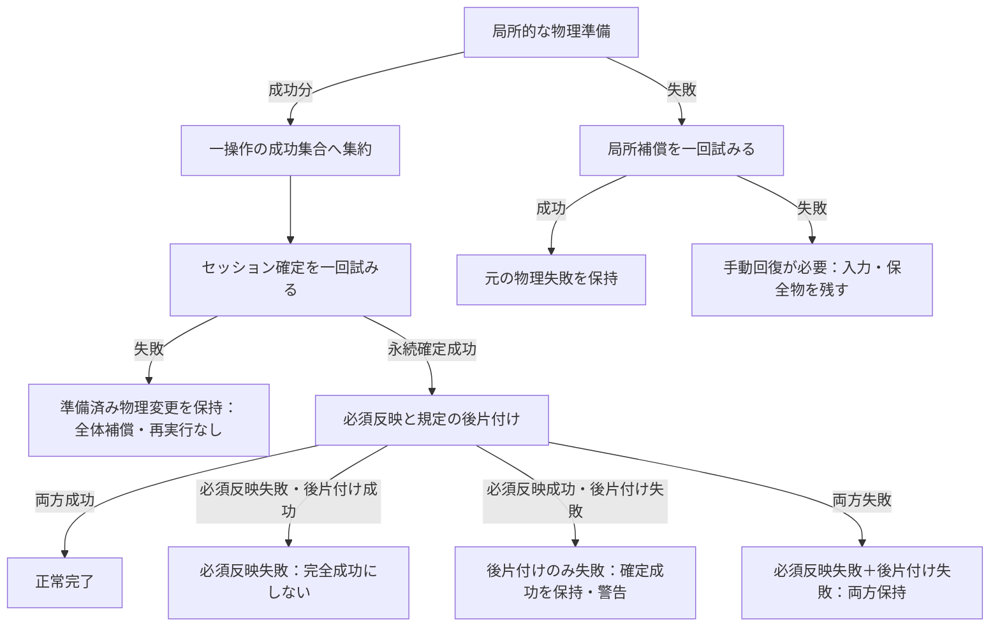

# ファイルとDBの整合

## 目的と適用範囲

ファイルシステムとSQLiteの両方を変更する処理について、保存前の保全、失敗の報告、保証しない範囲を定めます。操作の受付と反映順序は[ライブラリの変更](mutations.md)に従います。

## 用語

[共通用語集](../glossary.md)を参照します。コードの識別子は原表記を使います。

| 用語 | 意味 |
| --- | --- |
| 永続確定 | 対象のDBトランザクションが確定した状態。他の保存先や通知の成功までは意味しない |
| 補償 | 失敗した局所的な物理処理について、保全済みの情報を使って変更を戻す処理 |
| 確認候補 | 利用者が状態を調べるためのパス。存在や回復成功を保証するものではない |

## 仕様

フォルダの改名とルート移動では、停止前に確定した実src/dstを物理処理とDB変更事実へ共通して使います。診断計画を排他範囲や物理対象へ戻さず、宛先の正規化・採番を適用側で再実行しません。成功した対象は同じ変更セッションへ集約し、予期しない物理失敗では確定済みprefixと実移動の未処理suffixを保持します。`FolderAutoRenameWorkflowOwnerTests.PreparedAutoRename_UsesPhysicalTargetsForAdmissionAndPlaybackStop` と `BmsLibraryFolderRenameRefreshTests.AutoRenamePreparedPlans_DiagnosticsDoNotBlockDisjointPhysicalMoves` が実FS/SQLiteの接続と非対象保全を、既存 `ApplyAutoRenamePlans_UnexpectedMoveFailureCommitsConfirmedPrefixAndStopsSuffix` が部分失敗を分担します。

登録BMSルート本体とそれを含む祖先scopeは、別ルートへの移動計画から理由付きで除外し、物理配置・DB・登録を保持します。保護scopeを除いてから通常子を祖先集約し、成功した子だけを同じ変更セッションへ渡します。`SelectedChartMutationWorkflowOwnerTests.MoveAsync_RegisteredRootIsPreservedAndOnlyOrdinaryChildMoves` が停止前の不変と移動後のFS/SQLite・登録の整合を確認し、登録元・包含境界は[ライブラリ変更の対応表](mutations.md#実装とテストの対応)へ分担します。

外部変更の全てを包括的に保護する要件はありません。実行直前の存在等を安価に確認するTOCTOU対策は許容しますが、その観測後の外部変更まで防ぐ保証へ広げません。

### 保証の前提

ファイルシステムと複数のDBを、一つの原子的なトランザクションとして扱いません。各保存先の既存のトランザクション境界を維持し、一回の操作で確定した変更をまとめて渡します。アプリ内では同じ対象の書込みを排他しますが、外部アプリによる同時変更まで防止しません。

失敗は、原因、確認済みの成功、失敗対象、未処理対象を結果へ残し、利用者へ必要な案内を行います。診断を残すだけで通常成功にしません。ファイルが実内容の正本であっても、お気に入り、プレイリスト、導入情報など全てのDB情報を再生成できるとは限りません。

強制終了、電源断、媒体故障、外部変更による検査後の差替え、全ての通知先・診断先の停止に対し、完全な回復や必達の通知は保証しません。この非保証範囲を、アプリ自身が原因を隠す理由にはしません。

### 実行前の保全と確定

対象と実際の移動先を変更不能な計画として固定し、上書き先と型衝突を確認します。DBが書けることを確かめるための試験的な確定は行いません。

同じDBで一体に保存すべき行は一つのトランザクションで扱います。対象集合の一時表やSQL引数の分割は許容しますが、対象ごとに全体を読み直したり、同じ保存処理を繰り返したりしません。

不変な共通変更事実から、DB境界で保存行へ変換します。DB確定前に共通現在値を変更せず、確定後に共通現在値と派生索引を一回適用し、既存の排他を解放してから通知します。確定済みの事実を通知時に読み直しません。必須反映の失敗はDB確定前の失敗と区別し、保存を再実行しません。

カタログの確定、メモリ上の必須反映、補助的な公開を区別します。予期しない物理処理の失敗では安全に続けられない後続を止め、確認済みの成功集合に一回だけ確定を試みます。全体の巻戻し、DB処理の再実行、継続不能を永続化する新たな全体状態は追加しません。

### 単一ファイルの置換

単一ファイルは同じ親ディレクトリの一意な一時ファイルへ全内容を書き、閉じてから公開します。既存ファイルは `File.Replace`、初回は `File.Move` で公開し、先に既存ファイルを削除しません。公開に失敗した場合は旧ファイルを保全し、一時ファイルの回収失敗で元の例外を置き換えません。永続的な回復日誌をこの規則のためだけに増やしません。

### SQLiteの確定失敗

`SQLiteConnectionEx.Commit()` は基底の確定を一回だけ呼びます。`Busy` や `Locked` を再試行で隠しません。sqlite-netは確定失敗時に内部状態を変更して巻戻しを試みるため、二回目の `Commit` が何もせず成功したように見える経路を作りません。

`BmsLibraryDbGateway.ExecuteSongDbTransaction` は、処理本体または確定の例外に対して元の保存点への巻戻しを一回試みます。巻戻しの失敗は診断へ分離し、元の例外とスタックを維持します。既に成功した別のトランザクションまで未実行に戻ったとは報告しません。カタログの局所フォルダ保存は専用短命接続を所有し、`RAISE(ROLLBACK)` 後の失効保存点への巻戻しエラーでも元SQLite原因を保って接続を解放します。失効保存点だけを根拠に共有状態不整合とは扱いません。

SQLite nativeのbusy待機60秒とSQLの外側で再試行しない契約は[SQLiteの競合待機](../core/performance-and-scale.md#sqliteの競合待機)に従います。確定の再実行や、接続の管理状態を無視した別経路の保存は行いません。LR2楽曲チャンクの既存直接SQL巻戻しは保存の再実行とは区別し、SQLiteの実終端を確認します。安全な巻戻しと未解決状態、確定後の必須反映は[LR2同期](../integration/lr2-song-db.md#楽曲チャンクの確定と必須反映)に従います。

プレイリストのレベル上書きは、既存の対象BMSのsong行のlevelだけをDBへ保存してから所有現在値へ反映します。後続行の更新または確定が失敗し、トランザクションが戻った場合は、DB・現在値・新たな表示投影を旧値に保ちます。失敗した要求値を次の明示操作へ混ぜません。対象外BMS、BMSON、未登録行と他の列は変更しません。取消・おすすめ表の拒否・Busyの非受付でも保存しません。

### 局所的なファイル処理と補償

パッケージの物理処理では、上書き保護が必要な範囲に限り、一時配置とバックアップを保持します。準備中に失敗した場合は、同じ計画に基づいて公開済みのファイルを戻し、バックアップを復元する補償を一回だけ試みます。一時領域とバックアップは同じ対象を管理する処理が所有します。

補償にも失敗した場合は `ManualRecoveryRequired` を残し、入力元、バックアップ、一時配置、確認候補を保全して操作を止めます。回収、再帰的な補償、処理の再実行で証拠を失わせません。

退避した既存宛先を復元できなかった事実は、私有の一時配置の回収失敗と区別して `HasUnrestoredExistingDestination` に残し、操作全体の結果へ引き継ぎます。既存宛先が未復元なら通常利用へ戻さず、当該操作の開始済み処理と受付・排他の終端後に[最終終了](../runtime/shutdown.md#既存宛先の復元不能による終了)へ進みます。`ManualRecoveryRequired` だけを終了の条件にはしません。

一括処理の途中でこの危険が判明しても、それ以前に正常に物理処理できた対象だけは従来どおり一度保存します。失敗対象と未処理の後続は採用せず、入力と保全物を残して終了します。先行成功の保存・後片付けで、未復元の事実を消しません。操作全体の巻戻しや保存の再実行は行いません。

物理準備が成功した後のセッション確定失敗を、物理処理の失敗へ戻して補償しません。永続確定後は補償せず、入力元の後片付けも永続確定より前には行いません。

| 結果 | 扱い |
| --- | --- |
| 物理準備の失敗 | 確認できる局所補償を一回試み、元の失敗を保持する |
| 補償の失敗 | 手動確認が必要な状態と確認候補を残す。入力や保全物を回収しない |
| カタログの確定失敗 | 準備済みの物理変更を保持し、成功公開しない。全体補償や再実行をしない |
| 確定後の必須反映失敗 | `DurableFinalizationFailed` として永続確定を保持し、完全成功の公開を止める |
| 後片付けだけの失敗 | `CompletedWithCleanupFailure` として確定成功を保持し、警告する。新たな導入を始めない |

必須反映と後片付けの両方に失敗した場合は、両方を保持します。必須反映の失敗を単なる後片付け警告へ格下げしません。局所的な `FileDbMutationReceipt` と、操作全体の `LibraryMutationSessionReceipt` は混同しません。

導入のカタログ確定と局所的な物理完了の後に、導入先の走査または逆引き索引への反映が例外を投げた場合も、変更セッションの `FinalizationFailure` に実原因を保持します。`DurableCommit`、`HasRequiredFailure`、`HasDurableFinalizationFailure` は `true` とし、確定対象、確認候補、既に発生した後片付け失敗と、変更済みのファイル・DB・現在値を保ちます。物理失敗や後片付けだけの警告へ読み替えず、依存する必須保守・集合状態反映と完全成功の公開を止め、結果記録を返します。補償、物理処理の再実行、再確定は行いません。`TryBuildFromRoots` が `false` を返す不完全走査の既存スキップ方針は維持し、その性能警告の診断先だけが失敗しても必須反映失敗へ昇格させません。

#### 失敗地点と保全するもの

矢印はパッケージの局所的な物理準備から確定へ進む順序と、失敗地点ごとの扱いです。物理成功分は一操作の変更セッションへ集約し、パッケージごとに確定しません。操作全体の結果状態を網羅する状態図ではなく、各失敗を一つだけ選ぶものでもありません。

必須反映と後片付けの両方が失敗したときは、必須反映失敗に後片付けの失敗も保持します。永続確定後の失敗から補償へ戻る矢印はありません。確定前の失敗でも、既に成功した別の保存先まで戻ったとは保証しません。

### 型衝突の拒否

上書き許可は、ファイルとディレクトリの種類を変更する許可ではありません。最初の変更前に計画全体を検査し、個々のバックアップ直前にも種類を再検証します。削除だけの操作はこの上書き検査とは区別します。

導入では既存の採番・重複判定・対象除外を先に行い、決定した実際の導入先全体を読み取り専用で検査します。事前の拒否では入力元、導入先、DB、保留状態を保持し、成功件数に含めません。独立した後続パッケージは処理できます。リソース名を新たに変更して衝突を回避する機能は追加しません。

フォルダ統合は一つの対象として全体を検査し、一部分だけを統合してから通常の拒否にしません。実行中の再検査で失敗した場合は物理処理・補償の結果として扱い、内部例外の型だけを見て無害な事前拒否へ置き換えません。

### 入力元の後片付け

`PackageSourceCleanupPolicy` は操作開始時の設定を固定して各変更へ渡します。実際に移動・消費した入力は設定が無効でも回収しますが、追加の残存物削除とは区別します。`delete_parent` は調べる範囲であり、再帰削除の許可ではありません。入力元と導入先が同じ、または包含関係にあるディレクトリ導入は変更前に拒否します。

`DeleteVerifiedResidualContents` による追加削除は、全残存候補をBMS・BMSONとして読取り、ハッシュを確認でき、削除範囲外の既所持コピーまたは今回の確定先で一件ずつ裏付けられる場合だけ行います。未所持、非譜面、確認不能、未承認の所持実体が一つでもあれば追加削除しません。入力元自身や未実行予約を、残るコピーの根拠にしません。

統合は `MergeOwnedSourceContents` により所持済みの入力元も回収できますが、残るコピーの確認は必要です。ディレクトリは空になった範囲だけを深い順に削除します。判定に使う所持ハッシュと、独立した残存コピーのパスは分けて確認します。

### 回復操作

再実行は現在の対象、識別条件、承認、排他を取り直した新しい要求として扱います。不明な存在状態を「存在しない」と見なしません。再生成可能な情報だけを、入力が揃った場合に再構築します。

走査結果が0件だったことを根拠に既存DBを一括削除する保護解除は行いません。最後のファイルを削除した場合も、再起動だけで全てのDB情報が回復するとは保証しません。画面に存在しない回復操作や、自動的な全体修復を案内しません。

## 実装とテストの対応

| 仕様項目・主な条件 | 実装箇所 | テスト箇所・確認内容 |
| --- | --- | --- |
| 原子的な単一ファイルの公開と失敗時の保全 | [`AtomicFileWriter`](../../../BeMusicSeeker/Models/Utils/FileOperations/AtomicFileWriter.cs) | [`AtomicFileWriterTests`](../../../BeMusicSeeker.Tests/FileOperations/AtomicFileWriterTests.cs) |
| SQLiteの確定と巻戻し、元の例外の保持 | [`SQLiteConnectionEx`](../../../BeMusicSeeker/Models/LR2/SQLiteConnectionEx.cs)、[`BmsLibraryDbGateway`](../../../BeMusicSeeker/Models/BmsLibraryInternal/BmsLibraryDbGateway.cs) | [`SQLiteProviderRuntimeTests`](../../../BeMusicSeeker.Tests/Runtime/SQLiteProviderRuntimeTests.cs)、[`CatalogMutationOwnerTests`](../../../BeMusicSeeker.Tests/Catalog/CatalogMutationOwnerTests.cs)。`SQLiteConnectionEx_CommitBusyRemainsFailureAndRollsBackUncommittedChanges` は`DELETE` ジャーナルの読取りトランザクションで確定時に `Busy` を発生させ、失敗・未確定行不在・先行行保持・次の明示トランザクションを確認する。`ApplyLr2NormalFolderSync_RaiseRollbackKeepsPrimaryFailureAndAllowsNextExplicitSave` は通常フォルダ（`type=1`）の保存中に実際の `ROLLBACK` トリガーで元SQLite原因・未変更DBと現在値・接続解放後の次の明示保存を確認する。生値読取りの`step`／`finalize`と元原因は既存SQLiteケースが分担する。 |
| 表レベルのDB先行確定と失敗値の非混入 | `CatalogMutationOwner.ApplyPlaylistLevelRows`、`BmsLibraryDbGateway.UpdateSongLevels` | [`CatalogMutationOwnerTests.ApplyPlaylistLevelRows_RethrowsAndPublishesFailureFact`](../../../BeMusicSeeker.Tests/Catalog/CatalogMutationOwnerTests.cs) は後続UPDATE失敗と実Commit Busyで複数行のDB・所有現在値・新しい表示投影を旧値に保ち、別の明示保存へ失敗値を混ぜない。成功時の対象BMSのlevelだけの変更と対象外BMS・BMSON・未登録行の保全は [`BmsPlaylistMigrationAndRegistrationTests.PlaylistTableLevelOverwriteWorkflow_UpdatesOnlyExistingSongLevel`](../../../BeMusicSeeker.Tests/Playlist/BmsPlaylistMigrationAndRegistrationTests.cs)、取消・おすすめ表拒否は `PlaylistWorkspaceActionWorkflowTests.PlaylistTableLevelOverwriteWorkflowOwnsRecommendationAndConfirmation`、Busyの値保全は `BmsLibraryLr2SongDbSyncTests.PlaylistTableLevelOverwriteWorkflow_PresentsBlockedWarningWithoutLibraryDialog` が分担する。 |
| 一時配置・バックアップ・一回限りの補償 | [`ResilientFileMutationService`](../../../BeMusicSeeker/Models/Utils/FileOperations/ResilientFileMutationService.cs) | [`ResilientFileMutationServiceTests`](../../../BeMusicSeeker.Tests/FileOperations/ResilientFileMutationServiceTests.cs) |
| 既存宛先の未復元と私有回収失敗の区別、成功分の保存と終了 | [物理境界](../../../BeMusicSeeker/Models/BmsLibraryInternal/FileOperations/FileDbMutationBoundary.cs)、[セッション](../../../BeMusicSeeker/Models/Library/BMSLibrary.LibraryMutationOwner.Session.cs)、[保留操作](../../../BeMusicSeeker/ViewModels/Install/PendingPackageWorkflowOwner.cs)、[重複統合](../../../BeMusicSeeker/ViewModels/Maintenance/DuplicateMaintenanceWorkflowOwner.cs) | [物理処理テスト](../../../BeMusicSeeker.Tests/FileOperations/ResilientFileMutationServiceTests.cs)で補償成功・既存宛先復元不能・私有一時物残留を区別する。[保留操作テスト](../../../BeMusicSeeker.Tests/Install/PendingPackageWorkflowOwnerTests.cs)と[重複統合テスト](../../../BeMusicSeeker.Tests/Maintenance/DuplicateMaintenanceWorkflowOwnerTests.cs)で実FS・SQLiteの結果、先行成功だけの一回保存、保全物と当該処理の終端後の終了接続を確認する。`ManualInstallPackagesAsync_UnrestoredDestinationCommitsPrefixAndExitsAfterOwnedTerminal` は同じ推定先へのA成功・Bの公開と復元失敗・C未着手を通し、AのDB・現在値、Bの復旧用退避、Cの保留・元bytes・全譜面の導入先・未処理記録を保つ。installed-only資源上書きの別経路は既存caseが分担する。 |
| 導入と統合の型衝突、確定失敗、後片付け | [`BmsLibraryPackageInstallService`](../../../BeMusicSeeker/Models/BmsLibraryInternal/Install/BmsLibraryPackageInstallService.cs)、[`LibraryMutationOwner`](../../../BeMusicSeeker/Models/Library/BMSLibrary.LibraryMutationOwner.cs) | [`BmsLibraryPackageInstallServiceTests`](../../../BeMusicSeeker.Tests/Install/BmsLibraryPackageInstallServiceTests.cs)、[`BmsLibraryDuplicateServiceTests`](../../../BeMusicSeeker.Tests/Maintenance/BmsLibraryDuplicateServiceTests.cs) |
| 導入の走査・逆引き反映と永続確定後の必須反映失敗 | [`LibraryMutationSession.Commit`](../../../BeMusicSeeker/Models/Library/BMSLibrary.LibraryMutationOwner.Session.cs) | 走査・索引反映の例外を結果記録へ保持し、依存する必須後処理を止める制御は静的に確認する。この二つの例外経路は自動テストでは未確認。[`BmsLibraryPackageInstallServiceTests`](../../../BeMusicSeeker.Tests/Install/BmsLibraryPackageInstallServiceTests.cs) の `UsesPreflightDestinationAndWarmDelta` を含む通常・推定・強制導入ケースは正常な逆引き差分と一回の確定を、[`BmsLibraryLr2SongDbSyncTests`](../../../BeMusicSeeker.Tests/Lr2/BmsLibraryLr2SongDbSyncTests.cs) の `InstallPendingPackages_RollsBackNormalFolderBatchAndKeepsCatalogCommit` は別の必須反映失敗で永続確定の保持を確認する。 |
| 異常結果の分類と解放後の表示 | [`FileDbMutationReport`](../../../BeMusicSeeker/ViewModels/ChartOperations/FileDbMutationReport.cs) | [`FileDbMutationReportTests`](../../../BeMusicSeeker.Tests/ChartOperations/FileDbMutationReportTests.cs)、[`PendingPackageWorkflowOwnerTests`](../../../BeMusicSeeker.Tests/Install/PendingPackageWorkflowOwnerTests.cs)、[`PackageInstallWorkflowOwnerTests`](../../../BeMusicSeeker.Tests/Install/PackageInstallWorkflowOwnerTests.cs)、[`SelectedChartMutationWorkflowOwnerTests`](../../../BeMusicSeeker.Tests/ChartOperations/SelectedChartMutationWorkflowOwnerTests.cs) の `DeleteAsync_ReportsCatalogFailureAfterReleaseAndRetainsFacts`（表示成功／例外）は、報告時の再受付、操作中表示の終了、元の結果の保持を確認する。通知ごとの分担は[変更操作の対応表](mutations.md#実装とテストの対応)を参照する。 |
| 空の走査結果と既存データの保全 | [`BmsLibraryInitializationService`](../../../BeMusicSeeker/Models/BmsLibraryInternal/Startup/BmsLibraryInitializationService.cs) | [`BmsLibraryInitializationFileScanTests`](../../../BeMusicSeeker.Tests/Startup/BmsLibraryInitializationFileScanTests.cs) |

## 関連資料

[変更操作](mutations.md)、[パスとファイルI/O](../core/path-length-and-io.md)、[操作単位の設計判断](../../decisions/library-mutation-session.md)を参照します。
