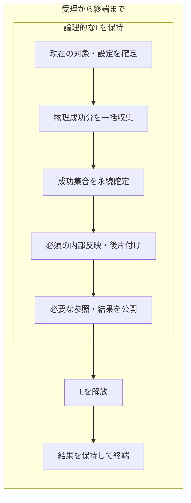
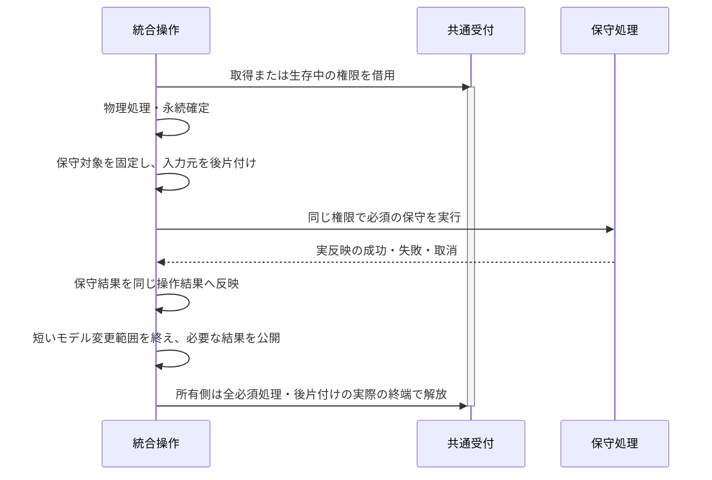

# ライブラリの変更

## 目的と適用範囲

譜面・フォルダ・パッケージを変更する操作について、確認、受付、物理処理、カタログ反映、通知の順序を定めます。ファイルとDBにまたがる失敗時の保証は[ファイルとDBの整合](file-db-consistency.md)、パスの同一性は[パスの識別と収束](../core/path-identity.md)を正本とします。

## 用語

[共通用語集](../glossary.md)の語を使います。変更セッション・確定事実・必須反映・公開・永続確定は[責務と処理の境界](../glossary.md#責務と処理の境界)、所持項目の識別・確定DST・現役の項目・切り離した項目は用語集の定義に従います。確定事実は、`*Facts` 型が保持し、画面の要約件数とは区別します。受付のLとPは[操作の競合ポリシー](../core/operation-concurrency-policy.md#用語)の定義です。コードの識別子は原表記を使います。

| 用語 | 本資料での意味 |
| --- | --- |
| 必須の後処理 | 必須反映のうち、永続確定の後に行う索引・パッケージ状態・保守などの反映。失敗しても完了済みの永続化は取り消さない |

## 仕様

### 責務と操作の入口

画面操作の入口は `SelectedChartMutationWorkflowOwner`、`DuplicateMaintenanceWorkflowOwner`、`PendingPackageWorkflowOwner`、`PackageInstallWorkflowOwner`、`PackageCatalogWorkflowOwner` です。フォルダ名の直接編集は `RegularChartListOwner`、自動変更は `FolderAutoRenameWorkflowOwner` が管理します。`MainWindowViewModel` は画面の構成と各処理の接続を担当します。

`LibraryMutationOwner` が変更内容の集約、索引への反映、必須の後処理、公開順序を管理します。`CatalogMutationOwner` はカタログの保存と正本の更新、`CatalogOwnedCollectionOwner` は所持集合と関連索引を管理します。`BMSLibrary` は公開窓口、専門キャッシュ、画面通知を接続します。共通反映の内部処理をコールバックとしてルートの ViewModel へ渡し、代行させることはしません。

選択譜面の文字コード変更は、共通受付を取得してから、同期の保存処理をUIスレッド外で実行します。選択対象、指定した文字コード、保留項目への反映を保ち、保存と必須反映の通知が終わるまで同じ受付を保持します。保存に失敗した場合は成功の更新を通知しません。成功・失敗のどちらの終端でも受付を解放します。専用のキューや自動再試行は設けず、競合する要求は既存の受付条件で拒否します。

#### 操作中表示と変更の権限

`ChartMutationActivityOwner` の操作中表示は、モデルを変更する権限の代わりになりません。モデルの受付には、`ChartFileOperationSynchronizer` の生存中の権限を明示的に渡します。LとPの分類は[競合ポリシー](../core/operation-concurrency-policy.md#ライブラリ保留保守)に従います。変更中は対象行のメニュー表示とコマンドの再入を拒否します。メニューの有効判定では、UIスレッドからファイルの存在を確認しません。

活動期間の数と `IsActive` の正本は `ChartMutationActivityOwner` が持ちます。表示の購読先は `MainWindowViewModel` で、コマンドの許可判定は `IsActive` を読み直します。

- 最も外側の開始と最後の解放だけを、ロックの外で表示へ通知します。
- 購読者の一つが失敗しても、元の原因と購読先を局所的に診断して残りの購読者へ進みます。受理した活動期間は巻き戻しません。
- 最後の解放の通知・診断が失敗しても非活動状態は成立し、`using` 本体の失敗を置き換えません。
- 同じ活動期間の解放は一回だけ行います。活動数の上限超過と、対応する開始のない解放は、本来の失敗として残します。

操作中表示はモデルの受付条件を変えません。

### 検索ルート確定後の保留再評価

検索ルートの確定では、親の受付の内側で、保存後の最終的な実走査範囲を一度捕捉し、同じ差分走査へ渡します。設定候補として採用するのは保存したセクションだけで、別のセクションの未確定入力は保持します。範囲外の所持登録の解除と、0件保護・収束の終端は[再読込みの範囲](../runtime/startup.md#再読込みの範囲)に従います。

次の三つの入口は、同じ保留再評価へ接続します。

- 検索ルート設定の確定
- 登録ルートを含む所持フォルダの物理削除に伴う登録解除
- 通常カスタム出力基点の確定

検索ルート設定では、保存の直後に再評価します。後続の走査が失敗しても、確定したルートと保留の解除は維持し、元の走査の失敗原因も保持します。通知は、親の設定操作のLとPを解放した後に完了します。

再評価は追加と削除を区別せず、確定後の `Lr2SearchRootSnapshot.Roots` と同じ実走査ルートの集合を使います。登録一覧の `RequestedRoots` や利用者向けの一覧では代用せず、追加出力・ROOT出力の除外を維持します。

解除するのは、実走査ルート自身またはその配下に元の入力がある保留だけです。その保留を参照と導入記録から外し、無関係な保留は保持します。元のファイル・フォルダ・管理一時入力は削除せず、公開されている保留の解除・回収APIも使いません。差分の作成からDB・一覧への反映までは、既存の保留更新と同じ順序（初期化済み状態の読取り、保留集合の書込み、導入DBの書込み）で短く保護します。DB確定後の一覧変更通知は、モデルの保護と親の受付を解放した後に渡し、保留ツリーと右クリック操作の入力を同じ現在の一覧へ揃えます。

#### 所持ルートの削除に伴う保留通知

所持ルートの削除では、同期区間で登録解除と保留再評価を確定し、今回の保留通知だけを親の受付の所有者へ返します。

- 通常削除とハッシュ整理は、それぞれの変更Taskの終了を待つ直近の `finally` で、親の受付を解放した後、削除結果を報告する前に通知を公開します。通常削除で取得したPも、この境界で解放します。
- 受付の権限を借用する入口は、通知の受渡しを省略できません。
- モデルを直接呼ぶ入口は、自身が所有するLとPを解放した後に自分で公開します。

通知を返す前に同期範囲を閉じ、モデルの保護・DB更新・一覧の交換・ルートの再取得を通知へ持ち越しません。例外で結果が返らない場合も、事前に捕捉した通知を `finally` で回収します。任意通知の失敗は既存の任意通知の境界で扱い、元の原因と削除の事実を置き換えません。

### 明示導入先と導入後の資源索引

所持譜面の再導入と保留の導入で明示する `INSTL DST` は、既存のディレクトリを指す値です。共通の物理処理前検査で実在を確認し直し、消失していれば元の譜面・現在値・保存行・保留を保持して再選択を案内します。指定先を作り直しません。通常ファイルとの型衝突では既存の拒否と結果記録を維持し、自動命名による新しい導入先は作成します。

通常の導入は、成功した導入先と、譜面を所有する既存の祖先フォルダを、フォルダ変更と同じ一回の資源索引更新へ渡します。最終的なファイルシステムに対して、親の集約キー・子の自己所有キーと各逆引きを同じ世代へ揃え、次の差分推定で直ちに使えるようにします。無関係な兄弟は置換しません。必須の祖先の走査が不完全または例外になった場合は必須反映の失敗とし、任意の走査の扱いを広げません。

### 譜面所有境界とTXTの局所反映

削除・無効な拡張子への変更・移転・導入が成功した場合は、最終的なファイルシステムで有効な譜面を `ChartDirectoryScanBuilder` で判定し、譜面の親と、影響を受ける既存の祖先の資源索引を一つの世代で反映します。

- 最後の譜面を失った親は、完全一致の項目だけを除き、存続する子の項目を保持します。
- 子の所有境界が消えた資源は、初回構築と同じく、最寄りの所有祖先の自己所有範囲へ戻します。
- 登録解除の要求を、有効な実ファイルの有無の代わりに使いません。

#### 直下BMSのTXT

導入・資源のみの導入・統合では、最終的な衝突計画を実行して `Prepare` に成功した、ディレクトリではないTXTの宛先の親を、同じ変更セッションへ集めます。確定の直前に、追加・移転した譜面の最終的な親と、TXTを置けた親をまとめ、同じ親を一回だけ評価して、追加・移転・存続する直下BMSのTXTを確定します。移転先で評価した値は変更不能な確定事実としてDB要求へ渡し、再探索や欠落値の補完は行いません。後続のパッケージがTXTを置く場合も、同じ最終配置を使います。

次は、存続する直下BMSのTXT更新の対象にしません。

- 子フォルダだけにあるTXT
- BMSON
- 名前が `.txt` で終わるディレクトリ
- 失敗・未実行の分

存続する項目は、同じ所持項目の識別・厳密なパス・ハッシュを検証してから、既存の `song` 保存トランザクション内でtxt列だけを保存します。同じカタログ確定で現在値のTXTだけを更新し、新規導入の対象には混ぜません。実際に差分がある場合だけカタログの版を進め、候補の内容版・順序・利用者列・文字コード・詳細は保ちます。必須の保守と表示用パッケージの登録の後で、確定した正本を捕捉し直し、同じ所持項目の識別の全所属へ渡します。後続の同期による修復、全所持譜面の走査、本文の再解析、後片付け後の二度目の修復は行いません。

### 退役所属と確定したパッケージ参照

差分走査でDBと所持集合の置換が確定した場合も、通常の内部削除と同じ形式・厳密な所持項目の識別で、導入済みパッケージの所属を剪定します。検索ルートの解除で元ファイルが残る場合も、退役した所属を保持しません。同じ所持項目の識別の改名・保守・日時更新には追従し、置き換わった所持項目の識別や、別の所持項目の識別を持つ同じハッシュの譜面を旧所属へ結び直しません。

部分的に剪定した場合は、存続する同じパッケージの題名を、モデルの保護を解放した後に公開します。代表の削除だけでなく、複数件から一件になって完全な題名へ変わる場合も対象です。最後の所属を失ったパッケージは既存のノード削除へ渡し、全パッケージの再生成や一覧の交換は行いません。

単体パッケージは、前方一致による参照の変更より前に、旧 `package.path` と、同じ所持項目の識別を持つ項目の旧パスを照合し、物理成功で確定した変更後のパスへ一度だけ追従します。統合の衝突採番と通常の導入先修正も同じ反映へ接続し、エクスプローラーで開く要求にも確定した先を渡します。フォルダパッケージのルートの移転は既存の範囲を保ち、個別譜面の移動から代表ルートを推測しません。

### 保留目録の解除と管理入力の回収

保留の単独解除・選択解除・全解除は、同じ共通受付の内側で、現在の保留から解除差分を確定します。その差分が削除する入力元パスのうち、管理一時入力に属するものを物理回収の対象とします。

回収対象がある場合だけ、モデルの集合とDBの保護をすべて解放してから、既存の再生変更停止の窓口を非同期で待ちます。現在曲のパスとの一致は停止の条件にしません。現在の再生と先読みを停止し、開始済みの読込み・復号・後片付けの終端へ合流してから、同じ解除差分を適用して管理入力を回収します。

| 状況 | 結果 |
| --- | --- |
| 停止の失敗、終了による取消 | 物理回収せず、入力元の内容と元の停止失敗を保持する |
| 借用入力だけの保留記録の解除、導入済み記録の解除 | 再生を停止せず、実体を保持する |
| 解除差分に含まれない管理入力 | 回収しない |

停止待ちから解除・通知・回収の実際の終端まで、同じ受付・変更活動・一覧更新の抑制を保持し、新しい試聴・変更の要求はBusyで拒否します。受付の解放を契機に予約実行することはなく、終端後の新しい明示要求だけを受け付けます。

演奏完了後や一時停止中でも管理入力を回収する場合は、表示と操作状態を停止へ揃えます。解除後の自動再開と先読みの再登録は行いません。停止処理自体と失敗の集約は[再生パネル](../ui/playback-panel.md)・[音声](../runtime/audio.md)の既存契約を使います。内蔵プレイヤーの読込み完了後の再開始は、この回収と同じ失敗条件に含めません。

ライブラリ変更の操作通知（OK だけの警告・失敗の案内）は、導入系も譜面変更系（選択譜面の変更・重複の整理・フォルダの自動リネーム・通常の譜面一覧のフォルダ名の変更）も、操作ごとの収集先（`LibraryOperationNotices`）へ集めます。収集先は所有者が一回の操作につき一つ作り、モデルへ必須の引数として渡します。モデルの発生源（拒否・失敗・Busy・未収束の警告）は、スレッドや非同期の継続の位置によらず、渡された収集先へ直接加えます。モデルは通知を同期に表示せず、スレッドの文脈にも依存しません。収集先の通知は、受付と対象別の受付・活動などを回収した後に、所有者が配送します。

### 管理出力との交差

分類と受付の取得条件は[競合ポリシー](../core/operation-concurrency-policy.md#分類と並行可否)に従います。実際の移動元・移動先、祖先の再帰範囲、生成・削除するフォルダ行の範囲を、保存・適用済みのLR2管理基点と現在の正本へ照合します。表が0件でも基点内の新しいディレクトリを見落とさず、少数の変更のために全所持譜面の走査を増やしません。

### フォルダ名の変更不要判定と表記変更

フォルダ名（FOLDER）の入口では、最初に開始時の原文と確定した入力を `Ordinal` で比較します。未編集の入力と、編集後に元へ戻した入力は、名前の正規化もせずに終了し、既存のUnicodeの表記・前後の空白を保持します。変更した入力にだけ既存設定のShift_JIS制限・無効文字の除去・前後の空白の除去を適用し、最終的な宛先が元と `Ordinal` で同じなら終了します。

どちらの終了でも、共通受付、Busy案内、Taskの起動、活動表示、表示の抑止、再生停止、ファイルシステムの検査、DBの変更・再走査・通知を始めません。

大文字・小文字だけの違いは、手動・自動とも実際の変更です。物理パスの同一性と、変更不要と判定する完全一致を分けて扱い、別の既存の宛先は拒否し、自動改名の予約と登録ルートの保護を維持します。物理処理では最終表記へ直接改名し、成功した最終表記だけを一つの変更セッションで公開します。BMS・BMSONと子階層の同じ所持項目の識別、完全一致の保存行と保守、一覧、索引と逆引きの候補、パッケージ、保留の確定DST・候補をすべて揃えます。失敗・未処理の新しい表記は公開しません。

#### 実際の移動と診断だけの計画

自動改名・手動改名・ルート移動は、共通受付の内側で、正規化済みの実際の移動を一回確定します。`FolderMoveBatch.Moves` の同じ移動元・移動先を、Pの判定、再生停止の要否、物理適用へ渡します。

- 失敗・変更不要・事前条件を満たさない計画は全計画に残して進捗と診断に使い、実際の移動へ戻しません。
- 診断だけが管理出力と交差しても、正常な非交差の対象をPのBusyで拒否しません。
- 実際の移動がなく診断だけの場合は、再生を停止しません。
- 実際に交差してPを取得できない場合は、停止・物理変更の前に拒否し、解放後の新しい要求だけを受け付けます。

適用時の存在確認は外部変更による失敗の判定に使い、対象や宛先を計算し直しません。

#### 登録ルートの保護

手動改名、選択および全件の自動改名、別ルートへのフォルダ移動では、確定済みの利用者BMSルート登録から、移動元が登録ルート本体またはその祖先かを判定し、該当するものを実際の移動から除きます。

- LR2の管理出力の登録は確定済みの配置で分類し、利用者のルートと混同しません。
- 自動改名と別ルート移動は、保護する移動元を祖先の集約へ含めません。同時に選んだ通常の子フォルダや独立した兄弟は処理できます。
- 登録の配下にあるだけの通常の作品や、名前の先頭が同じ別フォルダは保護対象にしません。
- 入れ子の登録の受理範囲は変えず、空の登録子ルートを含む祖先も保護します。通常設定で確定した登録に含まれる導入先も同じ保護を受けます。

登録の暗黙の書換え、移動先の自動登録、譜面だけの移動への読替えは行いません。別ルート移動の拒否理由は既存の操作診断に保持します。

### 確認と共通受付

利用者の判断が必要な場合は、画面側が物理処理の前に確認し、結果を明示的な引数としてモデルへ渡します。操作の収集先へ集められるのは、処理結果を知らせるOKボタンだけの通知です。Yes/NoやOK/Cancelの判断を収集先へ持ち込まず、必要な判断が欠けた要求は、確認を表示せず物理処理の前に失敗させます。導入先の修復で、重複した導入先がある対象に承認の一覧（削除しない判断は空の一覧）が渡されない要求は、`InvalidOperationException` で失敗し、ファイル・DB・カタログを変えません。重複がなければ、承認の一覧がなくても進めます。

通常削除と重複ハッシュ整理では、確認前の一回の準備で、対象の位置、種別と未加工の完全一致パスによる選択集合、物理フォルダの親子対応を固定します。同じ対応を、候補の列挙、全体の確認、承認後の計画、実際の削除へ渡します。全体の確認に回答した後でだけ停止と物理処理へ進みます。Noは譜面のみの削除、Cancelと閉じる操作は要求全体の取消です。確認待ちの間はモデルの短期ロックを保持しません。

各入口の受付開始・実際の終端・継続は[競合ポリシー](../core/operation-concurrency-policy.md#受付の開始終端と権限)へ集約します。内部の変更セッションと通知範囲は、論理的な受付より短い同期範囲です。

#### 再生の停止

物理変更を行う管理主体は、共通受付の内側で `IChartMutationPlaybackPort.StopPlaybackForMutationAsync` を待ち、現在曲と先読みの停止と復号の終了の後にだけ書き込みます。変更対象のパス・フォルダと現在曲の関係は判定せず、無関係な現在曲も停止します。停止の失敗や終了による取消では物理変更へ進みません。自動導入の各バッチも同じ停止境界を通ります。

変更側が既存の受付を後片付けまで保持する間、再生側は新しい開始を予約せずに断ります。試聴同士の次曲の順次受付は維持します。先に受け付けた曲の開始・準備は停止側が実際の終端まで待ち、停止後に待機中の要求を再始動したり、一時コピーを作ったりしません。再生入力の保護を保持した別の範囲を返したり、内側から外側の管理主体へ移譲したりしません。変更終了後の自動再開と先読みの再登録は行いません。検索や表示順の変更だけでは再生を止めません。再生の資源寿命は[音声仕様](../runtime/audio.md#次曲一件の先行準備)を参照します。

アーカイブの一時展開と、候補・実際の宛先の準備は、同じ受付の内側で、現在のライブラリへの適用と再生停止より前に行います。同期の準備、停止後の同期の適用・後片付け、直接推定の同期の評価・適用で生じた通知は、どのスレッドの区間でも同じ収集先へ加わります。例外・取消でも捕捉した診断を変更不能な操作結果へ渡します。

世代の切替や終了で表示を捨てる場合も受付を解放します。古い処理の終了通知で、新しい処理の排他権を解放しません。通常の変更の競合は `Warn_LibraryOperationBusy`、導入の未接続・停止・取消待ちを含む受付不能は `Warn_PackageInstallUnavailable` で案内します。

#### 登録ルートを含む全体削除

登録BMSルートのフォルダ全体を削除する場合は、範囲内の利用者登録の子ルートを含めて、登録の解除を確認します。

- 最後の利用者ルートまたは現在の導入先と、それらを含む祖先の範囲は、別のルート・導入先が確定するまで理由付きで拒否します。Yesを譜面のみの削除へ読み替えません。
- 保護と独立した対象は同じ変更セッションで続け、明示的なNoは譜面のみを削除します。
- 保護する祖先へのYesを拒否する場合は、その直下の対象グループだけを除きます。明示的に選ばれた安全な子グループは、自身のYes/Noに従います。
- 空の保護登録を含む別の子範囲は拒否し、祖先本体・保護登録・導入先を保持します。元の祖先範囲に含まれることだけを理由に、安全な子まで除外しません。

確認後に保護対象を除いた準備済みの対象を、Pの判定・停止・物理処理へ共通して渡します。

登録を解除するのは、実際の削除処理の削除APIが成功した範囲内にある、今回確認した利用者登録だけです。要求の集合・譜面の成功数・事後の存在確認から成功を推測しません。物理成功に対するカタログ・索引の反映と、登録の保存・限定公開は、それぞれ必須の終端として回収します。片方の失敗で他方を省略せず、両方の原因を同じ操作結果と、解放後の一回の報告へ残します。登録の保存失敗はカタログの失敗に分類しません。自動の代替、ルートの再作成、全体の巻戻し、予約・自動再試行は行いません。通常削除と重複ハッシュ整理は同じ準備済みの削除へ接続し、重複整理で残す譜面の選択は維持します。

### 操作単位の変更セッション

一回の利用者操作を一つの `LibraryMutationSession` とし、確認できた複数の変更を同じセッションへ追加します。単一対象も同じ経路を使います。

| 段階 | 契約 |
| --- | --- |
| 開始 | 外側の排他権を持つ操作が一回だけ開始する。対象ごとの反復中に別のセッションを作らない |
| 収集 | 物理処理の成功から、変更不能なカタログ・パッケージ参照・保存対象・リソースの変更内容を作る。未処理、拒否、失敗を成功に数えない |
| 後続の判定 | 先行する物理処理で成功したハッシュと実際の導入先だけを、操作内の成功差分へ追加する。未実行の予約を所持済みと見なさない |
| 確定 | 終端で変更を集約し、各管理主体の保存・索引反映・LR2同期・必須の公開準備を一回ずつ行う。別のDBまで単一の物理トランザクションにする保証ではない |
| 失敗 | 予期しない失敗では依存する後続処理を止め、確認済みの成功、失敗対象、未処理対象を同じ結果へ残す。確認済みの成功集合に対する確定は一回試みる |
| 公開 | 必須反映が成功した通知だけを準備し、短いモデル変更範囲を終えて公開する。外側のLの寿命は競合ポリシーに従う。補助的な先行読込みを対象数だけ起動しない |

#### 確認前の準備

削除と通常の拡張子変更は、UIで選択とライブラリの参照を固定し、既存のUI共通受付を取得した後、最初の確認より前に、背景処理で短命の変更不能な要求を準備して非同期に待ちます。フォルダ候補の計算と現在値の解決をUIで同期実行しません。

- 通常の準備済み対象は変更不能な `ChartFile` の列で、ファイルシステムの存在・属性は捕捉しません。
- 通常の拡張子変更は、BMS・PMSの双方を一つの背景処理で順に準備し、すべて準備した後に非同期の確認へ進みます。
- 重複ハッシュ整理では、既存の残す譜面の選択と対象なしの判定を、共通受付の前に行います。
- 準備で例外が起きた場合は元の原因を返して共通受付を解放し、確認・再生停止・変更処理へ進みません。

選択削除と重複ハッシュ整理は `LibraryChartRemovalPreflight`、拡張子変更は固定した対象と変更先の拡張子を持つ `LibraryFileExtensionRenameBatch` を使います。

フォルダ候補も削除対象と同じスナップショットの範囲で捕捉します。確認中はモデルの短い保護とDBのロックを保持せず、論理的な共通受付だけを保持します。承認後は同じ準備済みの値と生存中の共通権限を実際の変更へ渡し、必須処理と範囲の回収の終端後に解放します。

#### 重複ハッシュ整理のフォルダ確認

重複ハッシュ整理は、件数の確認の後、捕捉した候補のフォルダ全体の確認をワークフローの非同期UI確認で済ませます。モデルへは同じ準備済みの値と、明示的な承認パスの列（承認がない場合も null ではない空の列）を渡します。件数確認の表示設定を無効にしても、フォルダの判断は行います。

フォルダ確認はYes/No/Cancelで、既定はYesです。

| 回答 | 結果 |
| --- | --- |
| 明示のYes | フォルダ全体を削除する |
| 明示のNo | 選択した譜面だけを削除する |
| Cancel、閉じるボタン、Esc | 先行するYesの有無にかかわらず、物理処理の開始前に要求全体を取り消す |

閉じるボタンの結果が既定のYesを保持していても、STATUSでは明示の選択と区別します。全回答が揃うまで停止・Pの取得・活動表示・物理処理を始めません。表示の失敗・null応答・例外では、元の原因を保持して失敗とし、受付を解放します。初回の件数確認のOK/Cancel（既定はCancel）と表示設定は維持します。

モデルは準備済みの入力と判断済みの明示集合だけを受け取り、同期の確認や元の選択からの再確定を行いません。

#### 固定した対象の照合

削除の準備では、同じ所持項目の識別の現在値でも、要求の種別とDBの完全一致パスが変わっていれば未解決（`Unresolved`）とし、物理処理・DB変更へ進めません。選択時のハッシュが古いことだけは許容し、現在のハッシュを固定します。通常の拡張子変更では、生存する所持項目の識別の現在配置への追従を維持し、削除に固有の要求時パスの照合は加えません。指定した所持項目の識別が退役済みなら、共通の正規パス解決も移転の保存要求も、別の項目へ読み替えて救済しません。未所持の保守計算は、所持項目への再接続と区別します。

本受付の後、最初のファイルシステム・DBの変更より前に、固定した全対象の所持項目の識別・種別・固定パスの結び付きを照合します。削除はDBパスの `Ordinal` 比較、通常の拡張子変更は既存の物理パス比較を使い、改名を複数のバッチで行う場合も全バッチを先に照合します。不成立なら、原因と固定パスを持つ要求全体の失敗として既存の失敗経路へ渡します。ハッシュやファイルシステムの安全属性の履歴比較、確認中のモデル変更を前提にした個別の古い対象の継続は行いません。

成立した対象では、現在のハッシュと現在値から、DB・索引・操作内の成功差分・確定事実を作り、確認した物理元パスと承認したフォルダの列を維持します。必要なファイルシステムの観測は既存の実行直前の処理に委ね、物理的な欠落・失敗による部分成功、親子削除の実観測への依存、大文字・小文字だけの配置の一回処理を維持します。通常の変更の逐次前提は[ワークフローと並行性](../core/workflow-concurrency.md)、外部変更の保証範囲は[ファイルとDBの整合性](file-db-consistency.md)を参照します。

項目の削除と `PathCleanup` は意味を分けます。項目削除の確定事実は所持項目の識別を保持し、導入済み項目の剪定でもその所持項目の識別を厳密に照合します。同じ形式・パス・ハッシュの別の項目へ削除を広げません。内部移転の確定事実も同じ所持項目の識別を引き継ぐため、移転してから削除した項目も剪定できます。`PathCleanup` は所持項目の削除とは別の処理で、DBの完全一致パスを使って移転先の保護を適用します。

#### 確定事実と操作結果

`LibraryCatalogMutationFacts` と `LibraryPackageReferenceFacts` は、入力の列を構築時にコピーします。操作要約の件数やエラーから変更対象を推測し直しません。正本への反映は非公開の `CommitCatalogSessionChanges` と `CommitInstalledSessionChanges` に限り、呼出し元は `LibraryMutationSession.Commit` だけとします。同じセッションにカタログの移転・削除と導入対象の反映を混在させた場合は失敗です。

行のパス変更通知には `LibraryStorageRowPathNotificationPolicy` を渡し、診断用の `reason` 文字列で挙動を分岐しません。操作全体の結果は `LibraryMutationSessionReceipt` を正本とします。`FileDbMutationReceipt` は局所的な物理処理・保全・補償・確定後の後片付けの結果に限り、それを集めて操作全体の確定成功と解釈しません。

#### 通常の変更ライフサイクル

受理済みの通常の変更が成功する経路の順序です。物理成功分は一つの変更セッションへ収集します。外枠は追跡する操作、内枠は論理的なLを保持する区間を表し、集合ロックやDBトランザクションの保持期間ではありません。失敗の分岐は[ファイルとDBの整合](file-db-consistency.md#局所的なファイル処理と補償)、同じLで続ける必須処理は[フォルダ統合](#フォルダ統合と確定後の保守)を参照します。

内部反映・後片付け・公開準備の順序は操作ごとに異なります。図の永続確定は、複数の保存先を一つの原子的なトランザクションにする意味ではありません。必要な公開と任意の情報案内を区別し、[通知と操作結果](#通知と操作結果)と[競合ポリシー](../core/operation-concurrency-policy.md#受付の開始終端と権限)に従います。

### 排他権とロック

外側の論理的な受付は、必要な公開と全Task・後片付けの終端まで保持し、同期的なモデルの変更範囲や集合ロックとは区別します。対象を捕捉する短いロックは、初期化状態の読取り、保留集合の書込み、BMS集合の書込みの順で取得し、逆順に解放します。ファイルI/O、DB処理、補償、後片付け、通知に入る前に、不要な集合ロックを解放します。

入れ子の処理は、同じ生存中の排他権から明示的に渡された操作権限を検証します。別の所有者の権限、解放済みの権限、null の権限は失敗です。同じスレッドであること、`AsyncLocal`、再入回数を権限の根拠にしません。導入からLR2同期へ続く必須処理も、別の受付を取り直さず、この権限を引き継ぎます。

ロック中は `Dispatcher.Invoke`、ダイアログ、購読者、`Task.Wait`、`.Result` を待ちません。終了時の進捗、画面更新、補助タスク、報告は、短いモデルロックの解放後へ渡します。中間進捗が必要な操作は最新値だけを保持する非同期通知を使い、配送待ちと配送中を合わせて一件に抑えます。終端の前に通知を閉じ、遅れた世代の進捗を表示しません。

### 操作ごとの反映範囲

| 操作 | 確定と公開 |
| --- | --- |
| 複数譜面の削除 | 物理削除が成功した対象だけを集約する。成功したディレクトリの逆引きからの除去は、カタログと必須反映が成功した後に一回行う |
| フォルダの移動・名前変更、自動名前変更 | 変更前後のパスを操作単位で反映する。自動変更のLR2同期は、確定結果とそれに対応する所持集合の版から、変更したディレクトリとその祖先の現在のBMSを捕捉して行う。呼出し元で追加の同期や通常の更新を行わない |
| 通常譜面の拡張子修正 | `.b*` と `.p*` の処理を一つのセッションへ集める。拡張子の種類ごとに確定しない。保留だけの修正はパッケージの管理範囲に留める |
| 自動・推定先・強制・手動の導入 | 実際の導入先に対応する保存対象と導入行を一つのトランザクションで反映し、パッケージ状態、推定先の解除、保守を必須の後処理として保持する |
| リソースのみ・後片付けのみの導入 | 追加譜面が0件でも変更を保持する。必要なリソースの再走査・パッケージの更新を行うが、譜面の差分がなければ所持集合の版を増やさない |
| 明示的な走査 | 走査結果による全置換と、残る局所的な変更内容を区別する。局所操作を理由に全置換を省かず、逆に局所対象ごとに全保存集合を取得し直さない |
| 譜面情報・文字コードなどの更新 | 保存対象と更新項目に応じて反映する。セルだけの変更で所持集合全体を公開し直さない |

#### 保留の確定DSTと候補への反映

保留項目の確定DSTと推定候補への反映は、この節を正本とします。カタログの確定後、同じ変更セッションの成功範囲を現役の項目へ順に適用します。所持譜面の一時導入先と保留の参照は、物理範囲の比較規則を共有します。この共有部分の実装を変更する作業は、並行させず直列に行います。

**改名・純移動**では、確定DSTが空で候補だけを持つ項目も含め、確定DST・候補・配置文脈のパスを同じ相対位置へ追従させます。次は変えません。

- 候補の順序・数、未確定状態、表示根拠、警告、対象外状態
- 健康度、捕捉済みの索引・完全性・譜面の相対配置

自動確定・再推定・資源の追加の再走査は行いません。同じ項目の複数の候補が別々の成功範囲に属しても、先行する更新を、捕捉時の古い確定DST・候補で上書きしません。警告の事実に含まれるパスの扱いは[警告のリソース状態の評価](warnings.md#リソース状態の評価)に従います。

**削除・統合**では、成功範囲に候補が一つでも触れた項目の全候補と、候補に依存する推定警告を失効させます。残る候補の繰上げは行わず、新しい候補の取得には明示的な再推定が必要です。確定DSTは次のように扱います。

| 確定DSTの状態 | 結果 |
| --- | --- |
| 空 | 推定代表と候補の配置も解除し、[登録時の元配置・健康度](warnings.md#リソース状態の評価)へ戻す |
| 成功範囲の外 | 確定DST・代表・現在の配置・健康度を保持する |
| 統合元の範囲内 | 存続先へ、配置のパスとともに追従する |
| 全体削除の物理成功範囲内 | 解除し、元配置へ戻す |

確定DSTが存続する間に失効させるのは、候補の評価に依存する警告だけです。同じ推定分類のうち失効させない診断の種類は[警告のリソース状態の評価](warnings.md#リソース状態の評価)を正本とします。

同じ既存の推定対象群に確定DSTが残る場合は、利用者が明示的に全クリアするまで確定DSTを保持します。その後の再推定は[保留一覧の選択譜面操作](install-estimation.md#保留一覧の選択譜面操作)に従います。

失敗・取消・未処理・拒否・変更不要の対象と、名前の先頭が共通なだけの兄弟は変更しません。通常の導入先編集APIには他の項目への横断的な反映を付けず、所持全件の走査・複製を加えません。

#### 索引の反映

未使用の任意の索引は構築しません。構築済みの索引は、確定した変更前後の値から差分で更新します。親フォルダ、重複グループ、導入推定などの専門キャッシュへの接続は残しますが、共通反映の判断は `LibraryMutationOwner` に置きます。

改名・移動・削除・統合では、成功した物理変更の変更前後の範囲から厳密な祖先を辿り、既存のリソース索引の点検索で範囲外の更新対象を選びます。要求の全件や事後の存在確認から成功を推測しません。必要な祖先の集合は重複を除きます。物理走査ルートの包含による縮約とは区別し、下位の必要な項目も残します。

祖先の情報は、カタログ・LR2などの必須反映と統合の保守対象の捕捉を終え、入力元を後片付けした後の、最終的なファイルシステムから取得します。後片付けが失敗した場合も、実際に残っているものを読みます。移動した配下の既存ハッシュ、削除・統合元の除去、限定した祖先の項目の資源六分類を一つの未公開の索引へ反映し、逆引きと世代を一度だけ公開します。走査に含まれただけの無関係な兄弟の項目は置換しません。

必要な祖先の取得が失敗・不完全・例外になった場合は、[必須反映の失敗](file-db-consistency.md#失敗地点と保全するもの)として旧スナップショットと世代を維持します。親譜面の参照文字列や関連する全譜面の保守値を、この変更だけで書き換えません。明示的な保守は更新済みの索引を使います。

推定先導入で実際の対象がなく正常にスキップした場合は、公開する結果に空の変更セッション結果を含めます。内部の実行票のスキップ判定は保ち、そのほかの結果の欠落や失敗を空の成功へ置き換えません。

内部反映と公開通知は分けます。所持集合の世代と関連索引の世代の対応は内部反映で確定し、通知時に改めて世代を進めません。導入では、保存対象の反映に伴うリソース健全性索引の差分を後続の保守より前に適用し、保守も同じ操作の必須処理として反映してから公開します。索引の反映の例外を、公開通知の例外捕捉で診断だけに変えません。

導入中の譜面解析も、譜面情報・ハッシュと派生索引の内部反映を入力変更区間内で完了させます。譜面情報索引・解析失敗警告の通知は導入の既存の通知範囲へ集約し、モデルの短い変更範囲を終えて公開します。必要な公開を終えるまで外側の論理的な受付を保持します。

### 導入と導入先修正

一回の要求で親フォルダと配下の譜面を同時に受け取った場合は、既存の発見・グループ化を行った後、正規化した物理パッケージの同一性で重複を除きます。登録ルートと既存の保留を除いた後、親のディレクトリ型パッケージが捕捉した一覧に子パッケージの全譜面が含まれていれば、入力順によらず外側へまとめて一回だけ処理します。

- 子階層の譜面を含む親の既存の保留分類は維持し、子だけを先に導入して、親の保留が参照する実体を消費することはしません。
- 明示された譜面に隣接する資源があればディレクトリ型として受理する既存の条件を保ち、要求全体の拒否や常に単独ファイルにする扱いはしません。

取り込み後の自動推定に続く導入は、[推定仕様](install-estimation.md#取り込み後の自動推定に続く導入)の対象を既存の推定先導入の中核処理へ接続します。初段の通常導入・保留登録を先に確定し、推定が正常に完了した後の後段を、別の一つの変更セッションへ集約します。操作全体を一つのDBトランザクションにはせず、後段も対象ごとの確定へ分割しません。初段・後段それぞれの確定と必須反映の成否を保持し、後続の失敗で先行の確定を空の結果へ置き換えません。必要な同期・公開・入力の回収を同じ取り込みの中で待ちます。

導入先の採番と型衝突の検査は物理処理の前に行い、決定した実際のパスを保存結果とパッケージ状態に共通して使います。永続化前の準備では保存用のコピーを作り、現役の `PackageChartEntry` の現在値や所持の共通現在値のパスを一時的に差し替えません。DBと所持集合の確定後に、成功した対象だけの共通現在値を捕捉して、安定した項目へ渡します。新しい所持項目の識別を共有し、同じ項目の排他境界で現在値・導入状態を反映します。通知は、項目の排他を解放し、既存の操作単位の延期境界を終えてから公開します。

導入するBMSと、TXTを置けた親の直下にある存続BMSの `Txt` は、[直下BMSのTXT](#直下bmsのtxt)に従い、同じ保存境界の最終配置を `Lr2TextGroupResolver` で評価します。配置・更新日時・内容が変わらなければ、直後の差分読込みでTXTを理由にした再解析は必要ありません。

後続パッケージの分類に使う一時情報へ追加するのは、先行する物理処理の成功だけです。失敗、取消、未処理、推定先の解除は所持の成功に加えません。開始前に欠落を確認した入力は失敗として保持し、独立した後続のパッケージは処理できます。コピー開始後の入力の消失は予期しない物理処理の失敗であり、依存する後続を止めます。

リソースの上書きの成功件数は、物理的な準備だけでなく、カタログと必須反映の完了で確定します。後片付けだけの失敗は確定した成功を取り消しません。推定先の状態更新と `PackageChartEntry.PropertyChanged` の公開は分け、公開は排他権の解放後に行います。

導入先修正は選択した譜面だけを対象とし、兄弟のファイル、リソース、親フォルダをついでに処理しません。選択対象を除く既存の所持情報を一回捕捉し、物理移動の成功を後続の判定へ反映します。承認済みの重複削除も同じセッションへ追加します。確定後は、確定後の共通現在値から保守対象を作り、同じ外側の操作権限の下で `forceUpdate: true` の保守を一回行います。

導入の準備値は切り離した項目だけで構成し、DB確定後に同じ現役の項目へ現在値を渡します。[構造警告の解除](warnings.md#種類ごとの更新)も成功した分だけへ反映し、失敗・未処理の項目では元の種類とメッセージを保持します。保留の文字コードは[譜面読取りの保存契約](chart-file-reading.md#保留項目の文字コード)で成功した配置だけへ渡し、既存の資源索引の反映・必須保守の終端・所持の保存・公開の順序を保ちます。パスの投影のための追加の更新日時の読取りや、日時を未確定に戻す扱いはしません。

### フォルダ統合と確定後の保守

重複画面の統合先候補とCtrl+Gの分岐は[重複譜面の確認と整理](duplicate-files.md#一覧と操作)に従います。

統合の移動元が確定済みの利用者BMSルート本体、または空の登録子ルートを含む祖先なら、物理的な準備と変更セッションの開始より前に拒否します。移動元と移動先の譜面・音源・DB・登録を保持し、登録の解除・付替えは行いません。登録の配下にある通常の作品や、名前の先頭が同じ別フォルダは、登録を含まなければ通常の統合条件で処理できます。画面操作の統合は、共通受付の内側で既存の再生停止を終えてから、このモデルの準備へ進みます。

フォルダ統合は変更一件のセッションです。入力元が欠落している場合は、索引を取得する前に終了します。共通のパッケージ処理で全体の導入先と型衝突を確認し、物理処理の成功からカタログ・パッケージの変更を追加します。統合先の走査と逆引きの置換も集約し、リソースだけの統合を落としません。

後続の保守対象は、カタログの共通現在値を同じ所持項目の識別で移転した後、入力元の後片付けより前に固定します。入力元の削除は永続確定の後です。統合と同じ共通受付の生存中の権限を必須の保守へ渡し、`forceUpdate: true`、`DeferOnUpdates`、`merge_folder` の条件で保守します。単独の入口では統合が受付を所有し、外側で受理済みの操作の中では権限を借用します。保守・後片付けの実際の終端まで受付を保持し、新しい受付を取り直しません。

この保守は、論理的には同じ操作の必須処理 `PostCommitMaintenance` です。保守の例外・取消は同じ結果の `FinalizationFailure` に残します。`MergeApplied` と永続確定の成功は取り消しませんが、画面には通常の完全成功として報告しません。二つ目の変更セッションや別の成功報告は作りません。

#### 統合と必須保守の受付寿命

統合を適用した後も、同じ受付を保持して必須の保守を追跡します。モデルの短いロックを外部への通知へ持ち越さず、通知済みであることを完全成功の判定に使いません。

### 削除対象と部分失敗

削除の成功は、対象に対する削除APIが成功を返した事実で確認します。未実行の対象の存在確認が false であるだけでは成功にしません。ディレクトリの削除が途中で例外になった場合は全体を成功として扱わず、追加の走査でカタログからの削除を推測しません。DBの失敗で、確認済みの物理削除を起きなかったことにはしません。

通常フォルダで親子を同時に削除する場合は、親の再帰削除が依存する子を事前に記録します。操作内の親子対応は実際の包含関係だけから作り、独立した兄弟全体の探索や、譜面ごとの対象の位置の検索を繰り返しません。選択集合は種別と完全一致パスで照合し、フォルダごとに複製しません。

| 子の結果 | 親の扱い |
| --- | --- |
| 全ての子の全体削除が承認され、削除APIが成功した | 親を再帰削除する |
| 子の全体削除がNo | 子の譜面の個別削除が成功しても、親のYesより子の資源の保持を優先し、親も選択した譜面だけを削除する。Noは失敗・取消として扱わない |
| 子が失敗・未処理 | 親の選択した譜面を個別に処理する。親の再帰削除で、失敗した子を再試行しない |

独立した兄弟の処理は続けられます。選択されていない子孫は巻き込みません。

#### 保留パッケージのフォルダ全体削除

保留パッケージのフォルダ全体を削除するには、次の全条件が必要です。

- ディレクトリ単位のパッケージである。
- 入れ子のBMSONを含む、残存する全譜面が選択されている。
- フォルダ全体を削除する設定が有効である。

削除前に対象フォルダを一回走査し、列挙と各譜面の読取り・基本解析がすべて成立した一覧で全選択を確認します。事前に管理していた列や、個別譜面をまとめ直した列をフォルダ全体の根拠にしません。確認できない場合はフォルダの一括削除の対象から外し、選択した既知のファイルだけを個別削除へ渡します。フォルダ削除の処理件数・成功パスも、同じ確認済みの一覧から作ります。

対象は `ChartPackage.path` のフォルダそのものです。単一ファイルのパッケージは、この条件を満たしたように見えても親を削除しません。一部の選択や設定が無効な場合は、選択したファイルだけを削除します。全体削除が失敗した場合は、選択した譜面を失敗として数え、ディレクトリのエラーを一件残します。個別削除へ切り替えず、パッケージの所属と導入行を保持します。OSが行った部分的な削除の原子性までは保証しません。

導入済みの譜面だけを含む保留入力の削除も、対象フォルダを走査して、完全な一覧と全譜面の所持を確認します。不完全・読取り不能・未所持の譜面を含むフォルダは対象へ加えず、独立した完全な全所持の入力の削除は続けます。単一ファイルの対象範囲は維持します。ライブラリ全体の再走査や、確認後の外部変更を防ぐ保証は追加しません。

### 保留入力と登録ルート

保留へ加える入力は、LR2設定または単独動作の検索対象に登録されたルートとの包含関係を検査します。登録ルート自身とその配下は、未索引でも、ドロップ後の自動導入・保留追加の対象から除きます。外側の独立した兄弟は受け入れます。単純な文字列の前方一致では判定しません。

導入テーブルの読込み時も、登録ルートに入った行を保留の公開より前に除きます。除去するのは導入行であり、ファイルやカタログではありません。これは継続的な監視ではなく、登録ルートを変更した後の再評価には再起動または全体の再初期化が必要です。通常の差分更新やプレイリストの更新で同じ再評価を行う保証はありません。登録ルートを内包する外側のパッケージや、既存の範囲を越えた再解析位置の追跡は対象外です。

保留中の旧形式の操作対象を解決する場合も、確認前に対象の件数分だけを捕捉し、排他権の内側でパス・所属・種類・安全性を検証します。全保留集合の再取得を対象ごとに行いません。

### 譜面情報の保存

補完解析と導入時の解析は `ApplyChartInfoStorageWrite(CatalogChartInfoStorageWriteRequest)` を共用します。保存用のコピーまたは限定した投影、`chart_digest_map`、`chart_info`、解析失敗の追加・削除を、同じカタログのトランザクションへ渡します。

全件の補完では、パスとMD5が一致する既存のBMS行の、譜面情報に由来する9列だけを更新します。基本列、`mode`、`judge`、利用者の列は更新せず、欠落した行は挿入しません。BMSONからLR2の `song` 行を作りません。保存行を伴わない解析失敗の削除には、変更内容だけを扱う `ApplyChartInfoWrite` を使います。

永続化が成功してから、同じ所持項目の識別の共通現在値、ハッシュ、索引、警告を更新します。失敗した場合は、未反映の対象を次回の候補として残します。`PrepareOwnedChartDigestPublication` で変更内容を一回組み立て、依存する索引へ適用したものと同じ内容の公開処理を返します。譜面情報索引の更新とハッシュ変更範囲の解放の後に公開し、公開時に内容を計算し直しません。

### 起動時のLR2日時修正

`NormalizeSongTable` は、既存のフォルダ走査中に、修正候補のカタログ識別条件、表示用のパス、観測した日時を一回捕捉します。この走査中にダイアログ、ファイル変更、追加の全表走査を行いません。

初期の排他権を解放してから利用者へ確認し、承認した候補だけを二つ目の短い排他権で処理します。`Lr2FolderExistingRowLookup.QueryExactPaths` で、候補の元のパスに完全一致する行だけを取得し、識別条件・存在・日時の完全一致を検証し直します。差替え、消失、日時の変更があれば変更しません。必要な処理サービスの欠落は明示的な失敗とし、無関係なパスの日時調査や全行の辞書を追加しません。

### 通知と操作結果

メイン画面の実際のメニューは、要求を呼び出す前の同期例外と、開始済みのTaskの失敗を、同じ所有する入口で処理します。必要な終端・回収を待ってから元の原因を一度案内します。所有する取消要求がない `OperationCanceledException` は失敗です。`FileDbMutationReport` / `LibraryChartRemovalReport` が扱った結果記録は保存済みの事実を保持し、表示のためだけに再送出や一般のエラー通知を追加しません。必須の選択・一覧・画面遷移の反映が失敗した場合は実際の故障として伝え、結果記録のない本体の失敗と重なれば、一つの所有する終端へ原因をまとめます。任意通知の失敗は局所的な診断だけに留め、本体の結果や回収の失敗へ混ぜません。

必須反映が成功した通常の通知だけを公開予定へ加えます。公開処理は短いモデル変更範囲の解放後に一回実行し、購読者ごとの例外を診断して他の通知を続けます。論理的な受付の保持点は競合ポリシーに従います。通知の失敗は確定済みの結果を変えず、処理を再実行しません。

#### 導入の通知

導入の保守・インライン解析・パッケージ集合の状態の反映は、必須の後処理です。反映済みの状態の通知を延期した範囲の寿命の完了は、状態の反映の成否と区別します。次は任意の公開とし、各コールバックの失敗と、そのNLog診断の二次的な失敗を局所的に受け止めます。

- 排他の解放後の項目通知
- 保守・解析の通知
- 集合の通知
- 延期した案内

一つの通知・診断の失敗で、後続の独立した通知や `CollectionPublicationScope.Dispose` を放棄しません。成功、永続確定、必須反映の失敗、後片付けの失敗、手動回復の事実を変えません。実際の排他権・ロックの解放失敗までを任意通知へ格下げしません。

`PackageLifecycleOwner` のキュー公開は、集合状態と所属の反映後の通知だけを対象とし、通知処理ごとに元の原因を診断して後続へ進みます。保留集合の通知が失敗しても導入済み集合の通知を試み、診断先の二次的な失敗で通知列や実際の公開Taskを失敗させません。投稿・受付拒否・公開Taskの終端の診断にも同じ境界を使い、同期公開と入れ子の範囲の既存の意味は維持します。

自動フォルダ名変更の中間進捗の購読者が例外を投げても、通知の失敗として診断して変更処理を続けます。本体が成功した場合は成功の終端を公開してアイドルへ戻り、進捗通知の失敗を変更の失敗へ変換しません。

保留・自動導入の情報通知は、操作ごとの収集先（`LibraryOperationNotices`）へ集め、受付を解放した後に `FileDbMutationReport.ShowOperationMessagesAsync` へ渡します。収集先は所有者が作ってモデルへ明示の引数で渡し、変更権限には添えません。本文・見出し・ボタン・アイコン・既定値が一致する通知は最初の一件だけを残し、どのスレッド・段階・延期先の公開で加えた通知も同じ列へ入ります。所有者は、モデルの操作が戻った後（成功・例外・取消のいずれでも）に取得します。手動導入など外側の受付を借用する経路では、内側の終端では表示せず、外側の受付の解放後に一度だけまとめて表示します。表示は所有者に注入された窓口で行い、終了の要求の後・世代の失効後は表示せず診断へ残し、表示の失敗は操作の結果を変えません。見出しと重要度が同じ通知は一つのダイアログへまとめます。組は最初に現れた順に一件ずつ表示し、組の中は対象の入力順です。一件だけの組は元の通知をそのまま表示し、二件以上の組は件数の行と最大5件の標本の行で示して、全件に満たなければ「- ...」を加えます。表示時の言語で整形するのは、件数の行です。読込み失敗の見出しと本文の型は、再検査の経路では表示時の言語で整形します。導入・導入先の修正・統合・推定先導入・起動後の経路では、モデルの中で収集時の言語で整形します。それ以外の通知の見出し・本文・標本は、収集した時点の文字列のままです。標本に載らない件が出る組は、まとめる時点で、組ごとに一つのログ項目へ全メンバーの本文を残します（読込み失敗は収集した時点で全件をログへ残すため重ねません）。組の間は先行の表示の完了を待ちますが、導入処理は表示の完了を同期的に待ちません。表示に失敗しても後続の組は止めず、確認の代わりにもなりません。

保守の読取りが見つけた読込み失敗も、導入の通知と同じ表示役でまとめて表示します。読取りは並列のスレッドで動くため窓口を持たず、失敗の件数と、対象の入力順に並べた標本を結果の収集先へ集めます。収集先を受け取る呼出し元は、書込み保護と受付を解放した後にまとめた通知を渡します。導入・導入先の修正・統合の後の保守は、保守の書込み保護を出た後に、成功でも例外でも、それぞれの操作の収集先へ渡します。推定先導入は延期先へ、同じく成功でも例外でも渡します。起動後の保守は、保守の受付と書込み保護を解放した後に、成功でも例外でも、集めた失敗を待たない投函（`IBmsLibraryDialogService.Post`）で一度だけまとめて渡します。保守の終端と次の受付は表示の完了を待たず、終了の要求の後の通知は表示せず診断へ残します。起動後の保守の状態の公開（`FlushPostLeaseEffects`）は表示を含まない状態の公開だけで、受付の保持中の位置のまま変えません。保守が例外で終わっても、元の失敗は変えません。

#### 異常結果の報告

操作の異常結果は、短いモデルロック、操作中表示、同期ダイアログの範囲を解放してから一度だけ報告します。必要な通知・公開と外側の受付の終端は競合ポリシーに従い、情報案内の表示完了を同期的に待ちません。

| 結果 | 報告 |
| --- | --- |
| 完全成功 | 原則として通知しない |
| 後片付けだけの失敗 | 警告 |
| 未確定・必須反映の失敗・未確認の対象を含む | エラー |

削除専用の `LibraryChartRemovalReport` との二重報告を避け、導入先修正に含まれる承認済みの削除を別の操作として報告しません。

報告では成功した変更の数を使い、ファイル数へ読み替えません。確認候補のパスは最大3件・各240文字、例外は最大3件・各400文字、本文は4096文字までとします。候補は存在を確認した回復場所とは限りません。詳細は診断へ残しますが、表示や診断の失敗で本来の結果を上書きしません。

入力前の型衝突は専用の案内として先頭5件と残りの件数を表示し、全件を診断します。実行中の例外を型名だけで事前拒否へ丸めません。部分成功を表示するのは、永続確定した成功がある場合だけです。

### 新規一覧の所属解除

「新規」の行を一覧から削除するときは、行の `PackageEntry` 参照が現在所属するパッケージを解除します。同じ所持項目の識別・同じパスの譜面が別のパッケージにも表示されていても、それを所属の同一性の代わりに使いません。選択したパッケージの全項目を除き、同じパッケージの複数行の選択は一回にまとめます。退役した行は、同じ所持譜面を持つ別のパッケージへ結び直しません。ツリーからの直接操作、通常の一所属、確認の取消と保留解除は、既存の受付・確認・終端を使います。所属の解除は、所持項目の識別、実ファイル、`song` DB と資源索引を変更しません。

## 実装とテストの対応

| 仕様項目・主な条件 | 実装箇所 | テスト箇所・確認内容 |
| --- | --- | --- |
| 資源索引の祖先反映（最後の譜面の除去と親子の所有境界、改名・移動・統合・削除・通常導入の一回公開） | [`LibraryMutationSession.ApplyFolderResourceChanges`](../../../BeMusicSeeker/Models/Library/BMSLibrary.LibraryMutationOwner.Session.cs)、[`LibraryResourceIndexOwner.ApplyFolderChanges`](../../../BeMusicSeeker/Models/BmsLibraryInternal/Resources/LibraryResourceIndexOwner.cs) | Windows `BmsLibraryMutationBoundaryTests.ChartOnlyMutation_MatchesIndependentFinalResourceIndex` は、固定した最終的なファイルシステムから独立に構築した索引と資源六分類を照合する。[`LibraryResourceIndexOwnerTests`](../../../tests/BeMusicSeeker.Core.Tests/Resources/LibraryResourceIndexOwnerTests.cs) の `ApplyFolderChanges_PublishesSubtreeAndAncestorSixCategoriesTogether` は完全一致の除去と子の保持を確認し、同クラスは索引の一回公開・共有・同値時の変更なしと列挙失敗も分担する。[`BmsLibraryFolderRenameRefreshTests`（Core）](../../../tests/BeMusicSeeker.Core.Tests/Maintenance/BmsLibraryFolderRenameRefreshTests.cs) の `FolderMutation_RefreshesExistingAncestorsOnceFromFinalFilesystem` は改名・別の親への移動・共通祖先・六分類・兄弟・明示保守を確認する。削除の成功・失敗の混在は [`OwnedChartCollectionLibraryMutationTests`](../../../tests/BeMusicSeeker.Windows.Tests/Catalog/OwnedChartCollectionLibraryMutationTests.cs) の `RemoveLibraryCharts_PublishesOneResourceGenerationForConfirmedFoldersOnly`、統合と後片付け後の実際の残存は [`BmsLibraryDuplicateServiceTests`（Core）](../../../tests/BeMusicSeeker.Core.Tests/Maintenance/BmsLibraryDuplicateServiceTests.cs) の `MergeChartDirectory_RefreshesAncestorResourcesAfterSourceCleanup` が確認する。通常導入は [`BmsLibraryPackageInstallServiceTests.InstallPendingPackages_UpdatesAncestorResourcesForNextEstimate`](../../../tests/BeMusicSeeker.Core.Tests/Install/BmsLibraryPackageInstallServiceTests.cs) が、実導入後の親の集約キー、子の自己所有キーと各逆引き、一世代での反映と無関係な兄弟の不変、続く実際の再推定での親候補を確認する。 |
| 直下BMSのTXT（導入・資源のみの上書き・存続BMS）と直後の差分読込み | `LibraryMutationSession.Commit`、`CatalogMutationOwner`、[`Lr2TextGroupResolver`](../../../BeMusicSeeker/Models/BmsLibraryInternal/Lr2/Lr2TextGroupResolver.cs)、`BmsLibraryPackageInstallService.MovePackageFilesCore`、[`BMSLibrary.PackageInstall`](../../../BeMusicSeeker/Models/Library/BMSLibrary.PackageInstall.cs) の `BuildEstimatedInstallMaintenanceTargets` | Core `CatalogMutationOwnerTests.TextOnlyCommit_PreservesIdentityAndCandidateContent` は、TXTだけの確定で識別と候補の内容を保つことを確認する。[`BmsLibraryPackageInstallServiceTests`（Core）](../../../tests/BeMusicSeeker.Core.Tests/Install/BmsLibraryPackageInstallServiceTests.cs) の導入・資源上書きの系列は、別のSQLite接続、共通現在値、新旧の全所属を照合する。同クラスの `EstimatedInstall_TextFlagMatchesFinalPlacementWithoutImmediateFileDiffReparse` は、入力Txt0と既存の直下txt、同じセッションの後続だけが同梱するtxt、入力Txt1と子フォルダだけのtxtの3条件で、DB・所持の正本・導入済み項目を照合する。二つのパッケージでも保存の反映が一回であることと、固定した実走査からのLR2差分読込みで追加の解析・txtだけの更新が0件になることも確認する。物理失敗・補償・確定失敗・一括確定の保証は既存のテストが分担する。 |
| [保留の確定DSTと候補への反映](#保留の確定dstと候補への反映)（改名・純移動の追従、複数の成功範囲の合成、削除・統合での失効、元配置の復元と明示再推定） | `BmsLibraryLibraryFileOperationsService`、`LibraryInstallDestinationChange`、`PackageChartEntry.ApplyLibraryFolderChange`、`BmsLibraryPackageInstallService.ClearPendingInstallDestination` | [`BmsLibraryStateApplierTests`](../../../tests/BeMusicSeeker.Windows.Tests/Install/BmsLibraryStateApplierTests.cs) の `ApplyPackageReferenceFacts_FolderMovePreservesCandidatePlacementAndDiagnostics` は、候補だけの項目と範囲内外の確定DSTで、候補の順序・相対配置・捕捉済みの資源・診断の保持を確認する。`ApplyPackageReferenceFacts_InvalidationPrioritizesConfirmedDestination` は確定DSTが空・範囲内・範囲外の状態遷移を確認する。[`BmsLibraryFolderRenameRefreshTests.AutoRenameChartFolders_BatchesMultipleFolderMutationsIntoOneRefresh`](../../../tests/BeMusicSeeker.Core.Tests/Maintenance/BmsLibraryFolderRenameRefreshTests.cs) は、同じ項目の二つの候補に対する成功の合流と一回の反映を確認する。[`OwnedChartCollectionLibraryMutationTests.RemoveLibraryCharts_PublishesOneResourceGenerationForConfirmedFoldersOnly`](../../../tests/BeMusicSeeker.Windows.Tests/Catalog/OwnedChartCollectionLibraryMutationTests.cs) は実際の削除の成功範囲と、登録後に外部で追加したファイルを取り込まないことを、[`BmsLibraryDuplicateServiceTests.MergeChartDirectory_RechecksResourcesWithinAcceptedOperation`](../../../tests/BeMusicSeeker.Windows.Tests/Maintenance/BmsLibraryDuplicateServiceTests.cs) は実際の統合と、確定DSTが空の独立した単独パッケージ一件の明示再推定を確認する。生成済みの行からの候補の編集と、同じ推定対象群に確定DSTが混在する場合の再推定は[推定の対応表](install-estimation.md#実装とテストの対応)、元配置の復元値と、失効させない診断三種の統合時の追従・全体削除時の解除は[警告の対応表](warnings.md#実装とテストの対応)が分担する。 |
| 登録BMSルート本体・空の登録子ルートを含む祖先の改名・移動の保護と、安全な対象の処理 | [`LibraryFolderMoveCoordinator`](../../../BeMusicSeeker/Models/BmsLibraryInternal/FileOperations/LibraryFolderMoveCoordinator.cs)、[`BmsLibraryLibraryFileOperationsService`](../../../BeMusicSeeker/Models/BmsLibraryInternal/FileOperations/BmsLibraryLibraryFileOperationsService.cs) の `BuildRootFolderMovePlans`、`LibraryMutationOwner.BuildRootFolderMovePlans` | [`BmsLibraryFolderRenameRefreshTests`（Core）](../../../tests/BeMusicSeeker.Core.Tests/Maintenance/BmsLibraryFolderRenameRefreshTests.cs) の `PrepareRename_ProtectsRegisteredAncestorsBeforeAggregation`（改名）と `PrepareRootMove_ProtectsRegisteredScopesBeforeAncestorAggregation`（ルート移動）は、登録本体・空の登録子を含む祖先・名前の先頭が同じ兄弟・別の親の同名・安全な子と選択順の境界を確認する。`RenameRegisteredAncestor_PreservesRegistrationAndReloadsSafeResults` は、単独動作の手動改名の拒否と、選択・全件の自動改名の実際のLR2混在で、保護した移動元の保持、安全な二対象の実ファイル・DB・所持・一回の反映、保存した登録と新しいライブラリの読込みを確認する。`PrepareRootMove_CapturesConfiguredStandaloneAndLr2Roots` と `PrepareRootMove_ManagedOutputRegistrationsDoNotBecomeProtectedUserRoots` は登録元と管理出力の分類を確認する。`SelectedChartMutationWorkflowOwnerTests.MoveAsync_RegisteredRootIsPreservedAndOnlyOrdinaryChildMoves` は、理由の通知、実際の移動がない場合に停止しないこと、混在時の停止完了前の保全と子だけの一回の反映、ファイル・SQLite・現在値・保存した登録・事前検査を確認する。既存の採番・失敗・索引反映は既存の系列が分担する。 |
| 検索ルートの空範囲への確定・部分解除・回復・次の変更受付 | `BmsLibraryInitializationService`、`LibraryFileScanPipelineOwner`、`FileDiffReloadWorkflowOwner` | Core `BmsLibraryInitializationFileScanTests.ApplyFileScanDiff_EmptyScanUnregistersOnlyOutsideFinalRoots` が形式・LR2・範囲の比較と実DBを確認する。Windows `SettingDialogEditCompletionTests.BmsConfirmation_EmptyRootRecoversAndAcceptsRealInstallations` が実設定・同一本番ライブラリの全投影、失敗後の受付、同値／明示再読込み、手動・自動導入と改名・削除、保存媒体からの再起動を確認する。 |
| 検索ルート解除後の新規作品と題名 | `BmsLibraryStateApplier`、`PackageLifecycleOwner` | Windows `MainWindowPackageMaintenanceWpfTests.RemovedSearchRoot_CompiledSettingsPrunesInstalledTreeOnSameLibrary` と `InstalledMixedFolderRelocationKeepsRowsSelectionAndUncommittedEditor` が実Binding、同じ実走査、一覧再選択と同ノード題名を確認する。 |
| 単体導入パッケージの衝突先参照 | `PackageLifecycleOwner.CaptureCommittedPackagePaths` | Core `BmsLibraryDuplicateServiceTests.SingleFileInstall_MergeCollisionPublishesActualPackageAndExplorerPath` が実導入、統合、DB、所持項目の識別、エクスプローラーで開く要求を照合する。 |
| 所持の一時導入先と成功ディレクトリ通知 | `NormalLibraryRefreshPublisher`、`MainChartRowProjectionOwner` | Core `RegularChartNavigationTests.FolderSuccess_UpdatesOnlyOwnedTransientReferences` と `FolderSuccess_NotificationBatchDiscardsOnlyBeforeLastReset`、Windows `FullScanDestinationEditing_RealTreePreservesOriginAndFeedsExplicitRepair` が順序、寿命、実編集と修正先を確認する。 |
| 検索ルート確定後の実走査ルートによる保留解除と元ファイル保持 | [`LibraryMutationOwner.ReevaluatePendingPackagesForSearchRoots`](../../../BeMusicSeeker/Models/Library/BMSLibrary.LibraryMutationOwner.cs)、[`LibraryFileOperationSynchronization.EnterPendingPackageMutationScope`](../../../BeMusicSeeker/Models/BmsLibraryInternal/FileOperations/LibraryFileOperationSynchronization.cs)、[`PackageLifecycleOwner.BeginCollectionMutationScope`](../../../BeMusicSeeker/Models/BmsLibraryInternal/Install/PackageLifecycleOwner.cs) | [`BmsLibraryPackageInstallServiceTests.ReevaluatePendingPackages_UsesActualScanRootsAndPreservesSource`](../../../tests/BeMusicSeeker.Core.Tests/Install/BmsLibraryPackageInstallServiceTests.cs) は自身/祖先の追加と登録済み追加出力・ROOT出力の除外対照を確認する。[`SettingDialogEditCompletionTests.BmsConfirmation_CompletesRealFileDiffBeforeClosing`](../../../tests/BeMusicSeeker.Windows.Tests/Settings/SettingDialogEditCompletionTests.cs)、[`OutputConfirmation_ProtectsInstallDirectoryUntilAnotherConfirmedRootIsSelected`](../../../tests/BeMusicSeeker.Windows.Tests/Settings/SettingDialogOutputConfirmationTests.cs)、[`OwnedChartCollectionLibraryMutationTests.RemoveLibraryCharts_WholeRegisteredRootUnregistersOnlyAfterPhysicalSuccess`](../../../tests/BeMusicSeeker.Windows.Tests/Catalog/OwnedChartCollectionLibraryMutationTests.cs) は検索ルート設定・通常出力基点確定・所持ルート削除の三入口で、無関係保留・元ファイル保持、該当導入記録解除、代表設定の保留ツリー反映を確認する。設定確定の単独動作/LR2成功とLR2走査失敗を通し、実PresentationChangedとChartPackagesPendingのPropertyChanged受信時にDispatcher・親LとP非活動・モデル保護解放・DB/現在値/UI一致・同期保留読取りを確認する。走査保留中のルート保存、失敗後も新しい XMLの確定ルート・保留解除・元のバイト列、不完全走査の書込み見送りと実警告による元走査原因の伝達を確認する。差分作成からDB/一覧反映までの既存ロック順は静的確認を併用する。 |
| 所持ルート削除の実親受付解放後の保留公開と直接自己公開 | [`LibraryMutationOwner.RemoveLibraryCharts`](../../../BeMusicSeeker/Models/Library/BMSLibrary.LibraryMutationOwner.cs)、[`BMSLibrary.RemoveLibraryCharts`](../../../BeMusicSeeker/Models/Library/BMSLibrary.cs)、[`SelectedChartMutationWorkflowOwner.DeleteAsync`](../../../BeMusicSeeker/ViewModels/ChartOperations/SelectedChartMutationWorkflowOwner.cs)、[`DuplicateMaintenanceWorkflowOwner.RunHashCleanupCoreAsync`](../../../BeMusicSeeker/ViewModels/Maintenance/DuplicateMaintenanceWorkflowOwner.cs) | [`SelectedChartMutationWorkflowOwnerTests.DeleteAsync_RootPendingPublicationWaitsForActualLibraryAndPlaylistRelease`](../../../tests/BeMusicSeeker.Windows.Tests/ChartOperations/SelectedChartMutationWorkflowOwnerTests.cs) はLR2の独立した削除ルート・残存ルート・通常出力基点で、全体削除と出力内ファイル削除の実保存窓口への接続、停止中の親LとP保持、実InstallTree通知で双方の解放を確認する。[`DuplicateMaintenanceWorkflowOwnerTests.RunHashCleanupAsync_RootPendingPublicationWaitsForActualLibraryRelease`](../../../tests/BeMusicSeeker.Windows.Tests/Maintenance/DuplicateMaintenanceWorkflowOwnerTests.cs) は実在親フォルダの残す譜面と登録子ルートの同ハッシュ譜面を整理し、後片付け中の親L保持と通知時の解放を確認する。ハッシュ整理はPを取得しないためP保証は通常削除へ分担する。両代表は [`RootPendingPublicationObservation`](../../../tests/BeMusicSeeker.Windows.Tests/Helpers/RootPendingPublicationObservation.cs) でDispatcher・3保護解放・DB/現在値/UI入力一致・同期スナップショット読取りと元のバイト列保持を記録し、実Task終端後に判定する。直接自己公開の通知受信は `OwnedChartCollectionLibraryMutationTests.RemoveLibraryCharts_WholeRegisteredRootUnregistersOnlyAfterPhysicalSuccess` の単独動作/LR2へ分担する。例外・部分失敗は既存 `RegistrationAndCatalogFinalizeIndependently`、`DeleteAsync_ReportsCatalogFailureAfterReleaseAndRetainsFacts`、`RunHashCleanupAsync_ChoosesShortestNameAndReturnsRemovalCount` と設定走査失敗系列へ分担し、結果を返さない例外での公開の受渡しは事前の出力引数の初期化・同期範囲終端・親finally・任意の扱いを静的に確認する。 |
| 明示した導入先の実行時消失は無変更・再選択案内、既存先への再選択後に成功 | [`BmsLibraryPackageInstallService.MovePackageFilesWithReceipt`](../../../BeMusicSeeker/Models/BmsLibraryInternal/Install/BmsLibraryPackageInstallService.cs) の共通明示先事前検査 | [`BmsLibraryPackageInstallServiceTests.MovePackageFilesWithReceipt_MissingExplicitDestinationRetainsSourceAndAllowsReselection`](../../../tests/BeMusicSeeker.Core.Tests/Install/BmsLibraryPackageInstallServiceTests.cs) は改名/削除後の元のバイト列・パッケージ・DB コールバック未実行と案内、再選択成功を確認する。`InstallPendingPackages_MissingDestinationPreservesPendingAndDatabase` と [`BmsLibraryFolderRenameRefreshTests.FixInstallationDirectoryCharts_MissingDestinationRetainsOwnedChartAndAllowsReselection`](../../../tests/BeMusicSeeker.Core.Tests/Maintenance/BmsLibraryFolderRenameRefreshTests.cs) は保留/所持の実入口から元ファイル・DB・現在値を保持し再選択できることを確認する。通常ファイルの型衝突、自動命名の新規導入と既存先の成功は既存系列へ分担する。 [`MissingDestinationScenarioTests`](../../../tests/BeMusicSeeker.Scenarios.Tests/Install/MissingDestinationScenarioTests.cs)は `full` 検証で実起動・外部改名後の導入失敗と元のバイト列・保留・保存行の保全、実再読込・別の実在宛先への再選択・新しい導入要求の成功を確認する。終了前の未加工のDBと実ファイル、正常終了後の別プロセスで保存結果を照合し、回復用のカタログ/DB直接書込みは行わない。既存の消失先報告観測は維持し、未通知・別通知・多重通知・待受けの重複登録・未登録時の入力の非消費は [`ApplicationScenarioInstallReportTests`](../../../tests/BeMusicSeeker.Core.Tests/Runtime/ApplicationScenarioInstallReportTests.cs) がウィンドウなしで検査する。宣言中にUIスレッド以外から届いた通知が同期例外にならず失敗を保持し、UIスレッドの正当な報告は受理されることは、[`ApplicationScenarioInstallReportThreadTests`](../../../tests/BeMusicSeeker.Windows.Tests/Runtime/ApplicationScenarioInstallReportThreadTests.cs) が共有WPFホストで検査する。 |
| 統合の実譜面衝突と保護readmeの後続通常先 | `BmsLibraryPackageInstallService`、`LibraryMutationOwner` | `BmsLibraryDuplicateServiceTests.MergeChartDirectory_DifferentContentCollisionUsesActualDestinationEverywhere` は保護設定を固定し、既存譜面とreadmeの全バイト列・実採番先のsong/所持・利用者列、一変更セッション確定と元回収・受付解放を確認する。順序/拡張子の条件は導入の最終計画境界へ分担し、統合へ同表を複写しない。 |
| 登録本体・空の登録子を含む統合元の準備拒否と通常統合 | [`LibraryMutationOwner.MergeChartDirectory`](../../../BeMusicSeeker/Models/Library/BMSLibrary.LibraryMutationOwner.Merge.cs)、`BmsLibraryLibraryFileOperationsService.ContainsRegisteredBmsRoot` | [`BmsLibraryDuplicateServiceTests`（Core）](../../../tests/BeMusicSeeker.Core.Tests/Maintenance/BmsLibraryDuplicateServiceTests.cs) / [`BmsLibraryDuplicateServiceTests`（Windows）](../../../tests/BeMusicSeeker.Windows.Tests/Maintenance/BmsLibraryDuplicateServiceTests.cs) の `MergeChartDirectory_RejectsRegisteredSourceScope` は単独動作本体・実LR2空子祖先とBMS/BMSONで、元先の実体・DB・所持・保存登録・次回読込みの保持を確認する。`MergeChartDirectory_AllowsOrdinaryChildAndSimilarSibling` は登録配下の通常作品・名前の先頭が共通な兄弟の実統合と保存・再読込みを確認する。[`DuplicateMaintenanceWorkflowOwnerTests`（Core）](../../../tests/BeMusicSeeker.Core.Tests/Maintenance/DuplicateMaintenanceWorkflowOwnerTests.cs) / [`DuplicateMaintenanceWorkflowOwnerTests`（Windows）](../../../tests/BeMusicSeeker.Windows.Tests/Maintenance/DuplicateMaintenanceWorkflowOwnerTests.cs) の `RunFolderMergeAsync_RegisteredScopeRefusalReleasesAdmissionForNextMerge` は本番の保存窓口で拒否を受け、停止後の保全・活動/受付終端と次の正常要求を確認する。確定後の保守・故障・後片付けは既存系列を維持する。 |
| 登録ルートの全体削除・保護・独立終端 | [`LibraryMutationOwner`](../../../BeMusicSeeker/Models/Library/BMSLibrary.LibraryMutationOwner.cs) | `OwnedChartCollectionLibraryMutationTests.RemoveLibraryCharts_ProtectedWholeScopePreservesRootsAndContinuesIndependentTargets` が保護/祖先/No/混在を、`RemoveLibraryCharts_RegistrationAndCatalogFinalizeIndependently` が物理成功・失敗/未処理とカタログ×登録保存を分担する。`SelectedChartMutationWorkflowOwnerTests.DeleteAsync_RegisteredWholeRootUsesConfirmedScopeAndPersistsAfterSuccess` は実確認から媒体への接続、`DuplicateMaintenanceWorkflowOwnerTests.RunHashCleanupAsync_RealPreparedTargetsKeepGateAndModelAdmission` は残す譜面・ルート・資源・登録とTask終端を確認する。 |
| 同一要求の親フォルダ・配下譜面からの同一・包含パッケージを一回に集約 | `BmsLibraryPackageInstallService.PrepareAutoInstallWorkflow` | [`BmsLibraryPackageInstallServiceTests.InstallChartPackagesAuto_OverlappingDirectoryAndChartInputsInstallOnceWithoutStalePending`](../../../tests/BeMusicSeeker.Core.Tests/Install/BmsLibraryPackageInstallServiceTests.cs) は直下／子階層と両入力順を実取り込みへ渡す。直下は実譜面・音源の配置、一件成功、song・所持集合の非重複、消費済み入力の保留・導入不在を確認する。子階層は外側一件の保留・導入と全実体の保持、導入・song・所持追加なしを確認する。既存の `PrepareAutoInstallWorkflow_ExplicitBmsonFileWithAdjacentResourcesUsesDirectoryPackage` は隣接資源付き明示譜面の受理を分担する。 |
| 自動推定後導入の二段階確定・取消・結果集約 | `BMSLibrary.PackageInstall`、`BmsLibraryPackageInstallService`、`PackageInstallWorkflowOwner`、`FileDbMutationReport` | [`PackageInstallWorkflowOwnerAutomaticContinuationTests`](../../../tests/BeMusicSeeker.Core.Tests/Install/PackageInstallWorkflowOwnerAutomaticContinuationTests.cs) は実ファイル/DBで初段保持・後段の一括確定・部分成功・必須反映失敗を確認する。[`MainWindowPackageMaintenanceWpfTests.DropInstallAutomaticContinuation_ReportsBothStagesThroughActualReceiver`](../../../tests/BeMusicSeeker.Windows.Tests/MainWindow/MainWindowPackageMaintenanceWpfTests.cs) は確定済み導入・元DB失敗・管理入力回収失敗を保った実受信側への一回報告、`FileDbMutationReportTests` は既存の表示組合せを分担する。条件の詳細は[推定仕様の対応表](install-estimation.md#実装とテストの対応)を参照する。 |
| 保留フォルダ削除前の全譜面確認と部分管理列 | [`BmsLibraryPackageInstallService`](../../../BeMusicSeeker/Models/BmsLibraryInternal/Install/BmsLibraryPackageInstallService.cs) の全所持判定・`DeletePendingChartTargets` | [`BmsLibraryPackageInstallServiceTests`（Core）](../../../tests/BeMusicSeeker.Core.Tests/Install/BmsLibraryPackageInstallServiceTests.cs) / [`BmsLibraryPackageInstallServiceTests`（Windows）](../../../tests/BeMusicSeeker.Windows.Tests/Install/BmsLibraryPackageInstallServiceTests.cs) の `DeletePendingCharts_ChangedOrRestoredFoldersDeleteOnlySelectedFiles` は完全捕捉後に追加した不正子BMSON・有効な未選択子BMSONと、保存フォルダを復元した部分一覧を分担し、選択BMSだけの削除、フォルダ・非対象譜面・資源バイト列、実件数と除去パスを確認する。`DeletePendingCharts_DeletesWholePackageDirectoryWhenSelectionCoversPackage` は管理列外の譜面も選択した場合のフォルダ削除と実件数・成功パスを確認する。全所持削除は高度保留操作の実管理主体試験へ分担する。 |
| 高度保留操作の実管理主体・保存窓口・ファイル・DBの正常接続 | `PendingPackageWorkflowOwner`、`BmsLibraryPendingPackageStore` | [`PendingPackageWorkflowOwnerTests`](../../../tests/BeMusicSeeker.Windows.Tests/Install/PendingPackageWorkflowOwnerNormalMutationTests.cs) の `DeleteInstalledOnlyPendingPackageSourcesAsync_RealStoreDeletesOnlyAllOwnedSources` は子なし既所持フォルダを完全捕捉・登録後に不正子BMSONを追加し、削除前再確認による保全と後続の全所持単体への継続を確認する。正常な全所持フォルダ・単体だけを削除し、不完全化したフォルダ、復元部分一覧、管理列外の未所持、混在未所持、導入行、所持実体と単体の兄弟を保つ。`RenamePendingZeroNoteChartsAsync_RealStoreInvalidatesOnlyZeroNoteBmsAndPms` は実0note BMS/PMSだけを無効化し、非0note・BMSON・既無効と異内容ファイル・ディレクトリ衝突先を保つ。操作終端後の正本・DBと受付解放を観測し、資源のみ上書きと衝突の詳細条件は既存系列へ分担する。 |
| 通常・追加・ルート基点と移動元・移動先/親再帰の実交差、表0基点 | `Lr2SynchronizationOwner` | [`FolderMutation_UsesPlaylistAdmissionOnlyForActualManagedIntersection`](../../../tests/BeMusicSeeker.Windows.Tests/Library/BmsLibraryMutationBoundaryTests.cs): 実到達・実結果・Task終端を確認し、保持点はfinallyで解放して全開始Taskを待機する。 |
| 操作の排他、確認、通知解放 | [`SelectedChartMutationWorkflowOwner`](../../../BeMusicSeeker/ViewModels/ChartOperations/SelectedChartMutationWorkflowOwner.cs)、[`LibraryFileOperationSynchronization`](../../../BeMusicSeeker/Models/BmsLibraryInternal/FileOperations/LibraryFileOperationSynchronization.cs) | [`SelectedChartMutationWorkflowOwnerTests`（Core）](../../../tests/BeMusicSeeker.Core.Tests/ChartOperations/SelectedChartMutationWorkflowOwnerTests.cs) / [`SelectedChartMutationWorkflowOwnerTests`（Windows）](../../../tests/BeMusicSeeker.Windows.Tests/ChartOperations/SelectedChartMutationWorkflowOwnerTests.cs)、[`BmsLibraryMutationBoundaryTests`](../../../tests/BeMusicSeeker.Windows.Tests/Library/BmsLibraryMutationBoundaryTests.cs)、[`ChartMutationActivityOwnerTests`](../../../tests/BeMusicSeeker.Core.Tests/ChartOperations/ChartMutationActivityOwnerTests.cs) |
| 文字コード保存中のUI応答と受付終端 | `SelectedChartMutationWorkflowOwner.ApplyEncodingAsync`、`MainWindow.fixEncodingSelectedBMS` | `SelectedChartMutationWorkflowOwnerTests.ApplyEncodingAsync_KeepsDispatcherResponsiveAndAdmissionThroughNotification` は実Dispatcherから開始し、背景の保存窓口保留中のUI応答・再入拒否・保存前の非公開・通知中の受付保持・成功失敗後の次要求を確認する。実保存窓口の所持・保留保存は同クラスの既存ケース、コンパイル済みメニューの非同期接続は `MainWindowSelectedChartContextMenuWpfTests.CompiledChartContextMenuRoutesMutationAndResourceTerminalsWithExactTargets` が分担する。 |
| 保留解除の停止・合流・入力回収、失敗保全と受付寿命 | [`PackageCatalogWorkflowOwner`](../../../BeMusicSeeker/ViewModels/Install/PackageCatalogWorkflowOwner.cs)、`BMSLibrary.RemovePendingPackagesAsync` / `RemovePendingPackagesAllAsync` | [`PackageCatalogWorkflowOwnerTests`（Core）](../../../tests/BeMusicSeeker.Core.Tests/Install/PackageCatalogWorkflowOwnerTests.cs) / [`PackageCatalogWorkflowOwnerTests`（Windows）](../../../tests/BeMusicSeeker.Windows.Tests/Install/PackageCatalogWorkflowOwnerTests.cs) の `PendingRemoval_WaitsForStopAndRetainsInputOnFailure` は本番の保存窓口・実DB/ファイルで単独・選択・全解除、停止待ち中の入力/L・活動/抑制、成功後の実削除、停止失敗・終了取消のバイト列と主失敗、次の明示要求を確認する。`RecordOnlyRemoval_DoesNotStopPlayback` と既存 `BmsLibraryPackageInstallServiceTests.RemovePendingPackages*` が借用入力・導入済み実体・未収束時の解除を分担する。 |
| 再生状態の収束と標準構成の目録停止接続 | [`ApplicationComposition`](../../../BeMusicSeeker/ViewModels/MainWindow/ApplicationComposition.cs)、`PlaybackPanelViewModel.StopPlaybackForMutationAsync` | [`PlaybackPanelViewModelTests.PendingRemoval_ConvergesPausedOrCompletedPlaybackAndRejectsNewStart`](../../../tests/BeMusicSeeker.Windows.Tests/Playback/PlaybackPanelViewModelTests.cs) が一時停止・完了後の状態、Busy中の試聴拒否、自動再開・先読み再登録なしと次の明示開始を確認する。[`ApplicationCompositionTests.ChildComposition_PendingRemovalWaitsForComposedPlaybackStop`](../../../tests/BeMusicSeeker.Windows.Tests/MainWindow/ApplicationCompositionTests.cs) は本番子生成処理から実目録・パネルの接続と停止待ち→実回収を確認する。 |
| 再生変更停止と実入力・デコーダーの終端 | [`PlaybackPanelViewModel`](../../../BeMusicSeeker/ViewModels/Playback/PlaybackPanelViewModel.cs)、`InternalBMSAutoPlayerSoundOnly` | [`AudioContractsTests.MutationPlaybackStop_JoinsCurrentReadAndPreloadDecoderBeforeInputCleanup`](../../../tests/BeMusicSeeker.Windows.Tests/Playback/AudioContractsTests.cs) が実パネル→変更停止窓口→実内蔵プレイヤーで現曲読取り/先読みデコーダー解放待ちを確認する。既存 `InternalClose_WaitsForCancelledPreparationCleanupBeforeFree` / `CompletionFailure_JoinsRealInputAndDecoderCleanupBeforeRuntimeFree` と [`BMSAutoPlayerInputTests.AudioFallbackCancellationDuringDecodeJoinsAndReleasesInputAndDecoder`](../../../tests/BeMusicSeeker.Windows.Tests/Playback/BMSAutoPlayerInputTests.cs) が取消・故障時の実入力回収と主失敗保持を分担する。 |
| 活動表示の失敗隔離、入れ子・並列の活動数、冪等な解放、本体失敗と次の開始 | [`ChartMutationActivityOwner`](../../../BeMusicSeeker/ViewModels/ChartOperations/ChartMutationActivityOwner.cs) | [`ChartMutationActivityOwnerTests`](../../../tests/BeMusicSeeker.Core.Tests/ChartOperations/ChartMutationActivityOwnerTests.cs) は実管理主体で返された活動期間の状態、失敗購読者の後の通知、最後の解放、並列`Enter`・`Dispose`の終端、`using` 本体の元失敗と次の`Enter`を確認する。[`PackageCatalogWorkflowOwnerTests`（Core）](../../../tests/BeMusicSeeker.Core.Tests/Install/PackageCatalogWorkflowOwnerTests.cs) / [`PackageCatalogWorkflowOwnerTests`（Windows）](../../../tests/BeMusicSeeker.Windows.Tests/Install/PackageCatalogWorkflowOwnerTests.cs) の `RemovePackageAsync_PreservesMutationDespiteActivityNotificationFailure` は元の変更失敗・空区画を保持し、活動表示の失敗を変更結果へ追加しないことを確認する。 |
| 保留導入の確認前受付と、成功・失敗・取消後の解放 | [`PendingPackageWorkflowOwner`](../../../BeMusicSeeker/ViewModels/Install/PendingPackageWorkflowOwner.cs) の `TryEnterPendingOperation` / `InstallPackagesAsync` | [`PendingPackageWorkflowOwnerTests`（Core）](../../../tests/BeMusicSeeker.Core.Tests/Install/PendingPackageWorkflowOwnerTests.cs) / [`PendingPackageWorkflowOwnerTests`（Windows）](../../../tests/BeMusicSeeker.Windows.Tests/Install/PendingPackageWorkflowOwnerTests.cs) の `PendingInstall_RejectsDropDuringConfirmationAndReleasesAdmission`。手動・強制の成功／実行失敗と、手動の確認取消で、確認中のドロップ拒否、拒否した要求の無副作用・再実行なし、終端後の新規受付を確認する。 |
| 自動導入の受付から一要求の全処理の終了まで、競合する保留導入を拒否 | [`PackageInstallWorkflowOwner`](../../../BeMusicSeeker/ViewModels/Install/PackageInstallWorkflowOwner.cs) の `TryEnqueue`、[`PendingPackageWorkflowOwner`](../../../BeMusicSeeker/ViewModels/Install/PendingPackageWorkflowOwner.cs) の `InstallPendingAsync` / `InstallPackagesAsync` | [`PendingPackageWorkflowOwnerTests`（Core）](../../../tests/BeMusicSeeker.Core.Tests/Install/PendingPackageWorkflowOwnerTests.cs) / [`PendingPackageWorkflowOwnerTests`（Windows）](../../../tests/BeMusicSeeker.Windows.Tests/Install/PendingPackageWorkflowOwnerTests.cs) の `DropInstall_RejectsPendingInstallUntilAcceptedMultipleInputsFinish`（手動／強制 × 選択行要求／パッケージ要求）。実行開始前と処理中の拒否、追加要求の拒否、一要求内の複数入力、全処理後の通知時の受付解放を確認する。 |
| 自動導入のBusy拒否と、所有する未引渡し入力の回収 | [`PackageInstallWorkflowOwner`](../../../BeMusicSeeker/ViewModels/Install/PackageInstallWorkflowOwner.cs) の `TryEnqueue` | [`PackageInstallWorkflowOwnerTests`](../../../tests/BeMusicSeeker.Windows.Tests/Install/PackageInstallWorkflowOwnerTests.cs) の `Enqueue_RejectsBusyBeforeQueueingThenRunsAfterRelease` は未受理要求を予約せず、解放後の新規要求だけを実行することを確認する。`GateBusy_AbandonsOwnedIngressWithoutCallingInstaller` は所有する一時入力の回収と導入未実行を確認する。 |
| 取消・終了時の受付保持と解放、世代切替後の新規実行 | [`PackageInstallWorkflowOwner`](../../../BeMusicSeeker/ViewModels/Install/PackageInstallWorkflowOwner.cs) の `CancelAll` / `RequestShutdown` / `AttachLibrary` | [`PackageInstallWorkflowOwnerTests`](../../../tests/BeMusicSeeker.Windows.Tests/Install/PackageInstallWorkflowOwnerTests.cs) の `RequestShutdown_AfterPhysicalInsertionDrainsRequestWithoutPrivateLockCoordination` は終了要求後の未引渡し入力回収、`CancelAll_AfterPhysicalInsertionCannotCancelFreshPostDrainAdmission` は回収中の受付保持と、回収後の新規要求の実行、`AttachLibrary_BusyRequestFailsFastThenFreshRequestRunsAfterRelease` は世代切替中の拒否と旧処理終了後の新規実行を確認する。 |
| URL・外部APIの通信成功と導入未受理を分離 | [`PlaylistWorkspaceViewModel`](../../../BeMusicSeeker/ViewModels/Playlist/PlaylistWorkspaceViewModel.PlaylistUrlAcquisition.cs) の `QueuePlaylistUrlInstallPathsAsync` → [`PackageInstallWorkflowOwner`](../../../BeMusicSeeker/ViewModels/Install/PackageInstallWorkflowOwner.cs) の `Enqueue` | [`PlaylistUrlAcquisitionOwnershipTests`](../../../tests/BeMusicSeeker.Core.Tests/Playlist/PlaylistUrlAcquisitionOwnershipTests.cs) の `DownloadedPackages_BusyHandoffWarnsWithoutFallbackOrReplay`（`single`: 単発URL、`url`: 本体URL、`diff`: 差分URL、`api`: 外部API）。通信中のライブラリ変更を許可し、引渡し時のBusyだけを警告する。導入、ブラウザへの切替、自動再実行を行わず、所有する一時退避を回収することを確認する。 |
| 情報通知の見出し・重要度ごとのまとめ、表示順と、表示失敗後の継続 | [`FileDbMutationReport`](../../../BeMusicSeeker/ViewModels/ChartOperations/FileDbMutationReport.cs) の `ShowOperationMessagesAsync`、[`OperationNoticeGrouping`](../../../BeMusicSeeker/Models/BmsLibraryInternal/Dialogs/OperationNoticeGrouping.cs) | [`FileDbMutationReportTests`](../../../tests/BeMusicSeeker.Core.Tests/ChartOperations/FileDbMutationReportTests.cs) の `OperationMessages_PreserveOrderAndContinueAfterDisplayFailure` は見出しの違う組の先行表示の完了待ちと、表示失敗後も後続の組へ進む順序を確認する。`OperationMessages_GroupBySameCaptionAndSeverityInFirstAppearanceOrder` は組の順と、一件の組が元の通知のままであることを、`OperationMessages_ShowCountAndAtMostFiveSamples` は1・2・5・6・7件の境界を、`OperationMessages_SampleLinesCollapseWhitespaceAndLimitLength` は標本の一行化を確認する。`OperationMessages_DisplayFailureOfOneGroupDoesNotStopLaterGroups` は失敗の結果・失敗したTask・同期の例外の各形で、失敗した組ごとに一度だけ診断へ渡し後続の組を表示することを確認する。`ReporterFailureDoesNotAlterFactsOrRetry` は異常結果の表示失敗でも確定内容・元の原因を変えず、再報告しないことを確認する。 |
| 保守の読込み失敗の事実の整形 | [`MaintenanceReadFailureNotice`](../../../BeMusicSeeker/Models/BmsLibraryInternal/Dialogs/OperationNoticeGrouping.cs)、`FileDbMutationReport.ShowMaintenanceReadFailuresAsync` | `FileDbMutationReportTests.MaintenanceReadFailures_FormatWithDisplayCultureAndInputOrder`（1件・7件）は、一件が従来の個別の通知と同じ本文・見出し・ボタン・アイコンであること、複数件が表示時の言語の件数の行と入力順の標本5件・「- ...」であること、例外メッセージは捕捉時のままであることを確認する。`MaintenanceReadFailures_NoFailuresShowNothing` は失敗なしで表示しないことを確認する。 |
| まとめで標本に載らない通知の全件ログ | [`OperationNoticeGrouping`](../../../BeMusicSeeker/Models/BmsLibraryInternal/Dialogs/OperationNoticeGrouping.cs) | [`OperationNoticeGroupingLogTests`](../../../tests/BeMusicSeeker.Windows.Tests/Dialogs/OperationNoticeGroupingLogTests.cs) は、載らない件が出る組だけ組ごとに一つのログ項目へ全メンバーを残すこと、読込み失敗の組は収集時のログと重ならないことを確認する。 |
| 再検査以外の保守の経路の読込み失敗（成功・例外の両経路） | `BMSLibrary.PackageInstall`、`LibraryMutationOwner`、`BMSLibrary.ApplyEstimatedInstallMaintenanceForDeferredDispatch` | [`MaintenanceReadFailureNoticeRouteTests`](../../../tests/BeMusicSeeker.Core.Tests/Install/MaintenanceReadFailureNoticeRouteTests.cs) は、導入後の保守、導入先の修正（`try`/`catch` の後の通知）、推定先導入の保守が保存の失敗で終わっても、読込み失敗の通知を操作の通知の列・延期先へ渡し、モデルの窓口へ同期の表示も投函もせず、元の失敗を保つことを確認する。 |
| 起動後の保守の読込み失敗を、受付の解放後に一度だけ投函（成功・例外の両経路）し、表示が終わらなくても保守の終端と次の受付を止めない | `BMSLibrary.InstallableMaintenance` の `ProcessInstallableMaintenanceRequestsAsync`、[BmsLibraryDialogService](../../../BeMusicSeeker/Views/Dialogs/BmsLibraryDialogService.cs) の `Post` | [`InstallableMaintenanceAdmissionTests`](../../../tests/BeMusicSeeker.Core.Tests/Startup/InstallableMaintenanceAdmissionTests.cs) の `InstallableMaintenance_PostsCollectedReadFailuresOnceAfterAdmissionIsReleased` は、表示を保留したまま、保守が終端し、表示の要求の時点で共通受付とプレイリストの受付が取得でき、別の保守が完了できることを、保守が成功する条件と保存の失敗で終わる条件で確認する。 |
| 保存スコアの取得失敗の案内を、受付の解放後に、公開の後・完了の前の位置で表示 | `BMSLibrary` の `AdoptSavedScores`（事実を結果へ載せる）、`MainWindowViewModel` の `PresentScoreReadFailureAsync` | [`MainWindowViewModelStartupProgressTests`](../../../tests/BeMusicSeeker.Windows.Tests/MainWindow/MainWindowViewModelStartupProgressTests.cs) の `StartupScoreReadFailure_IsPresentedAfterAdmissionReleaseBeforeCompletion` は、表示の要求の時点でLとPが取得でき、スコアの公開の後・起動の完了の前に、ファイル・DB変更の案内の窓口（FileDbMutationDialogs）へ一件だけ届き、モデルの窓口へは届かないことと、表示の窓口が失敗しても起動が成功することを確認する。自有の入口は [`BmsLibrarySavedScoreAvailabilityTests`](../../../tests/BeMusicSeeker.Core.Tests/Startup/BmsLibrarySavedScoreAvailabilityTests.cs) が、受付の解放後の投函として確認する。 |
| 情報通知の待機・失敗を導入結果や必須処理の失敗に混ぜない | [`PackageInstallWorkflowOwner`](../../../BeMusicSeeker/ViewModels/Install/PackageInstallWorkflowOwner.cs) の終了処理、[`PendingPackageWorkflowOwner`](../../../BeMusicSeeker/ViewModels/Install/PendingPackageWorkflowOwner.cs) の `SearchPackagesAsync`・手動導入・強制導入 | [`LibraryOperationNoticesTests`](../../../tests/BeMusicSeeker.Core.Tests/Dialogs/LibraryOperationNoticesTests.cs) は収集先の重複除去・別スレッドの追加・取得後の写しの独立を確認する。[`PackageInstallWorkflowOwnerTests`](../../../tests/BeMusicSeeker.Windows.Tests/Install/PackageInstallWorkflowOwnerTests.cs) の `OperationDialogs_AreDispatchedWithoutBlockingQueueOrChangingMutationResult` は、同じスレッド・別のスレッド・導入の例外の終端で加えた案内が、受付の解放後に一度表示され、表示前の導入終端・表示失敗後の成功保持を確認し、`OperationDialogs_AreNotDisplayedAfterShutdownOrLibraryReplacement` は終了と差替えの後に表示しないことを確認する。Core の `PendingPackageWorkflowOwnerTests` の `InstallPackagesAsync_ShowsCollectedNoticesOnceAfterOuterAdmissionReleaseWithoutWaiting` は手動導入・強制導入・`InstallPendingAsync` が外側の受付の解放後に一度だけ依頼し、表示を待たず、表示の失敗（失敗の結果・失敗したTask・同期の例外）や store の例外で結果を変えないことを、`InstallPackagesAsync_RequestsNoticesOffUiContextBeforeCompletionWithoutWaitingForDisplay` は所有者のUIの文脈から呼ばれたときだけ同期にブロックする窓口でも、操作のTaskが外側の受付を保持したまま完了し、完了の時点で要求がすでに届いていることを、`InstallPackagesAsync_DoesNotShowCollectedNoticesAfterLibraryShutdownRequest` は終了の要求の後に表示しないことを確認し、Windows の同名クラスの `ManualInstallPackagesAsync_DeferredCleanupOnlyWarningIsShownOnceAfterAdmissionRelease` は延期先から遅れて公開される案内を落とさないことを確認する。[`BmsLibraryPackageInstallServiceTests`](../../../tests/BeMusicSeeker.Core.Tests/Install/BmsLibraryPackageInstallServiceTests.cs) の `ForceInstallPendingPackagesWithReceipt_MissingApprovalFailsBeforeMutationAndExplicitDecisionIsHonored` は、承認が必要な対象の判断が欠けた強制導入が確認を表示せず変更前に失敗し、明示の判断と承認が不要な要求は従来どおりであることを確認する。Windows の [`PendingPackageWorkflowOwnerTests`](../../../tests/BeMusicSeeker.Windows.Tests/Install/PendingPackageWorkflowOwnerTests.cs) の `SearchPackagesAsync_ActivityNotificationFailureKeepsSuccess` は活動表示の失敗後も推定成功・一覧通知を保持し、受付を解放して窓口へ何も依頼しないこと、`SearchPackagesAsync_PreservesRequiredFailuresButDoesNotPromoteNotificationFailure` は元の変更と必須抑制終了の失敗だけを保持し、残る受付の解放を続けることを確認する。 |
| ライブラリ変更（選択譜面の変更・重複の整理・フォルダ自動リネーム・通常の譜面一覧のフォルダ名の変更・導入先の編集）の操作通知を、受付の解放後に待たず UI の外から依頼する | [`SelectedChartMutationWorkflowOwner`](../../../BeMusicSeeker/ViewModels/ChartOperations/SelectedChartMutationWorkflowOwner.cs)、[`DuplicateMaintenanceWorkflowOwner`](../../../BeMusicSeeker/ViewModels/Maintenance/DuplicateMaintenanceWorkflowOwner.cs)、[`FolderAutoRenameWorkflowOwner`](../../../BeMusicSeeker/ViewModels/Maintenance/FolderAutoRenameWorkflowOwner.cs)、[`RegularChartListOwner`](../../../BeMusicSeeker/ViewModels/ChartList/RegularChartListOwner.cs) の `ExecuteFolderRenameAsync`、`FileDbMutationReport.RequestOperationNotices`、[`PendingPackageWorkflowOwner`](../../../BeMusicSeeker/ViewModels/Install/PendingPackageWorkflowOwner.cs) の `SetPendingAsync` | Windows の [`SelectedChartMutationWorkflowOwnerTests`](../../../tests/BeMusicSeeker.Windows.Tests/ChartOperations/SelectedChartMutationWorkflowOwnerTests.cs) の `MoveAsync_CollectedNoticesAreRequestedOnceAfterAdmissionReleaseOffUiBeforeCompletion` は、重複を除いた案内が論理Lの解放後に UI の外から操作の完了前に依頼され、表示の完了を保留しても操作が完了し、例外の経路でも依頼し、窓口の失敗が結果を変えないことを、`MoveAsync_CollectedNoticesAreNotRequestedAfterShutdown` は終了の要求の後に依頼しないことを確認する。Windows の `DuplicateMaintenanceWorkflowOwnerTests` の `RunHashCleanupAsync_ConvergenceWarningIsRequestedOnceAfterAdmissionReleaseOffUi`（終了の要求の後に依頼しないことを含む）と、Windows の `RegularChartFolderRenameTests` の `FolderRename_CollectedNoticeIsRequestedAfterAdmissionReleaseOffUiWithoutWaitingForDisplay` は、実のモデルが未収束で拒否した理由を同じ形で依頼することを確認する。`FolderAutoRenameWorkflowOwnerTests` の `Run_NoticesAreRequestedAfterAdmissionReleaseOffUiBeforeTerminalWithoutWaitingForDisplay` は、完了・失敗の通知（受付を保持）、受付の解放、案内の依頼、終端の順序と、表示を保留したままの終端・idleへの到達を、`Run_NoticesAreNotRequestedForStaleGenerationOrShutdown` は終了と世代の失効での不依頼を確認する。Windows の `RegularChartFolderRenameTests` の `FolderRename_Lr2FinalizationFailureStillDisplaysCommittedValues` は終端の報告が論理Lの解放後であることを、Core の `RegularChartFolderRenameTests` の `FolderRename_ManagedPlaylistBusyRejectsBeforePlaybackStopAndFreshRequestSucceeds` は物理処理の前の拒否の理由を解放後に一件依頼することを確認する。Windows の `PendingPackageWorkflowOwnerTests` の `SetPendingAsync_RejectedDestinationWarnsOnceAfterAdmissionRelease` は導入先の拒否の理由が解放後に一件だけ UI の外から依頼され、モデルの窓口へ届かないことを確認する。 |
| 重複した導入先の修復で、承認の判断が欠けた要求を物理処理の前に失敗させる | `LibraryMutationOwner.FixInstallationDirectoryCharts` | Core の [`BmsLibraryFolderRenameRefreshTests`](../../../tests/BeMusicSeeker.Core.Tests/Maintenance/BmsLibraryFolderRenameRefreshTests.cs) の `FixInstallationDirectoryCharts_MissingApprovalWithRequiredDecisionFailsBeforePhysicalWork` は、確認を表示せず、ファイル・DB・所持集合を変えずに失敗し、論理Lを解放することを、同ファイルの `FixInstallationDirectoryCharts_BmsonDuplicateHonorsApprovalAndKeepsSibling` は明示の判断（空の一覧を含む）の扱いが従来どおりであることを確認する。 |
| モデルのOKだけの通知が操作の収集先へだけ届き、窓口の同期の表示へ落ちない | `LibraryMutationOwner`、`LibraryFolderMoveCoordinator`、`InvalidExtensionRenameCoordinator`、`IBmsLibraryDialogService`、[`BmsLibraryDialogService`](../../../BeMusicSeeker/Views/Dialogs/BmsLibraryDialogService.cs) | Windows の [`BmsLibraryMutationBoundaryTests`](../../../tests/BeMusicSeeker.Windows.Tests/Library/BmsLibraryMutationBoundaryTests.cs) の `RenameChartFolder_AddsOkNoticeToOperationCollectorWithoutModelDisplay` は、重複を除いて収集先へ加わり、モデルの窓口へ同期にも投函でも届かないことを確認する。Core の [`BmsLibraryDialogServiceTests`](../../../tests/BeMusicSeeker.Core.Tests/Dialogs/BmsLibraryDialogServiceTests.cs) の `Confirm_RejectsOkOnlyNoticeWithoutShowing` は、OKだけの通知を確認として同期に表示しないことを確認する。 |
| 窓口を明示しないテストの予期しない投函の検出 | [`UnexpectedBmsLibraryDialogService`](../../../tests/BeMusicSeeker.TestSupport/Components/UnexpectedBmsLibraryDialogService.cs) | Windows の [`UndeclaredUiDialogServiceTests`](../../../tests/BeMusicSeeker.Windows.Tests/Infrastructure/UndeclaredUiDialogServiceTests.cs) の `UnexpectedBmsLibraryDialogService_PostRecordsUndeclaredDialogAndDoesNotThrow` は観測記録の項目 D へ残すことを確認する。観測の境界を持たない Core では、静的な記録を module 終了の後始末が失敗にする。 |
| 自動導入の必須反映失敗も、受付解放後に型付き結果で通知 | [`PackageInstallWorkflowOwner`](../../../BeMusicSeeker/ViewModels/Install/PackageInstallWorkflowOwner.cs) の終了処理 | [`PackageInstallWorkflowOwnerTests`](../../../tests/BeMusicSeeker.Windows.Tests/Install/PackageInstallWorkflowOwnerTests.cs) の `DurableFinalizationFailure_PublishesTypedCompletionWithoutRegisteredPackages`（更新抑制の終了処理の例外あり／なし）。登録パッケージが空でも確定済みの結果を保持し、完了通知・終了処理失敗の通知時に受付を解放していることを確認する。 |
| 複数対象の移動・削除・拡張子変更、反映回数と永続結果 | [`LibraryMutationOwner`](../../../BeMusicSeeker/Models/Library/BMSLibrary.LibraryMutationOwner.cs) | [`BmsLibraryFolderRenameRefreshTests`（Core）](../../../tests/BeMusicSeeker.Core.Tests/Maintenance/BmsLibraryFolderRenameRefreshTests.cs) の `RenameIngress_CapturesOnlyLocalBmsRangeFacts`（BMS局所範囲と手動・自動の両終端）、[`BmsLibraryCatalogRelocationTests`（Core）](../../../tests/BeMusicSeeker.Core.Tests/Catalog/BmsLibraryCatalogRelocationTests.cs) / [`BmsLibraryCatalogRelocationTests`（Windows）](../../../tests/BeMusicSeeker.Windows.Tests/Catalog/BmsLibraryCatalogRelocationTests.cs)、[`OwnedChartCollectionLibraryMutationTests`](../../../tests/BeMusicSeeker.Windows.Tests/Catalog/OwnedChartCollectionLibraryMutationTests.cs) の `RemoveLibraryCharts_ParentDeletionDependsOnObservedChildResult`、`RemoveLibraryCharts_PublishesOneResourceGenerationForConfirmedFoldersOnly`、`RemoveLibraryCharts_TwoWarmOperationsPreserveRemainingOwnersWithoutFullRebuild`、[`BmsLibraryLibraryFileOperationsServiceTests`](../../../tests/BeMusicSeeker.Core.Tests/FileOperations/BmsLibraryLibraryFileOperationsServiceTests.cs) |
| 導入時の先行成功、欠落と途中失敗、リソースのみの処理 | [`BmsLibraryPackageInstallService`](../../../BeMusicSeeker/Models/BmsLibraryInternal/Install/BmsLibraryPackageInstallService.cs) | [`BmsLibraryPackageInstallServiceTests`（Core）](../../../tests/BeMusicSeeker.Core.Tests/Install/BmsLibraryPackageInstallServiceTests.cs) / [`BmsLibraryPackageInstallServiceTests`（Windows）](../../../tests/BeMusicSeeker.Windows.Tests/Install/BmsLibraryPackageInstallServiceTests.cs)、[`PendingPackageWorkflowOwnerTests`（Core）](../../../tests/BeMusicSeeker.Core.Tests/Install/PendingPackageWorkflowOwnerTests.cs) / [`PendingPackageWorkflowOwnerTests`（Windows）](../../../tests/BeMusicSeeker.Windows.Tests/Install/PendingPackageWorkflowOwnerTests.cs)。`ManualInstallPackagesAsync_NoEstimatedDestinationsCompletesWithEmptyReceiptAndPreservesPendingSources` は、実入口の正常スキップ結果と保留パッケージ・元ファイルの保持を確認する。 |
| 導入後の任意公開失敗、独立通知の継続と集合通知の延期完了 | [`BMSLibrary.PackageInstall`](../../../BeMusicSeeker/Models/Library/BMSLibrary.PackageInstall.cs) の `FlushPostLeaseEffects` / `PublishPendingEstimatedInstallPostGuardEffects` / `PublishPendingEstimatedInstallFeedback` | [`BmsLibraryPackageInstallServiceTests`（Core）](../../../tests/BeMusicSeeker.Core.Tests/Install/BmsLibraryPackageInstallServiceTests.cs) / [`BmsLibraryPackageInstallServiceTests`（Windows）](../../../tests/BeMusicSeeker.Windows.Tests/Install/BmsLibraryPackageInstallServiceTests.cs) の `InstallPendingPackagesToEstimatedDestinations_SubscriberFailureDoesNotReclassifyCommittedInstall` は実リソース導入で項目・保留集合の購読者が失敗した後も永続確定・必須反映成功・所属・ファイルと後続の `ChartPackagesInstalled` 通知を保つことを確認する。`ForceInstallPendingPackages_PublishesEntryNotificationsAfterLeaseAndBestEffort` は次の項目通知・排他解放・ファイル/DB確定を、`EstimatedCleanupKeepsNormalAdviceButDefersMixedAbnormalAdviceToTerminal` は実案内の選択と後片付け事実を分担する。NLogの二次故障は自動テストでは未確認であり、診断の捕捉と後続公開への制御を静的に確認する。 |
| キュー公開中の集合状態確定、独立通知の継続と診断失敗の分離 | [`PackageLifecycleOwner`](../../../BeMusicSeeker/Models/BmsLibraryInternal/Install/PackageLifecycleOwner.cs) | [`BmsLibraryPackageLifecycleTests`](../../../tests/BeMusicSeeker.Windows.Tests/Install/BmsLibraryPackageLifecycleTests.cs) の `PackageLifecycleOwner_QueuedScopeReturnsBeforeUiPublicationAndObservesSubscriberFailure` は共有Dispatcher上で診断先の成功・例外を分担する。通知前の両集合状態の確定、保留通知の失敗後も導入済み通知を続けること、元原因の診断と公開処理の終端を確認する。 |
| 単体化した親の保留と子・後続作品の一回反映 | [`BmsLibraryPackageInstallService`](../../../BeMusicSeeker/Models/BmsLibraryInternal/Install/BmsLibraryPackageInstallService.cs)、[`BMSLibrary.PackageInstall`](../../../BeMusicSeeker/Models/Library/BMSLibrary.PackageInstall.cs) | [`BmsLibraryPackageInstallServiceTests`](../../../tests/BeMusicSeeker.Windows.Tests/Install/BmsLibraryManagedArchiveInstallTests.cs) の `AutoInstall_SplitRootKeepsChildrenAndPendingInputsAcrossSources` は通常フォルダ・管理ZIP・借用ZIPで、導入と保留の和に全譜面を各一回残し、実ファイル・song/導入DB・所持、一変更セッションの一回反映と親の保留元保持を確認する。発見条件の組合せと全体パッケージの非重複は[導入仕様](drop-install.md#単体分割と子作品の発見)の探索系列へ分担する。 |
| 管理アーカイブと独立フォルダの一操作一確定・反映 | [`BMSLibrary.PackageInstall`](../../../BeMusicSeeker/Models/Library/BMSLibrary.PackageInstall.cs) | [`BmsLibraryPackageInstallServiceTests`](../../../tests/BeMusicSeeker.Windows.Tests/Install/BmsLibraryManagedArchiveInstallTests.cs) の `AutoInstall_ManagedArchiveAndIndependentFolderShareOneCommitAndApply` は管理実ZIPと書庫名の通常フォルダ `Independent.ZIP` の二作品について、譜面・音源の内容、ファイル・DB・所持、保留なし、元の消費と一回反映を確認する。`InstallChartPackagesAuto_OnlyPhysicalSuccessReservesHashesForLaterCandidates` は実非同期入口で、保留公開時には先行物理成功だけが重複の根拠となる分類を観測する。後続推定で所有警告が更新される終端状態とは分け、第三の正常対象のファイル・DB・確定票と保留入力の保持も確認する。 |
| 保留文字コードの成功先保存と失敗・資源のみ更新への非拡散 | [`ChartFileProjection.WithInstalledPath`](../../../BeMusicSeeker/Models/Chart/ChartFileProjection.cs)、`BmsLibraryPackageInstallService.CreateInstalledChartProjection` | [`BmsLibraryPackageInstallServiceEncodingTests`](../../../tests/BeMusicSeeker.Core.Tests/Install/BmsLibraryPackageInstallServiceEncodingTests.cs) の通常新規・推定先・資源のみ代表と [`PackageInstallWorkflowOwnerEncodingTests`](../../../tests/BeMusicSeeker.Core.Tests/Install/PackageInstallWorkflowOwnerEncodingTests.cs) の自然な再投入後の自動継続。既存サービステストの `PrecommitFailureRetainsSourceAndRestoresPackageOwner` は未評価4値だけの切り離した準備と現役の項目の非変更、`PreservesPhysicalSuccessPrefixAndUnprocessedSuffix` は成功分だけの保存と失敗・未処理指定保持、`RejectsMissingSourceAndContinuesIndependentPackages` は欠落元を残した後続成功を確認する。形式・表示の条件網羅は既存導入系列へ分担する。 |
| 導入・譜面解析の通知前反映と排他解放 | [`LibraryMutationOwner`](../../../BeMusicSeeker/Models/Library/BMSLibrary.LibraryMutationOwner.Common.cs)、[`BMSLibrary`](../../../BeMusicSeeker/Models/Library/BMSLibrary.PackageInstall.cs) | [`BmsLibraryPackageInstallServiceTests`（Core）](../../../tests/BeMusicSeeker.Core.Tests/Install/BmsLibraryPackageInstallServiceTests.cs) / [`BmsLibraryPackageInstallServiceTests`（Windows）](../../../tests/BeMusicSeeker.Windows.Tests/Install/BmsLibraryPackageInstallServiceTests.cs) の `UsesPreflightDestinationAndWarmDelta` を含む自動・推定先・強制導入テスト。各通知で構築を起こさず索引の現在性と短いモデル保護の解放を確認する。自動導入は必須反映中に外側受付を保持するため新規要求はBusyであり、実Task終端後には新しい予約を取得できることを分けて検査する。譜面解析のハッシュ更新・保存失敗は [`OwnedChartCollectionInlineDigestTests`](../../../tests/BeMusicSeeker.Windows.Tests/Catalog/OwnedChartCollectionInlineDigestTests.cs) と [`ChartInfoBackfillStorageTests`](../../../tests/BeMusicSeeker.Core.Tests/ChartInfo/ChartInfoBackfillStorageTests.cs) で確認する。 |
| 統合、型衝突、確定後保守の失敗、元の欠落 | [`DuplicateMaintenanceWorkflowOwner`](../../../BeMusicSeeker/ViewModels/Maintenance/DuplicateMaintenanceWorkflowOwner.cs) | [`BmsLibraryDuplicateServiceTests`（Core）](../../../tests/BeMusicSeeker.Core.Tests/Maintenance/BmsLibraryDuplicateServiceTests.cs) / [`BmsLibraryDuplicateServiceTests`（Windows）](../../../tests/BeMusicSeeker.Windows.Tests/Maintenance/BmsLibraryDuplicateServiceTests.cs) の `MergeChartDirectory_RechecksResourcesWithinAcceptedOperation`（BMS/BMSONの成功、DB拒否による元失敗、同じ受付の生存権限を借用した実保守）、[`DuplicateMaintenanceWorkflowOwnerTests`（Core）](../../../tests/BeMusicSeeker.Core.Tests/Maintenance/DuplicateMaintenanceWorkflowOwnerTests.cs) / [`DuplicateMaintenanceWorkflowOwnerTests`（Windows）](../../../tests/BeMusicSeeker.Windows.Tests/Maintenance/DuplicateMaintenanceWorkflowOwnerTests.cs) |
| 保留の全体削除・一部削除、入力の所属と安全性 | [`PendingPackageWorkflowOwner`](../../../BeMusicSeeker/ViewModels/Install/PendingPackageWorkflowOwner.cs) | [`BmsLibraryPendingLegacyMutationTests`（Windows）](../../../tests/BeMusicSeeker.Windows.Tests/Install/BmsLibraryPendingLegacyMutationTests.cs)、[`PendingPackageWorkflowOwnerTests`（Core）](../../../tests/BeMusicSeeker.Core.Tests/Install/PendingPackageWorkflowOwnerTests.cs) / [`PendingPackageWorkflowOwnerTests`（Windows）](../../../tests/BeMusicSeeker.Windows.Tests/Install/PendingPackageWorkflowOwnerTests.cs)、[`MainWindowPendingPackageMutationViewTerminalTests`](../../../tests/BeMusicSeeker.Core.Tests/MainWindow/MainWindowPendingPackageMutationViewTerminalTests.cs)。実ファイルシンボリックリンクの削除・拡張子変更拒否と変更なしは [`BmsLibraryPendingLegacyMutationTests`（Compatibility）](../../../tests/BeMusicSeeker.Compatibility.Tests/Install/BmsLibraryPendingLegacyMutationTests.cs) の `DeletePendingCharts_ReparseSourceIsFailureWithoutMutation` と `InvalidExtensionPlan_ReparseSourceIsFailureWithoutMutation` が分担する。 |
| カタログの保存と譜面情報の確定後反映 | [`CatalogMutationOwner`](../../../BeMusicSeeker/Models/BmsLibraryInternal/Catalog/CatalogMutationOwner.cs) | [`CatalogMutationOwnerTests`](../../../tests/BeMusicSeeker.Core.Tests/Catalog/CatalogMutationOwnerTests.cs)、[`ChartInfoInlineHydrationTests`](../../../tests/BeMusicSeeker.Core.Tests/ChartInfo/ChartInfoInlineHydrationTests.cs)、[`ChartInfoInlineHydrationTests`（旧テストプロジェクトの接続・外部入力）](../../../tests/BeMusicSeeker.Windows.Tests/ChartInfo/ChartInfoInlineHydrationTests.cs)、[`ChartInfoBackfillStorageTests`](../../../tests/BeMusicSeeker.Core.Tests/ChartInfo/ChartInfoBackfillStorageTests.cs) の `BackfillChartInfos_TransactionFailureDoesNotPublishCanonicalDigestSongOrIndex`、`BackfillChartInfos_LaterChunkFailureKeepsEarlierPublicationAndDoesNotPublishFailedChunk`。失敗した分割単位を公開せず、先行確定分だけを保持する。 |
| 終端の分類・件数・確認候補、表示失敗と多言語通知 | [`FileDbMutationReport`](../../../BeMusicSeeker/ViewModels/ChartOperations/FileDbMutationReport.cs) | [`FileDbMutationReportTests`](../../../tests/BeMusicSeeker.Core.Tests/ChartOperations/FileDbMutationReportTests.cs)、[`LocalizationResourceParityTests`](../../../tests/BeMusicSeeker.Core.Tests/Localization/LocalizationResourceParityTests.cs) |
| 自動フォルダ名変更の承認、進捗、成功・失敗の終端 | [`FolderAutoRenameWorkflowOwner`](../../../BeMusicSeeker/ViewModels/Maintenance/FolderAutoRenameWorkflowOwner.cs) | [`FolderAutoRenameWorkflowOwnerTests`](../../../tests/BeMusicSeeker.Windows.Tests/Maintenance/FolderAutoRenameWorkflowOwnerTests.cs)。`SelectedRequest_IntermediateProgressSubscriberFailureStillCompletesAndReturnsIdle` は、中間進捗の通知失敗後も処理・成功終端・アイドル復帰が続くことを確認する。 |
| フォルダ移動の実対象・診断対象、条件付きPと停止順序 | `FolderMoveBatch`、`FolderAutoRenameWorkflowOwner`、`LibraryFolderMoveCoordinator` | `FolderAutoRenameWorkflowOwnerTests.PreparedAutoRename_UsesPhysicalTargetsForAdmissionAndPlaybackStop` は本番窓口からP競合・実ファイル/SQLite・通知終端・次要求へ接続し、失敗/変更なし交差と実交差を区別する。`BmsLibraryFolderRenameRefreshTests.AutoRenamePreparedPlans_DiagnosticsDoNotBlockDisjointPhysicalMoves` は正常二件の確定結果と診断・非対象保全を確認する。手動改名の既存 `RegularChartFolderRenameTests.FolderRename_ManagedPlaylistBusyRejectsBeforePlaybackStopAndFreshRequestSucceeds` と名前正規化の既存 `BmsLibraryLibraryFileOperationsServiceTests.BuildAutoRenamePlans_ReservesDestinationsAfterFolderNameNormalization` も維持する。 |
| ルート移動の本番の保存窓口準備結果からP・停止・実適用への接続 | `SelectedChartMutationWorkflowOwner.MoveAsync`、`BmsLibrarySelectedChartMutationStore` | `SelectedChartMutationWorkflowOwnerTests.MoveAsync_RealPreparedRootMovePreservesTargetsAndAcceptsFreshRequest` は、実P保持中も非交差対象の停止へ到達し、停止中に空の除外先を消しても実対象へ戻さないことを確認する。実ファイル/SQLite/現在値・事前構築照合表と非対象を検査し、保存後の通知までLを保持し、終端後の新しい明示要求だけを実行する。既存の記録用の保存窓口による成功順序、交差Busy・失敗と複数対象の下位保証は維持する。 |
| 譜面削除の部分成功と異常報告 | [`LibraryChartRemovalReport`](../../../BeMusicSeeker/ViewModels/ChartOperations/LibraryChartRemovalReport.cs) | [`LibraryChartRemovalReportTests`](../../../tests/BeMusicSeeker.Core.Tests/ChartOperations/LibraryChartRemovalReportTests.cs) |
| メイン画面の同期・`await`失敗、処理済み結果記録と実表示故障の区別 | [`MainWindow`](../../../BeMusicSeeker/Views/MainWindow/MainWindow.cs)、[`MainWindowPendingPackageMutationViewTerminal`](../../../BeMusicSeeker/Views/MainWindow/MainWindowFeatureTerminals.cs) | [`MainWindowPackageMaintenanceWpfTests`](../../../tests/BeMusicSeeker.Windows.Tests/MainWindow/MainWindowPackageMaintenanceWpfTests.cs) の `CompiledPackageMenusHandleSynchronousAndAwaitedFaultsOnce`、[`MainWindowSelectedChartContextMenuWpfTests`](../../../tests/BeMusicSeeker.Windows.Tests/MainWindow/MainWindowSelectedChartContextMenuWpfTests.cs) の `CompiledSelectedMutationFailuresReachOneOwningNotice` / `CompiledSelectedRenameKeepsOneHandledReceiptNotice` が実コンパイル済みメニューと通知終端を確認する。[`MainWindowPendingPackageMutationViewTerminalTests`](../../../tests/BeMusicSeeker.Core.Tests/MainWindow/MainWindowPendingPackageMutationViewTerminalTests.cs) が表示目的の再送出なし、必須反映・画面遷移失敗の保持を担う。実DB・回収の確定事実は下位管理主体の既存試験に分担する。 |
| 削除・拡張子変更の固定対象の事前照合と退役識別 | `LibraryChartRemovalPreflight`、`LibraryFileExtensionRenameBatch` | [`OwnedChartCollectionLibraryMutationTests`](../../../tests/BeMusicSeeker.Windows.Tests/Catalog/OwnedChartCollectionLibraryMutationTests.cs) の `RemoveLibraryCharts_PreflightChecksCapturedKindAndExactPathButAllowsOldHash` が削除の事前照合を確認する。`PreparedRequests_RejectRetiredTargetBeforeAnyPhysicalOrCatalogMutation` は不成立な後方対象でも削除の先行対象と改名の先行バッチを全変更前に止め、原因・ファイル/DB/現在値/索引・通知の無変更と受付解放を確認する。`PreparedRename_UsesCurrentDigestAndFixedSourceWithoutHashHistoryComparison` は旧ハッシュを持つ準備済み入力でも固定元パスで処理し、現在のハッシュをDB・現在値・索引へ維持する実接続を確認する。共通の識別解決は [`OwnedChartTokenTests`](../../../tests/BeMusicSeeker.Core.Tests/Catalog/OwnedChartTokenTests.cs) の `CanonicalRoots_RejectRetiredTokenButKeepTokenlessExactPath` と内部移転・参照退役の試験が分担する。保留の属性・直前消失は [`BmsLibraryPendingLegacyMutationTests`（Windows）](../../../tests/BeMusicSeeker.Windows.Tests/Install/BmsLibraryPendingLegacyMutationTests.cs) の既存境界が分担する。 |
| 通常削除の準備待機中のUI応答と準備例外 | `SelectedChartMutationWorkflowOwner.DeleteAsync` | `SelectedChartMutationWorkflowOwnerTests.DeleteAsync_PrepareKeepsDispatcherResponsiveAndRetainsCopiedInput` は実Dispatcherから開始し、準備待機中のUI応答・共通受付の保持・コピー済み入力と、準備例外時の元原因・未実行・解放を確認する。この試験はワークフローの順序を担い、ファイル/DBと対象結び付きは次の実保存窓口の試験が分担する。 |
| 最初の確認から同じ準備済み値を渡す本番接続、重複整理の全体フォルダ確認 | `SelectedChartMutationWorkflowOwner`、`DuplicateMaintenanceWorkflowOwner` | [`SelectedChartMutationWorkflowOwnerTests`（Core）](../../../tests/BeMusicSeeker.Core.Tests/ChartOperations/SelectedChartMutationWorkflowOwnerTests.cs) / [`SelectedChartMutationWorkflowOwnerTests`（Windows）](../../../tests/BeMusicSeeker.Windows.Tests/ChartOperations/SelectedChartMutationWorkflowOwnerTests.cs) の `PreparedTargets_RealStorePreservesFirstConfirmationBoundary` が実保存窓口・小規模な実DBで、削除の古いハッシュ許容と確認取消、通常拡張子変更の準備前移転追従を確認する。[`DuplicateMaintenanceWorkflowOwnerTests`（Core）](../../../tests/BeMusicSeeker.Core.Tests/Maintenance/DuplicateMaintenanceWorkflowOwnerTests.cs) / [`DuplicateMaintenanceWorkflowOwnerTests`（Windows）](../../../tests/BeMusicSeeker.Windows.Tests/Maintenance/DuplicateMaintenanceWorkflowOwnerTests.cs) の `RunHashCleanupAsync_RealPreparedTargetsKeepGateAndModelAdmission` は、同一管理主体の共通権限、確認中の未受理要求の副作用前Busyと非予約、実削除と後片付け終端までの受付保持、固定された準備済み入力による実削除1件・残す譜面の保持・終端後の次の明示受付を確認する。`RunHashCleanupAsync_WholeFolderDecisionUsesPreparedRealStore` は合成祖先グループの準備済み応答を実保存窓口・小規模な実DBで確認し、Yes／No／既定Yes付きの閉鎖による全体取消、候補部分集合だけの承認、モデルの再確認なし、権限転送、確認中のモデル要求Busyを確認する。`RunHashCleanupAsync_WholeFolderFailureDoesNotStartMutation` は先行Yes後でも、後続の表示失敗・管理主体不成立・null応答・例外で実行しないことを確認する。両管理主体の `CollectsAllWholeFolderDecisionsBeforeStartingMutation` / `CollectsWholeFolderDecisionsBeforeStartingMutation` は、先行Yes後の回答待機とCancel／閉鎖で停止・P取得・活動表示・実行が0であり、明示Noだけが回答後の一回実行へ進むことを確認する。通常側は表示不能・null・元例外も区別する。`DeleteAsync_WholeFolderCancellationPreservesRealFilesDatabaseAndRegistrations` はファイル内容、DBのパス・ハッシュ、カタログ所属、登録設定の無変更を、`UiDialogCoordinatorWpfTests.WholeFolderConfirmation_RealMessageProducesDistinctNoCancelAndClose` は実ダイアログのNo／Cancel／閉鎖／Escの結果を、`RunFolderMergeAsync_AwaitsConfirmationWithoutBlockingCaller` は確認待機中の共通受付取得失敗・別要求の拒否・保存窓口未実行と解放後の再取得を確認する。同期フォルダ確認だけの入口は退役し、モデルは判断済み集合を必須入力にする。 |
| 保護祖先と明示選択された子の包含 | `LibraryMutationOwner` | `OwnedChartCollectionLibraryMutationTests.RemoveLibraryCharts_ProtectedAncestorPreservesExplicitChildDecision` が、Yes／Noの別に祖先直下の拒否と自身の物理範囲、所持/SQLite、保存登録、管理外資源の保全を確認する。`RemoveLibraryCharts_EmptyProtectedChildPreservesContainingGroupsAndContinuesFree` は空の現在導入先を含む祖先と危険な子を保持し、安全な子だけを削除する。単一セッション・LとP・取消・各媒体の失敗は既存の担当ケースが分担する。 |
| フォルダ名の変更不要判定と大小文字だけの改名 | `RegularChartListOwner`、`FolderAutoRenameWorkflowOwner` | `RegularChartFolderRenameTests.FolderEdit_UnchangedInputHasNoEffectsBeforeAdmission` が空き／Busy時の無作用を、`BmsLibraryFolderRenameRefreshTests.RenameChartFolder_CaseOnlyPreservesAllSuccessReferences` と `FolderAutoRenameWorkflowOwnerTests.SelectedRequest_CaseOnlyRenamesMixedSubtreeWithProductionFileSystem` が本番の物理境界から成功反映までを確認する。索引単独の表記移転は `LibraryResourceIndexOwnerTests.MoveFolderReferences_CaseOnlyPublishesExactSpellingOnce` と `DirectoryResourceLookupCacheTests.ReplaceDirsWithResult_RewritesOnlyBucketsForMovedEntryHashes` が、旧スナップショットの保持と対象バケットの限定とともに確認する。 |
| 新規一覧の所属解除 | `PackageCatalogWorkflowOwner` | [`PackageCatalogWorkflowOwnerTests.RemoveSelectionAsync_ResolvesActualInstalledMembership`](../../../tests/BeMusicSeeker.Core.Tests/Install/PackageCatalogWorkflowOwnerTests.cs) は、パッケージXへの譜面a・bの実導入と、パッケージYへのaの資源のみの導入から実行する。実際の投影行・行の解決・本番の保存窓口による選択解除の終端で、Yだけ・Xだけ・両方への所属・同じパッケージの複数行・退役した行を確認する。 |

## 関連資料

[共通の並行処理](../core/workflow-concurrency.md)、[導入推定](install-estimation.md)、[ドロップ導入](drop-install.md)、[操作単位で集約する設計判断](../../decisions/library-mutation-session.md)、[反映回数の診断](../core/performance-and-scale.md)を参照します。
