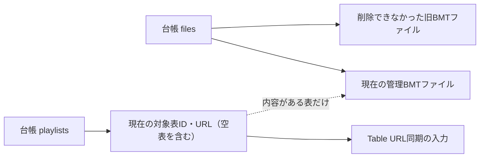
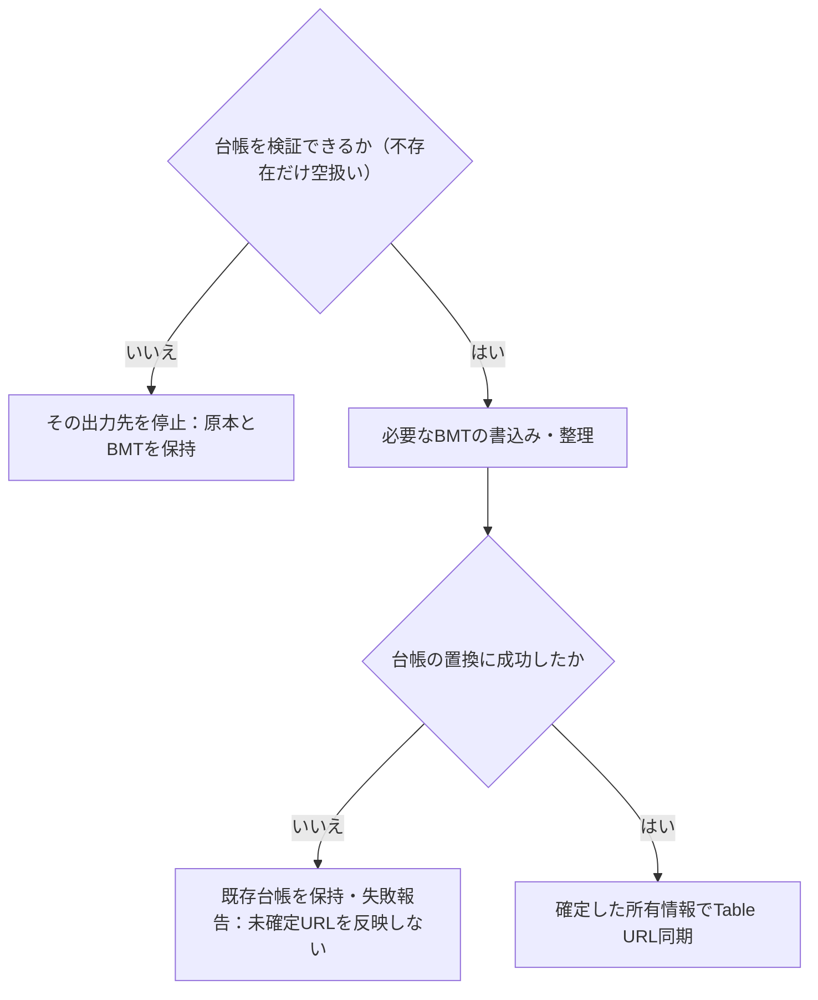

# beatoraja向けBMT出力

## 目的と適用範囲

プレイリストのBMTファイル、管理台帳、beatorajaのTable URL登録を定めます。LR2連携の有無には依存しません。

## 用語

[共通用語集](../glossary.md)を参照します。コードの識別子は原表記を使います。

## 仕様

設定変更時の準備・採用・整理の契約は更新済みです。実装・旧保証テストの置換が未完了の範囲は[リリース前の必須修正](../../plan/release-blocking-fixes.md)で管理します。

### 有効条件と場所

`EnableBeatorajaBmtOutput` が有効で、ルートに `config_sys.json` と `beatoraja.jar` または `beatoraja.exe` がある場合に出力します。出力先は `tablepath` から求め、相対ならbeatorajaルートを基準にします。派生値の `BeatorajaBmtTablePath` は画面から直接編集しません。スコアは確定ルートの `playerpath` と選択IDから独立して解決し、スコア操作からBMT出力先を解決・保存しません。

対象は `is_bmt_output=true` の表です。全出力では対象外の管理ファイルとURLを除きます。これは、全体設定を無効にしたとき既存出力を残す `KeepBeatorajaBmtFilesWhenOutputDisabled` とは別です。

### 形式とハッシュ

BMTはgzip圧縮したUTF-8 JSONです。URLのSHA-256に `.bmt` を付けたファイル名を使います。

表・フォルダ・譜面・コースの名前は、日時に見える場合もJSONの文字列として原文を保持します。コースJSONの再解析とgzipキャッシュの読戻しで日時への自動変換を行いません。
外部 `config_sys.json` の任意文字列も同様に保持し、Table URL同期でplayer名や未知キーを日時へ変換しません。

| 項目 | 内容 |
| --- | --- |
| `url` | 外部表はページURL、なければ絶対ヘッダーURL。ローカル表は `bemusicseeker://playlist/{playlist_id}`。 |
| `name` / `tag` | 表名と、tag・symbol・互換接頭辞の順に解決したタグ。 |
| `folder` | 有効な譜面を持つフォルダだけ。外部表の名前は解決したタグ＋互換レベル、ローカル表は既存名。 |
| `course` | 元ヘッダーのコースをbeatorajaの形へ変換する。制約を `MIRROR`、`GAUGE_LR2`、`LN` 等へ対応させ、検証条件に合わないトロフィーは除く。 |

譜面にはタイトルとMD5/SHA-256の少なくとも一方が必要です。対応範囲で `artist`、`url`、`appendurl`、`ipfs`、`appendipfs`、`org_md5` を出します。コースのハッシュは元ヘッダーの値だけを使います。

| `BeatorajaBmtHashOutputMode` | 譜面のハッシュ出力 |
| --- | --- |
| `Original`（既定） | DBに保存された値だけ。 |
| `FillMissingMd5Sha256` | 保存値を優先し、選択された照合キーで所持譜面・譜面情報を解決できる場合だけ不足する対の値を出力上で補う。 |
| `PreferSha256Only` | SHA-256を出せる場合はMD5を省く。解決できないMD5行は落とさずMD5で出す。 |

MD5とSHA-256が別譜面を指す場合はMD5を正本とし、危険な対の補完をしません。補完値を元DBへ書き戻しません。フォルダとコースが両方空ならBMT本体は出しませんが、対象表としてのURL所有権は台帳に残します。

### 順序と出力契機

生成内容の意味を変更した場合は既存の `exporterVersion` を更新します。旧生成版の管理BMTは同じ入力指紋でも通常出力で一度再生成し、現行生成版で入力と実ファイルが未変更なら以後の生成・書込みを省略します。別の移行台帳や全件強制出力の状態は持ちません。

表の順序は `bmt_sort` 昇順です。未正規化の同値・欠損は名前とIDで解消します。順序だけの変更はURL同期だけを行い、BMT本体を書き直しません。個別出力可否の変更はその表だけを出力・削除します。

起動・`ReloadTablesAsync`・復元では必須の譜面読込み・出力修復を直接待ち、保存済みプレイリストに対して管理対象の集合と実ファイルの状態を揃えます。表が0件でも不要な管理ファイルを整理します。外部更新の既知変更・ハッシュ初期化、ローカル保存、譜面行保存、BMT内容に影響するプロパティ変更では対象を出力します。

LR2出力先、ルート型、LR2出力種類だけの変更ではBMTを再生成しません。BMTの有効状態・出力先変更は全出力と旧先の整理を行いますが、無効化時の保持設定が有効ならファイル・台帳・URLを残します。BMT組の局所確定と同値の明示再更新は全表へ再生成を要求し、必要出力とTable URL反映の完了を待ちます。未変更判定による生成省略を適用せず、最新入力の再保存を許容し、成功済み工程を省略するための段階を持ちません。確定済み環境の初回開始も初期化の必要BMTへ全表投影を要求します。無関係な通常項目の保存はBMTを開始しません。出力無効時は既存の保持・整理条件に従います。表削除はその表の管理ファイルとURLだけを外します。

beatorajaディレクトリの有効な選択は、保存済みBMT方針で新先を準備してから設定を採用し、必要なscore処理とBMTのURL反映・旧先整理を同じ受理Taskで回収します。未確定BMT候補を混ぜず、BMTのURL・整理失敗で採用済みrootのscore処理を飛ばしません。score操作やその次の変更からBMTを再開しません。操作と保存の正本は[設定](../runtime/settings.md#beatorajaの局所反映)です。

BMT確定は確定rootと自身の候補だけを使い、score使用・playerの不備や別候補には依存しません。外部configの`tablepath`は今回の明示操作で解決し、操作中の入力を後から書き換えません。同じ物理先の形式変更・明示再更新は現在設定と保存済み正本から再生成し、途中生成物の完全復元や過去要求の再開を保証しません。生成失敗を通知し、必要なら既存の変更・再更新ボタンを案内します。無効化時に保持ONなら、現行どおりファイル・管理情報・管理URLを残します。

出力無効時の通常の編集・削除・順序変更はBMTのI/Oを行いません。無効化を保存する明示的な全体出力だけが保持設定に従って既存出力を整理します。保持設定が有効なら読取不能の台帳にも通常編集を依存させません。

全出力の進捗は実際に内容を生成・圧縮する表を対象にします。未変更で生成0件、整理・URL同期だけの場合に架空の0/1進捗を出しません。

異なる物理先AからBへの変更は、Bの必要ファイル・管理情報の準備、user.config保存によるB採用、管理URL切替、Aの管理ファイル整理の順にします。準備失敗ならAを維持し、Bの部分生成物残存を通知できます。B採用後のURL失敗はBを維持した部分失敗とし、Aのファイル整理へ進みません。旧URLが有効なまま残ることは、ファイル残存と別に通知します。URL切替後のA整理失敗はB維持の残存警告で操作を終えます。旧要求・成功段階を後続変更へ持ち越さず、A→B失敗後のCも最新入力から処理します。過去の全旧先を後で自動回収する保証は設けません。

### 管理台帳と未変更判定

出力先直下の `.bemusicseeker-bmt-manifest` を使い、`.json` は付けません。`files` は物理ファイルの所有、`playlists` は表IDとURLの所有を示します。表名・URL、ヘッダー・データハッシュ、更新日時ticks、出力に関係する入力の指紋、実ファイル名・更新時刻・サイズを保持します。

スキーマ版2ではこれらが一致する場合、内容生成とgzip書込みを省略します。入力指紋は、タグ解決結果、外部同期扱い、互換接頭辞、フォルダ順、コースJSONから作ります。ハッシュ出力方式や所持索引によるハッシュ解決結果は含めません。旧 `contentHash` は使わず、旧台帳のファイル・URL所有情報を保持して通常出力で現行形式へ移します。

空表はURLだけを記録し、有効な内容が得られたら同じIDへファイルを付けます。URL変更でファイル名が変わる場合は、新しいものを管理し、他表が参照しない旧ファイルを整理します。同名ファイルは管理外でも上書きし、それ以後管理対象にします。

#### ファイルとURLの所有を分ける

台帳内の所有関係を示します。矢印は所有・登録元の参照であり、書込み順ではありません。表が空であることやファイル削除の失敗だけでは、ファイル所有とURL所有が同じ状態になるとは限りません。

### 整理と失敗

削除するのは台帳にあるBMTだけで、管理外ファイルを走査して削除しません。全出力では別プロファイル由来も含め現在集合へ揃えます。変更表だけの部分出力は既存の表・URL所有へ変更を適用し、無関係な所有を消しません。旧URLのファイルは残る共有参照がなければ整理します。空の部分変更も全量更新へ読み替えません。`files` は現在ファイルに加え削除できなかった旧ファイルを保持し、`playlists` は現在の対象へ更新します。全削除の部分失敗ならURL所有権を空にし、未削除ファイルを残します。設定変更でURL切替に成功した後は今回の旧先だけを整理し、残留を通知します。後続操作へ旧先の回収履歴を持ち越しません。

`RemovedCount` は削除完了件数で、不存在も含みます。失敗、共有参照により残したもの、台帳自体の削除は含みません。存在確認のfalseを削除成功とみなさず、削除操作の結果で判定します。

台帳は同じディレクトリの一時ファイルから置換し、失敗時は既存内容を保持します。直接上書きへ切り替えません。台帳がない場合だけ空と扱い、読取不能、構文破損、不正構造、非対応版は原本とBMTを保持してその出力先を停止します。検証は新規BMT作成より先で、一部だけを救出しません。

| 台帳入力 | 許可条件 |
| --- | --- |
| 最上位 | オブジェクト。`files` 配列は必須、`playlists` オブジェクトは省略可能。 |
| `schemaVersion` | 省略なら0、明示する場合は整数0・1・2。 |
| ファイル名 | 非空の出力先直下BMT名。パス成分を勝手に切り捨てず、不正なら拒否する。大小文字を無視して重複をまとめる。 |
| 表の要素 | 非空キー、オブジェクト値、非空URL。`file` の省略・null・空文字はURLのみ。参照ファイルも物理台帳へ含める。 |
| その他 | 重複プロパティは拒否。未知の追加情報は許可。既知の任意項目は省略・nullを許すが値があれば宣言した型が必要。`exporterVersion` の違いは未変更判定の不一致であり、非対応スキーマではない。 |

部分削除・読取り・保存失敗は対象と原因を変更不能な結果へまとめ、出力ロックと台帳ロックを抜けてから既存のプレイリスト通知へ渡します。必要出力は変更元の同じTaskで待ち、出力失敗を元の操作結果へ返します。受付の保持点は[競合ポリシー](../core/operation-concurrency-policy.md#プレイリストと必要出力)に従います。台帳保存前に変更したBMTを戻す複数ファイルのトランザクションや、永続的な再試行キューは持ちません。

#### 台帳確定とURL公開の順序

矢印は出力先一つの処理順です。ファイル変更、台帳置換、beatoraja設定へのURL反映は一括トランザクションではありません。

### Table URL同期

順序だけのURL同期は確定した台帳を読み、configの管理URL順を反映する専用経路です。BMT生成・削除・台帳保存は行わず、台帳が読取り可能なら置換不能でも成立します。出力を伴うURL同期も、確定した台帳の所有情報から行い、物理書込み・削除0件でも省略しません。構成ファイルの読取り・書込み失敗は必要出力の部分失敗として元の操作へ返します。生成済みBMT・確定済みDBを戻さず、元の原因を保持し、次の明示操作で新しい入力を捕捉します。台帳の読取り・保存に失敗した操作では、未確定のURL所有権を反映しません。

出力有効の既存beatorajaルートでは、構成ファイルの破損・読取不能を表示用の無効判定や既定設定へ置換しません。必要同期は対象の構成ファイルパスと元原因を実通知へ渡し、その終端まで変更元のPを保持します。出力無効の通常変更は構成ファイルの読取りにも依存せず、未指定ルートの明示出力先と対象外ルートの従来の無作用は維持します。

`RegisterBeatorajaBmtUrls` が有効なら、既存配列から前回の管理URLを除き、管理外URLの順序を先頭側に保って、現在の管理URLをBMT順で末尾へ追加します。空表のURLも管理対象です。現在の表一覧に見つからない台帳要素は既知の表の後ろへ名前・ID順で並べます。登録設定が無効なら前回管理URLを外します。

設定による異なる物理先A→Bは、Bの必要ファイル・管理情報を準備し、user.config保存成功でBを採用した後、管理URLを切り替えてからA管理ファイルを整理します。準備・設定保存失敗ではAの設定・URL・ファイルを維持し、Bの部分生成物は残ることがあります。同rootの旧新URLは一回の原子的同期、別rootはB登録成功後にA解除とします。URL切替失敗ではB採用を維持し、旧URLがまだ有効な可能性をファイル残存と区別して通知し、Aのファイルは整理しません。整理だけの失敗はB採用・URLを維持し、残存を通知して終了します。同じ物理先は旧先として削除しません。無効化の保持ONはファイル・台帳・管理URLをすべて保持します。保持OFFはURL除去成功後にファイルを整理し、物理残存からURL所有を復活させません。今回の管理URL集合がある非空rootについて、実行ファイル等の欠落で共通同期が対象外となった場合もURL未反映の部分失敗とし、旧管理ファイルを保持します。共通同期の対象外での無作用は維持し、旧root未指定・URL所有なし・保持ONへ不要な同期を要求しません。

beatorajaの登録URL取込みでは成功・既存一致した表を元URL順でBMT順の先頭へ反映します。失敗URLは管理外として残します。詳細は[Table URL取込み](table-url-import.md)を参照します。

起動の保存済み表の必要出力は、最小カタログと必要譜面情報・ハッシュの準備後、親L/P内で直接待ちます。外部ネットワーク同期は親受付解放・操作解禁後です。全体LR2が必要なら修復と共通の生成・検証経路から完全な面を一度だけ返します。開始・更新・全終端は空でない発生元と同じ親関係を持つ要求識別で通知し、BMTはschedulerの暗黙実行文脈を参照しません。カスタム修復のfinallyにも同じ要求を渡します。実出力の接続は[`StartupRequiredInitializationTests`](../../../BeMusicSeeker.Tests/Startup/StartupRequiredInitializationTests.cs)、BMTの生産側通知は[`BmsPlaylistMigrationAndRegistrationTests`](../../../BeMusicSeeker.Tests/Playlist/BmsPlaylistMigrationAndRegistrationTests.cs)で確認します。

進捗要求の生成・開始・終了、件数進捗、性能ログ、失敗報告コールバックは任意通知です。その失敗は局所診断に留め、実BMT・台帳・設定の成功や取消しを変更せず、通知だけのために未完了出力を作りません。実ファイル・設定の失敗は引き続き必要出力の失敗とし、確定済みDBと出力の事実を保持します。

## 実装とテストの対応

| 仕様項目・主な条件 | 実装箇所 | テスト箇所・確認内容 |
| --- | --- | --- |
| 形式・ハッシュ・空表・未変更判定・台帳破損・削除失敗 | [`BmtTableExportService`](../../../BeMusicSeeker/Models/Playlist/BmtTableExportService.cs) | [`BmtTableExportServiceTests`](../../../BeMusicSeeker.Tests/Playlist/BmtTableExportServiceTests.cs) |
| 日時風の任意名と生成意味の更新 | `BmtTableExportService`、[`BeatorajaBmtTableImportService`](../../../BeMusicSeeker/Models/Playlist/BeatorajaBmtTableImportService.cs)、[`BeatorajaConfigService`](../../../BeMusicSeeker/Models/Settings/BeatorajaConfigService.cs) | `BmtTableExportServiceTests.ExportTable_ExternalTableWritesBeatorajaBmtShape` はコース再解析から実gzipまで、`BeatorajaBmtTableImportService_LoadCachedTable_RestoresTableWithConfigRawUrl` は実cacheから表・所属・コースまで文字列原文と型を確認する。`BeatorajaConfigService_SyncTableUrlsPreservesUnmanagedAndReplacesManaged` は実config更新後の任意文字列と管理外URL順、`ExportTableDataSet_SkipsUnchangedManagedPlaylistWrites` は旧生成版の一度の再生成と以後の省略を確認する。 |
| 必要出力の直接待機・URL同期・0件・元操作の部分失敗 | [`BMSPlaylist`](../../../BeMusicSeeker/Models/Playlist/BMSPlaylist.cs) | [`BmsPlaylistCustomFolderOutputTests`](../../../BeMusicSeeker.Tests/Playlist/BmsPlaylistCustomFolderOutputTests.cs)、[`BmsPlaylistMigrationAndRegistrationTests`](../../../BeMusicSeeker.Tests/Playlist/BmsPlaylistMigrationAndRegistrationTests.cs) |
| 部分変更・全量現在集合・無効保持・明示整理、置換不能台帳の順序同期 | [`PlaylistBmtOutputOwner`](../../../BeMusicSeeker/Models/BmsLibraryInternal/Playlist/PlaylistBmtOutputOwner.cs) | [`BmsPlaylistMigrationAndRegistrationTests.BeatorajaBmtOperations_PreserveUnchangedOwnershipAndSeparateUrlSyncFromOutput`](../../../BeMusicSeeker.Tests/Playlist/BmsPlaylistMigrationAndRegistrationTests.cs) が実SQLite・台帳・gzip・configで未変更表と管理外データを確認する。 |
| 台帳確定後の物理削除失敗とURL所有解除、報告中のP保持・終了回収、台帳未確定時のURL非公開 | [`PlaylistBmtOutputOwner`](../../../BeMusicSeeker/Models/BmsLibraryInternal/Playlist/PlaylistBmtOutputOwner.cs) | [`BmsPlaylistMigrationAndRegistrationTests`](../../../BeMusicSeeker.Tests/Playlist/BmsPlaylistMigrationAndRegistrationTests.cs) の `BeatorajaBmtOwnershipRelease_PublishesCommittedUrlsDespiteDeleteFailure` が通常削除と無効全整理の実台帳・config・残存媒体を確認し、`BeatorajaBmtFailure_ReportsTargetAndCauseWithinAcceptedOperation` が台帳読取・保存失敗時のconfig不変と元原因を確認する。下位のfiles/playlists分離は `BmtTableExportServiceTests.ManagedCleanupFailure_RetainsPhysicalOwnership` が引き続き担当する。 |
| BMT組の局所確定・同値再生成、正本と管理外データの保全 | 設定の局所確定、`PlaylistBmtOutputOwner` | [`SettingDialogEditCompletionTests.BmtSettingsAdoption_PreservesAdoptedMediaAndAllowsCurrentNextInput`](../../../BeMusicSeeker.Tests/Settings/SettingDialogEditCompletionTests.cs) が同先の方式変更・外部破損後の明示再更新、管理外file/URL順、実SQLiteの元hashを確認する。下位形式行列は `BmtTableExportServiceTests` が分担する。 |
| 新先準備・設定採用・URL切替・旧先整理の失敗境界 | 設定の局所確定、BMT担当、`BeatorajaConfigService` | 同 `BmtSettingsAdoption_PreservesAdoptedMediaAndAllowsCurrentNextInput` が実BMT置換/manifest/user.config/config/削除の共有拒否を分け、fresh設定、採用時の媒体、同root/別root URL、保持ON/OFF、準備・URL・整理失敗後の最新Cを確認する。score使用ONのroot準備/設定保存失敗も旧root採用を維持する。実行ファイルだけを失った旧rootでの無効化/別root移行、保持ON・URL所有なし・旧root未指定も同じ条件表で区別する。同root一回同期への旧新集合の接続は局所コード確認、原子的置換の原本保持は既存 `BeatorajaConfigService_SyncTableUrlsPreservesUnmanagedAndReplacesManaged` が分担する。 |
| 通知故障と実出力結果の分離 | [`PlaylistBmtOutputOwner`](../../../BeMusicSeeker/Models/BmsLibraryInternal/Playlist/PlaylistBmtOutputOwner.cs) | [`BmsPlaylistMigrationAndRegistrationTests.RegisteredBatch_AwaitsActualBmtOutputAndPreservesCommittedDatabaseOnOutputFailure`](../../../BeMusicSeeker.Tests/Playlist/BmsPlaylistMigrationAndRegistrationTests.cs)で通知故障時の実BMT・台帳・設定成功と、実台帳失敗時のDB保持を確認する。[`BmtTableExportServiceTests.OrderedProjectionProgressPublisherSerializesCallbacksInCompletionOrder`](../../../BeMusicSeeker.Tests/Playlist/BmtTableExportServiceTests.cs)で先行通知故障後も後続通知を直列に試みる。 |
| 順序四入口のDB・サマリー・configと同じP寿命、無変更、取込み後配置 | [`PlaylistWorkspaceViewModel`](../../../BeMusicSeeker/ViewModels/Playlist/PlaylistWorkspaceViewModel.cs) | [`PlaylistWorkspacePersistenceCommandTests.BmtOrderCommands_CompleteDatabaseSummaryAndConfigInOneAcceptedTask`](../../../BeMusicSeeker.Tests/Playlist/PlaylistWorkspacePersistenceCommandTests.cs)、[`PlaylistWorkspaceExternalSourceTests.BeatorajaTableUrlImport_ExistingTablesKeepInputFrontOrderAndRemainingRelativeOrder`](../../../BeMusicSeeker.Tests/Playlist/PlaylistWorkspaceExternalSourceTests.cs)。画面の選択・Bindingは既存 [`MainWindowPlaylistWorkspaceWpfTests`](../../../BeMusicSeeker.Tests/MainWindow/MainWindowPlaylistWorkspaceWpfTests.cs) が分担する。 |
| 順序と一括編集 | [`PlaylistWorkspaceViewModel`](../../../BeMusicSeeker/ViewModels/Playlist/PlaylistWorkspaceViewModel.cs) | [`PlaylistSummaryBulkEditTests`](../../../BeMusicSeeker.Tests/Playlist/PlaylistSummaryBulkEditTests.cs)、[`PlaylistWorkspacePersistenceCommandTests`](../../../BeMusicSeeker.Tests/Playlist/PlaylistWorkspacePersistenceCommandTests.cs) |
| 構成ファイルの解析・読取り・置換失敗、通知中のP保持、修復後の明示同期、無効保持falseの通常順序保存 | [`PlaylistBmtOutputOwner`](../../../BeMusicSeeker/Models/BmsLibraryInternal/Playlist/PlaylistBmtOutputOwner.cs)、[`BeatorajaConfigService`](../../../BeMusicSeeker/Models/Settings/BeatorajaConfigService.cs) | [`PlaylistWorkspacePersistenceCommandTests.BmtOrderConfigFailure_KeepsCommittedOrderAndAdmissionThroughNotification / BmtOrderDisabled_SavesOrderWithoutReadingLockedConfigOrManifest`](../../../BeMusicSeeker.Tests/Playlist/PlaylistWorkspacePersistenceCommandTests.cs)。四成功入口と保持trueは既存のworkspace・ownerケースが分担する。 |

## 関連資料

[正本の保存](storage-and-export.md)、[Table URL取込み](table-url-import.md)、[一覧操作](../ui/table-view.md)を参照します。
