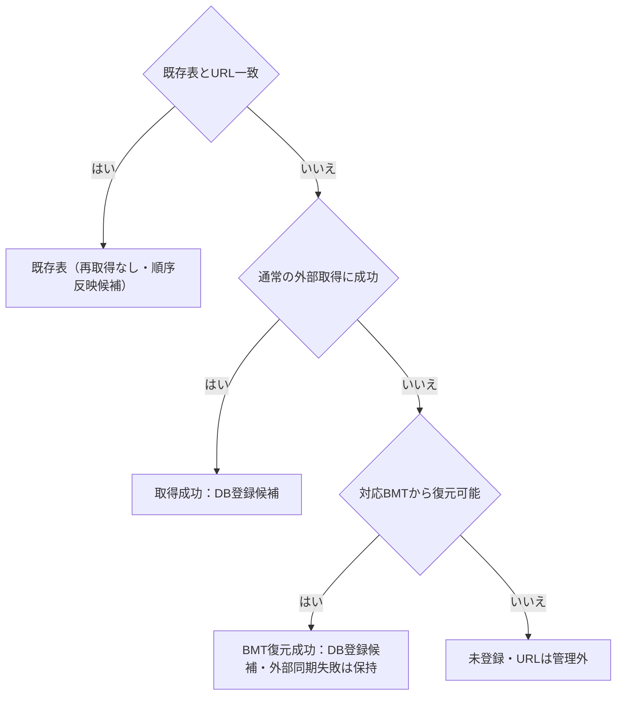

# beatorajaのTable URL取込み

## 目的と適用範囲

beatorajaに登録した難易度表URLを、プレイリストとBMT出力の管理へ取り込む契約を定めます。

## 用語

[共通用語集](../glossary.md)を参照します。コードの識別子は原表記を使います。

## 仕様

通信前の受付と必要出力の終端は[競合ポリシー](../core/operation-concurrency-policy.md#プレイリストと必要出力)に従います。

### 入力と実行順

設定の確定済み `BeatorajaRootPath` を使います。別rootの候補がある場合は破棄確認し、取消・検証不成立・実P受付拒否では元候補を保持します。実受付と最終検査後にroot候補だけを確定値へ戻し、他セクションの候補は保持します。設定Windowは実取込みTaskの終端までClose・同再操作を拒否します。`config_sys.json` の `tableURL` から文字列を順序付きで読み、空文字を除き、同じ絶対URLは先頭だけを採用します。絶対URIとして解釈できない値は失敗件数へ含めます。

確認後、既存表のページURLまたは絶対ヘッダーURLとの一致を調べます。一致する表は再取得せず順序反映だけの対象とします。未登録URLは通常の外部表取得を試み、失敗時は既存の受付条件で対応BMTキャッシュから復元します。日時方針は[保存と出力](storage-and-export.md#実装とテストの対応)に従い、URL初回はCompatibleで任意日時の不適合だけを省略して全採用行を保ち、古いBMTへ戻しません。ローカルJSON初回だけはStrictとし、不適合な採用日時を型付きheader/data原因で識別して、有効cacheがあっても復元せず保存前に止めます。既存のUI訂正要求、独立した他表の登録、既存表、URL順と所有規則を保持します。

外部取得は通常再読込みと同じ上限で並列化します。取得後に元URL順へ戻し、DB登録、重複名解消、表示集合、参照、URL補完、BMTの実出力と終端をまとめて進めます。DBと表示の変更は並列化しません。進捗はURL取得だけでなく登録・参照・順序反映・完了処理を含みます。

取得・BMT復元の登録候補は、実storeから捕捉した動作モードで検査します。LR2連携時だけ、LR2用の出力名が空になる対象をURL単位の失敗にし、同じ要求の正常表は登録・必要出力を続けます。スタンドアロンではこの出力名を使わないため、`한글` のようなUnicode実名も改名・翻字せず登録します。表名・タグ・譜面所属と元URLはDB読戻し・BMT出力まで保持し、同URLの再取込みは既存一致として同一IDを使います。

#### 一致・取得・復元の分岐

StrictのローカルJSON初回で日時不適合になった対象を除き、一URLの取得元選択と、既存表またはDB登録候補へ振り分けるまでを示します。矢印は判定・処理順です。外部取得は上限内で並列化できますが、DB登録・参照更新・順序反映の成否はこの図に含めません。

BMTからの復元はこの入口で規定した経路だけです。取得成功した空表も対象で、URL所有権は[BMT出力](bmt-export.md#ファイルとurlの所有を分ける)に従います。

### URLと順序の保持

成功または既存一致した表を元の `tableURL` 順でBMT順の先頭へ並べます。本アプリだけの表は現在の相対順を維持して後ろへ置きます。衝突・先頭側・無効な順序だけを必要に応じて移し、毎回全表を密に再採番して保存しません。

この入口だけは `Uri.AbsoluteUri` で正規化した文字列でなく、設定に書かれた生のURLをページURLまたは絶対ヘッダーURLとして保持します。BMT内のURLが異なっていても設定側を正本にします。既存表の補正は表の書込みロック内で行い、変更分をまとめて保存します。通常のURL指定取込みとプロパティ編集は、引き続き正規化済みURLを保存します。

### キャッシュからの復元

検索するファイル名は、生の設定URLのSHA-256＋`.bmt` です。表名、タグ、フォルダ・譜面・コースを復元し、譜面の `title`、`artist`、`md5`、`sha256`、`url`、`appendurl`、`org_md5` を引き継ぎます。直接DBへ書かず、合成したヘッダー・データJSONを常にCompatibleを明示した `LoadHeaderJSON` / `LoadDataJSON` へ渡します。BMT readerが採用していない日時fieldを新しく転送せず、元操作の日時方針を継承しません。

非数値のフォルダ所属も保持し、数値を抽出できない所属の `level` はnullにします。合成JSONでは `folder` と明示nullを含む `org_level` を渡し、数値所属との混在や同じhashの異なる所属を保ちます。通常登録・DB保存・読戻しでも所属とnullable levelを維持し、BMT再出力では各フォルダへ所属を引き継ぎます。

すべてのフォルダ名がタグで始まる場合はタグを互換接頭辞とし、再出力時の二重付与を防ぎます。統一されていなければ空の接頭辞とし、元のフォルダ名を保持します。

この入口では同名表を `name(1)`、`name(2)` のように改名して登録できます。通常のURL指定取込みの同名拒否とは区別します。

### 結果と出力管理

結果は元の入力対象順に確定します。対象の参照更新警告はその対象の主結果に続け、既存一致・取得失敗・新規登録の処理段階で順序を変えません。管理表の先頭配置も成功・既存表を元対象へ対応付けた順で共通並べ替えへ渡します。

DB登録後の一括参照通知に失敗した場合、登録済み対象の成功結果と件数を維持し、同じ元例外を保持したWarningを各対象の主結果に隣接して追加します。警告のURIと表名は対応する主結果と一致し、既存一致・取得失敗の結果を置き換えません。

キャッシュから復元できた場合、取込み結果は「BMTから復元」の成功です。ただしサマリーのSTATUSは外部同期の結果なので、元URLの404・403・HTTP・NETWORK等の失敗を表示します。取得・復元とも失敗したURLは登録せず、管理台帳にも含めません。元のURL配列では管理外として先頭側に順序を保ちます。

取得成功した空表は登録します。BMT本体は出せなくてもURLの所有権を台帳へ残し、BMT順の対象にします。後で内容が得られたら同じIDのファイルを出し、削除・出力対象外化ではURL所有権も外します。

BMT出力を無効から有効へ切り替える際、有効なbeatorajaルートに未取込みURLがあれば先に取込みを勧める確認を出します。利用者が続行すれば出力を有効にします。

## 実装とテストの対応

| 仕様項目・主な条件 | 実装箇所 | テスト箇所・確認内容 |
| --- | --- | --- |
| 確定root・候補破棄確認・実受付とWindowの寿命 | [`SettingsWindow`](../../../BeMusicSeeker/Views/Settings/SettingsWindow.cs)、[`PlaylistWorkspaceViewModel.BeatorajaTableUrlImport`](../../../BeMusicSeeker/ViewModels/Playlist/PlaylistWorkspaceViewModel.BeatorajaTableUrlImport.cs) | `SettingDialogEditCompletionTests.BeatorajaTableUrlButton_DeliversConfirmedRootToWorkspace` は実buttonで確認取消/P拒否時の候補保持、確定rootの既存URL、受理後の関係候補だけの破棄、実取込みTask終端前のClose/同再操作拒否を確認する。 |
| 取得・既存一致・復元・生URL・重複名・失敗集計 | [`BMSPlaylist`](../../../BeMusicSeeker/Models/Playlist/BMSPlaylist.cs) | [`BmsPlaylistMigrationAndRegistrationTests`](../../../BeMusicSeeker.Tests/Playlist/BmsPlaylistMigrationAndRegistrationTests.cs) |
| 実storeのモード別出力名検査・Unicode実名と成功分の登録 | [`PlaylistWorkspaceViewModel.BeatorajaTableUrlImport`](../../../BeMusicSeeker/ViewModels/Playlist/PlaylistWorkspaceViewModel.BeatorajaTableUrlImport.cs) | `PlaylistWorkspaceExternalSourceTests.StartBeatorajaTableUrlImport_NewTablePublishesOwnedProgressAndSuccessfulSummary` はスタンドアロンのUnicode実名・ASCIIタグを実DB・実gzipの曲集合と元URL・管理台帳・config登録まで照合する。`StartBeatorajaTableUrlImport_Lr2ModeRejectsOnlyEmptyOutputNameAndImportsValidTable` はWorkspaceと異なる実storeのLR2モードで対象別失敗と正常表の保存・実出力・元URL順を担う。登録本体のモード×単表・一括の検査は `BmsPlaylistMigrationAndRegistrationTests.ExternalTableRegistration_EmptyDerivedOutputNameUsesCapturedMode` へ分担する。 |
| キャッシュ復元の非数値所属・nullable level・同hashの別所属 | [`BeatorajaBmtTableImportService`](../../../BeMusicSeeker/Models/Playlist/BeatorajaBmtTableImportService.cs) | [`BmtTableExportServiceTests`](../../../BeMusicSeeker.Tests/Playlist/BmtTableExportServiceTests.cs) の `BeatorajaBmtTableImportService_CreateTable_PreservesMembershipsAndNullableLevels` は、共通タグの非数値二所属とタグなし数値混在を実JSON変換・解析後のhash/所属/level集合で確認する。既存の `BeatorajaBmtTableImportService_LoadCachedTable_RestoresTableWithConfigRawUrl` は数値level・実gzip・属性・コース・生URLを担い、一般JSONのnull・受理範囲は既存の `BMSTableLoadTests` へ分担する。 |
| BMT復元から通常登録・保存・読戻し・再生成への接続 | [`PlaylistWorkspaceViewModel.BeatorajaTableUrlImport`](../../../BeMusicSeeker/ViewModels/Playlist/PlaylistWorkspaceViewModel.BeatorajaTableUrlImport.cs)、[`BMSPlaylist`](../../../BeMusicSeeker/Models/Playlist/BMSPlaylist.cs) | [`PlaylistWorkspaceExternalSourceTests`](../../../BeMusicSeeker.Tests/Playlist/PlaylistWorkspaceExternalSourceTests.cs) の `StartBeatorajaTableUrlImport_CachedNonnumericMembershipsSurvivePersistenceAndReexport` はloopback HTTP 404からUnicode実名の実gzipを復元する一例。復元成功と外部同期失敗STATUSを区別し、実名・タグ・同hashの非数値二所属・数値一所属を登録モデル、新しいreadonly DB接続、通常DB読戻し、実BMT再生成で確認する。levelはモデルとDB、BMTは所属とhashを観測する。設定URLと異なる元cacheおよび再生成前のファイル除去により、既存ファイル残存だけの成功を防ぐ。取得元の終了後も再取込みは既存一致となり、同一IDと保存内容を保持する。実取込みTask・サマリー通知と残余Taskを回収し、購読・store/library・HTTP・一時領域を解放する。 |
| 混合対象の実取込み・日時方針・BMT復元境界と終端 | [`PlaylistWorkspaceViewModel.BeatorajaTableUrlImport`](../../../BeMusicSeeker/ViewModels/Playlist/PlaylistWorkspaceViewModel.BeatorajaTableUrlImport.cs) | `PlaylistWorkspaceExternalSourceTests.StartBeatorajaTableUrlImport_NewTablePublishesOwnedProgressAndSuccessfulSummary` は通常成功・既存一致・通常取得失敗・順序・ID/所属・管理台帳/config/管理外BMT・通信中Busyと進捗・実Task終端を担う。日時は別の `StartBeatorajaTableUrlImport_InvalidOptionalDatesKeepExternalRowsAndStrictLocalCacheBoundary` へ分担し、有効cacheがあるURLのheader/data不適合でも外部全行を保存し、Strictのlocal JSON初回は復元せず拒否する。`StartBeatorajaTableUrlImport_CachedNonnumericMembershipsSurvivePersistenceAndReexport` は404の実gzip復元・DB・再出力と404 STATUSの対照を維持する。BMT readerのCompatible接続は静的確認し、現在転送しない日時fieldのためのtestは加えない。日時の文法・診断・通常取込/再取得は[保存仕様](storage-and-export.md#実装とテストの対応)へ分担する。 |
| 順序と台帳・設定URL同期 | [`BMSPlaylist`](../../../BeMusicSeeker/Models/Playlist/BMSPlaylist.cs) | [`BmsPlaylistCustomFolderOutputTests`](../../../BeMusicSeeker.Tests/Playlist/BmsPlaylistCustomFolderOutputTests.cs) |

## 関連資料

[BMT出力](bmt-export.md)、[プレイリスト保存](storage-and-export.md)を参照します。
