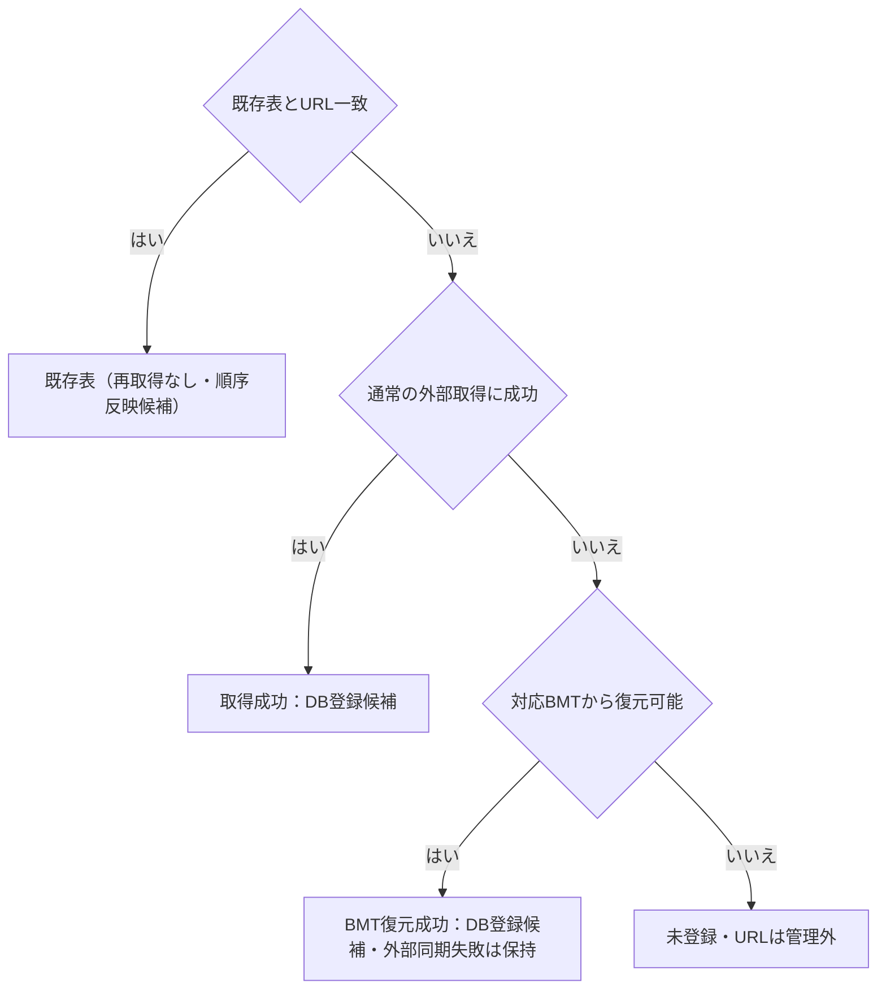

# beatorajaのTable URL取込み

## 目的と適用範囲

beatorajaに登録した難易度表URLを、プレイリストとBMT出力の管理へ取り込む契約を定めます。Pは、[操作の競合ポリシー](../core/operation-concurrency-policy.md)が定めるプレイリスト正本と必要な管理出力の変更受付です。

## 用語

[共通用語集](../glossary.md)に従います。

## 仕様

通信前の受付と必要出力の終端は[競合ポリシー](../core/operation-concurrency-policy.md#プレイリストと必要出力)に従います。

### 入力と実行順

設定で確定済みの `BeatorajaRootPath` を使います。取込みの終端までは同じ操作の再実行を拒否し、設定ウィンドウの通常の閉鎖と再表示は許可して、同じ取込みTaskを保持します。別のルート候補の破棄の確認、Pの受付、処理の寿命は[設定の補助操作](../runtime/settings.md#補助操作の対象受付閉鎖)に従います。

`config_sys.json` の `tableURL` から文字列を順序付きで読み、空文字を除き、同じ絶対URLは先頭だけを採用します。絶対URIとして解釈できない値は失敗件数へ含めます。

確認は、受付（P）を取得する前に、プレイリストの窓口で待ちます。確認が未完了の間は受付を保持せず、取消と表示の失敗では取込みを開始しません（表示の失敗は承認にも取消にも読み替えず、診断へ残して Error の通知を一件出します）。

受付を取得した後に決まる通知（最終のルート検証の失敗・URLなし・有効なURLなし）と、取込み中に確定した操作通知、結果の要約は、受付を解放した後に、同じ窓口へ依頼します。通知は見出しと重要度ごとに一件へまとめ（[プレイリスト側の操作通知](../ui/dialogs.md#プレイリスト側の操作通知)）、要約は通知の後に続けます。Ownerは窓口の解決に任せます。要約は、標本を各節最大5件とし、超えた分は「- ...」で示します。通知と要約の表示は任意であり、失敗しても診断へ残すだけで、取込みの結果と残りの表示を変えず、終了の要求後は表示しません。取込みのTaskは、終了の判定と最初の依頼までを含んで完了し、表示の完了は待ちません。結果は、取込みを開始した場合の要約です。確認の取消や開始前の拒否、受付後の早い終了では結果はありません。

確認後、既存表のページURLまたは絶対ヘッダーURLとの一致を調べます。一致する表は再取得せず、順序の反映だけを行います。未登録URLは通常の外部表取得を試み、失敗時は既存の受付条件で対応するBMTキャッシュから復元します。

JSONの日時は[JSON日時の読取り](storage-and-export.md#json日時の読取り)の方針で読みます。この入口では、方針の違いがBMTキャッシュからの復元にも及びます。

| 取得元 | 方針 | 日時が不適合な場合 |
| --- | --- | --- |
| URLからの初回取込み | `Compatible` | その日時だけを省略し、採用行をすべて保つ。古いBMTキャッシュへは戻さない。 |
| ローカルJSONの初回取込み | `Strict` | ヘッダー・データのどちらが原因かを識別し、有効なキャッシュがあっても復元せず、保存前に止める。 |

既存のUI訂正要求、独立した他表の登録、既存表、URL順と所有規則は保持します。

外部取得は通常の再読込みと同じ上限で並列化します。取得後に元のURL順へ戻し、DB登録、重複名の解消、表示集合、参照、URL補完、BMTの出力と終端をまとめて進めます。DBと表示の変更は並列化しません。進捗は、URL取得だけでなく登録・参照・順序反映・完了処理も含みます。

取得・BMT復元で得た登録候補は、実際のDB窓口が持つ動作モードで検査します。LR2連携時だけ、LR2用の出力名が空になる対象をURL単位の失敗にし、同じ要求の正常な表は登録と必要な出力を続けます。スタンドアロンではこの出力名を使わないため、`한글` のようなUnicodeの実名も改名・翻字せず登録します。表名・タグ・譜面所属と元URLはDBの読戻しとBMT出力まで保持し、同じURLの再取込みは既存一致として同じIDを使います。

#### 一致・取得・復元の分岐

`Strict` のローカルJSON初回で日時が不適合になった対象を除き、一つのURLについて取得元を選び、既存表またはDB登録候補へ振り分けるまでを示します。矢印は判定と処理の順です。外部取得は上限内で並列化できますが、DB登録・参照更新・順序反映の成否はこの図に含めません。

BMTからの復元は、この入口で規定した経路だけです。取得に成功した空の表も対象で、URLの所有権は[BMT出力](bmt-export.md#ファイルとurlの所有を分ける)に従います。

### URLと順序の保持

成功または既存一致した表を、元の `tableURL` の順でBMT順の先頭へ並べます。本アプリだけの表は現在の相対順を維持して後ろへ置きます。衝突・先頭側・無効な順序だけを必要に応じて移し、毎回全表を密に再採番して保存しません。

この入口だけは `Uri.AbsoluteUri` で正規化した文字列でなく、設定に書かれた元のURLを、ページURLまたは絶対ヘッダーURLとして保持します。BMT内のURLが異なっていても設定側を正本にします。既存表の補正は表の書込みロックの中で行い、変更分をまとめて保存します。通常のURL指定取込みとプロパティ編集は、引き続き正規化済みのURLを保存します。

### キャッシュからの復元

検索するファイル名は、設定に書かれた元のURLのSHA-256に `.bmt` を付けたものです。表名、タグ、フォルダ・譜面・コースを復元し、譜面の `title`、`artist`、`md5`、`sha256`、`url`、`appendurl`、`org_md5` を引き継ぎます。DBへ直接書かず、合成したヘッダー・データのJSONを、常に `Compatible` を明示した `LoadHeaderJSON` / `LoadDataJSON` へ渡します。BMTの読取りが採用していない日時の項目は新たに渡さず、元の操作の日時の方針も継承しません。

非数値のフォルダ所属も保持し、数値を抽出できない所属の `level` は null にします。合成JSONでは `folder` と、明示的な null を含む `org_level` を渡し、数値所属との混在や、同じハッシュの異なる所属を保ちます。通常の登録・DB保存・読戻しでも所属と nullable な `level` を維持し、BMTの再出力では各フォルダへ所属を引き継ぎます。

すべてのフォルダ名がタグで始まる場合はタグを互換接頭辞とし、再出力時の二重付与を防ぎます。統一されていなければ空の接頭辞とし、元のフォルダ名を保持します。

復元した新規表の出力除外は、取得に成功した新規表と同じく、登録の直前に一か所で、新規プレイリストの出力フォルダの既定（`PlaylistDefaultIgnoreFolderOutput`）へ揃えます。キャッシュからの表の変換は設定を知りません。既存表の再読込みと基底表からの引継ぎ、内蔵表の固定値、呼出し元が値を指定して登録する経路は上書きしません。

この入口では、同名の表を `name(1)`、`name(2)` のように改名して登録できます。通常のURL指定取込みの同名拒否とは区別します。

### 結果と出力管理

結果は元の入力対象の順に確定します。対象の参照更新警告はその対象の主結果に続け、既存一致・取得失敗・新規登録の処理段階によって順序を変えません。管理表の先頭配置も、成功した表と既存表を元の対象へ対応付けた順で、共通の並べ替えへ渡します。

DB登録後の一括参照通知に失敗した場合は、登録済み対象の成功結果と件数を維持します。同じ元例外を保持した警告を、各対象の主結果に隣接して追加します。警告のURIと表名は対応する主結果と一致し、既存一致・取得失敗の結果を置き換えません。

キャッシュから復元できた場合、取込み結果は「BMTから復元」の成功です。ただしサマリーのSTATUSは外部同期の結果なので、元URLの404・403・HTTP・NETWORKなどの失敗を表示します。取得・復元とも失敗したURLは登録せず、管理台帳にも含めません。元のURL配列では管理外として先頭側に順序を保ちます。

取得に成功した空の表は登録します。BMT本体を出せなくてもURLの所有権を台帳へ残し、BMT順の対象にします。後で内容が得られたら同じIDのファイルを出し、削除・出力対象外化ではURLの所有権も外します。

BMT出力を無効から有効へ切り替える際、有効なbeatorajaルートに未取込みのURLがあれば、先に取込みを勧める確認を出します。利用者が続行すれば出力を有効にします。

## 実装とテストの対応

| 仕様項目・主な条件 | 実装箇所 | テスト箇所・確認内容 |
| --- | --- | --- |
| 確定root・候補破棄確認・実受付とWindowの寿命 | [`SettingsWindow`](../../../BeMusicSeeker/Views/Settings/SettingsWindow.cs)、[`PlaylistWorkspaceViewModel.BeatorajaTableUrlImport`](../../../BeMusicSeeker/ViewModels/Playlist/PlaylistWorkspaceViewModel.BeatorajaTableUrlImport.cs) | `SettingDialogEditCompletionTests.BeatorajaTableUrlButton_DeliversConfirmedRootToWorkspace` は実buttonで確認取消/P拒否時の候補保持、確定rootの既存URL、受理後の関係候補だけの破棄、実取込みTask終端前のClose/同再操作拒否と、確認・通知・要約がプレイリストの窓口へ届くことを確認する。確認・受付の解放後の表示・順序・表示失敗・終了中は [`BeatorajaTableUrlImportPresentationTests`](../../../tests/BeMusicSeeker.Core.Tests/Playlist/BeatorajaTableUrlImportPresentationTests.cs)、要約の本文は [`BeatorajaTableUrlImportSummaryFormatTests`](../../../tests/BeMusicSeeker.Core.Tests/Playlist/BeatorajaTableUrlImportSummaryFormatTests.cs) が確認する。 |
| 取得・既存一致・復元・生URL・重複名・失敗集計 | [`BMSPlaylist`](../../../BeMusicSeeker/Models/Playlist/BMSPlaylist.cs) | [`BmsPlaylistMigrationAndRegistrationTests`（Core）](../../../tests/BeMusicSeeker.Core.Tests/Playlist/BmsPlaylistMigrationAndRegistrationTests.cs) / [`BmsPlaylistMigrationAndRegistrationTests`（Windows）](../../../tests/BeMusicSeeker.Windows.Tests/Playlist/BmsPlaylistMigrationAndRegistrationTests.cs) |
| 実storeのモード別出力名検査・Unicode実名と成功分の登録 | [`PlaylistWorkspaceViewModel.BeatorajaTableUrlImport`](../../../BeMusicSeeker/ViewModels/Playlist/PlaylistWorkspaceViewModel.BeatorajaTableUrlImport.cs) | `PlaylistWorkspaceExternalSourceTests.StartBeatorajaTableUrlImport_NewTablePublishesOwnedProgressAndSuccessfulSummary` はスタンドアロンのUnicode実名・ASCIIタグを実DB・実gzipの曲集合と元URL・管理台帳・config登録まで照合する。`StartBeatorajaTableUrlImport_Lr2ModeRejectsOnlyEmptyOutputNameAndImportsValidTable` はWorkspaceと異なる実storeのLR2モードで対象別失敗と正常表の保存・実出力・元URL順を担う。登録本体のモード×単表・一括の検査は `BmsPlaylistMigrationAndRegistrationTests.ExternalTableRegistration_EmptyDerivedOutputNameUsesCapturedMode` へ分担する。 |
| キャッシュ復元の非数値所属・nullable level・同hashの別所属 | [`BeatorajaBmtTableImportService`](../../../BeMusicSeeker/Models/Playlist/BeatorajaBmtTableImportService.cs) | [`BmtTableExportServiceTests`](../../../tests/BeMusicSeeker.Core.Tests/Playlist/BmtTableExportServiceTests.cs) の `BeatorajaBmtTableImportService_CreateTable_PreservesMembershipsAndNullableLevels` は、共通タグの非数値二所属とタグなし数値混在を実JSON変換・解析後のhash/所属/level集合で確認する。既存の `BeatorajaBmtTableImportService_LoadCachedTable_RestoresTableWithConfigRawUrl` は数値level・実gzip・属性・コース・生URLを担い、一般JSONのnull・受理範囲は既存の `BMSTableLoadTests` へ分担する。 |
| BMT復元から通常登録・保存・読戻し・再生成への接続 | [`PlaylistWorkspaceViewModel.BeatorajaTableUrlImport`](../../../BeMusicSeeker/ViewModels/Playlist/PlaylistWorkspaceViewModel.BeatorajaTableUrlImport.cs)、[`BMSPlaylist`](../../../BeMusicSeeker/Models/Playlist/BMSPlaylist.cs) | [`PlaylistWorkspaceExternalSourceTests`](../../../tests/BeMusicSeeker.Core.Tests/Playlist/PlaylistWorkspaceExternalSourceTests.cs) の `StartBeatorajaTableUrlImport_CachedNonnumericMembershipsSurvivePersistenceAndReexport` はloopback HTTP 404からUnicode実名の実gzipを復元する一例。復元成功と外部同期失敗STATUSを区別し、実名・タグ・同hashの非数値二所属・数値一所属を登録モデル、新しいreadonly DB接続、通常DB読戻し、実BMT再生成で確認する。levelはモデルとDB、BMTは所属とhashを観測する。設定URLと異なる元cacheおよび再生成前のファイル除去により、既存ファイル残存だけの成功を防ぐ。取得元の終了後も再取込みは既存一致となり、同一IDと保存内容を保持する。実取込みTaskの結果の要約（件数・結果の種別と順序・例外）と窓口へ届いた要約の本文、残余Taskを回収し、store/library・HTTP・一時領域を解放する。 |
| 混合対象の実取込み・日時方針・BMT復元境界と終端 | [`PlaylistWorkspaceViewModel.BeatorajaTableUrlImport`](../../../BeMusicSeeker/ViewModels/Playlist/PlaylistWorkspaceViewModel.BeatorajaTableUrlImport.cs) | `PlaylistWorkspaceExternalSourceTests.StartBeatorajaTableUrlImport_NewTablePublishesOwnedProgressAndSuccessfulSummary` は通常成功・既存一致・通常取得失敗・順序・ID/所属・管理台帳/config/管理外BMT・通信中Busyと進捗・実Task終端を担う。取込み結果の件数・種別・順序・例外は、実終端のTaskが返す要約で確認する。日時は別の `StartBeatorajaTableUrlImport_InvalidOptionalDatesKeepExternalRowsAndStrictLocalCacheBoundary` へ分担し、有効cacheがあるURLのheader/data不適合でも外部全行を保存し、Strictのlocal JSON初回は復元せず拒否する。`StartBeatorajaTableUrlImport_CachedNonnumericMembershipsSurvivePersistenceAndReexport` は404の実gzip復元・DB・再出力と404 STATUSの対照を維持する。BMT readerのCompatible接続は静的確認し、現在転送しない日時fieldのためのtestは加えない。日時の文法・診断・通常取込/再取得は[保存仕様](storage-and-export.md#実装とテストの対応)へ分担する。 |
| 順序と台帳・設定URL同期 | [`BMSPlaylist`](../../../BeMusicSeeker/Models/Playlist/BMSPlaylist.cs) | [`BmsPlaylistCustomFolderOutputTests`（Core）](../../../tests/BeMusicSeeker.Core.Tests/Playlist/BmsPlaylistCustomFolderOutputTests.cs) / [`BmsPlaylistCustomFolderOutputTests`（Windows）](../../../tests/BeMusicSeeker.Windows.Tests/Playlist/BmsPlaylistCustomFolderOutputTests.cs) |

## 関連資料

[BMT出力](bmt-export.md)、[プレイリスト保存](storage-and-export.md)を参照します。
