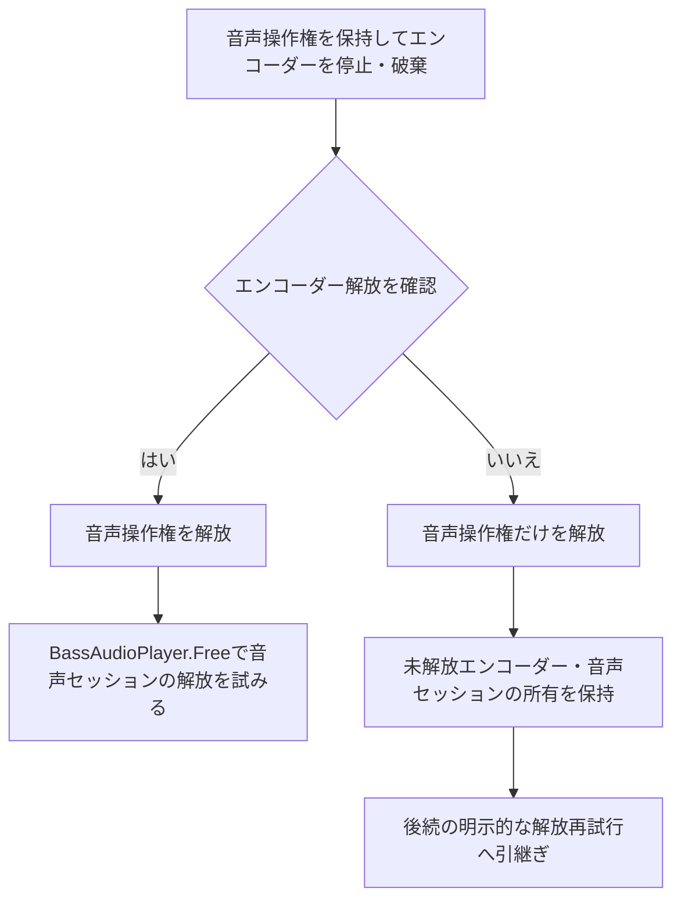

# 音声変換とエンコーダー

## 目的と適用範囲

BMS・bmsonのオフライン変換、外部エンコーダーの起動、音量調整、結果と後片付けを定めます。可聴再生の初期化と所有は[音声実行基盤](audio.md)に従います。

## 用語

[共通用語集](../glossary.md)を参照します。コードの識別子は原表記を使います。

## 仕様

### 対象譜面と解析

選択したBMS・bmsonのうち、実ファイルがあり、欠落・保留状態ではない対象を、選択順を保って変換します。メニューと実行側は同じ `ConvertToAudio` 能力を確認し、BMS専用の文字コードやIRの条件をbmsonに要求しません。出力先の選択、開始、取消、結果通知は両形式で同じ変換処理を使います。

譜面の形式選択と解析は通常再生と同じ `PlaybackChart.Load(path)` が行い、共通の音声区間を `BMSAutoPlayWriter` が出力します。bmsonの旧0.21、固定刻み時刻、音切り、up音は[bmson再生仕様](../library/bmson-playback.md)に従います。

- ファイル名の `%HASH%` とタグのコメントには、入力ファイルの実バイト列のMD5を使います。
- 題名・作者・ジャンルなどは再生解析の結果から取ります。BMSのRANDOM選択は、タグのコメントへ残します。
- bmsonをBMSの保存行に偽装しません。
- BPMタグは、OSの地域によらず小数点を `.` とする表記で作ります。BPMの値自体と、タグ・エンコーダーへの受渡しの経路は変えません。

### 出力ファイルのベース名

`BMSAutoPlayWriter.Write` の出力引数は、空でない拡張子なしのファイルパスです。呼出元の `BassSelectedChartAudioConversionExecutor` が設定の書式からベース名を決め、空白だけになる場合は曲順の番号を使い、出力フォルダと結合して渡します。Writerは既存フォルダを出力先とは解釈せず、空の名前をアプリケーションのフォルダへ置き換えません。

BMS・bmsonとも、`Out/Song` というフォルダが存在してもWAVEの出力先は `Out/Song.wav` です。拡張子はエンコーダーが付けます。完成パスが既存のファイルまたはフォルダと衝突する場合は、`BassAudioWriter.GetAvailableOutputFile` の採番で `Out/Song (2).wav` のように同じ親フォルダ直下へ保存します。同名フォルダとその内容、既存の完成ファイル、入力の譜面と音源は保全します。録音形式・品質・正規化と後片付けの契約は共通です。

### 変換用の無音セッション

`NullDevice` は物理的な出力先を使わない、変換専用の出力です。

- 内部ミキサーはFloat32・unityで動作します。有限音源の末尾が欠ける既知の問題への暫定措置として、再生時の選択値によらず初期化時から1スレッドに固定します。開始後の切替や失敗時の再実行はせず、既知の問題が解消したとも扱いません。BASSmix 2.4.13を維持し、設定値は読み戻して確認します。根拠と解除条件は[設計判断](../../decisions/audio-library-boundaries.md#並列ミキシングの末尾欠落に対する暫定措置)に従います。
- 変換はジョブ固有のNONE係数0.16を持ち、再生用の `DeviceVolume` とミュートを参照・変更しません。
- SRC品質は、[音声実行基盤](audio.md#src品質と並列ミキシング)の共通設定を変換開始時に捕捉します。

`BMSAutoPlayWriter` は譜面再生と同じ[音源の事前読込み](audio.md#譜面の音源事前読込み)を使います。候補の順序、代替、曲内の共有、省略の扱い、全候補失敗時の譜面単位の失敗は再生と同じです。未使用・未定義・空の定義は要求せず、正常な0フレームの音源は有効です。出力が0フレームになる譜面のエンコーダー前の拒否とは区別し、変換の音量・フレーム配置・完成PCMは維持します。

曲は一回だけレンダリングし、完成PCMをジョブの配列に保持して、測定・正規化・エンコードに同じデータを使います。PCM全体の再コピー、二回のレンダリング、レベルAPIによる別のデータ消費はしません。長尺では入力PCMと完成PCMのメモリが同時に必要です。任意サイズのストレージ退避は設けず、配列の上限を超える場合は失敗します。

`BMSAutoPlayWriter` は、再生と同じ不変の予約表と `BmsScheduledAudioMixer` を用い、半開の有限区間 `[StartFrame, EndFrameExclusive)` を出力します。BMSのイベント列挙、同じWAV index・同じ開始フレームの正規化、次の同indexによる打切りは[音声実行基盤](audio.md#bms音声のframe予約)に従います。

- BMSの出力長は、発音の終端と、`Duration` を量子化したフレーム数の大きい方です。再発音で切られた音も、開始位置と音源全長を出力長の下限に使います。欠損音源のイベントやロングノート終点に由来する末尾の無音も残します。
- bmsonは[継続発音列の規則](../library/bmson-playback.md#論理境界のframe変換と継続発音列)に従い、同じ再開からの継続ノートをフレーム化の前に一つの連続した音へまとめます。途中の論理境界を物理終端とせず、継続ノートの挿入・削除で同じ再開列のPCMや出力フレーム数を変えません。実PCM全体から決める[物理終端](../library/bmson-playback.md#物理eof曲長seek)を再生とWriterで共有します。
- bmsonでは、後方の欠落・正常な0フレーム・空の音源窓が出力長を延長せず、空でない音だけの終端を使います。空でない音がなければ出力計画は0フレームで、エンコーダー前の拒否を維持します。別の再開や別チャンネルの空でない音は独立し、BMSのindex排他は適用しません。表示の終端・ノート情報とBMSの末尾無音の下限は維持します。

最終区間までミキサーから実PCMを取得し、一律のフレーム追加やゼロ埋めでSRCの末尾を補いません。タグの時間長は完成PCMの総フレーム数から求めます。

### 音量調整

全体のPeakは最大絶対値、RMSは全チャンネル全サンプルの二乗平均平方根で、二乗和はdoubleの補償加算で求めます。追加の増幅率Aは有限の非負に限り、増幅率は次のとおりです。無音・空入力の測定値は0で、無音のまま維持します。gainはdoubleで計算し、最終適用時にfloat32へ丸めます。

| 正規化 | 増幅率 |
| --- | --- |
| NONE | 0.16 × A |
| PEAK | 0.99 / Peak × A |
| RMS | 0.4 / RMS × A |

変換用の音源の音量は1に固定し、再生用の `DefaultVolume` を重ねません。出力が0フレームの譜面はエンコーダーの開始前に拒否します。BASSencはPCMの供給がないとWAVヘッダーも出力しないため、ヘッダーのない空ファイルを成功結果として残しません。

Float32のWAVは、有限の±1超過をそのまま保存します。整数入力を必要とする出力では、最終gain後の範囲超過をエンコーダーの開始前に拒否し、ピークと必要な減衰量(dB)を例外に保持します。RMS正規化をPEAK正規化へ黙って変更しません。

### 失敗理由と再実行の案内

`Busy` と完了の通知は任意の案内です。表示結果が `Failed` や表示不可であっても、通知の呼出しや待機が失敗しても、元の原因を局所的に診断し、実際の `Busy`、バッチの状態、成功・失敗・未処理の件数と各ファイルの結果を保持します。`Busy` では再生停止や書込み処理を開始しません。次の挙動は通知の失敗によって変わりません。

- 必要な進捗処理経路の故障による取消と、全ワーカーの終端待機。
- 変換処理の故障。
- ネイティブ資源の解放を確認できない場合の安全停止。
- 操作トークンと受付の寿命。
- 実際の後片付けが失敗した場合の完了通知の抑止。

ファイルごとの結果は、成功・失敗だけでなく対象と主な原因を完了通知へ渡します。省略した音源があった成功には譜面名と一意なパス数を保持し、完了通知に警告として表示します。バッチの完了ダイアログは一回で、成功・失敗・未処理の件数の直後に、実際に使った形式の「出力形式」を示します。完了と利用者の取消による中断で本文は共通です。

- 整数範囲の超過は、件数、代表の対象、最大の最終ピークをまとめて案内します。
- その他の原因は、対象名と理由を最大3件示し、残りは件数で示します。全件の詳細はログで確認できます。
- 音声環境、OOM、ワーカー、セッションやデバイス、ネイティブ資源の解放未確認など、入力以外が原因の致命的な失敗は、後片付けの後にバッチを中止します。単なる譜面の失敗として次のファイルへ継続しません。解放未確認による停止や取消でも、それまでの失敗理由を捨てません。

最終ピークをP、ジョブの追加増幅率をAとして、次のとおり案内します。

- ピークは `20 log10(P)` dBを小数2桁で示します。
- 調整後の追加増幅率の上限は `A/P`、現在値に対する割合は `floor(100/P)` %です。
- 画面で0.1刻みに選べる安全側の値 `floor(10 A/P)/10` も示します。浮動小数の境界でも、上限を超える値は勧めません。
- 例えばP=1.349858、A=1なら、ピーク+2.61 dB、現在の増幅率の約74%以下、設定値0.7以下を案内します。別案としてPEAK正規化と追加増幅率1.0を示します。

`A/P<0.5` の場合は、設定範囲内では追加増幅率だけで解決できないため、実現できない数値案を省き、その理由とPEAK・1.0を示します。上限がちょうど0.5なら数値案を残します。設定の自動変更、クリップ、黙った再試行は行いません。

案内のdB、現在の増幅率に対する割合、推奨増幅率は、OSの地域によらず小数点を `.` とする固定小数表記で示します。表記だけを地域から独立させ、保存値・計算値、安全側への丸め、数値案を省く条件は変えません。

### 出力形式と命令の生成

`BassAudioWriter` は、変更不能な `AudioTagInfo`、`AudioEncoderCommandFactory`、`AudioEncoderSession` を通してManagedBass.Encを使います。WAV、LAME、Nero AAC、Opus、FLAC、OGGの六形式を扱い、品質値の制限とタグの指定を各形式へ適用します。AACの設定上の拡張子 `.aac` と、Neroが作る `.m4a` は区別します。

変換対象がある場合、`SelectedChartAudioConversionWorkflowOwner` は設定のスナップショットを一回だけ捕捉します。保存形式がWAVE以外なら、出力フォルダの選択より前に、スナップショットの形式と検索先で外部エンコーダーの可用性を一回だけ確認します。WAVEなら確認しません。判定は管理主体へ注入し、本番では設定画面と同じ `BassAudioWriter.IsEncoderAvailable(EncoderType, string)` を使います。この判定は静的な `BassAudioWriter.EncoderDirectory` を読み書きしません。

利用できない場合は、譜面の件数によらず一回だけ、題名を `Resources.Warning` とするOK・キャンセルの警告確認を表示します。既定はキャンセルで、本文は選んだ形式の表示名と必要な実行ファイル名を示し、OKで今回の変換だけをWAVEで続行すること、キャンセルで中止すること、設定の保存形式が変わらないことを伝えます。確認中はライブラリ操作の受付を保持しません。

- OKでは、形式と表示名だけをWAVEへ置き換え、他の値を捕捉時のまま保った今回専用のスナップショットを使い、設定を読み直しません。以後の出力フォルダ選択、受付、出力先確認、再生停止、変換、進捗、完了通知は従来の順序で進みます。
- キャンセル・否定・ウィンドウ閉鎖では、出力フォルダ選択、受付、再生停止、変換、進捗、完了通知を行わず、対象数だけを持つ `Cancelled` を返します。
- 確認が表示できない・失敗した場合は、変換せずに `InvalidOperationException` とし、失敗の原因を内部例外へ残します。確認自体の例外は伝播させます。

共有設定の `Encoder` は、確認の結果によらず書き換えません。実行側は渡されたスナップショットの形式をそのまま使い、ファイルごとの可用性判定やWAVEへの代替をしません。確認後に実行ファイルが失われた場合は、各ファイルの通常の失敗として結果へ残し、バッチは続行します。進捗の見出しと完了通知は、実際に使ったスナップショットの形式の表示名を示します。設定ページの表示時に実行ファイルの有無だけで形式を置き換えない扱いは、[設定](settings.md)に従います。設定ページでの検索先の変更時に、変換の事前確認を再実行することは対象外です。

実行ファイル、出力先、メタデータはWindowsの引数規則で引用し、シェルを介しません。WAVは出力パスを `EncodeStart` へ直接渡し、要求した標本形式の変換フラグを使います。WAVへRIFFのINFO情報は付加しません。

外部エンコーダーとNeroの実入力形式は、ネイティブミキサーのチャンネル情報を正本とし、命令・ヘッダー・実バイト列を一致させます。

| エンコーダー | Float32から渡す形式 |
| --- | --- |
| LAME | 符号付き32ビット |
| FLAC | 符号付き24ビット |
| Opus | Float32のWAVヘッダー付きデータ |
| Ogg | `-F 3` のIEEE Float生データ |
| Nero | Float32のWAVヘッダー付きデータ |

録音のサンプルレート・サンプル形式の `Auto` の表示名は `Resources.Auto` を使います。表示中の選択肢と変換開始時の設定スナップショットを現在の言語で整形し、列挙値による選択、実値、保存値、出力条件は変えません。

### 選択後の出力先確認

出力フォルダの選択が受理された後、再生を停止する直前に、`SelectedChartAudioConversionWorkflowOwner` が `LongPathFileSystem.DirectoryExists` で選択先を確認します。フォルダが存在しなければ標準の `DirectoryNotFoundException` を送出し、再生停止、進捗表示、変換、完了通知へ進みません。変換の実行側も開始時に出力先を再確認し、選択先の確認後にフォルダが失われていれば変換を拒否します。

### 開始と所有

エンコーダーのハンドルが0でなく、`EncodeSetNotify` に成功した後だけ、録音状態を `Playing` にします。停止に失敗した場合は、ハンドルと再生中の状態を保持し、解放済みとして扱いません。

変換処理は、共通の音声操作権を保持したまま、音声書出し処理が所有するエンコーダーの停止・破棄と結果を確認します。その後に操作権を解放し、操作権の解放後にだけ音声セッションの `BassAudioPlayer.Free` を行います。エンコーダーの解放を確認できない場合は音声セッションを解放せず、未解放のエンコーダーと音声セッションの所有を保持して、後続の明示的な解放の再試行へ渡します。この場合も操作権は `finally` で解放します。

次の図は、バッチ終了時の後片付けの順序と、解放確認による分岐を示します。ファイル単位の続行可否は[データ取得と失敗](#データ取得と失敗)に従い、図では音声操作権と音声セッションの所有を区別します。

音声セッション自体の解放を確認できない場合は、[音声実行基盤](audio.md#解放と失敗の保持)に従います。

### データ取得と失敗

`AudioPcmRenderer` はフレーム単位で読み、正の短い読取りは処理して継続します。0バイトの予期しない停滞、フレームの不整列、非有限値、ネイティブの失敗は成功としません。明示的なEOFが、有限の要求フレーム数に届かない場合も失敗です。

エンコーダーは一時停止の状態で作成して自動のDSP供給を止め、完成PCMを、エンコーダーのハンドルを指定した同期の `EncodeWrite` で一回だけ供給します。Pausedは正常な活動状態です。非同期キューは使いません。最終の整数変換だけにTPDFを適用し、float入力にはditherしません。音源は、供給とエンコーダーの終了確認まで保持します。

24bitだけは供給の直前に明示的に量子化します。固定版での実測による根拠、代替案、標準の変換へ戻す条件は[設計判断](../../decisions/audio-library-boundaries.md#24bitだけ明示的に量子化する理由)に従います。doubleで `q = Clamp(RoundToEven(x × 2^23 + U1 − U2), −2^23, 2^23−1)` を求め、正確に表現できる `q / 2^23` のfloat32を、再利用する小さい作業配列へ格納します。U1・U2はエンコーダー単位の乱数列から得る、独立した[0,1)の一様乱数です。元のPCMは変更せず、ネイティブ側のDITHERは無効にして、24bitへの正確な格納変換だけを行います。元入力の範囲検査は維持し、clampはditherの後の端点に限ります。24bit以外の整数形式は、BASSencのTPDFを使います。

書込みの失敗、途中終了、終了の失敗は保持します。終了時の強制停止の通知も、後続の解放通知で上書きして成功にしません。外部エンコーダーでは、[BASSが返すプロセスハンドル](https://www.un4seen.com/doc/bassenc/BASS_Encode_Start.html)を開始直後に非継承で複製して所有し、同期停止の後も終了コードを確認できるようにします。正常終了は終了コード0だけで、通知済みの故障を0で成功へ戻しません。WAV出力はプロセスハンドルを持ちません。

- 停止に失敗した場合は、ネイティブのエンコーダーと複製ハンドルを保持します。
- 停止に成功した場合は、ネイティブのエンコーダーを解放済みにし、0でない終了コードは変換の失敗として報告します。
- 終了コード259(未終了)または終了コードの取得失敗では、複製ハンドルを保持し、明示的な破棄の時に再確認します。確認できない間は後片付けの完了とせず、既存のバッチ停止条件へ渡します。

ファイルごとの破棄の後に解放を確認できれば、変換の失敗を報告して次のファイルへ進めます。確認できなければバッチを停止します。変換の失敗があればそれを主な失敗とし、後片付けの失敗で置き換えません。

### 外部エンコーダーの検証

外部プロセスを使う確認は、明示的に実行する任意のテストです。生成した短いステレオ音源を実際の音声書出し処理と無音セッションへ通し、Unicodeと空白を含むパス、既存の出力と衝突した場合の採番、内容、開始・停止・解放を確認します。実行条件と環境変数は[テストの実行基盤](../development/test-runtime.md#解析大規模データ外部エンコーダー)に集約します。エンコーダー本体、ライセンス、外部音源を検証用データとして追加しません。

## 実装とテストの対応

| 仕様項目・主な条件 | 実装箇所 | テスト箇所・確認内容 |
| --- | --- | --- |
| 録音Autoの言語表示と型付き条件 | `SettingsDialogViewModel.EncoderSampleRateNames` / `EncoderFormatNames`、`SelectedChartAudioConversionSettingsSnapshot` | `SettingsWindowCompiledBehaviorTests.RecordingPage_PreservesUnavailableSavedEncoderAndPersistsExplicitWaveAcrossReopen` が追加辞書・実ComboBox・スナップショット・保存なしを確認する。既存の `SelectedChartAudioConversionWorkflowOwnerTests` が出力条件と解放を分担する。 |
| 地域非依存の安全側の範囲助言 | `SelectedChartAudioConversionWorkflowOwner` | `SelectedChartAudioConversionWorkflowOwnerTests.RunAsync_RangeAdviceUsesCapturedAmplificationAndSafeTenths` が、fr-FRで2.61 dB・74%・0.7などの独立した期待値と、最小値・実行不能の条件を確認する。 |
| 拡張子なしのベース名と同名フォルダ、既存の完成ファイルとの衝突時の採番・保全 | [`BMSAutoPlayWriter.Write`](../../../BeMusicSeeker/Ribbit/BMS/BMSAutoPlayWriter.cs)、`BassSelectedChartAudioConversionExecutor`、`BassAudioWriter.GetAvailableOutputFile` | [`BMSAutoPlayWriterTests.WriterTreatsExistingDirectoryAsFileBaseAndPreservesExistingEntries`](../../../tests/BeMusicSeeker.Windows.Tests/Playback/BMSAutoPlayWriterTests.cs) が、BMS・bmsonと既存の完成ファイルの有無を組み合わせ、実WAVEの親フォルダ直下の名前、既知入力のNONE増幅PCM、Float32 48kHzの形式、入力・既存ファイル・フォルダ内容の保全を確認する。通常のバッチの形式・増幅・完了と解放は、既存の変換担当のテストが分担する。 |
| 表示時の形式保持と、変換前の一回の確認・WAVE続行・中止、共有設定の不変、確認後に失われた場合のファイルごとの失敗 | `SettingsDialogViewModel.EncoderIndex`、`SelectedChartAudioConversionWorkflowOwner.RunAsync`、`SelectedChartAudioConversionSettingsSnapshot.WithWaveEncoder`、`BassSelectedChartAudioConversionExecutor`、`BassAudioWriter.IsEncoderAvailable`、`BassAudioDeviceCatalog.IsEncoderAvailable` | 表示・保存・変換前のスナップショットは[設定の検証対応](settings.md#実装とテストの対応)で確認する。[`SelectedChartAudioConversionWorkflowOwnerTests`（Core）](../../../tests/BeMusicSeeker.Core.Tests/ChartOperations/SelectedChartAudioConversionWorkflowOwnerTests.cs) が、対象なし・WAVE・利用可能で判定と確認の回数、利用不能での一回の確認と出力先選択より前の順序・受付の非保持・要求の形・本文・他の設定値を保った今回専用のWAVEスナップショットと設定の非再読込み・進捗見出しと完了通知の形式、取消・否定・閉鎖での中止、表示不可・失敗での例外を確認する。[`SelectedChartAudioConversionWorkflowOwnerTests`（Windows）](../../../tests/BeMusicSeeker.Windows.Tests/ChartOperations/SelectedChartAudioConversionWorkflowOwnerTests.cs) の `RunAsync_RealExecutorReportsEachFileAsFailureWhenEncoderDisappearsAfterConfirmation` が、実executorでの確認後の消失を各ファイルの失敗として残し何も出力しないこと、対照のWAVEで同じ二譜面が成功することを確認する。[`BassAudioWriterTests`](../../../tests/BeMusicSeeker.Core.Tests/Playback/BassAudioWriterTests.cs) が、検索先を引数に取る判定を確認する。共有設定の書込み経路がないこと、判定が静的な検索先を書き換えないこと、catalogの委譲、本番の判定の注入は静的に確認する。 |
| BMS・bmsonの二曲の本番バッチから実WAVEと次の変換への接続 | `SelectedChartAudioConversionWorkflowOwner`、`BassSelectedChartAudioConversionExecutor`、`BMSAutoPlayWriter` | [`SelectedChartAudioConversionWorkflowOwnerTests.RunAsync_RealNativeExecutorRetainsLibraryAdmissionThroughEncoderAndSessionCleanup`](../../../tests/BeMusicSeeker.Windows.Tests/ChartOperations/SelectedChartAudioConversionWorkflowOwnerTests.cs) が、生成した48kHzステレオFloat32の入力から独立に求めたPCM・フレーム数・形式・増幅設定、二曲の成功と未処理0件を、実WAVEで確認する。エンコーダーとセッションの実解放中は共通の受付を保持して `Busy` となること、元のTaskと解放の終端後に次の明示的な二曲の変換ができることも確認する。NullDeviceのWAVE出力を、外部エンコーダーや物理デバイスの確認とは扱わない。 |
| BMS・bmsonの変換許可、選択順、保留・消失ファイルの除外と実行への受渡し | [`GridRowResolver`](../../../BeMusicSeeker/ViewModels/ChartList/GridRowResolver.cs)、[`MainWindow`](../../../BeMusicSeeker/Views/MainWindow/MainWindow.cs) の変換メニュー、`SelectedChartAudioConversionWorkflowOwner` | [譜面モデルの能力・メニューテスト](../library/chart-model.md#実装とテストの対応)に加え、[`SelectedChartAudioConversionWorkflowOwnerTests`（Core）](../../../tests/BeMusicSeeker.Core.Tests/ChartOperations/SelectedChartAudioConversionWorkflowOwnerTests.cs) / [`SelectedChartAudioConversionWorkflowOwnerTests`（Windows）](../../../tests/BeMusicSeeker.Windows.Tests/ChartOperations/SelectedChartAudioConversionWorkflowOwnerTests.cs) の `Request_FiltersCapabilityAndExistingFilesAcrossChartKindsInSelectionOrder` が、実際のリゾルバーから得た対象について、両形式共通の選択順・ファイル存在確認と保留の拒否を確認する。`RunAsync_AcceptedRoutePreservesCountsSettingsAndTerminalNotificationOrder` が、bmsonを先頭にした混在選択を、正確な譜面参照のまま実行側へ渡し、設定・件数・再生停止・一回の完了通知の順序を確認する。 |
| bmsonの共有区間一回、別チャンネルの重なり、EOF尾部・ロングノート・明示的なup音 | `PlaybackChart.Load`、`BMSAutoPlayWriter` | [`BMSAutoPlayWriterTests`](../../../tests/BeMusicSeeker.Windows.Tests/Playback/BMSAutoPlayWriterTests.cs) の `BmsonWriterContinuationInsertionKeepsContinuousPcmAndPhysicalEof` / `BmsonWriterContinuationRunsPreserveRestartAndSamePathChannelOverlap` / `BmsonWriterLongNoteDoesNotCutAudioAndExplicitOrphanUpSoundsAtItsOwnPulse`。出力フレームと同じレートで生成するPCMの条件は[bmson再生仕様](../library/bmson-playback.md#実装とテストの対応)を参照する。 |
| 復号失敗後の代替と、直接読んだ正常音源との出力フレーム・PCMの一致 | 共通の音源ローダー、`BMSAutoPlayWriter` | `BMSAutoPlayWriterTests.WriterFallbackMatchesDirectHealthySourcePcmAndFrames` が、BMS・bmson両形式を同じ生成PCMと比較する。 |
| bmsonの空でない音だけによる音声終端、後方の空イベントと有効な再開の区別 | `BmsAudioFrameSchedule.Create`、`BMSAutoPlayer`、`BMSAutoPlayWriter` | `BMSAutoPlayWriterTests.BmsonAudioEndUsesOnlyNonemptyVoicesAcrossLoadPreparationAndWriter` が、通常ロード・実際の準備結果の採用・出力WAVを比較し、表示情報と正常な0フレームの受理、0フレームのエンコード拒否を確認する。 |
| 形式、引数、品質、タグと拡張子 | [`AudioEncoderCommandFactory`](../../../BeMusicSeeker/Ribbit/Media/Audio/AudioEncoderCommandFactory.cs)、[`AudioTagInfo`](../../../BeMusicSeeker/Ribbit/Media/Audio/AudioTagInfo.cs) | [`AudioContractsTests`](../../../tests/BeMusicSeeker.Windows.Tests/Playback/AudioContractsTests.cs)、[`AudioEncoderCommandFactoryTests`](../../../tests/BeMusicSeeker.Core.Tests/Playback/AudioEncoderCommandFactoryTests.cs)。BPMタグの地域非依存の表記は、PCMの出力と合わせて `BMSAutoPlayWriterTests` と `AudioEncoderCommandFactoryTests` が品質・引用・タグ引数との対応を確認し、タグ生成のproviderは静的に確認する。 |
| 開始・通知・停止・実形式、途中終了と解放の所有 | [`AudioEncoderSession`](../../../BeMusicSeeker/Ribbit/Media/Audio/AudioEncoderSession.cs)、[`BassAudioWriter`](../../../BeMusicSeeker/Ribbit/Media/BassAudioWriter.cs) | [`AudioEncoderSessionTests`](../../../tests/BeMusicSeeker.Core.Tests/Playback/AudioEncoderSessionTests.cs)、[`BassAudioWriterTests`](../../../tests/BeMusicSeeker.Core.Tests/Playback/BassAudioWriterTests.cs) |
| 選択後の出力先の消失を再生停止前に拒否し、変換開始時にも再確認 | [`SelectedChartAudioConversionWorkflowOwner`](../../../BeMusicSeeker/ViewModels/ChartOperations/SelectedChartAudioConversionWorkflowOwner.cs)、`BassSelectedChartAudioConversionExecutor` | [`SelectedChartAudioConversionWorkflowOwnerTests`（Core）](../../../tests/BeMusicSeeker.Core.Tests/ChartOperations/SelectedChartAudioConversionWorkflowOwnerTests.cs) / [`SelectedChartAudioConversionWorkflowOwnerTests`（Windows）](../../../tests/BeMusicSeeker.Windows.Tests/ChartOperations/SelectedChartAudioConversionWorkflowOwnerTests.cs) が、選択直後に消失した場合は停止・進捗・通知が行われないこと、停止時に消失した場合は実行側が拒否することを確認する。 |
| ファイルごとの成功・失敗・未処理、主な失敗、省略音源数の警告、解放できない場合の停止 | [`SelectedChartAudioConversionWorkflowOwner`](../../../BeMusicSeeker/ViewModels/ChartOperations/SelectedChartAudioConversionWorkflowOwner.cs) | [`SelectedChartAudioConversionWorkflowOwnerTests`（Core）](../../../tests/BeMusicSeeker.Core.Tests/ChartOperations/SelectedChartAudioConversionWorkflowOwnerTests.cs) / [`SelectedChartAudioConversionWorkflowOwnerTests`（Windows）](../../../tests/BeMusicSeeker.Windows.Tests/ChartOperations/SelectedChartAudioConversionWorkflowOwnerTests.cs) が、一回の完了通知、警告つきの成功を含む件数、譜面名と省略パス数、主な失敗、未処理数を確認する。 |
| 別途用意した実エンコーダーとの接続 | [`BassAudioWriter`](../../../BeMusicSeeker/Ribbit/Media/BassAudioWriter.cs) | [`ExternalAudioEncoderSmokeTests`](../../../tests/BeMusicSeeker.Compatibility.Tests/Playback/ExternalAudioEncoderSmokeTests.cs) |
| 一回のレンダリング、全体RMS、絶対フレーム、有限音源の最終フレーム、末尾無音の下限、空変換の拒否、再生設定の不変 | [`BMSAutoPlayWriter`](../../../BeMusicSeeker/Ribbit/BMS/BMSAutoPlayWriter.cs)、[`BmsAudioFrameSchedule`](../../../BeMusicSeeker/Ribbit/BMS/BmsAudioFrameSchedule.cs)、[`BmsScheduledAudioMixer`](../../../BeMusicSeeker/Ribbit/BMS/BmsScheduledAudioMixer.cs)、[`AudioPcmRenderer`](../../../BeMusicSeeker/Ribbit/Media/Audio/AudioPcmRenderer.cs) | [`BMSAutoPlayWriterTests`](../../../tests/BeMusicSeeker.Windows.Tests/Playback/BMSAutoPlayWriterTests.cs) が、固定入力から独立に求めた出力長、非零の最終音フレーム、開始時刻の丸め、再発音、末尾無音をWAVで確認する。[`BmsRealtimeAudioSchedulerTests`](../../../tests/BeMusicSeeker.Windows.Tests/Playback/BmsRealtimeAudioSchedulerTests.cs) が、BPM・EXBPM・STOP・小節長・aliasを含む譜面の固定の期待フレーム、WriterのPCM、リアルタイムのPCMを照合する。[`AudioPcmRendererTests`](../../../tests/BeMusicSeeker.Core.Tests/Playback/AudioPcmRendererTests.cs) が、フレームの取得と測定の契約を確認する。 |
| 最終の整数変換、float過大値の保存、24bitの正確な格子 | [`AudioPcm24Quantizer`](../../../BeMusicSeeker/Ribbit/Media/Audio/AudioPcm24Quantizer.cs)、`AudioEncoderSession` | [`AudioOutputNativeTests`](../../../tests/BeMusicSeeker.Windows.Tests/Playback/AudioOutputNativeTests.cs) が、正負0.25 LSBと無音を各2^20サンプルで、平均誤差0.02 LSB以下、最大誤差2 LSB以下として検査する。24bit無音の−1/0/+1の頻度は、1/8・3/4・1/8に対して各0.005以内である。 |
| 任意の `Busy`・完了通知の失敗と、実変換結果の保持 | [`SelectedChartAudioConversionWorkflowOwner`](../../../BeMusicSeeker/ViewModels/ChartOperations/SelectedChartAudioConversionWorkflowOwner.cs) | [`SelectedChartAudioConversionWorkflowOwnerTests`（Core）](../../../tests/BeMusicSeeker.Core.Tests/ChartOperations/SelectedChartAudioConversionWorkflowOwnerTests.cs) / [`SelectedChartAudioConversionWorkflowOwnerTests`（Windows）](../../../tests/BeMusicSeeker.Windows.Tests/ChartOperations/SelectedChartAudioConversionWorkflowOwnerTests.cs) の `RunAsync_CompletionNotificationFailurePreservesConversionResult` が、表示不可・`Failed`・例外でも正確な成功結果を保持することを確認する。`RunAsync_AcceptedWorkerRejectsConcurrentRequestAndGateReopensAfterCompletion` が、`Busy` 通知の故障時に未開始であること、既存ワーカーの終端後に次の受付ができることを確認する。既存の進捗処理経路・ネイティブ資源の後片付けの故障テストが、実際の失敗と安全停止を担う。 |

## 関連資料

[音声実行基盤](audio.md)、[依存関係](audio-dependencies.md)、[テスト運用](../development/test-runtime.md)を参照します。
