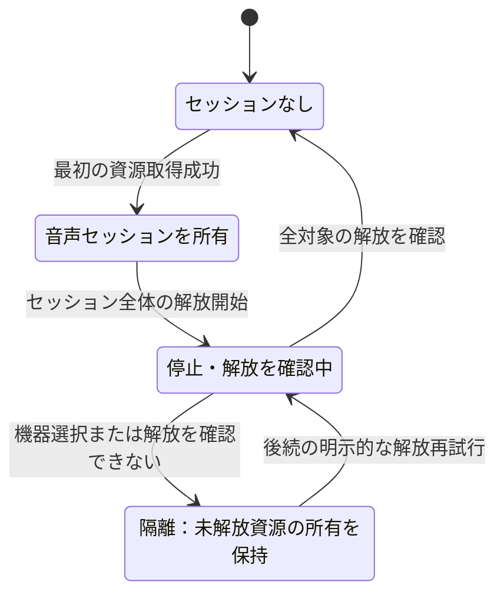

# 音声実行基盤と再生

## 目的と適用範囲

BMS・bmsonに共通の音声の初期化、機器選択、再生、デバイステスト、解放を定めます。依存する版は[依存関係](audio-dependencies.md)、変換と録音は[音声変換](audio-conversion.md)に分けます。採用理由と測定の根拠は[音声処理の設計判断](../../decisions/audio-library-boundaries.md)に置きます。

## 用語

[共通用語集](../glossary.md)を参照します。コードの識別子は原表記を使います。

| 用語 | 意味 |
| --- | --- |
| 出力方式 | WASAPI共有、WASAPI排他、ASIO。 |
| 交渉 | 機器が利用できる形式などを、ネイティブとの試行で選ぶ処理。 |
| 隔離 | 解放を確認できない資源を、新しい再生から分けて所有し続ける状態。 |
| 音声セッション | 一回の機器使用の所有範囲。ライブラリの変更セッションとは別。 |
| 要求値 | 利用者が選んだ方式、識別子・名前、レート、形式、バッファ、イベント、音量の変更不能な組。 |
| 実効要求 | 要求値のうち、選んだ方式が実際に適用する条件だけを残した組。 |
| 交渉値 | ネイティブが受理・報告した機器、レート、チャンネル、エンジン形式、機器形式、方式、遅延。 |
| 観測値 | 再生位置、経過時間、進行比率などの実測値。 |
| 入力ミキサー | 発音を予約・加算する、テンポ処理より前のFloat32のミキサー。 |
| 実取得 | 出力側が入力ミキサーから正のフレーム数のPCMを実際に読み出すこと。 |

要求値・交渉値・観測値を「実際の値」として混ぜません。

## 仕様

操作の受付の分類、競合時の結果、必要な継続の寿命は[操作の競合ポリシー](../core/operation-concurrency-policy.md)を正本とします。以下は、入力・処理・資源の所有と結果に固有の契約です。

### BMS再生入力

内蔵再生・先読み・音声変換は、通常の `PlaybackChart.Load` でBMSを読みます。監査ツールの `DecodeForAudit` → `ParsePreparedForAudit` も同じ復号処理を使います。この入力経路は、ライブラリの基本情報パーサーとは別の契約です。

#### 命令の切出しと文字コード

ヘッダー名と値の境界は、ASCIIの空白・タブ・コロンです。WAVに加えて、TITLE/ARTIST、BPM、BASE、LNOBJ、RANDOM/IFも同じ境界で読み、値の中の空白を保持します。行頭のインデントや、全角を含むUnicode空白へ受理範囲を広げません。

| 条件 | 扱い |
| --- | --- |
| UTF-8の先頭BOM | 復号した本文の先頭のBOMだけを取り除き、先頭のBPM・TITLE・WAVをBOMなしと同じように解釈する。本文中のU+FEFFは保持する。 |
| BOMなし | 自動判別の順序、判別できない場合の代替、CP932の資源名の解釈を維持する。UTF-16・UTF-32には対応しない。 |
| MD5 | 通常読込みは、BOMを含む元のバイト列から求める。BOMを除いた本文で計算し直さない。監査の準備入力は、呼出側が取得したMD5をそのまま受け取る。 |

ライブラリの基本情報パーサーによるCP932資源の解釈と先頭BOMの扱いは、この補正の対象外です。

#### 条件分岐の採用

`BMSFile` は、現在の乱数選択に一致する `#IF` / `#ELSEIF`、一致する条件がなければ `#ELSE` を一つだけ採用します。複数の `#ELSEIF` と入れ子も各階層の停止命令を基準に解釈し、選択した枝のメタデータ、`WavArray` / `BmpArray` の定義、譜面イベントを一回だけ反映します。`#ENDIF` の後の共通イベントも一回反映します。

- 同じ `#RANDOM` の値を、採用した枝の入れ子へ引き継ぎます。採用した枝の中で別の `#RANDOM` を宣言した場合はその枝の選択だけを変え、枝から外側へ戻った後の乱数値は変えません。
- 選ばれなかった枝のWAV・BMP・STAGEFILE・BANNER・BACKBMPのパスも `Resources` へ収集します。全資源パスの収集と、再生に採用する定義・イベントは区別します。
- 乱数の選択方式は変えません。完了した選択だけを記述順に `RandomPattern` と監査コールバックへ一回記録し、選ばれなかった枝の中の乱数は `Used = false` として保持します。

#### 基数の宣言

`#BASE` は、採用された枝と共通部分にある最後の有効な宣言をファイル全体へ適用し、宣言より前の定義・ノート・LNOBJも同じ規則で解釈します。選ばれなかった枝の宣言は結果に作用しません。

| 有効な最後の宣言 | 解釈 |
| --- | --- |
| 62 | 音源IDとLNOBJの大小文字を区別する。たとえば `#WAVAA upper.wav`、`#LNOBJ aa` では通常音AAを残し、終端のaa自身は発音しない。 |
| 16・36 | 定義件数による既定の推測を使う。先行する62による大小文字の区別は解除し、基数そのものを強制する意味は持たない。 |
| なし | 既定の推測を使い、大小文字だけが異なるノートの単一定義への同一視、AA/aa両方の定義の区別、`+/` を含む拡張IDの受理を維持する。 |

値は既存の整数指示と同じ `NumberStyles.Integer` / en-USで読み、`+62`・`062`・前後の空白も受理します。不正な文字列、未対応の値、整数範囲外は無視し、それまでの最後の有効な宣言を保ちます。内部のID文字の対応と、パーサーの版・LR2全体同期の判定は[譜面情報](../library/chart-info.md#最新性の判定)に従います。

`PlaybackChart.FromBms` は、採用済みのメタデータ、音源定義、発音時刻を共通の再生データへ投影します。

### 所有と初期化

`PlaybackPanelViewModel` が保持するライブラリ参照は、一時導入試聴で保留された入力の解決に使います。参照の接続と交換には、構成が所有する生存中の論理的な受付権限を渡します。一時導入試聴も同じ受付の下で参照を使うため、参照の交換と入力の解決は重なりません。

#### 音量の反映

操作中の音量は `PlaybackSettingsStore` が保持し、`IBMSPlayer.VolumeChanged` から現在の音声ランタイムへ直接渡します。次の再生要求が読むスナップショットは、保存済みの音量だけを使います。

- 設定画面と主画面のスライダーは、操作の終端で音量だけを保存し、重複した終端は再保存しません。保存に失敗した場合は、表示と現在の再生を最新の確定音量へ戻します。終了の開始時にも未確定の最終有効音量を処理し、終了後の新しい通知は表示しません。
- 現在の音量と、音声セッションの初期化後に音量を適用する順序は、同じ音声ランタイムが所有します。次回の初期化が古い保存音量を捕捉していても、初期化の終端で最新の現在音量を適用します。操作終端の保存と初期化のどちらが先でも、現在音量を巻き戻しません。
- 初期化と旧セッションの回収の実行中は、音量の設定が現在値を受け付け、ネイティブへの適用を待たずに戻ります。最新値は、その実行段階の終端の後に適用します。
- スナップショットと初期化結果の要求音量は、捕捉した値を保ちます。操作中の値を、次回の確定設定へ公開しません。

#### 要求の受付

通常再生、能力照会、明示テスト、解放は、`BassAudioOperationGate` の中で要求の受付を共有します。

- 競合する未受理の要求は待たずに戻します。拒否の前に、ネイティブ初期化、共有要求の変更、通常再生の停止を行いません。受理済みの要求の非同期の継続は、同じ論理的な受付を引き継ぎます。
- コールバックとネイティブ処理を解放から保護する、短い共有・排他のゲートを持ちます。排他リースは一回だけ解放し、音声セッションの遷移の終端は所有者の解放確認から判定します。
- 明示テストは `IAudioDeviceTestRequestAdmission` を通して共有の受付を取得し、通常再生の停止から、テストと後片付けの終端までリースを保持します。通常の競合による拒否は結果なし、解放待ちによる拒否はその例外を主な失敗として返します。どちらも停止処理とテストのランタイムを呼びません。既定の受付は共有のBASSへ接続し、検証では専用のゲートに差し替えます。能力照会のネイティブ受付は、照会ランタイムが所有します。

#### 音声セッションとネイティブDLL

`BassAudioRuntime` は、最初の取得成功から解放の確認まで、音声セッションを一つの管理主体として所有します。再生・テスト・変換・設定側は変更不能なトークンや結果だけを保持し、解放待ちの状態を重複して持ちません。初期化と解放を直列化し、使用中または隔離中の再入を拒否します。

初期化は、ネイティブDLLの読込み、ManagedBassへの接続、部品の版の検証の順です。各段階の失敗は、部品、処理段階、ネイティブの失敗元と番号、ロード状態を記録します。デバイスの列挙と `BASS_Init` は、選択した方式の境界でだけ行います。起動処理でBASS全体の既定デバイスを書き換えたり、機器を合成したりしません。

初期化済みのランタイムに対する `BassAudioRuntime.Initialize()` は、受付の後に共有リースで状態を確認して戻り、排他の初期化を予約しません。このため、進行中の共有処理や、独立したコールバックの受付・PCM読取りを妨げません。受付は省略せず、別の要求の所有中のBusy、受理済みの要求の再入、終了中・隔離中の拒否を維持します。共有リースを取得できない場合と未初期化の場合は、共有リースから昇格せずに解放してから、排他の初期化で状態を確認し直します。デバイスの列挙は、列挙全体を独立した共有リースで保護し、確認から取得までの間に終了が始まれば受付を拒否します。

`BassNativeRuntime` は、七つのDLL(BASS系六つとVorbisの接続層)を一つの世代としてロードし、全てが成功してから公開します。途中で失敗した場合は、成功済みの候補だけを逆順で解放します。`ManagedBassNativeLibraryResolver` は、六つのアセンブリが要求する既知の名前と `.dll` 付きの名前を、現在の世代のハンドルへ解決します。自身ではロード・解放をせず、未知の名前だけを通常の探索へ戻し、停止後も既知の名前を別のコピーへ解決しません。

CLRには接続済みの呼出しを解除するAPIがないため、成功済みのハンドルは最初の接続の前から保持し、プロセスの寿命まで手放しません。論理的な停止は、操作とコールバックの受付を閉じ、実行中の処理・音声セッション・機器の解放を待ってから、公開だけを解除します。再初期化では同じハンドルを再公開し、DLLの入替えはプロセスの再起動で行います。

### 解放と失敗の保持

取得の成功を確認できた資源だけを解放します。初期化の途中で得た資源も、同じ所有境界で扱います。

- 各層の停止・解放の前には、保存済みのBASS、WASAPI、ASIOの機器を選択します。選択に失敗した場合は別の機器の資源を解放せず、音声セッションを隔離して所有を保持します。後続の明示的な再試行で成功したものだけを、一回解放します。
- 繰返し可能な停止・解放が返す `BASS_ERROR_INIT` は解放済みとして記録できますが、機器選択の失敗を無視する理由にはしません。
- 最初の初期化・操作の例外を主な失敗として保持し、後片付けの失敗で置き換えません。解除するのは、解放を確認できたハンドルと状態だけです。

次の図は、音声セッション全体の所有と解放確認の遷移を示します。矢印のラベルは遷移の契機または解放確認の結果です。個別の音源操作の失敗は、一律の解放開始条件にしません。DLLハンドルのプロセス寿命や、機器ごとの交渉候補は表しません。

### 明示的な無音再生

`NullOutputPlaybackRuntime` を `InternalBMSAutoPlayerSoundOnly` へ直接渡すと、通常のパーサー・準備・デコーダー・BASSmixを使って無音で再生します。保存済みのデバイスを書き換えず、通常のランタイムによるNULLの拒否や、機器故障時の失敗・代替の順序も変えません。初期化結果は明示的なNULL要求として返し、無音への代替とは記録しません。アプリケーションでの選択、構成、再生パネル、一時コピーとの接続は、このネイティブ境界だけでは保証しません(明示検証起動での選択は[明示検証起動の実再生観測](#明示検証起動の実再生観測))。

`BassAudioWriter.InitializeOwnedSession` は、捕捉したレートとSRC品質を、ネイティブの受付・排他の内側まで引数で渡します。無音の音声セッションは、構築時に `NullOutputProcessing` の `Raw` か `Processed` に固定します。音声変換と手動の無音取得は `Raw`、`NullOutputPlaybackRuntime` だけが `Processed` を使い、`Raw` の経路へゲイン・準備完了の待機・時計補正を持ち込みません。

`Processed` は、実際のレンダラー、プロセッサー、公開する出力ハンドルを準備し、次の契約で通常再生と同じ開始・停止の境界を持ちます。

- `LoadResources` または準備済み譜面の採用の後、音声セッションごとに初回の実取得を一度だけ開始して共有し、その完了後に既存のプレイヤーを開始します。
- 準備完了の条件は、共通のコールバック本体で実レンダラーが正のフレームを取得し、プロセッサーが完了し、音声セッションに故障がないことです。戻りバイト数や最大要求フレームの観測だけでは準備完了にしません。空のミキサーの正常なゼロPCMは成功で、一時停止・欠落・故障時のゼロ埋めとは区別します。新しい音声セッションでは、旧セッションの準備完了を再利用しません。
- 演奏中の取得の所有者は `BmsRealtimeAudioScheduler` だけです。常駐の取得処理や追加のタイマーは設けず、`Processed` だけを共有のコールバック経路へ接続します。初回とスケジューラーの一回の取得は、最大4096フレームです。
- 音量は実プロセッサーへ一度だけ適用します。`ResetControlInterval` は無音の取得時計も更新し、一時停止の時間を再開時に一括で消費しません。`Raw` と通常出力の時計の意味は変えません。

停止では、既存プレイヤーの停止の取消と実再生Taskの合流の後、ランタイムが初回取得のTaskをロックとネイティブリースの外で合流してから、音声セッションのリースを解放します。待機側の取消は、実際の取得の終端の代わりになりません。取得や初期化が故障した場合も後片付けを試み、元の原因と後片付けの原因をともに保持します。解放を確認できなければ、既存のリースが所有を維持して次の初期化を拒否し、明示的な解放の成功後にだけ所有を手放します。自然な完了で自動の解放は追加しません。

### 選択できる出力方式と旧設定

可聴出力は、WASAPI共有、WASAPI排他、ASIOの順に表示し、新規の既定はWASAPI共有です。設定の列挙値の数値は変えず、画面の添字は明示的な選択肢の一覧に対応させます。`NullDevice=-1` はオフライン変換専用で、通常再生・機器テスト・代替の出力先にしません。

| 保存値 | 扱い |
| --- | --- |
| 旧 `DirectSound=0` | WASAPI共有とDefault機器に正規化し、機器の識別子と名前を空にする。旧名の一致で別の機器へ移行しない。 |
| 未知の値、`INVALID`、`NullDevice` | 黙って変更せず、利用不可として表示・拒否する。 |

画面を開くだけでは保存しません。機器の一覧はBASSWASAPIとBASSASIOの列挙だけから作り、各方式のDefault項目と実際の機器を公開します。BASSのDirectSoundの列挙は公開しません。

### 機器の代替規則

同じ方式内の候補を全て試してから、別の方式へ移ります。別の方式では、その方式のDefaultから始め、元の方式の識別子を流用しません。どの経路でも、無音の機器で成功にはしません。

| 要求方式 | 同じ方式内の試行 | 失敗後 |
| --- | --- | --- |
| ASIO | 要求または既定の機器、決定的なレート候補、Float32のみ | WASAPI排他、次に共有 |
| WASAPI排他 | 要求されたイベント・周期、同じ周期の非イベント、既定周期の非イベント | WASAPI共有 |
| WASAPI共有 | イベント要求なら、既定のバッファ・周期でのイベント、次に非イベント | 失敗として終了 |

WASAPI共有では空でない機器IDを正本とし、名前が変わっても維持します。消えたIDを同名の別の機器へ置き換えません。IDを持たない旧形式だけは、名前による互換の解決を許します。排他とASIOは、方式のDefaultへ進む前に名前の一致を試します。

結果には、IDの消失、周期・方式の変更、形式・レートの正規化、ネイティブの失敗、代替先を残します。選べないDirectSound内部の形式が未観測であることを示す `UNKNOWN` を、初期化の失敗や代替の成功の意味に流用しません。

### ASIOとWASAPIの形式

#### 共通の事項

機器のPCM形式は、16・24・32bit整数、32bitの容器に16・18・20・24bitを格納する整数形式、Float32を受理します。32bitの容器の整数は、機器形式の分類では整数32bitとし、交渉の診断にネイティブの値、容器幅、有効ビット数を残します。容器幅や有効ビット数をコールバックのバイト幅へ流用せず、コールバックは常に1サンプル4バイトです。未知の形式や情報の取得失敗を、PCMと推測しません。

明示レートは、要求値、ドライバーの現在値、重複しない標準値の順に試します。Autoは固定の48000ではなく、現在値から始めます。採用されたレートと形式は読み戻して確認します。ManagedBassが提供しないネイティブ関数を、独自のP/Invokeで補いません。

WASAPIのバッファ時間は、端末の形式によらず、`GetInfo.BufferLength` をFloat32のバイト長として換算します。たとえば48kHz・2ch・3840バイトなら、端末が16/24/32bit・Floatのいずれでも10msです。端末の形式、容器幅、有効精度は観測値として保持し、設定テストの遅延表示と内部のフレーム換算は、同じ交渉結果を参照します。機器テストの遅延表示は、OSの地域によらず小数点を `.` とする固定小数の表記を使い、編集中の設定を変更しません。

#### ASIO

エンジンとコールバックはFloat32固定です。形式の設定や読戻しに失敗した場合は、整数エンジンを試さず、方式の代替へ進んで理由を記録します。保存済みの整数形式の列挙値は変更しません。機器のネイティブ形式は `ChannelGetInfo` で取得して区別し、整数機器への最終変換だけにTPDFディザーを指定します。DSDは対象外です。

コールバックの形式は、ネイティブのraw値を契約とします。

| ネイティブ端点 | 要求するraw値 | 受理条件 |
| --- | --- | --- |
| Float32 | `0x13` | `ChannelGetFormat` が同じraw値を返す。 |
| 整数 | TPDF付きFloat32の `0x113` | 同上。 |

- `UNKNOWN=-1` の読戻しはAPIの失敗として、直後のネイティブエラーとともに保持します。別のraw値の正常な読戻しは形式の不一致であり、古いネイティブエラーを付けません。`SetFormat` の失敗は、その段階と直後のネイティブエラーを記録します。
- 各結果には、要求raw値、読戻しraw値、その方式で先に行った試行を残し、未読の値を実値として作りません。

#### WASAPI

エンジンはFloat32です。

- **共有**: 機器のミックスレートとチャンネル数、ネイティブ既定のバッファ・周期を使います。`BassWasapi.Init` には排他フラグを渡さず、イベントの有無に応じたフラグと、バッファ・周期0を指定します。排他の機器形式を埋め込みません。
- **排他**: `Exclusive | AutoFormat` と必要なイベントフラグ、候補の周期を使います。明示形式のデバイステストの例外は[要求・交渉・観測と設定](#要求交渉観測と設定)に従います。

### コールバックと音量

ASIOとWASAPIは、`BassAudioSession.CallbackOutputHandle` だけを音声の取得元に使います。ASIOのチャンネルの有効化・結合・開始、またはWASAPIの開始より前に、ミキサーと初期ゲインを音声セッションへ公開します。静的変数やプレイヤーから取得元を推測しません。

#### 初回コールバックの観測

通常再生のネイティブの開始は初期化の中で成功させ、初回の実コールバックの観測とは分けます。

- `BassAudioSession` は、正の実取得フレーム数を最大ブロックへ公開してから、一回の非同期通知を完了します。観測前のコールバックの故障も同じ通知を起こし、管理側で元の故障値を例外として取り出します。受付の拒否、無効な長さ、非正のフレームは観測の成功にしません。コールバックにはログ・UI・解放・待機・例外生成を加えず、信号と故障値の記録に限ります。
- 通常のロードと先読みの採用の後、曲情報の公開と `BMSAutoPlayer.Start` の前に、この通知を準備ポートで待ちます。ネイティブリース、取得のロック、表示のロックを保持して待ちません。観測済みの音声セッションは直ちに通過し、`NullDevice` は物理コールバックを待ちません。
- 待機は10秒に限ります。到来しなければ開始Taskを失敗させ、既存の破棄・解放の後片付けで主な原因と後片付けの原因を保持します。遅れて届いたコールバックで開始を再開せず、`Close` は開始・停止のゲートの後で、この有界の終端に合流します。復号全体のタイムアウト、即時の開始取消、ポーリング、推定したフレームは加えません。

#### 音量とテンポ処理

テンポ処理を交換するときは、新しい取得元を原子的に公開してから古い資源を解放し、解放を確認できなければ古い取得元へ戻します。

アプリケーションの音量は、DSP・テンポ処理の後のFloat32へ `AudioOutputProcessor` で一度だけ適用します。方式別のBFXやASIOの音量属性は併用しません。初回は指定値を即時に適用し、変更時は5msを最近傍の偶数に丸めたフレーム数Nで線形に変化させます。第1フレームから差分の1/Nずつ進め、第Nフレームで目標に到達します。途中で変更した場合は、直前のフレームの係数を起点にします。

Windows共有セッションの音量とミュートはWindowsが所有します。初期化で読み戻して書き直さず、アプリケーションのゲインとは独立に合成されます。排他には、この共有の保証を当てはめません。

`DeviceVolume` と `IsDeviceMuted` は、アプリケーションが保持する希望値です。

- 初期化の前や解放待ちでも設定でき、その操作からロード・列挙・初期化・代替・保存を開始しません。
- 音声操作を受け付けられない間はネイティブへの反映だけを保留し、有効な音声セッションの完成後に、ミュート時は0、それ以外は音量を適用します。
- 変換専用の無音機器は[音声変換](audio-conversion.md#変換用の無音セッション)に従います。録音は完成したPCMに正規化・増幅を適用し、再生用の音量・ミュートを参照しません。変換が失敗した場合も、次の譜面へ進む前にネイティブの解放を確認し、`DeviceVolume` の退避・復元は持ちません。

### 要求・交渉・観測と設定

代替の判定と結果の要求欄には、実効要求を使います。共有ミックスと使わない保存済みのレート・形式の差や、ASIOの保存形式とネイティブ形式の差だけでは、代替としません。保存意図は元の変更不能な設定・テスト要求に残し、実効要求や実値で書き換えません。

- 希望設定からネイティブ要求を作るときは、その方式が適用する条件だけを使います。共有のレート・形式・手動バッファ、ASIOの形式・イベント指定は、旧保存値が残っていても開始の制約にしません。保存したAuto・Defaultの意味は変えません。
- デバイステストの要求の表示と診断は、通常の結果、初期化の失敗、解放の失敗のいずれでも、同じ実効要求を使います。保存されたレート・形式・バッファ・イベント指定は要求オブジェクトに保持しますが、方式が使わない値を実効要求の表示に混ぜません。
- 音声セッションの再利用は、用途を含む出力要求の全体を比較して判断し、実時間の音量操作は比較に含めません。

WASAPI排他のAutoレートと明示形式の組は、照会済みであることを前提にしません。共通の開始処理が、現在のミックスレートを先頭に有限で決定的なレート候補を検査し、明示形式を完全一致で受理する最初のレートを選びます。

- たとえば、44.1kHz/16bitと48kHz/24bitだけを受理する機器のAuto/24bitは、ミックスが44.1kHzでも48kHzで開始します。
- 照会と開始は同じ `BASS_WASAPI_CheckFormat` の境界を使い、返された低精度の形式を、指定した形式への対応とは扱いません。
- 対応するレートがなければ、デバイステストは失敗し、通常再生は形式の代替へ進みます。

デバイステストはイベント指定を保持します。共有・排他ともイベント駆動の失敗を非イベント方式の成功に置き換えず、排他では同じイベント指定の範囲でバッファ・周期だけを調整できます。明示形式のテストでは、形式やレートを変更し得る `BASS_WASAPI_AUTOFORMAT` を渡さず、初期化後の形式の読戻しにも完全一致を要求します。通常再生では、イベントから非イベントへの順序と、バッファ・周期の候補順を維持します。APIの意味は [BASS_WASAPI_Init](https://www.un4seen.com/doc/basswasapi/BASS_WASAPI_Init.html) と [BASS_WASAPI_CheckFormat](https://www.un4seen.com/doc/basswasapi/BASS_WASAPI_CheckFormat.html) に従います。

通常再生は、交渉結果を永続設定へ書き戻しません。設定画面は方式・識別子・名前の編集用の組を所有し、列挙の更新や一時的な選択の変化では保存しません。保存時には組全体を反映し、失敗した場合はメモリ上の設定を戻しつつ、編集値を再試行できる状態に保ちます。機器の選択は、変わり得る添字ではなく、一覧の項目に結び付けます。

設定画面での機器一覧の更新は、ウィンドウごとの初回の音声表示を契機とし、列挙中は同じTaskを再利用します。表示・編集・失敗時の契約は[設定](settings.md#音声一覧の非同期取得)を正本とします。

- 失敗は方式ごとに扱い、失敗した方式は直近の正常な一覧を保ちます。
- 保存済みの機器が欠落した場合は、Defaultとは別の利用不可の項目とし、利用者がDefaultか別の機器を選ぶまでIDを消しません。
- 非同期の結果は、現在の方式に対する最新の要求の分だけ公開します。

### 機器能力の自動照会

オーディオ設定ページを表示したとき、および利用者が出力方式または機器を変更したときに、選択中の組だけを一回照会します。

#### 照会の契機と結果の寿命

- 一覧の取得中の照会は保留し、取得の実際の終端の後に、現在の選択を照会します。新しい列挙は、古い照会を失効させて取消を要求し、その実Taskの終端を待ってから開始します。利用者に、列挙と照会の順番を操作させません。
- 未選択の機器や他の方式へ代替せず、選択した機器が消えていれば照会の失敗とします。
- 結果は画面を開いている間だけの変更不能な値で、方式または機器の変更、ページの非表示、画面の終了で無効にします。照会は希望設定を保存・正規化せず、Auto、Default、保存済みの希望値を保ちます。
- 照会中に選択が複数回変わった場合は、先行する要求の完了後に、現在の選択だけを照会します。古い結果は表示せず、要求を並べて実行しません。
- Failed・Unsupportedは自動で再試行せず、ページの再表示または明示的な選択の変更を次の契機とします。

#### 受付と保留

能力照会はデバイステストと同じ受付を共有し、通常再生を止めません。再生セッションの使用中、解放保留中、デバイステストの実行中、設定の保存中の照会は受け付けません。

- 競合でBusyになった要求は保留し、実際の音声セッションの解放通知の後、ページが表示中なら現在の選択を一回照会します。再度Busyなら保留のままにし、失敗や同じ解放通知からループしません。
- 保留の解除は、要求が終了し、ネイティブの所有も残っていない通知だけで行います。再生表示の `IsPlaying=false` や、解放失敗を含むワークフローの終了通知から、受付できる状態と推測しません。
- 自己の照会中の通知は、完了結果を判定した後に処理し、Failedを再試行しません。解放を確認できない状態は、通常のBusyとは区別した失敗として表示します。
- 照会の開始後も、有効な音声選択の自動保存と編集ができます。選択の変更、ページの非表示、画面の終了では、結果を無効にして実行中の照会へ取消を渡します。
- ネイティブ呼出しは強制中断せず、次の初期化や候補の検査へ進む前に取消を確認し、取得済みの資源の解放まで受付を保持します。ASIOは、音声セッションの排他を取得した後に初期化・読取り・解放し、解放に失敗したときは結果を成功にせず、後片付けの保留へ所有を残します。
- 設定画面は、照会の最新世代と選択した組を照合してから結果を表示し、選択の変更や画面の終了の後に完了した古い照会を破棄します。結果を画面より長く保持するキャッシュや再試行の待ち行列は持ちません。

#### 照会内容

共通して、CheckFormatの非対応の応答とAPIの故障を分け、非対応はUnsupported、予期しないネイティブエラーはFailedとして診断します。照会する標準レートは、再生設定で選べる全レート(`SampleRate` の11025～384000Hz)です。

| 方式 | 照会内容 |
| --- | --- |
| WASAPI共有 | 選択した機器のミックスレートとチャンネル数を読み、共有フラグでCheckFormatを行ってミックス形式を確認する。読み取ったミックスレートと形式は表示専用。 |
| WASAPI排他 | 2チャンネルで各レート・形式の組をCheckFormatへ渡し、返されたraw形式が要求と一致した組だけを対応候補にする。レートは、機器が現在報告するミックスレート、保存済みの希望値、標準レートを含む。レートと形式の無条件な直積を対応とは扱わない。 |
| ASIO | `AsioInitFlags.Thread` を保ち、ドライバーが現在報告するレート、保存済みのレート、標準レートを重複なしで `CheckRate` する。`ChannelGetInfo` で、左右出力のch 0/1のネイティブ形式と精度を読む。`SetRate`、`SetFormat`、ミキサーの作成、コールバック、開始は実行しない。 |

#### 候補の表示

再生のレート・形式欄にはAutoを残し、機器が受理した候補と保存済みの希望値を表示します。未照会や非対応の保存値は、注記つきで選択を保ち、照会結果だけで値を書き換えません。ASIOの形式と、WASAPI共有の形式・レートは、読取専用の機器情報として表示します。

WASAPI排他の候補は、ドライバー、デバイス、レート、形式の順に絞り、現在の照会で確認した組だけを使います。確認済みのレートは現在の形式の選択で除外せず、形式だけを、選択したレートで確認済みの組に絞ります。レートがAutoなら、確認済みの形式全体が候補です。音声変換のレート・形式欄は、機器の能力から独立した固定の候補を使います。

### デバイステストの要求・実値と診断

デバイステストは、開始時に捕捉した要求(方式・機器・レート・形式)と、初期化済みの実値(方式・機器・レート・内部エンジン形式・機器形式・容器幅/有効精度・チャンネル数・遅延)を、同じ結果で分けて表示します。形式が希望と一致するかは機器形式で比較し、内部のFloat32エンジンとの比較で代替とは判定しません。結果は、編集値と保存済みの設定を書き換えません。

テストの終端結果は、必須の要求、初期化の実値(初期化に失敗した場合はなし)、再生の観測、主な失敗、音源と出力セッションの解放の失敗を保持します。

- 成功には、必要な進行と自然終了、および解放の確認をすべて必要とします。先行する処理だけが成功していても、解放の失敗を成功にしません。解放の失敗で先行する結果や取得済みの遅延を上書きせず、未取得の遅延を0で代用しません。
- 初期化の後にテスト音源の作成・再生・進行・自然終了が失敗した場合は、初期化情報と再生の失敗理由を両方残します。初期化に失敗した場合は、確定していない実際の機器・レート・形式を実値欄に出しません。
- 表示では、翻訳済みの利用者向けの理由と、ネイティブの段階・エラー・代替の試行列の技術診断を分けます。任意の例外のMessageやパスを直接表示しません。
- 初期化に成功したときの技術診断には、交渉の試行と、ネイティブ境界が組み立てた代替の理由を残します。方式の代替の要約は、バックエンド、失敗した段階、ネイティブエラーから作り、任意の例外のMessageを試行履歴へ複写しません。

### 入力PCMと配置

全ての入口は `AudioSourceLoader` を通り、元のレート、対応するチャンネル配置、実際に復号したフレーム数を持つ有限のFloat32 PCMへ事前に復号します。

- ±1を超える値と微小な値を保存し、非有限値、チャンネルの不整合、扱えないチャンネル数、実PCM配列の上限超過は拒否します。PCM32整数とfloat64は、Float32の精度へ丸めます。
- 正常に復号された0フレームの音源も有効です。空の音源は長さ0の停止状態を保ち、ミキサーへの登録とボイス数の計上を行いません。
- WAVのコンテナ長、byte rate、block align、パディング、fmtの長さを、独自の拒否条件にしません。BASSが返す1～8チャンネルの復号情報を使い、利用でき対応可能なWAVE extensibleのspeaker maskがあれば配置に採用し、それ以外はBASS標準のチャンネル配置を使います。
- BASSとVorbisが報告する長さは、上限つきの初期容量の目安としてだけ扱い、実PCMをEOFまで読みます。報告された長さが誤っていても、実際に読めた範囲だけを音源へ渡します。
- Oggは、拡張子ではなく先頭の署名で判定し、libvorbisfileのfloat APIでEOFまで読みます。復号の失敗を別のデコーダーで隠しません。同じサンプルレート・チャンネル配置のチェーンは連結し、実読取りで形式の変更を検出したチェーン全体は入力の失敗とします。`OV_HOLE` はlibvorbisfileの再同期として継続し、それ以外のEOF前の復号エラーは失敗です。アプリケーション独自のCRC・ページ・EOSの全走査を、拒否条件に加えません。

PCMの共有は一回の曲のロードに限り、正規化した絶対パスが同じ入力は一度だけ復号します。ロードの後は音源がPCMを保持し、バッチ全曲分は蓄積しません。音源ごとの `FloatWaveSource` は、小さいヘッダーと共有PCMを仮想のWAVEとして提示し、再生位置を共有しません。ネイティブの解放を確認できないときは、PCMとデリゲートの所有を維持します。

BMSのロードはBGM、可視の1P/2P、ロングノート開始の1P/2Pで使う音源だけを、bmsonは[専用の解析](../library/bmson-playback.md)が作る音声区間で使う音源だけを対象とします。候補の代替と最終的な省略は、[音源の事前読込み](#譜面の音源事前読込み)に従います。

BASSmix 2.4.13へ音源を一時停止の状態で接続し、Float/Decode、異なるレートに必要なSRC品質の指定と読戻し、明示的な行列、`NORAMPIN` を確認してから再開します。無音の区間も出力の時計を維持します。

- チャンネル配置は、WASAPI出力ではBASS標準の論理配置、ASIOではL/Rです。同じスピーカーを優先し、不足するFCと左右のサラウンドは対応するフロントへ1/√2、BCは左右へ1/2で送ります。LFEは同名の出力だけへ送ります。
- mono→stereoは両側1、stereo→monoは平均、マルチチャンネル→monoはstereoダウンミックスの平均です。自動のピーク補正やパンの二重指定はしません。

### SRC品質と並列ミキシング

SRC品質は、再生・デバイステスト・音声変換で共通の設定です。選択値は2～6(16・32・64・128・256点の補間)で、新規設定とキーがない場合の既定は2です。2は、BASSmixで品質を明示しない場合に通常使われる16点補間に相当します。保存済みの有効値は維持し、範囲外の値は修正が必要な設定として拒否し、2へ黙って読み替えません。

SRCの信号処理はBASSmixに委ねます。数値基準による回帰検査は品質6だけに適用し、既定の品質2を含む他の品質には数値上の品質保証を設けません。品質2の周波数特性は、同じ条件での版の比較のために記録するだけで、合否にはしません。検査条件は[実装とテストの対応](#実装とテストの対応)、理由は[設計判断](../../decisions/audio-library-boundaries.md#src品質と並列数を選ぶ理由)に示します。

#### 設定画面

詳細設定には、サンプルレート変換品質の説明の下に、再生ミキサーの並列度1(既定)・2・3・4を選ぶ欄を置きます。注記では次の内容を説明します。

- 品質: 高い設定で変換誤差が減りCPU負荷が増えること。内蔵プレイヤーでは次回の再生、音声ファイル変換では次回の変換開始から適用されること。
- 並列度: 2～4で速くなる場合があること。複数スレッドでは有限音源の末尾がごく短く欠ける既知の問題があること。音声ファイル変換は1スレッド固定であること。保存しても現在の再生を切り替えないこと。

選択時に当該項目だけを保存し、同じ値は保存しません。並列度だけの変更も保存の対象です。保存に失敗したときは、当該項目の確定値と表示を旧値に保ちます。

品質・並列度の選択肢名は、現在の表示資源から作ります。ページの初回生成の前と表示中のどちらの言語変更でも、品質2～6・並列度1～4のキーと既定印の意味を保ちます。

- 更新は、`AudioDeviceTestWorkflowOwner` の表示名と選択キーの通知を、設定ViewModelの既存の資源通知から転送するだけです。選択値、編集中の出力候補、保存値、音声テストの結果は変えません。辞書の項目を交換してもComboBoxの選択が外れないよう、保存済みのキーを読み直します。
- 表示の更新では、追加の音声設定の保存、機器の列挙、能力照会、テストの開始を行いません。言語選択自体の保存は通常どおり行います。購読と解除は、設定画面の寿命に従います。

#### 開始要求への捕捉

通常再生とデバイステストは、開始要求に品質と並列度を捕捉し、音声セッションの間は変更しません。

- 保存した値は次の開始要求から適用し、現在の再生の停止・再初期化・交換はしません。一時停止・再開・シークも、開始要求で捕捉した値を保ちます。
- 次回の開始では、品質または並列度が異なる古い音声セッションを再利用せず、停止・解放確認を経て作り直します。
- デバイステストの結果は要求時に捕捉した値を表示し、設定へ書き戻しません。

リアルタイム再生の出力ミキサーは、開始要求に含む1～4の並列数をBASSmixへ設定して読み戻します。既定は1で、CPU数による補正はしません。独自の並列SRCは実装しません。品質・並列数の設定の失敗、読戻しの失敗、不一致は理由を保持して失敗とし、未設定のまま成功にしません。保存された並列度が範囲外の場合も、品質と同じく修正が必要な設定として扱います。ファイル変換の `NullDevice` は1スレッドに固定します([音声変換](audio-conversion.md#変換用の無音セッション))。

### 出力故障の受渡し

コールバックは、実際のフレーム数で短い読取りを継続し、故障を値として音声セッションに一件保持して、以後を無音にします。例外・ログ・ファイル処理・復号をコールバックに持ち込みません。

故障は、通常の再生時計・位置の観測と、停止時に進行中のコールバックを一時停止と直列化した後の確認で回収し、既存の例外・停止・解放の経路へ渡します。停止時に見つけた故障も、自然終了とは扱いません。機器境界の過大なレベルは、音声セッションにつき一回、管理側の診断へ記録します。リミッターや自動減衰は追加しません。

### 譜面の音源事前読込み

`BMSAutoPlayer` は、共通の再生データで使う音源だけを読み込みます。BMSはBGM・可視の音符・ロングノート開始のWAV index、bmsonは音声区間が参照するサウンドチャンネルのindexです。未使用・未定義・空の定義は開かず、その破損を拒否の理由にしません。

#### 候補の順序と代替

各参照は、`Resources.NormalizeExtension` の候補順を使います。通常のロード、先読みの採用、Writerは、同じ解決とPCMの共有を使います。

- 拡張子を省略した名前は、読める元の拡張子なしの実体を最初に試し、続いて wav・ogg・mp3 を試します。短い名前と子パスも同じです。
- 既知の音声拡張子は `.wav` → `.ogg` → `.mp3` の順です。既知以外の拡張子はそのまま使います。
- サブフォルダーの候補を全て尽くしてから、ベース名の同じ候補順へ進みます。
- 各候補の読込み・復号に失敗した場合だけ、次の候補へ進みます。最初に復号に成功した候補を採用し、0フレームも成功です。正常な候補が複数あるときの選択、元のPCMと時刻は変えません。

BMS/PMSの資源参照の親参照 `..` は、基点のない文字列操作で圧縮せずに保持し、譜面のフォルダーと参照名を結合した候補を絶対パスへ解決します。`../`・`../../`・`../../../`・`dir/../../`・`dir/../` は、それぞれの階層を指します。譜面のフォルダーに同名の別の音源があっても、親階層の候補が復号できればそちらを採用します。`Resources` を共有するBMP参照も親階層を保持し、内蔵音声再生の `NullImageLoader` には表示用の復号を加えません。バックスラッシュ、小文字化、区切り、拡張子の一般化、登録・削除の共通変換、候補の順序、ベース名の代替は変えません。

#### 並列の復号と結果の公開

各候補の段階で、未解決の参照だけを正規化した絶対パス(`OrdinalIgnoreCase`)で集約し、`Environment.ProcessorCount` の並列度で処理します。

- 一回の曲のロードの間、正規化パスから完了結果(成功したPCMまたは入力の失敗)への辞書を候補の段階の間で共有し、同じパスの読込み・復号は一回にします。辞書への書込みと参照への反映は、段階の終了後に直列で行います。
- 成功したPCMは、元のレート・レベル・配置・実フレーム数を保つパス共有の `BmsAudioResource` とし、音源ゲインをロード時に捕捉します。発音するボイスの `FloatWaveSource` は独立した読取り位置を持ち、PCMを複製しません。
- 全候補が失敗した参照だけから最終的な失敗・省略を作り、正規化パス単位に集約して、最小のindexを代表にします。最初に存在した候補の入力失敗を保持し、後続の欠落で復号の原因を上書きしません。全候補が欠落していれば、最初に要求した先の読込みの原因を保持します。代替に成功した参照の途中の失敗は、省略・WARNに出しません。
- 準備時にはWARNを出さず、採用時に最終的な省略だけを一度WARNへ渡します。最終的な失敗があり、成功した資源が一件もなければ、譜面の読込みを失敗させます。空の定義だけの譜面は成功し、0フレームの復号成功は全失敗ではありません。
- 結果と、実効の入力ミキサーレートでの不変な予約表は、全処理の終了後に公開します。一致する次の曲一件の先行準備を除き、別のロードでは読み込み直し、任意の曲のキャッシュ、一般的な再試行、メモリの追出しは設けません。

#### 入力資源とエラーの分類

各仕事は、`AudioInputFile` とネイティブの復号の一時資源を確実に解放し、復号時に期待する音声セッションを確認します。BASSのデバイス設定と復号は、短い音声操作リースの内側で行います。

- 入力に由来する `AudioSourceLoadException` だけを、パス単位の省略へ変換します。入力に由来しない失敗(OOM、DLL/ABI、音声セッション・デバイス、ネイティブの所有・解放、資源の生成など)は `AudioSourceFatalException` として、ロード全体を失敗させます。
- 並列処理の完了または失敗を同期的に合流してから結果を返し、致命的な失敗を入力の省略にしません。`BmsAudioResource` はマネージドのPCMだけを保持し、ネイティブの所有者を持たないため、資源配列の汎用の破棄処理は設けません。

ファイル入力は、一つのネイティブの連続メモリの所有者と読取専用のストリームビューで扱い、署名判定・BASS・Vorbisが同じ入力を参照します。

- WAV/MP3の入力にマネージド配列のサイズ上限を設けず、実PCM配列とVorbis入力の `Array.MaxLength` による上限は維持します。先頭の署名は一回だけ読み、`OggS` なら、ネイティブの全体バッファを確保する前にVorbis入力の上限を確認し、先読みした分を同じバッファに含めます。
- BASSの一時デコーダーが入力を参照している間は、入力を音声セッションへ移し、ストリームの解放コールバックでネイティブの解放を確認してから解放します。解放を確認できなければ、音声セッションが入力とハンドルを保持します。Vorbis入力は、ネイティブデコーダーを閉じた後に解放します。
- I/Oの失敗は `InspectContainer` と元の例外を保ち、形式・復号の段階の分類も維持します。空でない明示的な音源参照の全候補が失敗した場合だけ、譜面のロード結果へ省略として反映します。

#### 再生部の入口と曲の切替

BMS・bmsonの譜面再生と音声変換は、同じ `BmsAudioResourceLoader` を使います。パスを受け取る `BassAudioPlayer`、`AudioSourceLoader.Load`、`VorbisDecoder.Decode` の入口も、同じ読込み・復号経路を通します。復号済みの音源を受け取るプレイヤーとWriterのコンストラクターは、ファイルを再確認・再読込みしません。再生開始の直前に強制的なGCは行いません。

- 次の曲では、旧曲の停止と音源の解放確認、および先行準備の終端が揃ってから、次の出力要求をランタイムへ渡します。先行準備のない対象は、共通の通常の読込み経路で解析と音源の読取りを行います。
- 曲の切替時は、旧プレイヤーの参照を外してから `CurrentTime` の表示通知を送り、表示のリセットを旧曲へのシークとして扱いません。公開の `CurrentTime` の設定は、選択中のプレイヤーへの通常のシークです。
- 旧音源の解放を確認できなければ、`SourceRelease` を主な失敗として音声セッションの後片付けへ進み、出力セッションの再初期化や次のプレイヤーの作成へは進みません。後片付けの後に、新しい曲を自動で再試行しません。

再生Taskは、ループの終了後のスケジューラーのボイスとテンポグラフの後処理までを所有し、その後処理が終わってから完了します。`Stop` と `Dispose` は同じTaskへ合流し、通常の取消だけを停止の完了として扱います。演奏と後処理の故障は、必要な素材の解放の後も元の原因を呼出元へ返し、解放を確認できない音源と音声セッションの参照を保持します。次の曲へ進むのは、旧曲の解放を確認した後だけです。ランタイムの `Free` もネイティブの解放を確認できなければ失敗を返し、保持している音声セッションを捨てず、自動では再試行しません。

### 次曲一件の先行準備

一覧からの内蔵音声再生では、現在の曲の開始に成功した後に、手動の「次へ」と同じ選択規則で次の一件を決め、通常のロードの解析・復号を前倒しします。

#### 候補の登録

- 候補の登録は、その曲の開始時に一回だけです。準備だけでは、選択、現在の曲、題名、時間、再生状態を変更しません。一時停止・再開、シーク、ハイライトの変更は、先読みへ接続しません。
- 一覧の差替え・並べ替え・再生モードの変更に、先読みを追従させません。次の実際の対象は切替時の通常の選択で決め直し、保持中の準備と一致する場合だけ使います。送り先が変わった直後の一回は通常のロードを待ちますが、古い候補へ送ることはありません。
- 候補の計算は一覧側で済ませ、ワーカーには固定した一件の入力だけを渡します。行を取得するときのプロバイダーの寿命と有限の探索は守りますが、旧行の破棄の通知へ、先読みの取消・再登録を接続しません。
- 単曲リピートでも手動の送り先一件を優先し、自然終了用の第二候補や現在曲のキャッシュは持ちません。一時配置を必要とする候補は先読みせず、その先の曲も探しません。一時配置による実際の開始は、通常のロードを使います。外部プレイヤーと音声変換には、先読みを接続しません。

#### 準備結果と採用

`PreparedBmsSong` は、不変の共通の再生データと、使用する音源のPCMを対にして保持します。BMSの分岐の選択も、ここまでに確定します。

- 通常のロード、先読み、Writerは、同じ `PlaybackChart.Load(path)` による形式選択と解析を使います。通常のロードも `Prepare` と `AdoptPreparedSong` の合成です。先読み専用のパーサー、デコーダー、曲長・省略の判定は持ちません。
- 完成した結果はマネージドのPCMで、次の曲のための音声セッション、ボイス、ミキサー、予約表は持ちません。復号中は現在の有効な音声セッションを捕捉し、デコーダーの操作リースで照合します。独立したランタイムや `NullDevice` は作りません。
- 採用先の音源ゲインが異なる場合は、PCMを参照する薄い資源へ束縛し直し、同じPCMの共有を保ちます。PCM配列を複製したり、アプリケーションの出力音量を焼き込んだりしません。発音の予約表は、次回の開始の実効入力ミキサーレートで作ります。出力設定の保存だけで、現在の曲を置き換えません。

照合には、正規化した譜面パス、長さ、最終更新時刻を使い、表示題名や行番号では照合しません。

| 実際の対象と保持中の準備 | 処理 |
| --- | --- |
| 一致・準備済み | 同じ解析結果とPCMを一回取り出して採用する。 |
| 一致・準備中 | 同じTaskの終端を待って採用する。取消・再ロードはしない。 |
| 一致・入力不良で失敗済み | 保存した元の例外を、通常の実開始の失敗へ渡す。自動では再試行しない。 |
| 不一致・一時配置 | 不要なTaskへ取消を送り、後片付けまで待つ。通常の入力失敗と取消だけを不採用として回収し、致命的な失敗がなければ、実際の対象を通常のロードで開始する。 |
| 先読みなし | 共通の通常のロードを実行する。 |

#### 曲の切替順序と開始の段階

曲の切替は、旧プレイヤーの停止と音源の解放、先読みTaskの取得と終了待ち、次の出力初期化、通常のロードまたは採用、出力開始の確認、曲の開始の順です。旧音源の解放と先読みの合流を、別々の生産者として並列化しません。復号が続いている間は旧音声セッションを維持し、取消要求だけでネイティブ資源を解放しません。

`PlaybackStartOperation.Ready` は、旧曲の解放、実際の対象の準備と採用、出力の初期化と初回の実取得の観測、開始の同期部分の成功を表します。`Completion` は、演奏と後片付けの終端です。

- 共通の曲選択処理は、`Ready` の成功後に次の候補を一回登録して戻り、`Completion` とUI描画を待ちません。
- `Ready` と `Completion` の分離、一回の自然終了通知、音声セッション単位の出力開始の確認は、通常再生にも共通の境界です。
- 一時コピーは `Ready` の終端まで保持し、演奏の終わりまでは保持しません。

#### 先読みの枠と故障の通知

先読みの枠は入力、取消元、準備Taskだけを持ち、登録、取得、取消は内蔵プレイヤーの開始・停止のゲートで直列化します。背景の監視はTaskの失敗だけを観測し、通常の入力不良は実際の採用まで通知しません。パーサーの分類は[BMSの入力失敗分類](../library/ribbit-timing.md)と[bmsonの入力・失敗条件](../library/bmson-playback.md)に従います。部分的な音源の失敗は、採用時に省略情報とWARNへ渡します。

致命的な失敗の報告は、準備Taskを引き取った処理が担当します。

- 実際の開始・停止が先に引き取った場合は、そのTaskへ元の原因を返します。まだ先読みの枠に残っている場合だけ、背景の監視が、準備の終端と現在の曲の停止・ランタイムの解放を待ち、捕捉した曲の通知先へ原因を渡します。遅い通知で、新しい曲の状態を消しません。`Dispose` が失敗した場合も `Free` を試み、後片付けの別の原因も保持します。
- `Ready` の後の演奏の故障も、現在のプレイヤーである場合だけ、先読みの終端を待ってから解放します。その開始が停止・解放を所有した場合だけ、ゲートの解放後のコールバックで終端の故障を通知します。表示世代の失効は、故障の通知責任を消しません。`Close`・背景の監視・切替が既にプレイヤーを外していた場合、元の `Completion` は故障を保持しますが、重ねて通知しません。再生パネル側の `Completion` の観測は成功・終了の記録に使い、別の故障の通知元にはしません。
- 取消だけの終端は通知しません。取消に解放の故障が伴えば、独立した原因を保って通知します。
- 古い外部開始の故障は、新しい表示を解除せず、通知を追加しません。ただし、外部プレイヤーの自然終了から開始・停止要求へ移譲された復元の故障は、その不変の返却エンベロープに保持する通知の責務に従います。表示世代が先に失効しても、故障を一度通知・診断し、元の返却例外の全体と原因・パスを保ちます。世代に基づく表示の解除と、観測済みの重複の抑止は変えません。詳細は[再生パネル](../ui/playback-panel.md#共通の再生対象と一覧状態)に従います。

内蔵プレイヤーの表示用の `PropertyChanged` は任意通知です。購読先の失敗で、表示ループ、開始結果、停止の回収を中断せず、40ms周期の重複した診断を避けて、開始要求ごとに最初の原因を記録します。停止では先に現在の曲の参照を解除し、表示状態の取得が失敗しても、プレイヤーの `Dispose` と実行基盤の `Free` をともに試みます。実際のネイティブの回収の失敗は、通知の失敗へ格下げしません。シークの実際の故障は、音声セッションの故障と演奏Taskの終端の経路で扱い、表示通知とは別に診断します。

#### 提供しない範囲

先読みは、一回の入力のスナップショットです。外部ツールによる全音源の変更の監視、切替時の全音源のハッシュ検査、ギャップレス、クロスフェード、無音除去、任意の曲のキャッシュ、メモリの追出し、専用の設定・表示は提供しません。代償として、現在の曲に加えて次の曲一件のPCMと、演奏中の復号のCPU・I/Oを使います。

### 再生の停止と譜面変更の受付

明示的な停止、自然終了後の停止、プレイヤーの交換、終了では、準備の取消と、入力バッファ・デコーダーの後片付けを待ちます。音声変換と出力テストも、停止Taskの後に始めます。

譜面・音源の物理的な変更は、対象との関係を問わず、現在の曲と先読みを両方止めます。

- 推定・変更・LR2同期が共通の受付を保持している間は、新しい試聴を、プレイヤーの開始や保留入力の一時コピーの前にBusyで拒否します。LR2のDB同期だけでは、既存の試聴を停止しません。試聴同士では、受理済みの「次へ」を順に実行します。
- 変更側は `ChartFileOperationSynchronizer` を保持し、その内側で `IChartMutationPlaybackPort.StopPlaybackForMutationAsync` を待ってから物理的な変更へ進みます。停止の失敗または終了による取消では書き込みません。別の再生入力の範囲を返したり、各変更の管理主体へ移譲したりしません。
- 変更の受付中の新しい再生要求は、予約せずに断ります。先に受け付けた開始がある場合は、変更側がその開始と停止の終端を待ちます。自然終了が変更の受付と重なった場合は、次の曲へ進まずに停止します。変更の後の自動再開と先読みの再登録はありません。検索・表示順の変更だけでは、現在の曲を停止しません。

プレイヤーの置換中の停止は、開始要求が捕捉した再生世代を失効させます。

- プレイヤーの生成、旧プレイヤーの `Close`、UIスレッドへの配送を通過しても、停止済みの要求を新しい世代で再開しません。開始の確定と最後の検査は、同じ排他の中で行います。未採用の要求は次の明示的な開始へ保持し、採用済みのプレイヤーは維持して要求だけを消費します。別の新しい保存は保持します。
- 通常の配置と一時配置で同じ境界を使い、一時配置では失効の後のコピーを開始しません。取消は通知せず、旧プレイヤーの `Close` などの実際の故障は保持して通知します。詳細は[再生パネル](../ui/playback-panel.md#曲の準備開始と次候補)に従います。

### 一時導入試聴

一時導入が必要な保留譜面では、候補を解決した後、ライブラリの変更受付(L)を待機せずに取得してから、新しい再生セッション・世代・選択位置・表示・開始イベントを変更します。

- 冒頭のBusyの確認の後に別の操作がLを取得した場合も、拒否では旧状態と終了コールバックを維持し、一時配置や実際の再生を始めません。拒否した要求は予約せず、次の明示操作だけを受け付けます。
- 取得したLは、一時コピー、`Ready` または外部開始の境界、保持時間、全コピーの合流・回収・元の名前の復元の試行まで、同じ所有者が保持し、残留の通知の前に解放します。

#### 譜面名の決定

譜面名は、入力元の既存の兄弟と、パッケージルートから同じ相対位置にある配置先の双方で、ファイル・フォルダーの占有を確認して決めます。この規則は、内蔵・外部プレイヤーの通常開始で共通です。

- 元の名前を配置できればそのまま使い、衝突する場合は、拡張子の前へ既存の規則で `_` を追加します。候補の探索中は入力元を動かさず、両側が空いている最終名へ、一回だけ上書き禁止で移動します。
- 移動に成功した後にだけ作業中のパスを採用し、終了処理で元の名前へ復元します。移動に失敗した場合、自分が所有しない候補を復元の対象にしません。

#### コピーと回収

一時試聴は、パッケージ内の対応する譜面・音源・画像を再帰的に列挙し、パッケージルートからの相対配置を保ちます。

- 異なるサブフォルダーの同名素材を平坦化せず、パッケージ外の素材へコピーを広げません。宛先に既にある素材は上書き・回収せず、新たに所有したファイルと空のフォルダーだけを回収します。
- 同じフォルダーの一意な一時退避先を作成の直後から所有し、全内容の転送と閉鎖に成功してから、正式な宛先へ上書き禁止で移動します。転送の途中で失敗しても不完全な正式ファイルを公開せず、公開の直前に現れた第三者のファイルも保全します。失敗した一時退避先も所有物として回収します。
- 一時コピーの寿命は `PlaybackPanelViewModel` の明示的な `using` が所有し、保持時間を待ってから、所有するファイルを全件回収し、その後に空の所有フォルダーを子から親へ回収します。第三者が追加した素材は再帰削除しません。
- 外部プレイヤーは、実際の開始後の短い保持時間を使い、返却Taskの終端までコピーや選曲の受付を延長しません。

コピー途中の失敗でも、開始済みの並列コピーを合流し、所有物の回収と元の譜面名の復元を終えてから受付を解放します。開始元の失敗通知へは、元のコピーの例外を返します。

- 回収の失敗は、元の原因とパスを局所的な診断に残し、他の回収を続けます。コピーの失敗と一つの例外集合には合成しません。一時物が残っても成功した再生を失敗に変更せず、`Dispose` から対象ごとのダイアログを開きません。診断の失敗で、元のコピー・再生の結果を置き換えません。二回目の `Dispose` では回収を再試行しません。
- 残留があれば、回収、元の譜面名の復元の試行、変更受付の解放の後に、操作の所有者が一度だけ通知して、表示の終端を待ちます。通知には配置先とログの確認の案内を示し、元の例外や対象ごとの詳細は載せません。通知の失敗は局所的な診断に留め、自動の再試行と再通知は行いません。

### 共通再生データとbmsonの音声区間

BMSの解析結果は `PlaybackChart.FromBms(...)` で投影し、bmsonは専用のパーサーが同じ不変の再生データを作ります。音源参照、発音区間、表示の制御、ノート統計は別の列として保持します。通常のロードと先読みの採用で同じ結果を使い、保存用の `chart_info` の解析値を音声の時計へ戻しません。

bmsonの固定刻みの時刻、論理的な音声区間、継続発音列、物理EOFの正本は[bmson再生仕様](../library/bmson-playback.md)です。

- `BmsAudioFrameSchedule` は、同じ元チャンネルの再開と後続の継続を、フレーム化とPCM終端への制限より前に、一つの連続したボイスにまとめます。継続位置で、読取り位置やSRCを作り直しません。
- 別のチャンネルと別の再開列は独立し、前のEOF尾部との重なりを保ちます。
- 実PCMのフレーム数から列の終端を一度決め、通常の予約、シーク、曲長、Writerで共有します。論理区間の有限境界を物理EOFにせず、切り出したPCMも複製しません。

bmsonの音声予約表は、実際に出力フレームのあるボイスだけを保持し、`MusicDuration` とWriterの音声長は、その物理EOFの最大を使います。後方の欠落した音源、正常な0フレーム、空の音源窓は尾部を延長しません。空でないボイスがなければ、0フレーム・0時間です。解析・表示の情報と、全音源の入力失敗の扱いは保持します。詳細は[bmsonの物理終端](../library/bmson-playback.md#物理eof曲長seek)に従います。

次節の、同じWAV indexによる正規化と再発音の打切りは、BMSだけの規則です。リアルタイムの絶対予約、一時停止、シーク、制御ロック、解放と故障の所有は、両形式に共通です。

### BMS音声のframe予約

#### 予約表と有限区間

`BmsAudioFrameSchedule` は、BGM、可視の1P/2P、ロングノート開始の1P/2Pだけを、解析済みの譜面から列挙します。ロングノート終点、不可視ノート、地雷は発音の対象にしません。予約表は、WAV index、元の `AbsoluteTime` のスナップショット、実効レートへ一度だけ量子化した開始フレーム、同じindexの次回の開始フレーム、安定した順序を保持します。

- 負の時刻はフレーム0に丸めます。同じindexで同じフレームの衝突は、一発音に正規化します。別のindexのエイリアスは別のボイスです。
- 音声イベントの正規化は、コンボ、密度、ロングノート終点などの表示状態の更新を変更しません。曲の `Duration` は譜面上の末尾の時刻と音源長から求め、発音イベントだけで短縮しません。

`BmsScheduledAudioMixer` は、WriterとリアルタイムのBMSで、同じ有限のボイス区間と配置の処理を使います。

- 有限音源の出力フレーム数は `ceil(sourceFrames × mixerRate / sourceRate)` で、同じindexの先行する発音は、次回の開始フレームで打ち切ります。区間は半開の `[StartFrame, EndFrameExclusive)` です。空の区間は登録せず、BASSmixの length=0 を有限長の代用にしません。
- 発音の配置は、テンポ・後段の効果より前の入力ミキサーのフレーム格子を基準とします。物理的なDAC出力の時刻、先頭の無音やSRC波形の最初の非零サンプル、任意の効果の残響時刻とは同一視しません。

#### リアルタイムの絶対予約

リアルタイム再生では、各区間に `S`(曲の開始フレーム)、`A`(出力の取得を止めている間に得た、現在の入力ミキサーのフレーム)、`origin = A - S` を持ち、イベント `E` を `origin + E.StartFrame` へ絶対予約します。

- 起動・シーク・再起動では、要求された曲のフレーム `S` を現在の入力ミキサーの位置 `A` に対応させてから、`S` と先行予約幅から予約範囲を決めます。先行予約幅は先行するイベントの予約にだけ使い、曲の原点に人工的な先頭の無音を加えません。開始後に遅れたイベントを、即時再生に置き換えません。
- 先行予約幅は、選択したバックエンドが報告する遅延、一時停止中も含めて実測したコールバックの最大取得、テンポ処理の先読み、速度、制御の周期とボイスの準備時間から計算します。テンポ処理の先読みは `max(4096 入力フレーム, ceil(33 ms × playbackRate × sampleRate))` です。この式を選んだ測定の根拠は[設計判断](../../decisions/audio-library-boundaries.md#テンポ処理の先読み幅)に示します。
- 速度の範囲0.05～50を維持します。速度を変更するときは、新しい速度の範囲を先行予約してから、同じBMSのテンポストリームの属性を変えます。BMSの速度1でもテンポストリームを保持し、1へ戻すときに、未排出のPCMを捨てて入力ミキサーへ直接切り替えることはしません。

リアルタイムの予約が余裕に含めたコールバックの最大フレーム数も、音声セッションに公開します。

- 初回の取得やブロックの増大が予約の上限を超えた場合、コールバックは、テンポストリームを読む前に故障を記録して無音を返します。予約の上限を超えてテンポを読み、未予約のイベントを無音のまま通すことはしません。
- 一時停止中のコールバックは、次の予約計算に使う実測のサイズを更新します。初回のサイズをまだ観測していない物理バックエンドでは予約を作らず、再生の開始を失敗させます。
- 復号済みPCMからボイスのネイティブストリームを作り、音源ゲインを設定し、スピーカー行列の値を作る処理は、入力ミキサーのネイティブロックの外で行います。予約の確定では、音声操作リースで音声セッションの寿命を保ち、入力ミキサーを `BASS_ChannelLock` して、バイト位置、フレームの整合性、全開始位置を確認し、一時停止・絶対位置・行列・`NORAMPIN` つきの有限音源を登録します。続けて必要なSRC品質の設定・読戻しと行列の適用を行い、同時に開始する群の設定の後にまとめて再開します。
- 開始フレームが現在の生成位置と等しい場合は、保護された確定の中で受理し、過去のフレームは失敗です。同時に開始する群の途中で失敗したら、追加分を再開の前に巻き戻し、コールバック出力の故障として記録します。巻戻しやネイティブのロック解除を確認できないボイスは音声セッションの所有の下に残し、以後のコールバックは、現在の取得が戻る前も含めてPCMを無音にします。コールバックからログ、音源の作成、解放待ちを行いません。

#### 一時停止とシーク

通常の一時停止は、コールバックとの取得の境界で無音を返し、入力ミキサーとテンポを含むグラフの読出しを止めます。既存のボイス、音源の読取り位置、SRC、テンポ内のバッファ、予約表の原点を保持し、再開時にボイスを再登録しません。

シーク・再起動は、同じ取得の境界で旧ボイスと旧テンポの出力を破棄し、新しい区間へ組み直します。シーク中の再生・一時停止の状態は保ちます。

| ボイスの区間と `S` | 扱い |
| --- | --- |
| `StartFrame < S < EndFrameExclusive` | 復元する。音源位置は `SourceStartFrame + floor((S - StartFrame) × sourceRate / mixerRate)` で元のサンプル格子へ移す。 |
| `StartFrame == S` | 未来のイベントとして一回だけ登録する。 |
| `EndFrameExclusive == S` | 復元しない。 |

BMSの `SourceStartFrame` は0です。bmsonは、同じ音源の最後の論理区間に限定せず、有効な全継続発音列を、再開の原点から復元します。

#### 再生制御のロックと自然終了

`BMSPlayer` が再生制御のロックを所有します。一回の制御周期は、取消・再生状態の確認、共通時計から曲内の経過時間を求める処理、音声側の状態確認と予約の補充、`ForwardTo` による時刻・BPM・キュー・コンボ・密度の反映、`Duration` への到達判定までを、同じロックの中で行います。

- 一時停止、シーク、速度変更も同じロックへ直列化し、譜面状態の更新をロックの外に残しません。`Stop` と `Dispose` は取消をロックの内側で要求し、後片付けを含む再生Taskへの合流をロックの外で待ってから、必要なリセットをロックの内側で行います。ネイティブのコールバックは、このロックを取得しません。
- 表示時刻と自然終了は、一時停止・シーク・速度変更を反映した `BMSPlayer` の共通の経過時間を使い、入力ミキサーの生成位置やバックエンドのバッファの進行では決めません。音声側から別の時刻や完了状態を返しません。リアルタイムのスケジューラーは、発音予約とボイス回収に必要なミキサー位置と曲内のフレームだけを扱い、予約範囲を `Duration` に制限します。
- `Duration` に到達または超過した場合は、表示を `Duration` に揃えてから、ボイスとテンポ処理器の後片付けへ進みます。入力ミキサーは `MixerNonStop` を保って曲全体のEOFへ遷移させず、バックエンドに残る音声の排出は待たないため、残った音の打切りを許容します。`NullDevice` の内部の取得とコールバックの最大ブロックの観測は先行予約にだけ使い、EOFや排出の完了の判定には使いません。
- 再生Taskと曲の終了の通知は、後片付けの完了後に限ります。取消や、再生・後片付けの失敗を自然終了として通知しません。

### 曲の再生と解放

音源の所属は `BASS_Mixer_ChannelGetMixer` で確認し、活動状態から推測しません。未接続なら、一時停止フラグつきで所有する音声セッションのミキサーへ一回追加し、読み戻して確認します。`BASS_ERROR_ALREADY` は、期待する所属を確認できた場合だけ許します。

再生・一時停止はミキサーの一時停止フラグを変更し、成功した後にだけマネージドの状態を更新します。音源の作成の前に受理済みの音声セッションの機器を選び、他のミキサーへ勝手に移しません。

- `CurrentVoices` は、再生の開始で一回増え、復号の自然終了、または確認済みの明示的な停止・解放で一回減ります。論理的な復号の終了、ミキサーへの接続、出力PCMの終端は区別します。再開の失敗の補償も、解放を確認した後にだけ件数を戻し、主な失敗を保持します。
- 全ての `Play` は新しい論理再生世代を開始し、古い終了通知と未処理の状態を無効にします。自然終了の位置は、長さの位置に保ちます。破棄と再生は同じインスタンス境界で直列化し、所属の解除と資源の解放確認で、所有・件数・未処理の状態を解消します。解放済みのハンドルは再使用しません。

自然終了の通知は、音声セッションの音源所有者からプレイヤーを解決し、コールバックの外へ例外を投げません。`BASS_SYNC_ONETIME` と再生世代で、古い通知を拒否します。ロックを取れなければ、停止状態とボイス数を更新する通知を世代つきで一つ保留し、次のインスタンス操作で、同じ世代の通知だけを適用します。

音源の自然終了の通知はSRCの先読みの時点で届くため、その場でミキサーから外しません。接続を保ってSRCの末尾を出力し、次の `Play` では先頭へシークして再利用し、明示的な `Stop` と `Dispose` で所属を解除します。保留した通知の適用でも、ネイティブの削除は行いません。有限入力Nフレームの出力は `[0, N/入力レート)` の出力格子、すなわち `ceil(N×出力レート/入力レート)` フレームまでとし、以後はNonStopミキサーの無音です。

メモリ音源のコールバックはプレイヤーが強参照を持ち、`AutoFree` による自動解放へ所有を移さず、解放を確認するまでハンドルと所有者を保ちます。

### テンポと効果

テンポは `BassFx.TempoCreate` と対応する属性を使い、交換・接続・公開・旧音源の解放を、同じ所有境界で直列化します。効果はDX8の9種とBASS_FXの23種です。保存値をライブラリの数値へ直接変換せず、明示的な対応表で `EffectType` へ変換します。引数の受渡しは、ManagedBassの変換処理と、呼出し中だけ有効な固定メモリで行います。主な失敗を、固定メモリの準備・解放の失敗で置き換えません。

### デバイステスト

利用者が明示する機器テストは、[設定の単一操作受付](settings.md#編集状態と画面の所有者)を通し、別の設定の実操作中は、無効表示と入口の拒否の両方で開始しません。設定担当が、音声の管理主体による要求の捕捉、実処理、ネイティブの解放と、担当する通知の終端まで、同じTaskを所有します。自動の一覧列挙・能力照会は音声の管理主体の独立したTaskのままとし、この明示操作の受付へ統合しません。

#### 合否の判定

初期化と再生の進行は独立に判定します。

- 最初に位置が進むまでを除き、少なくとも1秒の測定区間で単調に進行し、再生位置の進みと経過時間の比が0.75～1.25であることを要求します。1.5倍・2倍速は失敗です。
- 判定の区間を通過しても終了とはせず、有限のテスト音を正確に一回、自然終了まで再生します。時間を満たすための繰返しや、途中での解放はしません。停止を自然終了と見なせるのは、位置が報告済みの長さへ到達した場合だけです。
- 音源の欠落、無進行、逆行、不正な比率、早期の終了、自然終了に至らない時間超過、例外は失敗です。物理的に音が聞こえたとは判定しません。

失敗の種別は、初期化、音源の欠落、プレイヤーの作成、再生の開始、進行、比率の異常、自然終了の待機に分けます。型つきの例外の段階、ハンドル、機器、ネイティブの失敗を、結果とログへ渡します。設定画面は、完全なパスではなく翻訳済みの理由を表示します。予期しない例外も機能の境界で記録・表示し、全体の未処理例外の抑止には依存しません。

#### 実行中の画面と終端

テストはUIスレッドの外で実行します。今回の音声要求は、最初の待機の前に捕捉します。

- 受理から音源と出力セッションの解放の完了まで、音声出力の候補の編集、局所確定・取消、重複したテストを受け付けません。
- 通常の `Close`・Escは、受理済みのテストを継続したまま許可し、再表示も同じ設定担当のTaskと制限を引き継ぎます。無関係な通常項目の保存は継続できます。所有者の終了処理は表示を失効させ、処理と資源の解放の実際の終端まで合流します。閉じた画面へ遅れて届いた結果は表示しません。
- 初期化に成功した後は、要求値と実値、成功・失敗、診断を表示しますが、いずれも編集値や保存済みの値を変更しません。
- 後片付けの失敗が終端の結果になった場合は、失敗を表示して設定画面の操作を再開します。解放を確認できないネイティブ資源は音声セッションの所有者が保持し、新しい音声要求は、停止やネイティブ初期化の前に、解放未確認の失敗として拒否します。受理済みの要求の後片付けは継続し、明示的な後片付けが解放を確認した後に、新しい要求を受け付けます。画面側を復旧待ちの状態のまま残しません。

### 言語変更時の設定表示

機器テストは結果を、出力条件のAutoへのリセットは理由を、能力照会は状態と診断を、照会時の事実として保持し、現在の言語へ投影します。言語の変更は、表示名と選択キーを依存順に通知するだけとし、機器の列挙、能力照会、テスト、保存、選択の補正を開始しません。

音声ページを離れると能力は失効しますが、テスト結果は保持し、再訪問時は能力照会を行います。設定画面を閉じるとテスト結果を破棄し、非表示中の完了は表示へ採用しません。

### 診断と実機確認

音声の診断は `NLogWrapper` に集約し、要求、試行した方式と段階、ネイティブの失敗、交渉値、代替の理由を記録します。高頻度のコールバックへ、無制限のログを追加しません。再生の失敗は、`BassAudioPlaybackException` に所有情報も保持します。

機器の対応や出力方式を変更した場合は、Windows 10・11の配布物で、内蔵機器と利用できるUSBまたはASIO機器を使う確認を、利用者へ推奨できます。推奨では、次のうち変更に関係する条件・操作・期待結果を示します。

- 共有で他のアプリケーションと同時に再生できること。
- アプリケーションの音量と、Windowsの音量・ミュートが独立していること。
- 排他・ASIOの交渉値。
- テスト音が一回で自然終了すること。
- 機器の切断・再接続と、保存後の再起動。

実施と未実施の扱いは[検証方針](../development/testing.md#検証方針)に従います。無音変換が物理機器から独立していることと、ミュートに依存しないことは、自動検証で確認します。

### 明示検証起動の実再生観測

`--test-session` の `providers.audioPlayback: "null-output"` だけが、構成で無音のランタイムを選びます。未指定は通常の出力、未知の値は起動の失敗です。通常のコマンドライン、保存済みのデバイス、可聴出力の代替の順序は変えません。

PCMの観測は、`ReadNullOutputFrames` の取得が成功した後にだけ接続し、短い非無音の窓を一件返します。追加の取得処理やタイマーは作らず、実際の音声セッションを保持して、明示的な停止の実Task、当該 `Completion` の終端、同じ音声セッションの `IsReleased` を別々に確認します。`Ready` の初回のゼロPCMは正常です。

## 実装とテストの対応

| 仕様項目・主な条件 | 実装箇所 | テスト箇所・確認内容 |
| --- | --- | --- |
| 音声結果とリセット理由の言語更新 | `AudioDeviceTestWorkflowOwner.RefreshLocalizedOptionNames` と結果・理由の投影 | `SettingsDialogAudioTests` が成功・代替・失敗・能力照会を、`SettingsWindowCompiledBehaviorTests.AudioPagesBindPlayerCapabilitiesAndIndependentEncodingOptions` が実行回数・候補・実Bindingを確認する。 |
| WASAPIのFloat32バッファ時間と地域非依存の機器テスト表示 | `BassWasapiNegotiator`、`AudioDeviceTestWorkflowOwner` | `BassWasapiNegotiationTests.WasapiShared_UsesMixShapeAndGetInfoReadbackForResultMixerAndLatency` が16/24/32bit・Floatで10msと端末精度を確認する。`SettingsDialogAudioTests.AudioDeviceTest_BackendFallback_DoesNotChangeEditedAudioValues` が、fr-FRでも16.5と端末精度を表示し、編集設定を保持することを確認する。設定表示とスケジューラーが同じ交渉結果を読む接続は静的に確認する。 |
| BMS/PMS資源の親参照、同名の別音源がある階層の選択、通常・先読み・WriterのPCM一致、BMP参照 | [`Resources`](../../../BeMusicSeeker/Ribbit/BMS/Resources.cs)、[`BmsAudioResourceLoader`](../../../BeMusicSeeker/Ribbit/BMS/BmsAudioResourceLoader.cs) | [`BMSAutoPlayerInputTests`](../../../tests/BeMusicSeeker.Windows.Tests/Playback/BMSAutoPlayerInputTests.cs) の `BmsParentResourceReferencesLoadTheIntendedHierarchyPcm`(実在する各階層と7条件)、`NextSongFallbackPreparationAdoptsDecodedResultAfterInputsDisappear`(入力消失後の準備結果の採用)。[`BMSAutoPlayWriterTests`](../../../tests/BeMusicSeeker.Windows.Tests/Playback/BMSAutoPlayWriterTests.cs) の `WriterFallbackMatchesDirectHealthySourcePcmAndFrames`(破損wavから正常oggへの代替と直接入力のPCM一致)。[`RibbitBmsFileTimingTests`](../../../tests/BeMusicSeeker.Core.Tests/Chart/RibbitBmsFileTimingTests.cs) の `BmpParentResourceReferenceKeepsTheIntendedHierarchy`(BMP)。候補順とベース名の代替は `AudioFallbackUsesFirstDecodedCandidateAndKeepsItsPcm` / `AudioFallbackExhaustsSubdirectoryBeforeBasenameCandidates` が分担する。 |
| BMSのUTF-8先頭BOMの除去、BOMなしCP932、本文中のU+FEFF、元のバイト列のMD5の保持 | [`BMSFile.LoadFile` / `DecodeForAudit`](../../../BeMusicSeeker/Ribbit/BMS/BMSFile.cs)、[`PlaybackChart.Load`](../../../BeMusicSeeker/Ribbit/BMS/PlaybackChart.cs) | [`RibbitBmsFileTimingTests`](../../../tests/BeMusicSeeker.Core.Tests/Chart/RibbitBmsFileTimingTests.cs) の `Utf8BomKeepsFirstDirectiveAndPlaybackTimeWhileHashUsesOriginalBytes`(BOMの有無、通常読込みと監査準備、元のバイト列のMD5)、`BomlessCp932KeepsJapaneseResourceNamesInNormalAndPreparedInput`、`Utf8BomRemovalPreservesByteOrderMarkInsideTheBody`。[`BMSAutoPlayWriterTests`](../../../tests/BeMusicSeeker.Windows.Tests/Playback/BMSAutoPlayWriterTests.cs) の `Write_RendersInitialNoteOnceAndIgnoresDeviceVolumeAndMute` が、BOMの有無から実PCMの保存までを確認する。 |
| BMSのIF・複数ELSEIF・ELSE・入れ子の一枝採用、選ばれなかった資源パスの収集、乱数の監査 | [`BMSFile.ParseMain`](../../../BeMusicSeeker/Ribbit/BMS/BMSFile.cs)、[`PlaybackChart.FromBms`](../../../BeMusicSeeker/Ribbit/BMS/PlaybackChart.cs) | [`RibbitBmsFileTimingTests`](../../../tests/BeMusicSeeker.Core.Tests/Chart/RibbitBmsFileTimingTests.cs) の `ConditionalBranchesApplyOnlyTheSelectedDefinitionsAndEvents`(固定選択1/2/3/4)、`NestedConditionalBranchesKeepSelectionResourcesAndAuditAtTheirOwnDepth`(入れ子の採用集合、全資源パス、監査の順序とUsed)、`InnerRandomDoesNotReplaceTheOuterSelectionAfterTheBranchEnds`、`PlaybackProjectionUsesOnlySelectedBranchMetadataResourcesAndEventTimes`(ELSEIFと同一RANDOMの二重IFの発音と乱数履歴)。`AuditReportsEachUsedAndSkippedRandomChoiceOnceInOrder` と `AuditKeepsOnlyCompletedRandomChoicesWhenTheNextSelectionFails` が監査の一回性と故障前までの記録を分担する。 |
| 明示BASE62の音源ID・LNOBJの区別、最後の有効な宣言の全体適用、従来の推測と拡張IDの互換性 | [`BMSFile.ParseMain` / `SetIndexEncoding`](../../../BeMusicSeeker/Ribbit/BMS/BMSFile.cs) | [`RibbitBmsFileTimingTests`](../../../tests/BeMusicSeeker.Core.Tests/Chart/RibbitBmsFileTimingTests.cs) の `UpperAndLowerResourceDefinitionsKeepDistinctAudioEvents`、`ExplicitBase62KeepsNormalAudioAndSilencesOppositeCaseLnobj`、`MissingBaseDeclarationKeepsLegacyCaseInferenceAndExtendedIds`(AA/aa・GG/ggの同一視と `+/` の受理)、`LastValidBaseDeclarationAppliesToEarlierNotesAndLnobj`(62との往復、不正値の無視、整数書式)、`SelectedBranchBaseControlsNormalAndPreparedInputWithOrWithoutBom`(採用枝と非採用枝の宣言、宣言前の通常音、ENDIF後の共通音)。いずれも実解析から48000Hzの予約表へ通し、音源名・開始フレーム・件数を観測する。実PCMへの接続は `BMSAutoPlayerInputTests.PreparedSong_UsesParsedBranchAndDecodedPcmAfterInputsDisappear` が分担する。 |
| 保存音量を捕捉した次回の初期化と、実時間の音量の操作終端 | `BassAudioPlaybackRuntime.Initialize` / `SetVolume` | `AudioContractsTests.InternalNextSession_VolumeCompletionKeepsLatestVolumeAcrossCapturedInitialization` が、保存50/プレビュー10から、SRCの変更で50を捕捉した次セッションの初期化ゲートを機器の代替の中で保持し、実Panel→内蔵プレイヤー→ランタイムへの20の変更が、ゲートの解放前でも正常に終端することを確認する。保存20がネイティブ初期化の前後のどちらでも、現在音量・確定値20、`DeviceVolume` 0.2、旧セッションの解放と出力セッションの再利用を確認する。プレビューの非漏出、保存失敗からの復帰、同じ値の終端、Popup bindingは既存の設定/Panelのテストが分担する。 |
| 次回プレイヤーの置換中の停止の失効、採用済み/未採用の要求と実際の故障 | [`PlaybackPanelViewModel`](../../../BeMusicSeeker/ViewModels/Playback/PlaybackPanelViewModel.cs) の `ReplacePlayerCoreAsync` / `BeginPlaybackCore` | [`PlaybackPanelViewModelTests`](../../../tests/BeMusicSeeker.Core.Tests/Playback/PlaybackPanelViewModelTests.cs) の `PendingPlayerReplacement_StopCancelsStartWithoutConsumingUnadoptedOrNewRequest`(通常/一時配置と新しい保存の保持)、`PendingPlayerFactory_StopBeforeReturnKeepsRequestForExplicitStart`、`PendingPlayerReplacement_StopDoesNotSuppressOldCloseFailure`。 |
| 明示検証起動の無音出力選択、実PCMの観測、停止と再開始 | [`ApplicationRuntimeOptionsParser`](../../../BeMusicSeeker/Runtime/ApplicationRuntimeOptionsParser.cs) の `providers.audioPlayback`、[`NullOutputPlaybackRuntime`](../../../BeMusicSeeker/Models/Playback/NullOutputPlaybackRuntime.cs) | [`ApplicationRuntimeOptionsParserTests`](../../../tests/BeMusicSeeker.Core.Tests/Runtime/ApplicationRuntimeOptionsParserTests.cs) が、未指定の通常出力、`null-output` の選択、未知の値の拒否を確認する。Fullの [`PlaybackScenarioTests`](../../../tests/BeMusicSeeker.Scenarios.Tests/Playback/PlaybackScenarioTests.cs) が、通常のBMSの起動→別のBMSへの「次へ」→実PCM→その演奏の `Completion`→明示的な停止→再開始と、実際に発見した保留中の入れ子のbmsonの一時試聴→実PCM→演奏中の停止→再開始を代表として確認する。PCMの期待値は、WAVの整数振幅とゲインから独立に算出する。全フレーム・ゲインの条件は `NullOutputPlaybackRuntimeTests`、候補の探索と `Ready` 前の一時素材の保持は既存のCoreのテストが分担する。 |
| 実音声機器、OS音量、切断と再接続 | [`BassAudioSession`](../../../BeMusicSeeker/Ribbit/Media/Audio/BassAudioSession.cs)、[`SettingsWindow`](../../../BeMusicSeeker/Views/Settings/SettingsWindow.cs)、本書の[診断と実機確認](#診断と実機確認) | 自動テストは要求・結果・資源の寿命を検証する。実環境での聴感と機器との接続は、変更に応じて[利用者に推奨する実機確認](../development/testing.md#利用者に推奨する実機確認)へ分ける。 |
| bmsonの論理境界、継続発音列、物理EOF、独立ボイス、準備済みの解析/PCMの採用 | `PlaybackChart.Load`、`BmsAudioFrameSchedule.Create`、`BmsScheduledAudioMixer`、`PreparedBmsSong` | [`BmsAudioFrameScheduleTests`](../../../tests/BeMusicSeeker.Core.Tests/Playback/BmsAudioFrameScheduleTests.cs)、[`BmsRealtimeAudioSchedulerTests`](../../../tests/BeMusicSeeker.Windows.Tests/Playback/BmsRealtimeAudioSchedulerTests.cs) の `BmsonSeekAfterContinuationUsesTheRunOriginAndHalfOpenPhysicalEof` / `BmsonSeekRestoresBothRestartRunsFromTheirOwnOrigins` / `BmsonSeekRestoresEveryOverlappingRestartRunAtItsSourceOffset`、[`BMSAutoPlayerInputTests`](../../../tests/BeMusicSeeker.Windows.Tests/Playback/BMSAutoPlayerInputTests.cs) の `BmsonPreparationKeepsSharedPcmAndParsedSlicesAfterInputsDisappear`。詳細な条件と実譜面の確認の非保証は[bmson再生仕様](../library/bmson-playback.md#実装とテストの対応)を参照する。 |
| 共通のSRC品質2と、再生ミキサーの並列度1の既定、保存、取消、次回の開始への反映 | [`SettingsDialogViewModel`](../../../BeMusicSeeker/ViewModels/Settings/SettingsDialogViewModel.cs)、[`PlayerSettingsGateway`](../../../BeMusicSeeker/Models/Playback/PlayerSettingsGateway.cs)、[`AudioContracts`](../../../BeMusicSeeker/Models/Playback/AudioContracts.cs) | [`AudioContractsTests`](../../../tests/BeMusicSeeker.Windows.Tests/Playback/AudioContractsTests.cs)、[`SettingDialogOpenCommandTests`](../../../tests/BeMusicSeeker.Windows.Tests/Settings/SettingDialogOpenCommandTests.cs)、[`SettingDialogEditCompletionTests`](../../../tests/BeMusicSeeker.Windows.Tests/Settings/SettingDialogEditCompletionTests.cs)、[`SettingDialogCategoryPersistenceTests`](../../../tests/BeMusicSeeker.Windows.Tests/Settings/SettingDialogCategoryPersistenceTests.cs)、[`SettingsDialogAudioTests`](../../../tests/BeMusicSeeker.Windows.Tests/Settings/SettingsDialogAudioTests.cs)、[`SettingsWindowCompiledBehaviorTests`](../../../tests/BeMusicSeeker.Windows.Tests/Settings/SettingsWindowCompiledBehaviorTests.cs) が、両値の捕捉、保存の失敗、テスト結果による設定の不変、画面との接続を確認する。 |
| 品質・並列度の言語追従と、選択・候補・保存・結果の保持 | [`AudioDeviceTestWorkflowOwner.Presentation`](../../../BeMusicSeeker/ViewModels/Settings/AudioDeviceTestWorkflowOwner.Presentation.cs) の選択肢のgetterと `RefreshLocalizedOptionNames`、`SettingsDialogViewModel` の既存の資源通知 | [`SettingDialogCategoryPersistenceTests.CompiledAudioSelection_ShowsSaveRetryOnlyAfterFailureAndClearsOnSuccessOrRestoration`](../../../tests/BeMusicSeeker.Windows.Tests/Settings/SettingDialogCategoryPersistenceTests.cs) が、初回生成の前と表示中の言語変更で、選択・保存失敗の候補・テスト結果・列挙/照会/テストの回数が保持されることを確認する。`DisposedSettingsDialogStopsListeningToResourceServiceCultureChanges` が、二度のDispose後の通知の停止を確認する。追加のCommitがないことは、表示の更新が辞書の生成と通知だけに接続する静的確認と分担する。 |
| ロード、操作の受付、世代と解放の所有 | [`BassAudioRuntime`](../../../BeMusicSeeker/Ribbit/Media/Audio/BassAudioRuntime.cs)、[`BassAudioSession`](../../../BeMusicSeeker/Ribbit/Media/Audio/BassAudioSession.cs) | [`BassNativeRuntimeTests`](../../../tests/BeMusicSeeker.Windows.Tests/Playback/BassNativeRuntimeTests.cs)、[`BassAudioSessionTests`](../../../tests/BeMusicSeeker.Core.Tests/Playback/BassAudioSessionTests.cs)、[`BassCollectibleLoadContextTests`](../../../tests/BeMusicSeeker.Windows.Tests/Playback/BassCollectibleLoadContextTests.cs) |
| 初期化済みランタイムの共有確認、コールバックとの共存、受付の省略の禁止 | [`BassAudioRuntime.Initialize`](../../../BeMusicSeeker/Ribbit/Media/Audio/BassAudioRuntime.cs)、[`BassAudioDeviceEnumerator`](../../../BeMusicSeeker/Ribbit/Media/Audio/BassAudioDeviceEnumerator.cs) | [`BassNativeRuntimeTests`](../../../tests/BeMusicSeeker.Windows.Tests/Playback/BassNativeRuntimeTests.cs) の `BassAudioRuntime_RepeatedInitializeCoexistsWithHeldCallbackAndIndependentPcmPull`(コールバックが共有リースを保持する間の反復Initializeと、別スレッドの受付・PCM読取りの継続)、`BassAudioRuntime_InitializedRuntimeRejectsIndependentRequestButAllowsAcceptedReentry`(別の要求の拒否、受理済みの要求の再入、解放後の再受付)。初回のブートストラップ、失敗、再初期化は同じテスト群、終了のdrain、昇格の禁止、隔離は [`BassAudioSessionTests`](../../../tests/BeMusicSeeker.Core.Tests/Playback/BassAudioSessionTests.cs) の既存の検査を使う。 |
| 機器の列挙、保存値、方式ごとの交渉と代替 | [`BassAudioRuntime`](../../../BeMusicSeeker/Ribbit/Media/Audio/BassAudioRuntime.cs) | [`AudioDeviceCatalogTests`](../../../tests/BeMusicSeeker.Core.Tests/Playback/AudioDeviceCatalogTests.cs)、[`BassAudioDeviceEnumerationTests`](../../../tests/BeMusicSeeker.Core.Tests/Playback/BassAudioDeviceEnumerationTests.cs)、[`BassAsioNegotiationTests`](../../../tests/BeMusicSeeker.Core.Tests/Playback/BassAsioNegotiationTests.cs)、[`BassWasapiNegotiationTests`](../../../tests/BeMusicSeeker.Core.Tests/Playback/BassWasapiNegotiationTests.cs) |
| ASIOのraw形式・先行試行の診断と端点精度の保持 | [`BassAsioNegotiator`](../../../BeMusicSeeker/Ribbit/Media/Audio/BassAsioNegotiator.cs)、[`BassAudioBackendResult`](../../../BeMusicSeeker/Ribbit/Media/Audio/BassAudioBackendNegotiation.cs)、[`AudioPlaybackInitializationResult`](../../../BeMusicSeeker/Models/Playback/AudioContracts.cs) | [`BassAsioNegotiationTests`](../../../tests/BeMusicSeeker.Core.Tests/Playback/BassAsioNegotiationTests.cs) が0x13/0x113のraw値の一致、UNKNOWN/APIの失敗、不一致、Setの失敗を、[`AudioContractsTests`](../../../tests/BeMusicSeeker.Windows.Tests/Playback/AudioContractsTests.cs) が要求と実値、複数の試行、精度の受渡しを検査する。 |
| 受付前のBusy・解放未確認の拒否、同じ所有者での反復、主な失敗と解放の失敗の終端 | [`BassAudioOperationGate`](../../../BeMusicSeeker/Ribbit/Media/Audio/BassAudioSession.cs)、[`BassAudioDeviceTestRuntime`](../../../BeMusicSeeker/ViewModels/Settings/AudioDeviceTestWorkflowOwner.cs) | `ProcessAudioRequestBusy_RejectsTestAndQueryBeforeStoppingOrInitializing`、`OperationGate_CleanupQuarantineRejectsNewRootsButAllowsAcceptedContinuationAndCleanup`、`DeviceTestRuntime_PartialFailureAndCleanupFailurePreserveRequestAndAllowExplicitRecovery`、`StreamObserver_CleanupFailurePreservesEarlierFailureAndProgress` が、副作用、ネイティブの所有、実値、解放未確認中の拒否、明示的な後片付けの後の再受付を確認する。 |
| 選択機器に対するASIO/WASAPIの能力照会と既存セッションの所有 | [`BassAudioDeviceCapabilities`](../../../BeMusicSeeker/Ribbit/Media/Audio/BassAudioDeviceCapabilities.cs)、[`BassAsioNegotiator`](../../../BeMusicSeeker/Ribbit/Media/Audio/BassAsioNegotiator.cs)、[`BassWasapiNegotiator`](../../../BeMusicSeeker/Ribbit/Media/Audio/BassWasapiNegotiator.cs)、[`BassAudioPlayer`](../../../BeMusicSeeker/Ribbit/Media/BassAudioPlayer.cs)、[`AudioDeviceTestWorkflowOwner`](../../../BeMusicSeeker/ViewModels/Settings/AudioDeviceTestWorkflowOwner.cs) | [`BassAsioNegotiationTests`](../../../tests/BeMusicSeeker.Core.Tests/Playback/BassAsioNegotiationTests.cs)、[`BassWasapiNegotiationTests`](../../../tests/BeMusicSeeker.Core.Tests/Playback/BassWasapiNegotiationTests.cs)、[`AudioDeviceTestWorkflowOwnerTests`（Core）](../../../tests/BeMusicSeeker.Core.Tests/Settings/AudioDeviceTestWorkflowOwnerTests.cs)、[`AudioDeviceTestWorkflowOwnerTests`（Windows）](../../../tests/BeMusicSeeker.Windows.Tests/Settings/AudioDeviceTestWorkflowOwnerTests.cs)、[`BassAudioSessionTests`](../../../tests/BeMusicSeeker.Core.Tests/Playback/BassAudioSessionTests.cs) が、候補、非対応/APIの故障、機器の代替の禁止、受付の共有、セッション使用中の拒否、解放失敗時の所有の保持を検査する。 |
| ページ表示・出力選択による自動照会、最新の選択、Busyの保留、候補と保存値の分離 | [`SettingsDialogViewModel`](../../../BeMusicSeeker/ViewModels/Settings/SettingsDialogViewModel.cs)、[`AudioSettingsPage`](../../../BeMusicSeeker/Views/Settings/Pages/AudioSettingsPage.xaml)、[`RecordingSettingsPage`](../../../BeMusicSeeker/Views/Settings/Pages/RecordingSettingsPage.xaml) | [`SettingsDialogAudioTests`](../../../tests/BeMusicSeeker.Windows.Tests/Settings/SettingsDialogAudioTests.cs)、[`SettingsWindowCompiledBehaviorTests`](../../../tests/BeMusicSeeker.Windows.Tests/Settings/SettingsWindowCompiledBehaviorTests.cs) が、ページの表示、AからB/Cへの変更、自動照会、取消後の古い結果の破棄、保存の不変、レートの選択を形式候補へだけ反映する実Bindingを検査する。`LocalizationResourceParityTests` の全件検査が6言語の整合を確認する。 |
| デバイステストの要求/実値の表示と技術診断の分離 | [`AudioDeviceTestWorkflowOwner.Presentation`](../../../BeMusicSeeker/ViewModels/Settings/AudioDeviceTestWorkflowOwner.Presentation.cs)、[`AudioDeviceTestWorkflowOwner`](../../../BeMusicSeeker/ViewModels/Settings/AudioDeviceTestWorkflowOwner.cs)、[`AudioPlaybackInitializationResult`](../../../BeMusicSeeker/Models/Playback/AudioContracts.cs) | [`SettingsDialogAudioTests`](../../../tests/BeMusicSeeker.Windows.Tests/Settings/SettingsDialogAudioTests.cs) が、代替の成功、初期化の失敗、再生開始の失敗について、要求/実値、翻訳された表示、技術診断、保存の不変を検査する。 |
| ミキサーの所属、再生世代、ネイティブの失敗 | [`BassAudioPlayer`](../../../BeMusicSeeker/Ribbit/Media/BassAudioPlayer.cs) | [`BassMixerSourceControllerTests`](../../../tests/BeMusicSeeker.Core.Tests/Playback/BassMixerSourceControllerTests.cs)、[`BassAudioSessionTests`](../../../tests/BeMusicSeeker.Core.Tests/Playback/BassAudioSessionTests.cs) |
| 元のレート、実PCMの範囲、デコーダーの配置、0フレーム、対応するチェーン | [`AudioSourceLoader`](../../../BeMusicSeeker/Ribbit/Media/Audio/AudioSourceLoader.cs)、[`VorbisDecoder`](../../../BeMusicSeeker/Ribbit/Media/Audio/VorbisDecoder.cs)、[`BassAudioPlayer`](../../../BeMusicSeeker/Ribbit/Media/BassAudioPlayer.cs) | [`AudioSourceLoaderTests`](../../../tests/BeMusicSeeker.Windows.Tests/Playback/AudioSourceLoaderTests.cs) が整数PCMとfloat32/64、valid bits、非有限値、unsupported channelsを、[`VorbisDecoderTests`](../../../tests/BeMusicSeeker.Windows.Tests/Playback/VorbisDecoderTests.cs) が直接のlibvorbis参照PCM、同形式のチェーン、形式変更のチェーンを、[`AudioMixerSignalTests`](../../../tests/BeMusicSeeker.Windows.Tests/Playback/AudioMixerSignalTests.cs) が0フレーム音源のシーク・終端・ボイス・破棄を、実DLLで検査する。 |
| 候補順と復号失敗後の代替、段階間での曲内一回の読込み/復号、独立カーソル、部分失敗、省略の警告、PLINQ完了後の結果の公開、致命的な失敗の全体失敗、切替時のCurrentTime通知 | [`AudioInputFile`](../../../BeMusicSeeker/Ribbit/Media/Audio/AudioInputFile.cs)、[`BmsAudioResourceLoader`](../../../BeMusicSeeker/Ribbit/BMS/BmsAudioResourceLoader.cs)、[`FloatWaveSource`](../../../BeMusicSeeker/Ribbit/Media/Audio/FloatWaveSource.cs)、[`BMSAutoPlayer`](../../../BeMusicSeeker/Ribbit/BMS/BMSAutoPlayer.cs)、[`InternalBMSAutoPlayerSoundOnly`](../../../BeMusicSeeker/Models/Playback/InternalBMSAutoPlayerSoundOnly.cs) | [`AudioSourceLoaderTests`](../../../tests/BeMusicSeeker.Windows.Tests/Playback/AudioSourceLoaderTests.cs) の `AudioInputFile_RejectsOversizedOggBeforeNativeAllocationAfterSplitSignatureRead` と `AudioInputFile_DoesNotApplyOggInputLimitToWaveSignature`。[`BMSAutoPlayerInputTests`](../../../tests/BeMusicSeeker.Windows.Tests/Playback/BMSAutoPlayerInputTests.cs) の `AudioFallbackUsesFirstDecodedCandidateAndKeepsItsPcm`、`AudioFallbackExhaustsSubdirectoryBeforeBasenameCandidates`、`AudioFallbackReadFailureContinuesToNextCandidate`、`AudioFallbackSharesSuccessAndFailurePathsAcrossCandidateStages`、`AudioFallbackAllFailedKeepsFirstExistingDecodeCauseAfterLaterMissingCandidates`、`AudioFallbackFatalReadOrDecodeFailureNeverTriesHealthyAlternative`、`AudioFallbackCancellationDuringDecodeJoinsAndReleasesInputAndDecoder`、部分失敗・全失敗・未定義/空の定義・0フレーム、`LoadResources_SharesPcmWithinSongAndReloadsChangedWaveForNextPlayer`(曲内のPCM共有と変更後の別プレイヤーの読込み)。[`BmsRealtimeAudioSchedulerTests`](../../../tests/BeMusicSeeker.Windows.Tests/Playback/BmsRealtimeAudioSchedulerTests.cs) の `RealtimeMixer_PreservesWriterFramesAcrossDifferentPullDeadlines` と `ParsedTempoStopAndMeasureChangesMatchIndependentWriterAndRealtimeFrames`、[`AudioContractsTests`](../../../tests/BeMusicSeeker.Windows.Tests/Playback/AudioContractsTests.cs) の `InternalPlayer_ReleasesOldPlayerBeforeChangingOutputSession`(公開setterからのシーク、切替の表示通知による旧プレイヤーのシークの不在、旧音源の解放後のセッション変更)。 |
| 明示無音の実初回Ready、独立したPCM・ゲイン、既定のBMS/bmsonの接続、停止の合流、Rawの互換 | [`NullOutputPlaybackRuntime`](../../../BeMusicSeeker/Models/Playback/NullOutputPlaybackRuntime.cs)、`BassAudioPlayer`、`BmsRealtimeAudioScheduler` | [`NullOutputPlaybackRuntimeTests`](../../../tests/BeMusicSeeker.Windows.Tests/Playback/NullOutputPlaybackRuntimeTests.cs) が、実ネイティブの初回取得の保留と正常な無音、同じセッションでの一回、セッションの交換、PCM16と独立した期待値、既定の内蔵プレイヤーでの実音源への到達、停止後の再開始、故障・欠落・一時停止でReadyにならないこと、取消とFreeの実際の終端待機、未解放の所有と元/後片付けの原因、Processedだけの時計補正とRawの取得を確認する。通常のNULLの拒否と可聴デバイスは既存の検証を維持する。 |
| 設定保存時の現在曲の維持、次回のイベント要求、初回の実取得と開始の終端 | [`BassAudioSession`](../../../BeMusicSeeker/Ribbit/Media/Audio/BassAudioSession.cs)、[`BassAudioPlaybackRuntime`](../../../BeMusicSeeker/Models/Playback/AudioContracts.cs)、[`InternalBMSAutoPlayerSoundOnly`](../../../BeMusicSeeker/Models/Playback/InternalBMSAutoPlayerSoundOnly.cs) | [`SettingDialogEditCompletionTests`](../../../tests/BeMusicSeeker.Windows.Tests/Settings/SettingDialogEditCompletionTests.cs) と `PlaybackPanelViewModelTests` が、局所的な音声確定の非交換と次回の開始条件を確認する。[`AudioContractsTests`](../../../tests/BeMusicSeeker.Windows.Tests/Playback/AudioContractsTests.cs) の `EventModeNextStart_LoadAndPreparedAdoptionWaitForOwnRealCallback`、`FirstOutputDeadline_PreservesTimeoutAndCleanupFailuresWithoutLateRestart`、`InternalClose_JoinsFirstOutputObservationBeforeRuntimeFree` が、通常/採用、期限、遅延の報告、後片付け、Closeの合流を確認する。[`BassAudioSessionTests`](../../../tests/BeMusicSeeker.Core.Tests/Playback/BassAudioSessionTests.cs) の `FirstCallbackReady` が実フレームの公開と非同期通知・無効な入力・管理側の故障を、[`BmsRealtimeAudioSchedulerTests`](../../../tests/BeMusicSeeker.Windows.Tests/Playback/BmsRealtimeAudioSchedulerTests.cs) の `PhysicalSessionWithoutCallback_RejectsSchedulerConstructionAndPlaybackStart` が拒否条件の維持を確認する。 |
| 次曲の一回準備、準備中の採用、入力の不一致と失敗、取消後の終端 | [`PreparedBmsSong`](../../../BeMusicSeeker/Ribbit/BMS/PreparedBmsSong.cs)、[`NextSongPreloadOwner`](../../../BeMusicSeeker/Models/Playback/NextSongPreloadOwner.cs)、[`InternalBMSAutoPlayerSoundOnly`](../../../BeMusicSeeker/Models/Playback/InternalBMSAutoPlayerSoundOnly.cs) | [`NextSongPreloadOwnerTests`](../../../tests/BeMusicSeeker.Core.Tests/Playback/NextSongPreloadOwnerTests.cs) が、再解析しない一回の移譲、同じ準備Taskの待機、入力の不一致、元の例外、属性の失効を確認する。[`AudioContractsTests`](../../../tests/BeMusicSeeker.Windows.Tests/Playback/AudioContractsTests.cs) の `InternalSwitch_WaitsForSourceReleaseAndMatchingPreparation`、`InternalClose_WaitsForCancelledPreparationCleanupBeforeFree`、`PreloadFatal_CloseJoinsPreparationAndNotifiesOnceWithIndependentCleanupFailure` が、音源・デコーダー・ランタイムの終端を確認する。 |
| 停止・破棄時の元の故障と、未解放資源の所有の保持 | [`BMSPlayer`](../../../BeMusicSeeker/Ribbit/BMS/BMSPlayer.cs)、[`BassAudioPlaybackRuntime`](../../../BeMusicSeeker/Models/Playback/AudioContracts.cs) | [`BmsRealtimeAudioSchedulerTests`](../../../tests/BeMusicSeeker.Windows.Tests/Playback/BmsRealtimeAudioSchedulerTests.cs) の `StopOrDisposeRetainsVoiceOwnerAndKeepsOutputPausedWhenVoiceCleanupFails`、[`AudioContractsTests`](../../../tests/BeMusicSeeker.Windows.Tests/Playback/AudioContractsTests.cs) の `PlaybackRuntime_ReleasesOldSessionWhenNextStartCapturesDifferentAudioOutputSettings`(Freeの未解放の失敗、セッションの保持、明示的な解放)。 |
| 録音の再生音量への非依存と、変換の間の解放確認 | `BMSAutoPlayWriter`、`SelectedChartAudioConversionWorkflowOwner` | [`BMSAutoPlayWriterTests`](../../../tests/BeMusicSeeker.Windows.Tests/Playback/BMSAutoPlayWriterTests.cs) の `Write_RendersInitialNoteOnceAndIgnoresDeviceVolumeAndMute` と `OfflineNormalizationUsesWholeRenderRmsAndFixedNoneGain` が完成PCMの処理を確認する。[`SelectedChartAudioConversionWorkflowOwnerTests`（Core）](../../../tests/BeMusicSeeker.Core.Tests/ChartOperations/SelectedChartAudioConversionWorkflowOwnerTests.cs) / [`SelectedChartAudioConversionWorkflowOwnerTests`（Windows）](../../../tests/BeMusicSeeker.Windows.Tests/ChartOperations/SelectedChartAudioConversionWorkflowOwnerTests.cs) が、次の譜面の前の解放確認を分担する。 |
| 一時コピーの相対配置、所有範囲、回収と再生開始の寿命 | [`PlaybackPanelViewModel`](../../../BeMusicSeeker/ViewModels/Playback/PlaybackPanelViewModel.cs)、[`temporarilyCopyFiles`](../../../BeMusicSeeker/ViewModels/ChartOperations/temporarilyCopyFiles.cs) | [`PlaybackPanelViewModelTests`（Core）](../../../tests/BeMusicSeeker.Core.Tests/Playback/PlaybackPanelViewModelTests.cs)、[`PlaybackPanelViewModelTests`（Windows）](../../../tests/BeMusicSeeker.Windows.Tests/Playback/PlaybackPanelViewModelTests.cs) の `TemporaryCopy_IsRetainedUntilReadyAndRemovedBeforeCompletion`(開始名の衝突の各条件、バイト内容と相対配置、`Ready` までの素材と `L` の保持、`Completion` の前の回収と元の名前の復元、`Ready` の故障の一通知と再試聴)、`TemporaryCopy_ExternalDelayedReadKeepsNestedChartAndRestoresOriginalName`、`TemporaryCopy_AdmissionRacePreservesExistingSessionUntilExplicitInput`、`Dispose_DeleteShareDeniedLeavesOnlyOwnedResidueAndDoesNotRetry`、`TemporaryCopy_ResidueNotifiesOnceAfterCleanupWithoutChangingPlayback`。[`TemporaryCopyFilesTests`（Core）](../../../tests/BeMusicSeeker.Core.Tests/ChartOperations/TemporaryCopyFilesTests.cs) が、相対配置、第三者素材の保全、並列コピー全件の追跡、失敗時の所有物の回収を、`CopyFailure_StagingNeverPublishesPartialOrOverwritesCollision` が、途中の故障での正式な宛先の不在、ステージングの回収、第三者ファイルの保全を分担する。`PlaybackDialogServiceTests.NotifyTemporaryFilesRemain_PreservesSummaryAndDialogOutcome` が、残留用の資源と配置先の通知と、表示失敗の返却を確認する。保持時間は、`TemporaryCopy_ExternalDelayedReadKeepsNestedChartAndRestoresOriginalName` が製品既定の値で保持中の読取りと `L` の所有を、他の直接構築のケースが短い値で順序と回収を確認し、[`ChartListVirtualViewTests`](../../../tests/BeMusicSeeker.Windows.Tests/ChartList/ChartListVirtualViewTests.cs) が構成経由で既定の値を使うことを確認する。 |
| 内蔵プレイヤーの表示故障と、停止の回収の分離 | [`InternalBMSAutoPlayerSoundOnly`](../../../BeMusicSeeker/Models/Playback/InternalBMSAutoPlayerSoundOnly.cs) | [`AudioContractsTests`](../../../tests/BeMusicSeeker.Windows.Tests/Playback/AudioContractsTests.cs) の `InternalClose_WaitsForCancelledPreparationCleanupBeforeFree` が、表示購読先の故障、準備の取消後の後片付けの待機、`Dispose` と `Free` の実際の失敗、回収後の次の開始を組み合わせて確認する。 |
| 物理的な変更の前の全曲停止と、変更中の再生の拒否 | [`PlaybackPanelViewModel`](../../../BeMusicSeeker/ViewModels/Playback/PlaybackPanelViewModel.cs)、[`IChartMutationPlaybackPort`](../../../BeMusicSeeker/ViewModels/Playback/IChartMutationPlaybackPort.cs)、[`ChartFileOperationSynchronizer`](../../../BeMusicSeeker/Models/BmsLibraryInternal/ChartFileOperationSynchronizer.cs) | [`PlaybackPanelViewModelTests`](../../../tests/BeMusicSeeker.Core.Tests/Playback/PlaybackPanelViewModelTests.cs) の `FileMutation_StopsCurrentSongBeforeWritingAndRejectsPlaybackWhileBusy` が、停止前の書込みの禁止、停止の失敗、対象外の現在曲の停止、新規開始の拒否、自動再開なしを確認する。自動導入は [`PackageInstallWorkflowOwnerTests`](../../../tests/BeMusicSeeker.Windows.Tests/Install/PackageInstallWorkflowOwnerTests.cs) の `AutomaticInstall_WaitsForPlaybackStopAndDoesNotWriteOnStopFailure` で接続を確認する。 |
| `Ready` の後の故障通知の所有、停止による表示の失効、背景の監視との二重通知の防止 | [`InternalBMSAutoPlayerSoundOnly`](../../../BeMusicSeeker/Models/Playback/InternalBMSAutoPlayerSoundOnly.cs)、[`PlaybackPanelViewModel`](../../../BeMusicSeeker/ViewModels/Playback/PlaybackPanelViewModel.cs) | [`AudioContractsTests`](../../../tests/BeMusicSeeker.Windows.Tests/Playback/AudioContractsTests.cs) の `CompletionOwnedPreloadFatal_AfterStopNotifiesOnceWithBothCauses` と `BackgroundPreloadFatal_WithPlaybackCleanupFailureNotifiesOnce` が、実プレイヤーの故障・後片付けと先読みの終端、独立した原因、一回の通知を確認する。 |
| 演奏の故障時の先読みの終端と、交換済みプレイヤーの保護 | [`InternalBMSAutoPlayerSoundOnly`](../../../BeMusicSeeker/Models/Playback/InternalBMSAutoPlayerSoundOnly.cs) | [`AudioContractsTests`](../../../tests/BeMusicSeeker.Windows.Tests/Playback/AudioContractsTests.cs) の `CompletionFailure_JoinsRealInputAndDecoderCleanupBeforeRuntimeFree` と `InternalPlayer_LateCancelledStartDoesNotCloseTheReplacementSong`。 |
| `Ready` の後の一回の登録と、一時停止・一覧・モードの変更で再登録しないこと | [`PlaybackPanelViewModel`](../../../BeMusicSeeker/ViewModels/Playback/PlaybackPanelViewModel.cs)、[`PlaybackChartQueue`](../../../BeMusicSeeker/ViewModels/Playback/PlaybackChartQueue.cs) | [`PlaybackPanelViewModelTests`](../../../tests/BeMusicSeeker.Core.Tests/Playback/PlaybackPanelViewModelTests.cs) の `InternalReady_StartsNextPreparationBeforeCompletionOrUiPublication` と `SongStart_PreparesOnceAndUsesLiveTargetAfterListAndModeChanges`。 |
| BMSイベントの予約表、絶対フレームの予約、再発音、制御ロック、シーク、再起動、一時停止、速度、コールバックの故障、Duration到達と後片付け | [`BmsAudioFrameSchedule`](../../../BeMusicSeeker/Ribbit/BMS/BmsAudioFrameSchedule.cs)、[`BmsScheduledAudioMixer`](../../../BeMusicSeeker/Ribbit/BMS/BmsScheduledAudioMixer.cs)、[`BmsRealtimeAudioScheduler`](../../../BeMusicSeeker/Ribbit/BMS/BmsRealtimeAudioScheduler.cs)、[`BMSPlayer`](../../../BeMusicSeeker/Ribbit/BMS/BMSPlayer.cs)、[`BMSAutoPlayer`](../../../BeMusicSeeker/Ribbit/BMS/BMSAutoPlayer.cs)、[`BassAudioPlayer`](../../../BeMusicSeeker/Ribbit/Media/BassAudioPlayer.cs)、[`BassAudioSession`](../../../BeMusicSeeker/Ribbit/Media/Audio/BassAudioSession.cs) | [`AudioFrameMathTests`](../../../tests/BeMusicSeeker.Core.Tests/Playback/AudioFrameMathTests.cs)、[`BmsAudioFrameScheduleTests`](../../../tests/BeMusicSeeker.Core.Tests/Playback/BmsAudioFrameScheduleTests.cs)、[`BmsRealtimeAudioSchedulerTests`](../../../tests/BeMusicSeeker.Windows.Tests/Playback/BmsRealtimeAudioSchedulerTests.cs)、[`BMSPlayerControlTests`](../../../tests/BeMusicSeeker.Core.Tests/Playback/BMSPlayerControlTests.cs)、[`BassAudioSessionTests`](../../../tests/BeMusicSeeker.Core.Tests/Playback/BassAudioSessionTests.cs) が、独立したフレームの期待値、Writer／リアルタイムの先頭PCM、`SeekSegment_RestoresOnlyHalfOpenActiveVoicesAtTheirSourceGrid` の音源格子、`InternalPlayerRestart_RebasesAtCurrentMixerFrameWithoutArtificialSilence` の再起動、一時停止中の取得の停止、速度の境界と切替、共通時計と譜面状態の適用の競合、ネイティブコールバックの独立、後片付けと停止Taskの合流、同時に開始する群の確定の失敗と進行中のコールバックの無音化を確認する。[`Start_UsesDurationClockForNonFrameAlignedNaturalCompletion`](../../../tests/BeMusicSeeker.Core.Tests/Playback/BMSPlayerControlTests.cs) が `Duration` の未満・到達・超過を、[`InternalPlayer_NotifiesExitOnceAfterNaturalPlaybackCleanupCompletes`](../../../tests/BeMusicSeeker.Windows.Tests/Playback/BmsRealtimeAudioSchedulerTests.cs) が後片付けの後の通知を、[`PlaybackPanel_PlayerExitAdvancesExactlyOnceToTheNextChart`](../../../tests/BeMusicSeeker.Core.Tests/Playback/PlaybackPanelViewModelTests.cs) が次の曲への移行を確認する。 |
| 高密度BMSの先行予約幅、テンポ出力、共有PCM、同時ボイス・ネイティブハンドル、予約の余裕と処理時間 | [`BmsScheduledAudioMixer`](../../../BeMusicSeeker/Ribbit/BMS/BmsScheduledAudioMixer.cs)、[`BmsRealtimeAudioScheduler`](../../../BeMusicSeeker/Ribbit/BMS/BmsRealtimeAudioScheduler.cs) | [`AudioMixerPerformanceTests`](../../../tests/BeMusicSeeker.Performance.Tests/Playback/AudioMixerPerformanceTests.cs) が、高密度・短い長音・再発音・エイリアスを8chの入力ミキサーで速度50の予約条件下に測り、同じ譜面を2chの本番テンポグラフへ通して実出力を取得する。共有PCMのバイト数、ボイス数と解放、余裕、準備・確定・ネイティブロックの時間分布を出力し、固定の性能の合否値は設けない。 |
| SRC品質6の信号基準、有限終端、最初と再開の信号、float加算 | [`BassMixerSourceController`](../../../BeMusicSeeker/Ribbit/Media/Audio/BassMixerSourceController.cs) | [`AudioMixerSignalTests`](../../../tests/BeMusicSeeker.Windows.Tests/Playback/AudioMixerSignalTests.cs) が実DLLで検査する。`NativeMixer_SrcToneAmplitudeStaysWithinPointZeroOneDecibel` は品質6の44.1↔48kHzと48↔96kHzで、1/5/10/18kHzの振幅差が0.01 dB以下であること、`NativeMixer_DownsamplingRejectsThirtyToFortyTwoKilohertzAliasesBelowMinusNinetyDecibels` は96→48kHzで30/36/42kHz入力のエイリアスが−90 dB以下であることを確認する。`NativeMixer_FiniteSourceEndsAtTheCeilingRateRatioFrame` が、全品質の有限入力の最終フレームを数学的な切上げの期待値と比較する。 |
| 既定SRC2の周波数特性と処理負荷の測定 | 同じ本番の音源・ミキサーの無音機器経路 | [`AudioMixerPerformanceTests`](../../../tests/BeMusicSeeker.Performance.Tests/Playback/AudioMixerPerformanceTests.cs) の `DefaultSrcFrequencyResponse_RecordsAllThirtyFiveConditions` が、振幅0.5・1秒の正弦波の中央0.5秒を測り、44.1↔48、48↔96、44.1/48→192/384kHzでの1/5/10/18kHzの符号つき振幅差と、96→48kHzでの同じ入力に対するエイリアスを、入力振幅比のdBで全件記録する。測定の完了と有限値だけを検査し、値の大小は合否にしない。同率の短尺・128音源・120秒音源の処理に加え、44.1/48kHz各64音源・各2秒を192kHzへ256フレーム単位で取得し、読込み・発音・取得・プレイヤーの解放を3反復で測る。実際に読み戻した1スレッドを条件へ記録し、従来の4スレッドの測定と区別する。生成・初期化・作業バッファ・セッションの解放は時間の測定の外とし、マネージドの割当量を総メモリ量とは扱わない。品質や処理時間に合否の閾値は設けず、同じ環境での比較なしに速度の改善を主張しない。 |
| 5msの共通ゲイン、コールバックの短い読取りと故障の引渡し | [`AudioOutputProcessor`](../../../BeMusicSeeker/Ribbit/Media/Audio/AudioOutputProcessor.cs)、[`AudioPcmRenderer`](../../../BeMusicSeeker/Ribbit/Media/Audio/AudioPcmRenderer.cs) | [`AudioOutputProcessorTests`](../../../tests/BeMusicSeeker.Core.Tests/Playback/AudioOutputProcessorTests.cs)、[`AudioPcmRendererTests`](../../../tests/BeMusicSeeker.Core.Tests/Playback/AudioPcmRendererTests.cs)、`BassAudioSessionTests` |
| 効果の対応と引数ABI | [`BassAudioPlayer`](../../../BeMusicSeeker/Ribbit/Media/BassAudioPlayer.cs) | [`BassAudioEffectTests`](../../../tests/BeMusicSeeker.Core.Tests/Playback/BassAudioEffectTests.cs) が、採用版の公式ネイティブヘッダーのraw IDから、必要なカテゴリの欠落とIDの交換、実カタログ全体のIDの重複を検出し、スカラー/ポインターのアダプターのレイアウト・pin・copyback・解放を別のケースで確認する。内部の列挙順・型の一意性・初期引数値は固定しない。[`AudioContractsTests`](../../../tests/BeMusicSeeker.Windows.Tests/Playback/AudioContractsTests.cs) が実プレイヤーへの効果設定の接続を分担する。 |
| セッションの後片付けでの全rootの待機と、初期化の排他 | [`BassAudioOperationGate`](../../../BeMusicSeeker/Ribbit/Media/Audio/BassAudioSession.cs) | [`BassAudioSessionTests`](../../../tests/BeMusicSeeker.Core.Tests/Playback/BassAudioSessionTests.cs) の `OperationGate_SessionCleanupDrainsAllRootsAndRejectsSharedPromotion` と `OperationGate_NoSessionCleanupRemainsExclusiveAgainstInitialization` が、取得直前への到達後の短い否定観測、root個別の解放後の取得の抑止、最後の解放後の実際の取得とTaskの終端、共有リースからの昇格の拒否を確認する。 |
| 進行と自然終了、排他の期間、結果の表示と画面の寿命 | [`AudioDeviceTestWorkflowOwner`](../../../BeMusicSeeker/ViewModels/Settings/AudioDeviceTestWorkflowOwner.cs)、[`SettingsWindow`](../../../BeMusicSeeker/Views/Settings/SettingsWindow.cs)、[`MainWindow`](../../../BeMusicSeeker/Views/MainWindow/MainWindow.cs) | [`AudioDeviceTestWorkflowOwnerTests`（Core）](../../../tests/BeMusicSeeker.Core.Tests/Settings/AudioDeviceTestWorkflowOwnerTests.cs)、[`AudioDeviceTestWorkflowOwnerTests`（Windows）](../../../tests/BeMusicSeeker.Windows.Tests/Settings/AudioDeviceTestWorkflowOwnerTests.cs)、[`SettingDialogEditCompletionTests`](../../../tests/BeMusicSeeker.Windows.Tests/Settings/SettingDialogEditCompletionTests.cs)、[`SettingsWindowPresentationTests`](../../../tests/BeMusicSeeker.Windows.Tests/Settings/SettingsWindowPresentationTests.cs) が、成功・失敗・タイムアウト後の同じ所有者の再受付、実Windowの操作拒否とDispatcherの進行を確認する。`TryRunAsync_StopsPlaybackBeforeRuntimeAndRejectsDuplicate` が専有受付の保持と解放後の通知を、`TryRunAsync_AdmissionRejectionPreservesCauseWithoutStartingWork` がBusy／解放待ちの拒否を確認する。共有BASSとの実際の接続は `ProcessAudioRequestBusy_RejectsTestAndQueryBeforeStoppingOrInitializing` が分担する。`MainWindow_OwnerShutdownWaitsForAcceptedAudioWorkBeforeRuntimeShutdown` が、テスト中の通常Close、同じVM/Taskへの再表示、MainWindowの終了時の受理済みTaskとネイティブの終端待ち、閉じた画面への結果の抑止を分担する。 |

## 関連資料

[依存関係](audio-dependencies.md)、[音声変換](audio-conversion.md)、[音声処理の設計判断](../../decisions/audio-library-boundaries.md)、[設定](settings.md)、[終了](shutdown.md)、[表示パネル](../ui/playback-panel.md)を参照します。
