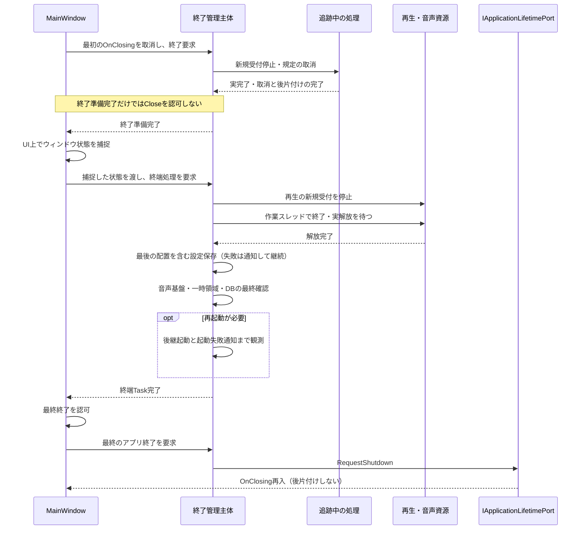

# 終了と再起動

## 目的と適用範囲

通常終了、更新、動作モードの変更、管理データの撤去を共通の終了処理へ接続し、追跡しているDB・ファイル処理と再生の実完了を待つ契約です。致命的例外やOSによる強制終了に同じ保証はありません。

## 用語

[共通用語集](../glossary.md)を参照します。コードの識別子は原表記を使います。

## 仕様

操作の受付分類・競合結果・必要継続の寿命は[競合ポリシー](../core/operation-concurrency-policy.md)を正本とします。以下は入力・処理・資源所有と結果の固有契約です。

### 終了要求の受付

通常終了では `MainWindow.OnClosing` が最初の要求を取り消し、`ShellShutdownWorkflowOwner` の終了準備を開始します。所有するプロパティ・一括編集dialogへもこの入口で終了を伝え、受理済みapplyを捨てず追跡します。dialogの終了を全P終端待ちより後に遅らせて循環待ちを作りません。準備が済んだだけではウィンドウを閉じず、終端処理のTaskを待ってから最終の終了を認可します。再入した `OnClosing` と `Closed` は後片付けを繰り返しません。

更新は先にパッケージと起動情報を準備し、待機状態の更新プログラムを起動します。その後に同じUI Dispatcherで終了を受け付けます。既知の処理が完了した後に `Proceed` を送り、更新プログラムはその通知と現プロセスの終了の両方を待って上書きします。終了やモード変更が先に受理されていた場合は `Abort` を送ります。

モード・LR2基礎パスの変更も同じDispatcherで先着順を確定します。その最小組だけを保存し、beatorajaや他セクションの候補を保存しません。保存失敗では終了準備へ進まず設定画面へ返します。保存・再起動受理後は当該L/Pを解放して通常の `MainWindow.Close`、終了join、後継起動へ進みます。beatorajaの変更と必要な旧新BMT処理は設定側の局所操作で完結し、再起動の前処理へ組み込みません。反映の入口と取消は[設定](settings.md#lr2の場所と設定xml)に従います。

終了準備は不可逆です。開始後に更新プログラム等の起動が失敗しても、半分停止したアプリとして継続せず、失敗を記録して共通の後片付けと終了へ進みます。

### 終了開始後の画面反映

最初の終了要求を受理した後に戻る表示専用の非同期処理や遅延Dispatcher処理は、結果を破棄して閉鎖中・閉鎖済みのメイン画面を変更しません。設定画面の表示要求も、UIキューでの実行直前に既存の終了状態を確認します。保留中の画面処理を所有側で取り消せる場合は取り消し、取り消せない場合も反映直前に終了状態を再確認します。メニュー、整列表示、選択・フォーカス、遅れて戻る成功・失敗通知などを終了開始後に新たに画面へ反映しません。

この破棄は表示結果だけに適用します。DB・ファイル・通信などの処理を未完了のまま切り離す理由にはせず、終了準備で待つ対象は引き続き実完了または規定の取消完了まで所有します。終端処理が明示的に行うウィンドウ状態の捕捉と設定保存は、後述の順序に従います。

設定画面から受理した局所処理・明示音声テストは既存の設定ViewModelが単一の実操作Taskを所有し、閉じたことを完了と扱いません。`MainWindow`はWindow別のTaskを蓄積せず、設定担当から実終端Taskを直接取得します。通常Close・Esc・再表示や手動同期の先行自動閉鎖でWindow参照が変わっても、捕捉済み要求を取り消さず、初期化の事前準備やL/P解放後の必須UI待ちも含む実終端を待ってからruntimeを終了します。終了開始時は表示を失効させ新規受付を止め、独立音声担当の一覧・照会・テストもnative解放までjoinします。再起動・撤去の要求元操作自身を終了待機へ循環接続しません。撤去は要求受理後に設定操作を解放し、その実Taskと通常終了の全実処理を回収した終端段階でだけ行います。成否通知を待ち、通知失敗時も終了を続けます。

音声一覧取得・能力照会・テストは既存音声管理主体が実終端タスクを所有します。設定画面の表示失効後に合成完了タスクを捕捉し、一覧のバックグラウンド処理待ち、旧能力照会待ち、方式間とネイティブ解放を含む終端まで待ちます。表示終了や一覧の可視状態を処理完了として扱わず、非取消ネイティブ処理を強制解放しません。表示失効後の後続照会を抑止することで、捕捉したタスクの後に新しい照会を取りこぼしません。詳細は[設定](settings.md#音声一覧の非同期取得)に従います。

### 終了準備で待つもの

`PrepareShutdownAsync` は実行中・完了後とも同じTaskを返します。最初に `BMSLibrary.RequestShutdown` と `BMSPlaylist.RequestShutdown` を呼び、新しい処理の受付を止めます。

| 対象 | 終了時の扱い |
| --- | --- |
| 起動時の処理 | 必須手続きは開始済みTaskとcleanupの実終端まで親L/Pを保持する。LR2終了取消も既存の`ShutdownRequested`へ伝播し、受付解放後の初回完了・操作解禁・外部同期投入を中止する。設定借用と完了コールバックにも同じ条件を適用する。後続schedulerの `chart_info_hydration`、`maintenance_hydration`、`installable_maintenance` は依存待ちと未到達の登録完了待ちを緩め、実処理の枠と先行必須処理の終端順を保って終結させる。各処理は終了要求を確認し、DB・ファイル処理へ入らず状態を戻す |
| その他の未実行の起動処理 | 実行せず `discarded` として終える。終了要求後の新しい受付も行わない |
| URL取得 | 単発・一括・外部APIの本文I/Oを取り消し、表示終了後に導入引渡しや未受理cleanupを待つ要求も含めて、開始済み全Taskの実終端を待つ |
| プレイリスト・履歴 | 入力構築、絞込み、参照索引の事前計算を取り消し、履歴の条件・表示先更新、参照反映、外部同期、再読込みの後片付け、出力と読込み、プレイリスト局所受付の必須公開・通知・後片付けの実終端まで待つ |
| ライブラリ変更 | 登録済みの通常リネームとその更新、ドロップ導入から直接自動推定までと手動推定を取り消すか実完了まで待つ。取消後も開始済み全評価Taskと後片付けを待機し、未反映の兄弟成功は適用しない。リネームの失敗でも残りの待機を省かない |
| 後続のデータ読込み | 譜面情報、保守、スコア、順位などが終了要求を確認して処理を終えられるようにする |
| 同期と接続 | 起動・再読込みのセマフォ、各待機対象、LR2のDB用ロック、追跡済みSQLite接続が未使用になるまで待つ |

起動の追加親が消えても、終了待機はスケジューラーが追跡する全仕事と事前準備の実終端を待ちます。難易度表リスト取得も通信からUI適用まで同じ仕事として追跡し、終了取消を保ちます。表示親の寿命を終了待機の条件に使いません。

IR通信・解析・保存は順位更新の一つのscheduler workとして実終端まで追跡します。共有prefetch Taskを別に切り離しません。HTTP本文の受信へ取消を伝え、終了要求後の結果をDBやスコアへ適用しません。利用側の待ちだけを解除して通信を切り離しません。

アプリ内の正常な終了に、時間超過で未完了処理を置き去りにする経路はありません。主処理は60秒、キューと事前計算は20秒を遅延警告の基準にし、超過時に `shutdown wait_slow` を一回記録して待機を続けます。強制終了は外部の責務です。

ライブラリ受付とプレイリスト受付の実idle Taskも待機し、音声変換のnative解放、通信・必要出力・cleanupを実行中フラグだけから完了と推定しません。

譜面プロパティの独立窓は、最初のメインClose受付で新規表示・読取りを止めて全窓を閉じます。終端の画面処理で、先に個別Closeした窓も含む開始済み読取りTaskを待ってから `CompleteTerminalShutdownAsync` へ進みます。通常失敗は既存表示モデルがログ・回収し、閉鎖後に反映しません。Show中の終了再入後は読取りを開始せず、遅れて戻る表示失敗の新しい通知も抑止します。詳細は[譜面プロパティ](../ui/chart-properties.md)を参照します。

### 再生の受付停止と終端の順序

`CompleteTerminalShutdownAsync` も同じTaskを共有します。最初の非同期待機より前に再生パネルの新しい再生・操作・自動送りを停止します。UI上でプレイヤーのロックを待ちません。先行していた曲解決が戻っても新しい再生へ進めず、古い終了通知も次曲を開始しません。通常の停止・次曲・プレイヤー変更ではこの終端専用の受付を閉じません。

内蔵playerの終了は、先行する曲開始に合流し、先読みの取消後も入力・decoderの後片付けを待ってから現在曲とruntimeを解放します。終了受付後に変更側が再生停止を要求した場合は、その変更を取消として終え、terminalの停止を待たずに書き込みへ進ませません。

終端では次の順序を維持します。

1. UI上でウィンドウ状態を捕捉する。
2. プレイヤーの終了と実際の解放を作業スレッドで行い、UIを止めずに待つ。
3. 最後のプレイヤー配置を含む設定をUI上で保存し、失敗通知も処理する。
4. 通常譜面の停止、音声基盤、一時領域、DBの最終確認を完了する。
5. 必要なら後継プロセスを起動し、最終のアプリ終了を要求する。

設定保存の失敗は記録・通知したうえで後片付けを続けます。待機の打切り、プレイヤーの切離し、強制的なネイティブ解放は追加しません。

LR2試聴の終了はプレイヤーの終端かプロセスの終了通知へ合流します。構成が保持する同じLR2所有者の現在正本を出力して後続登録と通常値・欠落を保ち、復元と所有の解消後にだけ次を受け付けます。設定保存のロック内でUI、プロセス待機、ウィンドウ操作を行いません。詳細は外部起動の仕様に従います。

### 再起動と最終の終了

`IApplicationLifetimePort.RequestShutdown` は、通常の準備と後片付けを通過した後にWPFの終了へ接続する境界です。差し替え可能であっても前段を短絡しません。

モード変更の `RestartApplicationAsync` は、ミューテックスを解放して後継プロセスを起動するだけです。自身でWPFを終了しません。起動失敗の通知の完了・失敗・非表示も観測してから終端Taskを完了します。メイン画面だけがTaskの完了後に終了を認可します。後継の起動と旧プロセスの最終終了が短時間重なることは許容します。

#### 終了準備から真の終端まで

通常終了の制御順を示します。矢印は次へ進める条件、シーケンス内の待機はTaskの実完了を待つことを表し、UIスレッドの同期ブロックではありません。既知の失敗は記録し、規定された後片付けを継続します。`MainWindow` が所有するダイアログ等の終端と、その所有処理・後片付けの収束は、終了準備完了後からウィンドウ状態捕捉までの内部詳細として省略します。

遅延警告の時間を超えても実処理を置き去りにしません。更新の `Proceed` と親プロセス終了の条件は[更新合意](../integration/portable-update.md#終了前の合意)を参照します。

### SQLiteと失敗の観測

`SQLiteConnectionEx` は `ShutdownOperationTracker` で接続の寿命を追跡し、終了準備は接続数0まで待ちます。生の値を読む `GetRawValuesAsString` は例外時も準備済みの文を解放します。接続を閉じる失敗の件数は結果とログに保持します。

終端でのLR2楽曲・スコアDBのロック確認は取得後に必ず解除します。未取得なら遅延警告後も待ちます。これは通常の終了準備後の最終確認であり、先行処理の追跡を代替しません。

統制された終了中に限り、未解放の文・未完了バックアップを理由にしたSQLite接続終了エラーは非常用ダイアログを出さず記録します。通常動作中の同じエラーは抑止しません。CLRが終了を決定済みの`AppDomain`例外も、この条件で回復扱いにしません。

未処理例外の最終防壁では、`NullReferenceException`・`InvalidOperationException`・`COMException`の型やHRESULTだけを理由に無記録で継続しません。元原因のローカル診断と非常用案内を個別に試し、自動送信しません。案内、`MainWindow`の不在・`Close`失敗にかかわらず、非デバッグ時は既存の最終終了へ到達します。窓のCloseはUIスレッドの場合だけ行い、非UIのAppDomain例外では窓を操作・待機せず最終終了へ進みます。

通常診断の非同期保存は、正常終了・起動失敗・未処理例外による最終終了で標準フラッシュを最大2秒だけ試します。起動失敗も `Shutdown` が発火するExitイベントで一回だけフラッシュし、失敗処理内では重ねて待ちません。基本環境の収集Taskは終了待機へ加えません。ログ失敗は元例外を置換せず、再帰記録もしません。通常終了では性能診断と通常ログの保存失敗がミューテックス解放を飛ばさず、起動失敗ではミューテックス解放の失敗が`Shutdown`の呼出しを飛ばしません。通常のDB・ファイル・通信の整合性待ちを、この診断専用の上限で打ち切りません。

### 既存宛先の復元不能による終了

所持先を退避・変更した後に元へ戻せず、具体的な危険が残る場合は、[ファイルとDBの整合](../library/file-db-consistency.md#局所的なファイル処理と補償)に従って操作を中止します。先行正常対象の一回保存と、当該操作が所有する処理・受付・排他の終端を経て、構成から最終終了へ渡します。新しいファイル操作と再生の受付を止め、通常の画面反映や後続操作へ戻しません。

この明示入口は既存の非常用案内と `finally` の `Environment.Exit(1)` を使います。`MainWindow.Close` と通常のShell終端は経由せず、設定保存、一時領域の一括削除、更新・再起動を始めません。復旧候補を保全し、案内の表示成否で終了を取り消しません。私有一時物の残留や補償済みの通常失敗だけでは、この入口へ進みません。

この経路は当該操作の通常終端を待ちますが、通常Closeが行う全処理の待機・全資源の解放を追加保証しません。プロセス終了後の自動修復や回復日誌も設けません。

### 保証の範囲

追跡対象は現在把握している長時間のDB・ファイル・通信処理です。全ての `Task.Run` の意味的な安全性を証明する台帳ではありません。新しい長時間処理は終了要求で停止するか、実完了を待つ対象へ登録します。個別の進捗画面が持つ取消もその所有に従います。未処理の致命的例外からの `Environment.Exit(1)` は通常終了の整合性待ちを保証しません。

構成の寿命で共有するプレイリスト受付と、各storeの終了状態は分離します。旧storeの終了要求で後継操作の生存権限を解放・失効しません。通常Closeは現在の受理済みプレイリスト処理の通知・後片付けを含む実終端を待ちます。再構築の必要継続は自身が保持する受付のidle待機を行わず、明示された権限を借用します。

モデル置換では個別モデルの停止・CTSだけを通知し、構成寿命の共有L/P受付を閉じません。共有受付はアプリshutdown時に閉じます。既存L待ちの旧仕事は取得後に自モデル停止を確認してDB変更前に終端し、現在モデルの受理済み継続は実終端まで回収します。

## 実装とテストの対応

| 仕様項目・主な条件 | 実装箇所 | テスト箇所・確認内容 |
| --- | --- | --- |
| アプリの起動失敗・最終防壁と、診断・終了の分離 | [`App`](../../../BeMusicSeeker/App.cs) | 必須起動準備と収集待ちの非干渉は [`ApplicationStartupCompositionOwnerTests`](../../../BeMusicSeeker.Tests/Startup/ApplicationStartupCompositionOwnerTests.cs)、通常終了は [`ShellShutdownWorkflowOwnerTests`](../../../BeMusicSeeker.Tests/MainWindow/ShellShutdownWorkflowOwnerTests.cs)、上限付きフラッシュは [`NLogWrapperTests`](../../../BeMusicSeeker.Tests/Runtime/NLogWrapperTests.cs) が分担する。ローカル診断の捕捉、限定したSQLite抑止、CLR終端、通知・窓閉鎖の失敗後も最終終了へ進む制御、非UIで窓を操作しないこと、各終端からのフラッシュ接続とミューテックス解放は静的に確認する。致命的な終了の実行は自動テストでは未確認。 |
| 既存宛先の復元不能と通常終了の区別 | [標準構成](../../../BeMusicSeeker/ViewModels/MainWindow/ApplicationComposition.cs)、[lifetime境界](../../../BeMusicSeeker/AppApplicationLifetime.cs)、[最終終了](../../../BeMusicSeeker/App.cs) | 操作所有者からの終了到達は[整合性のテスト分担](../library/file-db-consistency.md#実装とテストの対応)で確認する。Appの明示入口から非常用案内と最終終了への接続、通常Close・設定保存・一時領域削除・再起動を通さないことは静的に確認する。実プロセスの最終終了は代替しており、自動テストで実行しない。 |
| 局所プレイリストの空の結果記録の配送終端を待つ終了 | [`ShellShutdownWorkflowOwner`](../../../BeMusicSeeker/ViewModels/MainWindow/ShellShutdownWorkflowOwner.cs) | [`DefaultComposition_OutputPlacementChangesAfterPersistenceAndPlaylistNotificationDrainsOnClose`](../../../BeMusicSeeker.Tests/Settings/SettingDialogEditCompletionTests.cs) は、ドロップの空の結果記録の購読処理中も受理Task・Pを保持し、競合拒否と終了要求の待機を確認する。配送後はドロップと `RequestWindowCloseAsync` が終端し、L/Pを解放する。実ダイアログの表示待ちを確認するケースではない。 |
| 通常・更新時の終了、再入、UI応答、順序とTask共有 | [`ShellShutdownWorkflowOwner`](../../../BeMusicSeeker/ViewModels/MainWindow/ShellShutdownWorkflowOwner.cs)、[`MainWindow`](../../../BeMusicSeeker/Views/MainWindow/MainWindow.cs) | [`ShellShutdownWorkflowOwnerTests`](../../../BeMusicSeeker.Tests/MainWindow/ShellShutdownWorkflowOwnerTests.cs)、[`MainWindowViewHostTests`](../../../BeMusicSeeker.Tests/MainWindow/MainWindowViewHostTests.cs)、[`ApplicationCompositionTests`](../../../BeMusicSeeker.Tests/MainWindow/ApplicationCompositionTests.cs)。`MainWindowShutdownCapturePrecedesShellCompletion` は終了受付後の即時表示要求と、受付前に予約した遅延表示要求の抑止も確認する。`TerminalAsyncPlayerCloseRunsOnWorkerBeforeUiSettingsSave` は非同期player停止の同期部分も作業スレッドで実行し、解放後の設定保存はUI上で行うことを確認する。 |
| 実導入・player・保存・終了の順序 | [`ShellShutdownWorkflowOwner`](../../../BeMusicSeeker/ViewModels/MainWindow/ShellShutdownWorkflowOwner.cs) | [`MainWindowViewHostTests`](../../../BeMusicSeeker.Tests/MainWindow/MainWindowViewHostTests.cs) の `MainWindowPlayerDrainKeepsDispatcherResponsiveAndDefersTerminalClose`: 通常Closeでは実導入実処理の終端前にplayer停止・終端保存・最終終了へ進まず、導入とplayerの全Task終端後に保存と終了を行う。 |
| 通常設定閉鎖・再表示を越えるTaskと音声native終端のjoin | [`SettingsDialogViewModel`](../../../BeMusicSeeker/ViewModels/Settings/SettingsDialogViewModel.Operation.cs)、[`MainWindow`](../../../BeMusicSeeker/Views/MainWindow/MainWindow.cs) | `SettingsWindowPresentationTests.MainWindow_NormalSettingsCloseEndsModalBeforeActualFileDiffTerminates` は実FileDiffのgateとL/Pを、`MainWindow_OwnerShutdownWaitsForAcceptedAudioWorkBeforeRuntimeShutdown` は通常閉鎖後の同じ設定Taskと独立音声終端を確認する。`SettingDialogOperationShutdownTests` は初回準備・必須UIと手動同期の先行閉鎖後のjoinを分担する。 |
| idleのmode変更と最小保存、実Closeとの接続 | [`SettingsDialogViewModel`](../../../BeMusicSeeker/ViewModels/Settings/SettingsDialogViewModel.cs)、[`ShellShutdownWorkflowOwner`](../../../BeMusicSeeker/ViewModels/MainWindow/ShellShutdownWorkflowOwner.cs) | [`MainWindowViewHostTests`](../../../BeMusicSeeker.Tests/MainWindow/MainWindowViewHostTests.cs) の `MainWindowOperationModeRestartDrainsPlayerBeforeStartAndShutdown`、`MainWindowCloseDuringModeConfirmationPreservesEarlierCloseWithoutModeSave`、`MainWindowOperationModeRestartSaveFailureRetainsSettingsWithoutShutdown` は実Close、player終端、実XMLの最小保存、保存失敗時の編集再開・終了抑止を確認する。Busyの保存拒否は設定仕様の実導入caseに分担する。 |
| 再起動失敗通知の完了・非表示・例外と終端 | [`ApplicationComposition`](../../../BeMusicSeeker/ViewModels/MainWindow/ApplicationComposition.cs)、[`ShellShutdownWorkflowOwner`](../../../BeMusicSeeker/ViewModels/MainWindow/ShellShutdownWorkflowOwner.cs) | [`ShellShutdownWorkflowOwnerTests`](../../../BeMusicSeeker.Tests/MainWindow/ShellShutdownWorkflowOwnerTests.cs) の `ComposedOperationModeRestartFailureAwaitsNotificationBeforeTerminalCompletion`、`ComposedOperationModeRestartNotificationUnavailableCompletesTerminal`、`ComposedOperationModeRestartNotificationExceptionCompletesTerminal` はWindowなしで標準構成の実VM・通知接続を通す。実XMLのmode・履歴だけの保存、元起動失敗の通知、通知保持中の未終端、非表示・通知例外後の終端と報告、最終終了一回を確認する。 |
| 終端後の再生禁止、先行の曲解決、通常停止後の再開 | [`PlaybackPanelViewModel`](../../../BeMusicSeeker/ViewModels/Playback/PlaybackPanelViewModel.cs) | [`PlaybackPanelViewModelTests`](../../../BeMusicSeeker.Tests/Playback/PlaybackPanelViewModelTests.cs) |
| 起動処理とプレイリストの終了待ち | [`StartupBackgroundTaskSchedulerOwner`](../../../BeMusicSeeker/ViewModels/Startup/StartupBackgroundTaskSchedulerOwner.cs) | [`StartupBackgroundTaskSchedulerOwnerTests`](../../../BeMusicSeeker.Tests/Startup/StartupBackgroundTaskSchedulerOwnerTests.cs)、[`PlaylistShutdownCoordinatorTests`](../../../BeMusicSeeker.Tests/Playlist/PlaylistShutdownCoordinatorTests.cs) |
| 試聴の現在正本による復元、開始・終了失敗と明示再試行 | [`LR2body`](../../../BeMusicSeeker/Models/LR2/LR2body.cs)、[`Lr2ConfigOwner`](../../../BeMusicSeeker/Models/LR2/Lr2ConfigOwner.cs) | [`ExternalPlayerProcessGatewayTests`](../../../BeMusicSeeker.Tests/Processes/ExternalPlayerProcessGatewayTests.cs)、[`process終了後の復元再試行`](../../../BeMusicSeeker.Tests/Processes/Lr2PreviewOwnerTests.cs) |
| 拡張データ削除の受付、実処理終端後の撤去、失敗通知後の終了、LR2既存テーブルの保護 | [`ApplicationDataUninstallWorkflowOwner`](../../../BeMusicSeeker/ViewModels/Settings/ApplicationDataUninstallWorkflowOwner.cs)、[`LR2SongDB`](../../../BeMusicSeeker/Models/LR2/LR2SongDB.cs) | [`ApplicationDataUninstallWorkflowOwnerTests`](../../../BeMusicSeeker.Tests/Settings/ApplicationDataUninstallWorkflowOwnerTests.cs)、[`ShellShutdownUninstallTests`](../../../BeMusicSeeker.Tests/MainWindow/ShellShutdownUninstallTests.cs)、[`SettingsWindowPresentationTests`](../../../BeMusicSeeker.Tests/Settings/SettingsWindowPresentationTests.cs)、[`LR2SongDBExtendedUninstallTests`](../../../BeMusicSeeker.Tests/Lr2/LR2SongDBExtendedUninstallTests.cs) |
| 再起動の引数、実行パス、作業ディレクトリと引渡し順 | [`ApplicationRestartRequest`](../../../BeMusicSeeker/Models/Utils/Processes/ApplicationRestartGateway.cs)、[`ApplicationRestartArgumentsPolicy`](../../../BeMusicSeeker/Models/Utils/Processes/ApplicationRestartGateway.cs) | [`ApplicationRestartGatewayTests`](../../../BeMusicSeeker.Tests/Processes/ApplicationRestartGatewayTests.cs) |

## 関連資料

[起動](startup.md)、[設定](settings.md)、[音声基盤](audio.md)、[外部起動](../ui/external-launch.md)、[自動更新](../integration/portable-update.md)を参照します。
