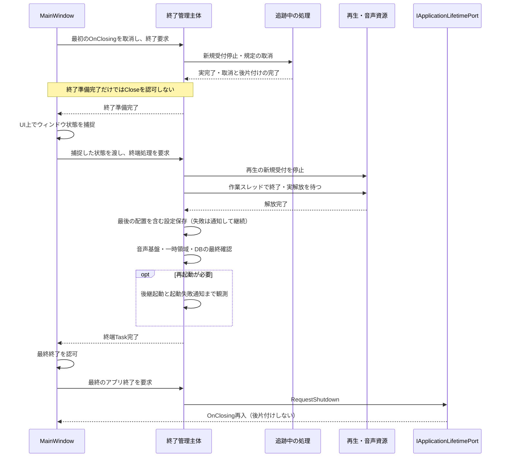

# 終了と再起動

## 目的と適用範囲

通常終了、更新、動作モードの変更、管理データの撤去を共通の終了処理へ接続し、追跡しているDB・ファイル処理と再生の実完了を待つ契約です。構成で共有する受付の閉鎖もここで定めます。致命的例外やOSによる強制終了に同じ保証はありません。

操作の受付分類・競合結果・必要な継続の寿命は[操作の競合ポリシー](../core/operation-concurrency-policy.md)を正本とします。本書は、終了の入力・処理・資源の所有と結果の固有の契約を定めます。

## 用語

[共通用語集](../glossary.md)を参照します。LとPは[操作の競合ポリシーの用語](../core/operation-concurrency-policy.md#用語)に従います。コードの識別子は原表記を使います。

| 用語 | 意味 |
| --- | --- |
| 終了準備 | 新規の受付を止め、追跡中の処理の実完了または規定の取消完了を待つ段階。完了してもウィンドウは閉じない。 |
| 終端処理 | 終了準備の後に、再生の停止・資源の解放・設定の保存・最終確認・後継の起動を行う段階。 |
| 最終の終了 | 終端処理のTaskの完了後に、メイン画面が認可するアプリの終了。 |

## 仕様

### 終了要求の受付

| 要求 | 受付と結果 |
| --- | --- |
| 通常終了 | `MainWindow.OnClosing` が最初の要求を取り消し、`ShellShutdownWorkflowOwner` の終了準備を開始する。終了準備が済んだだけではウィンドウを閉じず、終端処理のTaskを待ってから最終の終了を認可する。再入した `OnClosing` と `Closed` は後片付けを繰り返さない。 |
| 更新 | 先にパッケージと起動情報を準備し、待機状態の更新プログラムを起動してから、同じUI Dispatcherで終了を受け付ける。既知の処理の完了後に `Proceed` を送り、更新プログラムはその通知と現プロセスの終了の両方を待って上書きする。終了やモード変更が先に受理されていた場合は `Abort` を送る。 |
| モード・LR2基礎パスの変更 | 同じDispatcherで先着順を確定する。その最小の組だけを保存し、beatorajaや他のセクションの候補は保存しない。保存の失敗では終了準備へ進まず、設定画面へ返す。保存・再起動の受理後は、該当するLとPを解放してから、通常の `MainWindow.Close`、終了の合流、後継の起動へ進む。 |

`MainWindow` は、自分が所有するプロパティ・一括編集のダイアログへも、`OnClosing` の入口で終了を伝えます。受理済みの適用は捨てずに追跡し、ダイアログの終了を全てのPの終端待ちより後に遅らせて循環待ちを作りません。

beatorajaの変更と、必要な旧新のBMT処理は設定側の局所操作で完結し、再起動の前処理へ組み込みません。反映の入口と取消は[設定](settings.md#lr2の場所と設定xml)に従います。

終了準備は不可逆です。開始後に更新プログラム等の起動が失敗しても、半分停止したアプリとして継続せず、失敗を記録して共通の後片付けと終了へ進みます。

### 終了開始後の画面反映

最初の終了要求を受理した後に戻る表示専用の非同期処理や遅延したDispatcher処理は、結果を破棄し、閉鎖中・閉鎖済みのメイン画面を変更しません。

- 設定画面の表示要求も、UIキューでの実行直前に既存の終了状態を確認します。
- 保留中の画面処理を所有側で取り消せる場合は取り消し、取り消せない場合も反映直前に終了状態を再確認します。
- メニュー、整列表示、選択・フォーカス、遅れて戻る成功・失敗の通知などを、終了開始後に新たに画面へ反映しません。

この破棄は表示結果だけに適用します。DB・ファイル・通信などの処理を未完了のまま切り離す理由にはせず、終了準備で待つ対象は、引き続き実完了または規定の取消完了まで所有します。終端処理が明示的に行うウィンドウ状態の捕捉と設定の保存は、[再生の受付停止と終端の順序](#再生の受付停止と終端の順序)に従います。

#### 設定画面と音声の操作

設定画面から受理した局所処理と明示的な音声テストは、既存の設定ViewModelが単一の実操作のTaskを所有し、画面を閉じたことを完了と扱いません。

- `MainWindow` はWindowごとのTaskを蓄積せず、設定の担当から実際の終端のTaskを直接取得します。
- 通常のClose・Esc・再表示や、手動同期の先行する自動閉鎖でWindowの参照が変わっても、捕捉済みの要求を取り消しません。初期化の事前準備や、LとPの解放後の必須UIの待機も含む実終端を待ってから、実行基盤を終了します。
- 終了開始時は表示を失効させ、新規の受付を止めます。
- 再起動・撤去の要求元の操作自身を、終了の待機へ循環して接続しません。撤去は要求の受理後に設定操作を解放し、その実Taskと通常終了の全ての実処理を回収した終端の段階でだけ行います。成否の通知を待ち、通知に失敗しても終了を続けます。

音声の一覧取得・能力照会・テストは、既存の音声の管理主体が実終端のTaskを所有します。設定画面の表示の失効後に合成した完了のTaskを捕捉し、一覧のバックグラウンド処理、旧い能力照会、方式間の切替とネイティブの解放を含む終端まで待ちます。表示の終了や一覧の可視状態を処理の完了として扱わず、取消できないネイティブ処理を強制的に解放しません。表示の失効後の照会を抑止することで、捕捉したTaskの後に新しい照会を取りこぼしません。詳細は[設定](settings.md#音声一覧の非同期取得)に従います。

### 終了準備で待つもの

終了準備は、`ShellShutdownWorkflowOwner` が実行中・完了後とも同じTaskを返します。最初に `BMSLibrary.RequestShutdown` と `BMSPlaylist.RequestShutdown` を呼び、新しい処理の受付を止めます。

| 対象 | 終了時の扱い |
| --- | --- |
| 起動の必須処理 | 開始済みのTaskと後片付けの実終端まで、親のLとPを保持する。LR2の終了による取消も既存の `ShutdownRequested` へ伝播し、受付の解放後の初回完了・操作解禁・外部同期の投入を中止する。設定の借用と完了コールバックにも同じ条件を適用する（[起動の結果の分類](startup.md#結果の分類)）。 |
| 起動の必須な後続 | スケジューラーの `chart_info_hydration`、`maintenance_hydration`、`installable_maintenance` は、依存待ちと未到達の登録完了待ちを緩め、実処理の枠と先行する必須処理の終端の順を保って終結させる。各処理は終了要求を確認し、DB・ファイル処理へ入らずに状態を戻す。 |
| その他の未実行の起動処理 | 実行せず `discarded` として終える。終了要求の後の新しい受付も行わない。 |
| URL取得 | 単発・一括・外部APIの本文の入出力を取り消す。表示の終了後に導入の引渡しや未受理の後片付けを待つ要求も含めて、開始済みの全Taskの実終端を待つ。 |
| プレイリスト・履歴 | 入力の構築、絞込み、参照索引の事前計算を取り消す。履歴の条件・表示先の更新、参照の反映、外部同期、再読込みの後片付け、出力と読込み、プレイリストの局所受付の必須の公開・通知・後片付けの実終端まで待つ。 |
| ライブラリ変更 | 登録済みの通常の改名とその更新、ドロップ導入から直接の自動推定まで、手動推定を、取り消すか実完了まで待つ。取消後も開始済みの全評価のTaskと後片付けを待ち、未反映の兄弟の成功は適用しない。改名の失敗でも、残りの待機を省かない。 |
| 後続のデータ読込み | 譜面情報、保守、スコア、順位などが、終了要求を確認して処理を終えられるようにする。 |
| 同期と接続 | 起動・再読込みのセマフォ、各待機対象、同じ構成が所有するsong・scoreの再入の排他、読取り専用を含む全てのSQLite接続の実終端を待つ。 |
| 受付の空き | ライブラリの受付とプレイリストの受付の実際のidleのTaskを待つ。音声変換のネイティブの解放、通信・必要な出力・後片付けを、実行中フラグだけから完了と推定しない。 |

起動の追加処理の表示親が消えても、終了の待機はスケジューラーが追跡する全ての仕事と事前準備の実終端を待ちます。難易度表リストの取得も、通信からUIへの適用まで同じ仕事として追跡し、終了による取消を保ちます。表示親の寿命を、終了の待機の条件に使いません。

IRの通信・解析・保存は、順位更新の一つのスケジューラーの仕事として実終端まで追跡します。共有の先行取得のTaskを別に切り離しません。HTTPの本文の受信へ取消を伝え、終了要求の後の結果をDBやスコアへ適用しません。利用側の待機だけを解除して、通信を切り離すことはしません。

譜面プロパティの独立した窓は、最初のメイン画面のClose受付で新規の表示・読取りを止め、全ての窓を閉じます。終端の画面処理で、先に個別にCloseした窓も含む開始済みの読取りのTaskを待ってから、`CompleteTerminalShutdownAsync` へ進みます。通常の失敗は既存の表示モデルがログ・回収し、閉鎖後に反映しません。表示中の終了の再入の後は読取りを開始せず、遅れて戻る表示の失敗の新しい通知も抑止します。詳細は[譜面プロパティ](../ui/chart-properties.md)を参照します。

#### 待機の時間と診断

アプリ内の正常な終了に、時間超過で未完了の処理を置き去りにする経路はありません。主処理は60秒、キューと事前計算は20秒を遅延の警告の基準とし、超過時に `shutdown wait_slow` を一回記録して待機を続けます。強制終了は外部の責務です。

未完了のTask・idleでない条件の待機へ入るときは、待機の対象を `wait_start target=...` で一回記録します。遅延の警告に達する前の停止箇所も診断でき、診断の失敗で実処理の待機を打ち切りません。

### 構成で共有する受付の閉鎖

構成の寿命で共有するLとPの受付は、アプリの終了でだけ閉じます。終了の開始時に新規の非待機の受付を不可逆に閉じ、生存中の権限の借用と、登録済みの必須の背景継続は保持します。受付の分類・開始と権限の借用は[競合ポリシー](../core/operation-concurrency-policy.md#受付の開始終端と権限)を正本とします。

| 契機 | 共有受付 | 個別の扱い |
| --- | --- | --- |
| アプリの終了 | 閉じる。 | 通常のCloseは、現在の受理済みのプレイリスト処理の通知・後片付けを含む実終端を待つ。 |
| モデルの置換 | 閉じない。個別のモデルの停止・取消だけを通知する。 | Lを待っていた旧い仕事は、取得後に自分のモデルの停止を確認してDBの変更前に終端する。現在のモデルの受理済みの継続は実終端まで回収する（[起動のモデルの組](startup.md#モデルの組と任意処理の寿命)）。 |
| 旧いDB窓口の終了要求 | 閉じない。 | プレイリストの受付と各DB窓口の終了状態は分離し、後継の操作の生存中の権限を解放・失効させない。 |

再構築の必要な継続は、自身が保持する受付のidleを待たず、明示された権限を借用します。

### 再生の受付停止と終端の順序

`CompleteTerminalShutdownAsync` も同じTaskを共有します。最初の非同期の待機より前に、再生パネルの新しい再生・操作・自動送りを停止します。

- UI上でプレイヤーのロックを待ちません。
- 先行していた曲の解決が戻っても新しい再生へ進めず、古い終了通知も次の曲を開始しません。
- 通常の停止・次の曲・プレイヤーの変更では、この終端専用の受付を閉じません。

内蔵プレイヤーの終了は、先行する曲の開始に合流し、先読みの取消後も入力・デコーダーの後片付けを待ってから、現在の曲と実行基盤を解放します。終了の受付後に変更側が再生の停止を要求した場合は、その変更を取消として終え、終端の停止を待たずに書込みへ進ませません。

終端では次の順序を維持します。

1. UI上でウィンドウの状態を捕捉する。
2. プレイヤーの終了と実際の解放を作業スレッドで行い、UIを止めずに待つ。
3. 最後のプレイヤーの配置を含む設定をUI上で保存し、失敗の通知も処理する。
4. 通常の譜面の停止、音声基盤、一時領域、DBの最終確認を完了する。
5. 必要なら後継プロセスを起動し、最終のアプリの終了を要求する。

設定の保存の失敗は記録・通知したうえで後片付けを続けます。待機の打切り、プレイヤーの切離し、強制的なネイティブの解放は追加しません。

LR2の試聴の終了は、プレイヤーの終端かプロセスの終了通知へ合流します。構成が保持する同じLR2の所有者の現在の正本を出力して、後続の登録と通常値・欠落を保ち、復元と所有の解消の後にだけ次を受け付けます。設定の保存のロック内で、UI、プロセスの待機、ウィンドウの操作を行いません。詳細は[外部起動](../ui/external-launch.md)の仕様に従います。

### 再起動と最終の終了

一時領域全体の終端は、実際の `App` の寿命の管理主体が所有します。Shellは、DB等の開始済みの処理を回収してから、寿命の管理主体が返す一時領域の実Taskを待ち、その後に後継の起動へ進みます。headless構成の終了ではプロセス全体の一時領域を削除せず、テストの準備側は自分の末端のディレクトリを回収します。

一時セッションは、専有の範囲の新しいGUIDのディレクトリへ作り、既知のv2の目印を `FileShare.None` で保持してから末端のディレクトリを返します。

| 時機 | 扱い |
| --- | --- |
| 起動時の回収 | 範囲内で直列化し、排他取得できる既知の目印だけを回収する。生存中・未知の版・旧い目印・目印なし・所有を確認できない候補は保持する。 |
| 終了 | 新規の取得を止め、開始済みの回収のTaskの終端、生存中の保持の解放、自分のセッションの削除の順で完了する。繰返しの終了は同じTaskを返し、セッションを復活させない。 |
| 強制終了 | 残ったセッションは、OSが保持を解放した後の起動で回収する。 |

通常の再起動は、起動時に捕捉した引数を保持し、検証起動では絶対パスのmanifestも引き継ぎます。更新後の再起動も同じ捕捉した引数を使います（[更新](../integration/portable-update.md#引数と境界)）。引用は既存のWindowsのプロセス起動の境界だけで行います。

`IApplicationLifetimePort.RequestShutdown` は、通常の準備と後片付けを通過した後にWPFの終了へ接続する境界です。差し替え可能であっても、前段を短絡しません。

モード変更の `RestartApplicationAsync` は、ミューテックスを解放して後継プロセスを起動するだけで、自身ではWPFを終了しません。起動失敗の通知の完了・失敗・非表示も観測してから、終端のTaskを完了します。メイン画面だけが、そのTaskの完了後に終了を認可します。後継の起動と、旧いプロセスの最終の終了が短時間重なることは許容します。

#### 終了準備から真の終端まで

通常終了の制御順を示します。矢印は次へ進める条件、シーケンス内の待機はTaskの実完了を待つことを表し、UIスレッドの同期的な待機ではありません。既知の失敗は記録し、規定の後片付けを継続します。`MainWindow` が所有するダイアログ等の終端と、その所有処理・後片付けの収束は、終了準備の完了からウィンドウ状態の捕捉までの内部の詳細として省略します。

更新の `Proceed` と親プロセスの終了の条件は[更新の合意](../integration/portable-update.md#終了前の合意)を参照します。

### 検証起動の制御通信の終了

明示的な検証起動の終了要求も、実際の `MainWindow.Close` を通し、通常の業務処理・DB・一時領域の終端を先に待ちます。その後に、制御通信の未配送の要求と観測の待機を取り消し、読取りと配送のTaskを回収してから `Shutdown` します。

- 業務のTask自体の取消・結果は、通信側で作りません。
- 同じセッションの再入は一つの終了のTaskへ結び、同期的な `Application_Exit` から、Dispatcherに依存するTaskを待ちません。
- 通信の回収の失敗は非0の退出に反映します。通常起動の終了経路と、復元不能時の強制退出は変えません。

制御のClose応答は、要求を配送した事実だけを表します。テスト側は `OwnedProcess` で、ルート・両方の出力パイプ・所有する子孫の実際の退出を確認し、未知のパイプの切断を正常終了へ置き換えません。ケース本体の失敗と回収の失敗を別々に保持します。

### SQLiteと失敗の観測

#### 接続の所有

`ApplicationComposition` は、アプリの寿命で一つの `ApplicationDatabaseScope` を所有します。同じ構成の再構築前後のライブラリとプレイリスト、全プレイヤーのスコア、履歴、バックアップ、DB構造の操作、撤去と終了処理へ、同じ管理主体を明示的に渡します。別の構成とは、排他・接続数・閉鎖の失敗を共有しません。管理主体を省略する生成経路や、プロセス全体の代替の管理主体は持ちません。

この管理主体は、song・scoreごとの再入可能なMonitorと、接続の寿命を管理します。

| 段階 | 契約 |
| --- | --- |
| 書込み接続の生成 | 書込みの排他の取得、接続の保持の取得、ネイティブのopen、パスとタイムアウトの初期化、呼出し側の初期化の順に行う。 |
| 読取り専用の接続の生成 | 書込みの排他を取得せず、同じ管理主体の寿命へ登録する。 |
| 生成・初期化の失敗 | 取得済みの資源を解放し、後片付けの二次例外で最初の失敗を置き換えない。生の値を読む `GetRawValuesAsString` も、例外時に準備済みの文を解放する。 |
| 解放 | ネイティブのclose、接続の保持、書込みの排他の順で一度だけ行う。closeの失敗でも接続数は解放するが、その管理主体の累積の失敗を保持する。 |
| idleの通知 | 最後の接続の保持が実際に解放されたときだけidleのTaskを完了し、次の接続群には新しいidleのTaskを作る。 |

接続数0や、終了準備の開始時との差分0を、closeの成功の証拠にしません。過去のcloseの失敗も終了準備の失敗として既存の結果・通知経路へ渡し、更新の `Proceed` を許可しません。

#### 終了時の待機

終了は新規の受付を止め、所有するTaskの実終端、song・scoreの排他の排出、自分の管理主体の接続のidleの順に待ちます。メタデータのATTACHも、同じ接続の保持と所有するTaskに含めます。撤去が必要ならその後に同じ管理主体で実行し、再度idleと累積のcloseの失敗を確認します。異なる構成の生存中の読取り専用の接続は、待機の対象にしません。

終端でのLR2の楽曲DB・スコアDBのロックの確認は、取得後に必ず解除します。取得できなければ、遅延の警告の後も待ちます。これは通常の終了準備の後の最終確認であり、先行する処理の追跡を代替しません。

#### 失敗の通知と最終防壁

統制された終了中に限り、未解放の文・未完了のバックアップを理由にしたSQLite接続の終了エラーは、非常用ダイアログを出さずに記録します。通常の動作中の同じエラーは抑止しません。CLRが終了を決定済みの `AppDomain` の例外も、この条件で回復扱いにしません。

未処理例外の最終防壁では、`NullReferenceException`・`InvalidOperationException`・`COMException` の型やHRESULTだけを理由に、記録なしで継続しません。元の原因のローカル診断と非常用の案内を個別に試し、自動送信しません。案内の成否、`MainWindow` の不在・`Close` の失敗にかかわらず、非デバッグ時は既存の最終の終了へ到達します。窓のCloseはUIスレッドの場合だけ行い、UIスレッド以外の `AppDomain` の例外では、窓を操作・待機せずに最終の終了へ進みます。

通常の診断の非同期保存は、正常終了・起動失敗・未処理例外による最終の終了で、標準のフラッシュを最大2秒だけ試します。

- 起動失敗も、`Shutdown` が発火するExitイベントで一回だけフラッシュし、失敗処理の中では重ねて待ちません。
- 基本環境の収集のTaskは、終了の待機に加えません。
- ログの失敗は元の例外を置き換えず、再帰的に記録しません。
- 通常終了では、性能診断と通常のログの保存の失敗がミューテックスの解放を飛ばしません。起動失敗では、ミューテックスの解放の失敗が `Shutdown` の呼出しを飛ばしません。
- 通常のDB・ファイル・通信の整合性の待機を、この診断専用の上限で打ち切りません。

### 既存宛先の復元不能による終了

所持先を退避・変更した後に元へ戻せず、具体的な危険が残る場合は、[ファイルとDBの整合](../library/file-db-consistency.md#局所的なファイル処理と補償)に従って操作を中止します。先行した正常な対象の一回の保存と、当該操作が所有する処理・受付・排他の終端を経て、構成から最終の終了へ渡します。新しいファイル操作と再生の受付を止め、通常の画面反映や後続の操作へ戻しません。

この明示的な入口は、既存の非常用の案内と、`finally` の `Environment.Exit(1)` を使います。`MainWindow.Close` と通常のShellの終端は経由せず、設定の保存、一時領域の一括削除、更新・再起動を始めません。復旧の候補を保全し、案内の表示の成否で終了を取り消しません。私有の一時物の残留や、補償済みの通常の失敗だけでは、この入口へ進みません。

この経路は当該操作の通常の終端を待ちますが、通常のCloseが行う全ての処理の待機・全ての資源の解放は追加で保証しません。プロセスの終了後の自動修復や回復の記録も設けません。

### 保証の範囲

追跡の対象は、現在把握している長時間のDB・ファイル・通信の処理です。全ての `Task.Run` の意味的な安全性を証明する台帳ではありません。新しい長時間の処理は、終了要求で停止するか、実完了を待つ対象へ登録します。個別の進捗画面が持つ取消も、その所有に従います。未処理の致命的例外からの `Environment.Exit(1)` は、通常終了の整合性の待機を保証しません。構成で共有する受付の閉鎖は[構成で共有する受付の閉鎖](#構成で共有する受付の閉鎖)に従います。

## 実装とテストの対応

| 仕様項目・主な条件 | 実装箇所 | テスト箇所・確認内容 |
| --- | --- | --- |
| 検証起動のCloseと実process終端 | [`AppApplicationLifetime`](../../../BeMusicSeeker/AppApplicationLifetime.cs)、[`ApplicationScenarioDriver`](../../../tests/BeMusicSeeker.TestSupport/Scenarios/ApplicationScenarioDriver.cs) | [`LibraryReloadScenarioTests`](../../../tests/BeMusicSeeker.Scenarios.Tests/Library/LibraryReloadScenarioTests.cs) は終了前の保存照合、正常Close後の所有process完全退出、同profileの新規起動を確認する。pipe取消・配送回収・二重要求の共有と同期Exitで非同期Taskを待たない接続は独立静的レビューで確認する。 |
| 構成別DB排他、readonly寿命、生成失敗とclose失敗 | [`ApplicationDatabaseScope`](../../../BeMusicSeeker/Models/ApplicationDatabaseScope.cs)、[`SQLiteConnectionEx`](../../../BeMusicSeeker/Models/LR2/SQLiteConnectionEx.cs) | [`ApplicationDatabaseScopeTests`](../../../tests/BeMusicSeeker.Core.Tests/Runtime/ApplicationDatabaseScopeTests.cs) は再入・DB種別とownerの独立、readonlyの非排他、生成失敗後の再取得、idle世代、実接続解放後の故障注入による累積失敗と一回解放を確認する。初期化失敗と二次close失敗の組合せで元例外を保持する制御は静的に確認する。 |
| 自ownerだけの接続待ちと、過去close失敗の終了・更新への伝播 | [`ShellShutdownWorkflowOwner`](../../../BeMusicSeeker/ViewModels/MainWindow/ShellShutdownWorkflowOwner.cs) | [`ShellShutdownDatabaseScopeTests`（Windows）](../../../tests/BeMusicSeeker.Windows.Tests/MainWindow/ShellShutdownDatabaseScopeTests.cs) は同一processのA/B readonly非干渉、自ownerのDispose前の未終端、active 0でも更新準備と通常終了が失敗することを確認する。更新のAbort・失敗通知・終了は既存の [`StartupUpdateWorkflowOwnerTests`](../../../tests/BeMusicSeeker.Core.Tests/Startup/StartupUpdateWorkflowOwnerTests.cs) の準備失敗ケースへ分担する。 |
| metadata接続とarchiveまでの所有Taskの両終端 | [`ChartInfoMetadataBundleStartupImporter`](../../../BeMusicSeeker/Models/BmsLibraryInternal/ChartInfo/ChartInfoMetadataBundleStartupImporter.cs)、`ShellShutdownWorkflowOwner` | [`ShellShutdownDatabaseScopeTests`](../../../tests/BeMusicSeeker.Windows.Tests/MainWindow/ShellShutdownDatabaseScopeTests.cs) の `WindowClose_JoinsMetadataAttachmentAndImporterArchiveTerminal` は実ATTACH後とclose済み・archive前を別々に保持し、schedulerが受理した実importerと終了の未完了、解放後のarchive・再open・移動を確認する。実startupの所有接続は静的配線と [`StartupRequiredInitializationTests`](../../../tests/BeMusicSeeker.Core.Tests/Startup/StartupRequiredInitializationTests.cs) の `RequiredInitialization_HeaderFailureJoinsStartedFileTaskBeforeReleasingAdmissions` へ分担する。 |
| URL本文と先行cleanupの完了順に依存しない終了待ち | `ShellShutdownWorkflowOwner`、`PlaylistUrlAcquisitionOwner` | [`PlaylistUrlAcquisitionOwnershipTests`（Windows）](../../../tests/BeMusicSeeker.Windows.Tests/Playlist/PlaylistUrlAcquisitionDeadlineTests.cs) の `WindowClose_JoinsEarlierCleanupAndLaterBodyIndependently` は本文先行・cleanup先行の両方で片方だけの終端では終了しないことを確認する。 |
| アプリの起動失敗・最終防壁と、診断・終了の分離 | [`App`](../../../BeMusicSeeker/App.cs) | 必須起動準備と収集待ちの非干渉は [`ApplicationStartupCompositionOwnerTests`（Core）](../../../tests/BeMusicSeeker.Core.Tests/Startup/ApplicationStartupCompositionOwnerTests.cs) / [`ApplicationStartupCompositionOwnerTests`（Windows）](../../../tests/BeMusicSeeker.Windows.Tests/Startup/ApplicationStartupCompositionOwnerTests.cs)、通常終了は [`ShellShutdownWorkflowOwnerTests`](../../../tests/BeMusicSeeker.Windows.Tests/MainWindow/ShellShutdownWorkflowOwnerTests.cs)、上限付きフラッシュは [`NLogWrapperTests`](../../../tests/BeMusicSeeker.Windows.Tests/Runtime/NLogWrapperTests.cs) が分担する。ローカル診断の捕捉、限定したSQLite抑止、CLR終端、通知・窓閉鎖の失敗後も最終終了へ進む制御、非UIで窓を操作しないこと、各終端からのフラッシュ接続とミューテックス解放は静的に確認する。致命的な終了の実行は自動テストでは未確認。 |
| 既存宛先の復元不能と通常終了の区別 | [標準構成](../../../BeMusicSeeker/ViewModels/MainWindow/ApplicationComposition.cs)、[lifetime境界](../../../BeMusicSeeker/AppApplicationLifetime.cs)、[最終終了](../../../BeMusicSeeker/App.cs) | 操作所有者からの終了到達は[整合性のテスト分担](../library/file-db-consistency.md#実装とテストの対応)で確認する。Appの明示入口から非常用案内と最終終了への接続、通常Close・設定保存・一時領域削除・再起動を通さないことは静的に確認する。実プロセスの最終終了は代替しており、自動テストで実行しない。 |
| 局所プレイリストの空の結果記録の配送終端を待つ終了 | [`ShellShutdownWorkflowOwner`](../../../BeMusicSeeker/ViewModels/MainWindow/ShellShutdownWorkflowOwner.cs) | [`ShellShutdownWorkflowOwnerTests.WindowClose_AwaitsEmptyPlaylistDropNotificationDeliveryAndAdmissionCleanup`](../../../tests/BeMusicSeeker.Windows.Tests/MainWindow/ShellShutdownWorkflowOwnerTests.cs) は、同じ構成のPへ接続した実ドロップの空の結果記録の購読処理中も受理Task・Pを保持し、競合改名の拒否・無副作用と終了管理主体の待機を確認する。配送後はドロップと `RequestWindowCloseAsync` が終端し、構成LとPが非活動となり、拒否した改名を予約実行しない。実WindowのClose受付・Dispatcher応答・終端後Closedは [`MainWindowViewHostTests.MainWindowPlayerDrainKeepsDispatcherResponsiveAndDefersTerminalClose`](../../../tests/BeMusicSeeker.Windows.Tests/MainWindow/MainWindowViewHostTests.cs) に分担する。実ダイアログの表示待ちを確認するケースではない。 |
| 通常・更新時の終了、再入、UI応答、順序とTask共有 | [`ShellShutdownWorkflowOwner`](../../../BeMusicSeeker/ViewModels/MainWindow/ShellShutdownWorkflowOwner.cs)、[`MainWindow`](../../../BeMusicSeeker/Views/MainWindow/MainWindow.cs) | [`ShellShutdownWorkflowOwnerTests`](../../../tests/BeMusicSeeker.Windows.Tests/MainWindow/ShellShutdownWorkflowOwnerTests.cs)、[`MainWindowViewHostTests`](../../../tests/BeMusicSeeker.Windows.Tests/MainWindow/MainWindowViewHostTests.cs)、[`ApplicationCompositionTests`（Core）](../../../tests/BeMusicSeeker.Core.Tests/MainWindow/ApplicationCompositionTests.cs) / [`ApplicationCompositionTests`（Windows）](../../../tests/BeMusicSeeker.Windows.Tests/MainWindow/ApplicationCompositionTests.cs)。`MainWindowShutdownCapturePrecedesShellCompletion` は終了受付後の即時表示要求と、受付前に予約した遅延表示要求の抑止も確認する。`TerminalAsyncPlayerCloseRunsOnWorkerBeforeUiSettingsSave` は非同期player停止の同期部分も作業スレッドで実行し、解放後の設定保存はUI上で行うことを確認する。 |
| 実導入・player・保存・終了の順序 | [`ShellShutdownWorkflowOwner`](../../../BeMusicSeeker/ViewModels/MainWindow/ShellShutdownWorkflowOwner.cs) | [`MainWindowViewHostTests`](../../../tests/BeMusicSeeker.Windows.Tests/MainWindow/MainWindowViewHostTests.cs) の `MainWindowPlayerDrainKeepsDispatcherResponsiveAndDefersTerminalClose`: 通常Closeでは実導入実処理の終端前にplayer停止・終端保存・最終終了へ進まず、導入とplayerの全Task終端後に保存と終了を行う。 |
| 通常設定閉鎖・再表示を越えるTaskと音声native終端のjoin | [`SettingsDialogViewModel`](../../../BeMusicSeeker/ViewModels/Settings/SettingsDialogViewModel.Operation.cs)、[`MainWindow`](../../../BeMusicSeeker/Views/MainWindow/MainWindow.cs) | `SettingsWindowPresentationTests.MainWindow_NormalSettingsCloseEndsModalBeforeActualFileDiffTerminates` は実FileDiffのgateとLとPを、`MainWindow_OwnerShutdownWaitsForAcceptedAudioWorkBeforeRuntimeShutdown` は通常閉鎖後の同じ設定Taskと独立音声終端を確認する。`SettingDialogOperationShutdownTests` は初回準備・必須UIと手動同期の先行閉鎖後のjoinを分担する。 |
| idleのmode変更と最小保存、実Closeとの接続 | [`SettingsDialogViewModel`](../../../BeMusicSeeker/ViewModels/Settings/SettingsDialogViewModel.cs)、[`ShellShutdownWorkflowOwner`](../../../BeMusicSeeker/ViewModels/MainWindow/ShellShutdownWorkflowOwner.cs) | [`MainWindowViewHostTests`](../../../tests/BeMusicSeeker.Windows.Tests/MainWindow/MainWindowViewHostTests.cs) の `MainWindowOperationModeRestartDrainsPlayerBeforeStartAndShutdown`、`MainWindowCloseDuringModeConfirmationPreservesEarlierCloseWithoutModeSave`、`MainWindowOperationModeRestartSaveFailureRetainsSettingsWithoutShutdown` は実Close、player終端、実XMLの最小保存、保存失敗時の編集再開・終了抑止を確認する。Busyの保存拒否は設定仕様の実導入caseに分担する。 |
| 再起動失敗通知の完了・非表示・例外と終端 | [`ApplicationComposition`](../../../BeMusicSeeker/ViewModels/MainWindow/ApplicationComposition.cs)、[`ShellShutdownWorkflowOwner`](../../../BeMusicSeeker/ViewModels/MainWindow/ShellShutdownWorkflowOwner.cs) | [`ShellShutdownWorkflowOwnerTests`](../../../tests/BeMusicSeeker.Windows.Tests/MainWindow/ShellShutdownWorkflowOwnerTests.cs) の `ComposedOperationModeRestartFailureAwaitsNotificationBeforeTerminalCompletion`、`ComposedOperationModeRestartNotificationUnavailableCompletesTerminal`、`ComposedOperationModeRestartNotificationExceptionCompletesTerminal` はWindowなしで標準構成の実VM・通知接続を通す。実XMLのmode・履歴だけの保存、元起動失敗の通知、通知保持中の未終端、非表示・通知例外後の終端と報告、最終終了一回を確認する。 |
| 終端後の再生禁止、先行の曲解決、通常停止後の再開 | [`PlaybackPanelViewModel`](../../../BeMusicSeeker/ViewModels/Playback/PlaybackPanelViewModel.cs) | [`PlaybackPanelViewModelTests`（Core）](../../../tests/BeMusicSeeker.Core.Tests/Playback/PlaybackPanelViewModelTests.cs) / [`PlaybackPanelViewModelTests`（Windows）](../../../tests/BeMusicSeeker.Windows.Tests/Playback/PlaybackPanelViewModelTests.cs) |
| 起動処理とプレイリストの終了待ち | [`StartupBackgroundTaskSchedulerOwner`](../../../BeMusicSeeker/ViewModels/Startup/StartupBackgroundTaskSchedulerOwner.cs) | [`StartupBackgroundTaskSchedulerOwnerTests`（Core）](../../../tests/BeMusicSeeker.Core.Tests/Startup/StartupBackgroundTaskSchedulerOwnerTests.cs) の `ShutdownDrainsRequiredWorkAndDiscardsOtherWorkOutsideLock`・`ShutdownDiscardsUnstartedCustomFolderRepairExactlyOnceWhileRequiredMaintenanceDrains` が必須処理の排出と未開始の仕事の一回の破棄を、[`PlaylistShutdownCoordinatorTests`](../../../tests/BeMusicSeeker.Core.Tests/Playlist/PlaylistShutdownCoordinatorTests.cs) がプレイリストの終了待ちを確認する。 |
| 試聴の現在正本による復元、開始・終了失敗と明示再試行 | [`LR2body`](../../../BeMusicSeeker/Models/LR2/LR2body.cs)、[`Lr2ConfigOwner`](../../../BeMusicSeeker/Models/LR2/Lr2ConfigOwner.cs) | [`ExternalPlayerProcessGatewayTests`（Core）](../../../tests/BeMusicSeeker.Core.Tests/Processes/ExternalPlayerProcessGatewayTests.cs)。プロセスの終了後の復元の再試行は、同じクラスの[試聴の管理主体の部分](../../../tests/BeMusicSeeker.Core.Tests/Processes/Lr2PreviewOwnerTests.cs)が確認する。 |
| 拡張データ削除の受付、実処理終端後の撤去、失敗通知後の終了、LR2既存テーブルの保護 | [`ApplicationDataUninstallWorkflowOwner`](../../../BeMusicSeeker/ViewModels/Settings/ApplicationDataUninstallWorkflowOwner.cs)、[`LR2SongDB`](../../../BeMusicSeeker/Models/LR2/LR2SongDB.cs) | [`ApplicationDataUninstallWorkflowOwnerTests`](../../../tests/BeMusicSeeker.Core.Tests/Settings/ApplicationDataUninstallWorkflowOwnerTests.cs)、[`ShellShutdownWorkflowOwnerTests`の撤去の部分](../../../tests/BeMusicSeeker.Windows.Tests/MainWindow/ShellShutdownUninstallTests.cs)、[`SettingsWindowPresentationTests`](../../../tests/BeMusicSeeker.Windows.Tests/Settings/SettingsWindowPresentationTests.cs)、[`LR2SongDBExtendedUninstallTests`](../../../tests/BeMusicSeeker.Core.Tests/Lr2/LR2SongDBExtendedUninstallTests.cs) |
| 再起動の引数、実行パス、作業ディレクトリと引渡し順 | [`ApplicationRestartRequest`](../../../BeMusicSeeker/Models/Utils/Processes/ApplicationRestartGateway.cs)、[`ApplicationRestartArgumentsPolicy`](../../../BeMusicSeeker/Models/Utils/Processes/ApplicationRestartGateway.cs) | [`ApplicationRestartGatewayTests`](../../../tests/BeMusicSeeker.Core.Tests/Processes/ApplicationRestartGatewayTests.cs) |
| 一時領域の生存leaseと終了順 | [`TemporaryDirectorySession`](../../../BeMusicSeeker/Runtime/TemporaryDirectorySession.cs)、[`AppApplicationLifetime`](../../../BeMusicSeeker/AppApplicationLifetime.cs) | [`TempDirectoryPublisherTests`](../../../tests/BeMusicSeeker.Core.Tests/FileOperations/TempDirectoryPublisherTests.cs)が独立ownerで既知・未知・生存markerと実Task終端を、[`RuntimeIsolationProcessTests`](../../../tests/BeMusicSeeker.Windows.Tests/Runtime/RuntimeIsolationProcessTests.cs)が実processの生存中保全・強制停止後回収・scope分離を確認する。Shellの一時回収Task待機と後継起動順は[`ShellShutdownWorkflowOwnerTests`](../../../tests/BeMusicSeeker.Windows.Tests/MainWindow/ShellShutdownWorkflowOwnerTests.cs)が分担する。 |
| 自ownerのreadonly待機とmetadata所有Taskの待機の脱落検出 | `ShellShutdownWorkflowOwner.CollectShutdownPreparationResultAsync` | [`ShellShutdownDatabaseScopeTests`](../../../tests/BeMusicSeeker.Windows.Tests/MainWindow/ShellShutdownDatabaseScopeTests.cs) は、終了側の `wait_start` 到達通知をClose Taskと競合して待ち、対象待機の呼出し脱落を動的に識別する。待機呼出しを残したまま `await` だけを除く変更までは動的に保証せず、SQLite idleとstartup scheduler待機への二つの呼出しと各helper内の `await` の接続は独立静的レビューで確認する。 |
| 更新Gatewayによる実プロセスの停止 | [`UpdaterProcessGateway`](../../../BeMusicSeeker/Models/Update/UpdaterProcessGateway.cs) | [`UpdaterProcessGatewayTests`（Windows）](../../../tests/BeMusicSeeker.Windows.Tests/Update/UpdaterProcessGatewayTests.cs) は、stdinのreleaseを送らず、製品Gatewayによる実root終了と両pipeのEOFを観測する。その後の親Job回収を正常停止の表明には使わない。 |

## 関連資料

[起動](startup.md)、[設定](settings.md)、[音声基盤](audio.md)、[外部起動](../ui/external-launch.md)、[自動更新](../integration/portable-update.md)を参照します。
