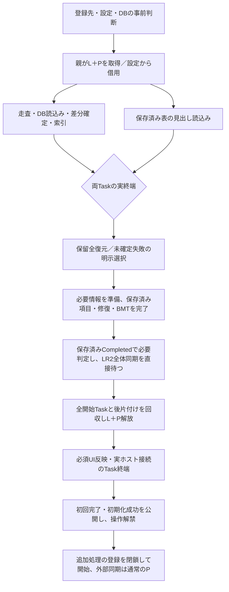
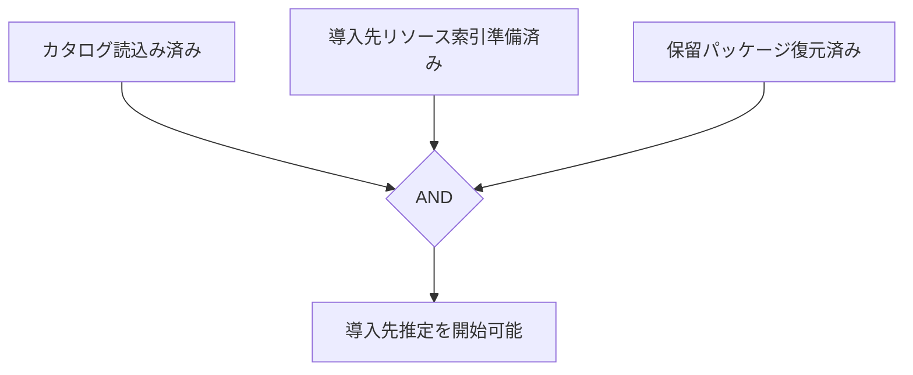

# 起動・初期化・再読込み

## 目的と適用範囲

ライブラリの構築、操作可能になる条件、必須処理と追加処理、各種再読込みの範囲を定めます。起動を単一の完了時刻で表さず、実際に利用できる機能と、各処理を所有する管理主体を区別します。内部検証用の検証起動と、その制御通信による観測もここで定めます。

受付の分類・競合結果・受理済み継続の寿命は[操作の競合ポリシー](../core/operation-concurrency-policy.md)、進捗の表示は[進捗](progress.md)、受付の閉鎖と終了時の待機は[終了と再起動](shutdown.md)を正本とします。

## 用語

[共通用語集](../glossary.md)を参照します。LとP・L＋Pは[操作の競合ポリシーの用語](../core/operation-concurrency-policy.md#用語)に従います。コードの識別子は原表記を使います。

| 用語 | 意味 |
| --- | --- |
| 必須初期化 | 通常起動・初回の明示開始・全再初期化で、操作解禁より前に終端させる処理。ローカル準備、保存済みデータの反映、必要な出力、必要なLR2同期、後片付けを含む。 |
| 親操作 | 必須初期化や再読込みで、L＋Pを保持して処理全体を所有する操作。内部の継続はこの生存中の権限を借用する。 |
| 必須UI | 親操作の受付を解放した後に、UIスレッドで行う必須の一覧・保留・参照の表示反映と、実際の再生ホストの接続。 |
| 操作解禁 | 必須初期化と必須UIが成立し、初回完了・初期化成功を公開して、通常入力を受け付けること。 |
| 追加処理 | 操作解禁の後に一括登録して開始する任意の後続処理。必須初期化の成功条件に含めない。 |
| 局所結果 | 必須初期化の本体が返す変更不能な結果。捕捉した設定、操作トークン、元の失敗、採用済みスコアの通知を含む。 |
| 検証起動 | `--test-session` で専有プロファイルを使う内部検証用の起動。 |

## 仕様

### 起動時の配置と実行条件

起動境界は、配置・DB読取り方式・検証起動の識別情報・更新URL・ログ条件・再起動引数を、変更不能な `ApplicationRuntimeOptions` として一度だけ捕捉し、`ApplicationComposition` へ必須の値として渡します。

| 値 | 契約 |
| --- | --- |
| 再起動引数 | 実行ファイル名を除く、引用前の引数配列の複製。動作モード変更による再起動と、更新後の再起動（[更新](../integration/portable-update.md#引数と境界)）が同じ値を使う。 |
| 更新URL | 解決処理は選択元の優先順位を決めるだけで、通常CLIの不正なURLを必須の起動失敗にしない。通常CLIの値は更新確認の境界で検査する。 |
| ログ条件 | `ApplicationLoggingOptions` が未加工のCLI値から副作用なしに解決し、共有のログ取得口を変更しない。`ApplicationRuntimeOptions` を直接構築してログ条件を省略した場合は、Infoと空の不正値を使い、再起動引数を解析しない。値の意味は[ログ仕様](../core/logging.md#ファイルとレベル)に従う。 |
| 配置 | `ApplicationPathSnapshot` が実行ファイル、読取り専用の素材、可変のプロファイルを分ける。配置の計算だけではファイルやディレクトリを作成しない。 |
| DB読取り方式 | `BmsDatabaseLoadOptions` の三つの必須bool。通常起動では、既存の三つの環境変数のうち `sqlite_net` だけをfalse、それ以外をtrueとする。値の共有と、各DB読取り処理への接続は別の責務とする。 |

ログ条件の共有窓口 `CommandLineSwitches` は、適用済みの不変な条件を公開するだけで、自らプロセス引数を読みません。適用は `Program` が並行処理の開始前に一度だけ行い、headless構成や個別の構成は共有条件を変更しません。

通常配置は、実行ファイル配下の `config/`、`data/`、`lang/`、`log/`、`update_work/downloads/` と `test.mp3` を使います。一時領域はOSの一時領域配下の `BeMusicSeeker`、旧設定の移行元は `%LOCALAPPDATA%/BeMusicSeeker` です。明示配置では実行体を変えず、素材・プロファイル・言語・一時領域・移行元をそれぞれ指定できます。

通常初期化後のタイトル、バージョン情報の製品版、更新の比較は、製品アセンブリの `AssemblyInformationalVersion` を共用します。バージョン情報のビルド番号は `AssemblyVersion` を表示します。

### 専有プロファイルでの検証起動

#### 引数

内部検証の入口は、独立した引数 `--test-session <manifest>` だけです。

- スイッチは大文字小文字を区別せず、一度だけ受理します。欠損・重複・イコール形式・不正な接頭辞は起動失敗です。
- 直後の値をmanifestのパスとして一回だけ消費します。先頭が `--update-manifest-url=` や `--log-level=` でも、別のオプションとして再解釈しません。
- 相対パスのmanifestは起動時の作業ディレクトリで絶対パスにし、変更不能な再起動引数へ保持します。他の通常引数と作業ディレクトリは保持します。

#### manifest

manifestはJSONオブジェクトで、未知のフィールドと重複したプロパティを拒否します。省略と不正値を区別し、次の値を受理します。

| フィールド | 条件・省略時の値 |
| --- | --- |
| `schemaVersion` | 必須。整数 `1`。 |
| `profileDirectory` | 必須。空白でない絶対パス。 |
| `runId`、`caseId`、`controlPipeName` | 必須。空白でない文字列。 |
| `assetsDirectory` | 省略時は実行ファイルのディレクトリ。 |
| `languageDirectory`、`tempDirectory`、`legacySettingsDirectory` | 省略時はプロファイル配下の `lang`、`temp`、`legacy`。 |
| `providers` | 省略またはオブジェクト。`fileEnumeration` は省略または厳密な文字列 `file-system`、`audioPlayback` は省略または厳密な文字列 `null-output` だけを受理する。 |
| `updateManifestUrl` | 省略時だけ、通常CLIの値、次に通常の既定値を使う。明示値は空白でない絶対HTTP(S) URL。 |
| `pendingSchemaConfirmation` | 省略時はfalse。boolだけを受理する。trueでは、実際のDB構造の確認への回答を保留する固定入力を起動前から用意する。 |

任意のパスも、指定した場合は絶対パスを要求し、null・空値・相対パス・別の型を拒否します。

不正なmanifestと未知のproviderは、`App` の生成より前に標準エラーへ理由を出して非0で終了し、未検証のプロファイルへ書き込みません。通常CLIの空白URLを既定値として扱う規則は検証起動でも維持し、不正な非空のURLを必須の起動失敗にしません。

#### 検証起動の配置

- 設定・DB・ログはプロファイルから派生し、通常の利用者領域へ戻りません。
- 更新作業とダウンロードは、実行ファイル側の配置に従います。
- 旧設定の移行も、明示した移行元で通常と同じ処理を通します。
- 言語の配置は素材と独立し、言語の検証データのためにネイティブ資産を複製する必要はありません。
- `file-system` は、グループ列挙を既存の `FastRootFileEnumerator`、初期・差分の譜面走査を既存の `FastDirectoryFileScanner` へ接続し、要求ごとに実際のファイルシステムを読みます。

### 起動の排他

| 排他 | 通常起動 | 検証起動 |
| --- | --- | --- |
| 固定GUIDによる全体排他 | 取得する。コピー先や別プロファイルでも、同時に一つだけ起動する。 | 参加しない。 |
| プロファイルの排他 | 取得する。 | 取得する。異なる専有プロファイルは並行して利用できる。 |

プロファイルの識別には、絶対パス化・末尾区切り・Windowsの大文字小文字を正規化した値を使い、run・caseのIDは排他キーにしません。全体排他、プロファイルの排他の順に取得し、途中で失敗した場合も取得済みの分だけを同じスレッドで解放します。

### 検証起動の操作と完了観測

検証起動の制御通信は、通常の起動・業務経路が開始した実際の処理を観測するだけです。業務処理の代行、結果の補完、業務Taskの取消・再実行は行いません。

#### 接続と起動結果

- 設定・DB構造・更新確認のモーダル画面より先に、専有の名前付きパイプへ接続します。接続通知はプロセスの識別だけを表し、初期化の成功を意味しません。
- 起動結果として、通常の `App`・`MainWindow`・`ContentRendered` が開始した一回の実際の初期化を `ShellActivationWorkflowOwner.StartupCompletion` から返します。既存の結果・必須UIの公開・操作可能状態をそのまま返し、取消・終了要求・失敗を成功へ置き換えません。構成前の失敗は例外の通知、実際の退出は所有プロセスの終端として区別します。
- 制御通信の接続自体に失敗した場合は、元の例外を標準エラーへ出し、業務の起動へ進まずに非0で終了します。業務のDB構造・設定・更新に対するモーダル画面と失敗処理は、通常起動と同じです。
- 駆動側は接続と実際の退出を競合して待ち、起動前の失敗・生存したままの期限超過・回収の失敗を区別します。回収した標準出力・標準エラー・終了コードは、プロセスごとの専有の診断へ保存します。

#### 制御要求の完了条件

制御要求は固定の型付き入力だけを受けます。各要求は、通常の受付が開始した同じTaskの終端と、その結果の実際の採用を確認してから応答します。

| 要求 | 完了の条件 |
| --- | --- |
| 通常ライブラリ検索 | 実際の設定口が開始したTaskと要求の識別を捕捉し、その結果の表示世代が、実際に採用されたスナップショットと一致した場合だけ返す。 |
| 差分再読込み | 通常の受付が返した実際の初期化結果と、必須表示の後まで待つ。受付の拒否を成功にしない。 |
| 導入 | 実際のドロップの入力確保・受付を通す。要求の生成時の `BatchId` を実終端の `BatchTerminated` へ値で引き継ぎ、受付前の購読と、同じIDの実結果・キューの終端を組み合わせる。保留だけの結果も観測する。 |
| 保留の解除・推定・手動の導入先指定 | 実際の一覧の行から通常の要求を作り、操作のTaskと、その後の明示的な一覧移動の表示Taskを別々に待つ。手動導入は、既存画面の導入・必要表示と同じ結果を返す。 |
| プレイリスト・設定 | 通常の取込みの受付が開始した同じTaskを観測し、実Taskの終端後に対象別の結果と実際のDBを照合する。詳細の選択は同じ表示Task・要求版と実際の採用、サマリーの選択は同じ集計Task・世代と採用済みのデータ世代を照合する。 |

スナップショットは、実際のカタログと実際の表示を別々に読み取ります。任意のリフレクション呼出し、操作後のDBの補充、キューのidle・同じ行数・集計通知・全体のidleによる完了の代用は行いません。

導入の観測は、既存の完了・失敗の利用者向け通知の条件を変えません。観測先へは受付の解放後に配送し、観測先の例外で業務の結果を置き換えません。観測したバッチに実結果も故障もない場合や、観測値の変換に失敗した場合は、制御要求を非成功で終端させ、通知の隔離に待機を残しません。ライブラリの世代をバッチの識別に流用せず、可変な入力の所有者を結果へ渡しません。

#### 固定入力

- シナリオの入力設定と既存のDB値は、実際の起動の前だけに準備します。ライブラリの起動・外部での追加と削除・差分の保存・次回起動の縦断では、終了前に生のDBと元ファイルのバイト列を確認し、次回起動の修復で保存漏れを隠しません。入力イベント・Bindingや細かい条件分岐の保証は、既存の画面・機能単位のテストに分担します。
- 固定のダイアログ入力は、操作ごとに一つだけ準備し、既知の型付き境界で一回だけ消費します。未知のダイアログへ承認を補いません。
  - プロパティと設定は、通常の調整役による実際の所有Windowの生成・表示を保ち、プロパティの実際のOK・上下ボタンと、設定の通常の設定口・`CloseCommand` を通します。
  - JSON出力は、既存の型付きダイアログ境界で宣言済みの二つのパスを返し、実際の書込みと、通知の結果記録の終端を別々に確認します。
  - SQLの保存・復元は、実際の設定画面の既存ハンドラーへ接続し、操作固有の確認・パス選択・成功通知・終了案内だけに固定入力を渡します。
- 旧DB構造の固定入力は、実際の `PrepareSchemaAsync` の確認への到達を観測し、駆動側の自然終了の期待を登録してから取消を解放します。解放要求のACKを送信した後に回答Taskを完了し、未応答の切断を正常終了へ読み替えません。承認も同じ実際の確認へ回答し、先行修復や成功結果の注入は行いません。
- 通常起動の配置・ミューテックス・終了方針は変えません。

### 実UI操作の一回観測

検証起動の型付きパイプは、実UI入力が開始する既存のTaskを一回だけ観測できます。観測は業務Taskを取り消し・再実行せず、失敗を後発の操作の成功で置き換えません。

| 項目 | 契約 |
| --- | --- |
| 対象 | 通常検索、プレイリストのMEMO、通常譜面のFOLDER、導入、通常譜面のプレイリストへのドロップ、ツリーのフォルダ削除、項目の削除。 |
| 登録 | UIスレッド上で、現在の管理主体・ソース・文脈・`RowsGeneration` と業務上の対象を捕捉し、購読を設置してから登録完了を一回応答する。行の指定には既存のAutomationIdを使い、登録時に表示の投影に依存しない識別へ解決する。待機要求は、別の通信要求IDから元の登録番号を参照する。 |
| 保持 | セッションに保持する通常の観測は一件だけ。重複した登録と二重の待機を拒否し、待機前の早期終端もその一件だけ保持する。消費、入力前かつ待機前の取消、切断、終了で、購読と保持値を破棄する。 |
| 完了 | 呼出し前のスナップショットから既存のメソッドを一回呼び、その同じTaskを通知して既存の経路で待つ。Taskの正常終了だけを保存成功とせず、確認の拒否と変更なしも実終端として返す。生の保存値の合否はDesktop側で検査する。 |

登録してから入力するまでに、ソース・対象・操作が変わった場合は観測失敗です。項目は生存参照と親を保持し、入力直前のハッシュと所属を照合します。譜面は種別・パス・ダイジェスト、表とフォルダは参照と要求時の保存値を照合します。

- 検索は途中の語を除外し、期待する最終語の実際の要求ID・`RowsGeneration`・`WasCommitted` と、終端時に採用された表示を返します。捕捉後の表示の交換を、元のTaskを付け替える理由にしません。
- 導入は、受付済みの `BatchId` と元パスの値の複製をキューの公開前に通知し、同じ `BatchId` の既存の `BatchTerminated` だけを採用します。管理主体の既存の世代失効条件は変えず、結果が来なければ同じ期限で観測失敗としてプロセスを回収します。
- `TableState` は、文脈・ソースの型・世代・件数・`RealizedRowCount` だけを返し、行の列挙・選択のスナップショット・Name/Valueの投影を行いません。
- 初回の外部プレイリスト同期は、接続時から既存のQueued・Completedを購読し、最初の初期化をスケジューラーが実行した同じTaskと、その理由・版の結果記録だけを一回保持します。結果記録の通知より後の受付解放を含む外側のTaskを待ち、見送り・結果記録の欠落・DB窓口の不在をロード成功にしません。

自然終了を検査する駆動側は、実際のモーダル画面への取消入力より先に `ExpectNaturalExit` を同期的に登録します。`WaitForExpectedExitAsync` はCloseを送らず、同じ絶対期限で、ルート・全子孫・標準出力と標準エラー・制御の読取りの終端と、終了コード0を確認します。期待期間中のEOF以外の通信例外、JSONの故障、未応答の要求、非0の終了、期限超過・回収の失敗を保持します。未応答の起動要求を、起動待機の成功で補いません。

検証起動では、外部シェルの窓口を、要求を記録するだけの実装（`ApplicationScenarioExternalShell`）へ差し替え、既定のブラウザー等の所有ジョブ外のプロセスを起動しません。通常起動では差し替えません。

起動時の更新確認では、`StartupUpdateWorkflowOwner` が開始状態（未開始・実行中・終端）と終端の実際の結果記録を、終端通知より先にロック下で保持します。制御要求は購読の時機に依存しません。実行中なら終端まで待ち、終端後ならその結果記録と記録済みの外部シェル要求を返し、未開始なら終端の種別を補わずに失敗します。応答は、更新による終了へ向かう途中でも配送します。

### 起動の流れと完了境界

#### プロセスの起動順序

`Program.Main` は、実行条件の捕捉、`CommandLineSwitches.Configure` によるログ条件の適用、`ApplicationPathPolicy.Configure`、`App` の生成、WPFの初期化の順に進みます。`App.xaml` から別のMainを生成しません。

設定・言語・ログ・ネイティブの配置窓口は、配置の確定後に参照します。例外として、固定配布ランタイムのSQLiteプロバイダーとコードページの登録はモジュール初期化子で先に行い、manifestによる素材の切替の対象外です。この登録は、可変のパス・設定・ログ・DB読取り方式の3値を参照も確定もしません。

`App` の言語一覧と設定の準備は、`ApplicationStartupCompositionOwner` の準備境界で行います。設定の寿命を管理する処理は表示文化圏を結果として返し、`App` が表示リソースへ適用します。準備に失敗した場合は既存の起動失敗処理を一度待ち、ViewModel・`Window` の構成へ進みません。ファイルログ、性能診断、ネットワーク診断、無効なログ水準の案内は、それぞれ独立した任意処理です。一つの診断の失敗で、言語一覧の準備や他の診断を飛ばしません。

#### 必須初期化の流れ

通常起動、初回の明示開始、全再初期化（All）は、同じ必須初期化と完了境界を使います。

1. 登録先・設定・DB構造・修復可否・終了の事前判断を終えてから、親がL＋Pを一度取得します。設定から開始した場合は、呼出元の生存中の権限を借用します。
2. 独立したファイル走査・DB読込みと、保存済みプレイリストの見出し読込みを並列に進めます。正本の変更は、明示した依存順で確定します。
3. 並行読取りの両方の実終端で合流し、保留パッケージの全体復元（[保留復元の失敗時選択](#保留復元の失敗時選択)）と、出力ルートの登録修復を行います。出力ルートの登録修復は、同じプレイリストの管理主体で確定します。
4. 必要な譜面情報・ハッシュ・保存済みスコアが利用可能になってから、保存済み項目・カスタムフォルダの修復・BMTを直接待ち、必要なLR2全体同期の実終端へ進みます。
5. 開始済みの全Taskと後片付けを回収してから、親のL＋Pを解放します。
6. 必須UIの実Taskを終えます。
7. 初回完了・初期化成功を公開し、通常入力を解禁します。
8. 追加処理を一括登録し、登録を閉鎖してから開始します。

LR2全体同期が必要な場合は、修復と同じ生成・検証経路で完全な入力を一度だけ準備し、その回の結果を同期へ渡します。部分修復を、完全な入力の証明へ読み替えません。全体同期が不要な場合や単独動作でも、必要な修復とBMTは行い、不要なLR2の段階を待ちません。外部同期は保存済みの表を使った必須起動の後に行い、ネットワークの待機を操作解禁の条件にしません。

#### 本体と終端処理の分担

必須初期化の本体は、構成・プレイヤーの置換・ローカル準備・必要なLR2・後片付けの実Taskを待ち、その回に捕捉した設定、既存の操作トークン、元の失敗を局所結果として返します。本体は、初回完了・成功のプロパティ・操作解禁・追加処理の登録完了を公開しません。これらは、親の受付を解放した後の終端処理が局所結果から行います。

設定からの借用では、外側の実際のL＋Pも解放してから、同じ非同期の終端処理を待ちます。共有の保留設定や、別の完了フラグは持ちません。

必須処理の管理主体 `StartupLibraryInitializationWorkflowOwner` は必須の各手続きのTaskを直接待ち、完了を登録名・登録の閉鎖・スケジューラー全体のidleから推測しません。必須の譜面情報と保存済みスコアは、停止中のスケジューラーを待たずに同じ親操作の中で準備します。内部の継続は親の生存中の権限を借用し、Busyで省略しません。

#### 必須UIと操作解禁

- UI更新の抑止は必ず解除しますが、反映の予約だけを完了にしません。親の解放後、既存のUIスケジューラーの実Taskで必須表示と実際の再生ホストの接続を終え、それから初回完了・成功を公開して入力を解禁します。ホスト接続の開始を、成功プロパティの通知に依存させません。
- メイン一覧の必須UI反映は、同じ操作の確定通知を既存の通常の排出で配送してから表示要求を開始し、その実Taskの終端を待ちます。再読込みのリセット通知が遅れて届いても、必須表示の候補を失効させた終端だけで成功を返しません。
- 独立したフォルダの最終読取りと、遅延表示の収束は待ちません。
- 終了による取消と、実際のUI・ホストの失敗は、通常起動と設定の既存の失敗処理へ返し、`finally` からの例外で通知を迂回しません。取消以外の実際の失敗は、終了と同時でも失敗として保持し、終了開始後に新しい失敗画面を開きません。
- 事後の案内・警告の表示失敗は局所診断に留め、必須初期化の結果に合成しません。
- 受付外の警告から新しい明示操作が始まった場合、旧い局所結果は既存トークンの確認により、新しい操作の完了・解禁に使いません。

#### 保存済みスコアの採用と通知

起動と許可されたScoreOnlyでは、保存済みスコアの参照表、実体の購読、版と取得状態、同じ取得操作で得た生の全履歴・プレイヤーの時系列を、必須初期化の本体で採用します。通常の成績と履歴の成否は独立して保持します。

採用を知らせる通知は副作用のない通知として局所結果へ渡し、初期化ロックと実際の親のL＋Pを解放した後に実行します。公開の初期化APIも、自身の受付を解放した後に同じ通知を行います。

- 採用後の後段処理が失敗しても、採用済みのスコアの状態と元の失敗を保持して終端へ渡します。
- 通知の通常の失敗で初期化結果を変えず、再構築や保存を繰り返しません。通知の失敗を局所化する範囲に、必要な参照表の構築や購読の置換を含めません。

成績を取得する契機と、全再初期化などで取得組を保持する範囲は[プレイ履歴のキャッシュと表示用変換](../playlist/play-history.md#キャッシュと表示用変換)を正本とします。起動の順序としては、全再初期化の本体は外部DBからの再取得とそれに伴う参照表・表示版の再公開を行わず、必須初期化の完了条件にもしません。開いているランプビューアは、既存の明示的な捕捉時に、通常の成績と同時に取得した履歴から集計し、成績の通知だけでは自動更新しません。

#### 追加処理の登録と開始

必須UIと実際のホスト接続のTaskの終端、成功の公開と操作解禁の後、完了案内の実Taskを待つ前に、停止中のスケジューラーへ追加処理をそろえて登録し、登録を閉鎖してから開始します。並列実行と依存は[追加処理の並列実行と依存](#追加処理の並列実行と依存)、表示は[進捗](progress.md#追加処理の段階と終端)に従います。

| 追加処理 | 契約 |
| --- | --- |
| 難易度表リストの取得 | `SkipInitPlaylistLoad` に依存せず登録する。HTTP通信・UIへの適用・終了による取消を、スケジューラーの一つの仕事として追跡する。全再初期化には追加しない。 |
| 自動の外部同期 | 設定に従って登録する。開始時に通常の新規のPを取得し、解禁の通知から新しい操作が先着した場合は通信前に見送る。Pの解放後に自動で再投入しない。 |
| 譜面情報の補完と候補要約、保守、導入可能譜面の保守、IR・順位、URL補完、表示キャッシュ、GC、事前計算 | 必須UIと成功の公開の後に明示的に登録し、それぞれ固有の依存で実行する。初期化の成功条件に加えない。 |

既存の `SchedulingComplete` へのGCの依存は維持しますが、起動成功の根拠にはしません。準備完了の記録、ストップウォッチ、変更の目印やスケジューラーのidleを、機能の完了判定にしません。任意の表示の事前計算は、成功の公開後の一括登録に含め、固有の先行依存とその実終端を追加処理の完了へ含めます。ログから追加の登録はしません。

フォルダツリーの最終読取りは独立した処理であり、遅くても操作解禁を止めません。

#### 計測の記録名

| 記録名 | 成立する状態 |
| --- | --- |
| `startup_install_estimation_ready` / `startup_install_ready` | 所持目録、リソース索引、保留パッケージがそろい、導入先推定を開始できる。 |
| `startup_ready_data` | 導入判定に必要なデータがそろった。 |
| `startup_ready_ui` | 必須の初期表示を適用した。 |
| `startup_ready_install` | 導入先表示の適用を計測する。 |
| `startup_ready_operable` | 必須処理・親の受付解放・必須UIとホスト接続を終え、通常入力を解禁したことを計測する。 |
| `startup_initialization_complete` | ローカル準備・必要なLR2の終端・操作解禁へ到達した。LR2の単独失敗は独立した結果に残す。 |
| `startup_post_initialization_maintenance_complete` | スケジューラーが追跡する登録済みの追加処理（順位・XML取得を含む）と、任意の事前計算が実終端した。独立した読取りの表示の収束は含まない。進捗の段階ではない（[進捗](progress.md#表示と後続処理の区別)）。 |

#### 結果の分類

| 状況 | 結果 |
| --- | --- |
| ローカルの必須処理の失敗 | LR2へ進まず、`Outcome=OperationFailed` として既存の失敗通知へ返す。 |
| 設定修復が必要な事前検査・検証の失敗 | `SettingsRequired`（[登録ディレクトリの検査](#登録ディレクトリの検査)）。 |
| ローカル成功後のLR2だけの失敗 | ローカルの確定と、LR2の永続的な失敗記録・通知を保持し、通常操作を解禁する。初期化は成功とする。 |
| 初回の完了案内だけの失敗 | 局所診断で終え、成功・初回完了・解禁を維持する。 |
| 終了による取消 | `ShutdownRequested`。 |

`Outcome=Succeeded` と通常起動の `bool` の `true` は、ローカル準備と必須UIの成立を表します。LR2の単独失敗は別の結果に記録・通知し、ローカルと必須UIが成立すれば `true` です。並列のTaskの一方が失敗しても、開始済みの相手のTaskを回収してから受付を解放します。次回起動や設定画面の手動同期は新しい入力から始め、自動の再試行・途中再開・巻戻しを行いません。

LR2の失敗の保存・公開は既存のLR2の管理主体で終結し、確定済みの `Failed`・`Incomplete` を上書き・重複通知しません。起動・再初期化の呼出元は、型付き結果のLR2の失敗を確認し、同じ管理主体の現在の状態を既存の進捗表示へ渡します。表示用の別の状態保持層は作りません。

終了による取消は、LR2の非致命的な失敗へ変換せず、`ShutdownRequested` へ伝播します。開始済みのTaskと後片付けを待って親の受付を解放しても、初回完了・通常操作の解禁・外部同期の投入には進みません。設定の借用権限による初期化と、受付解放後の完了コールバックにも同じ条件を適用します。

#### 任意の譜面情報補完

任意の譜面情報補完は、候補要約のDB読取りも既存の `chart_info_backfill` の後続で行います。必須の譜面情報の読込みは、必要な保存済み情報の反映を終え、同じ発生元を後続へ渡して終端します。後続は親の受付の解放後にLを取得し、候補要約から既存の補完の実終端までを処理します。後続の補完は既存の要求識別とキャッシュの失効を使います。

停止中のスケジューラー、保持された候補要約、後続の未完了を、必須の出力・LR2の開始条件にしません。追加の依存段階や共有の保留台帳は持ちません。終了が先着した後続は、DBの要約と実際の補完を開始しません。

#### 必須初期化中の読取りと変更

確定済みの一覧の閲覧・検索と、独立したフォルダの最終読取りは、必須処理の終端を妨げません。変更操作はLとPで拒否し、UIスレッド・DBトランザクション・モデルロックを持ったまま、別の管理主体の完了を同期的に待ちません。設定の閲覧・編集・取消と、Busy時の編集内容の保持は維持します。

#### 初回の完了案内

初回の完了案内は、必須のローカル準備と操作解禁、追加処理の一括登録・閉鎖・開始の後に表示します。既存のダイアログ処理の実Taskとして終端を待ちますが、難易度表リストの取得は、案内の終了や無関係な追加処理を待たずに開始できます。

- 案内の失敗は、成立済みのローカル・UIの成功、初回完了、操作解禁を取り消さず、その通知境界で元の例外を診断します。独立した次の案内は引き続き試み、初期化の失敗通知や再表示へ変換せず、受理済みの後続を未開始で残しません。
- 案内から次の明示操作へ再入した場合も、旧いトークンの仕事を新しい起動の表示へ混入させません。
- LR2の単独失敗でもローカル準備の成功の意味を維持し、外部同期やメンテナンス情報の更新の完了は案内しません。

### 保留復元の失敗時選択

通常起動と、初回の明示開始・設定反映から合流する必須初期化では、ファイル段階と保存済みの見出しの両方が成功した後に、保留パッケージ全体を復元します。全再初期化では、ファイル段階の成功後に同じ復元処理へ進みます。ScoreOnly・FileDiffには、この復元と選択を追加しません。

正常な不存在の整理も全体の復元と一括で確定します。取得・読取り・DB確定前の失敗では、全保留登録と既存の確定一覧を保持します。

DB確定前の保留復元の失敗だけに、元の原因を表示して次の三つの選択を提示します。

| 選択 | 結果 |
| --- | --- |
| 再試行 | 全保留DBと入力を新たに取得する。他のファイル走査・見出し・閏年修復などを一律には再実行しない。 |
| 保留一覧を初期化して続行 | 毎回の明示的な承認で、全保留登録を一つのトランザクションで消去し、成功後だけ空の一覧で通常の初期化へ進む。元の入力と導入済みの楽曲は削除しない。削除に失敗した場合は原因を表示して同じ三択へ戻り、自動で続行・再実行しない。 |
| 終了 | 下記の終了の引渡しへ進む。 |
| ×・Esc | 登録を保持したまま、その回の初期化の失敗とする。 |

選択を待つ間も親のL＋Pは生存しますが、DBトランザクションとモデルロックは解放済みです。DB確定後の一覧の公開・通知・配送・準備完了の障害、表示の失敗、他の段階の失敗は、保留復元の三択へ戻しません。既存の画面で終了が受け付けられた後は、新しい復元の確認を開始しません。

明示的な終了の選択は、短命な結果として、親のL＋P・排他・UI抑止の解放後まで渡し、実際のWindowの通常のCloseへ配送します。初期化のTaskは自分の終了準備の完了を待たず、既存の `OnClosing`・終了の結果記録・Windowの終端の所有を保ちます。既に終了中なら、追加のCloseを要求しません。

### 有限の入口と段階選択

| 入口 | 必須の範囲 |
| --- | --- |
| `ContentRendered` の通常起動、初回の明示開始 | 事前判断、構築、保存データと必要な差分、出力、必要なLR2、必須UIと必要なホスト。初回は確定済みの必須値を使い、同じWindowの外側の生存中の権限を借用して、必要な全表のBMT・必須UIとホストの公開を待ってから、初回完了とCloseへ進む。 |
| ツリーの全再初期化 | 既存の組の目録・全走査・保留、必要な出力とLR2、必須UIを同じ終端へ合流する。成績の扱いは[保存済みスコアの採用と通知](#保存済みスコアの採用と通知)に従う。新しい組の構築・プレイヤーの接続・初回案内・外部カタログの取得を追加しない。 |
| BMSの局所確定、ツリーの差分 | 再生停止、必要な差分・LR2・参照・必須表示。全目録・保存済みの見出し・全表の出力を無条件には追加しない。 |
| 許可されたScoreOnly、履歴のDB構造の変更後 | 保存済みの成績と生の全履歴・プレイヤーの時系列・取得時のノーツ数・DB構造の結果を同じ取得操作で用意し、成否を独立に採用して、スコアの投影と必要な表示へ渡す。IR・順位は後続で行い、ファイル走査・全表の出力・プレイリストのURL補完の予約を追加しない。 |
| 明示的な表一覧の再読込み | 保存済みの見出し・項目、利用者が要求した外部同期、必要な出力・参照・必須表示を、同じPの実Taskで待つ。 |
| 再読込みが不要な通常の設定 | 項目の保存の成功後に表示へ反映し、動作の方針は次の操作の開始時に捕捉する。同じ設定画面を維持し、URL補完などは既存の後続へ渡す。 |
| 手動LR2同期、モード切替、更新確認 | 既存の独立した寿命を維持する。手動LR2同期は既存の明示的な強制要求とする。モード・LR2パスの変更は、確認と選択の保存の後に、通常の終了処理による回収を経て新しいプロセスを起動する。 |

設定画面の局所操作は、同じWindowで必要な処理・必須UIの公開・通知まで待ちます。Busyと確認の取消は保存前に拒否し、部分保存と成立済みの出力は保持します。初回や修復で有効な組がなければ、各セクションは保存だけを行います。明示的な「この環境で開始」で確定済みの値から一回初期化し、全表のBMT・必須UIとホストの公開の成功後に、初回完了とCloseへ進みます。設定不足・処理の失敗・終了を既存の型付き結果で区別し、設定不足や失敗で画面を閉じて再表示する継続は作りません。

設定からの開始と、モード・LR2・beatorajaの組の反映は、通常起動の事前準備から必須UIとホストの公開の実終端まで拒否します。モデルの接続前やL＋Pの解放後も既存の操作中の状態で判定し、プロファイルの有無だけで初回の明示開始待ちと見なしません。設定不備の案内は起動の抑止と受付を解放してから行い、案内のTaskが未完了でも、その設定画面から開始できます。開始の連続入力で重複して初期化せず、成功の公開時に開始表示を更新します。beatorajaの有効な選択は[局所反映](settings.md#beatorajaの局所反映)で処理し、新しいプロセスやホストの再構築を要求しません。

### モデルの組と任意処理の寿命

既存の構築の管理主体が、設定・DB構造・単独動作DB・プロファイル・バックアップの判断と順序を持ち、画面は購読・一覧・ツリー・ホスト接続を担当します。

- 親のL＋Pの中で、必要な旧配置の移行の後に新しいライブラリとプレイリストの組を構築し、成功した組だけを接続します。
- 新しい組の構築に失敗した場合は、旧い組を停止しません。成功後は捕捉した旧い組へモデル固有の停止を通知し、停止済みの旧い組へ巻き戻しません。
- 親の中で、ネットワークやスケジューラー全体のidleを待ちません。

モデル固有の停止・取消と、構成で共有する受付の閉鎖は別です。共有受付はアプリの終了でだけ閉じます（[構成で共有する受付の閉鎖](shutdown.md#構成で共有する受付の閉鎖)）。構成が共有するLとPの受付と、ライブラリ・DB窓口ごとの対象・終了状態の分離は[競合ポリシーの受付の権限](../core/operation-concurrency-policy.md#受付の開始終端と権限)に従います。LR2の処理主体・DB・終了状態と再接続の識別は個別に保ち、初回の構築と再構築のどちらも、実際のモデルの初期化と必要な後処理を待ちます。

モデルの置換時の仕事は次のように終えます。

| 仕事 | 扱い |
| --- | --- |
| Lを待っている旧いモデルの仕事 | 取得後に自分のモデルの停止を再確認し、DBを確定せずに既存の後片付けへ終端する。 |
| 現在のモデルの受理済みの背景入力 | Busyで捨てず、既存のLを待って実行する。 |
| URL通信 | 既存のモデルのトークンと、通信後の停止確認を使う。 |

IRの通信・解析・キャッシュの読取りはLなしで行い、正本DBの更新・キャッシュの更新・モデルの確定だけをLの中で行います。取得後の停止とスコア文脈の確認で、旧い結果を新しい組へ保存することを止め、通信から末尾の確定までをスケジューラーの一つの仕事に含めます。共有の先行取得・消費の状態は持ちません。

公開のモデル初期化APIも、同じ名前付きの保存データ・走査の投影手順への接続口です。意味を持つ継続の入力は、全開始Taskを回収します。走査の正常・空・不完全・例外のいずれでも、先行列挙の全開始Taskと後片付けを回収してから返します。警告はその回の小さい局所結果として受付の外へ持ち出し、元の失敗を後発の通知の取消で隠しません。

### 起動後のソートキャッシュ準備

[ソートキャッシュ準備範囲](settings.md#起動時のソートキャッシュ準備範囲)は、`MainWindowViewModel` の構築中に、構成で共有する設定を設定ViewModelの構築時に一度 `Reload()` した後、一度だけ読取り専用の値として捕捉します。起動後の処理は、編集中・保存後の共有設定を読み直しません。同じプロセスの全再初期化も捕捉値を維持し、保存済みの変更は新しいプロセスの構成で初めて使います。

`StartupPostInitializationWarmupOwner` の既存の仮想順序の段階から、捕捉した優先度を通常一覧の管理主体の事前生成対象の選定へ渡します。選択した上限と対象件数を、既存の `virtual_order_prewarm` の診断へ残します。

| 値 | 結果 |
| --- | --- |
| 0 | ソート入力行の取得・順序計算の前にその段階を正常終了する。実パス、導入先の重ね合わせ、所持主ハッシュ、プレイリスト用ハッシュの他の4段階は行う。 |
| 1～3 | 選択した上限で事前生成する。 |
| 0～3以外 | 選定境界で例外とし、既存の任意の起動後処理の `Failed`、失敗段階 `virtual_order`、元の例外と実行権の終端へ接続する。別の値へ補正せず、必須初期化の成功・操作解禁の条件へ加えない。 |

5段階は同じ実行権の中で直列に行い、取消・旧い実行権の回収・版の整合・失敗の診断を維持します。並列の上限は[追加処理の並列実行と依存](#追加処理の並列実行と依存)に従います。

### 登録ディレクトリの検査

#### 設定受理の検査

`InitializeAsync` は、設定を捕捉した後、出力検索ルートの調整より前に、`StartupLibraryConstructionOwner.PrepareDirectoriesAsync` で共通の設定受理の検査を一回行います。

- 対象は、出力基点による利用可能性検査の除外を行う前の全BMS登録と、LR2連携で使う通常・追加・ROOTの出力基点です。これらへ[予約領域の条件](../playlist/lr2-custom-folders.md#出力先と事前検査)を適用し、利用可能性の検査・プロファイルの構築より前に `InvalidConfiguration` として既存の設定訂正へ戻します。
- 確定したLR2のルートが分かる実際のBMS登録は、両モードで検査します。単独動作で使わない出力の残存値は検査しません。
- 起動時の走査を無効にしていても省略しません。
- モード選択の即時保存ではこの検査を行わず、再起動後も同じ起動時の受理検査を通します。
- 具体的な理由の表示は、組込みの予約領域の既知リソースに限ります。追加JSONの構文不備などは汎用のローカライズ済みの理由を使い、診断の理由と元の例外を保持します。
- 通常の走査の要求作成では、予約領域を再検査しません。

#### LR2の設定XMLの取得

LR2連携では、検査要求を作る前に、構成の `Lr2ConfigSession` から採用済みの所有者を取得します。正本が未成立の場合だけ `LR2Config` で設定XMLを読み込み、検証後に採用します。

パスの未設定・不正、ファイルの欠落・読取り不能、XMLの不正、必要な `config/jukebox` 要素の欠落は、通常の設定不備です。検査入力を構成できない状態を、空の登録ルートや検査成功に置き換えず、設定の案内へ戻します。初回かつ全項目が空の場合だけの例外扱いはしません。

ディレクトリの検査と設定全体の検証が成功してから、出力検索ルートを修復します。修復とライブラリのプロファイル構成には、構成が保持する同じLR2の所有者を渡します。初回設定で既に保存したXMLも、全再初期化も、同じ正本を引き継ぎます。単独動作のLR2bodyと再生方式の変更後の再生成も同じ所有者を使い、LR2を使わない場合はXMLを必須にしません。これらの処理のためにXMLを再読込みせず、検証前に保存しません。

#### 設定不備の結果と案内

設定不備が確定した場合は、出力検索ルートの修復・保存、DB処理、モデルの構築、走査へ進みません。想定済みの入力不備だけをこの経路で扱い、それ以外の例外は予期しない失敗として通知・記録します。

| 入口 | 結果 | 案内 |
| --- | --- | --- |
| 通常の起動入口 `InitializeAsync` | `false` | 排他とUI抑止を解放してから、初回なら言語選択、それ以外なら通常の設定確認の警告と設定画面。 |
| 設定保存から開始した初期化 `ISettingsDialogStatePort.InitializeLibraryAsync` | 型付き結果の `Outcome` に `StartupInitializationOutcome.SettingsRequired` | 初回フラグが真でも言語選択へ戻さず、設定確認の警告を表示する。 |

設定不備の確定後に行う任意の警告や診断が失敗しても、元の `SettingsRequired` と検証結果を保持します。二次失敗は局所診断に留め、既存の設定案内を中止したり、再帰的な汎用の失敗通知を始めたりしません。終了による取消は、既存の終了結果へ返します。

初期化内部の設定準備・モデル構築・ファイル初期化からは、設定画面を開きません。

- 通常起動の失敗は、外側の初期化入口が排他を解放してから案内します。
- 設定から開始した場合は、結果と後片付けを呼出元へ返し、初期構成の不足だけを既存の再編集の案内へ戻します。通常の保存後の異常では自動で再提示せず、元の失敗を通知します。
- 初期設定の保存後に実処理から `OperationFailed` が返った場合も、有効なプロファイルがないことだけを理由に設定を再表示しません。設定修復が必要な `SettingsRequired` と、型付き結果を取得する前の既存の案内は維持します。

成功、設定修復が必要な失敗、処理・必須公開の失敗、既に要求した終了を区別し、処理の失敗や終了要求を設定画面への復帰に読み替えません。初期化の排他や保存中の状態を保持したまま、新しいモーダルの設定画面を待ちません。

#### LR2ディレクトリ未設定の警告

LR2連携の通常起動で、必須処理が正常に終端し、その初期化で捕捉した `LR2RootPath` が空なら、親の受付とライブラリ表示の更新抑止を解放し、必須UI・成功の公開・操作解禁の後に、起動を継続できる警告を一回表示します。

- 警告は、LR2のスコアDBの場所を解決できずLR2のスコアDBを利用できないこと、LR2バックアップやLR2標準カスタムフォルダの検出で予期しない動作になり得ること、設定画面でLR2ディレクトリを設定すべきことを伝えます。
- OKで閉じた後も初期化の成功を維持し、設定画面を自動では開きません。
- `LR2RootPath` が空の通常起動ごとに表示し、抑止する永続設定は持ちません。
- 単独動作、ルート設定済み、設定画面から保存後に呼び出す `ISettingsDialogStatePort.InitializeLibraryAsync` では表示しません。
- 必須設定の不備を `SettingsRequired` として扱う経路とは区別し、空のルートを別のパスから推測して補いません。

#### 登録ディレクトリが利用できない場合

モデル構築前の必須検査と出力先の検査で登録ディレクトリが利用できない場合は、設定の修復・保存、単独動作DBの作成、構造修復、モデルの構築、バックアップ、最適化、走査、後続処理へ進みません。初期化の排他とUI抑止を解除してから一回だけ警告し、結果と案内の分担は[設定不備の結果と案内](#設定不備の結果と案内)と同じです。欠落した登録を自動で外さず、修正・再接続の後のOKで新しい入力を確認して再試行できます。

#### DB読取り後の走査失敗

正本DBを正常に初期化・読み取った後の、BMSルートの切断・削除による再検査の失敗は、不完全な走査として警告し、保存済みの内容で利用を開始します。新規・既存、空・非空のDBで扱いを変えません。採用前の走査取得の失敗も同じ境界で閉じ、不完全な結果から追加・削除を反映しません。

DB読取り後のBMSルートの失敗を、初期の設定検証・出力先の失敗と混同しません。出力先や必須のDB読取りの失敗は外へ伝え、解放後に通知します。解析中の分割保存と必要な反映の失敗も走査取得の捕捉へ含めず、先行の確定を、保存内容による未変更の成功へ読み替えません。これらの停止後に、成功の記録や成功後の処理を公開しません。

### 登録rootの表記と走査入力

#### 登録ルートの表記の確認

走査の準備では、登録ルートの確認できるディレクトリ要素を、親の直下の列挙で取得します。

- `GetFullPath` や `DirectoryInfo.FullName` だけを実在の確認にしません。
- 事前確認だけでは、ドライブのルートとUNCのサーバー・共有名を推測で変換しません。
- リンク先の最終パスへ、登録の位置を置き換えません。
- 追加の表記確認で想定するファイルシステムの例外だけは、元の入力を保持し、保存の差分を作りません。取消とメモリー不足は伝播します。通常の事前検査の失敗は、事前検査の扱いのままです。

#### 走査入力の保持と採用

既存の `ActiveFileScan` が、事前確認済みのルート・設定の入力・事前検査の結果を変更不能に保持し、Everything・Fastの走査へ渡します。走査の取得と既存の再検査の後、実際に返却されたディレクトリと必要なファイルのパスが、確認した同じ場所の接頭辞を示す場合に、登録側がその表記を採用します。SDKが返した文字列とリソース索引は改変しません。入力から合成したFastのルートの項目とDB行は、実在の表記の根拠にしません。

#### 比較に使う既存の入力

通常フォルダの比較に使う既存のスナップショットは、操作の引数として渡します。比較のために全曲の追加I/O・再走査・管理出力の曲走査の追加・常駐するスナップショットの保持は行いません。

| 操作 | 既存の入力 |
| --- | --- |
| Full・全再初期化 | `LoadSongTable` の補正・確定後の有効な全件の結果を、`SongTableLoadResult`、既存の観測先、操作内の結果から直接再利用する。 |
| ReloadFileDiff | Lの受理・事前検査・`BeginFileScanRequest` の直後に、全フォルダの全列・全ての生のキーを一括で取得し、既に始まっている譜面走査と並行させる。同じ生の完全一致（Ordinal）の集合を、通常フォルダの生成・カスタムの依存・計画へ渡し、比較後に旧い行を再検索しない。 |

更新時刻用の先行Taskや取得口、DBの代替読取り、ルート集合の一致判定は持ちません。確認後のオプションを、通常フォルダ・管理範囲・カスタムの準備・分類へ共通に渡し、生の旧い完全一致のキーだけを更新・削除します。全件の取得結果を変更範囲へ渡しません。

#### 保存の境界

不完全な走査、既存DBを保護する空の走査、任意のBMSONの不完全な走査、ルート再検査の失敗による非反映の判定を通過してから、譜面DBの保存直前の `fileScanReadyToCommit` で[登録の保存と限定公開](settings-persistence.md#項目保存と公開)を行い、既存のカスタムの準備を開始します。

- このコールバックに到達しなかった場合は、返却するオプションも元の登録の入力を保持し、未保存の候補を後段へ漏らしません。
- 空の成功は確認の根拠がある場合に採用でき、未確認の空のルートは推測で変更しません。
- 保存に失敗しても、開始済みTaskの回収と、既に採用済みのスコアの結果・既存の終端通知は維持します。

### 動作モード

| モード | 楽曲DBとルート | 外部連携 |
| --- | --- | --- |
| LR2連携 | 保存済みのLR2楽曲DBと設定XMLの検索先を使う | LR2のカスタムフォルダ、バックアップ、IR・順位の更新を許可する |
| 単独動作 | アプリ内の `data/song.db` と複数の登録ルートを使う | LR2の実出力・XML変更・バックアップ・IRは行わない。明示設定がある場合だけbeatorajaのスコアを使う |

単独動作DBはAppDataではなくポータブルなアプリデータです。ディレクトリ、DB、ライブラリ、プレイリスト、BMSONと譜面情報の構造を順に作ります。LR2互換の構造と出力設定値は保持できますが、実際のLR2出力は行いません。

単独動作の通常の操作は、共通の確定した登録の読取り口から、要求ごとの変更不能な入力を捕捉します。起動のプロファイルは捕捉済みの入力を保持し、別の可変な実行時の一覧への起動時の配送は行いません。公開後の次の要求だけが新しい登録を読み、受理済みの入力は差し替わりません。LR2連携は同じXMLの所有者の登録・配置を使い、利用者の登録の読取り口だけに走査の集合を置き換えません。

単独動作のルートは複数登録でき、存在するパスの正規化と、大文字小文字を無視した重複の除去を行います。利用者が登録した親子や用途の単位を勝手にまとめません。旧 `BMSRootPath` は、ルートの一覧が空で実在する場合だけ初回の移行に使います。新規の導入先は、登録ルートのいずれかを必須とします。

有効な実行中のモードの切替は、プロセスの再起動です。設定の変更意図に対する確認・先着の受付・最小の設定の保存と終了は、[設定](settings.md#lr2の場所と設定xml)と[終了](shutdown.md#終了要求の受付)の仕様に従います。同じプロセスの再初期化で、DBの所有や連携先を差し替えません。

LR2の場所・DB・XMLが未設定でもモードの選択は保存でき、後継プロセスの必須検証で設定不足なら既存の設定の案内へ進みます。有効なプロファイルがない初回・検証失敗時は、モードだけをその場で保存して設定を続け、必須値を確定してから同じプロセスで明示的に開始します。モードの保存だけでは初期化を開始せず、未設定を有効な空のライブラリへ置き換えません。

初回の言語選択は `InitialSetupLanguageDialog` で行い、次にメイン画面を所有元とする設定画面を開きます。一般の設定不備は通常の確認画面で案内します。必須設定がそろうまで初回の走査を開始しません。LR2bodyのプレイヤー選択はライブラリのモードとは別で、単独動作でも使えます。

### DB構造の確認と修復

`AppSchemaPreflightService.Inspect` は読取り専用です。

| 状態 | 扱い |
| --- | --- |
| 既存の `playlist_entry` のSHA-256対応や、アプリの構造の版の更新が必要 | 利用者へ警告して確認する。 |
| 完全な初回DBへ、アプリ用の構造を追加するだけ | 互換性の警告を出さない。 |
| 補助の表・索引の欠落や非互換 | 確認なしで修復する。 |

ハッシュ対応行の充足率は構造の確認に含めません。

通常起動と初回設定の「この環境で開始」は、非同期の読取り専用の検査の後の確認で、取消・×・Escを `StartupInitializationOutcome.ExitRequested` として返します。修復・モデル構築を始めず、親のL＋P・排他・UI抑止を解放した後に、既存の `RequestInitializationExitAsync` から実際のWindowの通常のCloseへ接続します。作業スレッドからアプリの終了を直接要求しません。承認は同じ起動のセッション内で共有し、確認が不要な通常の準備と補助構造の修復は確認なしで進めます。

`EnsureAppOwnedSchema` / `RepairAppOwnedSchema` は、アプリが所有する表・索引をそろえ、`app_schema=1` を記録します。既存のMD5・SHA-256対応は保持します。`BmsLibraryDbGateway` の一つの外側のトランザクションが全変更を所有し、借りた接続を使う参加処理は確定・取消をしません。途中で失敗した場合は全体を戻し、最初の例外を伝えます。

修復後は必ず再確認し、収束しなければ起動失敗です。後の譜面情報の読込みを、構造修復の代わりにしません。構造修復のために楽曲全件や実ファイルからSHA-256を計算せず、実際に譜面を読む差分・導入・補完に任せます。

### LR2閏年日時修復の判断と終端通知

通常起動、設定の初期設定・All再構築、ツリーと公開APIの全再初期化は、既存の設定検証と未設定の案内を終えてから、共通の限定した前段を使います。受付の取得順序、Busy時の扱い、受付後の再検証と通知の時機は[競合ポリシー](../core/operation-concurrency-policy.md#設定全体操作終了)を正本とし、ここでは候補の条件と結果を定めます。

#### 候補の読取り

- 読取り専用の接続で、フォルダの `type=1`、`date` が未設定または負値、`adddate` が正常範囲の保存行だけを読みます。
- 絶対パスで実在するフォルダの更新時刻が、閏年の2月29日から3月2日未満の場合を候補とします。
- 物理的な候補は完全修飾のパスに限り、ドライブ・UNCのルートの末尾区切りを保持します。部分修飾の保存行を、現在のディレクトリに依存して採用・削除しません。
- 相対パスや異常な `adddate` の行は、その回の更新時刻の確認に含めず、通常の日時・パスの補正に残します。
- 候補の読取りは、楽曲や譜面情報をロードせず、DB・DB構造を作成・修復しません。

#### 確認と修復

候補の保存列・完全一致のパス・更新時刻を変更不能な要求に捕捉し、L＋Pを取得する前（設定の適用では保存前）に、既定が「いいえ」の確認を表示します。

- 「はい」だけを修復対象とし、「いいえ」・取消・閉じた確認でも初期化を継続します。確認待ちの予約はなく、Busyでは保存・修復を始めません。
- 取得後に、対象を限定した再検証を行い、保存行の差替え・列の変更・更新時刻の変更があれば見送ります。
- 承認は生の完全一致のキーの保存行ごとに照合します。物理的に同じ場所では、日時の再確認・変更だけを共有し、適合する承認済みの保存行をすべて更新します。未承認の行へ修復を広げず、別の対象へ読み替えず、自動で確認を再試行しません。
- 修復と、通常のロード・走査・必要な出力・LR2・後片付けを、一つの親操作の中に保ちます。

#### 結果の通知

実際の修復は部分成功を保持し、対象ごとの失敗は元のパスと原因を通知します。修復の成功がある場合、または検出があって承認した候補がない場合に、既存の閏年の警告を提示します。

- 警告・失敗の通知は、L＋P・書込みの保護・DBトランザクションの外で行い、通知から新しい明示的な要求を受け付けられます。
- 後段の失敗・終了で、捕捉済みの通知を成功結果に読み替えません。終了時は既存の終了要求の扱いに従います。
- 通知の `Failed`・`OwnerUnavailable`・null や表示の例外は局所診断とし、修復結果や元の初期化の失敗へ加えません。
- 通知を待つ間の `AppClosing` と既知の終了は取消へ伝え、終了または旧い要求と判明した後は次の通知を開始しません。
- 事前の確認画面の失敗を、承認や利用者の取消として扱いません。

候補の読取り・確認の待機の成功後から親の受付までに終了が先着した場合は、受付の閉鎖を他の操作のBusyと区別し、起動では `ShutdownRequested` を返します。設定の適用では保存・修復・設定の再表示を開始せず、ツリーの再初期化も未開始で終端します。初回完了・通常操作の解禁・外部同期の投入へ進みません。実際のDB読取りや画面の障害を、事後の終了フラグだけで取消へ置き換えません。

### 補助メタデータの取込み

配布された譜面情報は、起動時のDB読込みの前に取り込みます。取込み済みのファイルは、`imported_metadata/` の同名の管理キャッシュへ移します。`chart-info-metadata.7z` または `.db` をルートへ戻せば再取込みできます。再初期化と差分再読込みでは再取込みしません。

配布情報の `chart_info_schema_version` は輸出入形式の版であり、アプリのDB構造の版とは別です。取込みを、DB構造の修復や所持判定の代わりにしません。

### 目録とファイルの読込み

楽曲・BMSON・ハッシュ対応をDBから読み、スコアの取得元を選びます。LR2のIR取得と順位更新は、必須UIと操作解禁の後に一つの任意処理として開始します。単独動作でbeatorajaが無効なら、スコアの取得元はありません。

ファイルの列挙は `EBridge_ScanChartAndResources` を使い、Everythingが利用できない場合だけ同じ契約のマネージド走査を使います。古いDLLやABIの不一致への互換の代替は持ちません。ネイティブの橋渡しとC#は同じ成果物として配布します。

通常の走査は、音声・画像・動画の譜面相対キーと逆引き索引まで完成させます。未完成のまま導入可能とせず、保留バッチへ遅延構築を押し付けません。ネイティブ経路は復号済みの配列から索引を作り、中間のリソース辞書を実体化しません。マネージド走査と検証用の結合経路だけが辞書を持ちます。

列挙した譜面の時刻、テキスト、フォルダの時刻、LR2の出力情報は、[LR2同期仕様](../integration/lr2-song-db.md)の生産側の契約に従います。通常の差分の意味と、LR2の派生行の修復を混ぜません。LR2の同期の未完了だけを理由に、通常の差分を全件の更新へ変えません。並行する読込み・探索は別の表示行へ投影し、確認対象・解析対象・実変更数の表示と診断は[進捗](progress.md)・[ログ](../core/logging.md#初期化探索同期の記録)に従います。

### 導入とプレイリストの準備完了

`StartupInstallReadinessState` は、`CatalogLoaded && DestinationResourceIndexReady && PendingPackagesRestored` で導入先推定を許可します。スコア、順位、譜面情報、保守、プレイリストの読込みは、この条件に加えません。明示的に起動時の走査を省略してリソース索引がない場合、推定は `resource_index_unavailable` として利用できないことがあります。

次の矢印は導入先推定を始めるための必要条件です。ANDの三条件だけを表し、通常入力の解禁や起動全体の完了とは同一視しません。

#### 保留の復元

保留の復元は、[親子重複の物理範囲の整理](../library/install-estimation.md#検出した物理範囲の保持)を全対象の完成後に一括で確定します。初期のDB列挙順で最初の有効な行と `delete_parent` を保持し、大文字小文字だけが異なる別名や `.` を含む別名の全ての生のキーを正確に消費します。

| 状況 | 扱い |
| --- | --- |
| 属性取得の `NotFound` | 正常な不存在として整理する。 |
| 既存の正規化処理や属性取得で、不正な保存パスのため実行できない | 原因付きで復元全体を失敗とする。 |
| 列挙後の欠落、不完全な列挙、譜面の読取り不能 | 原因付きで復元全体を失敗とする。 |

通常の入力へ新しい構文検査を追加せず、判定できない保存行を黙って削除しません。孤立した単位もスナップショットの完全性を検査し、部分的な一覧を公開しません。復元した対象には、自動推定・自動導入を行いません。

モデルの復元処理は、同じL＋Pの中でDBと入力を毎回新しく取得し、全評価・警告・完成した一覧を事前に構築してから、一つのトランザクションで完全一致の差分を確定し、完成した一覧へ差し替えます。明示的なリセットは、導入の全登録だけを一括で削除し、成功した場合だけ保留を空にします。

- 復元・リセットは、モデルの保護とトランザクションを保持しない通知を受け取ります。呼出し側は、必須の通知を既存のUIスレッドへの配送で待ってから、保留・導入準備の準備完了へ合流させます。
- 同期的な公開の初期化だけは、同じ通知を自分のL＋Pの解放後に配送し、その成功後に準備完了へ進みます。
- 同期的なTaskの待機や、任意の通知と同じ失敗の扱いへ置き換えません。

DB確定前の読取り・DBの失敗は `PendingPackageRestoreException` が元の原因を保持し、DBと再初期化前の一覧を変更せずに返します。モデルロックとDBトランザクションは応答前に解放します。権限の不備・終了による取消・初期化の他の段階の失敗は、専用の復元失敗へ変換しません。DB確定後の一覧の同期・通知の障害も既存の公開失敗へ伝播し、確定済みの試行を復元の再試行へ戻しません。画面との接続は[保留復元の失敗時選択](#保留復元の失敗時選択)に従います。

#### プレイリストの準備完了

`StartupReadinessCoordinator` は、必須のプレイリスト準備と導入先推定の準備完了を独立して通知します。外部・リコメンドの新規取込みは、準備が完了するまで受け付けず、通信、解析・保存、公開集合の変更を開始しません。準備完了後も[競合ポリシー](../core/operation-concurrency-policy.md)に従い、通信前にPを取得します。Busyは未受理として、予約・自動再実行をしません。受理した一要求は、必要な出力・公開・後片付けの実終端まで所有します。

初期化の失敗では、準備の待機へ同じ元の失敗を返し、空の成功を公開しません。終了では準備の待機を終結させ、取消コールバックが失敗しても残りを試し、元の失敗を保持します。新規の受付を再開せず、受理済みの実処理は `finally` と後片付けまで追跡します。遅れて戻る通信や初期化の継続から、DB・公開状態を変更しません。

### 追加処理の並列実行と依存

追加処理の受付・集約・実終端はスケジューラー、事前準備の一連の寿命は `StartupPostInitializationWarmupOwner` が所有します。表示の段階計算と消去は[進捗の追加処理の段階と終端](progress.md#追加処理の段階と終端)へ投影します。

| 区分 | 並列と依存 |
| --- | --- |
| 上限 | スケジューラー全体の並列上限は4、起動後の追加処理は3。 |
| 独立したレーン | 難易度表リストのHTTP取得 `external_table_catalog`、プレイリスト索引の準備 `playlist_library_index_prewarm`、譜面一覧の索引・ソートキャッシュの準備 `playlist_virtual_order_prewarm` は、それぞれ上限1の独立したレーンを使い、同時に実行できる。開始時は難易度表リストの取得を先に選び、他の独立した仕事で開始を待たせない。索引準備の内部段階は分割せず、既存の読取りレーンの上限2も維持する。 |
| プレイリストの後続 | `playlist_url_completion`・`playlist_ref_apply`・`external_playlist_sync` は、共通の `playlist_followup` レーンで直列化する。 |
| 保守 | メンテナンス情報の更新はLとPの実際の受付とSQLiteの変更の排他を維持する。`installable_maintenance` は、譜面情報の補完・メンテナンス情報の読込みへの明示的な依存を保つ。 |
| GC | `post_initialize_gc` は、一括登録の閉鎖後、起動由来の並列の仕事と索引準備が実終端してから開始する。 |

共有索引の版の確認・取消と、旧い実行権の回収を保持し、新しい再試行や別のスケジューラーは追加しません。実行可能かどうかはスケジューラーの実際の状態から判断し、未登録の名前への依存や循環を作りません。

### 後続処理の診断と取消

スケジューラーの受付・予約・開始・完了・警告・終了の診断は任意です。診断先の例外を処理結果へ加えず、受理済みの要求の実処理と終端の計上、依存の解放、待機状態・全処理の終端の待機を維持します。進捗の購読先の例外は局所診断し、残りの購読先と実処理を継続します。実処理の失敗は所有境界で元の例外と処理名を診断し、`failed` として計上します。

スケジューラーが所有する取消トークンはありません。処理から外へ出た `OperationCanceledException` は、他の実処理の例外と同じく `failed` として計上します。所有側で期待された取消を処理して正常に終えた処理は `completed` です。`CancelQueued` は開始前の破棄として既存の終端を維持し、新しい取消の状態を追加しません。

スケジューラーは、受理済みの未開始・実行中の全要求が実終端・破棄・開始前取消の計上を終えた時点で完了する全体idleのTaskを返し、以後に新しい要求を受理した後は未完了の新しいTaskを返します。既に返したTaskは完了のままです。Taskは実処理の失敗・取消例外・購読先の例外で失敗・取消にならず、継続をスケジューラーの排他の中で実行せず、進捗の表示通知の有無にも依存しません。全体idleは終了の待機と記録の判定に限り、機能の完了・表示の寿命には使いません。

### 読込みと表示への反映

読取り専用の処理は、接続を閉じてから所有状態・索引・画面へ反映し、内部で構造修復や暗黙の書込みをしません。SQLiteの結果判定、接続設定、保守の有効性は[データと索引](../core/data-and-indexes.md)に従います。

譜面情報は、両モードで実際のDB行と現在の失敗記録を照合します。LR2同期の完了行は、譜面情報が存在する証明になりません。全対象が現在の値を持つと確認できた場合だけ補完を省きます。部分的な既存のBMSの更新は、譜面情報に由来する9列に限り、BMSONからLR2の楽曲行を作りません。

情報の追加後の表示は、現在の並べ替え・絞込み・列への依存で判断します。不要な全件の再構築をせず、基本値の順序を捨てません。

- 起動中に抑止した必要な一覧・保留・保存済み参照の表示は、親の解放後の同じ要求の必須UIのTaskへ集約します。
- 選択中の詳細は、実際の構築と適用の終端まで待ち、予約だけで完了にしません。途中で選択が変わった要求は、既存の対象一致の条件で誤適用せずに終端し、無関係な最新の構築全体を待ちません。実処理の失敗は、後発の失効で隠しません。
- 通常の起動でリソースの変更を全件再評価せず、明示的な再走査が選択した譜面または所持全件を扱います。

### 再読込みの範囲

| 操作 | 行うこと | 行わないこと |
| --- | --- | --- |
| `FullReinitialize` | DBとファイルから目録を再構築し、必要な補完を行う | 実行中のモードの切替、補助メタデータの再取込み |
| `ReloadFileDiff` | メモリーの目録と新しい走査を比較し、追加・更新・削除、索引、参照を反映する | 楽曲DB全体の再読込み |
| `ReloadTables` | 見出し、項目、参照を読み直し、その後に外部同期を行う | スコア・順位の読込み |
| `ScoreOnly` | 保存済みスコアの取得元、スナップショット、投影と必要な表示。IR・順位は後続 | プレイリストの見出し・項目・外部同期の再読込み、URL補完の予約 |

これらは同じセマフォで直列化します。スケジューラーへの新規の配送は必須初期化の間は停止し、必須UI・成功の公開・現在のトークンの確認の後の登録閉鎖と開始へそろえます。開始済みの旧い仕事は元の識別で終端まで追跡し、リセットで旧い要求の世代・版を付け替えません。検索ルートの追加・削除は、保存後に実行中の検索先を同期して差分を再読込みします。外部でのDB編集を取り込む場合は、差分の更新ではなく再初期化を使います。

#### 差分0件と空の走査

差分が0件なら、差分に由来するDB確定・譜面情報・保守の計算を行いません。Everythingとその代替走査が完全に成功して0件の場合は、最終の実検索範囲内の保存譜面を保護して警告します。新規の空のDBは空のライブラリとして許します。対象の判定には `ScanSource` を使い、診断用のフラグから推測しません。Fast走査など別の取得元へ、保護の条件を追加しません。

#### 解除した登録範囲

設定で明示的に解除した範囲の登録は、旧い実ファイルを残して通常の削除差分へ渡します。

- 存在確認前の確定登録と、管理出力の除外規則から最終の実検索範囲を捕捉します。通常の出力は含め、追加・ROOTの出力は除きます。重複・大文字小文字・親子の包含は、既存の物理パスの比較で扱います。
- 完全な0件で範囲外の保存行だけなら、正常な空のカタログを確定します。
- 範囲内と範囲外が混在すれば、範囲外の行だけを解除し、範囲内の行とその資源索引を保持します。この部分解除では警告と全体の未収束を維持し、完全なLR2同期は見送ります。
- 不完全な走査は、範囲外の解除も含めて全て反映しません。

解除は、最新の確定範囲と現在・保存済みの行から毎回導きます。保存後の失敗では設定や保留の再評価を巻き戻さず、同値の再確定、明示的な再読込み、次回起動で回復できます。変更履歴や二重のカタログは保存しません。空のカタログは譜面の登録・所持が空であることを表し、LR2の旧い範囲外のフォルダのキャッシュを全て削除する保証ではありません。実際のカスタムフォルダや `folderinfo` を物理的な削除として扱わず、全体同期の所有境界と保存署名の定義も変えません。

#### ファイル変更の受付を開く条件

ファイル変更の受付を開く収束の事実は、完全なDB・カタログ・所持／重複／資源の索引、必須のLR2、プレイリストの参照、必要な一覧・ツリーの反映が、実終端で成功した後に公開します。

- 設定の保存だけ、部分解除、失敗・取消・競合による見送りでは公開しません。LR2を使わない正常な省略は成功に含めます。
- 同期的なモデル単独の入口は自身の必須終端を終え、借用の入口は同じ結果を外側へ返します。
- 起動・再初期化で必要なLR2だけの失敗を捕捉した場合も、未収束を維持します。通常フォルダの同期だけが失敗した場合も未収束とし、その後の全体同期が成功しても次の再読込みまで開きません。
- 完全なLR2同期の見送りは、保護付きの部分解除に限ります。不完全な走査・保護だけの見送り・検索ルート0件・登録の未採用では、保存済みの同期状態に基づく必須の同期を試みます。

#### 差分と表の再読込み

通常の差分と手動の差分は、同じ[譜面の読込み](../library/chart-file-reading.md)を使います。LR2フォルダの準備済みの反映がある場合は、保存の成功後に差分の完了を進め、表示の排出の順序に依存させません。反映の失敗で、成功の完了を進めません。詳細は[進捗](progress.md#lr2フォルダの確認と反映)に従います。

表の再読込みでは、自動の対象を外部同期がONかつ絶対URIの表に絞ります。単体・選択範囲の手動の再読込みは、外部同期の設定によらず選択を対象とし、並列数を制限した共通処理を使います。失敗は個別の画面を乱発せず、ログと一覧の状態へ集約します。項目の反映コールバックまで完了してから外部同期へ進みます。

### 利用者が起こす入力再読込みの受付

起動の全体同期・条件付きの差分同期・任意の外部同期の開始判定と必須の継続は[競合ポリシー](../core/operation-concurrency-policy.md)に従います。スケジューラーへの登録だけから `Completed` を強制せず、実施済みの差分と参照の更新の事実を保持します。

#### 受付と保持

ライブラリツリーの差分再読込み・再初期化は、共通の論理的な受付を待たずに取得します。推定・変更・受理済みの背景入力の更新中はBusyで拒否し、再生の停止・モデルの変更を始めません。受理後は、既存の試聴停止の排他で、準備と受理済みの次曲の実終端を待ち、入力の変更・必須の反映・後片付けまで同じ受付を保持します。

- 設定の適用からの差分再読込みは、設定側が所有する受付の内部の継続として実行します。
- 再初期化も、その回の型付き結果で必要な出力・LR2の実終端を待ちます。差分再読込みは既存の変更範囲を保ち、その回の結果をLR2へ直接渡します。

全再初期化は、終了・初期化状態の確認の後、修復候補を読み取る前に、既存のL＋Pの実行可否を確認します。Busyなら確認・設定の保存・修復を始めず、既存の通知で戻ります。確認中は予約せず、回答後に待たずに実際の受付を行い、Pの取得に失敗した場合は取得済みのLを解放します。修復候補は再操作のたびに捕捉し、「いいえ」では消費しません。

#### メニューからの結果

表ルートの再読込み・差分再読込み・全再初期化の実際のメニューは、管理主体の実Taskの終端を待ちます。

| 終端 | メニューの扱い |
| --- | --- |
| 実際の終了要求に所有された取消 | 静かに終了し、通知済みのディレクトリ警告を重ねない。 |
| 終了要求のない `OperationCanceledException` | 例外の型だけで取消と判定せず、操作の失敗として一度通知する。 |
| 通常の失敗 | 既存の `MainWindow` の操作失敗の通知へ一度渡し、Dispatcherの未処理例外へ漏らさない。 |

結果の `OperationFailed` は、設定の検証失敗や成功を意味しません。確定済みの変更、開始済みTaskの回収、受付の解放、既存のトークンの鮮度の確認を維持します。

表一覧の再読込みで、想定された外部対象の取得失敗は、STATUSと既存データの保持へ終端し、次の明示的な要求を通常の受付で受け付けます。表の処理・必要な参照・必須の公開が例外で終端した場合は、受付の解放だけから参照の整合性を推測せず、既存の進捗による操作の停止を維持します。`OperationFailed` やメニューでの捕捉だけを根拠に、全ての失敗を再試行可能へ変えません。スコア・差分・全再初期化は、既存の後片付け後の受付条件を維持します。

#### 開始時の検査の失敗と走査中のルート消失

差分再読込みと全再初期化の開始時に、必須のディレクトリ検査または出力先の検査が失敗した場合は、再生の停止・UI更新の抑制・進捗の状態・実処理の後片付けを終え、共通の論理的な受付を解放してから警告を表示します。警告からの明示的な再試行を受け付け、元の失敗は通知の後も伝播します。設定からの差分再読込みは、同じ受理済み操作の内部の継続として受付を取り直さず、外側の保存・反映・後片付けが終端して受付を解放した後に一度通知します。

保存済み内容の読取りの後、手動の差分再読込みの途中でBMSルートが消えて再検査に失敗した場合は、不完全な走査として見送りを警告し、差分を反映せずに処理を終えます。取得できた部分だけの追加・削除・更新も採用せず、既存の正本と所持目録を保全します。走査の成功や正常な0件と読み替えず、その回の警告を親の受付の解放後に通知します。

## 実装とテストの対応

| 仕様項目・主な条件 | 実装箇所 | テスト箇所・確認内容 |
| --- | --- | --- |
| 起動時の配置分離と再起動引数の固定 | [`ApplicationPathSnapshot`](../../../BeMusicSeeker/Models/ApplicationPathSnapshot.cs)、[`ApplicationRuntimeOptions`](../../../BeMusicSeeker/Runtime/ApplicationRuntimeOptions.cs)、[`ApplicationComposition`](../../../BeMusicSeeker/ViewModels/MainWindow/ApplicationComposition.cs) | `ApplicationPathPolicyTests` は通常配置と明示した実行体・素材・プロファイルの分離、`ApplicationRuntimeOptionsTests` は元配列と公開コレクションからの変更防止を確認する。構成への受渡しは既存の `ApplicationCompositionTests`（Core）/ `ApplicationCompositionTests`（Windows）等の回帰で確認する。SC-16（[NormalStartupDesktopTests](../../../tests/BeMusicSeeker.Desktop.E2E.Tests/Startup/NormalStartupDesktopTests.cs)）は、CWDと独立した実行ファイル基準の通常配置を、配布物の通常起動と正常終了で確認する。 |
| ログCLIの捕捉と起動境界での適用 | [`ApplicationLoggingOptions`](../../../BeMusicSeeker/Runtime/ApplicationLoggingOptions.cs)、[`ApplicationRuntimeOptionsParser`](../../../BeMusicSeeker/Runtime/ApplicationRuntimeOptionsParser.cs)、[`CommandLineSwitches`](../../../BeMusicSeeker/Models/Utils/CommandLineSwitches.cs)、[`Program`](../../../BeMusicSeeker/Program.cs) | `ApplicationRuntimeOptionsParserTests`（Core）は通常の9種類のログ値、最後指定の優先、ログoptionに見えるmanifest値の一回消費、argv保持と共有getterの非変更を確認する。`ApplicationRuntimeOptionsTests` は直接構築時の既定ログ条件と共有getterの非変更を分担する。Programの適用順と適用箇所が一つであることは静的レビューで確認する。 |
| 検証manifest、初期化前の拒否とprofile排他 | [`Program`](../../../BeMusicSeeker/Program.cs)、[`ApplicationRuntimeOptionsParser`](../../../BeMusicSeeker/Runtime/ApplicationRuntimeOptionsParser.cs)、[`ApplicationInstanceLease`](../../../BeMusicSeeker/Runtime/ApplicationInstanceLease.cs) | [`ApplicationRuntimeOptionsParserTests`（Core）](../../../tests/BeMusicSeeker.Core.Tests/Runtime/ApplicationRuntimeOptionsParserTests.cs)が入力条件・無書込み・argv保持を集約する。相対manifestのoption prefixとparser前後のCWD保持は[`ApplicationRuntimeOptionsParserTests`（Windows）](../../../tests/BeMusicSeeker.Windows.Tests/Runtime/ApplicationRuntimeOptionsParserTests.cs)が非並列の専有workspaceで確認し、finallyで元CWDへ戻す。[`RuntimeIsolationProcessTests`](../../../tests/BeMusicSeeker.Windows.Tests/Runtime/RuntimeIsolationProcessTests.cs)が実製品の不正入力終了、fresh processの設定配置・子環境捕捉、通常全体とprofileの相互排他・強制終了後の再取得を確認する。OS試験の通常mutex名はcase専有とし、製品Appの固定GUIDへの接続は静的レビューで確認する。 |
| DB構造更新の取消・×・Esc、承認・確認不要の起動 | [`StartupLibraryInitializationWorkflowOwner.PrepareSchemaAsync`](../../../BeMusicSeeker/ViewModels/Startup/StartupLibraryInitializationWorkflowOwner.cs)、[`MainWindowViewModel`](../../../BeMusicSeeker/ViewModels/MainWindow/MainWindowViewModel.cs) の初期化結果・受付解放後の終了配送 | [`MainWindowViewModelAppSchemaRepairTests`（Core）](../../../tests/BeMusicSeeker.Core.Tests/MainWindow/MainWindowViewModelAppSchemaRepairTests.cs) / [`MainWindowViewModelAppSchemaRepairTests`（Windows）](../../../tests/BeMusicSeeker.Windows.Tests/MainWindow/MainWindowViewModelAppSchemaRepairTests.cs) は実旧DBの非同期確認を保留し、取消・×でschemaと保存版を変えず終了結果を返すこと、承認・修復のみ・通常準備の適用と同セッションの再確認省略を確認する。[`MainWindowViewHostTests.MainWindow_AppSchemaCancelUsesExistingCloseAfterAdmissionRelease`](../../../tests/BeMusicSeeker.Windows.Tests/MainWindow/MainWindowAppSchemaRepairExitTests.cs) は通常起動・初回設定開始の実CloseとLとP・gate解放を、[`UiDialogCoordinatorWpfTests.WholeFolderConfirmation_RealMessageProducesDistinctNoCancelAndClose`](../../../tests/BeMusicSeeker.Windows.Tests/Dialogs/UiDialogCoordinatorWpfTests.cs) のOKCancel対照は取消・×・Escの実入力結果を確認する。 |
| 確認済みrootの共有と保存境界 | `LongPathFileSystem.ConfirmDirectoryPathSpelling`、`LibraryFileScanPipelineOwner` | `RootFileEnumerationTests.ConfirmRootSpelling_UsesExistingComponentsAndPreservesUnconfirmedInput` が実要素・空root・未確認入力を、`LongPathFileSystemTests.CopyDirectory_DefaultFollowsNonCyclicDirectoryLink`（Compatibility）がリンク位置保持を分担する。`LibraryFileScanPipelineOwnerTests.ConfirmedRootRegistration_IsSharedByScanAndCommitWithFailureBoundaries`（Windows）がFast/捕捉Everythingのraw面不変、空成功と空走査保護、取消・不完全・root消失・保存/DB失敗を実入口で確認する。`RootFileEnumerationTests.ConfirmScanRoots_*` がdrive/UNC・root自身・兄弟境界と入力合成Entryの除外を分担する。 |
| 組込み予約領域の起動拒否と訂正 | `StartupLibraryConstructionOwner.PrepareDirectoriesAsync`、`LibraryDirectoryPreflightService.ValidateSettingsAcceptance` | `SettingDialogCustomFolderOutputBaseTests.SettingsAcceptance_ReservesBuiltinOnlyAtConfigurationBoundary`（Core）が受理条件と、許容祖先baseに含まれる明示BMS登録の構築前拒否を確認する。`SettingDialogEnvironmentConfirmationTests.ReservedOutputModeSave_FreshStartupRequiresCorrectionThenAncestorBaseAndPropertySaveSucceed` がmode即時保存、明示開始・fresh起動の訂正、訂正後の利用開始とbuiltin実ファイル保全を分担する。`LibraryDirectoryWarningFormatterTests.Format_InvalidConfigurationShowsOnlyKnownReservedDirectoryDetail` が受理例外の具体理由と追加JSON汎用理由、元例外・診断保持を確認する。 |
| 保留復元失敗の明示選択と通常終了への引渡し | [`StartupLibraryInitializationWorkflowOwner`](../../../BeMusicSeeker/ViewModels/Startup/StartupLibraryInitializationWorkflowOwner.cs)、[`PendingPackageRestoreWindow`](../../../BeMusicSeeker/Views/Dialogs/PendingPackageRestoreWindow.xaml)、[`MainWindowViewModel`](../../../BeMusicSeeker/ViewModels/MainWindow/MainWindowViewModel.cs) | `StartupLibraryInitializationWorkflowOwnerTests.PendingRestore_*` は共通選択条件を、`PendingRestore_PostCommitNotificationFailureDoesNotOfferRecoveryOrPublishReady` は実Libraryの必須通知失敗を三択へ戻さずReady未成立・DB確定保持・元原因伝播とする境界を確認する。[`PendingPackageRestoreInitializationTests`](../../../tests/BeMusicSeeker.Windows.Tests/MainWindow/PendingPackageRestoreInitializationTests.cs) は通常起動Retry・All再初期化Reset再承認・閉鎖／終了・他失敗の実接続、[`PendingPackageRestoreWindowTests`](../../../tests/BeMusicSeeker.Windows.Tests/Dialogs/PendingPackageRestoreWindowTests.cs) は実ボタン・Esc・Bindingを分担する。`MainWindowViewHostTests.MainWindow_PendingRestoreExitUsesExistingCloseAndTerminalLifetime` は実Closeから既存終端への到達を確認する。設定合流は既存設定テストと共通終端への接続を点検する。 |
| 保留復元全体の完成・DB先行一括確定・alias先着・Reset | `BmsLibraryInitializationService.LoadInstallTable`、`PackageLifecycleOwner.ReloadInstallTableWithoutPublishing`、`BMSLibrary.RestorePendingPackagesUnderAdmissionAsync` | [`BmsLibraryInitializationInstallTests`（Core）](../../../tests/BeMusicSeeker.Core.Tests/Startup/BmsLibraryPendingNormalizationStartupTests.cs) の `Initialize_RestoresPendingWithoutAutomaticEstimationAndAllowsManualEstimation` が公開初期化・自動推定なし・後の手動推定を、`LoadInstallTable_SoleNonCanonicalSurvivorConvergesDatabaseBeforePendingPublication` が先頭のbool・生のキー・後続の通常追加を確認する。同じクラスの `ReloadInstallTable_IncompleteRestoreKeepsAllRowsAndExistingCollections`、`ReloadInstallTable_InvalidStoredPathKeepsEveryRowAndExistingCollection`、`ReloadInstallTable_NormalizationDatabaseFailureKeepsRowsAndStopsBeforePublication`、`ReloadInstallTable_CommittedPublicationFailureIsNotRestoreFailure` と、[`BmsLibraryInitializationInstallTests`（Windows）](../../../tests/BeMusicSeeker.Windows.Tests/Startup/BmsLibraryPendingNormalizationStartupTests.cs) の `ResetPendingPackages_ChangesOnlyInstallAfterAtomicSuccess` が、全体の失敗・巻戻し・元の入力と他の表・確定後の公開失敗を分担する。Resetの実際の管理入力はWindows moduleが専有する一時セッションで作り、ケースの管理ルートの回収後にmoduleがセッションを終端する。Coreの `PendingRestoreStage_AwaitsRequiredPublicationBeforeReadiness` は実際の借用したファイル準備の後の通知待ちと、DB・モデルの読取りの解放をRestore・Resetで、`PendingRestoreStage_PropagatesPublicationFailureAfterCommit` は必須通知の故障・拒否による通常の失敗を確認する。`ResourceBearingNestedRestoreTests` は全定義の判定と導入の拒否を確認する。 |
| 未設定LR2のモード保存後も必須不足で利用開始を停止 | [モード保存と明示開始](../../../BeMusicSeeker/ViewModels/Settings/SettingsDialogViewModel.Confirmation.cs)、[`MainWindowViewModel.InitializeAsync`](../../../BeMusicSeeker/ViewModels/MainWindow/MainWindowViewModel.cs) | `SettingDialogEnvironmentConfirmationTests.UnconfiguredLr2ModeSave_ExplicitStartAndFreshStartupRequireSettings` は初回・非初回修復での実保存、実明示開始と同じ保存物を読む新compositionの通常起動を通し、設定案内、profile非公開、モデル工場・DB・出力未開始をWindowなしで確認する。既存の無効パス条件表と空root・有効個別パス互換は `SettingDialogEditCompletionTests.InitializeAsync_InvalidLr2SettingsUseSettingsGuidanceAndPreserveFiles`（Windows）等へ分担する。 |
| 確定readerと不変起動入力 | [`StartupSettingsSnapshot`](../../../BeMusicSeeker/ViewModels/Startup/StartupSettingsSnapshot.cs)、[`ApplicationComposition`](../../../BeMusicSeeker/ViewModels/MainWindow/ApplicationComposition.cs) | `StartupLibraryProfileTests` / `StartupSettingsSnapshotTests` が起動入力と実Library/Playlistの接続を、`SettingDialogEditCompletionTests.BmsConfirmation_CompletesRealFileDiffBeforeClosing`（Windows）が公開後の実差分走査を確認する。 |
| 初回設定からのLR2正本引継ぎと再初期化 | [`StartupLibraryConstructionOwner`](../../../BeMusicSeeker/ViewModels/Startup/StartupLibraryConstructionOwner.cs)、[`Lr2ConfigOwner`](../../../BeMusicSeeker/Models/LR2/Lr2ConfigOwner.cs) | [`SettingDialogLr2OwnerTests.Lr2InitialSettingsSaveIsInheritedByFirstLibraryConstruction`（Windows）](../../../tests/BeMusicSeeker.Windows.Tests/Settings/SettingDialogLr2OwnerTests.cs) が未構築時の保存から初回開始を、[`SettingDialogEditCompletionTests.BmsConfirmation_CompletesRealFileDiffBeforeClosing`（Windows）](../../../tests/BeMusicSeeker.Windows.Tests/Settings/SettingDialogEditCompletionTests.cs) が実LR2profileの保存・DB・表示と次差分・全再初期化を確認する。 |
| ソート準備範囲のReload後捕捉と次回起動からの適用 | [`MainWindowViewModel`](../../../BeMusicSeeker/ViewModels/MainWindow/MainWindowViewModel.cs) | [`MainWindowViewModelStartupProgressTests.StartupSortCachePriority_CapturesAfterReloadAndSurvivesFullReinitialization`（Windows）](../../../tests/BeMusicSeeker.Windows.Tests/MainWindow/MainWindowViewModelStartupProgressTests.cs) はReload前3/後0を実起動後warmupへ通し、保存3→同ownerの全体再初期化0→新構成3と実際の78件の順序準備を確認する。設定捕捉から`MainWindowViewModel`・実際の対象選定・準備処理への接続を対象とし、保守との本番順序は保証しない。既存の受付窓口で保守要求を実スケジューラーへの登録前に保持し、準備処理の観測後・失敗時の `finally`に一度だけ元スケジューラーへ渡して実処理も回収する。 |
| 準備なしと不正値の任意warmup終端 | [`StartupPostInitializationWarmupOwner`](../../../BeMusicSeeker/ViewModels/Startup/StartupPostInitializationWarmupOwner.cs)、[`RegularChartListOwner`](../../../BeMusicSeeker/ViewModels/ChartList/RegularChartListOwner.cs) | [`StartupPostInitializationWarmupOwnerTests.SelectedPriority_ConnectsActualDescriptorAndSortStage`](../../../tests/BeMusicSeeker.Core.Tests/Startup/StartupPostInitializationWarmupOwnerTests.cs) は実事前生成対象の選定とsort段階を接続し、0でも他4段階・Completed、-1/4でFailed・virtual_order・元例外・実行権の終端を確認する。`MainWindowViewModelStartupProgressTests.StartupSortCachePriority_InvalidValueFailsOnlyOptionalWarmup`（Windows）は-1/4で実必須起動の成功・操作解禁後に同じFailed結果と実行権の終端へ接続することを確認する（先行maintenance_hydrationは同じ受付窓口での保留を使う）。既存系列が取消・重複・shutdownとscheduler世代を担う。 |
| 正常DB読取り後の走査失敗と利用開始 | [`LibraryFileScanPipelineOwner`](../../../BeMusicSeeker/Models/BmsLibraryInternal/Scanning/LibraryFileScanPipelineOwner.cs)、`MainWindowViewModel.InitializeAsync` | [`MainWindowViewModelStartupProgressTests`（Windows）](../../../tests/BeMusicSeeker.Windows.Tests/MainWindow/MainWindowViewModelStartupProgressTests.cs) の `StartupScan_NewPortableDatabaseFailureWarnsAndStartsWithSavedEmptyCatalog` と `StartupScan_RootDeletedAfterDatabaseReadWarnsAndKeepsSavedCatalog` は、実標準構成・空／非空DB、DB読取り後のルート消失、未採用候補の不在、必須終端での警告と利用開始、受理済み起動後保守の実終端後の次受付を確認する。初期の必須検査・DB読取り・保存失敗の既存回帰は維持する。 |
| 手動差分の走査中のルート消失 | `BMSLibrary.ReloadFileDiff`、`LibraryFileScanPipelineOwner` | [`BmsLibraryDirectoryAvailabilityTests`（Core）](../../../tests/BeMusicSeeker.Core.Tests/Library/BmsLibraryDirectoryAvailabilityTests.cs) の `ReloadFileDiff_WhenRootDisappearsDuringPrefetch_WarnsAndPreservesCatalogWithoutApplyingCandidates` は実ルートを走査中に移動し、その回の見送りの警告、既存のBMS・BMSON・フォルダの保存値、所持目録、未登録候補の非追加を確認する。初期の必須検査・出力先検査の失敗は [`BmsLibraryDirectoryAvailabilityTests`（Windows）](../../../tests/BeMusicSeeker.Windows.Tests/Library/BmsLibraryDirectoryAvailabilityTests.cs) の既存ケースへ分担する。 |
| 必須実終端・親解放・必須UI/host・成功公開・任意開始の統合 | [`MainWindowViewModel`](../../../BeMusicSeeker/ViewModels/MainWindow/MainWindowViewModel.cs)、[`ISettingsDialogStatePort`](../../../BeMusicSeeker/ViewModels/Settings/ISettingsDialogPorts.cs)、[`MainWindow`](../../../BeMusicSeeker/Views/MainWindow/MainWindow.cs) | [`MainWindowViewModelStartupProgressTests`（Windows）](../../../tests/BeMusicSeeker.Windows.Tests/MainWindow/MainWindowViewModelStartupProgressTests.cs) の実起動UI gate、UI失敗と次受付、UI/置換中の終了、解禁後の初回案内失敗、閏年警告再入、解禁後外部同期Busy、任意work保持と独立folder read。設定は`SettingDialogEditCompletionTests.InitialEnvironmentStart_CompletesRealLr2InitializationWithoutReacquiringAdmission`（Windows）が初回の成功・必須UI失敗と同じ受付の実終端を分担し、必須UI前の親解放と、登録済み任意背景の実終端後のLとP解放を分けて確認する。全体再初期化は同じクラスの`TreeFullReinitialization_RequiredUiOwnsTerminalBeforeOptionalRegistration`が手動入口から確認する。hostは`MainWindowViewHostTests.MainWindowRenderedInitializationAttachesCreatedPlaybackHost`が実接続を分担する。 |
| 任意の起動後案内と必須初期化結果の分離 | [`StartupLibraryInitializationWorkflowOwner`](../../../BeMusicSeeker/ViewModels/Startup/StartupLibraryInitializationWorkflowOwner.cs)、[`MainWindowViewModel`](../../../BeMusicSeeker/ViewModels/MainWindow/MainWindowViewModel.cs) | [`MainWindowViewModelStartupProgressTests`（Windows）](../../../tests/BeMusicSeeker.Windows.Tests/MainWindow/MainWindowViewModelStartupProgressTests.cs)の`StartupCompletionNotice_FailureKeepsPublishedSuccessAndUnblockedOperations`は案内Taskの実終端を待ちながら追加仕事が開始すること、公開済みの成功・操作解禁の維持、元例外の局所診断、失敗の再通知がないことを確認する。[`StartupLibraryInitializationWorkflowOwnerTests`](../../../tests/BeMusicSeeker.Core.Tests/Startup/StartupLibraryInitializationWorkflowOwnerTests.cs)の`CompletionNotifications_FailurePreservesIndependentNotices`と`CompletionNotifications_ShutdownOrStaleRequestStopsSubsequentNotices`は表示失敗・所有していない取消しで独立した案内を続け、終了または要求更新後に旧要求の案内を開始しないことを確認する。事前の確認・承認にはこの局所化を適用しない。 |
| 必要表示の実反映と独立表示準備の分離 | [`MainWindowViewModel`](../../../BeMusicSeeker/ViewModels/MainWindow/MainWindowViewModel.cs)、[`PlaylistWorkspaceViewModel`](../../../BeMusicSeeker/ViewModels/Playlist/PlaylistWorkspaceViewModel.cs) | `SettingDialogEditCompletionTests.BmsConfirmation_CompletesRealFileDiffBeforeClosing`（Windows）はBMS局所確定から今回の実譜面をDBと一覧行へ反映する必須UI終端を確認する。[`MainWindowCatalogProjectionTests.ManualReload_StandardCompositionConvergesNormalDetailAndSummary`](../../../tests/BeMusicSeeker.Windows.Tests/MainWindow/MainWindowCatalogProjectionTests.cs) は実手動再読込みの再加入で通常drainを実Dispatcher配送前に保留し、未配送中は外側Reload Taskが未完了であること、解放後の同Task終端で通常一覧2行・詳細の再所持・summary所持数1へ収束し、保存entryが不変であることを確認する。[`PlaylistWorkspaceDetailRefreshTests`](../../../tests/BeMusicSeeker.Core.Tests/Playlist/PlaylistWorkspaceDetailRefreshTests.cs)は同じ実集計/反映 Task、選択変更後の非適用と元失敗保持を分担する。`MainWindowViewModelStartupProgressTests`（Windows）の`LimitedInitialization_ActualScoreFailureUsesOperationFailedWithoutSettingsGuidance`は実Score処理・必須UIの失敗分類と次の明示要求を、`ReloadTables_RequiredPublicationFailureRetainsExistingSafetyStop`は必須公開失敗後の既存停止を確認する。同じクラスは、独立したフォルダの読取り処理の保持を成功条件にしないことと、必須UI前の`Busy`と成功公開後の余韻・任意処理での非`Busy`を、実際の管理主体の接続で確認する。 |
| 走査の早期returnと開始済み走査Taskの回収 | `LibraryFileScanPipelineOwner` | `LibraryFileScanPipelineOwnerTests.ApplyActiveFileScan_IncompletePrefetchWarnsWithoutApplyingBeforeNextRequest`（Windows）は実先行走査失敗・不完全結果の非採用、確定済み目録の保全と次要求を確認する。Full結果の再利用とReloadFileDiffの一括取得結果を同じ操作の引数で渡すことは、通常フォルダの系列と静的な呼出しの確認へ分担する。空・incompleteの既存DB保護、解析失敗・公開continuationの回収は既存モデル/初期化service系列へ維持する。 |
| 閏年候補の限定読取、選択、対象再検証、部分成功と受付外通知 | [`BmsLibraryInitializationService`](../../../BeMusicSeeker/Models/BmsLibraryInternal/Startup/BmsLibraryInitializationService.cs)、[`BMSLibrary`](../../../BeMusicSeeker/Models/Library/BMSLibrary.cs)、[`StartupLibraryInitializationWorkflowOwner`](../../../BeMusicSeeker/ViewModels/Startup/StartupLibraryInitializationWorkflowOwner.cs) | [`BmsLibraryInitializationInstallTests`（Core）](../../../tests/BeMusicSeeker.Core.Tests/Startup/BmsLibraryInitializationInstallTests.cs)と[`BmsLibraryInitializationLoadTests`](../../../tests/BeMusicSeeker.Core.Tests/Startup/BmsLibraryInitializationLoadTests.cs): folderだけの小DB・未作成DB・非対象日時、実FS/保存列、Yes/No/取消、mtime・行差替え、部分失敗、公開初期化と通知再入を確認。LoadTestsの `LeapYearFolderRepair_PreservesEachApprovedRawKeyWithOnePhysicalMutation` は同所a/Aの両承認・片方承認・行変更・行削除・物理変更失敗をraw保存値と実日時変更一回で確認する。[`SettingDialogEditCompletionTests`（Windows）](../../../tests/BeMusicSeeker.Windows.Tests/Settings/SettingDialogEditCompletionTests.cs)の`LeapYearRepair_ActualInitializationEntriesConfirmBeforeBothAdmissionsAndNotifyAfterTermination`: 実compositionの初回の明示開始・通常起動・ツリー再初期化で受付外確認、同じLとP内の実修復、解放後通知、Busy副作用なし・無予約・次の明示要求、確認Task保持中の終了による未開始・完了案内と再表示なしを確認。[`SettingDialogEditCompletionTests.LeapYearPreparation_ShutdownDistinguishesClosingAndPreservesActualDialogFailure`（Core）](../../../tests/BeMusicSeeker.Core.Tests/Settings/SettingDialogEditCompletionTests.cs)で終了専用の画面結果と元の表示障害・原因を区別する。 |
| 必須hydrationと任意補完の候補要約の分離 | [`CatalogChartInfoOwner`](../../../BeMusicSeeker/Models/BmsLibraryInternal/Catalog/CatalogChartInfoOwner.cs) | [`ChartInfoInlineHydrationTests`（Core）](../../../tests/BeMusicSeeker.Core.Tests/ChartInfo/ChartInfoInlineHydrationTests.cs)の`RequiredHydration_DefersCandidateSummaryAndBackfillWithOriginalRequest`: 実DB・生産側ownerで候補要約を保持しても必須データの反映と終端を保ち、後続の実補完・同一発生元・開始/終端識別・終了が先着した場合の見送りを確認。[`StartupBackgroundTaskSchedulerOwnerTests`（Core）](../../../tests/BeMusicSeeker.Core.Tests/Startup/StartupBackgroundTaskSchedulerOwnerTests.cs)は補完を保持しても必須idleが成立する後続分類と、未開始補完の終了時破棄・必須処理のdrainを確認。 |
| 設定保存後の初期化失敗と画面への復帰 | [`MainWindowViewModel`](../../../BeMusicSeeker/ViewModels/MainWindow/MainWindowViewModel.cs)、[`SettingsDialogViewModel`](../../../BeMusicSeeker/ViewModels/Settings/SettingsDialogViewModel.cs) | [`SettingDialogEditCompletionTests`（Windows）](../../../tests/BeMusicSeeker.Windows.Tests/Settings/SettingDialogEditCompletionTests.cs) の `InitializeAsync_ConstructionFailurePresentsAfterBothAdmissionsAndProgressCleanup`: 実際の初期化・設定適用入口でLとP・UI抑止の解放を確認する。ディレクトリの設定修復では同じWindowの警告・再試行を、構成の実処理失敗では元原因と自動再表示しないことを確認する。 |
| 必須手続き、管理領域差分、両受付の実終端、ローカル／LR2単独失敗、設定借用と次入力 | [`StartupLibraryInitializationWorkflowOwner`](../../../BeMusicSeeker/ViewModels/Startup/StartupLibraryInitializationWorkflowOwner.cs) | [`StartupRequiredInitializationTests`](../../../tests/BeMusicSeeker.Core.Tests/Startup/StartupRequiredInitializationTests.cs)。小規模の実DB/FS・実モデル・制御可能ゲートで保存済み出力と両受付の寿命を確認。IRと順位は固有前提を持つ後続として扱い、停止中schedulerを必須終端の根拠にせず、全体同期省略後の修復・BMT、単独動作のSHA-256出力、ヘッダー失敗時の開始済みファイルTask回収、保存済みスコアの実取消・後段中止と全終端の要求識別を確認する。LR2実行前境界の失敗も元例外・実DBのFailed・通知一回を保ち、実LR2終了取消はIncompleteを一回残して例外伝播・全Task終端後の両受付解放を確認する。 |
| LR2失敗結果の本番表示と終了時の初回完了・解禁中止 | [`MainWindowViewModel`](../../../BeMusicSeeker/ViewModels/MainWindow/MainWindowViewModel.cs) | [`MainWindowViewModelStartupProgressTests`（Windows）](../../../tests/BeMusicSeeker.Windows.Tests/MainWindow/MainWindowViewModelStartupProgressTests.cs) の `StartupRequiredResult_ActualMainWindowConsumerProjectsLr2FailureWithoutAnotherSnapshotStore`: 実DBの失敗を本番の型付き結果消費から既存LR2行の診断へ表示する。[`SettingDialogEditCompletionTests`（Windows）](../../../tests/BeMusicSeeker.Windows.Tests/Settings/SettingDialogEditCompletionTests.cs) の `InitializeLibrary_ShutdownRetainsFirstStartupAndDoesNotUnlockOrQueueExternalWork`: 実終了要求で通常起動・設定借用の両方が初回完了を保持し、操作解禁と外部同期を始めず、終了Taskと受付の実終端を待つ。[`MainWindowViewHostTests`](../../../tests/BeMusicSeeker.Windows.Tests/MainWindow/MainWindowViewHostTests.cs) の `MainWindowCloseDuringRequiredStartupBmtCancellationJoinsAndDoesNotPresentLateFailure`: 実WPF終了がBMT取消の終端を待ち、起動完了・通常失敗表示へ変換せず、遅い失敗画面を開かない。 |
| モード別の構築、検索先、作成・適用の失敗 | [`StartupLibraryInitializationWorkflowOwner`](../../../BeMusicSeeker/ViewModels/Startup/StartupLibraryInitializationWorkflowOwner.cs) | [`StartupLibraryProfileTests`](../../../tests/BeMusicSeeker.Windows.Tests/Startup/StartupLibraryProfileTests.cs)、[`StartupLibraryFailureContractTests`（Core）](../../../tests/BeMusicSeeker.Core.Tests/Startup/StartupLibraryFailureContractTests.cs) / [`StartupLibraryFailureContractTests`（Windows）](../../../tests/BeMusicSeeker.Windows.Tests/Startup/StartupLibraryFailureContractTests.cs)、[`StartupLibraryInitializationWorkflowOwnerTests`](../../../tests/BeMusicSeeker.Core.Tests/Startup/StartupLibraryInitializationWorkflowOwnerTests.cs) |
| LR2設定の未設定・読取不能・構造不正、その他の必須設定不備 | [`MainWindowViewModel`](../../../BeMusicSeeker/ViewModels/MainWindow/MainWindowViewModel.cs)、[`LR2Config`](../../../BeMusicSeeker/Models/LR2/LR2Config.cs) | [`SettingDialogEditCompletionTests`（Windows）](../../../tests/BeMusicSeeker.Windows.Tests/Settings/SettingDialogEditCompletionTests.cs) の `InitializeAsync_InvalidLr2SettingsUseSettingsGuidanceAndPreserveFiles`、`InitializeLibrary_SettingsValidationFailureRoutesGuidanceByCaller`: 初回・通常起動と設定からの明示開始での設定案内の分担、UI抑止解除、保存パス・XML・DBの保持、保存・初期化の中止。`InvalidLr2Settings_OptionalWarningFailureRetainsSettingsOutcomeAndGuidance`は通常起動・型付き終端・初回明示開始の警告Task失敗と`Failed`結果でも設定修復の分類と案内・元XML/DB・未構築・受付解放を維持することを確認する。 |
| LR2ディレクトリ未設定時の通常起動警告 | [`MainWindowViewModel`](../../../BeMusicSeeker/ViewModels/MainWindow/MainWindowViewModel.cs) | [`SettingDialogEditCompletionTests`（Windows）](../../../tests/BeMusicSeeker.Windows.Tests/Settings/SettingDialogEditCompletionTests.cs) の `InitializeLibrary_Lr2RootPathWarningIsLimitedToEmptyRootOnNormalStartup`: 通常起動成功後だけ警告し、設定からの初回明示開始では追加表示しないこと、設定画面を自動で開かず成功結果を維持することを確認する。 |
| ディレクトリ不通、外側の警告、設定後の再試行 | [`MainWindowViewModel`](../../../BeMusicSeeker/ViewModels/MainWindow/MainWindowViewModel.cs) | [`SettingDialogEditCompletionTests`（Windows）](../../../tests/BeMusicSeeker.Windows.Tests/Settings/SettingDialogEditCompletionTests.cs)、[`FileDiffReloadWorkflowOwnerTests`](../../../tests/BeMusicSeeker.Core.Tests/Startup/FileDiffReloadWorkflowOwnerTests.cs)、[`LibraryDirectoryWarningFormatterTests`](../../../tests/BeMusicSeeker.Core.Tests/ChartList/LibraryDirectoryWarningFormatterTests.cs)、[`MainWindowTreePresentationWpfTests`](../../../tests/BeMusicSeeker.Windows.Tests/MainWindow/MainWindowTreePresentationWpfTests.cs) 。`FileDiffReloadWorkflowOwnerTests` は保存後Close・解放後警告・次の明示表示での再試行を確認する。警告中の明示操作を確認する専用テストは現在確認できない。 |
| 手動LR2と受理済み起動保守の非循環 | [`Lr2SongDbSyncRequestCoordinator`](../../../BeMusicSeeker/Models/BmsLibraryInternal/Lr2/Lr2SongDbSyncRequestCoordinator.cs)、[`BMSLibrary.InstallableMaintenance`](../../../BeMusicSeeker/Models/Library/BMSLibrary.InstallableMaintenance.cs) | [`InstallableMaintenanceAdmissionTests`](../../../tests/BeMusicSeeker.Core.Tests/Startup/InstallableMaintenanceAdmissionTests.cs) は実初期化の依存を保ち、準備中のLR2受付を実保守が待っても、実処理の実DB更新、保守更新、全Taskの終端と次の明示要求まで進むことを確認する。 |
| 必須・後続の依存、終結、導入可能条件 | [`StartupBackgroundTaskSchedulerOwner`](../../../BeMusicSeeker/ViewModels/Startup/StartupBackgroundTaskSchedulerOwner.cs)、[`StartupInstallReadinessState`](../../../BeMusicSeeker/Models/BmsLibraryInternal/Startup/StartupInstallReadinessState.cs) | [`StartupBackgroundTaskSchedulerOwnerTests`（Core）](../../../tests/BeMusicSeeker.Core.Tests/Startup/StartupBackgroundTaskSchedulerOwnerTests.cs)、[`StartupInstallReadinessStateTests`](../../../tests/BeMusicSeeker.Core.Tests/Startup/StartupInstallReadinessStateTests.cs)、[`StartupPostInitializationWarmupOwnerTests`](../../../tests/BeMusicSeeker.Core.Tests/Startup/StartupPostInitializationWarmupOwnerTests.cs) |
| 追加3・全体4、独立HTTPと2索引の並列、GCの後置 | [`StartupBackgroundTaskSchedulerOwner`](../../../BeMusicSeeker/ViewModels/Startup/StartupBackgroundTaskSchedulerOwner.cs)、[`StartupPostInitializationWarmupOwner`](../../../BeMusicSeeker/ViewModels/Startup/StartupPostInitializationWarmupOwner.cs) | [`StartupBackgroundTaskSchedulerOwnerTests`（Core）](../../../tests/BeMusicSeeker.Core.Tests/Startup/StartupBackgroundTaskSchedulerOwnerTests.cs)の `AdditionalProgress_IndependentLanesRunTogetherAndGcWaitsForActualTerminals` は実workerをgateで保持し、HTTP・プレイリスト索引・譜面一覧索引の同時開始、上限3/4・各レーン1・既存読取り2、共通プレイリストレーンと明示依存を確認する。GCは登録閉鎖後もHTTP・索引が未終端なら開始しないこと、全対象終端後に開始することを確認する。実P/L受付・SQLite・索引版と旧実行権の保証は既存の実DB・索引テストが分担する。 |
| スケジューラーの任意診断と実結果・終端の分離 | [`StartupBackgroundTaskSchedulerOwner`](../../../BeMusicSeeker/ViewModels/Startup/StartupBackgroundTaskSchedulerOwner.cs) | [`StartupBackgroundTaskSchedulerOwnerTests`（Core）](../../../tests/BeMusicSeeker.Core.Tests/Startup/StartupBackgroundTaskSchedulerOwnerTests.cs)の`AcceptanceAndStartDiagnosticFailuresStillRunAcceptedWorkOnce`、`DoneDiagnosticFailurePreservesSuccessAndDependentExecution`は受理・開始・完了診断の例外でも実処理一回・成功集計・依存後続を保つ。`FailureCompletesDependencyAndRecordsSummary`は実失敗と外へ出た取消の`failed`集計・警告例外・終端解放、`ProgressChanged_CapturesRequestIdentityAndIsolatesObserverFailure`は局所診断と残りの購読先の通知、`ShutdownDrainsRequiredWorkAndDiscardsOtherWorkOutsideLock`は終了・破棄診断例外でも未開始要求の一回破棄と必須処理の実終端待機を分担する。 |
| 起動失敗と進捗の後片付け、表示の遅延 | [`StartupProgressWorkflowOwner`](../../../BeMusicSeeker/ViewModels/Startup/StartupProgressWorkflowOwner.cs) | [`MainWindowViewModelStartupProgressTests`（Core）](../../../tests/BeMusicSeeker.Core.Tests/MainWindow/MainWindowViewModelStartupProgressTests.cs) の `StartupProgress_QueuedPresentationCannotOverwriteCurrentFailure` は同じ操作で失敗前に予約した表示更新を失敗後に実行する場合の表示の退行を検査する。[`MainWindowViewModelStartupProgressTests`（Windows）](../../../tests/BeMusicSeeker.Windows.Tests/MainWindow/MainWindowViewModelStartupProgressTests.cs) の `StartupRequiredUi_ShutdownWhileAwaitingKeepsRealFailureDistinct` は終了時の取消と、取消例外とは異なる実際の故障の両条件で、成功を公開しないこと・終了中の通知抑止・原因表示・処理と表示のタスクの回収を、`StartupRequiredUi_RealFailurePreservesPrimaryCauseAndNextAdmission` は元例外の同一性・通知先の二次失敗・次の明示的な受付を既存の実構成で確認する。 |
| 準備待ちの終了と取消コールバック失敗、実起動中のClose、継続の元失敗 | [`BmsLibraryInitializationService`と`StartupReadinessCoordinator`](../../../BeMusicSeeker/Models/BmsLibraryInternal/Startup/BmsLibraryInitializationService.cs) | [`StartupLibraryInitializationWorkflowOwnerTests`](../../../tests/BeMusicSeeker.Core.Tests/Startup/StartupLibraryInitializationWorkflowOwnerTests.cs) の `StartupReadiness_ShutdownTerminalizesWaitersDespiteCallbackFailure` と `InitializationService_RunInitialization_PropagatesContinuationFailure`、[`MainWindowViewHostTests`](../../../tests/BeMusicSeeker.Windows.Tests/MainWindow/MainWindowViewHostTests.cs) の `MainWindowCloseDuringRequiredStartupBmtCancellationJoinsAndDoesNotPresentLateFailure` が準備待ちの終結、元失敗、必須起動Taskと実Closeまでの回収を分担する。配布の必須判定は対応する単一ケースの成功を要求する。 |
| アプリ所有DB構造のInspect、外側transaction、修復後の再確認 | [`AppSchemaPreflightService`](../../../BeMusicSeeker/Models/BmsLibraryInternal/Startup/AppSchemaPreflightService.cs)、[`BmsLibraryDbGateway`](../../../BeMusicSeeker/Models/BmsLibraryInternal/BmsLibraryDbGateway.cs) | [`AppSchemaPreflightServiceTests`](../../../tests/BeMusicSeeker.Core.Tests/Startup/AppSchemaPreflightServiceTests.cs) の `EnsureAppOwnedSchema_FreshLr2DatabaseConvergesPreflightWithoutDigestMigration`、`RepairAppOwnedSchema_MissingVersionRowConvergesPreflight`、`RepairAppOwnedSchema_CurrentVersionWithInvalidDigestMapStillRepairsSchema`、`RepairAppOwnedSchema_LateFailureRetryConvergesOnSameDatabase`。Inspectの無変更、既存digest行の保持、途中失敗時の旧状態、再試行後の収束を実DBで確認する。`Inspect_PathOverload_DoesNotWaitForLr2SongDbExtendedMonitorLock` は共有Monitorの保持中に検査が完了することを確認し、解放待ちに依存しない起動前検査を保証する。 |
| スコアとIRの要求条件、通信・確定の分離と退役 | [`BMSLibrary`](../../../BeMusicSeeker/Models/Library/BMSLibrary.cs) | [`BmsLibraryIrStartupTests`](../../../tests/BeMusicSeeker.Windows.Tests/Startup/BmsLibraryIrStartupTests.cs)、[`StartupRankingRefreshPolicyTests`](../../../tests/BeMusicSeeker.Core.Tests/Startup/StartupRankingRefreshPolicyTests.cs)は有効XMLから実DB・metadata確定と、L待ち中の退役による非保存を確認する。`BmsLibraryIrStartupTests.IrCommunication_LeavesAdmissionFreeAndRetiredResultDoesNotCommit`がIR通信中の受付解放と退役後の非保存を確認する。環境変更は新プロセスの通常起動へ接続する。 |
| アプリ所有権と構成順序、構成・表示要求の失敗 | [`ApplicationStartupCompositionOwner`](../../../BeMusicSeeker/ApplicationStartupCompositionOwner.cs) | [`ApplicationStartupCompositionOwnerTests`（Core）](../../../tests/BeMusicSeeker.Core.Tests/Startup/ApplicationStartupCompositionOwnerTests.cs) / [`ApplicationStartupCompositionOwnerTests`（Windows）](../../../tests/BeMusicSeeker.Windows.Tests/Startup/ApplicationStartupCompositionOwnerTests.cs) は、注入したコールバックの順序・同一性、後続中止、元例外一回と失敗処理の実終端を確認する。VM生成前の失敗は通常Task、VM・`Window`型が必要な条件だけ共有STAを使う。Coreの `PreparationFailureUsesTerminalRouteOnceWithoutComposition` は必須準備失敗による構成中止を確認する。`App`からこの準備境界への配線と、独立した診断設定の捕捉範囲は静的レビューで確認する。実画面の表示・`DataContext`・描画後の接続は [`MainWindowViewHostTests`](../../../tests/BeMusicSeeker.Windows.Tests/MainWindow/MainWindowViewHostTests.cs) が分担する。 |
| フォルダ表示の最新入力への集約と古い入力の再受付 | [`LibraryFolderTreeViewModel`](../../../BeMusicSeeker/ViewModels/MainWindow/LibraryFolderTreeViewModel.cs) | [`LibraryFolderTreeViewModelTests`（Windows）](../../../tests/BeMusicSeeker.Windows.Tests/Library/LibraryFolderTreeViewModelTests.cs) の `DeferredRefresh_CoalescesToLatestOperationWithoutShellRetry` と `DeferredRefresh_StaleSourceRequestsShellReadmissionBeforeRetry` は共有Dispatcher上の実キュー、実入力の失効、継続通知と元のidle Task終端を確認する。共通キューを保持する2ケースだけ非並列とし、Dispatcher終了を扱うケースは専用STAを使う。 |
| スコアの本体内採用と実親解放後の純通知・必須UI | [`BMSLibrary`](../../../BeMusicSeeker/Models/Library/BMSLibrary.cs)、[`MainWindowViewModel`](../../../BeMusicSeeker/ViewModels/MainWindow/MainWindowViewModel.cs)、[`SettingsDialogViewModel`](../../../BeMusicSeeker/ViewModels/Settings/SettingsDialogViewModel.cs) | [`StartupRequiredInitializationTests`](../../../tests/BeMusicSeeker.Core.Tests/Startup/StartupRequiredInitializationTests.cs) の `RequiredInitialization_HoldsBothAdmissionsUntilLr2TerminalAndWritesSavedOutputs` はLR2待機中の非補完lookup・購読・版の採用と通知未実行、`Initialize_PublicScoreNotificationFailurePreservesAdoptionReleaseAndNextRequest` は起動・ScoreOnlyの公開入口と採用後の後段失敗・Ready/Version/変更通知の故障を確認する。[`SettingDialogEditCompletionTests`（Windows）](../../../tests/BeMusicSeeker.Windows.Tests/Settings/SettingDialogEditCompletionTests.cs) の `ScoreConfirmation_PublishesChangedRealScoreBeforeClosing` と `StartupRequiredInitializationTests` は、通常起動と設定借用の親解放後通知・必須UI終端を分担する。`MainWindowViewModelStartupProgressTests.SettingsScoreCompletion_RequiredUiFailureAndSavedNoticeFailureKeepDistinctFollowUp`（Windows）は設定score・通常score再読込みの共通完了と必須UI失敗後の明示再試行でURL補完登録0を確認する。[`BmsLibrarySavedScoreAvailabilityTests.InitializeStartup_AcquiresHistoryBeforeViewAndFullReinitializeKeepsCapturedBatch`](../../../tests/BeMusicSeeker.Core.Tests/Startup/BmsLibrarySavedScoreAvailabilityTests.cs) はIR・順位後続を無効にしたfixtureで、全再初期化本体のカタログ置換と成績・履歴・版の保持、外部DB再取得に伴うScoreChangesと成績専用property通知を追加しないことを確認する。独立した表示版更新と履歴参照・取得世代の保持は `ScoreSnapshotPublicationTests`（Windows）が分担する。全再初期化のカタログ・通知・解放と次要求は既存の初期化・閏年修復系列が分担する。ランプの明示捕捉と取得済み履歴の利用は、既存の [`BmsLibraryPlaylistLampDataSourceTests`（Core）](../../../tests/BeMusicSeeker.Core.Tests/Playlist/BmsLibraryPlaylistLampDataSourceTests.cs) / [`BmsLibraryPlaylistLampDataSourceTests`（Windows）](../../../tests/BeMusicSeeker.Windows.Tests/Playlist/BmsLibraryPlaylistLampDataSourceTests.cs) と [`PlaylistLampViewerSessionTests`](../../../tests/BeMusicSeeker.Core.Tests/Playlist/PlaylistLampViewerSessionTests.cs) が分担する。 |
| ディレクトリの事前検査、不通時の既存データ保持 | [`BMSLibrary`](../../../BeMusicSeeker/Models/Library/BMSLibrary.cs)、[`LibraryDirectoryPreflightService`](../../../BeMusicSeeker/Models/BmsLibraryInternal/Startup/LibraryDirectoryPreflightService.cs) | [`LibraryDirectoryPreflightTests`](../../../tests/BeMusicSeeker.Core.Tests/Library/LibraryDirectoryPreflightTests.cs)、[`BmsLibraryDirectoryAvailabilityTests`（Core）](../../../tests/BeMusicSeeker.Core.Tests/Library/BmsLibraryDirectoryAvailabilityTests.cs) / [`BmsLibraryDirectoryAvailabilityTests`（Windows）](../../../tests/BeMusicSeeker.Windows.Tests/Library/BmsLibraryDirectoryAvailabilityTests.cs) |
| 実製品の起動・検索・差分保存・新processへの復元 | [`ApplicationScenarioControl`](../../../BeMusicSeeker/Runtime/ApplicationScenarioControl.cs)、[`ShellActivationWorkflowOwner`](../../../BeMusicSeeker/ViewModels/MainWindow/ShellActivationWorkflowOwner.cs) | [`LibraryReloadScenarioTests`](../../../tests/BeMusicSeeker.Scenarios.Tests/Library/LibraryReloadScenarioTests.cs) は実Appの結果と採用表示をraw DB・fixture manifest・元bytesへ照合する。Bの既存利用者列は起動前seedの読取り・非干渉・再起動保持を確認し、生成列変更時の保持は既存writer・文字コード変更の機能単位テストに分担する。 |
| 導入の縦断（保留付きの一般入れ子警告ZIP、明示推定、手動導入、次Dropの祖先参照） | [`ApplicationScenarioControl`](../../../BeMusicSeeker/Runtime/ApplicationScenarioControl.cs) | [`PackageInstallScenarioTests`](../../../tests/BeMusicSeeker.Scenarios.Tests/Install/PackageInstallScenarioTests.cs) は、親・Child双方に譜面がある実ZIPの一般入れ子警告付き保留を観測し、新規インストールを一度通して導入する。その後の全宛先解除後の明示推定、既知の所持先への手動導入、再走査を挟まない次Dropの祖先資源参照を確認する。全相対ファイルとraw DBを終了前に照合し、正常終了後の別processで再照合する。既知の利用者所有保留元と末尾の利用者所有単独譜面の2入力に限り、終了前後の `install(path, delete_parent=0)` 登録と元bytesの保持も確認する。指定先・候補の復元や管理一時入力の保留復元は期待しない。保留復元後の再推定と消失入力の整理はFull代表へ分担する。 |
| 旧schemaの取消と承認の縦断 | `PrepareSchemaAsync` の確認到達、`ApplicationScenarioControl` | [`RecoveryScenarioTests`](../../../tests/BeMusicSeeker.Scenarios.Tests/Recovery/RecoveryScenarioTests.cs) のSC-13は、取消前後のDB bytes・schema・版・利用者行と自然退出、その後の別processによる承認・通常検索を確認する。LとP解放とClose接続、modal入力の条件表は既存のCore・Windows・Desktopの保証へ分担する。 |
| 受付の標準構成接続 | [`ApplicationComposition`](../../../BeMusicSeeker/ViewModels/MainWindow/ApplicationComposition.cs) | [`ApplicationCompositionTests`（Windows）](../../../tests/BeMusicSeeker.Windows.Tests/MainWindow/ApplicationCompositionAdmissionTests.cs) の `StandardComposition_RejectsDependentOperationsWhileSavingOrdinaryItemsAndKeepingCandidates` は、競合する操作の副作用前拒否・候補保持と独立項目保存を確認する。`StandardComposition_ActualLr2KeepsPlaybackAndAllowsIndependentOrdinarySettings` は、実LR2同期中の再生維持と通常設定の保存を確認する。再読込みと局所確定の成否・終端は、本表の他の行に従う。 |
| 実UI操作の一回観測、更新確認の終端観測、自然終了 | `ApplicationScenarioControl`、`StartupUpdateWorkflowOwner`、`ApplicationScenarioExternalShell` | `ApplicationScenarioObservationTests`（Windows）は、観測の登録・実Task識別・投影抑止と、更新確認の終端観測の未開始・実行中・終端後を確認する。自然終了と通信故障は `ApplicationScenarioDriverTests`（Core）が分担する。導入開始の順序と観測先の隔離は `PackageInstallWorkflowOwnerTests`（Windows）、初回同期の観測の同じTask・結果記録の先行・DB窓口の欠落は `PlaylistWorkspaceDetailRefreshTests` が確認する。実UI入力から保存までの確認は、Desktopの各業務シナリオで行う。 |
| プレイリスト・設定の保存接続 | `ApplicationScenarioControl` | [`PlaylistDailyScenarioTests`](../../../tests/BeMusicSeeker.Scenarios.Tests/Playlist/PlaylistDailyScenarioTests.cs) は、専有profileの実Appで、外部同期ONのMEMO、ローカル表の登録・編集・JSON、設定の即時保存と候補取消をraw SQLite・JSON・新provider・表示から照合する。通常Closeと所有process全終端の後、一回の別processで保存identityと値を再確認する。入力・テーマ・同期ONのContentRendered起動全体はDesktopの代表、権限と失敗の条件表は既存機能テストへ分担する。 |
| 設定変更による製品再起動と所有 | `ApplicationScenarioDriver`、通常の環境確定・Shell終了 | `SettingsScenarioTests.Lr2OutputAndDetails_CommitReachesSingleOwnedSuccessor` は、旧root退出0とcontrol EOFを中間として、同じJobに所属する一回の後継の実初期化・保存値・catalog・表示を確認し、後継Close後に元ownerの全子孫・両出力を回収する。`ApplicationScenarioDriverTests.RestartHelloRejectsLiveProcessOutsideOwnedJob` は、別Jobの正常形式helloを拒否し、そのprocessの寿命を侵害しないことを確認する。 |

## 関連資料

[進捗](progress.md)、[設定](settings.md)、[終了](shutdown.md)、[LR2同期](../integration/lr2-song-db.md)、[IRと順位](../integration/lr2-ranking.md)、[バックアップ](../integration/lr2-backup.md)、[プレイリストの保存と出力](../playlist/storage-and-export.md)を参照します。
