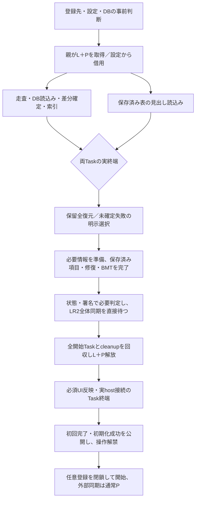
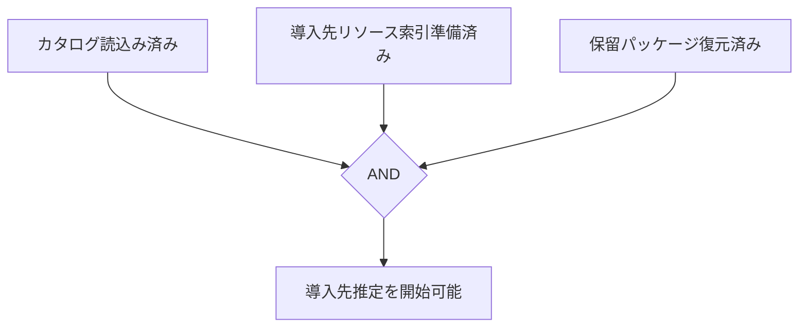

# 起動・初期化・再読込み

## 目的と適用範囲

ライブラリの構築、操作可能になる条件、必須処理と後続処理、各種再読込みの範囲を定めます。起動を単一の完了時刻で表さず、実際に利用できる機能と処理の所有者を区別します。

## 用語

[共通用語集](../glossary.md)を参照します。コードの識別子は原表記を使います。

## 仕様

### 起動の流れと完了境界

`App`の必須パスと言語一覧の準備は、設定読込みと同じ`ApplicationStartupCompositionOwner`の準備境界で行います。準備に失敗した場合は既存の起動失敗処理を一度待ち、VM・`Window`の構成へ進みません。ファイルログ、性能診断、既存ネットワーク診断、無効ログ水準の案内はそれぞれ独立した任意処理とし、一つの診断失敗で言語一覧の準備や他の診断を飛ばしません。

登録先・設定・DB構造・修復可否・終了の事前判断後、親が既存L＋Pを一度取得します。設定適用では呼出元の生存権限を借用します。独立したファイル走査・DB読込みと保存済みプレイリストの見出し読込みを並列に進め、正本変更は明示した依存順で確定します。並行読取りの合流後に出力ルートの登録修復を同じプレイリスト管理主体で確定します。必要な譜面情報・ハッシュ・保存済みスコアが利用可能になってから項目、カスタムフォルダ修復、BMTを直接待ち、必要なLR2全体同期の実終端へ進みます。

通常起動、初期設定、All再構築は同じ完了境界を使います。coreは構成・player置換・ローカル準備・必要LR2・cleanupの実Taskを待ち、その回の捕捉設定、既存操作token、元の実失敗を変更不能な局所結果として返します。coreでは初回完了・成功property・解禁・任意処理の登録完了を公開しません。設定からの借用では外側の実L/Pも解放してから、同じ非同期の終端処理を待ちます。共有の保留設定や別の完了flagは持ちません。

起動と許可されたScoreOnlyでは、保存済みスコアのlookup、実体購読、版と取得状態、同じ取得操作のraw全履歴・player時系列を初期化本体で採用します。通常成績と履歴の成否は独立して保持します。その変更を知らせる純通知だけを局所結果へ渡し、初期化ロックと実際の親L/Pを解放した後に実行します。公開初期化も自身の受付解放後に同じ通知を行います。採用後の後段処理が失敗した場合も、採用済みのスコア状態と元の失敗を保持して終端へ渡します。通知の通常失敗で初期化結果を変えず、再構築や保存を繰り返しません。通知の失敗を局所化する範囲へ、必要なlookup構築や購読の置換を含めません。メイン一覧の必須UI反映は、同じ操作の確定通知を既存の通常drainで配送してから表示要求を開始し、その実Task終端を待ちます。再読込みのreset通知が遅れて届いても、必須表示の候補を失効させた終端だけで成功を返しません。全再初期化本体は通常成績とraw履歴の外部DB再取得を行わず、その取得に伴うlookup・表示版の再公開をしません。設定で有効な既存のIR・順位後続による成績値と表示用 `Version` の更新は維持し、その場合も `PlayHistorySnapshot` 参照と取得世代 `SourceGeneration` を保持します。取得の契機は起動、意味のある成績取得元設定の変更、LR2履歴の導入・修復・削除後です。開いているランプビューアは既存の明示捕捉時に、通常成績と同時に取得した履歴から集計し、成績通知だけでは自動更新しません。

UI抑止解除は必ず行いますが、flushの予約だけを完了にしません。親解放後、既存UI schedulerの実Taskで必須表示と実player host接続を終え、それから初回完了・成功を公開して入力を解禁します。host接続の開始を成功property通知に依存させません。独立folder最終read・遅延表示の収束は待ちません。終了による取消と実UI/host失敗は通常起動と設定の既存失敗処理に返し、finallyからの例外で通知を迂回しません。事後の案内・警告の表示失敗は局所診断に留め、必須初期化の結果に合成しません。非OCEの実失敗は同時終了でも失敗として保持し、終了開始後の新しい失敗画面は開きません。受付外の警告から新しい明示操作が始まった場合、旧局所結果は既存tokenの確認で新操作の完了・解禁に使いません。

必須UI・実host接続のTask終端、成功公開・操作解禁の後、完了案内の実Taskを待つ前に、停止中schedulerへ難易度表リスト取得・事前計算・必要な外部同期をそろえて登録し、登録を閉鎖してから開始します。難易度表リスト取得は `SkipInitPlaylistLoad` に依存せず登録し、自動外部同期は従来の設定に従います。リスト取得のHTTP通信・UI適用・終了取消は既存schedulerの仕事として追跡します。全再初期化へリスト取得を新規追加しません。既存SchedulingCompleteのGC依存は維持しますが、起動成功の根拠にはしません。ready記録、stopwatch、dirty maskやscheduler idleを機能の完了判定にしません。外部同期はその開始時に通常の新規Pを取得し、解禁通知から新操作が先着した場合は通信前に見送ります。P解放後の自動再投入は行いません。

全体同期が必要なら修復と同じ生成・検証経路で完全な面を一度だけ準備し、今回の結果を同期へ渡します。部分修復を完全な入力の証明へ読み替えません。全体同期不要・単独動作でも必要な修復とBMTを保ち、不要なLR2段階を待ちません。外部同期には保存済み表を使った必須起動の後で進み、ネットワーク待ちを操作解禁条件にしません。

| 記録名 | 成立する状態 |
| --- | --- |
| `startup_install_estimation_ready` / `startup_install_ready` | 所持目録、リソース索引、保留パッケージが揃い導入先推定を開始できる |
| `startup_ready_data` | 導入判定に必要なデータが揃う |
| `startup_ready_ui` | 必須の初期表示を適用済み |
| `startup_ready_install` | 導入先表示の適用を計測する |
| `startup_ready_operable` | 必須処理・親受付解放・必須UI/hostを終え、通常入力を解禁したことを計測する |
| `startup_initialization_complete` | ローカル準備・必要LR2の終端・操作解禁へ到達する。LR2単独失敗は独立結果に残す |
| `startup_post_initialization_maintenance_complete` | 登録済み後続と任意事前計算が収束する |

ローカル必須処理の失敗ではLR2へ進まず、実処理の失敗を`Outcome=OperationFailed`で既存の失敗通知へ返します。設定修復が必要な事前検査・検証だけを`SettingsRequired`とします。一方が失敗しても開始済みの相手Taskを回収してから受付を解放します。ローカル成功後のLR2だけの失敗は、ローカル確定と永続失敗記録・通知を保持して通常操作を解禁します。結果の`Outcome=Succeeded`はローカルと必須UIの成立を示します。通常起動の`bool`は必須処理と必須UIの成立を表します。初回案内だけの失敗は局所診断で終え、`true`と公開済み成功・初回完了・解禁を維持します。LR2単独失敗は別結果に記録・通知し、ローカルと必須UIが成立すれば`true`です。次回起動・設定画面の手動同期は新しい入力から始め、自動再試行・途中再開・巻戻しを行いません。

LR2失敗の保存・公開は既存のLR2管理主体で終結し、既に確定した`Failed`/`Incomplete`を上書き・重複通知しません。起動・再初期化の本番呼出元は型付き結果のLR2失敗を確認し、同主体の現在の状態を既存の進捗表示へ渡します。表示用の別状態保持層は作りません。終了による取消はこの非致命的な失敗へ変換せず、既存の`ShutdownRequested`へ伝播します。開始済みTaskとcleanupを待ち、親受付を解放しても、初回完了・通常操作解禁・外部同期投入には進みません。設定の借用権限による初期化と、受付解放後の完了コールバックにも同じ条件を適用します。

任意の譜面情報補完は、候補要約のDB読取りも既存の`chart_info_backfill`後続で行います。必須hydrationは必要な保存済み情報の反映を終え、同じ発生元を後続へ渡して終端します。後続は親受付の解放後にLを取得し、候補要約から既存補完の実終端まで処理します。停止中scheduler、保持された候補要約、後続の未完了を必須出力・LR2の開始条件にせず、追加の依存stageや共有保留台帳は持ちません。終了が先着した後続はDB要約・実補完を開始しません。

確定済み一覧の閲覧・検索と独立したフォルダ最終読取りは必須処理の終端を妨げません。変更操作はL/Pで拒否し、UIスレッド・DBトランザクション・モデルロックを持ったまま別主体の完了を同期的に待ちません。設定の閲覧・編集・取消と、Busy時のdraft保持を維持します。

初回の完了案内は必須ローカル準備と操作解禁、追加処理の一括登録・閉鎖・開始後です。既存dialog serviceの実Taskとして終端を待ちますが、難易度表リスト取得は案内の終了や無関係な追加処理を待たず開始できます。案内の失敗は成立済みのlocal/UI成功・初回完了・操作解禁を取り消さず、その通知境界で元例外を診断します。独立した次の案内は引き続き試み、初期化の失敗通知や再表示へ変換せず、受理済み後続を未始動で残しません。案内から次の明示操作へ再入した場合も、旧tokenの仕事を新しい起動の表示へ混入させません。LR2単独失敗でもローカル準備成功の意味を維持し、外部同期やメンテナンス情報更新の完了を案内しません。後続の終了記録はschedulerで追跡する順位・XML取得の実終端を含み、独立readerの表示収束は含みません。追加親の消去は[対象起動だけの実終端](progress.md#追加処理の段階と終端)で判定し、この終了記録や終了待機の全追跡対象の意味を変えません。

### 保留復元の失敗時選択

通常起動と初回開始・設定反映が合流する必須初期化では、ファイル段階と保存ヘッダーの両方が成功した後に、保留パッケージ全体を復元します。All再初期化ではファイル段階の成功後に同じ復元処理へ進みます。正常な不存在の整理も全体復元と一括確定し、取得・読取り・未確定DB失敗では全保留登録と既存の確定一覧を保持します。ScoreOnly・FileDiffへはこの復元や選択を追加しません。

DB確定前の保留復元失敗だけに、元原因を表示して「再試行」「保留一覧を初期化して続行」「終了」を提示します。再試行は全保留DBと入力を新たに取得し、他のファイル走査・ヘッダー・閏年修復等を一律に再実行しません。一覧初期化は毎回の明示承認で全保留登録を一transactionで消去し、成功後だけ空一覧で通常初期化へ進みます。元入力・導入済み楽曲は削除しません。削除失敗は原因を表示して同じ三択へ戻り、自動続行・自動再実行を行いません。×・Escは登録を保持した当回の初期化失敗です。

選択待機中も親L/Pは生存しますが、DBtransaction・モデルロックは解放済みです。DB確定後の一覧公開・通知・配送・Ready障害、表示失敗、他段階の失敗を保留復元の三択へ戻しません。既存Shellで終了が受け付けられた後は新しい復元確認を開始しません。明示した終了選択は短命な結果で親L/P・gate・UI抑止の解放後まで渡し、実Windowの通常Closeへ配送します。初期化Taskは自分の終了準備完了を待たず、既存OnClosing・終了receipt・Window終端の所有を保ちます。既に終了中なら追加Closeを要求しません。

### 有限の入口と段階選択

| 入口 | 必須の範囲と既存との差分 |
| --- | --- |
| ContentRenderedの通常起動、初回の明示開始 | 事前判断、構築、保存データと必要差分、出力、必要LR2、実UIと必要host。初回は確定済み必須値を使い、同じWindowの外側の生存権限を借用して必要全表BMT・必須UI/host公開を待ってから初回完了とCloseへ進みます。 |
| ツリー全再初期化 | 既存組の目録・全走査・保留、必要出力とLR2、実UIを同じ終端へ合流。本体は通常成績・全履歴の外部DBを再取得せず、それに伴うlookup・表示版の再公開をしません。既存IR・順位後続の表示用Version更新は維持し、履歴参照と取得世代は保持します。新組構築・player接続・初回案内・外部catalog取得を追加しません。 |
| BMS局所確定、ツリー差分 | 再生停止、必要差分・LR2・参照・実表示。全目録・保存ヘッダー・全表出力を無条件に追加しません。 |
| 許可されたScoreOnly、履歴schema変更後 | 保存成績とraw全履歴・player時系列・取得時ノーツ・schema結果を同じ取得操作で用意し、成否を独立に採用してスコア投影・必要表示へ渡します。IR・順位は後続で、ファイル走査・全表出力・プレイリストURL補完予約を追加しません。 |
| 明示の表一覧再読込み | 保存見出し・entries、利用者が要求した外部同期・必要出力・参照・実表示を同じPの実Taskで待ちます。 |
| 再読込み不要の通常設定 | 項目保存の成功後に表示へ反映し、動作方針は次の操作開始時に捕捉します。同じ設定画面を維持し、URL補完等は既存の後続へ渡します。 |
| 手動LR2、モード切替、更新確認 | 既存の独立寿命を維持。手動LR2は既存の明示force要求、モード・LR2パスの変更は確認と選択保存後に通常shutdownによる回収を経て新プロセスを起動します。 |

設定の局所操作は同じWindowで必要な処理・必須UI公開・通知まで待ちます。Busyと確認取消は保存前に拒否し、部分保存・成立済み出力は保持します。初回・修復で有効な組がなければ、各セクションは保存だけを行います。明示した「この環境で開始」で確定済み値から一回初期化し、全表BMT・必須UIとhost公開の成功後に初回完了とCloseへ進みます。設定不足・処理失敗・終了を既存の型付き結果で区別し、設定不足や失敗で画面を閉じて再表示する継続は作りません。

設定からの開始とモード・LR2・beatoraja組の反映は、通常起動の事前準備から必須UI・host公開の実終端まで拒否します。モデル接続前やL/P解放後も既存の操作中状態で判定し、profileの有無だけで初回の明示開始待ちと見なしません。設定不備の案内は起動抑止・受付を解放してから行い、案内Taskが未完了でも、その設定画面から開始できます。開始の連続入力は重複初期化せず、成功公開時に開始表示を更新します。beatorajaの有効選択は[局所反映](settings.md#beatorajaの局所反映)で処理し、新しいプロセスやhostの再構築を要求しません。

### モデルの組と任意処理の寿命

既存の構築ownerが設定・schema・standalone DB・profile・バックアップの判断と順序を持ち、画面は購読・一覧・ツリー・host接続を担当します。親L＋P内で必要な旧配置移行後に新LibraryとPlaylistの組を構築し、成功した組だけを接続します。新組構築失敗では旧組を停止しません。成功後は捕捉した旧組へモデル固有の停止を通知し、停止済み旧組への巻戻しはしません。親内でnetworkやscheduler全体のidleを待ちません。

モデル固有の停止・CTSと構成の共有L/P受付閉鎖を分離します。共有閉鎖はアプリshutdownだけで行います。L待ちの旧workerは取得後に自モデルの停止を再確認し、DB確定をせず既存cleanupへ終端します。現在モデルの受理済み背景入力はBusyで捨てず、既存Lを待って実行します。URL通信は既存のモデルtokenと通信後の停止確認を使います。

chart_info backfillと候補要約、保守、installable、IR・順位、URL補完、外部catalog、自動外部同期、GC、warmupは実UIと成功公開後に明示登録します。IRの通信・parse・cache読取りはLなしで行い、正本DB更新・cache Upsert・モデル確定だけL内で行います。取得後の停止・score context確認で旧結果の新組への保存を止め、通信から末尾の確定までschedulerの一つのworkに含めます。共有prefetch／consume状態を持ちません。

公開モデル初期化も同じ名前付き保存データ・走査投影手順へのadapterです。意味を持つcontinuation入力は全開始Taskを回収します。走査の正常・空・incomplete・例外では先行列挙の全開始Taskとcleanupを回収してから返します。警告は今回の小さい局所結果として受付外へ持ち出し、元失敗を後発の通知取消で隠しません。

### 起動後のソートキャッシュ準備

[ソートキャッシュ準備範囲](settings.md#起動時のソートキャッシュ準備範囲)は `MainWindowViewModel` の構築中に、構成で共有する設定を設定VMの構築時に一度 `Reload()` した後、一度だけ読み取り専用値として捕捉します。起動後の処理は編集中・保存後の共有設定を読み直しません。同じプロセスの全体再初期化も捕捉値を維持し、新しいプロセスの構成で初めて保存済みの変更を使います。

`StartupPostInitializationWarmupOwner` の既存仮想順序段階から、捕捉した優先度を通常一覧ownerの事前生成対象の選定へ渡します。選択した上限と対象件数を既存の `virtual_order_prewarm` 診断へ残します。0ならソート入力行の取得・順序計算の前にその段階を正常終了し、実パス、導入先重ね合わせ、所持主ハッシュ、プレイリスト用ハッシュの他4段階は維持します。

0～3外は選定境界で例外とし、既存の任意起動後処理の `Failed`、失敗段階 `virtual_order`、元例外と実行権の終端へ接続します。別値への補正は行わず、必須初期化の成功・操作解禁条件へ追加しません。5処理は同じ実行権の中で直列に行い、取消・旧実行権の回収・版整合・失敗診断を維持します。並列上限は[追加処理の並列実行と依存](#追加処理の並列実行と依存)に従います。

### 登録ディレクトリの検査

`InitializeAsync` は設定を捕捉した後、出力検索ルート調整より前に `StartupLibraryConstructionOwner.PrepareDirectoriesAsync` で共通の設定受理検査を一回行います。出力基点による利用可能性検査の除外前の全BMS登録と、LR2モードで使う通常・追加・ROOT出力基点へ[予約領域条件](../playlist/lr2-custom-folders.md#出力先と事前検査)を適用し、write probe・profile構築前に `InvalidConfiguration` として既存の設定訂正へ戻します。mode選択の即時保存時はこの検査を行わず、再起動後も同じ起動受理を通します。standaloneの未使用出力残存値は検査せず、確定LR2rootが分かる実BMS登録は両モードで検査します。起動時走査を無効にしていても省略しません。具体理由の表示は組込み予約領域の既知リソースに限定し、追加JSON構文不備などは汎用のローカライズ済み理由を用い、診断Reasonと元例外を保持します。通常走査のrequest作成には予約領域の再検査を置きません。

LR2連携では、検査要求を作る前に構成の `Lr2ConfigSession` から採用済み所有者を取得します。正本未成立の場合だけ `LR2Config` で設定XMLを読み込み、検証後に採用します。パスの未設定・不正、ファイルの欠落・読取不能、XML不正、必要な `config/jukebox` 要素の欠落は通常の設定不備です。検査入力を構成できない状態を空の登録ルートや検査成功に置き換えず、設定案内へ戻します。初回かつ全項目が空の場合だけに限定した例外扱いはしません。

通常の起動入口 `InitializeAsync` で設定不備が見つかった場合は、排他とUI抑止を解放してから、初回なら言語選択、それ以外なら通常の設定確認の警告と設定画面へ案内し、`false` を返します。設定保存から開始した初期化では、初回フラグが真でも言語選択へ戻さず、設定確認の警告を表示して、`ISettingsDialogStatePort.InitializeLibraryAsync` から 型付き結果の`Outcome`に`StartupInitializationOutcome.SettingsRequired`を返します。出力検索ルートの修復・保存、DB処理、モデル構築、走査へ進みません。想定済みの入力不備だけをこの経路で扱い、それ以外の例外は予期しない失敗として通知・記録します。設定不備の確定後に行う任意の設定確認警告や診断が失敗しても、元の`SettingsRequired`と検証結果を保持します。二次失敗は局所診断へ留め、通常起動・設定適用の既存設定案内を中止したり再帰的な汎用失敗通知を始めたりしません。終了による取消は既存の終了結果へ返します。

初期化内部の設定準備・モデル構築・ファイル初期化からは設定画面を開きません。通常起動の失敗は外側の初期化入口が排他を解放してから案内します。設定から開始した場合は結果と後片付けを呼出元へ返し、初期構成不足だけを既存の再編集案内へ戻します。通常保存後の異常で自動再提示せず、元失敗を通知します。初期設定の保存後も、実処理から`OperationFailed`が返った場合は有効なプロファイルがないことだけを理由に設定を再表示しません。設定修復が必要な`SettingsRequired`と、型付き結果を取得する前の既存案内は維持します。成功、設定修復が必要な失敗、処理・必須公開の失敗、既に要求した終了を区別し、処理失敗や終了要求を設定画面への復帰に読み替えません。初期化の排他や保存中状態を保持したまま新しいモーダル設定画面を待ちません。

LR2連携の通常起動の必須処理が正常に終端し、その初期化で捕捉した `LR2RootPath` が空なら、親受付とライブラリ表示更新の抑止を解放し、必須UI・成功公開・操作解禁の後に起動継続可能な警告を一回表示します。警告は、LR2のスコアDBの場所を解決できずLR2のスコアDBを利用できないこと、LR2バックアップやLR2標準カスタムフォルダの検出で予期しない動作になり得ること、設定画面でLR2ディレクトリを設定すべきことを伝えます。OKで閉じた後も初期化成功を維持し、設定画面を自動では開きません。

この警告は `LR2RootPath` が空の通常起動ごとに表示し、抑止する永続設定は持ちません。単独動作、ルート設定済み、設定画面から保存後に呼び出す `ISettingsDialogStatePort.InitializeLibraryAsync` では表示しません。必須設定不備を `SettingsRequired` として扱う経路とは区別し、空のルートを別パスから推測して補いません。

ディレクトリ検査と設定全体の検証が成功してから出力検索ルートを修復します。修復とライブラリのプロファイル構成には、構成が保持する同じLR2所有者を渡します。初回設定で既に保存したXMLも、全再初期化も同じ正本を引き継ぎます。スタンドアロンのLR2bodyと再生方式変更後の再生成も同じ所有者を使い、LR2非利用時はXMLを必須にしません。これらの処理のためにXMLを再読込みせず、検証前の保存も行いません。

利用不能なら設定修復・保存、単独動作DBの作成、構造修復、モデル構築、バックアップ、最適化、走査、後続処理へ進みません。初期化の排他とUI抑制を解除してから一回だけ警告します。通常の起動入口は `false`、設定保存側の入口は 型付き結果の`Outcome`に`StartupInitializationOutcome.SettingsRequired`を返します。設定画面への案内は上記の呼出元の分担に従います。欠落登録を自動で外さず、修正・再接続後のOKで新しい入力を確認して再試行できます。

モデル構築前の必須検査と出力先検査は維持します。正本DBを正常に初期化・読み取った後は、BMSルートの切断・削除による再検査失敗を、不完全な走査として警告し、保存済み内容で利用を開始します。新規・既存、空・非空のDBで扱いを変えません。未採用の走査取得失敗も同じ境界で閉じ、不完全な結果から追加・削除を反映しません。

DB読取り後のBMSルート失敗と、初期の設定検証・出力先の失敗を混同しません。出力先や必須DB読取りの失敗は外へ伝え、解放後に通知します。解析中の分割保存と必要反映の失敗も走査取得の捕捉へ含めず、先行確定を保存内容による未変更の成功へ読み替えません。これらの停止後に成功記録や成功後の処理を公開しません。

### 登録rootの表記と走査入力

走査準備では、登録rootの確認可能なディレクトリ要素を親の直下列挙で取得します。`GetFullPath` や `DirectoryInfo.FullName` のみを実在確認としません。事前確認だけではdrive rootとUNCのserver/shareを推測変換せず、リンク先の最終pathへ登録位置を置換しません。追加の表記確認で想定するファイルシステム例外だけは元入力を保持し、保存差分を作りません。取消・メモリ不足は伝播します。通常のpreflightの失敗は従来どおり扱います。

既存 `ActiveFileScan` が事前確認済みroot・設定入力・preflightを変更不能に保持してEverything/Fastへ渡します。走査取得と既存の再検査後、実返却directory面・必要なfile pathが確認した同所prefixを登録側が採用し、SDK literalとresource indexを改変しません。入力合成Fast root EntryとDB行は実在表記の根拠にしません。normal folder比較の既存snapshotは操作引数として渡し、Full/全再初期化では `LoadSongTable` の補正・commit後の有効全件結果を `SongTableLoadResult`、既存observer、操作ローカル結果から直接再利用します。ReloadFileDiffだけはL受理・preflight・BeginFileScanRequest直後に全folderの全列・全rawキーを一括取得し、既に走るchart走査と並行します。同じraw Ordinal面をnormal生成・custom依存・planへ渡し、比較後の旧行再検索はしません。mtime用先行Task/provider・DB代替read・root集合一致判定は持ちません。確認後Optionsをnormal folder・管理scope・custom準備・分類へ共通に渡し、raw旧exactだけを更新・削除します。全件取得をmutation scopeへ渡さず、全曲追加I/O・再走査・管理出力の曲走査追加・常駐snapshot保持は行いません。

不完全走査、既存DBを保護する空走査、任意BMSONの不完全走査とroot再検査失敗の非反映判定を通過してから、譜面DB保存直前の `fileScanReadyToCommit` で[登録保存と限定公開](settings-persistence.md#項目保存と公開)を行い、既存custom準備を開始します。callback未到達では返却Optionsも元の登録入力を保持し、未保存候補を後段へ漏らしません。空成功は確認根拠がある場合に採用でき、未確認の空rootは推測変更しません。保存失敗でも開始済みTaskの回収と既に採用済みのscore結果・既存終端通知を維持します。

### 動作モード

| モード | 楽曲DBとルート | 外部連携 |
| --- | --- | --- |
| LR2連携 | 保存済みのLR2楽曲DBと設定XMLの検索先を使う | LR2のカスタムフォルダ、バックアップ、IR・順位更新を許可する |
| 単独動作 | アプリ内の `data/song.db` と複数の登録ルートを使う | LR2の実出力・XML変更・バックアップ・IRは行わない。明示設定がある場合だけbeatorajaのスコアを使う |

単独動作DBはAppDataではなくポータブルなアプリデータです。ディレクトリ、DB、ライブラリ、プレイリスト、BMSONと譜面情報の構造を順に作ります。LR2互換の構造と出力設定値は保持できますが、実際のLR2出力は行いません。

standaloneの通常操作は、共通の確定登録readerから要求ごとの変更不能な入力を捕捉します。起動profileは捕捉済み入力を保持し、別の可変runtime一覧への起動配送を行いません。公開後の次要求だけが新しい登録を読み、既受理入力は差し替わりません。LR2は同XML所有者の登録・配置を使い、利用者登録readerだけへ走査集合を置き換えません。

単独動作のルートは複数登録でき、存在するパスの正規化と大小文字を無視した重複排除を行います。利用者が登録した親子や用途の単位を勝手にまとめません。旧 `BMSRootPath` はルート一覧が空で実在する場合だけ初回移行に使います。新規導入先は登録ルートのいずれかを必須とします。

有効な実行中モードの切替はプロセス再起動です。設定の変更意図に対する確認・先着受付・最小設定の保存と終了は、設定と終了の仕様に従います。同じプロセスの再初期化でDB所有や連携先を差し替えません。LR2の場所・DB・XMLが未設定でもモード選択は保存でき、後継プロセスの必須検証で設定不足なら既存の設定案内へ進みます。有効profileがない初回・検証失敗時はモードだけをその場で保存して設定を続け、必須値を確定してから同じプロセスで明示開始します。モード保存だけでは初期化を開始せず、未設定を有効な空ライブラリへ置き換えません。

初回の言語選択は `InitialSetupLanguageDialog` で行い、次にメイン画面を所有元とする設定画面を開きます。一般の設定不備は通常の確認画面で案内します。必須設定が揃うまで初回走査を開始しません。LR2bodyのプレイヤー選択はライブラリのモードとは別で、単独動作でも使用できます。

### DB構造の確認と修復

`AppSchemaPreflightService.Inspect` は読み取り専用です。既存 `playlist_entry` のSHA-256対応やアプリ構造の版更新が必要なら警告します。完全な初回DBへアプリ用の構造を追加するだけの場合は互換性警告を出しません。補助表・索引の欠落や非互換は修復しますが、ハッシュ対応行の充足率は構造確認に含めません。

`EnsureAppOwnedSchema` / `RepairAppOwnedSchema` はアプリ所有の表・索引を揃え、`app_schema=1` を記録します。既存のMD5・SHA-256対応を保持します。`BmsLibraryDbGateway` の一つの外側トランザクションが全変更を所有し、借りた接続を使う参加処理は確定・取消をしません。途中失敗では全体を戻し、最初の例外を伝えます。

修復後は必ず再確認し、未収束なら起動失敗です。後の譜面情報読込みを構造修復の代わりにしません。構造修復のために楽曲全件や実ファイルからSHA-256を計算せず、実際に譜面を読む差分・導入・補完へ任せます。

### LR2閏年日時修復の判断と終端通知

通常起動、設定の初期設定・All再構築、ツリーと公開APIの全再初期化は、既存の設定検証・未設定案内を終えてから共通の限定前段を使います。読取専用接続でfolderのtype=1、date未設定または負値、正常範囲のadddateを持つ保存行だけを読み、絶対pathで実在するフォルダのmtimeが閏年2月29日から3月2日未満か確認します。物理候補は完全修飾pathに限り、drive/UNC rootの末尾区切りを保持し、部分修飾の保存行を現在ディレクトリ依存で採用・削除しません。相対pathや異常adddateの行はその回のmtime確認に含めず、通常の日時・path補正へ残します。候補読取はsongや譜面情報をロードせず、DB・schemaを作成・修復しません。

候補の保存列・exact-path・mtimeを変更不能な要求に捕捉し、L＋Pを取得する前、設定適用では保存前にNo既定のYesNoを確認します。Yesだけを修復対象とし、No・取消・閉じた確認でも初期化を継続します。確認待ちの予約はなく、Busyでは保存・修復を始めません。取得後に既存の対象限定再検証を行い、保存行の差替え・列の変更・mtime変更は見送ります。承認はraw exact keyの保存行ごとに照合し、物理同所では日時の再確認・変更だけを共有して、適合する承認済み保存行をすべて更新します。未承認行へ修復を広げません。別の対象を読み替えたり、自動で確認を再試行したりしません。修復と通常ロード・走査・必要出力・LR2・cleanupは一つの親操作内に保ちます。

実修復は部分成功を保持し、対象ごとの失敗は元のpathと原因を通知します。修復成功がある場合、または検出があり承認候補がない場合に既存の閏年警告を提示します。警告・失敗通知はL/P、writer保護とDBトランザクションの外で行い、通知から新しい明示要求を受け付けられます。後段の失敗・終了で捕捉済み通知を成功結果に読み替えず、終了時は既存の終了要求の扱いに従います。通知のFailed・OwnerUnavailable・nullや表示例外は局所診断とし、修復結果や元の初期化失敗へ加えません。通知待機中のAppClosingと既知の終了は取消へ伝え、終了または旧要求と判明した後は次の通知を開始しません。事前の確認画面の失敗を、承認や利用者の取消として扱うことはしません。

候補読取・確認待機の成功後から親受付までに終了が先着した場合は、受付閉鎖を他操作のBusyと区別し、起動では`ShutdownRequested`へ返します。設定適用では保存・修復・設定再表示を開始せず、ツリー再初期化も未開始で終端します。初回完了・通常操作解禁・外部同期投入へ進みません。実際のDB読取・画面障害を、事後の終了フラグだけで取り消しへ置換しません。

### 補助メタデータの取込み

配布された譜面情報は起動時のDB読込み前に取り込みます。取込み済みのファイルは `imported_metadata/` の同名の管理キャッシュへ移します。`chart-info-metadata.7z` または `.db` をルートへ戻せば再取込みできます。再初期化と差分再読込みでは再取込みしません。

配布情報の `chart_info_schema_version` は輸出入形式の版であり、アプリDB構造の版とは別です。取込みをDB構造の修復や所持判定の代わりにしません。

### 目録とファイルの読込み

楽曲・BMSON・ハッシュ対応をDBから読み、スコアの取得元を選びます。LR2のIR取得と順位更新は必須UIと操作解禁後に一つの任意処理として開始します。単独動作でbeatoraja無効ならスコア取得元はありません。

ファイル列挙は `EBridge_ScanChartAndResources` を使い、Everythingが利用できない場合だけ同じ契約のマネージド走査を使います。古いDLLやABIの不一致への互換代替は持ちません。ネイティブ橋渡しとC#は同じ成果物として配布します。

通常走査は音声・画像・動画の譜面相対キーと逆引き索引まで完成させます。未完成で導入可能とせず、保留バッチへ遅延構築を押し付けません。ネイティブ経路は復号済み配列から索引を作り、中間のリソース辞書を実体化しません。マネージド走査と検証用の結合経路だけが辞書を持ちます。

列挙した譜面時刻、テキスト、フォルダ時刻、LR2出力情報は[LR2同期仕様](../integration/lr2-song-db.md)の生産側契約へ従います。通常差分の意味とLR2派生行の修復を混ぜません。LR2の同期未完了だけを理由に通常差分を全件更新へ変えません。並行する読込み・探索は別の表示行へ投影し、確認対象・解析対象・実変更数の表示と診断は[進捗](progress.md)・[ログ](../core/logging.md#初期化探索同期の記録)に従います。

### 導入とプレイリストの準備完了

`StartupInstallReadinessState` は `CatalogLoaded && DestinationResourceIndexReady && PendingPackagesRestored` で導入先推定を許可します。スコア、順位、譜面情報、保守、プレイリストの読込みはこの条件に加えません。明示的に起動走査を省略してリソース索引がなければ、推定は `resource_index_unavailable` として利用不能になり得ます。

次の矢印は導入先推定を始めるための必要条件です。ANDの三条件だけを表し、通常入力の解禁や起動全体の完了とは同一視しません。

保留復元は[親子重複の物理範囲整理](../library/install-estimation.md#検出した物理範囲の保持)を全対象の完成後に一括確定します。初期DB列挙順の最初の有効rowと`delete_parent`を保持し、case-onlyやdotのaliasの全生キーを正確に消費します。属性取得のNotFoundだけを正常な不存在として整理し、既存Normalizerや属性取得で不正保存pathのため実行不能となる場合、列挙後欠落・不完全列挙・譜面読取不能は原因付き復元全体の失敗です。新しい構文検査を通常入力へ追加せず、判定不能な保存行を黙って削除しません。孤立単位もsnapshotの完全性を検査し、部分一覧を公開しません。復元した対象に自動推定・自動導入は行いません。

モデルの`RestorePendingPackagesUnderAdmissionAsync`は同じL/P内でDBと入力を毎回freshに取得し、全評価・警告・完成collectionの事前構築、一transaction exact差分、完成一覧のswapを行います。同期公開初期化は同じstageを自有L/P内で合成し、借用files入口は外側の共通必須workflowがheaders成功後にstageを呼ぶ契約です。`ResetPendingPackagesUnderAdmissionAsync`は明示選択用にinstall全登録だけを一括削除し、成功時だけ保留を空にします。両API自身が同期coreをTask.Runで一回実行し、model保護とtransactionを保持しない純通知Actionを受け取ります。外側はstageを直接awaitし、外側Task.Runを追加しません。必須通知を既存InvokeAsyncでawaitしてから保留・導入準備のReadinessへ合流させます。同期公開初期化だけは同じcoreの通知を自有L/P解放後にInvokeし、その成功後にReadyへ進みます。同期Task待ちや任意通知のbest-effortへ置換しません。

DB確定前の読取・DB失敗は`PendingPackageRestoreException`が元原因を保持し、DBと再初期化前の一覧を変更せず返します。model lock・DBtransactionは応答前に解放します。権限不備・終了取消・他の初期化phase失敗は専用復元失敗へ変換しません。DB確定後のcollection同期・通知障害も既存の公開失敗へ伝播し、確定済み試行を復元Retryへ戻しません。画面との接続は[保留復元の失敗時選択](#保留復元の失敗時選択)に従います。

`StartupReadinessCoordinator` は必須プレイリスト準備と導入先推定の準備完了を独立して通知します。外部・おすすめの新規取込みは準備未完では受け付けず、通信、解析・保存、公開集合の変更を開始しません。準備完了後も[競合ポリシー](../core/operation-concurrency-policy.md)に従って通信前にPを取得し、Busyは未受理として予約・自動再実行を行いません。受理した一要求は必要出力・公開・後片付けの実終端まで所有します。

初期化失敗では準備待ちへ同じ元失敗を返し、空の成功を公開しません。終了では準備待ちを終結させ、取消コールバックが失敗しても残りを試し、元失敗を保持します。新規受付を再開せず、受理済み実処理は `finally` と後片付けまで追跡します。遅れて戻る通信や初期化の継続からDB・公開状態を変更しません。

### 必須の処理と後続処理

必須手続きは`StartupLibraryInitializationWorkflowOwner`が直接Taskを待ち、完了を登録名、登録閉鎖、scheduler全体のidleから推測しません。親進捗は必要な実UIまで直接待った手続きの終端で完了し、scheduler全体のidleや任意段階を分母・完了条件へ加えません。操作解禁後に既存schedulerを開始し、URL補完、外部同期、表示cache、独立した導入可能保守、GCを固有の依存で扱います。

必須の譜面情報と保存済みスコアは停止中schedulerを待たず同じ親操作で準備します。後続の譜面情報補完は既存の要求識別・cache失効を使い、初期化の成功条件へ足しません。内部継続は親の生存権限を借り、Busyで省略しません。

フォルダツリーの最終読取りは独立し、遅くても操作解禁を止めません。任意の表示事前計算は成功公開後の明示した一括登録に含め、固有の先行依存とその実終端を後続完了へ含めます。ログから追加登録しません。

### 追加処理の並列実行と依存

既存スケジューラー全体の並列上限は4、起動後の追加処理は3です。難易度表リストのHTTP取得 `external_table_catalog`、プレイリスト索引の準備 `playlist_library_index_prewarm`、譜面一覧の索引・ソートキャッシュの準備 `playlist_virtual_order_prewarm` はそれぞれ独立した上限1のレーンを使い、同時実行できます。追加処理の開始時は難易度表リスト取得を先に選び、他の独立仕事で開始を待たせません。索引準備の内部段階は分割せず、既存の読取りレーン上限2も維持します。

`playlist_url_completion`・`playlist_ref_apply`・`external_playlist_sync` は共通の `playlist_followup` レーンで直列化します。メンテナンス情報更新のL/P実受付とSQLite変更排他は維持し、`installable_maintenance` は譜面情報補完・メンテナンス情報読込みへの明示依存を保ちます。共有索引の版確認・取消と旧リース回収を保持し、新しい再試行・別スケジューラーは追加しません。

`post_initialize_gc` は一括登録の閉鎖後、起動由来の並列仕事と索引準備が実終端してから開始します。実行可能性はスケジューラーの実状態から判断し、未登録名への依存や循環を作りません。仕事の受付・集約・実終端はスケジューラー、事前準備の一連の寿命は `StartupPostInitializationWarmupOwner` が所有し、表示の段階計算・消去は[進捗仕様](progress.md#追加処理の段階と終端)へ投影します。

### 後続処理の診断と取消

スケジューラーの受付・予約・開始・完了・警告・終了の診断は任意です。診断先の例外を処理結果へ加えず、受理済み要求の実処理と終端計上、依存解放、待機状態／全処理の終端待機を維持します。進捗購読先の例外は局所診断し、残りの購読先と実処理を継続します。実処理の失敗は所有境界で元例外と処理名を診断し、`failed`として計上します。

処理にスケジューラー所有の取消トークンはありません。処理から外へ出た`OperationCanceledException`は他の実処理例外と同じ`failed`として計上し、所有側で期待された取消を処理して正常完了した処理は`completed`です。`CancelQueued`は開始前の破棄として既存の終端を維持し、新しい取消状態を追加しません。

### 読込みと表示への反映

読み取り専用処理は接続を閉じてから所有状態・索引・画面へ反映し、内部で構造修復や暗黙の書込みをしません。SQLiteの結果判定、接続設定、保守の有効性は[データと索引](../core/data-and-indexes.md)に従います。

譜面情報は両モードで実際のDB行と現在の失敗記録を照合します。LR2同期の完了行は譜面情報の現存を証明しません。全対象が現在の値を持つと確認できた場合だけ補完を省きます。部分的な既存BMSの更新は譜面情報由来の9列に限定し、BMSONからLR2楽曲行を作りません。

情報追加後の表示は、現在の並べ替え・絞込み・列への依存で判断します。不要な全件再構築をせず、基本値の順序を捨てません。起動中に抑止した必要な一覧・保留・保存済み参照の表示は、親解放後の同じ要求の実UI Taskへ集約します。選択中詳細は実buildと適用の終端まで待ち、予約だけで完了にしません。途中で選択が変わった要求は既存の対象一致条件で誤適用せず終端し、無関係な最新build全体を待ちません。実処理失敗は後発のobsoleteで隠しません。通常の起動でリソース変更を全件再評価せず、明示再走査が選択譜面または所持全件を扱います。

### 再読込みの範囲

| 操作 | 行うこと | 行わないこと |
| --- | --- | --- |
| `FullReinitialize` | DBとファイルから目録を再構築し、必要な補完を行う | 実行中モードの切替、補助メタデータの再取込み |
| `ReloadFileDiff` | メモリ目録と新しい走査を比較し、追加・更新・削除、索引、参照を反映する | 楽曲DB全体の再読込み |
| `ReloadTables` | 見出し、項目、参照を読み直し、その後に外部同期を実行する | スコア・順位の読込み |
| `ScoreOnly` | 保存スコアの取得元、スナップショット、投影と必要表示。IR・順位は後続 | プレイリスト見出し・項目・外部同期の再読込み、URL補完予約 |

これらは同じセマフォで直列化します。新規dispatchは必須初期化中に停止し、実UI・成功公開・現行token確認後の登録閉鎖と開始へ揃えます。開始済み旧仕事は元の識別で終端まで追跡し、Resetで旧要求の世代・versionを付け替えません。検索ルートの追加・削除は保存後に実行中の検索先を同期して差分を再読込みします。外部のDB編集を取り込む場合は差分更新ではなく再初期化を使います。

差分0件なら差分由来のDB確定・譜面情報・保守計算を行いません。成功した走査が0件でも既存の保存譜面がある場合は削除の正本にせず、DB・LR2同期・メモリ置換を止めて設定と検索状態を確認する警告を出します。新規の空DBは空ライブラリとして許します。判定は `ScanSource` を使い、診断用のフラグから推測しません。

通常差分と手動差分は同じ[譜面読込み](../library/chart-file-reading.md)を使います。LR2フォルダの準備済み反映がある場合、保存成功後に差分完了を進め、表示排出の順序へ依存させません。反映失敗で成功完了を進めません。詳細は[進捗](progress.md)に従います。

テーブル再読込みは自動対象を外部同期ONかつ絶対URIのものに絞ります。単体・選択範囲の手動再読込みは外部同期設定によらず選択を対象とし、並列数を制限した共通処理を使います。失敗は個別画面を乱発せず、ログと一覧の状態へ集約します。項目の反映コールバックまで完了してから外部同期へ進みます。

### 利用者が起こす入力再読込みの受付

ライブラリツリーの差分再読込み・再初期化は、共通論理受付を待たずに取得します。推定・変更・受理済み背景入力更新中はBusyで拒否し、再生停止・モデル変更を始めません。受理後は既存の試聴停止gateで準備・受理済みNextの実終端を待ち、入力変更・必須反映・後片付けまで同じ受付を保持します。設定適用からの差分再読込みは、設定側が所有する受付の内部継続として実行します。再初期化も今回の型付き結果で必要出力・LR2の実終端を待ちます。差分再読込みは既存の変更範囲を保ち、今回の結果をLR2へ直接渡します。

受付の標準構成接続は [`ApplicationCompositionTests`](../../../BeMusicSeeker.Tests/MainWindow/ApplicationCompositionAdmissionTests.cs) の `StandardComposition_RejectsDependentOperationsWhileSavingOrdinaryItemsAndKeepingCandidates` が、競合する操作の副作用前拒否・候補保持と独立項目保存を確認します。`StandardComposition_ActualLr2KeepsPlaybackAndAllowsIndependentOrdinarySettings` は実LR2同期中の再生維持と通常設定の保存を確認します。再読込みと局所確定の成否・終端は、下記の対応表に従います。

表ルート再読込み・差分再読込み・全再初期化の実メニューは、管理主体の実Task終端を待ち、実際の終了要求により所有された取消だけを静穏に終了させ、既通知のディレクトリ警告を重ねません。例外の型だけで取消と判定せず、終了要求のない`OperationCanceledException`は操作失敗として一度通知します。普通の失敗は既存の`MainWindow`操作失敗通知へ一度渡し、Dispatcherの未処理例外へ漏らしません。結果の`OperationFailed`は設定検証失敗や成功を意味せず、確定済み変更・開始済みTaskの回収・受付解放・既存トークンの鮮度確認を維持します。

表一覧再読込みで想定された外部対象の取得失敗はSTATUSと既存データ保持へ終端し、次の明示要求を通常の受付で受け付けます。一方、表の処理・必要参照・必須公開が例外終端した場合は、受付解放だけから参照の整合性を推測せず、既存の進捗による操作停止を維持します。`OperationFailed`やメニューでの捕捉だけを根拠に全失敗を再試行可へ変えません。スコア・差分・全再初期化は既存の後片付け後の受付条件を維持します。

差分再読込みと全再初期化の開始時の必須ディレクトリ検査、または出力先検査が失敗した場合は、再生停止・UI更新抑制・進捗状態・実処理の後片付けを終え、共通論理受付を解放してから警告を表示します。警告からの明示再試行を受け付け、元の失敗は通知後も伝播します。Settingsからの差分再読込みは同じ受理操作の内部継続として受付を取り直さず、外側の保存・反映・後片付けが終端して受付を解放した後に一度通知します。

保存済み内容の読取り後、手動の差分再読込み中にBMSルートが消失して再検査に失敗した場合は、不完全な走査としてスキップを警告し、差分を反映せず処理を終えます。取得できた部分だけの追加・削除・更新も採用せず、既存の正本と所持目録を保全します。走査成功や正常0件と読み替えず、今回の警告を親受付の解放後に通知します。

起動全体同期・条件付き差分同期・任意外部同期の開始判定と必須継続は[競合ポリシー](../core/operation-concurrency-policy.md)に従います。scheduler登録だけからCompletedを強制せず、実施済み差分と参照更新の事実を保持します。

ライブラリの構築では、標準構成が共有するライブラリ・プレイリスト受付の生存権限を、個別ライブラリ・storeへ明示的に渡します。LR2処理主体、DB、終了状態と再接続識別は個別に保ち、共有受付の一致だけで旧storeの対象を再び許可しません。初回構築と再構築のどちらも実モデル初期化・必要後処理を待ち、同じ受付を取り直したり自分の終端を待ったりしません。

## 実装とテストの対応

| 仕様項目・主な条件 | 実装箇所 | テスト箇所・確認内容 |
| --- | --- | --- |
| 確認済みrootの共有と保存境界 | `LongPathFileSystem.ConfirmDirectoryPathSpelling`、`LibraryFileScanPipelineOwner` | `RootFileEnumerationTests.ConfirmRootSpelling_UsesExistingComponentsAndPreservesUnconfirmedInput` が実要素・空root・未確認入力を、`LongPathFileSystemTests.CopyDirectory_DefaultFollowsNonCyclicDirectoryLink` がリンク位置保持を分担する。`LibraryFileScanPipelineOwnerTests.ConfirmedRootRegistration_IsSharedByScanAndCommitWithFailureBoundaries` がFast/捕捉Everythingのraw面不変、空成功と空走査保護、取消・不完全・root消失・保存/DB失敗を実入口で確認する。`RootFileEnumerationTests.ConfirmScanRoots_*` がdrive/UNC・root自身・兄弟境界と入力合成Entryの除外を分担する。 |
| 組込み予約領域の起動拒否と訂正 | `StartupLibraryConstructionOwner.PrepareDirectoriesAsync`、`LibraryDirectoryPreflightService.ValidateSettingsAcceptance` | `SettingDialogCustomFolderOutputBaseTests.SettingsAcceptance_ReservesBuiltinOnlyAtConfigurationBoundary` が受理条件と、許容祖先baseに含まれる明示BMS登録の構築前拒否を確認する。`SettingDialogEditCompletionTests.ReservedOutputModeSave_FreshStartupRequiresCorrectionThenAncestorBaseAndPropertySaveSucceed` がmode即時保存、明示開始・fresh起動の訂正、訂正後の利用開始とbuiltin実ファイル保全を分担する。`LibraryDirectoryWarningFormatterTests.Format_InvalidConfigurationShowsOnlyKnownReservedDirectoryDetail` が受理例外の具体理由と追加JSON汎用理由、元例外・診断保持を確認する。 |
| 保留復元失敗の明示選択と通常終了への引渡し | [`StartupLibraryInitializationWorkflowOwner`](../../../BeMusicSeeker/ViewModels/Startup/StartupLibraryInitializationWorkflowOwner.cs)、[`PendingPackageRestoreWindow`](../../../BeMusicSeeker/Views/Dialogs/PendingPackageRestoreWindow.xaml)、[`MainWindowViewModel`](../../../BeMusicSeeker/ViewModels/MainWindow/MainWindowViewModel.cs) | `StartupLibraryInitializationWorkflowOwnerTests.PendingRestore_*` は共通選択条件を、`PendingRestore_PostCommitNotificationFailureDoesNotOfferRecoveryOrPublishReady` は実Libraryの必須通知失敗を三択へ戻さずReady未成立・DB確定保持・元原因伝播とする境界を確認する。[`PendingPackageRestoreInitializationTests`](../../../BeMusicSeeker.Tests/MainWindow/PendingPackageRestoreInitializationTests.cs) は通常起動Retry・All再初期化Reset再承認・閉鎖／終了・他失敗の実接続、[`PendingPackageRestoreWindowTests`](../../../BeMusicSeeker.Tests/Dialogs/PendingPackageRestoreWindowTests.cs) は実ボタン・Esc・Bindingを分担する。`MainWindowViewHostTests.MainWindow_PendingRestoreExitUsesExistingCloseAndTerminalLifetime` は実Closeから既存終端への到達を確認する。設定合流は既存設定テストと共通終端への接続を点検する。 |
| 保留復元全体の完成・DB先行一括確定・alias先着・Reset | `BmsLibraryInitializationService.LoadInstallTable`、`PackageLifecycleOwner.ReloadInstallTableWithoutPublishing`、`BMSLibrary.RestorePendingPackagesUnderAdmissionAsync` | `BmsLibraryInitializationInstallTests.Initialize_RestoresPendingWithoutAutomaticEstimationAndAllowsManualEstimation`が公開初期化・自動推定なし・後の手動推定を確認する。`ReloadInstallTable_IncompleteRestoreKeepsAllRowsAndExistingCollections`、`ReloadInstallTable_InvalidStoredPathKeepsEveryRowAndExistingCollection`、`ReloadInstallTable_NormalizationDatabaseFailureKeepsRowsAndStopsBeforePublication`、`ResetPendingPackages_ChangesOnlyInstallAfterAtomicSuccess`、`ReloadInstallTable_CommittedPublicationFailureIsNotRestoreFailure`が全体失敗/rollback/元入力と他表/確定後公開失敗を分担する。`PendingRestoreStage_AwaitsRequiredPublicationBeforeReadiness`は実borrowed files準備後の通知待ち・DBとmodel読取解放をRestore/Resetで、`PendingRestoreStage_PropagatesPublicationFailureAfterCommit`は必須通知fault/rejectの通常失敗を確認する。`LoadInstallTable_SoleNonCanonicalSurvivorConvergesDatabaseBeforePendingPublication`は先頭bool・rawキー・後続通常追加を、`ResourceBearingNestedRestoreTests`は全定義判定と導入拒否を確認する。 |
| 未設定LR2のモード保存後も必須不足で利用開始を停止 | [モード保存と明示開始](../../../BeMusicSeeker/ViewModels/Settings/SettingsDialogViewModel.Confirmation.cs)、[`MainWindowViewModel.InitializeAsync`](../../../BeMusicSeeker/ViewModels/MainWindow/MainWindowViewModel.cs) | `SettingDialogEditCompletionTests.UnconfiguredLr2ModeSave_ExplicitStartAndFreshStartupRequireSettings` は初回・非初回修復での実保存、実明示開始と同じ保存物を読む新compositionの通常起動を通し、設定案内、profile非公開、モデル工場・DB・出力未開始をWindowなしで確認する。既存の無効パス条件表と空root・有効個別パス互換は `InitializeAsync_InvalidLr2SettingsUseSettingsGuidanceAndPreserveFiles` 等へ分担する。 |
| 確定readerと不変起動入力 | [`StartupSettingsSnapshot`](../../../BeMusicSeeker/ViewModels/Startup/StartupSettingsSnapshot.cs)、[`ApplicationComposition`](../../../BeMusicSeeker/ViewModels/MainWindow/ApplicationComposition.cs) | `StartupLibraryProfileTests` / `StartupSettingsSnapshotTests` が起動入力と実Library/Playlistの接続を、`SettingDialogEditCompletionTests.BmsConfirmation_CompletesRealFileDiffBeforeClosing` が公開後の実差分走査を確認する。 |
| 初回設定からのLR2正本引継ぎと再初期化 | [`StartupLibraryConstructionOwner`](../../../BeMusicSeeker/ViewModels/Startup/StartupLibraryConstructionOwner.cs)、[`Lr2ConfigOwner`](../../../BeMusicSeeker/Models/LR2/Lr2ConfigOwner.cs) | [`Lr2InitialSettingsSaveIsInheritedByFirstLibraryConstruction`](../../../BeMusicSeeker.Tests/Settings/SettingDialogLr2OwnerTests.cs) が未構築時の保存から初回開始を、[`BmsConfirmation_CompletesRealFileDiffBeforeClosing`](../../../BeMusicSeeker.Tests/Settings/SettingDialogEditCompletionTests.cs) が実LR2profileの保存・DB・表示と次差分・全再初期化を確認します。 |
| ソート準備範囲のReload後捕捉と次回起動からの適用 | [`MainWindowViewModel`](../../../BeMusicSeeker/ViewModels/MainWindow/MainWindowViewModel.cs) | [`MainWindowViewModelStartupProgressTests.StartupSortCachePriority_CapturesAfterReloadAndSurvivesFullReinitialization`](../../../BeMusicSeeker.Tests/MainWindow/MainWindowViewModelStartupProgressTests.cs) はReload前3/後0を実起動後warmupへ通し、保存3→同ownerの全体再初期化0→新構成3と実際の78件の順序準備を確認する。設定捕捉から`MainWindowViewModel`・実際の対象選定・準備処理への接続を対象とし、保守との本番順序は保証しない。既存の受付窓口で保守要求を実スケジューラーへの登録前に保持し、準備処理の観測後・失敗時の `finally`に一度だけ元スケジューラーへ渡して実処理も回収する。 |
| 準備なしと不正値の任意warmup終端 | [`StartupPostInitializationWarmupOwner`](../../../BeMusicSeeker/ViewModels/Startup/StartupPostInitializationWarmupOwner.cs)、[`RegularChartListOwner`](../../../BeMusicSeeker/ViewModels/ChartList/RegularChartListOwner.cs) | [`StartupPostInitializationWarmupOwnerTests.SelectedPriority_ConnectsActualDescriptorAndSortStage`](../../../BeMusicSeeker.Tests/Startup/StartupPostInitializationWarmupOwnerTests.cs) は実事前生成対象の選定とsort段階を接続し、0でも他4段階・Completed、-1/4でFailed・virtual_order・元例外・実行権の終端を確認する。`MainWindowViewModelStartupProgressTests.StartupSortCachePriority_InvalidValueFailsOnlyOptionalWarmup` は-1/4で実必須起動の成功・操作解禁後に同じFailed結果と実行権の終端へ接続することを確認する（先行maintenance_hydrationは同じ受付窓口での保留を使う）。既存系列が取消・重複・shutdownとscheduler世代を担う。 |
| 正常DB読取り後の走査失敗と利用開始 | [`LibraryFileScanPipelineOwner`](../../../BeMusicSeeker/Models/BmsLibraryInternal/Scanning/LibraryFileScanPipelineOwner.cs)、`MainWindowViewModel.InitializeAsync` | [`MainWindowViewModelStartupProgressTests`](../../../BeMusicSeeker.Tests/MainWindow/MainWindowViewModelStartupProgressTests.cs) の `StartupScan_NewPortableDatabaseFailureWarnsAndStartsWithSavedEmptyCatalog` と `StartupScan_RootDeletedAfterDatabaseReadWarnsAndKeepsSavedCatalog` は、実標準構成・空／非空DB、DB読取り後のルート消失、未採用候補の不在、必須終端での警告と利用開始、受理済み起動後保守の実終端後の次受付を確認する。初期の必須検査・DB読取り・保存失敗の既存回帰は維持する。 |
| 手動差分の走査中のルート消失 | `BMSLibrary.ReloadFileDiff`、`LibraryFileScanPipelineOwner` | [`BmsLibraryDirectoryAvailabilityTests`](../../../BeMusicSeeker.Tests/Library/BmsLibraryDirectoryAvailabilityTests.cs)で実ルートを走査中に移動し、今回のスキップ警告、既存BMS・bmson・folderの保存値、所持目録、未登録候補の非追加を確認する。初期必須検査・出力先検査の失敗は同テスト群の既存ケースへ分担する。 |
| 必須実終端・親解放・必須UI/host・成功公開・任意開始の統合 | [`MainWindowViewModel`](../../../BeMusicSeeker/ViewModels/MainWindow/MainWindowViewModel.cs)、[`ISettingsDialogStatePort`](../../../BeMusicSeeker/ViewModels/Settings/ISettingsDialogPorts.cs)、[`MainWindow`](../../../BeMusicSeeker/Views/MainWindow/MainWindow.cs) | [`MainWindowViewModelStartupProgressTests`](../../../BeMusicSeeker.Tests/MainWindow/MainWindowViewModelStartupProgressTests.cs) の実起動UI gate、UI失敗と次受付、UI/置換中の終了、解禁後の初回案内失敗、閏年警告再入、解禁後外部同期Busy、任意work保持と独立folder read。設定は`SettingDialogEditCompletionTests.InitialEnvironmentStart_CompletesRealLr2InitializationWithoutReacquiringAdmission`が初回の成功・必須UI失敗と同じ受付の実終端を分担し、必須UI前の親解放と、登録済み任意背景の実終端後のL/P解放を分けて確認する。全体再初期化は`MainWindowViewModelStartupProgressTests.TreeFullReinitialization_RequiredUiOwnsTerminalBeforeOptionalRegistration`が手動入口から確認する。hostは`MainWindowViewHostTests.MainWindowRenderedInitializationAttachesCreatedPlaybackHost`が実接続を分担する。 |
| 任意の起動後案内と必須初期化結果の分離 | [`StartupLibraryInitializationWorkflowOwner`](../../../BeMusicSeeker/ViewModels/Startup/StartupLibraryInitializationWorkflowOwner.cs)、[`MainWindowViewModel`](../../../BeMusicSeeker/ViewModels/MainWindow/MainWindowViewModel.cs) | [`MainWindowViewModelStartupProgressTests`](../../../BeMusicSeeker.Tests/MainWindow/MainWindowViewModelStartupProgressTests.cs)の`StartupCompletionNotice_FailureKeepsPublishedSuccessAndUnblockedOperations`は案内Taskの実終端を待ちながら追加仕事が開始すること、公開済みの成功・操作解禁の維持、元例外の局所診断、失敗の再通知がないことを確認します。[`StartupLibraryInitializationWorkflowOwnerTests`](../../../BeMusicSeeker.Tests/Startup/StartupLibraryInitializationWorkflowOwnerTests.cs)の`CompletionNotifications_FailurePreservesIndependentNotices`と`CompletionNotifications_ShutdownOrStaleRequestStopsSubsequentNotices`は表示失敗・所有していない取消しで独立した案内を続け、終了または要求更新後に旧要求の案内を開始しないことを確認します。事前の確認・承認にはこの局所化を適用しません。 |
| 必要表示の実反映と独立表示準備の分離 | [`MainWindowViewModel`](../../../BeMusicSeeker/ViewModels/MainWindow/MainWindowViewModel.cs)、[`PlaylistWorkspaceViewModel`](../../../BeMusicSeeker/ViewModels/Playlist/PlaylistWorkspaceViewModel.cs) | `SettingDialogEditCompletionTests.BmsConfirmation_CompletesRealFileDiffBeforeClosing`はBMS局所確定から今回の実譜面をDBと一覧行へ反映する必須UI終端を確認します。[`MainWindowCatalogProjectionTests.ManualReload_StandardCompositionConvergesNormalDetailAndSummary`](../../../BeMusicSeeker.Tests/MainWindow/MainWindowCatalogProjectionTests.cs) は実手動再読込みの再加入で通常drainを実Dispatcher配送前に保留し、未配送中は外側Reload Taskが未完了であること、解放後の同Task終端で通常一覧2行・詳細の再所持・summary所持数1へ収束し、保存entryが不変であることを確認します。[`PlaylistWorkspaceDetailRefreshTests`](../../../BeMusicSeeker.Tests/Playlist/PlaylistWorkspaceDetailRefreshTests.cs)は同じ実集計/反映 Task、選択変更後の非適用と元失敗保持を分担します。`MainWindowViewModelStartupProgressTests`の`LimitedInitialization_ActualScoreFailureUsesOperationFailedWithoutSettingsGuidance`は実Score処理・必須UIの失敗分類と次の明示要求を、`ReloadTables_RequiredPublicationFailureRetainsExistingSafetyStop`は必須公開失敗後の既存停止を確認します。同クラスは独立フォルダ 読取り処理の保持を成功条件にしないことを確認し、必須UI前の`Busy`と成功公開後の余韻・任意処理での非`Busy`を実管理主体接続で確認します。 |
| 走査の早期returnと開始済み走査Taskの回収 | `LibraryFileScanPipelineOwner` | `LibraryFileScanPipelineOwnerTests.ApplyActiveFileScan_IncompletePrefetchWarnsWithoutApplyingBeforeNextRequest` は実先行走査失敗・不完全結果の非採用、確定済み目録の保全と次要求を確認する。mtime Taskは撤去し、Full結果の再利用/Reload一括結果を同操作引数で渡すことはnormal-folder系列と静的呼出し確認へ分担する。空・incompleteの既存DB保護、解析失敗・公開continuationの回収は既存モデル/初期化service系列へ維持する。 |
| 閏年候補の限定読取、選択、対象再検証、部分成功と受付外通知 | [`BmsLibraryInitializationService`](../../../BeMusicSeeker/Models/BmsLibraryInternal/Startup/BmsLibraryInitializationService.cs)、[`BMSLibrary`](../../../BeMusicSeeker/Models/Library/BMSLibrary.cs)、[`StartupLibraryInitializationWorkflowOwner`](../../../BeMusicSeeker/ViewModels/Startup/StartupLibraryInitializationWorkflowOwner.cs) | [`BmsLibraryInitializationInstallTests`](../../../BeMusicSeeker.Tests/Startup/BmsLibraryInitializationInstallTests.cs)と[`BmsLibraryInitializationLoadTests`](../../../BeMusicSeeker.Tests/Startup/BmsLibraryInitializationLoadTests.cs): folderだけの小DB・未作成DB・非対象日時、実FS/保存列、Yes/No/取消、mtime・行差替え、部分失敗、公開初期化と通知再入を確認。LoadTestsの `LeapYearFolderRepair_PreservesEachApprovedRawKeyWithOnePhysicalMutation` は同所a/Aの両承認・片方承認・行変更・行削除・物理変更失敗をraw保存値と実日時変更一回で確認する。[`SettingDialogEditCompletionTests`](../../../BeMusicSeeker.Tests/Settings/SettingDialogEditCompletionTests.cs)の`LeapYearRepair_ActualInitializationEntriesConfirmBeforeBothAdmissionsAndNotifyAfterTermination`: 実compositionの初回の明示開始・通常起動・ツリー再初期化で受付外確認、同じL/P内の実修復、解放後通知、Busy副作用なし・無予約・次の明示要求、確認Task保持中の終了による未開始・完了案内と再表示なしを確認。同クラスの非WPFケース`LeapYearPreparation_ShutdownDistinguishesClosingAndPreservesActualDialogFailure`で終了専用の画面結果と元の表示障害・原因を区別する。 |
| 必須hydrationと任意補完の候補要約の分離 | [`CatalogChartInfoOwner`](../../../BeMusicSeeker/Models/BmsLibraryInternal/Catalog/CatalogChartInfoOwner.cs) | [`ChartInfoInlineHydrationTests`](../../../BeMusicSeeker.Tests/ChartInfo/ChartInfoInlineHydrationTests.cs)の`RequiredHydration_DefersCandidateSummaryAndBackfillWithOriginalRequest`: 実DB・生産側ownerで候補要約を保持しても必須データの反映と終端を保ち、後続の実補完・同一発生元・開始/終端識別・終了が先着した場合の見送りを確認。[`StartupBackgroundTaskSchedulerOwnerTests`](../../../BeMusicSeeker.Tests/Startup/StartupBackgroundTaskSchedulerOwnerTests.cs)は補完を保持しても必須idleが成立する後続分類と、未開始補完の終了時破棄・必須処理のdrainを確認。 |
| 設定保存後の初期化失敗と画面への復帰 | [`MainWindowViewModel`](../../../BeMusicSeeker/ViewModels/MainWindow/MainWindowViewModel.cs)、[`SettingsDialogViewModel`](../../../BeMusicSeeker/ViewModels/Settings/SettingsDialogViewModel.cs) | [`SettingDialogEditCompletionTests`](../../../BeMusicSeeker.Tests/Settings/SettingDialogEditCompletionTests.cs) の `InitializeAsync_ConstructionFailurePresentsAfterBothAdmissionsAndProgressCleanup`: 実際の初期化・設定適用入口でL/P・UI抑止の解放を確認する。ディレクトリの設定修復では同じWindowの警告・再試行を、構成の実処理失敗では元原因と自動再表示しないことを確認する。 |
| 必須手続き、管理領域差分、両受付の実終端、ローカル／LR2単独失敗、設定借用と次入力 | [`StartupLibraryInitializationWorkflowOwner`](../../../BeMusicSeeker/ViewModels/Startup/StartupLibraryInitializationWorkflowOwner.cs) | [`StartupRequiredInitializationTests`](../../../BeMusicSeeker.Tests/Startup/StartupRequiredInitializationTests.cs)。小規模の実DB/FS・実モデル・制御可能ゲートで保存済み出力と両受付の寿命を確認。IRと順位は固有前提を持つ後続として扱い、停止中schedulerを必須終端の根拠にせず、全体同期省略後の修復・BMT、単独動作のSHA-256出力、ヘッダー失敗時の開始済みファイルTask回収、保存済みスコアの実取消・後段中止と全終端の要求識別を確認する。LR2実行前境界の失敗も元例外・実DBのFailed・通知一回を保ち、実LR2終了取消はIncompleteを一回残して例外伝播・全Task終端後の両受付解放を確認する。 |
| LR2失敗結果の本番表示と終了時の初回完了・解禁中止 | [`MainWindowViewModel`](../../../BeMusicSeeker/ViewModels/MainWindow/MainWindowViewModel.cs) | [`MainWindowViewModelStartupProgressTests`](../../../BeMusicSeeker.Tests/MainWindow/MainWindowViewModelStartupProgressTests.cs) の `StartupRequiredResult_ActualMainWindowConsumerProjectsLr2FailureWithoutAnotherSnapshotStore`: 実DBの失敗を本番の型付き結果消費から既存LR2行の診断へ表示する。[`SettingDialogEditCompletionTests`](../../../BeMusicSeeker.Tests/Settings/SettingDialogEditCompletionTests.cs) の `InitializeLibrary_ShutdownRetainsFirstStartupAndDoesNotUnlockOrQueueExternalWork`: 実終了要求で通常起動・設定借用の両方が初回完了を保持し、操作解禁と外部同期を始めず、終了Taskと受付の実終端を待つ。[`MainWindowViewHostTests`](../../../BeMusicSeeker.Tests/MainWindow/MainWindowViewHostTests.cs) の `MainWindowCloseDuringRequiredStartupBmtCancellationJoinsAndDoesNotPresentLateFailure`: 実WPF終了がBMT取消の終端を待ち、起動完了・通常失敗表示へ変換せず、遅い失敗画面を開かない。 |
| モード別の構築、検索先、作成・適用の失敗 | [`StartupLibraryInitializationWorkflowOwner`](../../../BeMusicSeeker/ViewModels/Startup/StartupLibraryInitializationWorkflowOwner.cs) | [`StartupLibraryProfileTests`](../../../BeMusicSeeker.Tests/Startup/StartupLibraryProfileTests.cs)、[`StartupLibraryFailureContractTests`](../../../BeMusicSeeker.Tests/Startup/StartupLibraryFailureContractTests.cs)、[`StartupLibraryInitializationWorkflowOwnerTests`](../../../BeMusicSeeker.Tests/Startup/StartupLibraryInitializationWorkflowOwnerTests.cs) |
| LR2設定の未設定・読取不能・構造不正、その他の必須設定不備 | [`MainWindowViewModel`](../../../BeMusicSeeker/ViewModels/MainWindow/MainWindowViewModel.cs)、[`LR2Config`](../../../BeMusicSeeker/Models/LR2/LR2Config.cs) | [`SettingDialogEditCompletionTests`](../../../BeMusicSeeker.Tests/Settings/SettingDialogEditCompletionTests.cs) の `InitializeAsync_InvalidLr2SettingsUseSettingsGuidanceAndPreserveFiles`、`InitializeLibrary_SettingsValidationFailureRoutesGuidanceByCaller`: 初回・通常起動と設定からの明示開始での設定案内の分担、UI抑止解除、保存パス・XML・DBの保持、保存・初期化の中止。`InvalidLr2Settings_OptionalWarningFailureRetainsSettingsOutcomeAndGuidance`は通常起動・型付き終端・初回明示開始の警告Task失敗と`Failed`結果でも設定修復の分類と案内・元XML/DB・未構築・受付解放を維持することを確認します。 |
| LR2ディレクトリ未設定時の通常起動警告 | [`MainWindowViewModel`](../../../BeMusicSeeker/ViewModels/MainWindow/MainWindowViewModel.cs) | [`SettingDialogEditCompletionTests`](../../../BeMusicSeeker.Tests/Settings/SettingDialogEditCompletionTests.cs) の `InitializeLibrary_Lr2RootPathWarningIsLimitedToEmptyRootOnNormalStartup`: 通常起動成功後だけ警告し、設定からの初回明示開始では追加表示しないこと、設定画面を自動で開かず成功結果を維持することを確認する。 |
| ディレクトリ不通、外側の警告、設定後の再試行 | [`MainWindowViewModel`](../../../BeMusicSeeker/ViewModels/MainWindow/MainWindowViewModel.cs) | [`SettingDialogEditCompletionTests`](../../../BeMusicSeeker.Tests/Settings/SettingDialogEditCompletionTests.cs)、[`FileDiffReloadWorkflowOwnerTests`](../../../BeMusicSeeker.Tests/Startup/FileDiffReloadWorkflowOwnerTests.cs)、[`LibraryDirectoryWarningFormatterTests`](../../../BeMusicSeeker.Tests/ChartList/LibraryDirectoryWarningFormatterTests.cs)、[`MainWindowTreePresentationWpfTests`](../../../BeMusicSeeker.Tests/MainWindow/MainWindowTreePresentationWpfTests.cs)  `MainWindowConsumer_DirectoryPreflightWarningRunsAfterCleanupAndRetrySucceeds` は警告中の明示操作、`FileDiffReloadWorkflowOwnerTests` は保存後Close・解放後警告・次の明示表示での再試行を分担する。 |
| 手動LR2と受理済み起動保守の非循環 | [`Lr2SongDbSyncRequestCoordinator`](../../../BeMusicSeeker/Models/BmsLibraryInternal/Lr2/Lr2SongDbSyncRequestCoordinator.cs)、[`BMSLibrary.InstallableMaintenance`](../../../BeMusicSeeker/Models/Library/BMSLibrary.InstallableMaintenance.cs) | [`InstallableMaintenanceAdmissionTests`](../../../BeMusicSeeker.Tests/Startup/InstallableMaintenanceAdmissionTests.cs) は実初期化の依存を保ち、準備中のLR2受付を実保守が待っても、実処理の実DB更新、保守更新、全Taskの終端と次の明示要求まで進むことを確認する。 |
| 必須・後続の依存、終結、導入可能条件 | [`StartupBackgroundTaskSchedulerOwner`](../../../BeMusicSeeker/ViewModels/Startup/StartupBackgroundTaskSchedulerOwner.cs)、[`StartupInstallReadinessState`](../../../BeMusicSeeker/Models/BmsLibraryInternal/Startup/StartupInstallReadinessState.cs) | [`StartupBackgroundTaskSchedulerOwnerTests`](../../../BeMusicSeeker.Tests/Startup/StartupBackgroundTaskSchedulerOwnerTests.cs)、[`StartupInstallReadinessStateTests`](../../../BeMusicSeeker.Tests/Startup/StartupInstallReadinessStateTests.cs)、[`StartupPostInitializationWarmupOwnerTests`](../../../BeMusicSeeker.Tests/Startup/StartupPostInitializationWarmupOwnerTests.cs) |
| 追加3・全体4、独立HTTPと2索引の並列、GCの後置 | [`StartupBackgroundTaskSchedulerOwner`](../../../BeMusicSeeker/ViewModels/Startup/StartupBackgroundTaskSchedulerOwner.cs)、[`StartupPostInitializationWarmupOwner`](../../../BeMusicSeeker/ViewModels/Startup/StartupPostInitializationWarmupOwner.cs) | [`StartupBackgroundTaskSchedulerOwnerTests`](../../../BeMusicSeeker.Tests/Startup/StartupBackgroundTaskSchedulerOwnerTests.cs)の実workerをgateで保持し、HTTP・プレイリスト索引・譜面一覧索引の同時開始、上限3/4・各レーン1・既存読取り2、共通プレイリストレーンと明示依存を確認する。GCは登録閉鎖後もHTTP・索引が未終端なら開始しないこと、全対象終端後に開始することを確認する。実P/L受付・SQLite・索引版と旧実行権の保証は既存の実DB・索引テストが分担する。 |
| スケジューラーの任意診断と実結果・終端の分離 | [`StartupBackgroundTaskSchedulerOwner`](../../../BeMusicSeeker/ViewModels/Startup/StartupBackgroundTaskSchedulerOwner.cs) | [`StartupBackgroundTaskSchedulerOwnerTests`](../../../BeMusicSeeker.Tests/Startup/StartupBackgroundTaskSchedulerOwnerTests.cs)の`AcceptanceAndStartDiagnosticFailuresStillRunAcceptedWorkOnce`、`DoneDiagnosticFailurePreservesSuccessAndDependentExecution`は受理・開始・完了診断の例外でも実処理一回・成功集計・依存後続を保ちます。`FailureCompletesDependencyAndRecordsSummary`は実失敗と外へ出た取消の`failed`集計・警告例外・終端解放、`ProgressChanged_CapturesRequestIdentityAndIsolatesObserverFailure`は局所診断と残りの購読先の通知、`ShutdownDrainsRequiredWorkAndDiscardsOtherWorkOutsideLock`は終了・破棄診断例外でも未開始要求の一回破棄と必須処理の実終端待機を分担します。 |
| 起動失敗と進捗の後片付け、表示の遅延 | [`StartupProgressWorkflowOwner`](../../../BeMusicSeeker/ViewModels/Startup/StartupProgressWorkflowOwner.cs) | [`MainWindowViewModelStartupProgressTests`](../../../BeMusicSeeker.Tests/MainWindow/MainWindowViewModelStartupProgressTests.cs) の `StartupProgress_QueuedPresentationCannotOverwriteCurrentFailure` は同じ操作で失敗前に予約した表示更新を失敗後に実行する場合の表示の退行を検査する。`StartupRequiredUi_ShutdownWhileAwaitingKeepsRealFailureDistinct` は終了時の取消と、取消例外とは異なる実際の故障の両条件で、成功を公開しないこと・終了中の通知抑止・原因表示・処理と表示のタスクの回収を、`StartupRequiredUi_RealFailurePreservesPrimaryCauseAndNextAdmission` は元例外の同一性・通知先の二次失敗・次の明示的な受付を既存の実構成で確認する。 |
| 準備待ちの終了と取消コールバック失敗、実起動中のClose、継続の元失敗 | [`BmsLibraryInitializationService`と`StartupReadinessCoordinator`](../../../BeMusicSeeker/Models/BmsLibraryInternal/Startup/BmsLibraryInitializationService.cs) | [`StartupLibraryInitializationWorkflowOwnerTests`](../../../BeMusicSeeker.Tests/Startup/StartupLibraryInitializationWorkflowOwnerTests.cs) の `StartupReadiness_ShutdownTerminalizesWaitersDespiteCallbackFailure` と `InitializationService_RunInitialization_PropagatesContinuationFailure`、[`MainWindowViewHostTests`](../../../BeMusicSeeker.Tests/MainWindow/MainWindowViewHostTests.cs) の `MainWindowCloseDuringRequiredStartupBmtCancellationJoinsAndDoesNotPresentLateFailure` が準備待ちの終結、元失敗、必須起動Taskと実Closeまでの回収を分担します。配布の必須判定は対応する単一ケースの成功を要求します。 |
| アプリ所有DB構造のInspect、外側transaction、修復後の再確認 | [`AppSchemaPreflightService`](../../../BeMusicSeeker/Models/BmsLibraryInternal/Startup/AppSchemaPreflightService.cs)、[`BmsLibraryDbGateway`](../../../BeMusicSeeker/Models/BmsLibraryInternal/BmsLibraryDbGateway.cs) | [`AppSchemaPreflightServiceTests`](../../../BeMusicSeeker.Tests/Startup/AppSchemaPreflightServiceTests.cs) の `EnsureAppOwnedSchema_FreshLr2DatabaseConvergesPreflightWithoutDigestMigration`、`RepairAppOwnedSchema_MissingVersionRowConvergesPreflight`、`RepairAppOwnedSchema_CurrentVersionWithInvalidDigestMapStillRepairsSchema`、`RepairAppOwnedSchema_LateFailureRetryConvergesOnSameDatabase`。Inspectの無変更、既存digest行の保持、途中失敗時の旧状態、再試行後の収束を実DBで確認する。`Inspect_PathOverload_DoesNotWaitForLr2SongDbExtendedMonitorLock` は共有Monitorの保持中に検査が完了することを確認し、解放待ちに依存しない起動前検査を保証する。 |
| スコアとIRの要求条件、通信・確定の分離と退役 | [`BMSLibrary`](../../../BeMusicSeeker/Models/Library/BMSLibrary.cs) | [`BmsLibraryIrStartupTests`](../../../BeMusicSeeker.Tests/Startup/BmsLibraryIrStartupTests.cs)、[`StartupRankingRefreshPolicyTests`](../../../BeMusicSeeker.Tests/Startup/StartupRankingRefreshPolicyTests.cs)は有効XMLから実DB・metadata確定と、L待ち中の退役による非保存を確認します。`BmsLibraryIrStartupTests.IrCommunication_LeavesAdmissionFreeAndRetiredResultDoesNotCommit`がIR通信中の受付解放と退役後の非保存を確認します。環境変更は新プロセスの通常起動へ接続します。 |
| アプリ所有権と構成順序、構成・表示要求の失敗 | [`ApplicationStartupCompositionOwner`](../../../BeMusicSeeker/ApplicationStartupCompositionOwner.cs) | [`ApplicationStartupCompositionOwnerTests`](../../../BeMusicSeeker.Tests/Startup/ApplicationStartupCompositionOwnerTests.cs) は、注入したコールバックの順序・同一性、後続中止、元例外一回と失敗処理の実終端を確認する。VM生成前の失敗は通常Task、VM・`Window`型が必要な条件だけ共有STAを使う。 `PreparationFailureUsesTerminalRouteOnceWithoutComposition`は必須準備失敗による構成中止を確認する。`App`からこの準備境界への配線と、独立した診断設定の捕捉範囲は静的レビューで確認する。実画面の表示・`DataContext`・描画後の接続は [`MainWindowViewHostTests`](../../../BeMusicSeeker.Tests/MainWindow/MainWindowViewHostTests.cs) が分担する。 |
| フォルダ表示の最新入力への集約と古い入力の再受付 | [`LibraryFolderTreeViewModel`](../../../BeMusicSeeker/ViewModels/MainWindow/LibraryFolderTreeViewModel.cs) | [`LibraryFolderTreeViewModelTests`](../../../BeMusicSeeker.Tests/Library/LibraryFolderTreeViewModelTests.cs) の `DeferredRefresh_CoalescesToLatestOperationWithoutShellRetry` と `DeferredRefresh_StaleSourceRequestsShellReadmissionBeforeRetry` は共有Dispatcher上の実キュー、実入力の失効、継続通知と元のidle Task終端を確認する。共通キューを保持する2ケースだけ非並列とし、Dispatcher終了を扱うケースは専用STAを使う。 |
| スコアの本体内採用と実親解放後の純通知・必須UI | [`BMSLibrary`](../../../BeMusicSeeker/Models/Library/BMSLibrary.cs)、[`MainWindowViewModel`](../../../BeMusicSeeker/ViewModels/MainWindow/MainWindowViewModel.cs)、[`SettingsDialogViewModel`](../../../BeMusicSeeker/ViewModels/Settings/SettingsDialogViewModel.cs) | [`StartupRequiredInitializationTests`](../../../BeMusicSeeker.Tests/Startup/StartupRequiredInitializationTests.cs) の `RequiredInitialization_HoldsBothAdmissionsUntilLr2TerminalAndWritesSavedOutputs` はLR2待機中の非補完lookup・購読・版の採用と通知未実行、`Initialize_PublicScoreNotificationFailurePreservesAdoptionReleaseAndNextRequest` は起動・ScoreOnlyの公開入口と採用後の後段失敗・Ready/Version/変更通知の故障を確認する。[`SettingDialogEditCompletionTests`](../../../BeMusicSeeker.Tests/Settings/SettingDialogEditCompletionTests.cs) の `ScoreConfirmation_PublishesChangedRealScoreBeforeClosing` と `StartupRequiredInitializationTests` は、通常起動と設定借用の親解放後通知・必須UI終端を分担する。`MainWindowViewModelStartupProgressTests.SettingsScoreCompletion_RequiredUiFailureAndSavedNoticeFailureKeepDistinctFollowUp` は設定score・通常score再読込みの共通完了と必須UI失敗後の明示再試行でURL補完登録0を確認する。[`BmsLibrarySavedScoreAvailabilityTests.InitializeStartup_AcquiresHistoryBeforeViewAndFullReinitializeKeepsCapturedBatch`](../../../BeMusicSeeker.Tests/Startup/BmsLibrarySavedScoreAvailabilityTests.cs) はIR・順位後続を無効にしたfixtureで、全再初期化本体のカタログ置換と成績・履歴・版の保持、外部DB再取得に伴うScoreChangesと成績専用property通知を追加しないことを確認する。独立した表示版更新と履歴参照・取得世代の保持は `ScoreSnapshotPublicationTests` が分担する。全再初期化のカタログ・通知・解放と次要求は既存の初期化・閏年修復系列が分担する。ランプの明示捕捉と取得済み履歴の利用は、既存の [`BmsLibraryPlaylistLampDataSourceTests`](../../../BeMusicSeeker.Tests/Playlist/BmsLibraryPlaylistLampDataSourceTests.cs) と [`PlaylistLampViewerSessionTests`](../../../BeMusicSeeker.Tests/Playlist/PlaylistLampViewerSessionTests.cs) が分担する。 |
| ディレクトリの事前検査、不通時の既存データ保持 | [`BMSLibrary`](../../../BeMusicSeeker/Models/Library/BMSLibrary.cs)、[`LibraryDirectoryPreflightService`](../../../BeMusicSeeker/Models/BmsLibraryInternal/Startup/LibraryDirectoryPreflightService.cs) | [`LibraryDirectoryPreflightTests`](../../../BeMusicSeeker.Tests/Library/LibraryDirectoryPreflightTests.cs)、[`BmsLibraryDirectoryAvailabilityTests`](../../../BeMusicSeeker.Tests/Library/BmsLibraryDirectoryAvailabilityTests.cs) |

## 関連資料

[進捗](progress.md)、[設定](settings.md)、[終了](shutdown.md)、[LR2同期](../integration/lr2-song-db.md)、[IRと順位](../integration/lr2-ranking.md)、[バックアップ](../integration/lr2-backup.md)、[プレイリストの保存と出力](../playlist/storage-and-export.md)を参照します。
